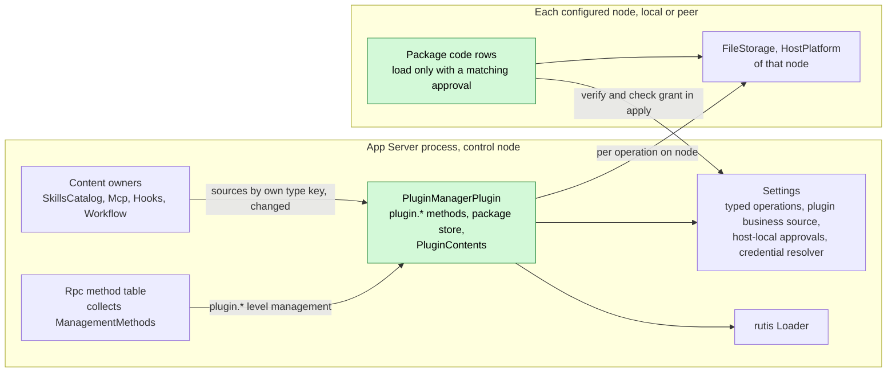
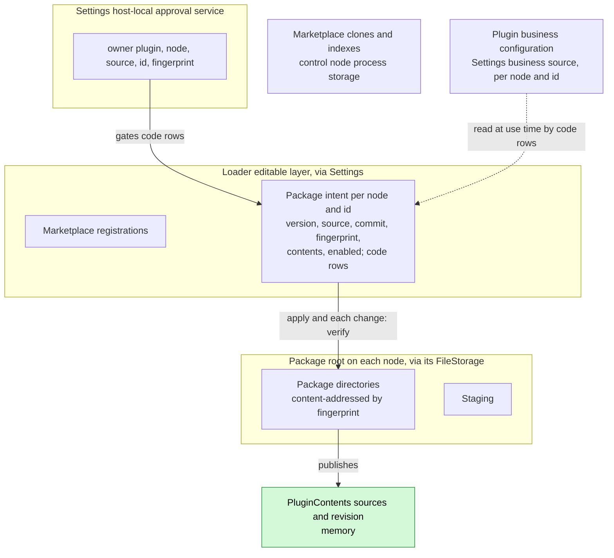
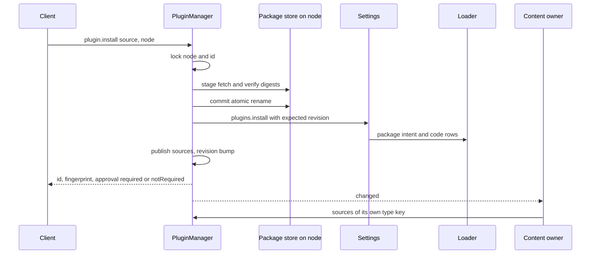
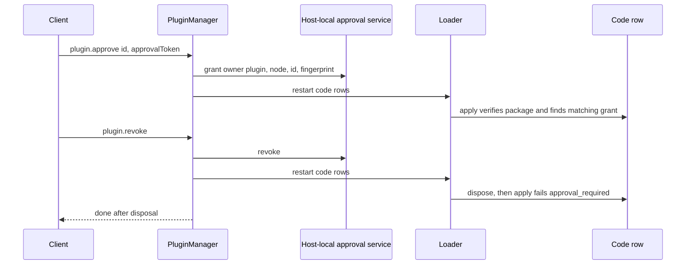
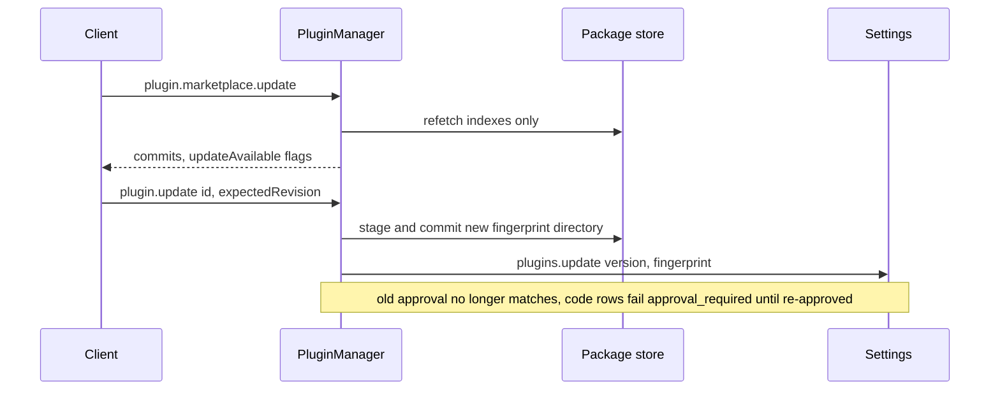

# PluginManager

Status: Draft. Overall design: [overview B.12](../overview.md#b12-pluginmanager), [Settings, Mcp, SkillsCatalog changes](../overview.md#c2-app-server-process-plugins), [conventions](../overview.md#64-conventions), [multiple nodes](../overview.md#63-multiple-nodes), [ADR 002](../../adr/002-plugin-scope.md). Phase: P3 (depends on [#3](https://github.com/arcships/dim/issues/3); non-Rust capability plugins on [#4](https://github.com/arcships/dim/issues/4); peer nodes on [#5](https://github.com/arcships/dim/issues/5)). Language: Rust.

PluginManager is a process plugin ([ADR 002](../../adr/002-plugin-scope.md): installation is per host). It installs plugin packages from Git marketplaces, local paths or Git URLs onto a target node, records plugin intent (install, enable, node binding, package paths) through typed Settings operations into loader rows, routes each plugin's business configuration to that plugin's business source, and publishes the typed content of enabled packages as the `PluginContents` process service. Content owners (SkillsCatalog, Mcp, Hooks, Workflow) depend on `PluginContents`, define their own content type keys and read the content they understand; PluginManager knows none of them. Package code loads only after approval through the Settings host-local approval service, bound to node and package fingerprint. Packages are never upgraded automatically.

## 1. Structure



All dependencies are process services at the same scope ([ADR 002 D3](../../adr/002-plugin-scope.md)). Content owners depend on `PluginContents`, accepted per D3: installing, enabling or removing a package changes published sources as a data update (`changed()`), never a reload, while a PluginManager reload (upgrade, crash) reloads the content owners. Rpc collects PluginManager's `ManagementMethods`, so a PluginManager reload also reloads Rpc. Both are rare structural events whose propagation is documented, not prevented. Package code rows are ordinary loader rows: they offer what their code declares through the mechanisms of their own scope, and when one unloads its dependents reload under the same rule.

| Part | Scope | Depends on | Provides |
| --- | --- | --- | --- |
| `PluginManagerPlugin` | Process, control node | `SettingsService` (typed operations, plugin business source, host-local approvals), `Arc<Loader>`, `FileStorage` and `HostPlatform` of each configured node | `PluginContents` process service; `ManagementMethods` (`plugin.*`), collected by Rpc |
| Package code rows | Process, on the package's node | that node's `FileStorage`, the host-local approval service, what the code declares | what the code declares; reads its business configuration at use time |
| Content owners | Process | `PluginContents` | — (each defines its own type key) |

Contracts defined here: package manifest `dim-plugin.json` schema 2, marketplace index `dim-marketplace.json`, the `PluginContents` service (`ContentSource`), the package directory layout, the code-row approval check, `plugin.*` methods. Contracts depended on: typed Settings operations on the loader editable layer (#3) for plugin intent, the Settings business source for per-plugin configuration ([ADR 002 D4](../../adr/002-plugin-scope.md)), the Settings host-local approval service (R11) and credential-reference resolver (R10), process storage on the control node, the rutis-loader `Loader` (`entries`, `reload`, `restart`, `LoaderChanged`), `FileStorage` and `HostPlatform` of the package's node (peer nodes: imported over the rutis link), the [methods](../contracts/session-boundary.md) contract. PluginManager never calls a content owner and never names a content type key in code.

## 2. Data and state



Package intent in loader rows is the persisted state; `plugin.list` is projected from loader entries, never from a separate store. Published sources are rebuilt from intent on `apply` (verifying each enabled package) and updated in place after each operation, with a revision bump. Per-plugin business configuration is not in rows: `plugin.configure` writes it to the business source with a revision and a change notification, and the plugin reads it at use time, so configuring never reloads anything (D4, A16). Package bytes live under the package root of their node, marketplace caches in control-node process storage; approvals live only in the host-local approval service. Nothing is a Session fact.

## 3. Flows

### 3.1 Install and publish



Content-only packages are active once published; owners reconcile on `changed` and never receive pushes. Code rows stay Pending until approval.

### 3.2 Approve, revoke and code lifecycle



A code row checks integrity and a matching grant in its own `apply`; without one it fails `approval_required` and stays out of service. Revoking or disabling code unloads that row; its dependents reload per D3, and in-flight turns that used what it offered may fail. That cost is documented, not prevented.

### 3.3 Explicit update, never automatic



A marketplace refresh only marks `updateAvailable`; changing an installed package always takes an explicit `plugin.update` (decision E22).

## 4. Timing and conflicts


Install is ordered stage, commit, Settings write; the Settings revision is the commit point, so an interruption never leaves an approved or half-registered package.

| Scenario | Outcome | Owner |
| --- | --- | --- |
| Code row revoked or disabled while something it offers is in use | The row unloads; dependents reload (D3); affected in-flight turns may fail | Loader, code row |
| Approval granted, then package updated | New fingerprint does not match; code rows fail `approval_required` until re-approved | Code row |
| Node unavailable after install | Operations on that node `node_unavailable`; its sources withdrawn; other nodes unaffected | PluginManager |
| `plugin.configure` while the plugin runs | Business data update and notification; no reload; next use reads the new value | Plugin |
| Two installs of one id | Second waits on the lock, then `plugin_exists` | PluginManager |
| Package disabled while a branch uses its Skill | Branch keeps its adopted prompt until it re-adopts | Skills owner |
| PluginManager reload | Content owners and Rpc reload with it (D3); in-flight install/remove `operation_interrupted` | PluginManager |

Full table: [Appendix B](#appendix-b-full-conflict-table).

## 5. Context mapping

No direct model-visible effect. PluginManager writes no input, offers no tool and registers no prompt source. Package content reaches the model only through its owner, in that owner's form: Skills through the Skill prompt source (adopted per branch, replayed after compaction as configuration, inherited by child branches from the adopted prefix), MCP and code-row tools through tool declarations and `ToolResult.content`, Hooks output through Session input. Non-interactive Sessions differ only as owners define. The model never sees package ids, fingerprints, approvals, marketplace data, configuration or diagnostics.

## 6. Interfaces (summary)

| Interface | Kind | Purpose |
| --- | --- | --- |
| `plugin.marketplace.list/add/remove/update/search/view` | Methods, level management | Marketplaces; `update` refreshes indexes only |
| `plugin.install/update/list/set_enabled/configure/reload/approve/revoke/remove` | Methods, level management | Package lifecycle |
| `PluginContents::sources(type_key)`, `changed()` | Process service | Generic content publication |
| Code-row approval check | Loader row rule | Code rows load only with a matching grant |
| `dim-plugin.json` v2, `dim-marketplace.json` v1 | File formats | Package and marketplace descriptions |
| Typed Settings operations `plugins.*`, `marketplaces.*` | Depended on (#3, ADR 002 D4) | Persist intent; route business configuration |
| CLI | `/plugins`, `/plugin`, `/reload-plugins`, `dimcode plugin …` | User entries |

Details: [Appendix A](#appendix-a-interface-details).

## 7. Security

Installing, approving and removing are management-level methods, served only by entries configured for that level ([methods](../contracts/session-boundary.md)); RemoteGateway never serves them. Package code is trusted native-process code once loaded (AGENTS rule 11), so loading requires a host-local approval of the exact fingerprint on that node; replay, fork, FullAccess, project files and installation itself never grant it. Git fetch runs no repository hooks or submodules; package files are never executed at install time; integrity is rechecked on every load. Content owners apply their own host-local approval to executable content they interpret (Hooks, MCP, workflows). Plugin business configuration holds credential references only, resolved by the plugin through the Settings credential resolver; resolved secrets never enter rows, the business source, `plugin.list`, diagnostics or content sources. A package whose code contributes management-level methods extends the host administration surface only after approval.

## Appendix A. Interface details

### A.1 Package manifest `dim-plugin.json` (schema 2)

Version 1 is the existing managed-provider manifest ([App Server contract](../../../crates/dim-app-server/README.md#optional-managed-provider)); it stays for `--plugin-dir` and is not installable here (A3).

```json
{
  "schemaVersion": 2,
  "id": "acme-review",
  "version": "1.2.0",
  "name": "Acme review kit",
  "description": "Review Skills and hooks",
  "files": {"skills/review/SKILL.md": "<sha256>", "dist/index.js": "<sha256>"},
  "contents": [
    {"type": "skills", "path": "skills"},
    {"type": "hooks", "path": "hooks/hooks.json"}
  ],
  "code": [
    {"runtime": "node", "entry": "dist/index.js", "hostApiVersion": 2, "rutisVersion": "0.10.0"}
  ]
}
```

| Field | Rule (validated once at the install boundary) |
| --- | --- |
| `id` | `[a-z][a-z0-9-]{0,63}`; unique per node (A4) |
| `version` | SemVer; displayed and compared for `updateAvailable` only |
| `files` | Every file except `dim-plugin.json` and `.git/`; relative POSIX paths, no `..`, no symlinks; unlisted file or digest mismatch rejects |
| `contents` | Opaque `type` `[a-z][a-z0-9-]*` (key defined by its consumer: `skills`, `hooks`, `mcp`, `workflows`, R14), `path` inside the package, optional `options` ≤ 64 KiB; only this shape is validated |
| `code` | Optional; `runtime: "node"` loads `entry` as a rutis runtime row; `hostApiVersion`/`rutisVersion` checked; other runtimes rejected until #4 (A1) |
| Fingerprint | SHA-256 of the stored manifest bytes; the manifest lists every file digest, so it binds all package bytes. This is the canonical executable content PluginManager declares to the host-local approval service (R11) |

### A.2 Marketplace index `dim-marketplace.json` (A5)

At the repository root: `{schemaVersion: 1, name, plugins: [{id, version, description, keywords?, source: {path} | {git, ref?}, fingerprint?}]}`. `source.path` is inside the marketplace repository; `fingerprint`, when present, must equal the fetched package's fingerprint.

### A.3 `PluginContents`

```rust
/// Process service provided by PluginManagerPlugin; content owners depend on it.
impl PluginContents {
    /// Sources of enabled, integrity-verified packages on available nodes.
    pub fn sources(&self, type_key: &str) -> Vec<Arc<ContentSource>>;
    pub fn changed(&self) -> tokio::sync::watch::Receiver<u64>; // revision
}
pub struct ContentSource {
    pub package: String,
    pub version: String,
    pub fingerprint: String,             // consumers bind their own approvals to it
    pub node: Option<String>,            // None = control node
    pub root: PathBuf,                   // package directory on `node`
    pub path: PathBuf,                   // declared path, relative to root
    pub options: serde_json::Value,       // from the manifest
}
```

A consumer owns its type key and format, reads files through services valid for `node`, and binds its own host-local approval to `node + package + fingerprint` ([overview conventions](../overview.md#64-conventions)). Node rule (A6): a source on node N is content of node N. A consumer that executes content against a Session (for example Hooks) uses only sources whose node equals that Session's resource node (`SessionConfig.resource_node`); a consumer that only reads content on the control node ignores sources it cannot reach and reports them in its own catalog.

### A.4 Package store

Internal to PluginManager, not a service: `stage` (fetch, verify), `commit` (atomic rename), `verify` (re-hash), `remove`, `fetch_marketplace`, each run against the `FileStorage` and `HostPlatform` of the target node; sources are a local path or a Git URL with optional reference. A node that is not configured or whose services are unavailable fails the operation with `node_unavailable`.

Packages live under PluginManager's package root on their node, written through that node's `FileStorage` (A13). Git runs through the node's `HostPlatform` with hooks and submodules disabled, `https://` and `ssh://` only (A7). Local paths are copied, never referenced (A8). Directories are content-addressed by fingerprint, so an update never rewrites files a running row uses.

### A.5 Methods (`ManagementMethods`, namespace `plugin`, level management)

| Method | Params | Result | Interruption |
| --- | --- | --- | --- |
| `plugin.marketplace.list` | `{}` | `[{name, url, ref, commit, fetchedAt, error?}]` | Drain |
| `plugin.marketplace.add` | `{name, url, ref?}` | `{commit}` | Report |
| `plugin.marketplace.remove` | `{name}` | `{}` | Report |
| `plugin.marketplace.update` | `{name?}` | `[{name, commit, error?}]`; refreshes indexes only | Report |
| `plugin.marketplace.search` | `{query, marketplace?}` | `[{marketplace, id, version, description, installed: [{node, version}]}]` | Drain |
| `plugin.marketplace.view` | `{marketplace, id}` | entry plus manifest summary (`contents` types, `code` presence) | Drain |
| `plugin.install` | `{source: {marketplace, id} \| {path} \| {git, ref?}, node?, enabled?}` | `{id, version, node, fingerprint, approval, approvalToken?}` | Report |
| `plugin.update` | `{id, node?, version?, expectedRevision}` | `{version, fingerprint, approval}` | Report |
| `plugin.list` | `{node?}` | `[{id, version, node, enabled, status, approval, approvalToken?, contents, source, updateAvailable, error?}]` | Drain |
| `plugin.set_enabled` | `{id, node?, enabled, expectedRevision}` | `{}` | Report |
| `plugin.configure` | `{id, node?, configuration, expectedRevision}`; `expectedRevision` of the plugin's business configuration | `{}` | Report |
| `plugin.reload` | `{id?, node?}` | `[{id, node, status, error?}]` | Report |
| `plugin.approve` | `{id, node?, approvalToken}` | `{}` | Report |
| `plugin.revoke` | `{id, node?}` | `{}` after code rows are disposed | Report |
| `plugin.remove` | `{id, node?}` | `{cleanupError?}` | Report |

`status`: `active`, `pending` (node unavailable or awaiting approval), `failed` (reason), `disabled`. `approval`: `notRequired`, `required`, `approved`; `approvalToken` is the fingerprint (a digest, not a credential). `install`, `update` and `marketplace.update` report phases (`fetch`, `verify`, `commit`) through the call's progress sink ([methods](../contracts/session-boundary.md), A14). Additions to overview B.12: `configure`, `approve`, `revoke`, `update`, `marketplace.search/view` (A9).

### A.6 Typed Settings operations used (#3, proposed Settings supplement)

| Operation | Effect |
| --- | --- |
| `plugins.install(entry, expected_revision)` | Records package intent and creates code rows on the editable layer |
| `plugins.update(id, node, version, fingerprint, expected_revision)` | Updates package intent; code rows follow |
| `plugins.set_enabled(id, node, enabled, expected_revision)` | Sets the package's enabled flag and `set_disabled` on its code rows |
| `plugins.configure(id, node, configuration, expected_revision)` | Writes the plugin's business configuration to the Settings business source keyed `<node>/<id>` and notifies; never edits rows (A16) |
| `plugins.remove(id, node, expected_revision)` | Removes the package intent and all its code rows |
| `marketplaces.save/remove` | Marketplace registrations |
| Host-local approval service `grant/revoke {owner: "plugin", node, source, id, fingerprint}` | Outside loader and Timeline (R11) |

`reload`, `restart` and status call the `Loader` directly.

### A.7 Capability mechanics

| Step | Path |
| --- | --- |
| Timeline | No writes, no Dispatcher subscription, no `StateCell`; rechecks are Settings revisions and approval matches |
| Install | Lock `(node, id)` (A10), `stage`, compare with intent, `commit`, `plugins.install`, publish sources, reply; a failed Settings write leaves an unreferenced directory collected later (A11) |
| Publication | On `apply`, verify each enabled package and build sources; after each operation, update sources and bump the revision; a package that fails verification is withdrawn and reported `failed` |
| Code rows | `apply` verifies integrity and requires a grant matching node, id and fingerprint, else fails `approval_required`; `approve`/`revoke`/`update` restart them through the `Loader`; business configuration read at use time |
| PluginManager reload | Content owners and Rpc reload with it (D3); in-flight install/remove return `operation_interrupted`; code rows are unaffected |
| Process restart | Loader restores rows; packages re-verify; staging deleted; orphans collected after the loader settled |

## Appendix B. Full conflict table

| Scenario | Sequence order | Outcome | Owner of the decision |
| --- | --- | --- | --- |
| Turn or branch interrupt, branch close, concurrent inputs, `input/withdrawn`, unsettled batch, compaction, child cut | — | No effect on PluginManager; owners' adoption rules apply | Content owners |
| Package disabled while a Session uses its Skill | revision bump < next adoption | Branch keeps its adopted prompt until it re-adopts | Skills / PromptSourcesBranch |
| Code row revoked or disabled while in use | — | Row unloads; its dependents reload (D3); affected in-flight turns may fail | Loader |
| Two installs of one id on one node | lock, then Settings revision | Second `plugin_exists` (or `plugin_settings_conflict` across processes) | PluginManager, Settings |
| Two `configure` calls race | business source revision | Stale `expectedRevision` fails; `set_enabled` uses the intent revision and does not conflict with `configure` | Settings |
| Approval granted, then package updated | new fingerprint | Code rows fail `approval_required` until re-approved | Code row |
| Revoke while code runs | revoke persisted < restart | Code rows disposed after settling their work; reply after disposal | Loader, code rows |
| Install interrupted after commit, before Settings | — | `operation_interrupted`; no intent; directory collected | PluginManager |
| Install interrupted after Settings write | — | `operation_interrupted`; intent exists; retry `plugin_exists` | Client reads state |
| Duplicate or late `plugin.install` | — | `plugin_exists` | PluginManager |
| Marketplace update finds a newer version | — | `updateAvailable` only; nothing changes | PluginManager |
| Target node unavailable before install | — | `node_unavailable`; nothing written | PluginManager |
| Node unavailable after install | — | Its sources withdrawn; its code rows not running; other nodes unaffected | PluginManager, Loader |
| Package node differs from a Session's resource node | — | Executing consumers ignore the source for that Session | Content owner |
| Files modified on disk | next verification | `integrity_failed`; sources withdrawn; code rows fail | PluginManager, code row |
| PluginManager reload or restart mid-operation | — | Per A.7; never re-executes a fetch | PluginManager |
| Session unload/restore | — | No effect | — |
| Client detach | — | Operation continues; reply and progress dropped | Rpc |

## Appendix C. Errors and recovery

| Code (`appError`) | Meaning |
| --- | --- |
| `manifest_invalid` | Missing or malformed manifest or index |
| `integrity_failed` | Digest mismatch, unlisted file, path escape or symlink |
| `incompatible_host` | `hostApiVersion`/`rutisVersion` or unsupported `runtime` |
| `source_unavailable` | Git fetch or path read failed (stderr only in diagnostics) |
| `node_unavailable` | Target node not configured or its services unavailable |
| `plugin_exists`, `plugin_not_found`, `marketplace_not_found` | Identity errors |
| `plugin_settings_conflict` | Stale `expectedRevision` |
| `approval_stale` | `approvalToken` differs from the current fingerprint |
| `approval_required` | Code row has no matching grant (row status) |
| `runtime_unavailable` | Node runtime not configured; code rows Pending |
| `operation_interrupted` | `Report` rule of the methods contract; read `plugin.list` before retrying |

Removal disposes code rows, then deletes the directory; a deletion failure returns `cleanupError` and garbage collection retries.

## Appendix D. Acceptance

Flow tests through `plugin.*` methods with a local test marketplace and a test consumer of a custom type key:

1. Add, update, search, view a marketplace; invalid index `manifest_invalid`; update marks `updateAvailable` without changing installed packages.
2. Install from marketplace, path and Git URL; tampered, unlisted and fingerprint-mismatched packages are rejected with nothing written.
3. A content-only package publishes sources to the test consumer through `changed()` without reloading it; disable withdraws them; remove deletes intent then files; a PluginManager reload reloads the test consumer, which then reads the same sources.
4. A package with Node code fails `approval_required` until `plugin.approve`; `plugin.update` requires re-approval; revoke disposes the code row.
5. Revoking a code row that offers a test tool reloads its dependents; the test records the failed in-flight turn as the documented outcome.
6. Concurrent installs; stale `expectedRevision`; interruption after commit and after the Settings write.
7. Peer test node: install targets it; unavailable makes only its operations fail and withdraws its sources; recovery restores them.
8. Restart: rows restored, integrity verified, staging removed, orphans collected.

## Appendix E. Assumptions

| # | Assumption | Basis | Effect if rejected |
| --- | --- | --- | --- |
| A1 | Package code is Node runtime rows until #4; no dynamic Rust code | Overview §5.12, §11.1 | More `code.runtime` values |
| A2 | Code approvals use the Settings host-local approval service with owner `plugin` | Decision R11; overview conventions | A plugin-owned approval file |
| A3 | Manifest schema 2 extends the existing format; v1 only for `--plugin-dir` | App Server README; judgment | Compatibility mapping |
| A4 | One installed version per `(node, id)` | Judgment | Side-by-side versions |
| A5 | Marketplace index format and name | Judgment; feature list "Git plugin marketplaces" | Format replaced |
| A6 | Sources are node content; executing consumers match the Session's resource node | Overview multiple nodes; judgment | Consumers read peer content through imported services |
| A7 | Git via the node's `git`, hooks/submodules disabled, `https`/`ssh` only | Judgment | Library fetcher or more schemes |
| A8 | Local paths copied, not linked | Judgment (integrity) | A development link mode |
| A9 | Additional methods `configure`, `approve`, `revoke`, `update`, `marketplace.search/view` | Feature list; overview B.12 | Folded into other methods |
| A10 | Operations serialize per `(node, id)` | Judgment | Settings revisions alone |
| A11 | Unreferenced directories garbage-collected after the loader settled | Judgment | Explicit cleanup command |
| A12 | Content owners depend on `PluginContents`; a PluginManager reload reloads them | ADR 002 D3 | A separately hosted publication service |
| A13 | Package directories are written through the node's `FileStorage` under a PluginManager package root (atomic rename available there) | Judgment | A per-node storage service is needed |
| A14 | Install and update report progress phases | Methods contract progress sink; judgment | Result only |
| A15 | No automatic upgrade, including content-only packages | Decision E22 | Opt-in auto-upgrade setting |
| A16 | Per-plugin business configuration lives in a Settings business source keyed `<node>/<id>`, read by the plugin at use time | ADR 002 D4; judgment | Each plugin keeps its own store and contributes its own configure method |

## Appendix F. Open questions

| Question | Description |
| --- | --- |
| #3 typed operations | The Settings operations in A.6 are proposed here; their final shape belongs to the Settings supplement and #3 (intent only; `plugins.configure` writes business configuration, ADR 002 D4) |
| Overview SkillsCatalog change | "Installation and removal are initiated by PluginManager" is read as: PluginManager publishes and withdraws sources, SkillsCatalog reads them; PluginManager makes no SkillsCatalog call |
| Peer-node content | Whether control-node consumers should read content on peer nodes through imported resource services (#5) |
| Peer node offline ([#5](https://github.com/arcships/dim/issues/5)) | Whether a peer node's imported services going offline only fail calls (`node_unavailable`) or make the import Pending and reload PluginManager (D3); this design assumes the former |
