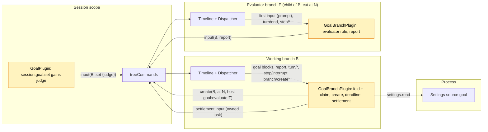

# Pursuit

Status: Draft, Ready candidate ([#146](https://github.com/arcships/dim/issues/146), milestone M2; what remains for Ready is listed in [§17](#17-what-remains-for-ready)). Scope: an amendment of [Goal](Goal.md)'s Session and branch parts; no new Capability ([ADR 002](../../adr/002-plugin-scope.md)). Language: TypeScript, in Goal's package `runtime/plugins/goal` ([Goal §10](Goal.md#10-implementation)). Depends on: Goal (P5, implemented in TypeScript by [#199](https://github.com/arcships/dim/pull/199), acceptance completed, [#69](https://github.com/arcships/dim/issues/69) closed), C5 (delivered, [branch TypeScript binding](../branch-typescript.md)), S8b (delivered, [settings service](../appserver/settings-service.md)). Nothing it needs is missing; [§12](#12-dependencies) lists what it uses and the non-blocking limits. Milestone M2, not part of the current plan ([roadmap](../roadmap.md) D3).

Requirement ([feature list](../../feature-list.md), Agent behavior): keep working toward an explicit objective and record its completion or blockage, **with completion judged by an evaluator instead of the model doing the work**.

Decision A3 ([#44](https://github.com/arcships/dim/issues/44), roadmap D3) built Goal first and deferred Pursuit. The experimental Pursuit design (#17) was a second continuation owner with its own `pursuit/*` events, objective, limit and interrupt rules. This document replaces it. **Pursuit is a judge mode of Goal**: a goal set with `judge: "evaluator"` keeps every Goal rule (objective and status keys, fold, continuation, limit, interrupt, compaction, child branches) and changes only what a completion report means. Under the model judge (Goal as implemented), `goal_update completed` ends the goal. Under the evaluator judge it is a **claim**: when the turn that made the claim ends, Goal creates an **evaluator branch**, a child of the working branch cut at that `turn/end`, which checks the facts and ends its turn with a verdict line. Goal's branch part runs on every branch, the evaluator included; on the evaluator it reads its own final reply and writes one **report** input to the working branch by id. Goal on the working branch, the owner of the goal, decides what the report means and writes the result: a verified completion, a blocker, a reopened goal (one continuation), or an automatic pause. An unverified claim never stands: every claim is settled by a report, a pause, a deadline, or a later goal change.

Everything Pursuit needs is already Goal's or already exported to TypeScript: the state owner (Goal's branch part), the facts (Goal's `input/message` blocks and TimelineTree's `branch/create`), the continuation budget (`maxContinuations`), branch creation (`treeCommands.create`) and cross-branch input (`treeCommands.input`). The new pieces are a `judge` parameter on `set`, the claim rules in Goal's fold, the evaluator role of Goal's branch part, the report and settlement writes, and one Settings field.

## 1. Key decisions

| # | Decision | Why |
| --- | --- | --- |
| P1 | Pursuit is a judge mode of Goal, not a separate plugin | One owner of continuation; a separate plugin would race Goal on the same `turn/end` or have to read Goal's state (§4 rule 7) |
| P2 | The judge is chosen per goal by `set`, recorded on the `set` block | Which judge a goal uses is the user's intent for that goal, a Timeline fact; a Settings switch would silently change the meaning of goals already running |
| P3 | Evaluate only on a completion claim, not after every turn | The verdict that matters is "done or not"; continuation between claims is Goal's |
| P4 | The evaluator is a child branch cut at the `turn/end` that follows the claim | It sees what was done and why (and reuses the provider prompt cache of the shared prefix), runs under the same policy, and is an ordinary TimelineTree branch created with the exported `treeCommands.create` |
| P5 | The evaluator branch reports by input; the working branch decides | A branch part reads only its own branch, and cross-branch communication is input by id through `treeCommands` ([branch TypeScript binding](../branch-typescript.md#subscription-rebuild-and-recovery), item 6). Goal on the evaluator reads its own final reply and writes a report; Goal on the working branch validates it against its own facts and writes the settlement (callers write, owners decide). No branch observes another |
| P6 | A rejected claim reopens the goal and counts as one continuation | Rejection loops are bounded by the existing `maxContinuations`; no second budget |
| P7 | An evaluation that started is never re-run; a deadline settles every evaluation that produces no report | [Overview constraint 4](../overview.md#62-constraints). The deadline is derived from the `branch/create` fact, so it survives reload and restart, and it covers a lost, cut or never-built evaluator without observing it |

## 2. User flow

```
 user: session.goal.set {objective: "make the CLI tests pass", judge: "evaluator"}
   └─ goal active ─▶ turn runs
 model: ... work ... goal_update completed "all tests pass"      (claim C)
 turn/end N ─▶ Goal(B): claim C pending ─▶ treeCommands.create(B, at N, goal:evaluate:N)
                                            evaluator branch E: reads files, runs checks,
                                            replies "... \n CONTINUE: 2 tests still fail"
               Goal(E): turn/end ─▶ report input to B (verdict continue)
 Goal(B): report from E for evaluation N, claim C pending
   ├─ done     → status completed (by evaluator)        user sees the summary
   ├─ blocked  → status blocked (by evaluator)          user sees what is needed
   ├─ continue → active again (Queue, count + 1)  ─▶ next turn sees the report
   └─ failed / no report by the deadline → paused (evaluation_failed), user resumes
 user: Esc on B during the evaluation ─▶ stop/interrupt ─▶ paused (interrupted); E's late report is ignored
```

A client reads everything from the working branch's events, as for any goal ([Goal A.3](Goal.md#a3-reading-the-goal)): the judge on the `set` block, the claim (a `completed` block without `by`), the evaluation (`branch/create` with operation `goal:evaluate:<T>`), and the settlement. A status line can show:

```
 goal ▸ active · 3/20                         (model working)
 goal ▸ evaluating claim · branch 7f3c…       (claim pending, evaluator created)
 goal ▸ completed ✓ verified · "all tests pass"
```

The CLI has no `/goal` commands yet; when they are added, `/pursue <objective>` is `/goal <objective>` with `judge: "evaluator"`, and every other `/goal` command applies to either judge (§16).

## 3. Structure and dependencies



No new part, service or dependency. Goal's parts change as follows:

| Part | Change |
| --- | --- |
| `GoalPlugin` (Session, `session.ts`) | `session.goal.set` accepts `judge?: "model" \| "evaluator"` (default `model`) and writes `judge="evaluator"` on the `set` objective block. `goal_update` and the other methods are unchanged and still never read the fold |
| `GoalBranchPlugin` (branch, `branch.ts`) | Its existing injections (`dispatcher`, `timelineIdentity`, `treeCommands`, `settings`, `branchLifecycle`) suffice. It adds `branch/create` and `branch/create-failed` to its Dispatcher keys; folds the judge, claim and evaluation facts (§4); takes the decisions in §5 on the working branch; and on an evaluator branch takes the evaluator role (§5.3) |
| Shared fold and texts (`goal.ts`) | Claim and evaluation fields, the evaluator role, the `reopen` status (§4.1), the new markers (§9) |
| Goal Settings source `goal` (`settings.json`) | New field `evaluationTimeoutSeconds` (§6) |

The evaluator branch is not a Goal part. It is an ordinary child branch that TimelineTree creates with `source: host`; its first input is the prompt as plain Queue text ([TimelineTree `first_input`](../../../crates/dim-agent-capabilities/src/timeline_tree.rs)). Goal on the evaluator sees no goal of its own (its fold uses local events only) and writes the start `clear` there as on any child ([Goal §3.4](Goal.md#34-a-new-branch-clears-the-inherited-goal)), so the evaluator never takes the working branch's goal as its own and never continues.

## 4. Data and state

Pursuit adds no event type. Besides Goal's own blocks it reads `branch/create` and `branch/create-failed` on the working branch, whose source is `host` with `operation_id` `goal:evaluate:<T>`, and, on the evaluator branch, its own `branch/start`, first `input/message`, `turn/end`, `step/model-start` and `step/text`. Every Pursuit write is an `input/message` with source `goal` whose first raw block is a `<dim-goal>` marker; its attributes (`claim`, `evaluation`, `evaluator`, `after`) say what it settles.

### 4.1 Working branch fold

Additions to Goal's fold ([Goal §2](Goal.md#2-data-and-state)), over the branch's local events:

| Field | Derivation |
| --- | --- |
| `judge` | `evaluator` if the live `goal:objective` block came from a `set` marked `judge="evaluator"`, or from an `edit` after such a `set` with no other `set` between; otherwise `model`. `edit` keeps the judge; to switch judges, `set` again |
| `claim` | Sequence `C` of the current `goal:status` block when it is `op="completed"` without `by` (written by `goal_update`), a goal exists and `judge = evaluator`. A `blocked` report is never a claim: a blocker needs the user under either judge |
| `settled(C)` | A Goal write marked `claim="C"` exists |
| `pending` | `claim` exists and is not `settled` |
| `trigger` | For a pending `C`: the sequence `T` of the latest of (a) the first `turn/end` with status `completed` after `C`, (b) any live `edit` after that `turn/end`. The cut for `T` is always that `turn/end` |
| `started(T)` | The first local `branch/create` with source `host` and `operation_id` `goal:evaluate:T`; its `branch` is the evaluator id `E`, its `create_at` the start time |
| `create_failed(T)` | A local `branch/create-failed` whose `createEvent` is `started(T)`'s sequence |
| `report(T)` | The first local `input/message` whose first marker is `kind="report" evaluation="T"` with `evaluator` equal to `started(T)`'s `E`. A report from any other branch, or for another `T`, settles nothing |
| `deadline(T)` | `started(T).create_at + evaluationTimeoutSeconds` |

Goal's status and count rules gain one status op:

| Change | Written by | Keys | Effect on the fold |
| --- | --- | --- | --- |
| `reopen` | Goal, on a `continue` report | Continuation (no key) + `goal:status` | `status = active`; becomes `A` for the `interrupted` rule; does **not** restart the count, so the continuation it carries counts (P6) |
| `completed` / `blocked` `by="evaluator"` | Goal, on a `done` / `blocked` report | `goal:status` | As Goal's `completed` / `blocked`, with the evaluator's summary; never a claim |
| pause `evaluation_failed` | Goal | `goal:status` | As Goal's automatic pauses |

The implemented fold has one sequence `active` that is both `A` and the count base; it is split: `A` moves on `set`, `resume` and `reopen`; the count base is `max(latest set or resume, last_operator)` as today.

### 4.2 Evaluator branch fold

The same fold, on the evaluator's own local events:

| Field | Derivation |
| --- | --- |
| `evaluation` | The branch's first local `input/message` is user text whose first line is the marker `<dim-goal kind="evaluate" branch="B" claim="C" evaluation="T">`, and `B` is the `parent` of the branch's `branch/start`. Gives `B`, `C`, `T` |
| `evaluation turn` | The first `turn/end` after that input's `input/consumed`; sequence `N` |
| `reported` | A local Goal input marked `kind="reported" after="N"` exists |

Everything is a fold of committed facts, so a reload or a restore rebuilds it. Runtime only: the creation task, the deadline timer and the report and settlement tasks, each keyed by the sequence that decided it, exactly as Goal's write tasks.

The worker never sees a settlement before it is written: until then the latest status block in its context is its own `completed`, and the fold agrees (`status = completed`, `pending`). Goal A16 (the replay equals the fold) is unchanged: every Pursuit write that changes the status is a `goal:status` block.

## 5. Decisions

Goal's branch part takes each decision when its Dispatcher handler consumes the event, from consumed state only, registers an owned task when a write or a creation is needed, and returns without awaiting, exactly as [Goal A.4](Goal.md#a4-continuation-decision). Every task waits for `branchLifecycle.activated()`, and rechecks its condition over the fold as consumed before writing ([time bus §4](../../architecture/rust-agent/time-bus.md)). Goal's C1–C6 and its interrupt rule are unchanged: they need `status = active`, which a pending claim is not.

### 5.1 On the working branch

| Consumed event | Condition | Action |
| --- | --- | --- |
| `turn/end` N | `pending` `C < N`, status `failed` | Write pause (`turn_failed`, `claim="C" after="N"`) |
| `turn/end` N | `pending` `C < N`, status `completed`, `trigger = N`, not `started(N)` | Creation task `T = N` (§5.2) |
| `edit` E | `pending`, a completed `turn/end` follows `C` | Cancel the creation task in flight; creation task `T = E`, cut at that `turn/end`. The earlier evaluator is not stopped (R1); its report no longer matches the trigger |
| `stop/interrupt` M (`scope: turn`) | `pending`, `C < M` | Write pause (`interrupted`, `claim="C" after="M"`). The turn of the claim, if still running, ends `cancelled` and decides nothing more |
| Any other goal block after `C` (`set`, `pause`, `resume`, `clear`, another `goal_update`) | — | Nothing is pending; cancel the creation task in flight. Nothing is written: the newer block already decides |
| `branch/create` for `goal:evaluate:T` | `pending`, `T = trigger` | Deadline task (§5.2) |
| `branch/create-failed` for `started(T)` | `pending`, `T = trigger` | Write pause (`evaluation_failed`, `claim="C" evaluation="T"`) |
| report input R for `T` | `report(T)` is R, `pending`, `T = trigger` | Settlement task (§5.4) |

A turn that ends after `C` while the evaluation runs (for example a user turn) does not restart it: the claim was made about the state at the cut. A new claim during that turn is a new goal block, which supersedes the old claim.

### 5.2 Creation and deadline tasks (working branch)

Creation task for `T`:

1. Call `treeCommands.create(B, cut, {prompt, source: {host: {operation_id: "goal:evaluate:T"}}}, cancelled)`, with the prompt of §9. `cancelled` completes when the task is cancelled (a superseding row or unload). TimelineTree writes `branch/create` on `B`, builds the child and commits its first input (the prompt, Queue), or records `branch/create-failed` once the anchor is committed.
2. If `create` throws anything but the task's own cancellation, recheck (`pending`, `T = trigger`) and write pause (`evaluation_failed`). A failure that TimelineTree also recorded is written once: the second write finds the claim settled.

Deadline task for `T`, registered when `started(T)` is consumed, live or at load:

1. `settings.read {source: "goal", scope: "user"}` for `evaluationTimeoutSeconds`; a failed read ends the task without writing, as Goal's turn-end task does ([Goal Appendix C](Goal.md#appendix-c-errors-and-recovery)), and the next load retries.
2. Wait until `deadline(T)`; if it has passed (after a restart), do not wait.
3. Recheck (`pending`, `T = trigger`, no `report(T)`) and write pause (`evaluation_failed`).

The deadline is the single recovery for every evaluation that produces no report: an evaluator that runs too long, a restart that cut its turn or its report, an evaluator branch not restored, or a creation whose `branch/create-failed` was lost. Goal never observes the evaluator branch.

### 5.3 Evaluator role (evaluator branch)

On consuming the `evaluation turn` `N` (or at load, if `N` is consumed and not `reported`), Goal on the evaluator registers one report task:

1. Reassemble the final reply from `dispatcher.local(open, N)`: take the last `step/model-start` of that turn; its `request_id` is the final model request. Concatenate, in sequence order, the `delta` of every `step/text` with that `turn_id` and `request_id`. `step/text` is a delta that Output flushes at size and time boundaries, so a verdict line may span several records. Earlier requests of the turn (replies before a tool cycle) and `step/thinking` are not part of the reply. This is the same concatenation the history projection does.
2. Parse at this boundary: the last non-empty line, `DONE: <summary>`, `CONTINUE: <feedback>` or `BLOCKED: <reason>`, gives the verdict and its text (truncated to 2000 characters, Goal A10). Any other last line is `continue` with the whole reply as feedback (truncated likewise). A `turn/end` with status `failed` or `cancelled` is `failed`.
3. Write the report to `B`: `treeCommands.input(B, report)` (Append, §9), marked `claim="C" evaluation="T" evaluator="E"` with `E` from `timelineIdentity`.
4. Write `reported` on its own branch (Append, `after="N"`).

The order makes the report at least once: a reload between steps 3 and 4 writes a second report, which `report(T)` ignores (only the first counts) and which is the only cost. The `reported` record keeps every later restore of the evaluator branch from reporting again. The evaluator role decides nothing about the goal; it only states what its branch produced.

### 5.4 Settlement task (working branch)

1. For a `continue` verdict, `settings.read` for `maxContinuations` (a failed read ends the task without writing, as above).
2. Recheck (`report(T)` consumed, `pending`, `T = trigger`) and write the settlement (§5.5), marked `claim="C" evaluation="T" after="R"`.

### 5.5 Settlement writes

| Verdict | Write | Mode |
| --- | --- | --- |
| `done` | `goal:status` `completed`, `by="evaluator"`, with the report's summary | Append |
| `blocked` | `goal:status` `blocked`, `by="evaluator"`, with the report's reason | Append |
| `continue`, `count < maxContinuations` | Reopen: block 1 a continuation (no key, `count = k+1`); block 2 `goal:status` `reopen` | Queue |
| `continue`, `count >= maxContinuations` | pause (`limit`) | Append |
| `failed` | pause (`evaluation_failed`) | Append |

The reopen is one Queue input; its first block is a continuation marker, so Goal's `count` counts it, and `reopen` does not restart the count (§4.1). The report it answers is an Append input committed before it, so the turn the reopen drives sees the report first. At that turn's end Goal's C1–C6 apply as usual: the worker either claims again or is continued.

## 6. Budget and loop limits

| Limit | Bound |
| --- | --- |
| Evaluations per claim | One, plus one per `edit` of the objective while the claim is pending |
| Rejected claims | Each consumes one continuation: at most `maxContinuations` reopens between two `set`, `resume` or operator inputs; the next `continue` verdict pauses (`limit`) |
| One evaluation | `evaluationTimeoutSeconds` (source `goal`, integer, minimum 60, maximum 3600, default 900), measured from the `branch/create` that started it; at the deadline the claim pauses (`evaluation_failed`) |
| Evaluator recursion | None: the evaluator branch has no goal, so it makes no claim and creates no evaluator; its own children have no evaluation marker and no goal |

Settings are read at use (§5.2, §5.4), so a change applies from the next deadline or settlement without reloading Goal. Until R1, the deadline, an interrupt or a superseding change stops Goal from waiting for an evaluator but does not stop the evaluator itself: it runs its turn to the end and its late report is ignored.

## 7. Interrupts, reload, restore and fork

| Case | Outcome |
| --- | --- |
| User interrupts the working branch during the claim's turn | The `stop/interrupt` after `C` pauses the claim (`interrupted`); the turn ends `cancelled` and creates no evaluator. An unverified claim does not survive an interrupt |
| User interrupts the working branch during the evaluation | Pause (`interrupted`); the evaluator's later report is ignored (the claim is settled) |
| User interrupts the evaluator branch | Its turn ends `cancelled`: report `failed`, pause (`evaluation_failed`) |
| `pause`, `resume`, `clear`, `set` or another `goal_update` during the evaluation | The newer block decides; nothing else is written; the report is ignored |
| `edit` during the evaluation | A new evaluation against the new objective (§5.1) |
| User input during the evaluation | Its turn runs on the working branch while the evaluator runs; the claim stays pending; a `continue` reopen is queued after the user's turn |
| Branch part reload or restart, working branch | The new generation refolds and takes the owed decisions once at load, as Goal does ([Goal §4.2](Goal.md#42-reload)): an undecided trigger without `started` registers the creation task; a `started` evaluation without settlement registers the deadline task (the deadline is a fact, so no time is lost or added); a consumed unanswered `report(T)` registers the settlement task. A generation handover with a creation already in flight can create a second evaluator; only the first `branch/create` counts, so the claim is still settled once. This handover race is the generic one accepted for Goal in [#242](https://github.com/arcships/dim/pull/242) and is not a Pursuit acceptance case |
| Branch part reload or restart, evaluator branch | Load reports once if the evaluation turn is consumed and not `reported` (§5.3) |
| Restore cuts the evaluator's turn | If the restore ends the turn `cancelled`, the report is `failed`; if it leaves no `turn/end`, the deadline settles the claim |
| Evaluator branch not restored | No report; the deadline settles the claim |
| Working branch closes | The evaluator is its child and closes with the subtree; nothing is written. At the next load of the working branch the deadline settles a claim still pending |
| Child branch of the working branch | No goal, so no claim (Goal A3); no evaluation marker, so no evaluator role |
| Session fork | A fork copies `main` and writes `session/forked` after the copied facts; Goal folds from after it, so the fork's `main` has no goal and no claim, and clears a copied live goal (Goal A11). Child branches, evaluators included, are not copied |

### 7.1 What is persisted

| Fact | Where | Written by |
| --- | --- | --- |
| The judge | `set` objective block (`judge` attribute) | Goal Session part (`session.goal.set`) |
| The claim | `goal_update completed` block | Goal Session part (`goal_update`) |
| Evaluation started / creation failed, and its start time | `branch/create`, `branch/create-failed` on the working branch | TimelineTree |
| The evaluator's prompt, work and reply | The evaluator branch's own Timeline | TimelineTree (first input), Loop and the branch's capabilities |
| The report | Report input on the working branch; `reported` on the evaluator branch | Goal branch part on the evaluator |
| The settlement | Settlement input on the working branch | Goal branch part on the working branch |

Not persisted: the tasks and the timer; all are rebuilt from the facts above.

## 8. Settlement summary

| Settles a pending claim `C` | Written by Goal on the working branch | Status after |
| --- | --- | --- |
| Report `done` | `completed` (`by="evaluator"`) | completed |
| Report `blocked` | `blocked` (`by="evaluator"`) | blocked |
| Report `continue`, under the limit | Reopen (Queue) | active |
| Report `continue`, at the limit | pause (`limit`) | paused |
| Report `failed`, creation failure, deadline | pause (`evaluation_failed`) | paused |
| Claim's turn failed | pause (`turn_failed`) | paused |
| Interrupt after `C` | pause (`interrupted`) | paused |
| A later goal block | Nothing (that block decides) | per that block |

## 9. Context mapping

The worker sees only Goal inputs, as in [Goal §5](Goal.md#5-context-mapping); the evaluator sees its inherited history through the cut, then its prompt. Marker format, escaping and keys are Goal's ([A.5](Goal.md#a5-model-visible-texts)); `C`, `T`, `R`, `N` are sequences, `B` the working branch, `E` the evaluator. New and changed texts:

| Write | Branch, blocks (key) | Mode | Text |
| --- | --- | --- | --- |
| `set` with the evaluator judge | B; Goal's `set`, block 1 marked `judge="evaluator"` | Queue | Goal's `set` text unchanged: the worker behaves the same under either judge |
| evaluator prompt | E; plain text first input (written by TimelineTree from `prompt`) | Queue | `<dim-goal kind="evaluate" branch="B" claim="C" evaluation="T">` / `You are an evaluator. Branch B reported that its goal is completed. Do not continue the work, do not change files or settings, and do not call goal_update.` / blank / `Objective:` / `<objective>` / blank / `Reported result:` / `<claim summary>` / blank / `Check whether the objective is actually achieved. Verify the facts yourself by reading files and running checks; do not rely on the report or on earlier messages. End your reply with exactly one line: DONE: <the verified result>, CONTINUE: <what is missing or wrong>, or BLOCKED: <what only the user can provide>.` |
| report | B; one block, no key | Append | `<dim-goal kind="report" verdict="done\|continue\|blocked\|failed" claim="C" evaluation="T" evaluator="E" branch="B">` / `Evaluator report:` / `<verdict text, or "the evaluator's turn did not complete">` / blank / `This is the evaluator's report on the completion reported for branch B. Goal records the result.` |
| reported | E; one block, no key | Append | `<dim-goal kind="reported" after="N" branch="E">` / `This branch reported its verdict to branch B. Its evaluation is finished.` |
| verified completion | B; `goal:status` live | Append | `<dim-goal kind="goal" op="completed" by="evaluator" claim="C" evaluation="T" after="R" branch="B">` / `Result:` / `<summary>` / blank / `An evaluator checked the result and set the goal status for branch B to completed. Do not continue working toward a goal for branch B on your own.` |
| evaluator blocker | B; `goal:status` live | Append | `op="blocked" by="evaluator"`; `Blocker:` / `<reason>` / blank / `An evaluator found that the goal for branch B cannot proceed without the user and set its status to blocked. Do not continue working toward it on your own.` |
| reopen | B; 1: none, 2: `goal:status` live | Queue | 1: `<dim-goal kind="continuation" count="k" limit="L" claim="C" evaluation="T" after="R" branch="B">` / `An evaluator found that the goal for branch B is not achieved yet; its report is above. Continue working toward it. When it is achieved, call goal_update with status "completed" again.`; 2: `<dim-goal kind="goal" op="reopen" claim="C" branch="B">` / `The goal for branch B is active again.` |
| pause (`evaluation_failed`) | B; `goal:status` live | Append | Goal's automatic pause text with reason phrase "the evaluator could not check the result", marked `claim="C" evaluation="T"` (and `after` when a sequence decided it) |
| pauses `interrupted`, `turn_failed`, `limit` on a claim | B | Append | Goal's texts, marked `claim="C"` |

The reopen's continuation does not repeat the feedback: the report carries it and precedes the reopen in the same request. Neither is keyed, so compaction treats both alike. Compaction replays the latest `goal:status` block as for any Goal status, so after a reopen the model sees `active`, and after a verified completion it sees the evaluator's `completed` with its summary.

## 10. Interfaces

| Interface | Change |
| --- | --- |
| `session.goal.set` | Params `{sessionId, branchId?, objective, judge?}`; `judge` is `"model"` (default) or `"evaluator"`; any other value is `invalid_params` |
| Reading the goal | Unchanged: no query method (Goal A.3, A8). The judge, the claim, the evaluation (`branch/create` with `goal:evaluate:<T>`), the report and the settlement are read from the working branch's events |
| `goal_update` | Unchanged. Its result text stays `goal_update recorded: completed.`; under the evaluator judge the record is the claim |
| Settings source `goal` | Adds `evaluationTimeoutSeconds` to `settings.json` (integer, `minimum: 60`, `maximum: 3600`, `default: 900`) |
| Branch operation id | `goal:evaluate:<T>`, `T` decimal; clients may use the prefix to label or hide evaluator branches |

## 11. Security

The evaluator is an ordinary child branch: it has the working branch's permission policy (Permission replays the ancestor prefix), and its tool calls pass Approval like any other, so it gains nothing the working branch lacks ([ADR 003](../../adr/003-approval-scope.md)). "Do not change anything" in its prompt is guidance, not isolation; a read-only evaluator needs a per-branch narrowing that does not exist (§16). In an interactive Session its approval requests reach the user like the worker's.

A verdict cannot be forged into a settlement. `session.submit` accepts no raw blocks, and markers escape all text. A report is written only by Goal's branch part; the working branch accepts only the first report whose `evaluator` is the branch id TimelineTree recorded in `branch/create` for the current trigger. An operator who creates a host branch with a forged evaluation prompt (`session.branch_create`) can make Goal there write a report to its parent, which settles nothing; such an operator can already write to the working branch directly. Diagnostics record Session, branch, claim and evaluation sequences and the verdict kind, never the objective, report or feedback text.

## 12. Dependencies

| Mechanism | State | What Pursuit uses |
| --- | --- | --- |
| Goal (P5, #69) | Implemented (#199), acceptance complete, #69 closed | Everything; Pursuit amends `runtime/plugins/goal` (§3) |
| C5 branch TypeScript binding | Delivered (#100, #195, #196, #205) | `treeCommands.create` with explicit `cancelled`, `treeCommands.input`, `dispatcher.listen/local`, `timelineIdentity`, `branchLifecycle` |
| S8b Settings | Delivered | `settings.read` of source `goal` (already Goal's) |
| Optional tool startup timing ([#241](https://github.com/arcships/dim/issues/241)) | Open | If `goal_update` misses the first tool sample, the worker cannot claim, and the goal continues to the `maxContinuations` pause, as under the model judge ([Goal Appendix B](Goal.md#appendix-b-full-conflict-table)). Not solved here |
| Stopping a branch by id from TypeScript | Not exported | Not blocking (R1) |
| Durable branch retirement | Does not exist | Not blocking (R2) |
| Dynamic events (#2) | Converged 2026-10-20 | Not needed: Pursuit writes no event type of its own |

## 13. Rule check

Rules: [principles §1 and §4](../../architecture/rust-agent/principles.md), [ADR 002](../../adr/002-plugin-scope.md) D1–D5.

| Rule | How this document complies |
| --- | --- |
| §4.1 Command events for others' state | Goal changes only goal state, through its own inputs. The evaluator creation is a command to TimelineTree through its exported `create`, and TimelineTree writes its facts. The claim is a goal block the model writes through `goal_update`; the report is an input the evaluator side writes; in both cases Goal on the working branch, the owner, decides what they mean |
| §4.2 No recall after handoff | Goal withdraws nothing: a settlement, once written, stands, and a superseded evaluator is not recalled (its report is simply not matched) |
| §4.3 Only before callbacks, never block | Not applicable: no before callback; `set` validates only its params |
| §4.4 No business meaning in core | No change to Timeline, Dispatcher, TimelineTree, InputQueue or Loop: a host-sourced branch with an `operation_id` is an existing contract, and the report and settlement are ordinary input |
| §4.5 Batch | Decisions follow consumed events in sequence order; every task rechecks over consumed state before writing; the reopen is one input whose status block follows its continuation block |
| §4.6 Context only from handed-off events | The worker sees the verdict only through the adopted report and settlement inputs; the evaluator's reply stays on its own branch |
| §4.7 Public events and services only | Goal reads public `branch/*`, `input/*`, `turn/*`, `stop/interrupt`, `step/model-start` and `step/text` on its own branch and its own blocks; it calls the exported `treeCommands`, `dispatcher`, `timelineIdentity`, `branchLifecycle` and `settings`. No branch reads another branch |
| §4.8 Requirements to mechanism owners | R1 and R2 in §14, neither blocking |
| §4.9 Only facts later decisions use enter the Timeline | No new event type. The report is the fact the working branch decides on; `reported` is the fact that stops a restored evaluator from reporting again; the settlement is both model context and the fact `settled` reads; the deadline derives from `branch/create`. Tasks and timers stay out |
| §1 Capability and App Server boundary | No new Capability or dependency; nothing in App Server |
| ADR 002 D1 Scope | The claim, evaluation and settlement are state of the working branch, owned by Goal's branch part there; the evaluator role is state of the evaluator branch, owned by Goal's branch part there; the evaluator branch belongs to TimelineTree |
| ADR 002 D2 No wiring modules | Nothing names Goal; the evaluator branch is an ordinary child |
| ADR 002 D3 Scope dependencies | Unchanged from Goal: branch services, the enclosing Session `treeCommands` and the process `settings`; no core part depends on Goal |
| ADR 002 D4 Configuration | The judge is a per-goal Timeline fact, not configuration. The timeout is business configuration in Goal's Settings source, read at use, never a reload |
| ADR 002 D5 Language-neutral contracts | The `judge` parameter, block attributes, Settings field, operation id and block formats are data; the implementation is TypeScript over the exported services |

## 14. Requirements raised to mechanism owners

### R1. Stop a branch by id from a TypeScript part (not blocking)

| Item | Content |
| --- | --- |
| Blocked by | Nothing blocks. Cost only: after a deadline, an interrupt of the working branch or a superseding change, Goal stops waiting for its evaluator but cannot stop it, so the evaluator runs its turn to the end (model and tool cost) and stays loaded idle |
| Existing mechanisms considered | `treeCommands` exports `list`, `info`, `input` and `create` only; `TreeCommands::get` returns a `Branch` handle that does not cross languages, and the C5 binding keeps cross-branch communication to input by id. A stop input does not exist (`stop/interrupt` is a facade command, not input). Session methods (`session.stop`) are client entries, not a part's dependency |
| Generic capability | `TreeCommands` data methods by id, as `input` is: `interrupt(id, reason)` (the facade's `Branch::interrupt`) and `close(id)` (`Branch::close`), exported to other languages |
| Effect on sequence, batch, interrupt, reload | None: they delegate to the facade's existing semantics; the caller holds no handle |
| Owner and issue | Runtime and assembly (TimelineTree, C5 export list); issue to be opened when this design is accepted |

### R2. Durable branch retirement (not blocking)

| Item | Content |
| --- | --- |
| Blocked by | TimelineTree: "closing is not deletion of persisted history", and `restore` builds every stored branch. Every evaluator branch is rebuilt with its full capability scope at each restore of the Session, so the cost of a restore grows with every claim. The same holds for finished delegated branches of the `branch` tool |
| Existing mechanisms considered | `Branch::close`: runtime only, undone by the next restore. `session.delete`: the whole Session. Leaving them loaded and idle: correct (the `reported` record keeps a restored evaluator from reporting again), at a growing restore cost |
| Generic capability | A durable "retired" state of a stored branch, owned by TimelineTree: a retired branch keeps its history readable but is not built on restore and accepts no input |
| Effect on sequence, batch, interrupt, reload | Retiring implies close (interrupt, settle, unload). It is a branch-directory fact of TimelineTree, so it adds no event to any business Timeline; restore skips building retired branches and their subtrees |
| Owner and issue | Runtime (TimelineTree); issue to be opened when this design is accepted |

## 15. Acceptance

Planned flow tests through `session.goal.*`, `goal_update` and Timeline events, with a fake model for both the worker and the evaluator, in `goal.test.mjs` (fold and decisions over exact event orders) and `transport_flow/goal.rs` (the real plugin in Node):

1. `set {judge: evaluator}`; the worker calls `goal_update completed`; at the turn's end one `branch/create` with operation `goal:evaluate:N`, cut at `N`; the evaluator replies `DONE: …`; one report and one verified `completed` are written and no further turn runs on the working branch.
2. `CONTINUE` writes one reopen (Queue, `count` + 1); the next turn sees the report and the reopen; a second claim starts a second evaluation; `BLOCKED` writes the evaluator's `blocked`. A model `goal_update blocked` under the evaluator judge creates no evaluator.
3. Limit: with `maxContinuations = 1`, the second `CONTINUE` writes pause (`limit`); `resume` restarts the count; a reopen does not.
4. An unparsable reply counts as `continue`; an evaluator turn that fails, a creation that fails, and an evaluator that does not report by the deadline each write pause (`evaluation_failed`).
5. Interrupt during the claim's turn and during the evaluation: pause (`interrupted`); a later report writes nothing.
6. `pause`, `clear`, `set` and a second `goal_update` during the evaluation: nothing else is written and the report is ignored; `edit` creates a new evaluator with operation `goal:evaluate:E`, and only that evaluator's report settles the claim.
7. User input during the evaluation: the user's turn runs, the claim stays pending, the report settles it; a reopen runs after the user's turn.
8. Restart with an evaluation in flight: no second `branch/create`; a report already written is settled once; a restore that ends the evaluator's turn `cancelled` yields `failed`; with the deadline already past, the pause is written right after load. A restored evaluator that has `reported` writes no second report.
9. Model judge: `goal_update completed` ends the goal with no evaluator (Goal's acceptance unchanged).
10. The evaluator branch has no goal and makes no claim; its policy equals the working branch's at the cut; a host branch created by a client with a forged evaluation prompt writes a report that settles nothing.
11. Compaction after a verified completion and after a reopen: the latest `goal:status` block in the context matches the fold.
12. Changing `evaluationTimeoutSeconds` applies from the next deadline without reloading Goal.
13. Verdict independent of flush boundaries: the evaluator's turn has a tool cycle whose earlier reply ends with `DONE: early`, and its final request streams `... \nDONE:` and ` all checks pass` as separate `step/text` records; the verdict is `done` with summary `all checks pass`. The same with `BLOCKED:` split across records yields `blocked`.

As for Goal (#242), a generation handover with a task in flight is the generic handover and not a Pursuit case.

## 16. Open questions

| Question | Note |
| --- | --- |
| Evaluate every turn | P3 evaluates only claims. A worker that never claims is continued to the limit, as under the model judge. Evaluating every k turns is a possible later setting |
| Evaluator independence | P4 cuts at the claim's `turn/end`, so the evaluator sees the worker's reasoning. Cutting at the goal's `set` instead would judge only the workspace, at the cost of the prompt cache and of context on what was attempted |
| Read-only or cheaper evaluator | Needs creating a branch with an initial configuration applied before its first input, and for read-only, a per-branch narrowing of a Session-level Permission policy. Neither exists; raise as requirements if users need them |
| Structured verdict | A verdict tool would replace the last-line protocol but would be offered on every branch; the line protocol keeps the tool set unchanged |
| CLI | The CLI has no `/goal` commands; `/pursue` and the `evaluating` / `verified` status follow when they are designed |
| Evaluator branches in listings | Clients may hide branches whose `branch/create` has a `goal:evaluate:` operation; until R2 they stay listed |
| ~~Fork and Goal A11~~ | Resolved: the fork writes `session/forked` and Goal folds from after it, so a fork's `main` has no claim (§7) |
| ~~Observing the evaluator from the working branch~~ | Resolved by P5: C5 delivered cross-branch input by id and no cross-branch reads, so the evaluator reports instead of being observed; the former R1 (a `Branch` facade for TypeScript) is withdrawn |

## 17. What remains for Ready

1. Maintainer confirmation of P5: the evaluator side reports by input and the working branch decides, replacing observation of the evaluator.
2. Confirmation of the Goal amendments: the `judge` parameter and attribute, the `reopen` status with `A` split from the count base (§4.1), and the claim rows added to Goal's decisions (§5.1). [Goal Appendix F](Goal.md#appendix-f-open-questions) is updated with them when this design is accepted.
3. Agreement that R1 and R2 are not blocking: until R1, a superseded or late evaluator runs to the end of its turn; until R2, every evaluator is rebuilt on restore.
4. The default and range of `evaluationTimeoutSeconds` (900, 60..=3600).

## 18. Ablation review

| Removed from the merged Draft | Why it is not needed |
| --- | --- |
| Observation of the evaluator (`idle`, `local` and `get` of another branch, `S:SessionLifecycle`), and the former R1 | P5: the evaluator reports by input; C5's binding has no cross-branch reads, and none is needed |
| Closing the evaluator after the verdict | Not available to TypeScript and not needed for correctness; left to R1 and R2 |
| Fork row pausing a copied claim | Goal A11 already gives the fork's `main` no goal and no claim |
| Feedback repeated in the reopen continuation | The report precedes it in the same request |
| Reload-race acceptance | Generic handover, as decided for Goal in #242 |

| Kept | Purpose |
| --- | --- |
| `reported` on the evaluator | Without it every restore of an evaluator branch writes another report into the working branch |
| `branch/create-failed` row | Settles a known creation failure at once instead of at the deadline |
| Deadline | The single recovery for every evaluation without a report; derived from a fact, so it needs no observation and survives restarts |
| Report and settlement as two inputs | The report is written by the evaluator side, which cannot read the working branch's fold; only the owner can decide whether the claim is still pending (A16 needs the status block to agree with the fold) |
