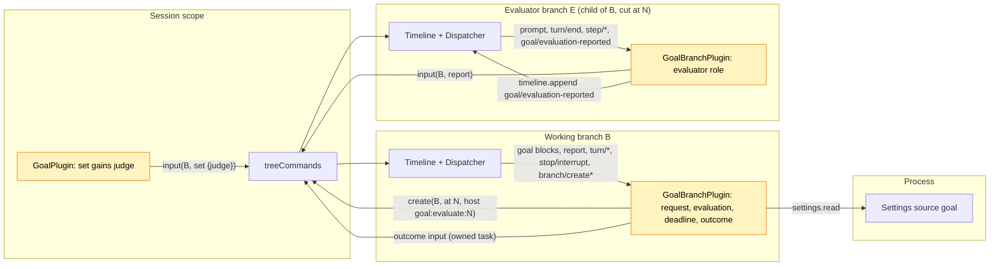

# Pursuit

Status: Draft, Ready candidate ([#146](https://github.com/arcships/dim/issues/146), milestone M2; what remains for Ready is [§17](#17-what-remains-for-ready)). Scope: an amendment of [Goal](Goal.md)'s Session and branch parts; no new Capability ([ADR 002](../../adr/002-plugin-scope.md)). Language: TypeScript, in Goal's package `runtime/plugins/goal` ([Goal §10](Goal.md#10-implementation)). Depends on: Goal (P5, implemented by [#199](https://github.com/arcships/dim/pull/199), [#69](https://github.com/arcships/dim/issues/69) closed), C5 and its branch `timeline` export ([branch TypeScript binding](../branch-typescript.md), #260), S8b ([settings service](../appserver/settings-service.md)). All are delivered; [§12](#12-dependencies) lists the non-blocking limits. Milestone M2, not part of the current plan ([roadmap](../roadmap.md) D3).

Requirement ([feature list](../../feature-list.md), Agent behavior): keep working toward an explicit objective and record its completion or blockage, **with completion judged by an evaluator instead of the model doing the work**.

Decision A3 ([#44](https://github.com/arcships/dim/issues/44), roadmap D3) built Goal first and deferred Pursuit; this document replaces the experimental design (#17). **Pursuit is a judge mode of Goal.** A goal set with `judge: "evaluator"` runs exactly as any Goal goal: the same continuations between turns, with Goal's text, budget, interrupt, pause and limit. Pursuit changes one point: **where Goal would stop because the worker reported completion, it runs one evaluation round instead.** Under the evaluator judge, the worker's `goal_update completed` is a request to verify, not a status; the goal stays active. Goal creates an **evaluator branch**, a child of the working branch cut at the `turn/end` of the request, which checks the facts and ends its turn with one of three results: `DONE` (the goal is completed by the evaluator), `CONTINUE` with the items that are at least still missing and their evidence (Goal continues the worker, as one continuation), or `BLOCKED` with what only the user can provide. Only the evaluator can complete such a goal. A worker's `goal_update blocked` still stands directly, because it needs the user; a limit, an interrupt or a user pause never starts an evaluation.

Goal's branch part runs on every branch, the evaluator included. On the evaluator it reads its own final reply and writes the result as one **report** input to the working branch by id, the only cross-branch path ([branch TypeScript binding](../branch-typescript.md#subscription-rebuild-and-recovery), item 6). Goal on the working branch, the owner of the goal, checks that the report answers the evaluation still open and writes the outcome.

## 1. Key decisions

| # | Decision | Why |
| --- | --- | --- |
| P1 | Pursuit is a judge mode of Goal, not a separate plugin | One owner of continuation; a separate plugin would race Goal on the same `turn/end` or have to read Goal's state (§4 rule 7) |
| P2 | The judge is chosen per goal by `set`, recorded on the `set` block | The judge is the user's intent for that goal, a Timeline fact; a Settings switch would silently change goals already running |
| P3 | Evaluate only at the point where Goal would stop on a completion report | Continuation between turns is Goal's and stays unchanged; the evaluation replaces only the stop |
| P4 | Under the evaluator judge, `goal_update completed` is a request; the status stays `active` | Only the evaluator completes the goal. No intermediate status (claim, pending, reopen) is needed: the request, the evaluation and its outcome are facts on the working branch |
| P5 | The evaluator is a child branch cut at the `turn/end` of the request | It sees what was done and why (and reuses the prompt cache of the shared prefix), runs under the same policy, and is an ordinary TimelineTree branch created with `treeCommands.create` |
| P6 | The evaluator reports by input; the working branch decides | No branch reads another; cross-branch communication is input by id. Callers write, owners decide: the evaluator states its result, Goal on the working branch writes the outcome |
| P7 | `CONTINUE` is one Goal continuation that hands the worker the evaluator's list as possibly incomplete | The evaluator names what is at least missing; the worker assesses the rest itself. The budget is Goal's `maxContinuations` |
| P8 | An evaluation is never re-run; a deadline settles one that produces no report | [Overview constraint 4](../overview.md#62-constraints). The deadline derives from `branch/create`, so it survives reloads and restarts and needs no observation of the evaluator |

## 2. User flow

```
 user: session.goal.set {objective: "make the CLI tests pass", judge: "evaluator"}
   └─ goal active ─▶ turn ─▶ continuation ─▶ turn ...        (Goal, unchanged)
 model: goal_update completed "all tests pass"              (request; status stays active)
 turn/end N ─▶ Goal(B): request in this turn ─▶ treeCommands.create(B, at N, goal:evaluate:N)
                                                   evaluator E checks, replies
                                                   "... \n CONTINUE: 2 tests still fail: ..."
               Goal(E): report input to B
 Goal(B): report answers the open evaluation N
   ├─ DONE     → status completed (by evaluator)
   ├─ CONTINUE → continuation (count + 1): "the list may be incomplete; assess, continue,
   │             report completed again when done"           ─▶ next turn
   ├─ BLOCKED  → status blocked (by evaluator)
   └─ failed / no report by the deadline → paused (evaluation_failed)
 user: Esc on B during the evaluation ─▶ Goal's interrupt pause; E's late report is ignored
```

Clients read everything from the working branch's events ([Goal A.3](Goal.md#a3-reading-the-goal)): the judge on the `set` block, the request (a worker `completed` block), the evaluation (`branch/create` with operation `goal:evaluate:<N>`), the report and the outcome:

```
 goal ▸ active · 3/20                        (worker running)
 goal ▸ active · evaluating · branch 7f3c…   (open evaluation)
 goal ▸ completed ✓ by evaluator · "all tests pass"
```

The CLI has no `/goal` commands yet; `/pursue <objective>` follows them as `/goal` with `judge: "evaluator"` (§16).

## 3. Structure



| Part | Change |
| --- | --- |
| `GoalPlugin` (Session, `session.ts`) | `session.goal.set` accepts `judge?: "model" \| "evaluator"` (default `model`) and marks the `set` objective block `judge="evaluator"`. The `goal_update completed` block's text becomes judge-neutral (§9). Nothing reads the fold |
| `GoalBranchPlugin` (branch, `branch.ts`) | Adds the injection `timeline` (#260) and the Dispatcher keys `branch/create`, `branch/create-failed` and `goal/evaluation-reported`. Folds the judge, the request and the evaluation (§4); takes the decisions in §5 on the working branch and the evaluator role on an evaluator branch |
| Shared fold and texts (`goal.ts`) | §4 fields, the judge-dependent meaning of a worker `completed` block, the new markers (§9) |
| Settings source `goal` (`settings.json`) | New field `evaluationTimeoutSeconds` (§6) |

The evaluator branch is not a Goal part. TimelineTree creates it with `source: host`; its first input is the prompt as plain Queue text ([TimelineTree `first_input`](../../../crates/dim-agent-capabilities/src/timeline_tree.rs)). Goal there has no goal of its own (its fold uses local events only) and writes the start `clear` as on any child ([Goal §3.4](Goal.md#34-a-new-branch-clears-the-inherited-goal)), so it never continues.

## 4. Data and state

Pursuit adds one extension event, `goal/evaluation-reported`, written only by Goal on an evaluator branch (§5.3). Everything else is Goal's `input/message` blocks and TimelineTree's facts.

### 4.1 Working branch

Additions to Goal's fold ([Goal §2](Goal.md#2-data-and-state)), over the branch's local events:

| Field | Derivation |
| --- | --- |
| `judge` | `evaluator` if the live `goal:objective` block came from a `set` marked `judge="evaluator"`, or from an `edit` after such a `set`; otherwise `model`. To switch judges, `set` again |
| Worker `completed` block | Under the model judge: status `completed`, as Goal. Under the evaluator judge: **no status change**; it is a request |
| `request(N)` | Under the evaluator judge, the turn ending at `N` contains a worker `completed` block (between the previous `turn/end` and `N`) |
| `evaluation(N)` | The first local `branch/create` with source `host` and `operation_id` `goal:evaluate:N`; its `branch` is the evaluator id `E`, its `create_at` the start time. It marks `N` decided |
| `open(N)` | `evaluation(N)` exists, no Goal outcome marked `evaluation="N"` exists, and no keyed goal block (`goal:objective` or `goal:status`, any writer) follows `N`. A pause, interrupt pause, `set`, `edit`, `resume`, `clear` or a new worker report closes it |
| `report(N)` | The first local input whose first marker is `kind="report" evaluation="N"` with `evaluator` equal to `evaluation(N)`'s `E`. Reports from any other branch, or after the first, count for nothing |
| `deadline(N)` | `evaluation(N).create_at + evaluationTimeoutSeconds` |

The status stays what Goal's existing rules make it: `active` until an outcome (§5.4), a user change, or one of Goal's pauses. Goal's count, `A`, interrupt and limit rules are unchanged.

### 4.2 Evaluator branch

| Field | Derivation |
| --- | --- |
| `role` | The branch's first local `input/message` is user text whose first line is `<dim-goal kind="evaluate" branch="B" evaluation="N">`, and `B` is the `parent` of its `branch/start` |
| `evaluation turn` | The first `turn/end` after that input's `input/consumed`, at `M` |
| `reported` | A local `goal/evaluation-reported {evaluation: N}` event exists |

All of this is a fold of committed facts. Runtime only: the creation, deadline, report and outcome tasks, each keyed by its deciding sequence, as Goal's write tasks.

## 5. Decisions

Goal's branch part takes each decision when its Dispatcher handler consumes the event, from consumed state only, registers an owned task and returns, as [Goal A.4](Goal.md#a4-continuation-decision). Every task waits for `branchLifecycle.activated()` and rechecks its condition over the consumed fold before writing ([time bus §4](../../architecture/rust-agent/time-bus.md)).

### 5.1 Turn end on the working branch

Goal's table A.4 gains one condition and one branch:

| # | Condition | If false |
| --- | --- | --- |
| C0 (new) | No `open` evaluation | Stop: the evaluation decides what happens next |
| C1–C4 | Goal's (goal exists and `active`, not interrupted, turn `completed`, latest and not decided) | Goal's (pause `interrupted`, pause `turn_failed`, or stop) |
| E (new) | `request(N)` | Go on to Goal's C5–C6 and continuation |
| — | E holds | Creation task for `N` (§5.2), instead of C5–C6 |

So the evaluation runs exactly where the model judge would have stopped (C1 would fail on `completed`), and every other decision is Goal's. A pending user input does not suppress an evaluation (it suppresses only a continuation, C5): the evaluation drives no turn on the working branch.

### 5.2 Creation and deadline tasks

Creation task for `N`: recheck (C0–C4 and `request(N)`, no `evaluation(N)`, no keyed goal block after `N`), then `treeCommands.create(B, N, {prompt, source: {host: {operation_id: "goal:evaluate:N"}}}, cancelled)` with the prompt of §9. `cancelled` completes on unload or when a keyed goal block after `N` is consumed. If `create` throws anything but that cancellation, recheck `open`-or-not-yet-created and write pause (`evaluation_failed`).

| Consumed event | Condition | Action |
| --- | --- | --- |
| `branch/create` for `goal:evaluate:N` | `open(N)` | Deadline task: `settings.read` for `evaluationTimeoutSeconds` (a failed read ends the task without writing, as Goal's turn-end task, [Goal Appendix C](Goal.md#appendix-c-errors-and-recovery)); wait until `deadline(N)` (no wait if past); recheck `open(N)` and no `report(N)`; write pause (`evaluation_failed`) |
| `branch/create-failed` for `evaluation(N)` | `open(N)` | Write pause (`evaluation_failed`) |
| report input R | `report(N)` is R, `open(N)` | Outcome task (§5.4) |

The deadline is the one recovery for every evaluation without a report: an evaluator that runs too long, a restart that cut its turn or its report, an evaluator branch not restored, or a lost `branch/create-failed`.

### 5.3 Evaluator role

On consuming its `evaluation turn` `M` while not `reported` (live, or at load), Goal on the evaluator registers one task:

1. Reassemble the final reply from `dispatcher.local(open, M)`: the last `step/model-start` of that turn gives the final `request_id`; concatenate, in sequence order, the `delta` of every `step/text` with that `turn_id` and `request_id`. Earlier requests of the turn and `step/thinking` are excluded; a result line may span several `step/text` records. This is the history projection's concatenation.
2. Parse at this boundary. The result starts at the last line beginning `DONE:`, `CONTINUE:` or `BLOCKED:` and runs to the end of the reply, so a `CONTINUE` list may take several lines. No such line: `continue` with the whole reply as the list. A `turn/end` with status `failed` or `cancelled`: `failed`. Text is truncated to 4000 characters.
3. `treeCommands.input(B, report)` (Append, §9), marked `evaluation="N" evaluator="E"` with `E` from `timelineIdentity`.
4. `timeline.append({type: "goal", name: "evaluation-reported", data: {evaluation: N}})`.

The record is an extension event on the evaluator's own Timeline (#260) because restore must not report again and cannot derive that it already did: the evaluator cannot read the working branch. An event is the smallest durable fact for this: unlike an input it never enters the evaluator's model context and involves no InputQueue or Loop. Steps 3 then 4 make the report at-least-once: a reload between them writes one duplicate report, which `report(N)` ignores. The evaluator role decides nothing about the goal.

### 5.4 Outcome task

1. For `continue`, `settings.read` for `maxContinuations` (a failed read ends the task without writing).
2. Recheck `open(N)` and write one input marked `evaluation="N" after="R"`:

| Result | Write | Mode |
| --- | --- | --- |
| `done` | `goal:status` `completed`, `by="evaluator"`, with the evaluator's result | Append |
| `blocked` | `goal:status` `blocked`, `by="evaluator"`, with what the user must provide | Append |
| `continue`, `count < maxContinuations` | Goal continuation (`count = k+1`) with the Pursuit text (§9) | Queue |
| `continue`, `count >= maxContinuations` | pause (`limit`) | Append |
| `failed` | pause (`evaluation_failed`) | Append |

The report precedes the outcome, so the turn a `continue` drives sees the evaluator's list first. At that turn's end Goal's rules apply again: the worker reports completion again (another evaluation) or is continued.

## 6. Budget and limits

| Limit | Bound |
| --- | --- |
| Evaluations | At most one per worker request, and only at a turn end where Goal would stop |
| `CONTINUE` results | Each is one Goal continuation under `maxContinuations`, counted with Goal's own; at the limit Goal pauses (`limit`), with the report in context |
| One evaluation | `evaluationTimeoutSeconds` (source `goal`, integer, 60..=3600, default 900), from its `branch/create`; at the deadline the goal pauses (`evaluation_failed`) |
| Evaluator recursion | None: the evaluator branch has no goal, so it makes no request; its children carry no evaluation marker |

Settings are read at use, so a change applies from the next deadline or outcome without a reload. Until R1, a closed evaluation (deadline, interrupt, pause, newer change) stops Goal waiting but not the evaluator: it runs its turn to the end and its late report is ignored.

## 7. Interrupts, reload, restore and fork

| Case | Outcome |
| --- | --- |
| Interrupt during the request's turn | Goal's C2: pause (`interrupted`); no evaluation |
| Interrupt of the working branch during the evaluation | Goal's interrupt pause (the goal is `active`); the pause closes the evaluation; the late report is ignored |
| Interrupt of the evaluator branch | Its turn ends `cancelled`: report `failed`, pause (`evaluation_failed`) |
| `pause`, `resume`, `set`, `edit`, `clear` or a worker `goal_update` during the evaluation | The keyed block closes the evaluation and decides as Goal does; the late report is ignored. After `resume` Goal continues normally; a new request is evaluated at its turn's end |
| User input during the evaluation | Its turn runs on the working branch; at its end C0 stops Goal (no continuation while the evaluation is open); the outcome applies when the report arrives |
| Reload or restart, working branch | The new generation refolds and takes owed decisions once at load, as Goal ([Goal §4.2](Goal.md#42-reload)): an undecided `N` with `request(N)` gets the creation task; an `open` evaluation gets the deadline task (the deadline is a fact); a consumed unanswered `report(N)` gets the outcome task. A handover with a creation in flight may create a second evaluator; only the first `branch/create` counts. This generic handover race is accepted for Goal in [#242](https://github.com/arcships/dim/pull/242) and is not a Pursuit case |
| Reload or restart, evaluator branch | Load reports once if the evaluation turn is consumed and not `reported` |
| Restore cuts the evaluator's turn | A `cancelled` turn reports `failed`; no `turn/end` leaves it to the deadline |
| Evaluator branch not restored, or working branch closed | No report; the deadline settles the evaluation at the next load of the working branch |
| Child branch of the working branch | No goal (Goal A3) and no evaluation marker |
| Session fork | Goal A11: the fork's `main` folds from `session/forked`, so it has no goal and no open evaluation; evaluator branches are not copied |

### 7.1 What is persisted

| Fact | Where | Written by |
| --- | --- | --- |
| Judge | `set` objective block | Goal Session part |
| Request | Worker `completed` block | Goal Session part (`goal_update`) |
| Evaluation started / creation failed | `branch/create`, `branch/create-failed` on the working branch | TimelineTree |
| Evaluator prompt, work, reply | Evaluator branch | TimelineTree, Loop, its capabilities |
| Report | Report input on the working branch | Goal on the evaluator |
| Reported | `goal/evaluation-reported` on the evaluator branch | Goal on the evaluator |
| Outcome | Outcome input on the working branch | Goal on the working branch |

## 8. Outcome summary

| Ends an open evaluation | Goal writes on the working branch | Status after |
| --- | --- | --- |
| `DONE` | `completed` (`by="evaluator"`) | completed |
| `BLOCKED` | `blocked` (`by="evaluator"`) | blocked |
| `CONTINUE`, under the limit | Continuation | active |
| `CONTINUE`, at the limit | pause (`limit`) | paused |
| `failed`, creation failure, deadline | pause (`evaluation_failed`) | paused |
| A keyed goal block after `N` | Nothing more (that block decides) | per that block |

## 9. Context mapping

The worker sees only Goal inputs ([Goal §5](Goal.md#5-context-mapping)); the evaluator sees its inherited history through the cut, then its prompt. Marker format, escaping and keys are Goal's ([A.5](Goal.md#a5-model-visible-texts)). `N` is the request's `turn/end`, `R` the report, `B` the working branch, `E` the evaluator.

| Write | Branch, blocks (key) | Mode | Text |
| --- | --- | --- | --- |
| `set` | B; Goal's two blocks, block 1 marked `judge="evaluator"` | Queue | Goal's text unchanged: the worker reports completion the same way under either judge |
| worker `completed` (changed for both judges) | B; `goal:status` live | Append | `op="completed"`; `Result:` / `<summary>` / blank / `goal_update reported the goal for branch B as completed. Do not continue working toward it on your own unless a later goal input asks you to.` |
| evaluator prompt | E; plain text first input | Queue | `<dim-goal kind="evaluate" branch="B" evaluation="N">` / `You are an evaluator. Branch B reported that its goal is completed. Only you decide whether it is. Do not continue the work, do not change files or settings, and do not call goal_update.` / blank / `Objective:` / `<objective>` / blank / `Reported result:` / `<summary>` / blank / `Verify the facts yourself by reading files and running checks; do not rely on the report or on earlier messages. End your reply with exactly one of:` / `DONE: <the verified result>` / `CONTINUE: followed by the items that are at least still missing, one per line, each with its evidence` / `BLOCKED: <what only the user can provide>` |
| report | B; one block, no key | Append | `<dim-goal kind="report" result="done\|continue\|blocked\|failed" evaluation="N" evaluator="E" branch="B">` / `Evaluator report:` / `<result text, or "the evaluator's turn did not complete">` |
| `DONE` | B; `goal:status` live | Append | `<dim-goal kind="goal" op="completed" by="evaluator" evaluation="N" after="R" branch="B">` / `Result:` / `<result>` / blank / `An evaluator verified that the goal for branch B is completed. Do not continue working toward it on your own.` |
| `BLOCKED` | B; `goal:status` live | Append | `op="blocked" by="evaluator"`; `Blocker:` / `<what is needed>` / blank / `An evaluator found that the goal for branch B cannot proceed without the user. Do not continue working toward it on your own.` |
| `CONTINUE` | B; Goal continuation, no key | Queue | `<dim-goal kind="continuation" count="k" limit="L" evaluation="N" after="R" branch="B">` / `An evaluator checked your report that the goal for branch B is completed and found it is not achieved yet. Its report above lists items that are at least still missing; the list may be incomplete. Assess yourself how far the goal still is, then continue working toward it. When you think it is achieved, call goal_update with status "completed" again.` |
| pause `evaluation_failed` | B; `goal:status` live | Append | Goal's pause text with reason phrase "the evaluator could not check the result", marked `evaluation="N"` |

The worker `completed` text changes for the model judge too, because the Session part writes it without knowing the judge; "unless a later goal input asks you to" is true under both. The `goal:status` replay stays equal to the fold (Goal A16) with one judge-dependent rule: under the evaluator judge a worker `completed` block means `active`. Compaction keeps it the latest status block until an outcome or a change replaces it; a `CONTINUE` adds no status block, since the status never left `active`.

## 10. Interfaces

| Interface | Change |
| --- | --- |
| `session.goal.set` | Params `{sessionId, branchId?, objective, judge?}`; `judge` is `"model"` (default) or `"evaluator"`; any other value is `invalid_params` |
| `goal_update` | Parameters and result unchanged (`goal_update recorded: completed.`); the block text is judge-neutral (§9) |
| Reading the goal | No query method (Goal A8); clients read the judge, request, `branch/create` with `goal:evaluate:<N>`, report and outcome from the working branch's events |
| Settings source `goal` | Adds `evaluationTimeoutSeconds` (integer, `minimum: 60`, `maximum: 3600`, `default: 900`) |
| Extension event | `goal/evaluation-reported {evaluation: number}`, written by Goal on an evaluator branch only; read only by Goal there |
| Branch operation id | `goal:evaluate:<N>`; clients may use the prefix to label or hide evaluator branches |

## 11. Security

The evaluator is an ordinary child branch: it inherits the working branch's permission policy and its tool calls pass Approval ([ADR 003](../../adr/003-approval-scope.md)), so it gains nothing the worker lacks. "Do not change anything" is guidance, not isolation (§16). A result cannot be forged into an outcome: `session.submit` accepts no raw blocks, markers escape all text, and Goal on the working branch accepts only the first report from the branch that its own `branch/create` names for an open evaluation. An operator who creates a host branch with a forged evaluation prompt (`session.branch_create`) makes Goal there write a report that settles nothing; such an operator can write to the working branch anyway. Diagnostics record Session, branch and evaluation sequences and the result kind, never objective or report text.

## 12. Dependencies

| Mechanism | State | Use |
| --- | --- | --- |
| Goal (P5) | Implemented (#199), #69 closed | Amended in `runtime/plugins/goal` (§3) |
| C5 binding, branch `timeline` export | Delivered (#100, #196, #205, #260) | `treeCommands.create` / `input`, `dispatcher`, `timelineIdentity`, `branchLifecycle`, `timeline.append` |
| Extension events (#2) | Delivered (#260) | `goal/evaluation-reported` |
| S8b Settings | Delivered | `settings.read` of source `goal` |
| Optional tool rows (#241) | Delivered (#255) | `goal_update` is offered once Goal's row is active; nothing Pursuit-specific |
| Stopping a branch by id from TypeScript | Not exported | Not blocking (R1) |
| Durable branch retirement | Does not exist | Not blocking (R2) |

## 13. Rule check

Rules: [principles §1 and §4](../../architecture/rust-agent/principles.md), [ADR 002](../../adr/002-plugin-scope.md) D1–D5.

| Rule | How this document complies |
| --- | --- |
| §4.1 Command events for others' state | Goal changes goal state only through its own inputs. Creating the evaluator is a command to TimelineTree (`create`), which writes its facts. The worker's request and the evaluator's report are inputs; Goal on the working branch, the owner, decides what they mean |
| §4.2 No recall after handoff | Nothing is withdrawn: an outcome stands, and a closed evaluation's evaluator is not recalled, its report simply matches nothing |
| §4.3 Only before callbacks, never block | Not applicable: no before callback; `set` validates only its params |
| §4.4 No business meaning in core | No change to Timeline, Dispatcher, TimelineTree, InputQueue or Loop; a host branch with an `operation_id`, inputs and an extension event are existing contracts |
| §4.5 Batch | Decisions follow consumed events in order; every task rechecks over consumed state; each outcome is one input |
| §4.6 Context only from handed-off events | The worker sees the result only through the adopted report and outcome; the evaluator's reply stays on its branch; `goal/evaluation-reported` is no context |
| §4.7 Public events and services only | Goal reads only its own branch's public events and its own blocks and events, and calls exported services; no branch reads another |
| §4.8 Requirements to mechanism owners | R1 and R2 (§14), neither blocking |
| §4.9 Only facts later decisions use enter the Timeline | The report is what the owner decides on; `goal/evaluation-reported` is what keeps a restored evaluator from reporting again; the outcome is model context and closes the evaluation; the deadline derives from `branch/create`. Tasks and timers stay out |
| §1 Capability and App Server boundary | No new Capability; nothing in App Server |
| ADR 002 D1 Scope | Request, evaluation and outcome are working-branch state of Goal's branch part there; the evaluator role is evaluator-branch state of Goal's branch part there; the branch itself is TimelineTree's |
| ADR 002 D2 No wiring modules | Nothing names Goal; the evaluator is an ordinary child |
| ADR 002 D3 Scope dependencies | Branch services, the enclosing Session `treeCommands` and the process `settings`, as Goal; no core part depends on Goal |
| ADR 002 D4 Configuration | The judge is a per-goal Timeline fact; the timeout is business configuration in Goal's Settings source, read at use |
| ADR 002 D5 Language-neutral contracts | The `judge` parameter, markers, Settings field, operation id and extension event are data |

## 14. Requirements raised to mechanism owners

### R1. Stop a branch by id from a TypeScript part (not blocking)

| Item | Content |
| --- | --- |
| Blocked by | Nothing; cost only. After a deadline, an interrupt or a newer change, Goal cannot stop the evaluator: it finishes its turn (model and tool cost) and stays loaded idle |
| Existing mechanisms considered | `treeCommands` exports `list`, `info`, `input`, `create`; `TreeCommands::get` returns a `Branch` handle that does not cross languages; `timeline` is the part's own branch only; `session.stop` is a client entry |
| Generic capability | `TreeCommands` data methods by id, as `input`: `interrupt(id, reason)` and `close(id)`, delegating to the facade |
| Effect on sequence, batch, interrupt, reload | None: the facade's semantics; the caller holds no handle |
| Owner and issue | Runtime and assembly (TimelineTree, C5 export list); issue to be opened when this design is accepted |

### R2. Durable branch retirement (not blocking)

| Item | Content |
| --- | --- |
| Blocked by | `restore` builds every stored branch, so every evaluator branch is rebuilt with its full capability scope at each restore; cost grows with every evaluation (the same holds for finished `branch` tool branches) |
| Existing mechanisms considered | `Branch::close` is undone by the next restore; `session.delete` removes the whole Session; leaving them idle is correct (`goal/evaluation-reported` prevents a second report) at a growing restore cost |
| Generic capability | A durable "retired" state of a stored branch owned by TimelineTree: history readable, not built on restore, no input |
| Effect on sequence, batch, interrupt, reload | Retiring implies close; a branch-directory fact, no business event; restore skips retired subtrees |
| Owner and issue | Runtime (TimelineTree); issue to be opened when this design is accepted |

## 15. Acceptance

Planned flows with a fake model for worker and evaluator, in `goal.test.mjs` (fold and decisions over exact event orders) and `transport_flow/goal.rs` (the real plugin in Node):

1. Evaluator judge: continuations between turns are Goal's (same text, count, limit). The worker reports `completed`; the status stays `active`; at that turn's end exactly one `branch/create` with `goal:evaluate:N` cut at `N`, and no continuation. `DONE` writes one report and `completed` by the evaluator; no further turn.
2. `CONTINUE` with a two-line list: one report and one continuation (`count` + 1) with the Pursuit text; the next turn sees both; a second request starts a second evaluation; `BLOCKED` writes `blocked` by the evaluator.
3. A worker `goal_update blocked` under the evaluator judge stands at once, with no evaluation. A limit pause, an interrupt and a user pause start no evaluation.
4. Limit: with `maxContinuations = 1`, a `CONTINUE` after one continuation writes pause (`limit`).
5. A reply without a result line is `continue`; an evaluator turn that fails, a creation failure and a missing report at the deadline each write pause (`evaluation_failed`).
6. Interrupt of the working branch during the evaluation: Goal's pause; a later report writes nothing. `pause`, `edit`, `set`, `clear` and a new worker report during the evaluation close it; its report writes nothing.
7. User input during the evaluation: the user's turn runs, no continuation at its end, the outcome applies when the report arrives.
8. Restart with an evaluation open: no second `branch/create`; an existing report is answered once; a past deadline pauses right after load; a restored evaluator with `goal/evaluation-reported` writes no second report; a cancelled evaluator turn reports `failed`.
9. Model judge: Goal's acceptance unchanged except the judge-neutral `completed` text.
10. The evaluator has no goal and makes no request; its policy equals the working branch's at the cut; a forged evaluation branch's report settles nothing.
11. Compaction after `DONE` and after `CONTINUE`: the latest `goal:status` block and the judge give the fold's status.
12. A changed `evaluationTimeoutSeconds` applies from the next deadline without a reload.
13. Flush boundaries: an evaluator turn with a tool cycle whose earlier reply ends `DONE: early`, and whose final request streams `... \nDONE:` and ` all checks pass` separately, yields `done` with `all checks pass`; the same with a split `BLOCKED:` and with a multi-line `CONTINUE:` list.

As for Goal (#242), a generation handover with a task in flight is the generic handover, not a Pursuit case.

## 16. Open questions

| Question | Note |
| --- | --- |
| Evaluator independence | P5 cuts at the request's `turn/end`, so the evaluator sees the worker's reasoning. Cutting at the goal's `set` would judge only the workspace, at the cost of the prompt cache and of context on what was attempted |
| Read-only or cheaper evaluator | Needs initial branch configuration before the first input and a per-branch Permission narrowing; neither exists |
| Structured result | A result tool would replace the line protocol but would be offered on every branch |
| CLI | No `/goal` commands yet; `/pursue` and the `evaluating` status follow them |
| Evaluator branches in listings | Clients may hide branches with a `goal:evaluate:` operation; until R2 they stay listed |
| ~~Claim, pending and reopen states~~ | Removed by P4: the request leaves the status `active`; the open evaluation is derived from `branch/create` and closed by any keyed goal block |
| ~~Observing the evaluator~~ | Removed by P6: the evaluator reports by input |

## 17. What remains for Ready

1. Confirm the judge-neutral worker `completed` text for both judges (§9): the Session part cannot know the judge, so this is the one change the model judge sees.
2. Confirm that a pending user input does not suppress an evaluation (§5.1), and that during an open evaluation Goal does not continue after a user turn (C0).
3. Agree that R1 and R2 are not blocking: until R1 a closed evaluation's evaluator still finishes its turn; until R2 every evaluator is rebuilt on restore.
4. The default and range of `evaluationTimeoutSeconds` (900, 60..=3600).

## 18. Ablation review

| Removed | Why it is not needed |
| --- | --- |
| Claim, `pending`, `trigger`, `settled` and the `reopen` status, with the split of Goal's `A` from the count base | P4: the status stays `active`; `open(N)` is derived from `branch/create` and closed by any keyed goal block, so Goal's own rules (interrupt, pause, `resume`, limit) settle it without Pursuit-specific rows |
| Pursuit's own interrupt, `turn_failed` and pause rows | Goal's C2, C3 and interrupt rule already apply, because the goal is `active` |
| Re-evaluation on `edit` | `edit` closes the evaluation like any keyed block; a new request is evaluated at its turn's end |
| Observation of the evaluator, `S:SessionLifecycle`, closing the evaluator | P6 and the deadline; closing waits for R1 and R2 |
| Local `reported` input on the evaluator | Replaced by the extension event: no model context, no InputQueue |
| Reload-race acceptance | Generic handover (#242) |

| Kept | Purpose |
| --- | --- |
| Report input from the evaluator | The only cross-branch path; the evaluator cannot read whether its evaluation is still open, so only the owner writes the outcome |
| `goal/evaluation-reported` | Without it every restore of an evaluator branch writes another report |
| `branch/create-failed` row | Settles a known creation failure at once instead of at the deadline |
| Deadline | The one recovery for every evaluation without a report, derived from a fact |
| C0 | Without it Goal would continue the worker while the evaluator checks, and a `CONTINUE` would add a second continuation |
