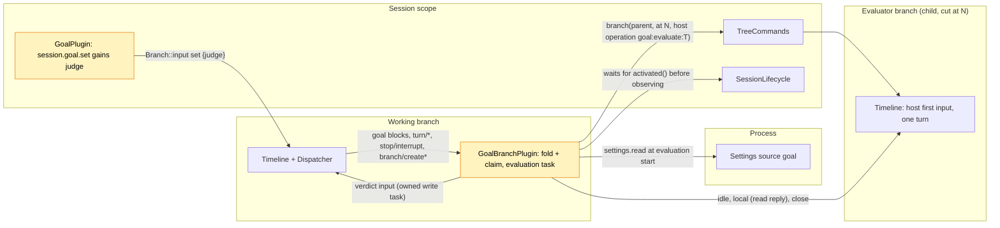

# Pursuit

Status: Draft ([#146](https://github.com/arcships/dim/issues/146), milestone M2). Scope: an extension of [Goal](Goal.md)'s Session and branch parts; no new Capability ([ADR 002](../../adr/002-plugin-scope.md)). Language: as Goal (TypeScript first, Rust until [#4](https://github.com/arcships/dim/issues/4) reaches branch parts). Depends on: Goal (P5, [#69](https://github.com/arcships/dim/issues/69), not implemented), C5 ([#100](https://github.com/arcships/dim/pull/100), not implemented), S8b ([#118](https://github.com/arcships/dim/issues/118), not implemented). Not part of the current plan ([roadmap](../roadmap.md) D3).

Requirement ([feature list](../../feature-list.md), Agent behavior): keep working toward an explicit objective and record its completion or blockage, **with completion judged by an evaluator instead of the model doing the work**.

Decision A3 ([#44](https://github.com/arcships/dim/issues/44), roadmap D3) built Goal first and deferred Pursuit. The experimental Pursuit design (#17) was a second continuation owner with its own `pursuit/*` events, objective, limit and interrupt rules, so a Session could enable only one of Goal and Pursuit, and its own event types waited on dynamic events ([#2](https://github.com/arcships/dim/issues/2)). This document replaces it. **Pursuit is a judge mode of Goal**: a goal set with `judge: "evaluator"` keeps every Goal rule (objective and status keys, fold, continuation, limit, interrupt, compaction, child branches), and changes only what a completion report means. Under the model judge (Goal as designed), `goal_update completed` ends the goal. Under the evaluator judge it is a **claim**: when the turn that made the claim ends, Goal starts an **evaluator branch**, a child of the working branch cut at that `turn/end`, which checks the facts and ends with a verdict. Goal reads the verdict and writes the result as its own goal input: a verified completion, a blocker, a reopened goal with the evaluator's feedback (one continuation), or an automatic pause. An unverified claim never stands: any claim is settled by a verdict, a pause, or a later goal change.

Everything Pursuit needs is already Goal's: the state owner (Goal's branch part), the facts (Goal's `input/message` blocks, which carry no new event type), and the continuation budget (`maxContinuations`). The new pieces are a `judge` attribute on `set`, the evaluation task in Goal's branch part, the verdict writes, and one Settings field.

## 1. Key decisions

| # | Decision | Why |
| --- | --- | --- |
| P1 | Pursuit is a judge mode of Goal, not a separate plugin | Goal and Pursuit both continue the branch; one owner of continuation avoids two state machines racing on the same `turn/end`. A separate Pursuit plugin would have to read Goal's state or wait for it (§4 rule 7). Goal already handles the rest |
| P2 | The judge is chosen per goal by `set`, recorded on the `set` block | Which judge a goal uses is the user's intent for that goal, so it is a Timeline fact; a Settings switch would silently change the meaning of goals already running |
| P3 | Evaluate only on a completion claim, not after every turn | The verdict that matters is "done or not"; evaluating every turn doubles model cost for turns the worker itself knows are unfinished. Continuation between claims is Goal's |
| P4 | The evaluator is a child branch cut at the `turn/end` that follows the claim | It sees what was done and why (and reuses the provider prompt cache of the shared prefix), runs under the same policy, and is an ordinary TimelineTree branch; no new Session or process mechanism |
| P5 | The verdict is the last line of the evaluator's final reply, parsed at the boundary by Goal; Goal writes the result on the working branch | The evaluator is a model run; its reply is already a durable fact on its own branch. The result that later decisions use is Goal's own write (§4 rule 1: Goal owns goal state) |
| P6 | A rejected claim reopens the goal and counts as one continuation | Rejection loops are bounded by the existing `maxContinuations`; no second budget |
| P7 | An evaluation that started is never re-run; a later generation only observes the existing evaluator branch | [Overview constraint 4](../overview.md#62-constraints) |

## 2. User flow

```
 user: /pursue "make the CLI tests pass"
   └─ session.goal.set {objective, judge: evaluator} ─▶ goal active ─▶ turn runs
 model: ... work ... goal_update completed "all tests pass"     (claim C)
 turn/end N ─▶ Goal: claim C pending ─▶ evaluator branch cut at N
                                         reads files, runs checks, replies
                                         "... \n CONTINUE: 2 tests still fail"
            ◀─ Goal reads the verdict
               ├─ DONE     → status completed (by evaluator)   user sees the summary
               ├─ BLOCKED  → status blocked (by evaluator)     user sees what is needed
               ├─ CONTINUE → status active again + feedback (Queue, count + 1) ─▶ next turn
               └─ failed   → status paused (evaluation_failed) user resumes
 user: Esc during evaluation ─▶ stop/interrupt ─▶ evaluator closed, status paused (interrupted)
```

CLI: `/pursue <objective>` is `/goal <objective>` with the evaluator judge. Every other `/goal` command (`edit`, `pause`, `resume`, `clear`, and `/goal` alone for the status) applies to either judge. The status line shows `evaluating` while a claim is being checked:

```
 goal ▸ active · 3/20                         (model working)
 goal ▸ evaluating claim · branch b-7f3c      (evaluator running)
 goal ▸ completed ✓ verified · "all tests pass"
```

## 3. Structure and dependencies



No new part. Goal's parts change as follows:

| Part | Change |
| --- | --- |
| `GoalPlugin` (Session) | `session.goal.set` takes `judge?: "model" \| "evaluator"` (default `model`) and writes it on the `set` block; `goal_update` and the other methods are unchanged and still never read the fold |
| `GoalBranchPlugin` (branch) | Folds `judge`, the claim and the evaluation facts (§4); decides on them (§5); runs the evaluation task. New dependencies: `S:TreeCommands` (create, get, close the evaluator), `S:SessionLifecycle` (wait for the restored tree before observing an evaluator, §7) |
| Goal Settings source `goal` | New field `evaluationTimeoutSeconds` (§6) |

Both new dependencies are Session-scoped services of the enclosing scope (D3); neither is optional. `S:TreeCommands` already exists in Rust; a TypeScript branch part reaches it and the `Branch` facade it returns only through C5 (requirement R1, §12).

The evaluator branch is not a Goal part. It is an ordinary child branch that TimelineTree creates with `source: host`, with every capability the assembly installs on branches. Goal on the evaluator branch sees no goal of its own (its fold uses local events only) and writes the start `clear` there as on any child ([Goal §3.4](Goal.md#34-a-new-branch-clears-the-inherited-goal)), so the evaluator does not take the parent's goal as its own and never continues.

## 4. Data and state

Pursuit adds no event type. It reads three public facts besides Goal's own blocks: `branch/create` and `branch/create-failed` on the working branch, whose source is `host` with `operation_id` `goal:evaluate:<T>`, and, on the evaluator branch, its `turn/end`, the `step/model-start` of that turn's last model request, and the `step/text` deltas of that request. Goal's writes carry `claim="C"` and `evaluation="T"` attributes in their markers so the fold can tell what they settle.

Additions to Goal's fold ([Goal §2](Goal.md#2-data-and-state)), over the working branch's local events:

| Field | Derivation |
| --- | --- |
| `judge` | The `judge` attribute of the latest live `set`; `model` if there is none, or a `clear` follows it. `edit` does not change it; to switch judges, `set` again |
| `claim` | Sequence `C` of the current `goal:status` block when that block is a `completed` written by `goal_update` (not by Goal), and `judge = evaluator` |
| `settled(C)` | A Goal write marked `claim="C"` exists (§8 lists them) |
| `pending` | `claim` exists and is not `settled` |
| `trigger` | For a pending `C`: the latest of (a) the first `turn/end` with outcome `completed` after `C`, (b) any live `edit` after that `turn/end`. Its sequence `T` identifies the evaluation |
| `started(T)` | A local `branch/create` with operation `goal:evaluate:T`; its `branch` field is the evaluator's id |
| `create_failed(T)` | A `branch/create-failed` for that `branch/create` |
| `evaluating` | `pending`, and `started(trigger)` |

Everything is a fold of committed facts, so a reload or a restore rebuilds it. Runtime only: the evaluation task (one per branch at most) and its timer.

The worker never sees the claim's settlement before it is written: until then the latest status block in its context is its own `completed`, and the fold agrees (`status = completed`, `pending`). A16 of Goal (the replay equals the fold) is unchanged: every Pursuit write that changes the status is a `goal:status` block.

## 5. Decisions

Goal's branch part takes each decision when its Dispatcher handler consumes the event, from consumed state only, registers an owned task when a write or an evaluation is needed, and returns without awaiting, exactly as [Goal A.4](Goal.md#a4-continuation-decision). Goal's C1–C6 are unchanged: they need `status = active`, which a pending claim is not.

| Consumed event | Condition | Action |
| --- | --- | --- |
| `turn/end` N | `pending` claim `C < N`, outcome `failed` | Write pause (`turn_failed`, `claim="C"`) |
| `turn/end` N | `pending` claim `C < N`, outcome `completed`, `trigger = N`, not `started(N)` | Start the evaluation `T = N` (§5.1) |
| `edit` E | `pending`, a completed `turn/end` follows `C` | Cancel the evaluation in flight and close its branch; start the evaluation `T = E`, cut at that `turn/end` |
| `stop/interrupt` M (`scope: turn`) | `pending`, `C < M` | Cancel the evaluation in flight and close its branch; write pause (`interrupted`, `claim="C"`, `after="M"`) |
| Any other goal block after `C` (`set`, `pause`, `resume`, `clear`, another `goal_update`) | — | The claim is no longer the current status, so nothing is pending; cancel the evaluation in flight and close its branch. Nothing is written: the newer block already decides |
| `branch/create-failed` for `goal:evaluate:T` | `pending`, `T = trigger` | Write pause (`evaluation_failed`) |

A `turn/end` cancelled by an interrupt is handled by the `stop/interrupt` row that precedes it. A turn that ends after `C` while the evaluation runs (for example a user turn) does not restart it: the claim was made about the state at the cut, and a new claim during that turn is a new goal block, which supersedes the old one.

### 5.1 Evaluation task

1. `settings.read {source: "goal", scope: "user"}` (S8b) for `evaluationTimeoutSeconds` and `maxContinuations`; the task uses this document to its end.
2. Create the evaluator: `S:TreeCommands.branch(parent = this branch, at = the cut turn/end, {source: host {operation_id: "goal:evaluate:T"}, prompt}, admission)`, the prompt in §9. TimelineTree writes `branch/create` on the working branch and opens the child, whose first input is the prompt (Queue). Creation failure is recorded by TimelineTree as `branch/create-failed`, which the row above settles.
3. Observe: await the evaluator's `idle()` under the timeout, then read its local events: the latest `turn/end` and its `turn_id`. On timeout, interrupt the evaluator and treat it as failed.
4. Reassemble the final reply: take the last `step/model-start` of that turn; its `request_id` is the final model request. Concatenate, in sequence order, the `delta` of every `step/text` with that `turn_id` and `request_id`. `step/text` is a delta that Output flushes at size and time boundaries, so a single record is not a reply and a verdict line may span several records. Earlier requests of the turn (replies before a tool cycle) and `step/thinking` are not part of the reply. This is the same concatenation the history projection already does; no new event or core API is needed.
5. Parse at this boundary: the last non-empty line of the reassembled reply, `DONE: <summary>`, `CONTINUE: <feedback>` or `BLOCKED: <reason>`. Any other text counts as `continue` with the whole text as feedback (truncated to 2000 characters, Goal A10). A `turn/end` that is `failed` or `cancelled`, or no completed turn, is a failed evaluation.
6. Recheck over consumed state ([time bus §4](../../architecture/rust-agent/time-bus.md)): `C` is still `pending` and `T` is still its `trigger`. If not, write nothing.
7. Write the verdict (§5.2), then `close()` the evaluator.

Cancelling the task (rows above, or unload) cancels the admission or the observation, interrupts and closes the evaluator if it was created, and writes nothing; the cancelling row writes what the claim needs. At most one task runs per branch: a new evaluation only starts after its predecessor's claim or trigger is superseded, which cancels the predecessor.

### 5.2 Verdict writes

Each is one `input/message` with source `goal` on the working branch, marked `claim="C" evaluation="T"`, so `settled(C)` holds once it is consumed.

| Verdict | Write | Mode |
| --- | --- | --- |
| `done` | `goal:status` `completed`, `by="evaluator"`, with the evaluator's summary | Append |
| `blocked` | `goal:status` `blocked`, `by="evaluator"`, with the evaluator's reason | Append |
| `continue`, `count < maxContinuations` | Reopen: block 1 a continuation (no key, `count = k+1`) carrying the feedback; block 2 `goal:status` `active` (`op="reopen"`) | Queue |
| `continue`, `count >= maxContinuations` | `goal:status` pause (`limit`) | Append |
| failed (create, turn, timeout) | `goal:status` pause (`evaluation_failed`) | Append |

The reopen input starts with the continuation marker, so Goal's `count` counts it (Goal A5: only `set`, `resume` and operator input restart the count; a reopen does not). Its status block makes `status = active` again, so at the next `turn/end` Goal's C1–C6 apply as usual: the worker either claims again or is continued.

## 6. Budget and loop limits

| Limit | Bound |
| --- | --- |
| Evaluations per claim | One, plus one per `edit` of the objective while it is pending |
| Rejected claims | Each consumes one continuation: at most `maxContinuations` reopens between two `set`, `resume` or operator inputs; the next `continue` verdict pauses (`limit`) |
| Evaluations per active period | At most `maxContinuations + 1` without user input |
| One evaluation | `evaluationTimeoutSeconds` (source `goal`, integer, minimum 60, maximum 3600, default 900); on expiry the evaluator is interrupted and the claim pauses (`evaluation_failed`) |
| Evaluator recursion | None: the evaluator branch has no goal, so it makes no claims and starts no evaluator; any branches it creates are closed with it |

Settings are read at use time (§5.1 step 1), so a change applies from the next evaluation without reloading Goal. Goal's handler-side decisions keep reading `maxContinuations` as Goal §1 specifies; only the evaluation task reads its own copy, because it awaits anyway.

## 7. Interrupts, reload, restore and fork

| Case | Outcome |
| --- | --- |
| User interrupts the working branch during the claim's turn | The turn ends `cancelled`; the `stop/interrupt` row pauses the claim (`interrupted`). An unverified claim does not survive an interrupt |
| User interrupts the working branch during the evaluation | The evaluator is interrupted and closed; pause (`interrupted`) |
| User interrupts the evaluator branch itself | Its turn ends `cancelled`: failed evaluation, pause (`evaluation_failed`) |
| `pause`, `resume`, `clear`, `set` or another `goal_update` during the evaluation | The newer block decides; the evaluation is cancelled, nothing else is written |
| `edit` during the evaluation | The evaluation restarts against the new objective (§5) |
| User input during the evaluation | Its turn runs on the working branch concurrently with the evaluator; the claim stays pending; the verdict applies when it arrives. A `continue` reopen is queued after the user's turn |
| Goal branch part reload with an evaluation in flight | The old task ends with its generation. The new generation folds `evaluating`: it does not create a second evaluator; it observes the existing one by its id (`TreeCommands.get`) from step 3. Observation of a saved handle is allowed by overview constraint 4 |
| Process restart or Session restore with an evaluation in flight | The same, after `SessionLifecycle` is active (the restored tree is published). TimelineTree restores the evaluator branch like any child: a turn cut by the restart ends `cancelled` (failed evaluation), a completed turn is read as usual, and a first input never consumed may still run, which the observation then waits for. A creation cut by the restart is recorded by TimelineTree as `branch/create-failed`: pause (`evaluation_failed`). Nothing is re-executed by Goal |
| Evaluator branch missing at observation (inactive after restore) | Failed evaluation, pause (`evaluation_failed`) |
| Undecided trigger at load (the task had not created the branch) | The load fold takes the decision once and starts the evaluation; `started(T)` deduplicates |
| Working branch closes | The evaluator is a child and closes with the subtree; nothing is written. At the next load of that branch, if it is loaded, the evaluation is observed or failed as above |
| Child branch of the working branch | No goal, so no claim and no evaluation (Goal A3) |
| Session fork | A fork copies `main` through a cut and opens it with `branch/resume` ([session deletion and fork](../appserver/session-deletion-and-fork.md)); child branches, the evaluator included, are not copied. If the fork's goal fold carries a pending claim with `started(T)`, observation finds no evaluator: pause (`evaluation_failed`). The fork writes `session/forked` after the copied facts and Goal clears a copied live goal on it (Goal A11), so a copied claim stops being the fork's goal |

### 7.1 What is persisted

| Fact | Where | Written by |
| --- | --- | --- |
| The judge | `set` block (`judge` attribute) | Goal Session part (`session.goal.set`) |
| The claim | `goal_update completed` block | Goal Session part (`goal_update`) |
| Evaluation started / creation failed | `branch/create`, `branch/create-failed` on the working branch | TimelineTree |
| The evaluator's work and reply | The evaluator branch's own Timeline | Loop and the branch's capabilities |
| The settlement | Goal's verdict or pause input on the working branch | Goal branch part |

Not persisted: the task, its timer, and the evaluator's in-memory branch; all are rebuilt or observed from the facts above.

## 8. Settlement summary

| Settles a pending claim `C` | Written by Goal | Status after |
| --- | --- | --- |
| Verdict `done` | `completed` (`by="evaluator"`) | completed |
| Verdict `blocked` | `blocked` (`by="evaluator"`) | blocked |
| Verdict `continue`, under the limit | Reopen with feedback (Queue) | active |
| Verdict `continue`, at the limit | pause (`limit`) | paused |
| Failed evaluation or creation | pause (`evaluation_failed`) | paused |
| Claim's turn failed | pause (`turn_failed`) | paused |
| Interrupt after `C` | pause (`interrupted`) | paused |
| A later goal block | Nothing (that block decides) | per that block |

## 9. Context mapping

The worker sees only Goal inputs, as in [Goal §5](Goal.md#5-context-mapping); the evaluator sees its inherited history through the cut plus its prompt. Marker format, escaping and keys are Goal's (A.5); new markers:

| Write | Blocks (key) | Text |
| --- | --- | --- |
| verified completion | `goal:status` live | `<dim-goal kind="status" op="completed" by="evaluator" claim="C" evaluation="T" branch="B">` / `Result:` / `<summary>` / blank / `An evaluator checked the result and set the goal status for branch B to completed. Do not continue working toward a goal for branch B on your own.` |
| evaluator blocker | `goal:status` live | `op="blocked" by="evaluator"`; `Blocker:` / `<reason>` / blank / `An evaluator found that the goal for branch B cannot proceed without the user and set its status to blocked. Do not continue working toward it on your own.` |
| reopen | 1: none; 2: `goal:status` live | 1: `<dim-goal kind="continuation" count="k" limit="L" claim="C" evaluation="T" branch="B">` / `An evaluator checked your report that the goal for branch B is completed and found it is not achieved yet:` / `<feedback>` / blank / `Continue working toward it. When it is achieved, call goal_update with status "completed" again.`; 2: `<dim-goal kind="status" op="reopen" status="active" branch="B">` / `The goal for branch B is active again.` |
| pause (`evaluation_failed`) | `goal:status` live | Goal's pause text with the reason phrase "the evaluator could not check the result" |
| evaluator prompt (first input of the evaluator branch, plain text) | — | `You are an evaluator. Branch B reported that its goal is completed. Do not continue the work, do not change files or settings, and do not call goal_update.` / blank / `Objective:` / `<objective>` / blank / `Reported result:` / `<claim summary>` / blank / `Check whether the objective is actually achieved. Verify the facts yourself by reading files and running checks; do not rely on the report or on earlier messages. End your reply with exactly one line: DONE: <the verified result>, CONTINUE: <what is missing or wrong>, or BLOCKED: <what only the user can provide>.` |

The `set` blocks are Goal's unchanged: the worker behaves the same under either judge (it reports completion when it believes the goal is achieved), so the judge is not model context and needs no key. Compaction replays the latest `goal:status` block as for any Goal status, so after a reopen the model sees `active`, and after a verified completion it sees the evaluator's `completed`.

## 10. Interfaces

| Interface | Change |
| --- | --- |
| `session.goal.set` | Params `{sessionId, branchId?, objective, judge?}`; `judge` is `"model"` (default) or `"evaluator"`; writes it as the `judge` attribute of the `set` block's first block. Any other value is `invalid_params` |
| Reading the goal | Goal has no query method (Goal A.3, A8): the judge and the evaluation's claim, trigger and branch are read from Goal's blocks, as the rest of the goal is |
| `goal_update` | Unchanged. Its result text stays `goal_update recorded: completed.`; under the evaluator judge the record is the claim |
| Settings source `goal` | Adds `evaluationTimeoutSeconds` to the schema Goal's manifest declares (integer, 60..=3600, default 900) |
| CLI | `/pursue <objective>` sends `set` with `judge: "evaluator"`; status shows `evaluating` and `verified` from Goal's blocks |

## 11. Security

The evaluator is an ordinary child branch: it has the working branch's permission policy (Permission replays the ancestor prefix), and its tool calls pass Approval like any other, so it gains nothing the working branch lacks. "Do not change anything" in its prompt is guidance, not isolation; a read-only evaluator needs a per-branch narrowing that does not exist (§14). In an interactive Session its approval requests reach the user like the worker's. Users cannot forge verdicts: `session.submit` accepts no raw blocks, the markers escape all text, and the verdict comes only from the evaluator branch whose id Goal recorded through `branch/create`. Diagnostics record Session, branch, claim and evaluation sequences and the verdict kind, never the objective or feedback text.

## 12. Dependencies on unimplemented mechanisms

| Mechanism | State | What Pursuit needs from it |
| --- | --- | --- |
| Goal (P5, #69) | Design merged, not implemented | Everything; Pursuit is implemented as part of Goal or right after it |
| C5 (#100), part of #4 | Not implemented | TypeScript branch part using `TreeCommands`, and the `Branch` facade operations it returns (requirement R1). A Rust start does not need it |
| S8b (#118) | Design merged, not implemented | `settings.read` of source `goal` (already a Goal dependency) |
| Durable branch retirement | Does not exist | Not blocking (requirement R2) |
| Dynamic events (#2) | Proposed | Not needed: Pursuit writes no event type of its own |

## 13. Rule check

Rules: [principles §1 and §4](../../architecture/rust-agent/principles.md), [ADR 002](../../adr/002-plugin-scope.md) D1–D5.

| Rule | How this document complies |
| --- | --- |
| §4.1 Command events for others' state | Goal changes only goal state, through its own inputs. The evaluator branch is created through TimelineTree's public `TreeCommands`, and TimelineTree writes its facts. The claim is a goal block the model writes through `goal_update`, and Goal, the owner, decides what it means |
| §4.2 No recall after handoff | Goal withdraws nothing: a reopen or pause, once written, stands. The evaluator is closed with the branch facade's public `close`, the branch's own stop command for a branch Goal started |
| §4.3 Only before callbacks, never block | Not applicable: no before callback; `set` validates only its params |
| §4.4 No business meaning in core | No change to Timeline, Dispatcher, TimelineTree or Loop: a host-sourced branch with an `operation_id` is an existing contract, and the verdict is ordinary input |
| §4.5 Batch | Decisions follow consumed events in sequence order; the task rechecks over consumed state before writing; each verdict is one input, whose status block comes after its continuation block |
| §4.6 Context only from handed-off events | The worker sees the verdict only through Goal's adopted inputs; the evaluator's reply stays on its own branch |
| §4.7 Public events and services only | Goal reads public `branch/create`, `branch/create-failed`, `turn/*`, `stop/interrupt`, `step/model-start`, `step/text` and its own blocks, and calls `TreeCommands`, `Branch` and `settings` |
| §4.8 Requirements to mechanism owners | R1 and R2 in §14 |
| §4.9 Only facts later decisions use enter the Timeline | No new event type; the verdict writes are both model context and the settlement facts later decisions read; the evaluation in flight is derived from TimelineTree's facts; timers and tasks stay out |
| §1 Capability and App Server boundary | No new Capability; Goal's existing parts gain two Session-scoped dependencies; nothing in App Server |
| ADR 002 D1 Scope | The claim, evaluation and verdict are state of the working branch, owned by Goal's branch part; the evaluator branch belongs to TimelineTree |
| ADR 002 D2 No wiring modules | Nothing names Goal; the evaluator branch is an ordinary child |
| ADR 002 D3 Scope dependencies | The branch part depends on Session-scoped `TreeCommands` and `SessionLifecycle` and the process service `settings`, all enclosing; Goal is optional and no core part depends on it |
| ADR 002 D4 Configuration | The judge is a per-goal Timeline fact, not configuration. The timeout is business configuration in Goal's Settings source, read at use time, never a reload |
| ADR 002 D5 Language-neutral contracts | The `judge` parameter, block attributes, Settings field, operation id and block formats are data; Rust and TypeScript bindings follow Goal's |

## 14. Requirements raised to mechanism owners

### R1. Branch facade operations for TypeScript branch parts (C5)

| Item | Content |
| --- | --- |
| Blocked by | ADR 002 D5 and Goal's TypeScript-first language: Goal's branch part must create a child branch, wait for it to go idle, read its local events and close it. C5's scope names `Dispatcher`, `Branch::input` and `TreeCommands` by name, but not the `Branch` facade that `TreeCommands.branch` and `get` return |
| Existing mechanisms considered | `TreeCommands` by name alone: returns a handle a TypeScript part cannot use. Session methods (`session.*`): client entries, not a branch part's dependency. Starting in Rust: the fallback until C5 covers it |
| Generic capability | Branch parts in other languages use the public `Branch` facade by name for branches obtained through `TreeCommands`: `id`, `idle`, `state`, `local`, `interrupt` and `close`; and `TreeCommands.branch` with `source: host` and a cancellable admission |
| Effect on sequence, batch, interrupt, reload | None: the calls keep the facade's semantics; a handle does not survive its owner's reload, and the caller looks the branch up again by id |
| Owner and issue | Runtime and assembly, zerob13; [#100](https://github.com/arcships/dim/pull/100) (C5) |

### R2. Durable branch retirement (not blocking)

| Item | Content |
| --- | --- |
| Blocked by | TimelineTree: "closing is not deletion of persisted history", and `restore` builds every stored branch. Every evaluator branch, once closed, is rebuilt with its full capability scope at each restore of the Session, so the cost of a restore grows with every claim. The same holds for finished delegated branches of the `branch` tool |
| Existing mechanisms considered | `Branch::close`: runtime only, undone by the next restore. `session.delete`: the whole Session. Leaving them loaded and idle: correct, and Pursuit works this way until this lands, at a growing restore cost |
| Generic capability | A durable "retired" state of a stored branch, owned by TimelineTree: a retired branch keeps its history readable but is not built on restore and accepts no input |
| Effect on sequence, batch, interrupt, reload | Retiring implies close (interrupt, settle, unload). It is a branch-directory fact of TimelineTree, so it adds no event to any business Timeline; restore skips building retired branches and their subtrees |
| Owner and issue | Runtime (TimelineTree); issue to be opened when this design is accepted |

## 15. Acceptance

Flow tests through `session.goal.*`, `goal_update` and Timeline events, with a fake model for both the worker and the evaluator:

1. `set {judge: evaluator}`; the worker calls `goal_update completed`; at the turn's end one evaluator branch is created at that `turn/end` with operation `goal:evaluate:N`; `DONE` writes the verified `completed` and no further turn runs; `get` shows `judge: evaluator` and no `evaluation`.
2. `CONTINUE` writes one reopen input (Queue, `count` + 1) with the feedback; the next turn runs; a second claim starts a second evaluation; `BLOCKED` writes the evaluator's `blocked`.
3. Limit: with `maxContinuations = 1`, the second `CONTINUE` writes pause (`limit`); `resume` restarts the count.
4. Unparsable reply counts as `continue`; an evaluator turn that fails, a creation failure and a timeout each write pause (`evaluation_failed`).
5. Interrupt during the claim's turn and during the evaluation: pause (`interrupted`), evaluator closed, a late verdict writes nothing.
6. `pause`, `clear`, `set` and a second `goal_update` during the evaluation: the evaluation is cancelled, nothing else is written; `edit` restarts it with operation `goal:evaluate:E`.
7. User input during the evaluation: the user's turn runs, the claim stays pending, the verdict applies; a reopen runs after the user's turn.
8. Branch part reload and process restart with an evaluation in flight: no second `branch/create`; the existing evaluator is observed and its verdict applied once; a restart that cut its turn writes pause (`evaluation_failed`).
9. Model judge: `goal_update completed` ends the goal with no evaluator (Goal's acceptance unchanged).
10. The evaluator branch has no goal, makes no claim and starts no evaluator; its policy equals the working branch's at the cut.
11. Compaction after a verified completion and after a reopen: the latest `goal:status` block in the context matches `get`.
12. Changing `evaluationTimeoutSeconds` applies from the next evaluation without reloading Goal.
13. Verdict independent of flush boundaries: the evaluator's turn has a tool cycle whose earlier reply text ends with `DONE: early`, and its final request streams `... \nDONE:` and ` all checks pass` as separate `step/text` records; the verdict is `done` with summary `all checks pass`. The same with `BLOCKED:` split across records yields `blocked`.

## 16. Open questions

| Question | Note |
| --- | --- |
| Evaluate every turn | P3 evaluates only claims. A worker that never claims is continued to the limit, as under the model judge. Evaluating every k turns is a possible later setting |
| Evaluator independence | P4 cuts at the claim's `turn/end`, so the evaluator sees the worker's reasoning. Cutting at the goal's `set` instead would judge only the workspace, at the cost of the prompt cache and of context on what was attempted |
| Read-only or cheaper evaluator | Needs creating a branch with an initial configuration applied before its first input (`ConfigureUpdate` after creation can lose to the first request), and for read-only, a per-branch narrowing of a Session-level Permission policy. Neither exists; raise as requirements if users need them |
| Structured verdict | A verdict tool would replace the last-line protocol but would be offered on every branch; the line protocol keeps the tool set unchanged |
| Evaluator branches in listings | Clients may hide branches with a `goal:evaluate:` host operation; until R2 they stay listed |
| ~~Fork and Goal A11~~ | Resolved: the fork writes `session/forked` after the copied facts, and Goal folds from after it and clears a copied live goal (Goal A11). Pursuit's rule (no evaluator is copied, so a claim pauses) still holds for the window before that clear |
