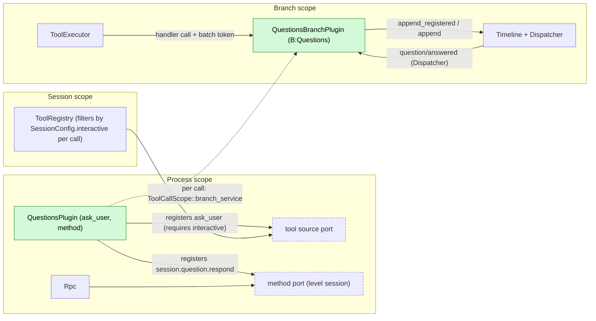
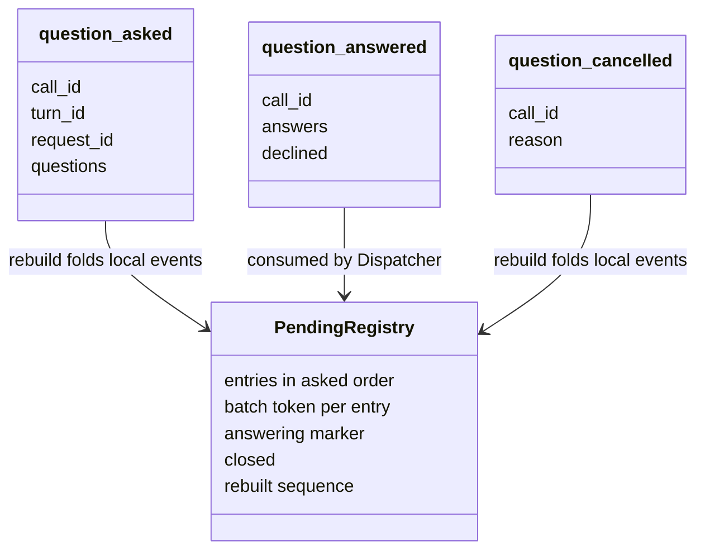
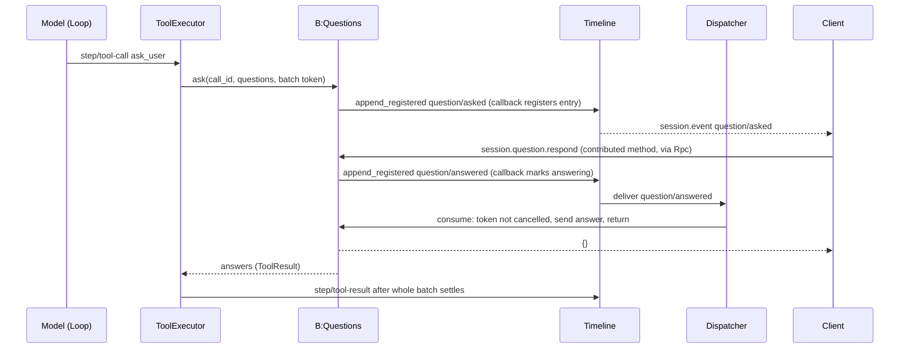
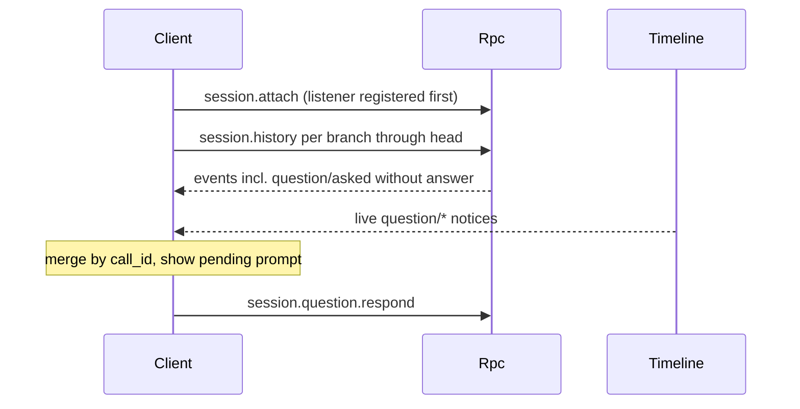
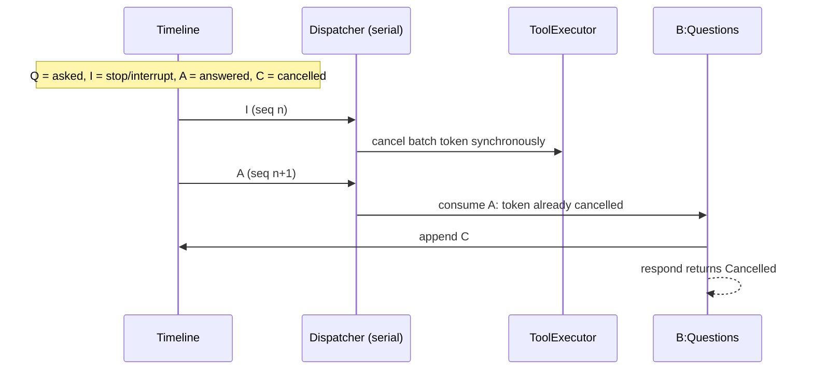
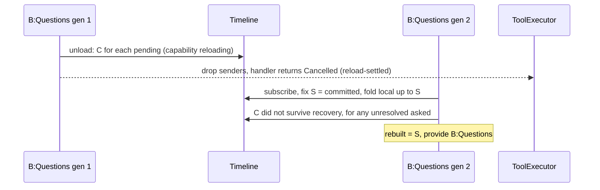

# Questions

Status: Draft. Overall design: [overview B.1](../overview.md#b1-questions). Phase: P1. Language: Rust.

The model asks the user one or more questions through the `ask_user` tool and waits for the answer: single choice, multiple choice, several questions in one call, custom answer. A process part registers the tool into ToolRegistry's [tool source port](../contracts/process-tool-contribution.md), where it is offered per call only to interactive Sessions, and registers the Session method `session.question.respond` into Rpc's [method port](../contracts/session-boundary.md). A branch part records the pending question and the answer as Timeline facts and decides answer versus interrupt by sequence number (the [Approval](../../architecture/rust-agent/plugins/Approval.md) pattern); it is the only scoped part because it writes the branch Timeline ([ADR 002](../../adr/002-dependency-direction.md) D3).

## 1. Structure



ToolRegistry offers `ask_user` only when the calling Session's `SessionConfig.interactive` is true; all waiting and ordering lives in the branch part. The process part holds no state, depends on no Session or branch plugin and reaches the branch only per call through `ToolCallScope::branch_service::<Questions>()` ([process-tool-contribution A.4](../contracts/process-tool-contribution.md#a4-per-call-context)).

| Part | Scope | Depends on | Provides |
| --- | --- | --- | --- |
| `QuestionsPlugin` | Process | [tool source port](../contracts/process-tool-contribution.md), [method port](../contracts/session-boundary.md) | Tool set `questions` (`ask_user`, requirement `interactive`); method `session.question.respond` (`level: session`) |
| `QuestionsBranchPlugin` | Branch | `B:Timeline`, `B:Dispatcher` | `B:Questions` (`ask`, `respond`) |

Contracts depended on: the tool source port and its per-call context (calling Session's `SessionConfig`, branch, batch token, `ToolCallScope::branch_service::<T>()`, A1), which resolves the calling branch's service as [Wait](../../architecture/rust-agent/plugins/Wait.md) does; Permission risk category `session`; ToolExecutor's batch token and settlement; the `Timeline` append contract and Dispatcher protocol of [single-tree](../../architecture/rust-agent/single-tree.md); `SessionConfig.interactive` (proposed Agents supplement, set by `session.create`); the method port (Rpc passes the acquired Session to `level: session` handlers); client-visible dynamic events (#2, A10).

Contracts defined here: the `ask_user` tool, the `question/*` data and consumption contracts, `B:Questions`, `session.question.respond` and its errors. The only write path of `question/answered` is `Questions::respond`. Questions names no other plugin's internal type.

## 2. Data and state



All three events are branch Timeline facts written only by `B:Questions`; the pending registry is memory under a `Mutex` (no `StateCell`, like Approval) and is never carried across generations.

Outcome rule, used by rebuild and by clients reading history: a question is **pending** while it has `asked` and neither `answered` nor `cancelled`; **answered** when an `answered` exists and no `cancelled`; otherwise **cancelled**. `cancelled` always wins because it is written exactly when an answer was not delivered to the handler.

Rebuild on load folds only the branch's local events (a child branch never owns its parent's questions) and writes `question/cancelled` ("did not survive recovery") for every unresolved `asked`. `interactive` is fixed at Session creation, so the per-call filter gives a stable tool list per Session.

Why the events exist (overview §6): between handler start and `step/tool-result` a call has no fact, and results publish only after the whole batch, so "waiting" and "answered" are not derivable; the answer is user content that must be a fact to be ordered against `stop/interrupt` and to survive until the batch result. `turn_id`, `request_id` and `declined` extend the overview payload (A3, open question F1).

## 3. Flows

### 3.1 Ask and answer



`respond` returns only after the Dispatcher consumed the answer, so `{}` means the answer reached the waiting call. The Dispatcher handler only resolves channels; the ask future builds the result.

### 3.2 Detach and re-attach



Ordering closes the attach race: anything dispatched before the listener is in history, anything later arrives live, duplicates merge by `call_id`. No Questions-specific replay is added to Rpc.

### 3.3 Non-interactive Sessions

`session.create {interactive: false}` (used by `exec`, AcpGateway, Scheduler, Workflow) fixes `SessionConfig.interactive = false`; ToolRegistry filters `ask_user` out for that Session and the model never sees it. A model calling it by name gets `Unknown tool`.

## 4. Timing and conflicts

### 4.1 Answer versus interrupt



The Dispatcher delivers each event to every subscriber before the next, so a token cancelled at consumption of `A` means an interrupt with a lower sequence was consumed. If `A` precedes `I`, the answer is accepted and kept as a truly completed result; the turn still ends cancelled after `step/tool-result`.

### 4.2 Reload and restart



Nothing is re-asked. The branch part reloads only with `B:Timeline`/`B:Dispatcher` and is not on ToolExecutor's injection chain, so its reload ends only its own calls. A `QuestionsPlugin` (process) unload removes its registrations: in-flight `ask_user` calls end "provider unavailable", the ask future is dropped and writes `question/cancelled {reason: "provider unavailable"}`, and turns continue; no consumer reloads.

| Scenario | Outcome |
| --- | --- |
| Two clients answer | Second registration fails `AlreadyAnswered` |
| Client unable to answer (ACP, `-p` attached to an interactive Session) | ACP Sessions are non-interactive, no tool; a `-p` CLI stops the turn with exit code 3 (A8) |
| `QuestionsPlugin` unloaded while pending | Call ends "provider unavailable"; `C` written; turn continues |
| Remote paired device answers | Allowed: Session method; paired devices may call all Session methods |
| `input/withdrawn` while pending | No effect on the question |
| Process restart mid-question | `C` on load; batch settled as not executed; turn Failed |

Full table: Appendix B.

## 5. Context mapping

| What the model sees | Form | Placement |
| --- | --- | --- |
| `ask_user` name, description, schema | Tool declaration of the `questions` set | Adopted `context/configured`, interactive Sessions only |
| Answers, decline | `ToolResult.content` (Appendix A.1) | Tool result position, after every call of the batch settles |
| Cancellation | Error text from ToolExecutor | Same position |

Never visible: `question/*` events, `structured_content`, the CLI rendering. Compaction keeps the declaration (configuration) and keeps answers only through the summary. Child branches inherit the declaration and answers whose `step/tool-result` precedes the cut; a call cut between `asked` and its result projects as not executed. Non-interactive Sessions see no declaration.

## 6. Interfaces (summary)

| Interface | Kind | Purpose |
| --- | --- | --- |
| `ask_user` | Tool (tool source port), risk `session` | Ask 1–4 questions, wait for the answer |
| `session.question.respond` | Session method (method port, `level: session`) | Answer or decline a pending call |
| `B:Questions::ask` / `respond` | Branch service | Register and wait; boundary write of the answer |
| `question/asked`, `question/answered`, `question/cancelled` | Events | Pending state and answer ordering |
| CLI prompt contract | Client | Rendering, deferral, `Ctrl+C`, attach |

## 7. Security

`ask_user` uses no host resource and is `session` risk (allowed under every preset; `disallowed_tools` still applies). Answers are user content written as facts and replayed to the model; clients must not put secrets in them. `session.question.respond` is available to any client with Session access, including paired remote devices (maintainer decision; see [RemoteGateway](RemoteGateway.md)); it confers no authority beyond answering. Questions never widens permissions; replay never re-asks.

## Appendix A. Interface details

### A.1 Tool `ask_user`

Registered into the tool source port, risk `session`, requirement `interactive`: ToolRegistry declares it only when the calling Session's `SessionConfig.interactive` is true.

| Parameter | Type | Rule |
| --- | --- | --- |
| `questions` | array, 1..=4 (A4) | Required |
| `questions[].id` | string | Optional; defaults to `"1"`, `"2"`, ... by position; unique in the call |
| `questions[].header` | string, at most 40 chars | Optional short label |
| `questions[].question` | non-empty string | Required |
| `questions[].options` | array of `{label, description?}`, 2..=6, unique labels | Required (A4) |
| `questions[].multiSelect` | boolean, default false | Multiple choice |
| `questions[].allowCustom` | boolean, default true | "Other" free text (A5) |

Validation happens in the handler; invalid input returns an error `ToolResult` and writes nothing. Result `content`:

```
User answered:
1. <question>
   -> <label>, <label>
2. <question>
   -> (custom) <text>
```

A declined call yields `User declined to answer the question(s).` (A6). `structured_content` carries `{answers, declined}` for clients only. Cancellation is reported by ToolExecutor from the handler's `HostError::Cancelled`.

### A.2 Event payloads

| Type | Payload | Write path | Consumers |
| --- | --- | --- | --- |
| `question/asked` | `call_id, turn_id, request_id: String`, `questions: Vec<Question>` | `Questions::ask`, `append_registered`; callback registers the entry under the lock (fails if closed or `call_id` already pending) | Rebuild; clients show the prompt |
| `question/answered` | `call_id: String`, `answers: Vec<Answer>`, `declined: bool` | `Questions::respond`, `append_registered`; callback fails `Closed`/`Cancelled`/`AlreadyAnswered`, else sets `answering` and stores the waiter by event id | Dispatcher subscription `"Questions"`, under the rebuild gate, skipping `sequence <= rebuilt`; accepted only if the entry is pending and its token is not cancelled. Clients close the prompt |
| `question/cancelled` | `call_id, reason: String` | `Questions` only, `append` (no registration): ask future on cancel, consumer, `close()`, rebuild | Rebuild; clients close the prompt |

All three are declared through #2 registration as client-visible and are never rendered into model history.

```rust
pub struct Question { pub id: String, pub header: Option<String>, pub question: String,
    pub options: Vec<QuestionOption>, pub multi_select: bool, pub allow_custom: bool }
pub struct QuestionOption { pub label: String, pub description: Option<String> }
pub struct Answer { pub question_id: String, pub selected: Vec<String>, pub custom: Option<String> }
```

### A.3 Branch service

```rust
impl Questions {   // key BranchScope::key::<Questions>()
    /// Registers and waits. `cancel` is the batch token from ToolExecutor.
    pub async fn ask(&self, call_id: &str, ctx: &ToolExecutionContext, questions: Vec<Question>,
        cancel: CancellationToken) -> Result<Answered, HostError>;
    /// `Ok` means the answer was dispatched and delivered to the waiting call.
    pub async fn respond(&self, call_id: &str, answers: Vec<Answer>, declined: bool)
        -> Result<(), QuestionRespondError>;
}
pub enum QuestionRespondError { Unknown, AlreadyAnswered, Cancelled, Invalid(String), Closed }
```

### A.4 Mechanics

| Step | Mechanics |
| --- | --- |
| Tool resolution | Handler: `ToolCallScope::branch_service::<Questions>()`; no AgentIndex is involved, so no `Reloading`; `BranchMissing` (branch closed), `Pending` (branch part not active) or `NotProvided` → error result, turn continues |
| Ask | Token already cancelled: return Cancelled, write nothing. Else `append_registered(question/asked)`; on commit failure remove the entry and return Cancelled or an error |
| Wait | `select! biased { response, cancel.cancelled() }`. On cancel: take the entry under the lock; if taken, write `question/cancelled {reason: "Tool execution cancelled"}` after releasing the lock; return Cancelled. Dropped sender: Cancelled with `CAPABILITY_RELOADING`. Ask future dropped (process part unloaded): the entry guard takes the entry and writes `question/cancelled {reason: "provider unavailable"}` |
| Respond | Pre-check pending and validate against the entry's `asked` data; `append_registered(question/answered)`; await the dispatch result |
| Consume | Take the entry; token cancelled: send `None`, reply `Cancelled`, write `question/cancelled`; else send the answer, reply `Ok`. Missing entry: `Unknown` |
| Recheck | Only the batch token, which reflects interrupts ToolExecutor already consumed; no committed-but-unconsumed tail is read (time-bus §4) |
| Terminal facts | `asked`/`cancelled` by Questions (initiator), `answered` is the boundary fact; the call's terminal fact is ToolExecutor's `step/tool-result` |
| Unload | `ctx.effect` disposer: set `closed`, drop respond waiters (`Closed`), take all entries, write `question/cancelled {reason: "capability reloading"}`, drop senders. A closing Timeline may reject the write; that branch is not restored |
| Load / restart | Subscribe, fix `S = committed()` under the gate, fold `local(..=S)`, cancel unresolved, set `rebuilt`, provide `B:Questions` |

### A.5 Session method `session.question.respond`

Registered by `QuestionsPlugin` with `level: session` into the [method port](../contracts/session-boundary.md). Rpc acquires the Session as for any Session method and passes it to the handler; the handler resolves `B:Questions` of the named branch per call (`service::<Questions>(branch)`, as `approval.respond` does today).

`{sessionId, branchId?: "main", callId, answers: [{questionId, selected: [label], custom?}], declined?: false}` → `{}`.

| Error | Condition |
| --- | --- |
| `invalid_params` `Question is absent or already resolved` | `Unknown` |
| `invalid_params` `Question already answered` | `AlreadyAnswered` |
| `invalid_params` `Question was cancelled` | `Cancelled` |
| `invalid_params` `<reason>` | `Invalid`: unknown question id, label not offered, several labels without `multiSelect`, `custom` without `allowCustom`, nothing selected and no `custom` while not `declined` |
| `service_reloading` | `Closed` on a live branch |
| Method port outcome for an unregistered method | `QuestionsPlugin` not registered |
| Session closed | `Closed` on a closed Session, mapped like `approval.respond` |

Accepted commands belong to the Session and continue after disconnect.

### A.6 CLI contract

The CLI handles `question/*` notices of every branch of the attached Session (A9), like approvals:

| Situation | CLI behavior |
| --- | --- |
| `question/asked`, no prompt open | Queue; one call at a time in arrival order. Print `[question] <header>`, each question with numbered options, plus `0. Other (type your answer)` when `allowCustom`. Prompt `Choose 1-N` or `Choose numbers, comma separated`. Empty line on the first question declines the call (A6) |
| Prompt open | Other notices deferred until the prompt closes |
| All questions collected | `session.question.respond`; error replies printed; `Cancelled`/`Unknown` close the prompt silently |
| `answered`/`cancelled` for the shown call | Close the prompt; print `[question answered elsewhere]` or `[question cancelled]` |
| `Ctrl+C` while prompting | `session.stop` (turn); the interrupt cancels the question |
| EOF | `session.stop`; exit code 130 |
| No interactive input (`-p`) and a question arrives | `Interactive answer required; stopping`, `session.stop`, exit code 3 (A8) |
| Attach or resume | Listener first, then `session.history` per branch; derive pending; merge by `call_id` |

## Appendix B. Full conflict table

`A` = `question/answered`, `I` = turn `stop/interrupt`, `Q` = `question/asked`, `C` = `question/cancelled`, `R` = `step/tool-result`.

| Scenario | Sequence order | Outcome | Owner of the decision |
| --- | --- | --- | --- |
| Interrupt before the batch is dispatched | I < `step/tool-call` consumed | No `Q`; call not executed | ToolExecutor |
| Interrupt before the question is registered | I consumed, then `ask` | Token cancelled; nothing written | Questions (token check) |
| Answer, then interrupt | Q < A < I | Answer accepted; result kept as completed; turn ends cancelled after R | Questions; ToolExecutor |
| Interrupt, then answer committed before cancel | Q < I < A < C | `respond` → `Cancelled`; `C` written | Questions |
| Interrupt, cancel written, then answer | Q < I < C | Registration fails `Cancelled`; nothing written | Questions |
| Two clients answer concurrently | Q < A1 (A2 rejected) | `AlreadyAnswered`; first decides | Questions (registration lock) |
| Duplicate or late RPC | after resolution | `Unknown` or `Cancelled`; nothing written | Questions |
| Branch-scoped interrupt, branch close | Q < branch I | Token cancelled → C; close settles the rest with C | Questions; ToolExecutor |
| Answered, other calls of the batch running | Q < A < R | Answer held in the handler result until R | ToolExecutor |
| Answered, then reload before R | Q < A < reload | Batch reload-settled, turn Failed; question outcome answered | ToolExecutor |
| Answer committed, Questions unloads before consuming | Q < A, unload | `close()` writes C: cancelled; `respond` → `service_reloading` | Questions |
| Steer/Queue/Append while pending | Q < input | Consumed only after R (Steer/Append) or `turn/end` (Queue); question continues (A11) | Loop, InputQueue |
| `input/withdrawn` while pending | Q < withdrawn | No effect; withdrawal concerns unconsumed inputs only | InputQueue |
| Several `ask_user` in one batch | Q1 < Q2 | Answered independently; results published together | Questions; ToolExecutor |
| Same `call_id` asked twice | — | Second registration fails; error result | Questions |
| Compaction between Q and R | — | Cannot happen: compaction runs at request preparation, not during a batch | ContextPreparation |
| Child branch cut between Q and A | Q < cut < A | Child has nothing pending; inherited call projects as not executed | Questions (child) |
| Session unload | Q pending | Turn running, Session not idle, not unloaded | AgentIndex |
| Process restart mid-question | Q, no A/C | Load writes C; batch settled; turn Failed | Questions; ToolExecutor; Loop |
| Resource node offline | — | No host resource used; unaffected | — |
| Client detach | — | Question stays pending | — |
| Client unable to answer: ACP | — | ACP Sessions created non-interactive; no tool ([AcpGateway](AcpGateway.md)) | Agents; QuestionsPlugin |
| Client unable to answer: `-p` CLI on an interactive Session | Q < I | CLI stops the turn; C via the interrupt | CLI; Questions |
| No client attached ever | Q pending | Stays pending, no timeout (A7); user stops or answers later | User |
| Paired remote device answers | Q < A | Accepted like any client | Questions |
| `QuestionsPlugin` unloaded | Q pending | `ask_user` call ends "provider unavailable", `C` written, turn continues; `session.question.respond` gets the method port's unregistered outcome | Tool source port; method port; Questions |
| Non-interactive Session | — | Tool filtered out per call; call by name → `Unknown tool` | ToolRegistry, ToolBinding |

## Appendix C. Errors and recovery

| Case | Result |
| --- | --- |
| Invalid tool input | Error `ToolResult`; nothing written |
| Branch service missing (reloading) | Cancelled with `capability reloading`; ToolExecutor reload-settles |
| `asked` commit fails | Entry removed; Cancelled or error result |
| Interrupt, branch close | `question/cancelled`; handler `HostError::Cancelled` |
| Reload, restart | `question/cancelled` for every unresolved question; never re-asked |
| `respond` during reload | `service_reloading`; the retry returns `Unknown` because the question was cancelled |

## Appendix D. Acceptance

Flow tests through RPC, tool calls and events:

1. Single, multiple, multi-question and custom answers produce the specified `content`; invalid answers are rejected at `respond` without facts.
2. `ask_user` absent in a Session created with `interactive: false` (incl. `exec` and ACP); present otherwise and when `interactive` is omitted.
3. Answer then stop: result has the answer. Stop then answer: `Cancelled`, `question/cancelled`, cancelled result. Both orders forced by committing `I` before `A` with a held Dispatcher.
4. Two concurrent `respond`: exactly one accepted.
5. Two `ask_user` plus a slow tool in one batch: answers held until the single `step/tool-result`.
6. Branch close, branch-part reload and process-part unload settle pending questions (the unload ends the call "provider unavailable" without failing the turn); restart writes "did not survive recovery" and the turn fails; no re-ask.
7. Detach and re-attach: history shows the pending question; answering after re-attach works; answering from a paired remote device works.
8. A withdrawn queued input while a question is pending does not affect it.
9. CLI: rendering, deferral, `Ctrl+C`, EOF, `-p` exit code 3.

## Appendix E. Assumptions

| # | Assumption | Basis | Effect if rejected |
| --- | --- | --- | --- |
| A1 | `ask_user` registers into the tool source port with requirement `interactive`, and the port's per-call context gives the handler the calling branch's service lookup | [ADR 002](../../adr/002-dependency-direction.md) D2, D3; [session-access](../contracts/session-access.md) `config` | The handler resolves the branch through Session access per call |
| A2 | `interactive` omitted on `session.create` means interactive | Judgment (existing clients) | Existing Sessions lose the tool |
| A3 | Payload adds `turn_id`, `request_id`, `declined` | Judgment | Correlation through `step/tool-call`; decline modeled as an answer |
| A4 | 1..=4 questions, 2..=6 options | Edge-case reference; judgment | Schema limits change |
| A5 | Custom answers allowed by default | Feature list "custom answers"; default is judgment | Model must opt in |
| A6 | The user may decline a whole call | Maintainer decision | User must answer or stop |
| A7 | No timeout | Maintainer decision | A timeout writes `question/cancelled {timeout}` |
| A8 | CLI without input stops with exit code 3 | CLI approval precedent | Different exit policy |
| A9 | Questions of every branch are presented | Approval precedent | Child-branch questions need another client |
| A10 | #2 registration marks events client-visible and Connection forwards them as `session.event` | Overview §1 (#2); judgment | Rpc needs dedicated notifications like `approval.request` |
| A11 | Steer does not end a pending question | Judgment | Steer cancels with reason `user steer` |

## Appendix F. Open questions

| # | Question | Description |
| --- | --- | --- |
| F1 | Overview §6 payloads | `turn_id`, `request_id`, `declined` are not in the overview's `question/*` fields (A3) |
| F2 | Client visibility of dynamic events | Whether #2 projects plugin events to clients by a declared flag (A10) |
| F3 | Overview §13 "How events enter context" | Designed for tool results only (ADR 001) |
