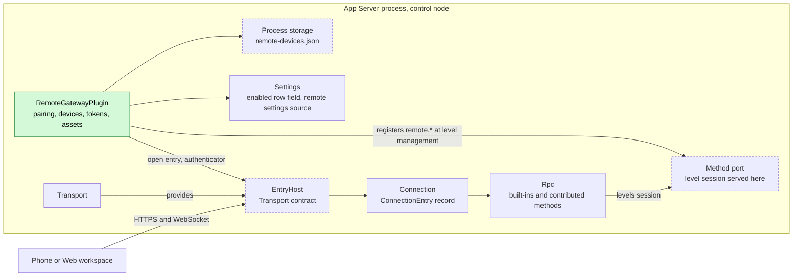
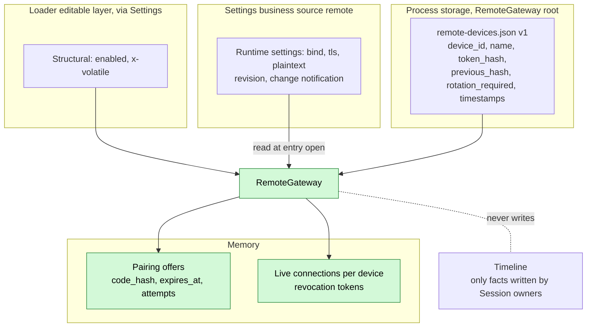
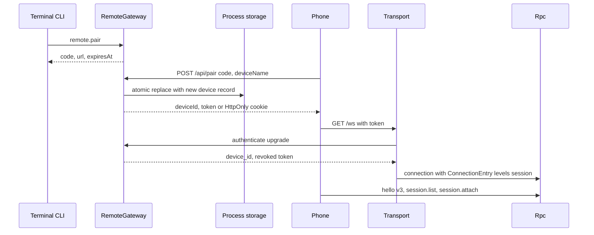
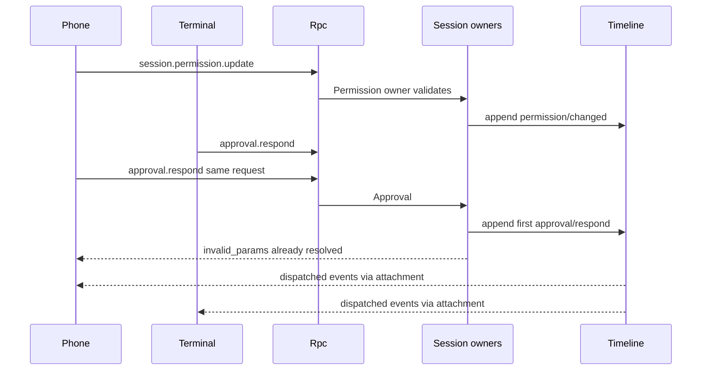
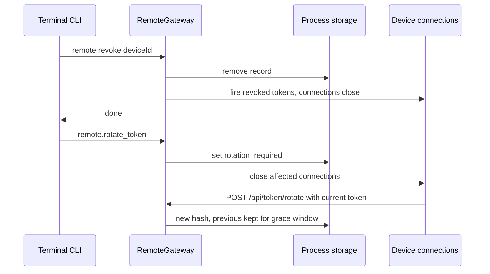
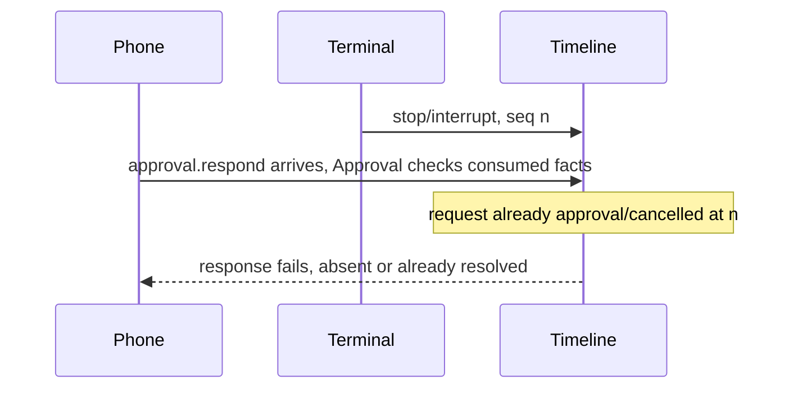

# RemoteGateway

Status: Draft. Overall design: [overview B.13](../overview.md#b13-remotegateway), [Transport, Connection changes](../overview.md#c2-app-server-process-plugins), [multiple nodes](../overview.md#63-multiple-nodes), [common constraints](../overview.md#62-constraints), [ADR 002](../../adr/002-dependency-direction.md). Phase: P3 (authentication, disconnection and TLS trade-offs with [#5](https://github.com/arcships/dim/issues/5)). Language: Rust.

RemoteGateway opens an authenticated entry on Transport's WebSocket for phones and the Web workspace: pairing by QR code or pairing code, per-device tokens with rotation and revocation, and the Web workspace static assets. Paired devices speak the existing App Server protocol; the entry serves only `level: session` of the [method contribution](../contracts/session-boundary.md#a1-method-port) contract, so devices may call every Session method, including `session.permission.update` (decision E3), and no management method. The entry is the product UI plane and never carries the rutis link plane between nodes.

## 1. Structure



RemoteGateway only authenticates upgrades and records the device on the connection; every call afterwards is an ordinary Session-level method served by its owner. Its own `remote.*` methods are contributed at `level: management`, so they are reachable from the local entry, not from paired devices.

| Part | Scope | Depends on | Provides |
| --- | --- | --- | --- |
| `RemoteGatewayPlugin` | Process, control node | `EntryHost` (Transport), process storage, `SettingsService`, method port | `remote.*` methods (level management) |
| `TransportPlugin` (change) | Process | existing | existing `ListenAddresses`; added `EntryHost` |
| `ConnectionPlugin` / `RpcPlugin` (change) | Process | existing | `ConnectionEntry {name, levels, device_id}`; Rpc dispatches only the entry's levels |

Contracts defined here: device records and tokens, pairing and rotation HTTP endpoints, `remote.*` methods, the `remote-devices.json` format. Contracts depended on: Transport's `EntryHost` and `UpgradeAuthenticator` (proposed Transport change; Transport owns them as their consumer), Connection's entry record, the [method contribution](../contracts/session-boundary.md#a1-method-port) contract and its entry level rules ([Management A.1](Management.md#a1-entry-levels-and-export)), [process storage](../overview.md#c2-app-server-process-plugins), a typed Settings operation for the structural `enabled` field (`x-volatile`, `VolatileUpdate`, rutis-loader 0.10), and the Settings business source for runtime settings (ADR 002 D5). RemoteGateway knows no Session method's meaning and no other plugin.

## 2. Data and state



`enabled` is structural plugin configuration; `bind`, `tls` and `plaintext` are business configuration read when the entry opens, and a change is a data update with a notification, never a plugin reload (A16). Device records are host-local security material in process storage (atomic replace, lock, format version, owner-only file); a corrupt or unreadable file fails closed. Offers and live connections are in memory and lost on reload or restart. The Timeline holds only facts that Session owners write for remote calls, without device attribution (A2).

## 3. Flows

### 3.1 Pairing and connect



The offer is single use and consumed before the record is written; tokens are stored only as hashes.

### 3.2 Remote control of a Session



Remote and local clients are equal Session clients; owners validate at their boundary and Timeline sequence decides between them. Both attachers see the same events in per-branch order.

### 3.3 Revocation and rotation



Revocation is persisted before connections close, so a racing upgrade with the old token is rejected. Admitted commands of a revoked device continue; their replies are lost.

## 4. Timing and conflicts



Every race between remote and local clients is decided by Timeline sequence inside the owning plugin; RemoteGateway decides only its own pairing, revocation and rotation order.

| Scenario | Outcome | Owner |
| --- | --- | --- |
| Phone and terminal answer the same approval or question | First consumed fact decides; second fails | Approval, Questions |
| Phone `session.permission.update` races terminal | Two `permission/changed` facts; later sequence wins | Permission |
| Phone withdraws an input (`session.input.withdraw`) while it is consumed | `input/consumed` first: withdraw fails; `input/withdrawn` first: never consumed | InputQueue |
| Disconnect with a pending approval | Stays pending; replayed on re-attach; no timeout (A14) | Approval |
| Revocation while that device's request runs | Connection closed; command continues; reply lost | Rpc |

Full table: [Appendix B](#appendix-b-full-conflict-table).

## 5. Context mapping

No model-visible effect of its own. Content from remote clients enters the model exactly as local client content: `session.submit` user content (text, images) becomes one user message at the input's consumed position, with no source marker because the user is its author; approvals, stops, withdrawals and permission changes are not model content. Compaction, child-branch inheritance and non-interactive Sessions follow the Session input rules ([session access](../contracts/session-access.md)). The model never sees device ids, device names, tokens, entry names or diagnostics.

## 6. Interfaces (summary)

| Interface | Kind | Purpose |
| --- | --- | --- |
| `GET /`, `/assets/*` | HTTP | Web workspace static assets |
| `POST /api/pair`, `POST /api/token/rotate` | HTTP | Pairing, device token rotation |
| `GET /ws` | WebSocket | App Server protocol v3 for paired devices: all Session methods |
| `remote.start/stop/status/pair/devices/revoke/rotate_token` | Methods, level management | Local administration of the entry and devices |
| `EntryHost`, `UpgradeAuthenticator`, `ConnectionEntry` | Transport/Connection change | Authenticated entries with assembly-defined levels |
| CLI | `/remote`, `/web`, `dimcode remote`, `dimcode web` | User entries |

Details: [Appendix A](#appendix-a-interface-details).

## 7. Security

Every paired device has full Session-level control of every Session on the host: submitting input, answering approvals and questions, stopping turns, `session.permission.update`, `session.exec.stop`, `session.model.update`, `session.mcp*` and creating Sessions in any authorized directory (decision E3, A12). This widens today's local-only execution Session methods and is recorded in [Management's compatibility table](Management.md#a3-classification-migration-and-compatibility). The permission preset changed remotely is Session configuration (decision E4): a Timeline fact inherited by child branches and reset to the default on fork. The entry never grants management: pairing, revocation, configuration, host-local approvals and `daemon.shutdown` are `level: management` and require an entry that serves that level; serving it here is an assembly option equal to giving every paired device host administrator rights. Authentication stays minimal ([overview multiple nodes](../overview.md#63-multiple-nodes)): one bearer token per device, hashed at rest, rotated by the device, revoked locally; pairing codes are short-lived, single-use and rate-limited. Cookies are `HttpOnly`, `Secure`, `SameSite=Strict` with a same-origin `Origin` check. Tokens never appear in URLs, logs, diagnostics or Timeline. The entry never accepts rutis link frames or exports services.

## Appendix A. Interface details

### A.1 Transport change (proposed, owned by Transport)

```rust
impl EntryHost {
    /// Binds a listener served by Transport's HTTP/WebSocket stack; dropping the
    /// handle closes the listener and every connection it accepted (detach).
    pub async fn open(&self, spec: EntrySpec) -> Result<EntryHandle, EntryError>;
}
pub struct EntrySpec {
    pub name: String,                              // "remote"
    pub bind: SocketAddr,
    pub tls: Option<TlsFiles>,                     // cert and key paths on the control node
    pub authenticate: Arc<dyn UpgradeAuthenticator>,
    pub routes: Arc<dyn HttpRoutes>,               // non-WebSocket paths
    pub levels: MethodLevels,                      // assembly data; RemoteGateway passes {Session} (A1)
}
pub trait UpgradeAuthenticator: Send + Sync {
    fn authenticate(&self, request: &UpgradeRequest) -> HostFuture<'_, Result<Authenticated, Rejected>>;
}
pub struct Authenticated { pub device_id: String, pub revoked: CancellationToken }
pub struct ConnectionEntry { pub name: String, pub levels: MethodLevels, pub device_id: Option<String> }
```

The connection closes when `revoked` fires. Without RemoteGateway, the bare WebSocket keeps today's rules (protected profiles: `hello` and `daemon.ping` only).

### A.2 HTTP surface

| Path | Auth | Behavior |
| --- | --- | --- |
| `GET /`, `GET /assets/*` | None | Static files confined to the distribution's assets directory; immutable cache headers; restrictive Content-Security-Policy (A5) |
| `POST /api/pair` | Pairing code | `{code, deviceName, web?}` → `{deviceId, token}`; `web: true` sets an `HttpOnly; Secure; SameSite=Strict` cookie instead (A6); offers single use |
| `POST /api/token/rotate` | Current or previous token | New token; previous valid for this endpoint and upgrades until the new one is used or 10 minutes pass (A7) |
| `GET /ws` | Bearer token, or cookie with same-origin `Origin` | Upgrade; 401 when unknown, revoked or `rotation_required` |

Tokens: 32 random bytes, base64url; SHA-256 hashes compared in constant time. Pairing codes: 8 Crockford base32 characters (A8). Attempts: 5 per offer, 20 per minute per entry; exceeding invalidates the offer (A9). Loopback by default; non-loopback requires `tls` or explicit `plaintext: true` (A10).

### A.3 Protocol on the remote entry

| Item | Rule |
| --- | --- |
| Version | `hello` v3 only; v1/v2 rejected with `protocol_version` (A11) |
| Methods | Rpc Session built-ins and every contributed `level: session` method, on every Session of the host (E3, A12); `level: management` names, including `management.methods` and `daemon.shutdown` → `-32601 unknown_method` |
| `hello.features` | Session features only |
| Identity | `ConnectionEntry.device_id` for diagnostics and revocation; grants nothing beyond the entry's method set |
| Reverse requests | None: client requests, server notifies ([#5](https://github.com/arcships/dim/issues/5)) |

### A.4 Methods (namespace `remote`, level management)

| Method | Params | Result | Interruption |
| --- | --- | --- | --- |
| `remote.start` | `{bind?, tls?, plaintext?}` | `{address}` after bind | Report |
| `remote.stop` | `{}` | `{}` after listener and connections closed | Report |
| `remote.status` | `{}` | `{enabled, running, address?, tls, error?, devices, connections}` | Drain |
| `remote.pair` | `{ttlSeconds?}` (default 300, max 900) | `{code, url, expiresAt}`; `url` is `<origin>/pair#code=<code>` | Drain |
| `remote.devices` | `{}` | `[{deviceId, name, pairedAt, lastSeenAt, connections, rotationRequired}]` | Drain |
| `remote.revoke` | `{deviceId}` | `{}` after record removed and connections closed | Report |
| `remote.rotate_token` | `{deviceId?}` (absent: all) | `{}` after flag persisted and connections closed | Report |

`remote.start`/`stop` write the structural `enabled` field through the typed Settings operation; the loader delivers a `VolatileUpdate` without reloading the plugin, and RemoteGateway opens or drops its `EntryHandle`. `remote.start` parameters `bind`, `tls`, `plaintext` are saved to the business source first. A business-source change while the entry runs reopens the `EntryHandle` with the new settings (connections detach) without reloading the plugin (A16).

### A.5 Capability mechanics

| Step | Path |
| --- | --- |
| Writes | None by RemoteGateway. Remote calls reach owners through Rpc like local calls: `session.submit` → Session input boundary (`Timeline::append`), `approval.respond` → branch Approval (`approval/respond`), `session.stop` → `stop/interrupt`, `session.permission.update` → Permission (`permission/changed`), `session.input.withdraw` → InputQueue (`input/withdrawn`) |
| Dispatcher | Not subscribed; devices receive events through their per-connection Session attachment |
| Concurrent attachers | No exclusive owner (A13); all receive the same events in per-branch order |
| Reload | Drops the `EntryHandle`: listener and remote connections close (detach); records persist; offers lost; `remote.*` leave the method port until re-registered. Transport reload reloads RemoteGateway (it injects `EntryHost`); runtime-settings changes never reload it |
| Process restart | Entry reopens if `enabled`; devices reconnect and re-attach; committed inputs and pending approvals replay on attach |

## Appendix B. Full conflict table

| Scenario | Sequence order | Outcome | Owner of the decision |
| --- | --- | --- | --- |
| Phone and terminal answer the same approval | first `approval/respond` | First decides; second `invalid_params` | Approval |
| Remote answer after turn `stop/interrupt` | interrupt < response | Request already `approval/cancelled`; response fails | Approval |
| Remote answer before the interrupt | response < interrupt | Accepted; tool may still be stopped before start | Approval, ToolExecutor |
| Branch-scoped interrupt or branch close while attached | — | Events delivered; later calls on that branch fail | Session owners |
| Phone Steer while terminal Queue input pending | Timeline order | Applied per mode in sequence order | InputQueue, Loop |
| Remote withdraw vs consumption of the input | `input/consumed` vs `input/withdrawn` | Earlier fact wins; the other is rejected | InputQueue |
| Remote submit during an unsettled tool batch | input < `step/tool-result` | Steer/Append after the batch result; Queue after `turn/end` | Loop |
| Remote `session.permission.update` vs terminal update | sequence | Later `permission/changed` is current; tool admissions use the policy consumed at admission | Permission, Approval |
| Remote `session.exec.stop` vs exec completion | sequence | Earlier terminal fact wins | WorkspaceTools exec owner |
| Compaction or child cut around a remote input | — | As any input ([session access](../contracts/session-access.md)) | ContextPreparation, InputQueue |
| Fork after a remote permission change | — | Fork resets the preset to default (E4) | SessionStore |
| Question answered from two devices | first `question/answered` | First accepted | Questions |
| Disconnect while an approval is pending | — | Stays pending; replayed on re-attach (A14) | Approval |
| Disconnect after `session.submit` admitted, reply lost | input committed | Reconnect, `session.input_lookup` by `submissionId` | Client |
| Revocation while a device's request runs | admitted < revoke | Connection closed; command continues; reply lost | Rpc |
| Upgrade racing revocation | record removed < connections closed | Upgrade with the old token rejected | RemoteGateway |
| Two phones use one pairing code | first `POST /api/pair` | Second fails, counts as an attempt | RemoteGateway |
| Rotation response lost | — | Previous token valid in the grace window; device retries | RemoteGateway |
| `remote.rotate_token` while a device rotates | persisted flag order | Rotation before the flag is also flagged | RemoteGateway |
| `remote.stop` with attached devices | — | Connections close (detach); Sessions continue | RemoteGateway, Transport |
| Rpc reload | — | `service_reloading` for affected calls; connections stay unless the protocol instance changes | Rpc |
| Contributor of a session-level namespace unloads | — | Its names `service_reloading` while it unloads, then `unknown_method` until it registers again; its in-flight `Report` calls end `operation_interrupted`, `Drain` calls delay the unload; connections stay | Rpc, contributor |
| Runtime settings change while devices are connected | business source revision | Entry reopens with the new settings; connections detach and reconnect | RemoteGateway |
| Session closed by another client | `session.closed` | Remote attachers receive it | Connection |
| Session idle unload with only remote attachers | — | Attachment pins the Session; detach releases | AgentIndex |
| Resource node of a Session offline | — | Same retryable errors as local clients | Session owners |
| Process restart with offers outstanding | — | Offers lost; devices persist | RemoteGateway |

## Appendix C. Errors and recovery

| Case | Result |
| --- | --- |
| Bind failure on `remote.start` | `-32000 remote_bind_failed`; `enabled` stays false |
| TLS files unreadable | `-32000 remote_tls_invalid`; not started |
| Non-loopback bind without TLS or `plaintext` | `-32602 invalid_params` |
| Device file corrupt or unreadable | `remote.status.error`; all upgrades rejected; `remote.devices` fails `remote_storage_failed`; file kept for repair |
| Process storage lock or write failure on pair/revoke/rotate | `-32000 remote_storage_failed`; in-memory state unchanged; revocation not reported done |
| Unknown device id | `-32602 invalid_params` |
| Upgrade with bad token | HTTP 401, no detail; counted in diagnostics without the token |
| Listener fails while running | Entry closed, `remote.status.error` set, `enabled` unchanged; daemon keeps running (A15) |

## Appendix D. Acceptance

Flow tests in the App Server suite over a real WebSocket entry:

1. `remote.start`/`status`/`stop`; non-loopback without TLS rejected; restart reopens when `enabled`; changing `bind` in the business source reopens the entry without reloading the plugin.
2. Pairing with valid, expired, reused code and too many attempts; `remote.devices` lists the device.
3. A paired device calls Session methods including `session.permission.update`, `session.exec.stop`, `session.model.update` and `session.input.withdraw`; every management-level name, including `management.methods` and `daemon.shutdown`, returns `unknown_method`; v1 is rejected.
4. Two attached clients: both receive events; competing `approval.respond`; interrupt before and after a remote response; remote withdraw racing consumption.
5. Disconnect with a pending approval and with a submitted input; re-attach replays; `session.input_lookup` finds the input.
6. Revoke closes connections and rejects the token; rotation grace window; `remote.rotate_token` forces rotation.
7. A corrupt device file rejects all upgrades without resetting the file.

## Appendix E. Assumptions

| # | Assumption | Basis | Effect if rejected |
| --- | --- | --- | --- |
| A1 | Entry levels are entry assembly data; `{session}` here | Overview common constraints; method contribution entry rules | — |
| A2 | Device identity is not written to Timeline | Overview §9; judgment | Inputs carry device attribution |
| A3 | Devices stored in `remote-devices.json` in RemoteGateway's process storage | Decision R8 | Another store with a format change |
| A4 | Pairing offers in memory only | Judgment | Persisted offers |
| A5 | Web workspace assets ship with the distribution, unauthenticated | Feature list `/web`; judgment | Assets require authentication |
| A6 | Browser pairing uses an HttpOnly cookie; native clients get the token | Judgment | Token in browser storage |
| A7 | Device-initiated rotation with a 10-minute grace window; forced rotation by flag | Feature list "rotate access tokens"; judgment | Different rotation model |
| A8 | Pairing code format and 32-byte tokens | Judgment | — |
| A9 | Attempt limits 5 per offer, 20 per minute | Judgment | Different limits |
| A10 | Loopback default; non-loopback needs TLS or explicit plaintext | Overview §5.13; judgment | Policy decided in #5 |
| A11 | Remote entry accepts protocol v3 only | Judgment | v1/v2 on the entry |
| A12 | A paired device can access every Session and every Session method | Decision E3; feature list "access projects and Sessions" | Per-entry method filter or per-device scoping |
| A13 | No exclusive Session ownership; "take over" means attaching and acting | Feature list "collaborate with or take over" | A control-lock protocol |
| A14 | Pending approvals have no timeout with no client attached | Existing Approval behavior | Timeout in Approval |
| A15 | A listener failure stops only the remote entry | Judgment | Daemon shutdown on remote failure |
| A16 | `bind`, `tls`, `plaintext` are business configuration in a Settings business source; only `enabled` is structural | ADR 002 D5 | Runtime settings become `x-volatile` loader fields |

## Appendix F. Open questions

| Question | Description |
| --- | --- |
| [#5](https://github.com/arcships/dim/issues/5) and overview open questions "Remote access" | Relation of product device identity to peer tokens, link disconnection, TLS deployment |
| Per-device scope | Whether devices may later be limited to workspaces or Sessions (not required by E3) |
| Transport/Connection change | `EntryHost` and authenticator contracts are proposed here and need the Transport change document |
