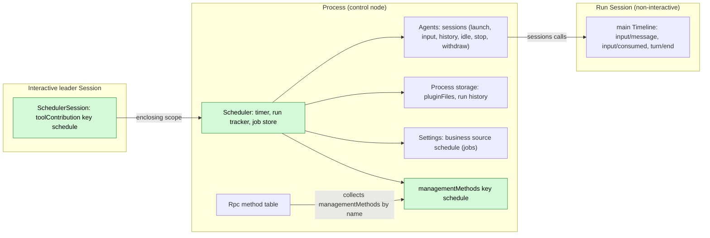
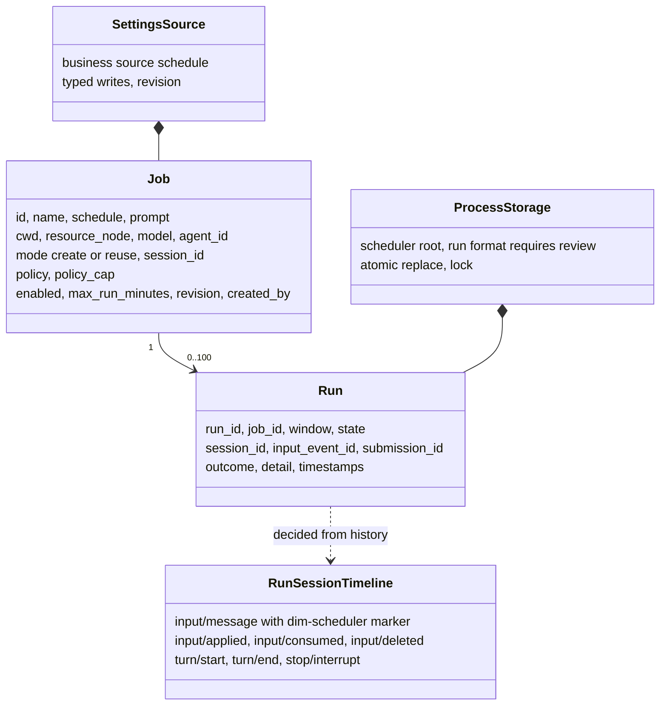
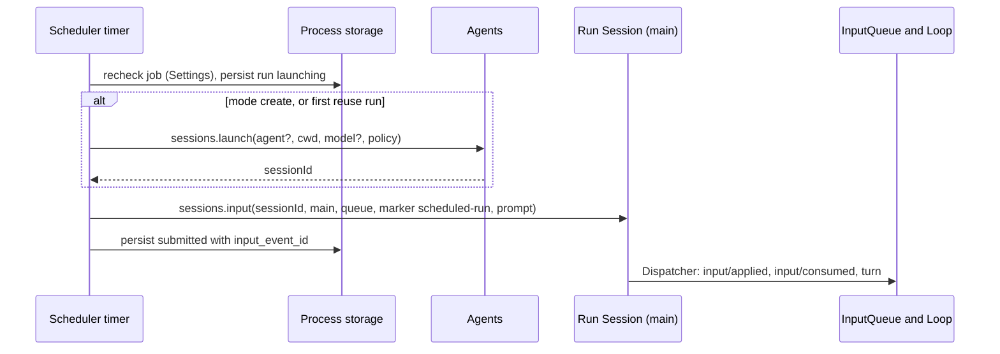
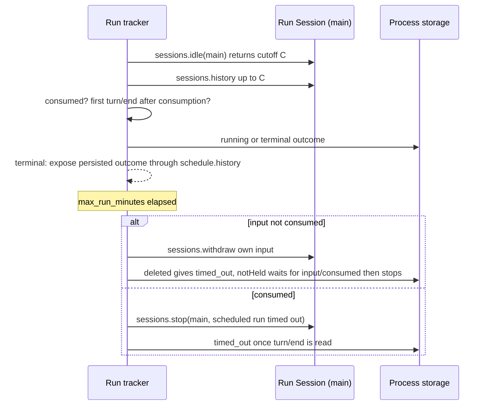
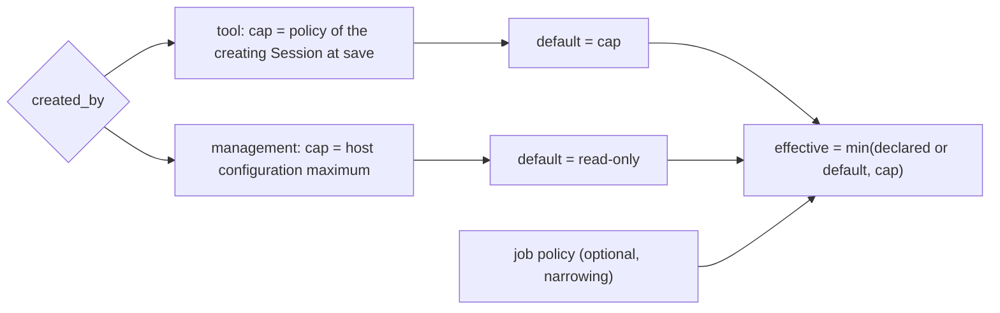
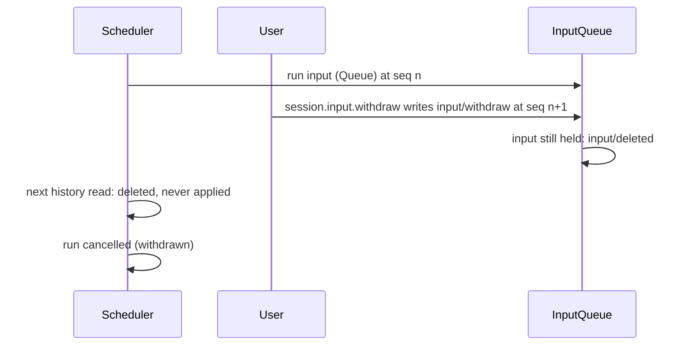

# Scheduler

Status: Draft. Overall design: [overview §4](../overview.md#4-plugin-catalog); scope: [ADR 002](../../adr/002-plugin-scope.md) (process + Session). Phase: P2. Language: TypeScript first ([overview Appendix C](../overview.md#appendix-c-implementation-language)).

**Delivery boundary.** This is a design for review, not an implemented Scheduler. C4 tools (#150), Settings source declarations/read-write (#175), Settings events (#177), `sessions` (S2) and versioned text storage (S10) are available. The remaining binding and business decisions are explicit in §1.1 and Appendix F; none is a request to expand core or rutis.

> **Offline resource nodes.** Rows about an offline resource node describe P3 multi-node behaviour. #5 is withdrawn (rutis is an external dependency, and it withdraws imported services when a link drops), so these rows are redesigned in P3 following overview §6.3: node services are looked up on each call by `resourceNode`. In P1/P2 every Session uses the control node.

**Run reporting.** Scheduler owns its run history and outcome notification. `schedule.history` is the durable read path. The notification destination and delivery policy need a business decision before implementation (A.6); no Notifications plugin or named process-event extension is required here.

Scheduler keeps scheduled jobs, which are user-written configuration, in its Settings business source `schedule`, and their run history in [`pluginFiles`](../../../crates/dim-app-server/README.md#trusted-plugin-storage). While the daemon is alive and a window is due, the process part creates a non-interactive Session through `sessions.launch` (or reuses one) and writes the job prompt as a Queue input with its own source marker through `sessions.input` ([session-access](../contracts/session-access.md)), as Collaboration reaches its members. The Session part declares the `schedule` tool (risk `persistent_configuration`) in every Session; only interactive leader Sessions can use it. Operators use the proposed `schedule.*` management methods. All contracts are language-neutral ([ADR 002 D5](../../adr/002-plugin-scope.md#d5-contracts-are-language-neutral)); the Rust binding limits are in [Appendix G](#appendix-g-rust-binding). Scheduler writes no Timeline event of its own: it derives outcomes from run Session history and persists them in its own store.

## 1. Structure

Jobs and windows span Sessions, so they belong to the process ([ADR 002](../../adr/002-plugin-scope.md) D1); offering a tool to a Session is the Session part's job (D2). The process part declares the existing `sessions`, `settings` and `pluginFiles` services. Agents' stable directory provides `sessions` and finds the current index on each call: index reload fails calls with `reloading`, without reloading Scheduler or any Session ([S2 D1](../appserver/sessions-service.md#3-decisions), [#35](https://github.com/arcships/dim/issues/35)). The requested per-call `scheduleJobs` access still needs a supported binding (§1.1); undeclared `ctx.use` is not a generic optional native lookup. C3 keeps core tool consumers independent of optional rows. No dependency from ToolRegistry, Loop or Session readiness to Scheduler is introduced. Job edits use Settings' owner write and change events, never structural reload.

| Part | Scope | Depends on | Provides |
| --- | --- | --- | --- |
| `Scheduler` | Process (control node) | Stable `sessions`, `settings`, `pluginFiles` | Job access, timer, run tracker; proposed `scheduleJobs` and management namespace `schedule` |
| `SchedulerSession` | Session, installed when Scheduler is enabled | Existing C4 tool contract; creation configuration; per-call process access subject to §1.1 | `toolContribution:schedule`; handler refuses when `interactive === false` or the Session is a Collaboration member |

**Contracts depended on:** [C4 tools](../session-typescript.md), [Settings](../appserver/settings-service.md), [S2 sessions](../appserver/sessions-service.md), [method admission](../contracts/session-boundary.md) and [pluginFiles](../../../crates/dim-app-server/README.md#trusted-plugin-storage). **Plugin-owned contracts proposed here:** job/run data, `toolContribution:schedule`, `scheduleJobs.call`, management namespace `schedule`, source `schedule`, marker `dim-scheduler` and submission ids `scheduler:<run_id>`. The risk `persistent_configuration` remains unclassified under Permission; no category is added.

### 1.1 Existing bindings and implementation gates

| Surface | Current implementation and consequence |
| --- | --- |
| Session tool | An ordinary C4 row declares `toolContribution:schedule` with synchronous `declaration` and asynchronous `execute`. Its declaration does no I/O. C3 samples active tools at branch initialization; a later provider waits for the next Session reload. |
| Process package / `scheduleJobs` | rutis already runs process service rows, but `ServerConfig.session_typescript` installs Session factories and rejects other service families. It is not generic process-package configuration. Select the package's process assembly and #35 tool access using existing mechanisms before Ready; no Session wiring row, new registry or optional-lookup API is assumed. |
| Management namespace | Rust `ManagementMethods` supports admission and `report`/`drain`; C4 currently projects tools and Session methods, not TypeScript `managementMethods`. A TypeScript row's declaration alone does not make `schedule.*` callable. Binding choice is an Appendix F gate, not delivered C4 behavior. |
| Settings | Owner `settings.read/update` and `settings.changed` are implemented (#175/#177). One owning row declares source `schedule` with its schema, files and user-only `/max_concurrent_runs`; the Session part does not declare it again. Read the validated/defaulted document at use, and CAS with `expectedRevision`. Source file/scope/schema need confirmation before Ready. |
| Storage | `pluginFiles.open()` returns an owned scope with `withLock`, `quiesce`, `close`; `read`/`replace` operate on text using the host's v1 envelope. Serialize Scheduler's own run document at that boundary; no binary API or filesystem bypass is needed. Decide its business format before committing persisted data. |
| Sessions | Calls use `{ok:true,value}` / `{ok:false,error:{code,message,retryable}}`. `launch` returns `{sessionId,policy}`, `input` returns `{inputId,sequence}`, `idle` returns `{sequence}`, and `lookup` returns `accepted`/`unknown`. Keep data in these existing shapes. |
| Native lifetime | Each S2 call holds its own lease. Automatic idle unload remains [#126](https://github.com/arcships/dim/issues/126), required before create-mode jobs ship. Scheduler must not turn detachment into close or add its own unload loop. |

### 1.2 Impact

No runtime, facade, loader, event format or rutis change is proposed. All new business behavior belongs to the Scheduler package. The source, tool and management namespace above have concrete consumers (Settings, ToolRegistry and operators); `scheduleJobs` exists only for the feature's two scopes. There is no additional registry, readiness service, notification bus or App Server business module.

## 2. Data and state

Jobs live in the Settings business source and runs only in process storage; nothing is rebuilt from Timeline and Scheduler owns no `StateCell`. A run's progress is derived from existing facts on the run Session's `main` branch. The Session part holds no state.

## 3. Flows

### 3.1 A due window

The run is persisted `launching` before any external effect, so a restart settles it by lookup instead of resubmitting.

### 3.2 Completion and timeout

Each active run has an owned task that waits on `sessions.idle` and reads history up to the returned sequence, as Collaboration and Workflow do; Scheduler does not observe Session broadcasts. If withdrawal replies `notHeld`, ownership has passed to Loop. Timeout handling must distinguish this run's consumption from another active turn before calling `stop`; the concrete wait/read sequence is an Appendix F gate. Persist terminal state before reporting it. Cleanup stops new windows and settles owned work through existing effects; a JavaScript Promise is not proof that an in-flight native S2 call was cancelled.

### 3.3 Permission of a run

Automation never widens authority (E2). `sessions.launch` caps the requested policy by the starter branch's **current** Permission state, or host defaults without a starter. The returned `policy` is the actual result; a stored `policy_cap` is not a starter identity. Capturing a cap at job save and checking a reused Session require a supported read path before Ready (Appendix F). Do not substitute creation-time `SessionConfig.permission_policy`, omit an unavailable starter or silently fall back to host authority.

## 4. Timing and conflicts

Every pending-input decision excludes deleted inputs, so a deleted run input never leaves the run `submitted` forever.

| Scenario | Sequence order | Outcome | Owner |
| --- | --- | --- | --- |
| Previous run still active when a window fires | — (storage) | `skipped: overlap` (A4) | Scheduler |
| User interrupts the run's turn | consumed < `stop/interrupt` < `turn/end` | Run `cancelled` | Loop; Scheduler records |
| Timeout withdraw after apply | `input/applied` < `input/withdraw` | `notHeld`, nothing written; `stop` after `input/consumed` | InputQueue, Scheduler |
| Agents index reload | — | Scheduler and Sessions continue; uncertain input resolved through `lookup`/history, calls fail `reloading` | Agents; Scheduler |
| Scheduler reload or restart | — | Known Session: `launching` → lookup; accepted → `submitted`, unknown → `lost`. No Session id after an uncertain launch: `lost`, never launch again for that run | Scheduler |
| Daemon down over a window | — | `missed`; no catch-up (E5) | Scheduler |

Full table: Appendix B.

## 5. Context mapping

| Where | What the model sees | Form | Placement and survival |
| --- | --- | --- | --- |
| Calling Session | `schedule` declaration | Tool declaration in adopted configuration (every Session; usable only in interactive leaders) | Configuration; survives compaction |
| Calling Session | `schedule` result | `ToolResult.content` | Batch result position; summary only after compaction |
| Run Session | `<dim-scheduler kind="scheduled-run" job="..." run="...">job name</dim-scheduler>`, then the prompt as user content | Raw marker block + user text of one Queue input | At its `input/consumed` position; unkeyed, so only via summary after compaction; child branches inherit it if consumed before the cut |

Run Sessions are non-interactive: `ask_user` and `schedule` stay declared, and their handlers refuse with an error result. Prior runs in a `reuse` Session remain history like any input. Job/run records reach a calling model only when returned in `ToolResult.content`; there is no automatic context injection of the store, timers or diagnostics.

## 6. Interfaces (summary)

| Interface | Kind | Purpose |
| --- | --- | --- |
| `schedule` | `toolContribution` (Session, key `schedule`), risk `persistent_configuration` | Model manages jobs |
| `schedule.list/save/delete/set_enabled/run_now/history` | `managementMethods` (process, key `schedule`) | Operators manage jobs |
| Run outcome delivery | Business decision pending (A.6) | Scheduler-owned notification; durable record is `schedule.history` |
| CLI entry | Separate client work after method binding | No CLI command implementation is claimed here |
| `sessions` | Depended on (process) | Non-interactive run Session with node, model and starter-capped `policy`; input, history, idle, stop, withdraw |

## 7. Security

`schedule` declares the risk `persistent_configuration`, which Permission treats as unclassified: FullAccess allows it (E1), WorkspaceWrite asks and ReadOnly denies. No Permission change is needed (#45). A run only writes input; its tools are admitted under the run Session's policy, and approvals are not pre-granted. Tool-created jobs record `created_by` and are visible for review. Owner `settings.update` cannot change user-only `/max_concurrent_runs`; the implemented protected client `settings.update` can. Jobs store no credentials. Anyone with management access can read job prompts. Do not enable automation until the §3.3 policy gates are resolved.

## 8. Rule check

Rules: [principles §1 and §4](../../architecture/rust-agent/principles.md), [ADR 002](../../adr/002-plugin-scope.md) D1–D5.

| Rule | How this document complies |
| --- | --- |
| §4.1 Command events for others' state | Scheduler changes run Sessions only through `sessions` (input, `withdraw` writing `input/withdraw`, `stop` writing `stop/interrupt`); InputQueue and Loop decide and write the results. |
| §4.2 No take-back after hand-off | Before `input/applied` the run input is withdrawn; after it (`notHeld`) Scheduler only uses `stop` once `input/consumed` is read (§3.2). |
| §4.3 Intervene only through before callbacks | Not applicable: Scheduler adds no entry check and no before callback; job validation is the owner's own boundary validation of its methods and tool. |
| §4.4 Core mechanisms carry no business meaning | Scheduler uses existing tool, Settings, storage and sessions contracts; notification policy belongs to Scheduler. |
| §4.5 Read the whole batch before deciding | Run decisions read history through the cutoff `C` that `sessions.idle` returns and use only events up to `C`; batches commit whole, so no batch is split at `C` (A.5). |
| §4.6 Model context holds only handed-over events | The run prompt reaches the model only as a consumed Queue input; a withdrawn input is deleted and never seen. |
| §4.7 Only public events and services | Existing `sessions`, `settings` and `pluginFiles`; proposed `scheduleJobs` is feature-owned. No private Permission read or internal AgentIndex lease is assumed. |
| §4.8 Requirements to mechanism owners | None (§9). Unresolved bindings/policies stay explicit before Ready; no new mechanism is inferred from them. P3 nodes remain separate. |
| §4.9 Only facts later decisions use enter the Timeline | No Scheduler Timeline event; jobs stay in Settings, runs in process storage. |
| §1 Capability and App Server boundary | Jobs and runs are process-level, not a Capability; storage is the `pluginFiles` plugin, not an App Server service. |
| ADR 002 D1 | Jobs span Sessions (process part); the tool belongs to a Session (Session part). |
| ADR 002 D2 | Existing Rpc and ToolRegistry consume feature-owned methods/tools; no wiring plugin or notification bus. TS management projection is not claimed. |
| ADR 002 D3 | Stable `sessions` isolates index reload; C3 keeps core independent of optional rows. Per-call process access is an explicit binding gate. |
| ADR 002 D4 | Jobs and the run limit are business data in the Settings business source `schedule`, read at use time; nothing structural changes. |
| ADR 002 D5 | Existing service names/envelopes are used directly; proposed feature contracts and binding limits are distinguished (§1.1, Appendix G). |

## 9. Requirements raised to mechanism owners

None. Existing C3/C4, S2, Settings and pluginFiles mechanisms are the baseline. Resolve Appendix F within Scheduler's business/assembly design before implementation; do not add an optional-service API, notification protocol, runtime event or infrastructure requirement merely to make this draft executable.

## Appendix A. Interface details

### A.1 Records

| Record | Fields |
| --- | --- |
| Job | `id`, `name`, `schedule` (A.4), `prompt` (text ≤ 32 KiB), `cwd`, `resource_node` (`None` = control node), `model` (`None` = the profile's model), `agent_id` (optional; `None` = Agents' default profile), `mode` (`create` \| `reuse`), `session_id` (bound by `reuse` on first run), `policy` (optional preset, narrowing only), `policy_cap` (captured at save), `enabled`, `max_run_minutes` (default 60, A7), `revision`, `created_by` (`user` \| `tool:<session_id>`) |
| Run | `run_id`, `job_id`, `window` (instant or `manual`), `state`, `session_id`, `input_event_id`, `submission_id`, timestamps, `outcome` (`completed` \| `failed` \| `cancelled` with reason), `detail` |

Run states: `skipped` (overlap, capacity, disabled, node unavailable, policy), `missed`, `launching`, `submitted`, `running`, terminal `completed`/`failed`/`cancelled`/`timed_out`/`lost`. History keeps the last 100 runs per job (A8). The Settings source `schedule` holds one document, `{ jobs: [Job], max_concurrent_runs }` (A13), validated against Scheduler's schema and given its defaults by Settings on write and when reading a persisted file; Scheduler uses it as delivered. Job writes are Scheduler's typed writes to that document, CAS on its revision, so tool and management saves never overwrite each other silently; run records use atomic replace under the storage lock.

### A.2 Tool `schedule`

`toolContribution:schedule` is declared independently of interactivity (#30). The handler refuses when `config.interactive === false` or the Session has a member role (A9); omitted `interactive` means true. C4 supplies the original creation configuration in each call, not live Permission state. `declaration(): sync -> ToolDeclaration` performs no I/O and declares `persistent_configuration` for all actions (A10). `execute(ToolCall, cancelled): async -> ToolResult` uses the existing second by-reference cancellation Promise. The handler owns cleanup before settling; ToolExecutor owns terminal tool facts. A persisted save stays committed on cancellation.

Proposed `scheduleJobs`, process scope: `call(JobRequest): async -> JobReply`, where `JobRequest = {action, job_id?, job?, enabled?, limit?, caller: {sessionId, branchId, cwd}}` and `JobReply = {content: string, records: JSON}` or `{code,message}` from Appendix C. The caller branch is needed for the existing S2 starter. This is a plugin-owned contract subject to §1.1, not a currently available named service.

| Parameter | Type | Rule |
| --- | --- | --- |
| `action` | `list` \| `get` \| `create` \| `update` \| `delete` \| `set_enabled` \| `run_now` \| `history` | Required |
| `job_id` | string | All but `list`, `create` |
| `job` | object: `name`, `schedule`, `prompt`, `cwd?`, `model?`, `mode?`, `policy?`, `max_run_minutes?` | `create`, `update` (partial) |
| `enabled` | bool | `set_enabled` |
| `limit` | integer ≤ 50 | `history` |

`cwd` defaults to the calling Session's configuration. `resource_node` is absent until P3 (control node); the tool cannot select another node (A11). Save-time current-policy capture (A15) remains a gate, not an Agents API. Put job/run ids and all records needed for subsequent model actions in `ToolResult.content`; `structuredContent` is only persistence/UI data. Validation failures return `isError`, without disguising service/protocol failures as successful results.

### A.3 Management methods

`managementMethods` key `schedule`: `describe(): async -> MethodDecl[]` lists the methods below (`mutating` for all but `list` and `history`); `call(MethodCall): async -> MethodReply` dispatches them. Parameters and results are JSON objects; errors are codes from Appendix C.

| Method | Parameters | Result |
| --- | --- | --- |
| `schedule.list` | `{}` | Jobs with `next_window`, last run |
| `schedule.save` | `{job, revision?}` | Saved job (`policy_cap` = host configuration maximum); stale `revision` → `schedule_conflict` |
| `schedule.delete` | `{job_id}` | Removes the job (Settings) and its history (`pluginFiles`); an active run is not stopped (A14) |
| `schedule.set_enabled` | `{job_id, enabled}` | Pause/resume |
| `schedule.run_now` | `{job_id}` | `run_id` or the skip reason |
| `schedule.history` | `{job_id, limit?}` | Runs, newest first |

After a supported management binding is selected, use existing method admission: `list`/`history` are `report`; mutations are `drain` so accepted operations settle before unload. Rpc returns `service_reloading` for a Pending/reloading owner, `service_unavailable` for a Failed/Unresolved owner, and `unknown_method` when disabled/absent. These are existing Rpc rules, not an implemented TypeScript `schedule` namespace.

### A.4 Schedule formats

| Kind | Form | Rule |
| --- | --- | --- |
| `cron` | `{cron: "m h dom mon dow", tz?: IANA}` | Five fields with lists, ranges, steps; `tz` defaults to the control node's zone; DST-gap times skipped, repeated times fire once |
| `every` | `{every_minutes: n}` | `n` ≥ 1; windows at `anchor + k·n`, anchor = last enable time |
| `at` | `{at: RFC 3339 instant}` | One window; after it fires or is missed the job is disabled |

Granularity one minute (A1). A window fires only if observed within 60 s of its instant (A2); otherwise one `missed` record collapses the stretch. The timer evaluates wall clock on every tick and on wake, so suspended time is never caught up.

### A.5 Timeline and capability mechanics

| Step | Path |
| --- | --- |
| Trigger | Timer task computes the next window per enabled job; at a window applies overlap, capacity (A13), enablement and policy rules; persists `launching` with a fresh `run_id` |
| Session | `sessions.launch {agent?, cwd, model?:{providerId,modelId}, policy?, starter?:{sessionId,branchId}}` → `{sessionId,policy}`. Agents chooses the default profile/model and caps authority; Scheduler does not resolve them. Persist the returned identity/policy before input. `reuse` calls restore the bound Session. Missing starter, captured cap and reuse checks remain Appendix F gates. |
| Write | `sessions.input {sessionId, branchId:"main", mode:"queue", submissionId:"scheduler:<run_id>", rawBlocks:[{text:"<dim-scheduler …>…</dim-scheduler>"}], content:[{type:"text",text:prompt}]}` → `{inputId,sequence}`. The marker text is constructed/escaped at Scheduler's external-input boundary; S2 accepts `RawBlock {text,key?}`, not a structured marker object. Persist the receipt as `submitted`. |
| Consumption | InputQueue appends `input/applied`; Loop appends `input/consumed { input_id }` and drives the turn |
| Completion | Tracker task: `sessions.idle {sessionId, branchId: "main"}` → cutoff `C`; `sessions.history {through: C}` pages; `running` once `input/consumed { input_id = input_event_id }` exists; ends at the first `turn/end` after it; `input/deleted` → `cancelled: withdrawn` (unless the tracker's own timeout withdraw wrote it: `timed_out`) |
| Timeout | Not consumed: `sessions.withdraw` of the own input; `deleted` → `timed_out`, `notHeld` → wait for `input/consumed`, then as consumed; consumed: `sessions.stop {sessionId, branchId: "main"}` (turn scope), `timed_out` when `turn/end` is read |
| Recheck | Before writing, re-read the job from Settings and the run from storage (enabled, revision unchanged, run still `launching`) |
| Reload or restart | Index reload does not reload consumers. With a known `sessionId`, resolve uncertain input through `sessions.lookup {sessionId,branchId:"main",submissionId}`: accepted → `submitted`, unknown → `lost`, never resubmit. Without a persisted Session id after an uncertain launch, record `lost` without relaunching; the input lookup cannot recover that id. |
| Run outcome | Persist terminal state; `schedule.history` reads it. Notification policy is owned by Scheduler and still needs confirmation (A.6). |

### A.6 Run outcome delivery

Run history contains job/run identity, Session identity when known, terminal state, fixed reason text and end time. `schedule.history` reads persisted records. Scheduler's own notification destination, configuration and failure semantics remain a Ready decision; this design defines no separate public outcome event, listener plugin, outbox or replay protocol. Reporting must not add another model-context path or expose Session content implicitly.

## Appendix B. Full conflict table

| Scenario | Sequence order | Outcome | Owner |
| --- | --- | --- | --- |
| Previous run active when a window fires | — | `skipped: overlap`; no input (A4) | Scheduler |
| `run_now` while a run is active | — | Rejected `skipped: overlap` | Scheduler |
| Reused Session busy | prior facts < run input | Written as Queue; consumed after the running turn (A5) | InputQueue, Loop |
| Reused Session: concurrent user Steer/Queue/Append | Timeline order | Applied by mode in sequence order; run tracked by its own `input_id` | InputQueue |
| User interrupts the run's turn | consumed < interrupt < `turn/end` | `cancelled` | Loop |
| Interrupt before the run input | interrupt < input | Input starts a turn | Loop |
| Input applied, interrupt before consumption | applied < interrupt | Stays pending; consumed by the next turn; run `submitted` | Loop |
| User withdraws the run input while held | input < `input/withdraw`, no `input/applied` | `input/deleted`; run `cancelled: withdrawn` | InputQueue, Scheduler |
| User withdraws after apply | `input/applied` < `input/withdraw` | `notHeld`; run continues | InputQueue |
| Timeout withdraw races apply | `input/applied` < `input/withdraw` | `notHeld`; `stop` after `input/consumed`, then `timed_out` | InputQueue, Scheduler |
| Branch close or Session closed before the write | — | `failed: session_missing`; reuse binding kept (A6) | Scheduler |
| Session closed while the run is active | — | History read fails; `failed` | Scheduler |
| Compaction during the run | — | No effect: `input/consumed` and `turn/end` stay in local history | — |
| Child branch created in the run Session | — | Ignored; runs use `main` only | Scheduler |
| Run Session idle-unloaded with input pending | — | The tracker's open `sessions.idle` call keeps it loaded; after restart the next `sessions` call restores it | Agents |
| Agents index reload mid-run | — | Scheduler and Sessions continue; `reloading`/uncertain replies are reconciled through existing S2 calls | Agents; Scheduler |
| Scheduler reload or restart mid-run | — | A.5 settlement; never resubmitted | Scheduler |
| Scheduler reload during a `schedule` call | — | Provider settles accepted work; C3 keeps core consumers running; process access binding still requires §1.1 confirmation | Scheduler; ToolExecutor |
| Daemon down over a window | — | `missed`; no catch-up | Scheduler |
| Resource node offline at trigger, `create` | — | A launch refused for the unavailable node → `skipped: node_unavailable`, not retried (A6); a launched Session runs and its node-service calls fail `node_unavailable` (row below) | Agents, Scheduler |
| Resource node offline, `reuse` or mid-run (P3) | — | Outside P1/P2; requires the P3 resource-node design, not a new requirement on rutis | Session's node services, Scheduler |
| Reuse Session policy above the job's effective policy | — | `skipped: policy` | Scheduler |
| Pending approval in a run Session | `approval/request` | Waits for `approval.respond` from any client or the timeout | Approval; Scheduler |
| Duplicate/late `schedule.save` | revision | Stale revision rejected | Scheduler |
| `schedule` call interrupted after save | save < interrupt | Saved job stays; tool result cancelled | ToolExecutor; Scheduler |
| Client detach | — | No effect | — |

## Appendix C. Errors and recovery

| Case | Result |
| --- | --- |
| Invalid job (schedule, prompt size, unknown node, policy above cap) | `schedule_invalid` or error tool result |
| Launch failure | Run `failed`; window not retried |
| Uncertain write (reload, publication unknown) | Run stays `launching`; settled by lookup |
| Storage unreadable or unknown format version | Scheduler fails to apply (no silent reset) |
| Process exit | Timers stop; settlement at next start |

Error codes: `schedule_invalid`, `schedule_conflict`, `schedule_not_found`, `service_reloading`.

## Appendix D. Acceptance

After the Appendix F gates reach Ready, verify actual bridge flows through management methods and the `schedule` tool, with a controllable clock:

1. Each schedule kind yields the expected windows, including DST gap/overlap and `at` disabling itself.
2. A due `create` job yields a non-interactive Session whose input carries the marker/prompt and published receipt; the persisted run reaches `completed` and is readable. Verify the confirmed notification policy separately.
3. Overlap: a window during an active run is `skipped: overlap`.
4. `reuse` with a busy Session: input queued behind the running turn.
5. User interrupt → `cancelled`; timeout while held → `input/deleted` and `timed_out`; timeout after apply → `notHeld`, then `stop`; after consumption → `stop/interrupt` and `timed_out`.
6. User withdraws the run input while held → `input/deleted` and `cancelled: withdrawn`.
7. Clock jump → one `missed` record, no runs.
8. Restart with a `launching` run: accepted resumes, unknown → `lost`; no duplicate input.
9. Agents index reload mid-run: Scheduler and Sessions stay loaded; reconcile uncertain writes without duplicate input. Scheduler reload affects its own feature only.
10. Policy: tool-created job under WorkspaceWrite runs with at most WorkspaceWrite; management job defaults to ReadOnly.
11. `schedule` is declared in non-interactive and member Sessions and returns an error result there; asked under WorkspaceWrite, allowed under FullAccess.
12. Missing/Pending optional providers do not block native Sessions. Known failed management owners return `service_unavailable`; disabled owners are unknown. P3 resource-node cases wait for their own design.
13. Retention drops the last owned run reference before deleting a create-mode Session through `sessions.delete`; a reused or externally owned Session is not deleted merely because a run ends. Verify the confirmed ownership policy and #126 before shipping.

## Appendix E. Assumptions

| # | Assumption | Basis | Effect if rejected |
| --- | --- | --- | --- |
| A1 | Formats `cron`, `every`, `at`; one-minute granularity | Feature list ("recurrence"); judgment | Formats change |
| A2 | 60 s grace for a window | Judgment | Other missed detection |
| A4 | Overlap: skip the new window | Judgment | Queue or parallel runs |
| A5 | Reused busy Session: enqueue | Judgment | Busy windows skipped |
| A6 | Failures never retry or fall back to `create` | Judgment | Fallback policy |
| A7 | `max_run_minutes` default 60 | Judgment | Unbounded runs |
| A8 | Last 100 runs per job | Judgment | Retention setting |
| A9 | Tool usable only in interactive leader Sessions; the handler refuses elsewhere | [Overview §6.2](../overview.md#62-constraints) constraint 15; judgment | Runs could create jobs |
| A10 | One risk category for all actions | [Overview §6.2](../overview.md#62-constraints) constraint 7 | Split read-only tool |
| A11 | Tool-created jobs use the caller's resource node | Judgment (overview §6.3) | Other nodes allowed |
| A13 | Max concurrent runs = 4, the user-only field `max_concurrent_runs` of the `schedule` document, read at each window | Judgment; ADR 002 D4 | Other limit |
| A14 | Deleting a job does not stop its active run | Judgment | Delete stops the run |
| A15 | The cap of a tool-created job is captured at save | Judgment within E2 | Re-resolve per run |

Decided: run policy (E2), FullAccess allows `persistent_configuration` (E1), daemon liveness (E5), jobs in a Settings business source and run history in `pluginFiles` (user decision), optional `LaunchRequest.agent` (user decision), withdrawal of own inputs, scope ([ADR 002](../../adr/002-plugin-scope.md)).

## Appendix F. Open questions

| Question | Description |
| --- | --- |
| Liveness wording | Feature list says the interactive terminal must be alive; this design keeps "daemon alive" (E5); recorded, not open |
| Package binding | Choose the TypeScript process row's assembly, #35 per-call `scheduleJobs` access and management method binding using existing mechanisms. C4's Session configuration does not provide them. Do not create a wiring plugin or generic optional-service API. |
| Settings and storage | Confirm the source file/scope/schema, run document format and create/reuse Session ownership on retention. Use existing owner CAS and `sessions.delete`, not a binary storage extension or silent format migration. |
| Policy capture / reuse | A15 requires the live caller branch policy at save; reuse requires checking the existing Session. S2 exposes no policy-query method, and C4 gives creation config. Select a supported business flow; do not infer a new `sessions` method or fall back to a wider authority. |
| Timeout sequence | Specify how the owned tracker reads published history while `idle` waits and distinguishes this input's consumption from another turn before `stop`. Reuse S2 history/withdraw/idle; no readiness/subscription protocol is presumed. |
| Outcome notification | Scheduler owns this feature. Confirm destination, configuration and failure behavior, without Notifications or a new public process-event contract. |
| Native idle lifetime | [#126](https://github.com/arcships/dim/issues/126) remains open and is required by S2 before create-mode jobs ship. Do not implement host unloading inside Scheduler. |

Known recovery limit: `launch` can finish after a caller disappears, before its id is persisted. A run without that id is recorded `lost` and is never relaunched; Scheduler cannot identify the resulting Session for tracking or retention deletion. Keep this limitation explicit for later unified recovery design, without adding idempotency, a registry or an infrastructure gate here.

## Appendix G. Rust binding

Existing bindings do not make all proposed TypeScript surfaces available. Keep these limits explicit until Appendix F is resolved.

| Neutral | Rust |
| --- | --- |
| `toolContribution` key `schedule` | Session-scoped `ToolContribution` registered in `SchedulerSession`'s `provides`; `declaration()` / `execute(ToolCall, cancel)` |
| `managementMethods` key `schedule` | Looked up by Rpc per call, not a dependency of Rpc ([methods Appendix F](../contracts/session-boundary.md#appendix-f-rust-binding)) |
| `sessions` | Public named service through `host_key("sessions")`; native request types and `AgentIndex::acquire` are private implementation details, not an external crate API |
| `scheduleJobs` | Proposed process service owned by Scheduler; lookup/assembly binding remains a Ready gate |
| Process storage | Existing `pluginFiles.open` scope, with immediate effect cleanup; business format confirmed before use |
| Timer / trackers | Owned by the process plugin; register cleanup immediately and start business work after apply; stop new work and settle before unloading |
