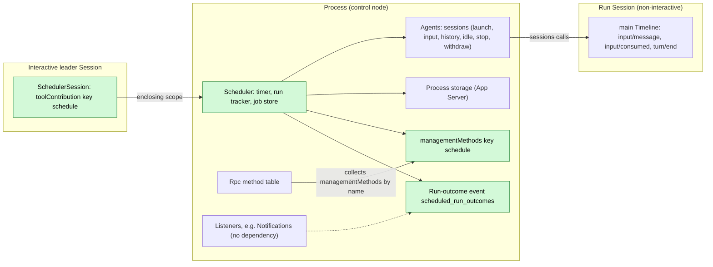
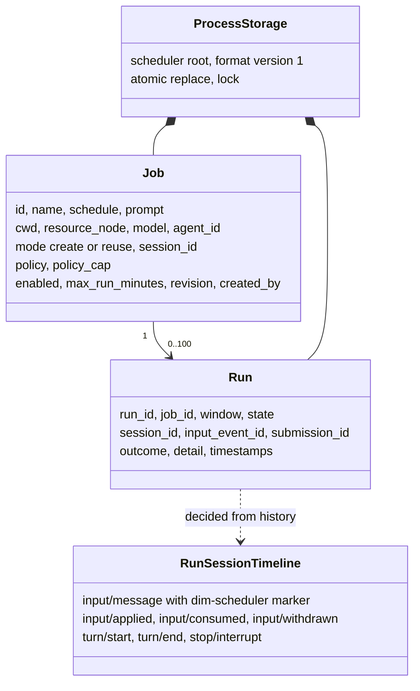
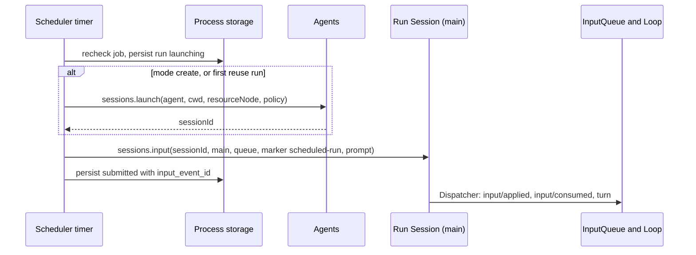
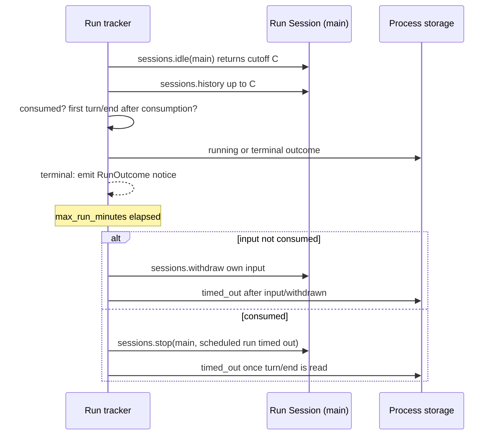
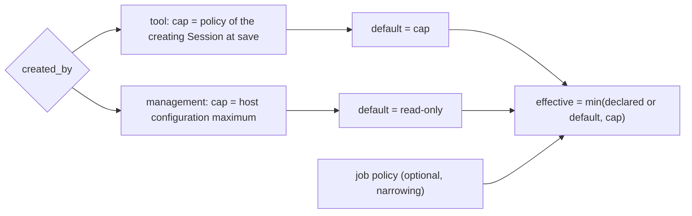
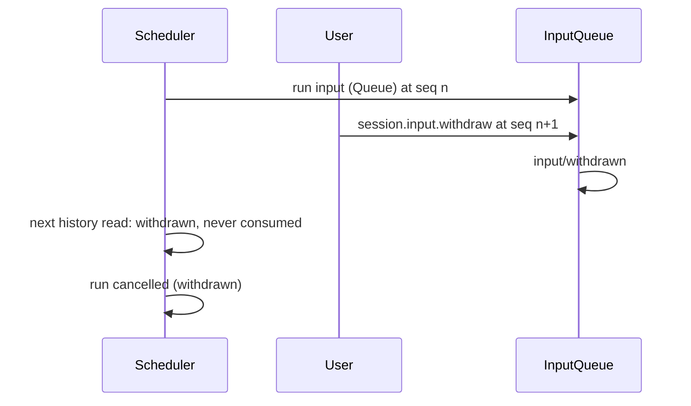

# Scheduler

Status: Draft. Overall design: [overview B.8](../overview.md#4-plugin-catalog); scope: [ADR 002](../../adr/002-plugin-scope.md) (process + Session). Phase: P2. Language: TypeScript first (overview §F.3).

Scheduler keeps scheduled jobs and their run history in App Server process storage. While the daemon is alive and a window is due, the process part creates a non-interactive Session through `sessions.launch` (or reuses one) and writes the job prompt as a Queue input with its own source marker through `sessions.input` ([session-access](../contracts/session-access.md)), as Collaboration reaches its members. The Session part offers the `schedule` tool (risk `persistent_configuration`) to interactive leader Sessions as a `toolContribution`. Operators use the management-level `schedule.*` methods, a `managementMethods` entry. All contracts are language-neutral named services ([ADR 002 D5](../../adr/002-plugin-scope.md#d5-contracts-are-language-neutral)); the Rust forms are in [Appendix G](#appendix-g-rust-binding). Scheduler writes no Timeline event of its own: a run's outcome is read from the run Session's history and published as a run-outcome event notice.

## 1. Structure



Jobs and windows span Sessions, so they belong to the process ([ADR 002](../../adr/002-plugin-scope.md) D1); offering a tool to a Session is the Session part's job (D2). The Session part depends on the process part (enclosing scope). The process part depends on Agents (service `sessions`) and App Server process storage; it reaches run Sessions only through `sessions`. Dependencies follow scope (D3): an Agents reload reloads Scheduler, and a Scheduler reload reloads its Session parts, failing their in-flight turns; both are rare structural events and an accepted, documented cost. Job edits are business configuration (D4): a data update plus notification, never a reload.

| Part | Scope | Depends on | Provides |
| --- | --- | --- | --- |
| `Scheduler` | Process (control node) | `sessions` (Agents; `launch` with `policy`), App Server process storage | Job store, timer, run tracker; `managementMethods` key `schedule`; process event `scheduled_run_outcomes` |
| `SchedulerSession` | Session, installed when Scheduler is enabled | `Scheduler`, Session configuration | `toolContribution` key `schedule`, declared only when `interactive` and not a Collaboration member |

**Contracts depended on**: `sessions` ([session-access](../contracts/session-access.md): `launch` with a starter-capped `policy`, Session configuration fields `interactive`/`resource_node`/`created_by`, `input` with source raw blocks, fixed-prefix `history`, `idle`, `stop`, `withdraw`), `toolContribution` (ToolRegistry accepts named tool services, a supplement; [tool contributions](../../architecture/rust-agent/tool-contributions.md)), `managementMethods` collected by Rpc ([session-boundary](../contracts/session-boundary.md)), Permission category `persistent_configuration` (FullAccess allows it, E1), App Server process storage (R8; an existing typed service, reachable by name from a TypeScript part once [#4](https://github.com/arcships/dim/issues/4) exposes it), the [single-tree event contract](../../architecture/rust-agent/single-tree.md). **Contracts defined here**: job and run formats, the `schedule` tool, the `schedule.*` methods, the run-outcome event (A.6), source name `scheduler` (marker `dim-scheduler`, submission ids `scheduler:<run_id>`).

## 2. Data and state



Jobs and runs live only in process storage; nothing is rebuilt from Timeline and Scheduler owns no `StateCell`. A run's progress is derived from existing facts on the run Session's `main` branch. The Session part holds no state.

## 3. Flows

### 3.1 A due window



The run is persisted `launching` before any external effect, so a restart settles it by lookup instead of resubmitting.

### 3.2 Completion and timeout



Each active run has a task that waits on `sessions.idle` and reads history up to the returned cutoff, as Collaboration and Workflow do; Scheduler does not observe Session broadcasts. If the withdrawal finds the input already consumed, the tracker falls back to `stop`. A notice is emitted once, after the terminal record is persisted.

### 3.3 Permission of a run



Automation never widens authority (E2): the effective policy goes into `sessions.launch`'s `policy`, which Agents caps by the starter (the job's `policy_cap`). A reused Session keeps its own policy; if it exceeds the job's effective policy the run is `skipped: policy`.

## 4. Timing and conflicts



Every pending-input decision excludes withdrawn inputs, so a withdrawn run input never leaves the run `submitted` forever.

| Scenario | Sequence order | Outcome | Owner |
| --- | --- | --- | --- |
| Previous run still active when a window fires | — (storage) | `skipped: overlap` (A4) | Scheduler |
| User interrupts the run's turn | consumed < `stop/interrupt` < `turn/end` | Run `cancelled` | Loop; Scheduler records |
| Timeout withdraw vs consumption | consumed < withdraw | Withdraw rejected; `stop` path | InputQueue, Scheduler |
| Agents or Scheduler reload, restart | — | `launching` → lookup: accepted → `submitted`, unknown → `lost`; never resubmitted; tracking resumes | Scheduler |
| Daemon down over a window | — | `missed`; no catch-up (E5) | Scheduler |

Full table: Appendix B.

## 5. Context mapping

| Where | What the model sees | Form | Placement and survival |
| --- | --- | --- | --- |
| Calling Session | `schedule` declaration | Tool declaration in adopted configuration (interactive leaders only) | Configuration; survives compaction |
| Calling Session | `schedule` result | `ToolResult.content` | Batch result position; summary only after compaction |
| Run Session | `<dim-scheduler kind="scheduled-run" job="..." run="...">job name</dim-scheduler>`, then the prompt as user content | Raw marker block + user text of one Queue input | At its `input/consumed` position; unkeyed, so only via summary after compaction; child branches inherit it if consumed before the cut |

Run Sessions are non-interactive: no `ask_user`, no `schedule` tool. Prior runs in a `reuse` Session remain history like any input. The model never sees job records, run history, timers or diagnostics.

## 6. Interfaces (summary)

| Interface | Kind | Purpose |
| --- | --- | --- |
| `schedule` | `toolContribution` (Session, key `schedule`), risk `persistent_configuration` | Model manages jobs |
| `schedule.list/save/delete/set_enabled/run_now/history` | `managementMethods` (process, key `schedule`) | Operators manage jobs |
| `scheduled_run_outcomes` | Process event defined here (A.6) | Live notice per ended run (Notifications listens) |
| `/scheduled`, `/schedule`, `dimcode schedule` | CLI | Call the management methods |
| `sessions` | Depended on (process) | Non-interactive run Session with node, model and starter-capped `policy`; input, history, idle, stop, withdraw |

## 7. Security

`schedule` is admitted by Approval and Permission as `persistent_configuration`; FullAccess allows it (E1), other presets ask or deny. A run only writes input; its tools are admitted under the run Session's policy, capped as in 3.3, and approvals are not pre-granted. Tool-created jobs record `created_by` and are visible for review. Jobs store no credentials. The run Session uses only its own resource node's services; Scheduler touches none. Anyone with management access can read job prompts.

## Appendix A. Interface details

### A.1 Records

| Record | Fields |
| --- | --- |
| Job | `id`, `name`, `schedule` (A.4), `prompt` (text ≤ 32 KiB), `cwd`, `resource_node` (`None` = control node), `model` (`None` = Agents default), `agent_id` (optional profile), `mode` (`create` \| `reuse`), `session_id` (bound by `reuse` on first run), `policy` (optional preset, narrowing only), `policy_cap` (captured at save), `enabled`, `max_run_minutes` (default 60, A7), `revision`, `created_by` (`user` \| `tool:<session_id>`) |
| Run | `run_id`, `job_id`, `window` (instant or `manual`), `state`, `session_id`, `input_event_id`, `submission_id`, timestamps, `outcome` (`completed` \| `failed` \| `cancelled` with reason), `detail` |

Run states: `skipped` (overlap, capacity, disabled, node unavailable, policy), `missed`, `launching`, `submitted`, `running`, terminal `completed`/`failed`/`cancelled`/`timed_out`/`lost`. History keeps the last 100 runs per job (A8). Writes use atomic replace under the storage lock with `revision` checks, so tool and management saves never overwrite each other silently.

### A.2 Tool `schedule`

`toolContribution` key `schedule`, registered by `SchedulerSession` only in Sessions whose configuration has `interactive: true` and no member role (A9), so run Sessions and members never see it and a run cannot schedule further runs. `declaration(): sync -> ToolDeclaration` returns the parameters below with risk `persistent_configuration` for all actions (A10); `execute(ToolCall): async -> ToolResult` calls the process part. Cancellation is the consumer dropping the call.

| Parameter | Type | Rule |
| --- | --- | --- |
| `action` | `list` \| `get` \| `create` \| `update` \| `delete` \| `set_enabled` \| `run_now` \| `history` | Required |
| `job_id` | string | All but `list`, `create` |
| `job` | object: `name`, `schedule`, `prompt`, `cwd?`, `model?`, `mode?`, `policy?`, `max_run_minutes?` | `create`, `update` (partial) |
| `enabled` | bool | `set_enabled` |
| `limit` | integer ≤ 50 | `history` |

`cwd` and `resource_node` default to the calling Session's configuration; the tool cannot target another resource node (A11). On `create`/`update`, `policy_cap` is the calling Session's current policy, resolved by Agents (A15). Result `content`: a short text with `job_id`, next window, or the list; `structured_content` holds records. Validation errors are error results.

### A.3 Management methods

`managementMethods` key `schedule`: `describe(): async -> MethodDecl[]` lists the methods below (level `management`, `mutating` for all but `list` and `history`); `call(MethodCall): async -> MethodReply` dispatches them. Parameters and results are JSON objects; errors are codes from Appendix C.

| Method | Parameters | Result |
| --- | --- | --- |
| `schedule.list` | `{}` | Jobs with `next_window`, last run |
| `schedule.save` | `{job, revision?}` | Saved job (`policy_cap` = host configuration maximum); stale `revision` → `schedule_conflict` |
| `schedule.delete` | `{job_id}` | Removes job and history; an active run is not stopped (A14) |
| `schedule.set_enabled` | `{job_id, enabled}` | Pause/resume |
| `schedule.run_now` | `{job_id}` | `run_id` or the skip reason |
| `schedule.history` | `{job_id, limit?}` | Runs, newest first |

While Scheduler reloads, Rpc answers `service_reloading`; when it is not enabled, `unknown_method`.

### A.4 Schedule formats

| Kind | Form | Rule |
| --- | --- | --- |
| `cron` | `{cron: "m h dom mon dow", tz?: IANA}` | Five fields with lists, ranges, steps; `tz` defaults to the control node's zone; DST-gap times skipped, repeated times fire once |
| `every` | `{every_minutes: n}` | `n` ≥ 1; windows at `anchor + k·n`, anchor = last enable time |
| `at` | `{at: RFC 3339 instant}` | One window; after it fires or is missed the job is disabled |

Granularity one minute (A1). A window fires only if observed within 60 s of its instant (A2); otherwise one `missed` record collapses the stretch. The timer evaluates wall clock on every tick and on wake, so suspended time is never caught up.

### A.5 Timeline and capability mechanics

| Step | Path |
| --- | --- |
| Trigger | Timer task computes the next window per enabled job; at a window applies overlap, capacity (A13), enablement and policy rules; persists `launching` with a fresh `run_id` |
| Session | `create`: `sessions.launch {agent, cwd, resourceNode?, policy?, starter?}` → `{sessionId}`; Agents records `createdBy = {kind: "launch", source: "scheduler"}` from the declared source. For a tool-created job `starter` is the creating Session (A15), else absent. `reuse`: the bound `session_id` (an unloaded Session is restored by the call); the first run launches and binds `session_id` |
| Write | `sessions.input {sessionId, branchId: "main", mode: "queue", submissionId: "scheduler:<run_id>", rawBlocks: [marker {kind: "scheduled-run", attrs: [job, run], body: job name}], content: [prompt text]}` → `{inputId}` stored as `input_event_id`; input admission checks run first; `input_denied` → run `failed: input_denied`; persist `submitted` |
| Consumption | InputQueue appends `input/applied`; Loop appends `input/consumed { input_id }` and drives the turn |
| Completion | Tracker task: `sessions.idle {sessionId, branchId: "main"}` → cutoff `C`; `sessions.history {through: C}` pages; `running` once `input/consumed { input_id = input_event_id }` exists; ends at the first `turn/end` after it; `input/withdrawn` before consumption → `cancelled: withdrawn` |
| Timeout | Not consumed: `sessions.withdraw` of the own input → `timed_out`; consumed: `sessions.stop {sessionId, branchId: "main"}` (turn scope), `timed_out` when `turn/end` is read |
| Recheck | Before writing, re-read job and run from storage (enabled, revision unchanged, run still `launching`) |
| Reload or restart | Session parts reload with Scheduler; an in-flight `schedule` call fails with its turn. The new generation settles: `launching` → `sessions.lookup` by `submissionId`: accepted → `submitted`, unknown → `lost` (never resubmitted); `submitted`/`running` resume tracking; passed windows `missed` |
| Run outcome | After persisting a terminal state, publish `scheduled_run_outcomes` with the A.6 data; nothing is replayed after reload or restart |

### A.6 Run-outcome event (public contract)

Process event named `scheduled_run_outcomes`; listeners subscribe by name and form no dependency on Scheduler. Data:

| Field | Type |
| --- | --- |
| `job_id`, `job_name`, `run_id` | string |
| `session_id` | string, optional |
| `state` | `completed` \| `failed` \| `cancelled` \| `timed_out` \| `lost` |
| `reason` | string, optional; fixed reason text, never Session content |
| `ended_at` | RFC 3339 instant |

Emitted once per run after its terminal record is persisted (A16, A17). Delivery is live and non-resumable; a listener that is not loaded misses the notice. The notice carries no prompt or Session content; `schedule.history` is the durable record.

## Appendix B. Full conflict table

| Scenario | Sequence order | Outcome | Owner |
| --- | --- | --- | --- |
| Previous run active when a window fires | — | `skipped: overlap`; no input (A4) | Scheduler |
| `run_now` while a run is active | — | Rejected `skipped: overlap` | Scheduler |
| Reused Session busy | prior facts < run input | Written as Queue; consumed after the running turn (A5) | InputQueue, Loop |
| Reused Session: concurrent user Steer/Queue/Append | Timeline order | Applied by mode in sequence order; run tracked by its own `input_id` | InputQueue |
| User interrupts the run's turn | consumed < interrupt < `turn/end` | `cancelled` | Loop |
| Interrupt before the run input | interrupt < input | Input starts a turn | Loop |
| Input applied, interrupt before consumption | applied < interrupt | Stays pending; consumed by the next turn; run `submitted` | Loop |
| User withdraws the run input | input < `input/withdrawn` | Run `cancelled: withdrawn` | InputQueue, Scheduler |
| Timeout withdraw races consumption | consumed < withdraw request | Withdraw rejected; `stop` then `timed_out` | InputQueue, Scheduler |
| Branch close or Session closed before the write | — | `failed: session_missing`; reuse binding kept (A6) | Scheduler |
| Session closed while the run is active | — | History read fails; `failed` | Scheduler |
| Compaction during the run | — | No effect: `input/consumed` and `turn/end` stay in local history | — |
| Child branch created in the run Session | — | Ignored; runs use `main` only | Scheduler |
| Run Session idle-unloaded with input pending | — | The tracker's open `sessions.idle` call keeps it loaded; after restart the next `sessions` call restores it | Agents |
| Agents reload mid-run | — | Scheduler reloads with it; runs kept; tracking resumes from history | Scheduler |
| Scheduler reload or restart mid-run | — | A.5 settlement; never resubmitted | Scheduler |
| Scheduler reload during a `schedule` call | — | The calling Session part reloads; that turn fails (D3, accepted) | Loop |
| Daemon down over a window | — | `missed`; no catch-up | Scheduler |
| Resource node offline at trigger, `create` | — | A launch refused for the unavailable node → `skipped: node_unavailable`, not retried (A6); a launched Session runs and its node-service calls fail `node_unavailable` (row below) | Agents, Scheduler |
| An input admission check denies the run input | — | Nothing written; run `failed: input_denied` (reason kept in `detail`); not retried | Session input boundary, Scheduler |
| Resource node offline, `reuse` or mid-run | — | Input commits; the run Session stays loaded (no reload, no Pending); its calls on node services fail `node_unavailable` and the turn ends on its own outcome; timeout applies (requirement on [#5](https://github.com/arcships/dim/issues/5)) | Session's node services, Scheduler |
| Reuse Session policy above the job's effective policy | — | `skipped: policy` | Scheduler |
| Pending approval in a run Session | `approval/request` | Waits for `approval.respond` from any client or the timeout | Approval; Scheduler |
| Duplicate/late `schedule.save` | revision | Stale revision rejected | Scheduler |
| `schedule` call interrupted after save | save < interrupt | Saved job stays; tool result cancelled | ToolExecutor; Scheduler |
| Client detach | — | No effect | — |

## Appendix C. Errors and recovery

| Case | Result |
| --- | --- |
| Invalid job (schedule, prompt size, unknown node, policy above cap) | `schedule_invalid` or error tool result |
| Launch failure | Run `failed`; window not retried |
| Uncertain write (reload, publication unknown) | Run stays `launching`; settled by lookup |
| Storage unreadable or unknown format version | Scheduler fails to apply (no silent reset) |
| Process exit | Timers stop; settlement at next start |

Error codes: `schedule_invalid`, `schedule_conflict`, `schedule_not_found`, `service_reloading`.

## Appendix D. Acceptance

With a controllable clock, through management methods, the `schedule` tool and the notice:

1. Each schedule kind yields the expected windows, including DST gap/overlap and `at` disabling itself.
2. A due `create` job yields a non-interactive Session whose first input carries the marker and prompt; run `completed`; one notice.
3. Overlap: a window during an active run is `skipped: overlap`.
4. `reuse` with a busy Session: input queued behind the running turn.
5. User interrupt → `cancelled`; timeout before consumption → `input/withdrawn` and `timed_out`; after consumption → `stop/interrupt` and `timed_out`.
6. User withdraws the run input → `cancelled: withdrawn`.
7. Clock jump → one `missed` record, no runs.
8. Restart with a `launching` run: accepted resumes, unknown → `lost`; no duplicate input.
9. Agents reload mid-run: Scheduler reloads, the run completes and is tracked to its end.
10. Policy: tool-created job under WorkspaceWrite runs with at most WorkspaceWrite; management job defaults to ReadOnly.
11. `schedule` absent in non-interactive and member Sessions; asked under WorkspaceWrite, allowed under FullAccess.
12. Node unavailable at trigger: `skipped: node_unavailable`.

## Appendix E. Assumptions

| # | Assumption | Basis | Effect if rejected |
| --- | --- | --- | --- |
| A1 | Formats `cron`, `every`, `at`; one-minute granularity | Feature list ("recurrence"); judgment | Formats change |
| A2 | 60 s grace for a window | Judgment | Other missed detection |
| A4 | Overlap: skip the new window | Judgment | Queue or parallel runs |
| A5 | Reused busy Session: enqueue | Judgment | Busy windows skipped |
| A6 | Failures never retry or fall back to `create` | Judgment | Fallback policy |
| A7 | `max_run_minutes` default 60 | Judgment | Unbounded runs |
| A8 | Last 100 runs per job | Judgment | Retention setting |
| A9 | Tool only for interactive leader Sessions | Overview §5.1; judgment | Runs could create jobs |
| A10 | One risk category for all actions | Overview §5.8 | Split read-only tool |
| A11 | Tool-created jobs use the caller's resource node | Judgment (overview §6.3) | Other nodes allowed |
| A13 | Max concurrent runs = 4, a business setting read at each window | Judgment; ADR 002 D4 | Other limit |
| A14 | Deleting a job does not stop its active run | Judgment | Delete stops the run |
| A15 | The cap of a tool-created job is captured at save | Judgment within E2 | Re-resolve per run |
| A16 | Run outcomes are a live, non-resumable notice | Overview §5.11; judgment | Persistent outbox per listener |
| A17 | Only runs that reached `launching` produce a notice | Judgment | Listeners see every window |

Decided: run policy (E2), FullAccess allows `persistent_configuration` (E1), daemon liveness (E5), process storage (R8), withdrawal (R7), scope ([ADR 002](../../adr/002-plugin-scope.md)).

## Appendix F. Open questions

| Question | Description |
| --- | --- |
| Liveness wording | Feature list says the interactive terminal must be alive; this design keeps "daemon alive" (E5); recorded, not open |
| Launch contract | The Agents supplement must define `sessions.launch` with `policy` capped by the starter and a way to resolve a Session's current policy; `LaunchRequest` has no `model` field, so a job's `model` needs one (or a profile per model) |

## Appendix G. Rust binding

One binding of the neutral contracts above, for a Rust implementation; a TypeScript implementation uses the same names and data through its rutis-bridge runtime.

| Neutral | Rust |
| --- | --- |
| `toolContribution` key `schedule` | Session-scoped `ToolContribution` registered in `SchedulerSession`'s `provides`; `declaration()` / `execute(ToolCall, cancel)` |
| `managementMethods` key `schedule` | Entry of `Contributions<ManagementMethods>` collected by Rpc |
| `sessions.launch` | `AgentIndex::launch(LaunchRequest) -> SessionUse` |
| `sessions.input` / `history` / `idle` / `stop` / `withdraw` | `AgentIndex::acquire(id)` lease, then `Session::input`, `local_page`, `idle`, `stop`, `service::<InputQueue>(branch).withdraw` |
| `scheduled_run_outcomes` | `pub fn scheduled_run_outcomes() -> EventKey<RunOutcome>` in Scheduler's public types crate; `emit(host_ctx, &key, Arc::new(outcome))`, listeners `on(host_ctx, &key, listener)` |
| Timer task | Spawned in `ctx.effect` |

```rust
pub struct RunOutcome {
    pub job_id: String, pub job_name: String, pub run_id: String,
    pub session_id: Option<String>,
    pub state: RunEnd,               // Completed | Failed | Cancelled | TimedOut | Lost
    pub reason: Option<String>,
    pub ended_at: Timestamp,
}
```
