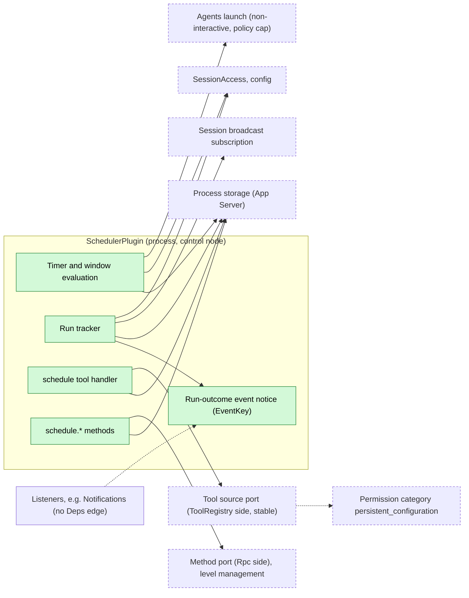
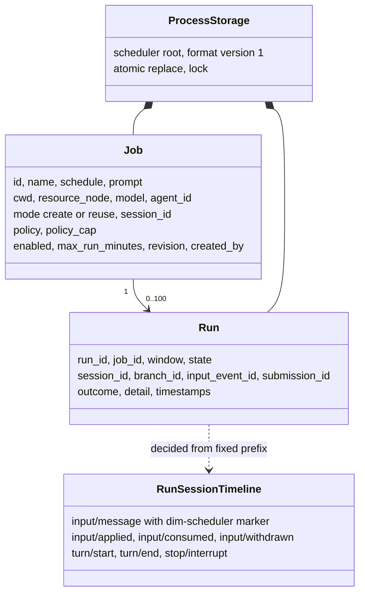
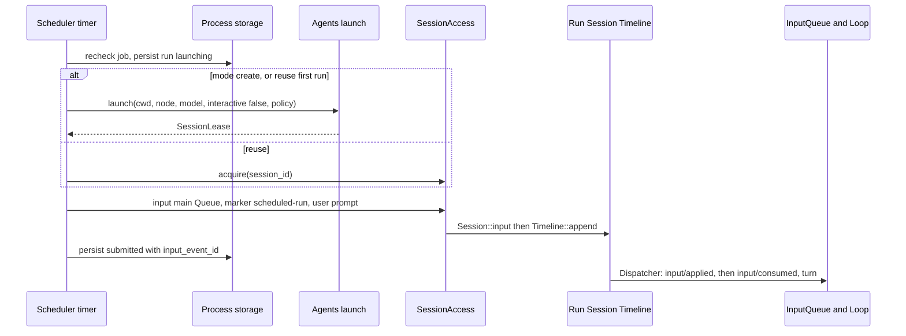
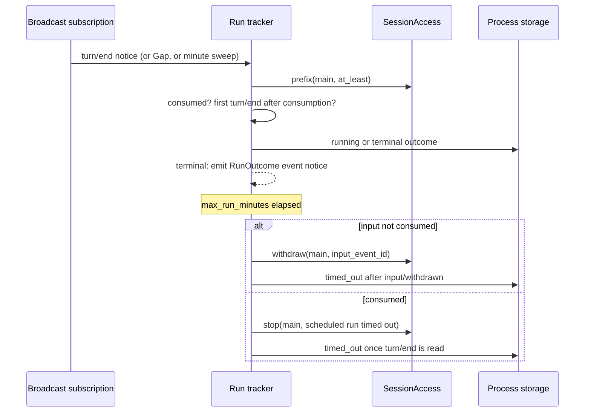
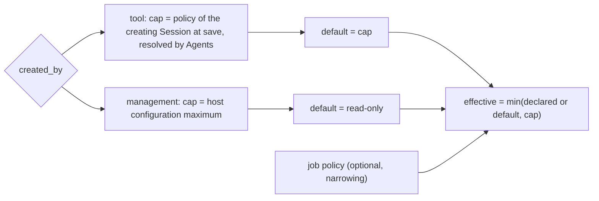
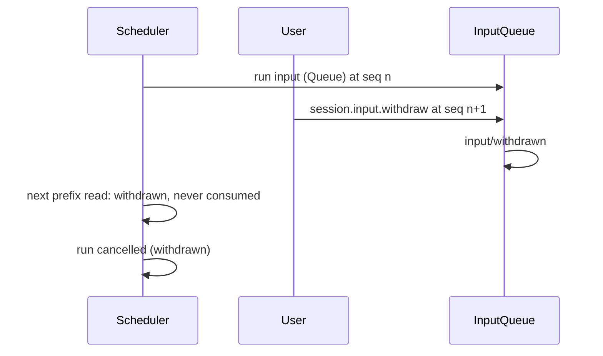

# Scheduler

Status: Draft. Overall design: [overview B.8](../overview.md#b8-scheduler). Phase: P2. Language: TypeScript first (overview §11.3).

Scheduler keeps scheduled jobs and their run history in App Server process storage. While the daemon is alive and a window is due, it creates (through the Agents launch contract) or reuses a non-interactive Session and writes the job prompt as a Queue input with its own source marker through [session-access](../contracts/session-access.md). It contributes the process-level `schedule` tool (risk `persistent_configuration`) and the `schedule.*` management methods, and writes no Timeline event: a run's outcome is read from the run Session's fixed prefix and published as a run-outcome event notice, which forms no dependency edge.

## 1. Structure



Scheduler registers its tool set and methods into stable ports owned by their consumers ([ADR 002 D2](../../adr/002-dependency-direction.md#d2-contributors-register-into-a-stable-port-owned-by-the-consumer)), so its reload never reloads ToolRegistry, Rpc or a Session. It reaches Sessions only through `SessionAccess`, hosted in a stable plugin that returns `Reloading` during an Agents reload instead of reloading Scheduler. Run outcomes go out as an event notice ([D4](../../adr/002-dependency-direction.md#d4-peer-notices-use-events-not-dependencies)): listeners form no `Deps` edge on Scheduler and Scheduler names none of them.

| Part | Scope | Depends on | Provides |
| --- | --- | --- | --- |
| `SchedulerPlugin` | Process (control node) | `SessionAccess` (`config`, acquire, prefix, input, `withdraw`, `stop`, lookup), Agents launch contract, Session broadcast subscription, App Server process storage, its business configuration in a Settings source | Registrations: process tool set `scheduler` in the tool source port ([process-tool-contribution](../contracts/process-tool-contribution.md)), method namespace `schedule` at level `management` in Rpc's method port ([session-boundary](../contracts/session-boundary.md)); event key `scheduled_run_outcomes` |

**Contracts depended on** (none names Scheduler): the tool source port ([process-tool-contribution](../contracts/process-tool-contribution.md)), [session-access](../contracts/session-access.md) (`SessionAccess`, `config`, `withdraw`), Agents launch with `policy` (overview §7.2 Agents supplement), [session-broadcast-subscription](../contracts/session-broadcast-subscription.md), Permission category `persistent_configuration` (overview §7.1; FullAccess allows it, E1), [method contribution](../contracts/session-boundary.md), App Server process storage (overview §7.2; per-plugin root, atomic replace, lock, format version, R8). **Contracts defined here**: job and run formats, the `schedule` tool, the `schedule.*` methods, the run-outcome event notice (A.7), source name `scheduler` (marker `dim-scheduler`, submission ids `scheduler:<run_id>`).

## 2. Data and state



Jobs and runs live only in process storage; nothing is rebuilt from Timeline and Scheduler owns no `StateCell`. A run's progress is derived from existing facts on the run Session's `main` branch, read through `SessionAccess::prefix`; Settings holds only Scheduler's business settings (A13).

## 3. Flows

### 3.1 A due window



The run is persisted `launching` before any external effect, so a restart can settle it by `lookup` instead of resubmitting. Scheduler holds no Dispatcher subscription.

### 3.2 Completion and timeout



The withdrawal is limited to Scheduler's own input; if InputQueue rejects it because the input was consumed first, the tracker falls back to `stop`. A run-outcome event is emitted once, after the terminal record is persisted.

### 3.3 Permission of a run



Automation never widens authority: the starter's policy is an upper bound, a job may only narrow it, and jobs saved by management default to read-only (E2). The effective policy is passed in `launch`'s `policy` field, which Agents caps by the starter (here the job's `policy_cap`); reused Sessions keep their own policy, which a reuse job must not exceed (otherwise the run is `skipped: policy`).

## 4. Timing and conflicts



Every pending-input decision excludes withdrawn inputs, so a withdrawn run input never leaves the run `submitted` forever.

| Scenario | Sequence order | Outcome | Owner |
| --- | --- | --- | --- |
| Previous run still active when a window fires | — (storage) | `skipped: overlap` (A4) | Scheduler |
| User interrupts the run's turn | consumed < `stop/interrupt` < `turn/end` | Run `cancelled` | Loop; Scheduler records |
| Timeout withdraw vs consumption | consumed < withdraw | Withdraw rejected; `stop` path | InputQueue, Scheduler |
| Agents reload mid-run | — | Facades return `Reloading`; runs kept; tracking resumes from the prefix after the window | Scheduler |
| Scheduler reload or restart | — | `launching` → `lookup`: `Accepted` → `submitted`, `Unknown` → `lost`; never resubmitted | Scheduler |
| Daemon down over a window | — | `missed`; no catch-up (E5) | Scheduler |

Full table: Appendix B.

## 5. Context mapping

| Where | What the model sees | Form | Placement and survival |
| --- | --- | --- | --- |
| Calling Session | `schedule` declaration | Tool declaration in adopted configuration (interactive leaders only) | Configuration; survives compaction |
| Calling Session | `schedule` result | `ToolResult.content` | Batch result position; summary only after compaction |
| Run Session | `<dim-scheduler kind="scheduled-run" job="..." run="...">job name</dim-scheduler>`, then the prompt as user content | Raw marker block + user text of one Queue input | At its `input/consumed` position; unkeyed, so only via summary after compaction; child branches inherit it if consumed before the cut |

Run Sessions are non-interactive: no `ask_user`, no `schedule` tool. Prior runs in a `reuse` Session remain history like any input. The model never sees job records, run history, timers, other runs or diagnostics.

## 6. Interfaces (summary)

| Interface | Kind | Purpose |
| --- | --- | --- |
| `schedule` | Process tool, risk `persistent_configuration`, interactive leaders only | Model manages jobs |
| `schedule.list/save/delete/set_enabled/run_now/history` | Methods, level `management` | Operators manage jobs |
| `scheduled_run_outcomes()` | Event key defined here (no `Deps` edge) | Live notice per ended run (Notifications listens) |
| `/scheduled`, `/schedule`, `dimcode schedule` | CLI | Call the management methods |
| Agents `launch` | Depended on (Agents supplement) | Create a non-interactive run Session with node, model and a starter-capped `policy` |
| Job and run formats | Defined here | Appendix A |

## 7. Security

`schedule` is admitted by Approval and Permission as `persistent_configuration`; FullAccess allows it (E1), other presets ask or deny. A run only writes input; its tools are admitted under the run Session's policy, which is capped as in 3.3, and approvals are not pre-granted. Tool-created jobs record `created_by` and are visible for review. Jobs store no credentials. The run Session uses only its resource node's Session-bound services; Scheduler touches none. Anyone with Management access can read job prompts.

## Appendix A. Interface details

### A.1 Records

| Record | Fields |
| --- | --- |
| Job | `id`, `name`, `schedule` (A.4), `prompt` (text ≤ 32 KiB), `cwd`, `resource_node` (`None` = control node), `model` (`None` = Agents default), `agent_id` (optional profile), `mode` (`create` \| `reuse`), `session_id` (bound by `reuse` on first run), `policy` (optional preset, narrowing only), `policy_cap` (captured at save), `enabled`, `max_run_minutes` (default 60, A7), `revision`, `created_by` (`user` \| `tool:<session_id>`) |
| Run | `run_id`, `job_id`, `window` (instant or `manual`), `state`, `session_id`, `branch_id` (`main`), `input_event_id`, `submission_id`, timestamps, `outcome` (`completed` \| `failed` \| `cancelled` with reason), `detail` |

Run states: `skipped` (overlap, capacity, disabled, node unavailable, policy), `missed`, `launching`, `submitted`, `running`, terminal `completed`/`failed`/`cancelled`/`timed_out`/`lost`. History keeps the last 100 runs per job (A8). Writes use process storage atomic replace under its lock and `revision` checks, so saves from the tool and from management never overwrite each other silently.

### A.2 Tool `schedule`

Process tool set key `scheduler`, registered into the tool source port and filtered per call by `requires: { interactive: true, roles: {leader} }` (A9), so run Sessions and members never see it and a run cannot schedule further runs. Risk `persistent_configuration` for all actions (A10).

| Parameter | Type | Rule |
| --- | --- | --- |
| `action` | `list` \| `get` \| `create` \| `update` \| `delete` \| `set_enabled` \| `run_now` \| `history` | Required |
| `job_id` | string | All but `list`, `create` |
| `job` | object: `name`, `schedule`, `prompt`, `cwd?`, `model?`, `mode?`, `policy?`, `max_run_minutes?` | `create`, `update` (partial) |
| `enabled` | bool | `set_enabled` |
| `limit` | integer ≤ 50 | `history` |

`cwd` and `resource_node` default to the caller's `SessionConfig` subset in the tool call context; the tool cannot target another resource node (A11). On `create`/`update`, `policy_cap` is the calling Session's current policy, resolved through the Agents launch contract at the call (A15). Result `content`: a short text with `job_id`, next window, or the list; `structured_content` holds records. Validation errors are error results.

### A.3 Management methods

| Method | Parameters | Result |
| --- | --- | --- |
| `schedule.list` | `{}` | Jobs with `next_window`, last run |
| `schedule.save` | `{job, revision?}` | Saved job (`policy_cap` = host configuration maximum); stale `revision` → `schedule_conflict` |
| `schedule.delete` | `{job_id}` | Removes job and history; an active run is not stopped (A14) |
| `schedule.set_enabled` | `{job_id, enabled}` | Pause/resume |
| `schedule.run_now` | `{job_id}` | `run_id` or the skip reason |
| `schedule.history` | `{job_id, limit?}` | Runs, newest first |

### A.4 Schedule formats

| Kind | Form | Rule |
| --- | --- | --- |
| `cron` | `{cron: "m h dom mon dow", tz?: IANA}` | Five fields with lists, ranges, steps; `tz` defaults to the control node's zone; DST-gap times skipped, repeated times fire once |
| `every` | `{every_minutes: n}` | `n` ≥ 1; windows at `anchor + k·n`, anchor = last enable time |
| `at` | `{at: RFC 3339 instant}` | One window; after it fires or is missed the job is disabled |

Granularity one minute (A1). A window fires only if observed within 60 s of its instant (A2); otherwise one `missed` record collapses the stretch. The timer evaluates wall clock on every tick and on wake, so suspended time is never caught up.

### A.5 Agents launch (depended on)

```rust
// Agents supplement (overview §7.2); shape owned by Agents.
async fn launch(&self, config: LaunchConfig) -> Result<SessionLease, LaunchError>;
struct LaunchConfig { agent_id: Option<String>, cwd: String, resource_node: Option<NodeId>,
    model: Option<ModelSelection>, interactive: bool /* false */,
    policy: PermissionPolicy /* capped by the starter; Scheduler passes min(job policy, policy_cap) */ }
```

The resulting `SessionConfig` carries `interactive: false` and Agents' launch value of `created_by`. Scheduler writes the first input itself through the lease (overview §7.2 says Agents submits it; see Appendix F).

### A.6 Timeline and capability mechanics

| Step | Path |
| --- | --- |
| Trigger | Timer task (`ctx.effect`) computes the next window per enabled job; at a window applies overlap, capacity, enablement and policy rules; persists `launching` with a fresh `run_id` before any external effect |
| Session | `create`: `launch`. `reuse`: `SessionAccess::source("scheduler").acquire(session_id)` (restores if unloaded); first run launches and binds `session_id` |
| Write | `lease.input("main", SourceInput { submission_id: "scheduler:<run_id>", marker: { kind: "scheduled-run", attrs: [job, run], body: job name }, user: prompt, mode: Queue })` → `Session::input` → `TimelineContext::input` → `Timeline::append`; persist `submitted` |
| Consumption | InputQueue's Dispatcher subscription appends `input/applied`; Loop appends `input/consumed { input_id }` and drives the turn |
| Completion | `turn/end` notices filtered to active run Sessions, `Gap`, or a minute sweep (A3) trigger `lease.prefix("main", at_least)`; `running` once `input/consumed { input_id = input_event_id }` exists; ends at the first `turn/end` after it with that outcome; `input/withdrawn` of the input before consumption → `cancelled: withdrawn` |
| Timeout | Not consumed: `SessionAccess::withdraw` (own source) → `timed_out`; consumed: `lease.stop("main", ...)` (turn-scoped `stop/interrupt`), `timed_out` when `turn/end` is read |
| Recheck | Before writing, re-read job and run from storage (enabled, revision unchanged, run still `launching`); never reads capability state; busy state is not consulted |
| Own reload / restart | Registrations disappear (in-flight tool call gets "tool provider unavailable", turn continues; `schedule.*` returns `service_reloading`; ToolRegistry and Rpc do not reload); timers and subscription end; leases drop. The new generation settles: `launching` → `lookup(submission_id)`: `Accepted` → `submitted`, `Unknown` → `lost` (never resubmitted); `submitted`/`running` resume tracking; passed windows `missed` |
| Run outcome | After persisting a terminal state, `emit(host_ctx, &scheduled_run_outcomes(), Arc::new(outcome))`; nothing is replayed after reload or restart |
| Agents reload | `SessionAccess` and the broadcast subscription return `Reloading`; Scheduler stays loaded; a write in the window does `lookup` before one retry within the 60 s grace |

### A.7 Run-outcome notice (public contract)

```rust
/// Process event key defined in Scheduler's public types crate; listeners
/// register with `on(host_ctx, &key, listener)` and form no `Deps` edge.
pub fn scheduled_run_outcomes() -> EventKey<RunOutcome>;
pub struct RunOutcome {
    pub job_id: String, pub job_name: String, pub run_id: String,
    pub session_id: Option<String>,
    pub state: RunEnd,               // Completed | Failed | Cancelled | TimedOut | Lost
    pub reason: Option<String>,      // fixed reason text, never Session content
    pub ended_at: Timestamp,
}
```

Emitted once per run after its terminal record is persisted (A16, A17), following the [single-tree event contract](../../architecture/rust-agent/single-tree.md). Delivery is live and non-resumable; a listener that is not loaded misses the notice. The notice carries no prompt or Session content. Listeners never read job storage; `schedule.history` is the durable record. A Scheduler reload or absence reloads no listener; it only stops notices.

## Appendix B. Full conflict table

| Scenario | Sequence order | Outcome | Owner |
| --- | --- | --- | --- |
| Previous run active when a window fires | — | `skipped: overlap`; no input (A4) | Scheduler |
| `run_now` while a run is active | — | Rejected `skipped: overlap` | Scheduler |
| Reused Session busy | prior facts < run input | Written as Queue; consumed after the running turn (A5) | InputQueue, Loop |
| Reused Session: concurrent user Steer/Queue/Append | Timeline order | Applied by mode in sequence order; run tracked by its own `input_id` | InputQueue |
| User interrupts the run's turn | consumed < interrupt < `turn/end` | `cancelled` | Loop |
| Interrupt before the run input | interrupt < input | Input starts a turn | Loop |
| Input applied, interrupt before consumption | applied < interrupt | Stays pending; consumed by the next turn; run `submitted` | Loop |
| User withdraws the run input | input < `input/withdrawn` | Run `cancelled: withdrawn` | InputQueue, Scheduler |
| Timeout withdraw races consumption | consumed < withdraw request | Withdraw rejected; `stop` then `timed_out` | InputQueue, Scheduler |
| Branch close or Session closed before the write | — | `SessionClosed`/`BranchMissing`; `failed: session_missing`; reuse binding kept (A6) | Scheduler |
| Session closed while the run is active | — | Prefix read fails; `failed` | Scheduler |
| Tool batch in the run turn not settled | — | Nothing observed until `turn/end` | Loop |
| Compaction during the run | — | No effect: `input/consumed` and `turn/end` stay in local history | — |
| Child branch created in the run Session | — | Ignored; runs use `main` only | Scheduler |
| Run Session idle-unloaded with input pending | — | Restored and adopted on load; `acquire` restores it | AgentIndex |
| `turn/end` notice lost (`Gap`) | — | Minute sweep reads the prefix | Scheduler |
| Agents reload mid-run | — | `Reloading` from the facades; runs kept; tracking resumes | Scheduler |
| Scheduler reload or restart mid-run | — | A.6 settlement; never resubmitted | Scheduler |
| Daemon down over a window | — | `missed`; no catch-up | Scheduler |
| Resource node offline at trigger, `create` | — | `launch` fails at the startup deadline → `skipped: node_unavailable`; not retried (A6) | Agents, Scheduler |
| Resource node offline, `reuse` | — | Input commits; capabilities Pending; turn starts after recovery; timeout applies | rutis lifecycle, Scheduler |
| Reuse Session policy above the job's effective policy | — | `skipped: policy` | Scheduler |
| Pending approval in a run Session | `approval/request` | Waits for `approval.respond` from any client or the timeout | Approval; Scheduler |
| Duplicate/late `schedule.save` | revision | Stale revision rejected | Scheduler |
| Duplicate `run_now` | — | Second sees the active run: skipped | Scheduler |
| `schedule` call interrupted after save | save < interrupt | Saved job stays; tool result cancelled | ToolExecutor; Scheduler |
| Scheduler unregistered during a `schedule` call | — | That call gets "tool provider unavailable"; batch and turn continue | Tool source port |
| Client detach | — | No effect | — |

## Appendix C. Errors and recovery

| Case | Result |
| --- | --- |
| Invalid job (schedule, prompt size, unknown node, policy above cap) | `schedule_invalid` or error tool result |
| Launch failure | Run `failed`; window not retried |
| Write `Reloading` | `lookup`, then at most one retry within the 60 s grace |
| `PublicationUnknown` | Run stays `launching`; settled by `lookup` after recovery |
| Storage unreadable or unknown format version | Scheduler fails to apply (no silent reset) |
| Process exit | Timers stop; settlement at next start |

Error codes: `schedule_invalid`, `schedule_conflict`, `schedule_not_found`, `service_reloading`.

## Appendix D. Acceptance

With a controllable clock, through management methods, the `schedule` tool and events:

1. Each schedule kind yields the expected windows, including DST gap/overlap and `at` disabling itself.
2. A due `create` job yields a non-interactive Session whose first input carries the marker and prompt; run `completed`.
3. Overlap: a window during an active run is `skipped: overlap`.
4. `reuse` with a busy Session: input queued behind the running turn.
5. User interrupt → `cancelled`; timeout before consumption → `input/withdrawn` and `timed_out`; after consumption → `stop/interrupt` and `timed_out`.
6. User withdraws the run input → `cancelled: withdrawn`.
7. Clock jump → one `missed` record, no runs.
8. Restart with a `launching` run: `Accepted` resumes, `Unknown` → `lost`; no duplicate input.
9. Agents reload mid-run: run continues and completes; no Scheduler reload.
10. Policy: tool-created job under WorkspaceWrite runs with at most WorkspaceWrite; management job defaults to ReadOnly.
11. `schedule` absent in non-interactive Sessions; asked under WorkspaceWrite, allowed under FullAccess.
12. Node unavailable at trigger: `skipped: node_unavailable`.

## Appendix E. Assumptions

| # | Assumption | Basis | Effect if rejected |
| --- | --- | --- | --- |
| A1 | Formats `cron`, `every`, `at`; one-minute granularity | Feature list ("recurrence"); judgment | Formats change |
| A2 | 60 s grace for a window | Judgment | Other missed detection |
| A3 | Once-per-minute prefix sweep | Subscription is lossy; judgment | Late completions |
| A4 | Overlap: skip the new window | Judgment | Queue or parallel runs |
| A5 | Reused busy Session: enqueue | Judgment | Busy windows skipped |
| A6 | Failures never retry or fall back to `create` | Judgment; overview §3 constraint 4 | Fallback policy |
| A7 | `max_run_minutes` default 60 | Judgment | Unbounded runs |
| A8 | Last 100 runs per job | Judgment | Retention setting |
| A9 | Tool only for interactive leader Sessions | Overview §5.1; judgment | Runs could create jobs |
| A10 | One risk category for all actions | Overview §5.8 | Split read-only tool |
| A11 | Tool-created jobs use the caller's resource node | Judgment (overview §3.1) | Other nodes allowed |
| A13 | Settings hold only Scheduler's business setting max concurrent runs = 4, read at each window (enablement is a loader row) | Judgment; ADR 002 D5 | Jobs in Settings |
| A14 | Deleting a job does not stop its active run | Judgment | Delete stops the run |
| A15 | The cap of a tool-created job is captured at save, not re-evaluated per run | Judgment within E2 | Re-resolve the creator's policy per run |
| A16 | Run outcomes are published as a live, lossy, non-resumable notice; history is read with `schedule.history` | Overview §5.11 (scheduled job ends); judgment | A persistent outbox per listener |
| A17 | Only runs that reached `launching` produce a notice; `skipped` and `missed` do not | Judgment | Listeners see every window |

Decided: run policy (E2), FullAccess allows `persistent_configuration` (E1), daemon liveness (E5), process storage contract (R8), withdrawal contract (R7).

## Appendix F. Open questions

| Question | Description |
| --- | --- |
| Liveness wording | Feature list says the interactive terminal must be alive; this design keeps "daemon alive" (E5); the difference is recorded, not open |
| Launch contract | Agents supplement must define `launch` with `policy` capped by the starter and a way to resolve a Session's current policy; overview §7.2 still says Agents submits the first input (D17) |
