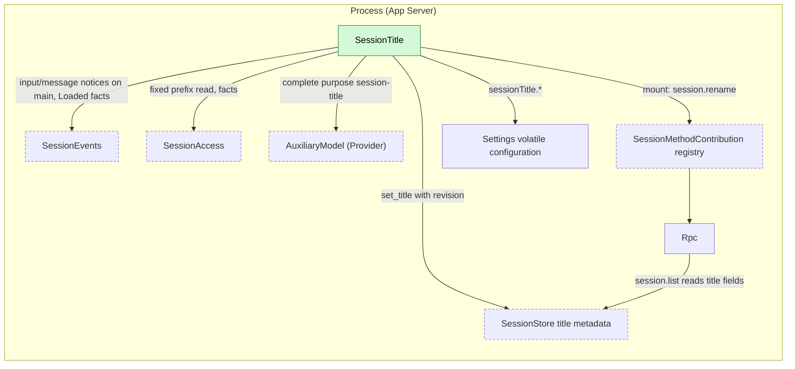
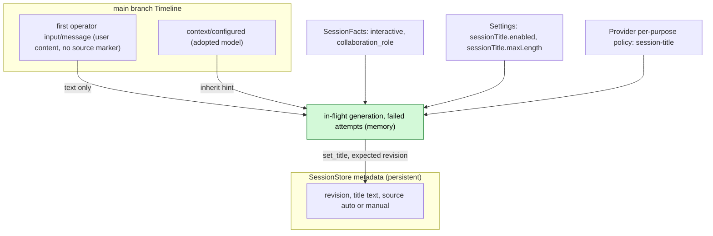
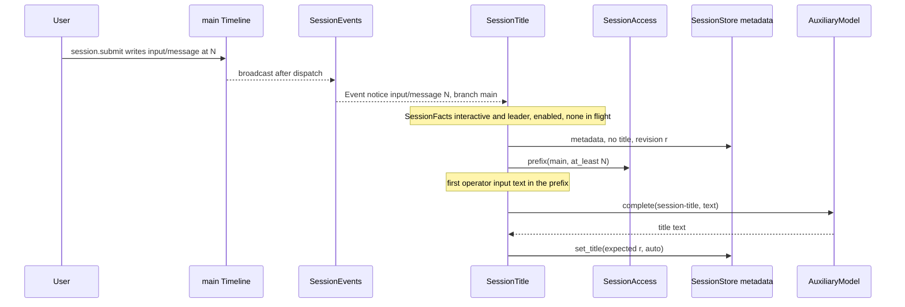
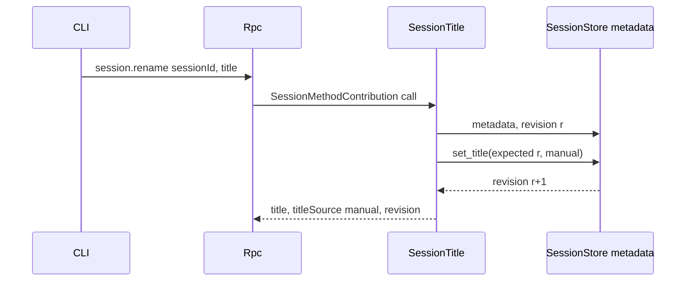
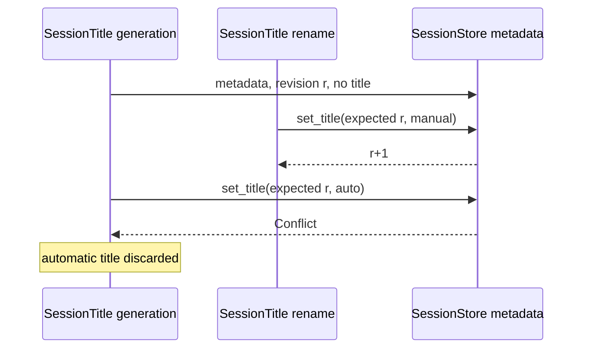

# SessionTitle

Status: Draft. Overall design: [overview §5.6](../overview.md#56-sessiontitle). Phase: P1. Language: TypeScript first ([overview §11.3](../overview.md#113-assignment)).

SessionTitle gives each interactive leader Session a title stored as SessionStore metadata. When the first user input on the main branch is written, it generates an automatic title from that input's text alone through the Provider `AuxiliaryModel` port under its purpose key `session-title`, and it serves `session.rename` for manual titles on any Session. It is the single writer of title metadata, writes no Timeline event and has no model-visible effect on any Session.

## 1. Structure



SessionTitle touches no Session or branch plugin: it observes through SessionEvents, reads through SessionAccess and writes only SessionStore metadata. Rpc reaches it only through the Session-method registry and reads list fields from SessionStore directly.

| Part | Scope | Depends on | Provides |
| --- | --- | --- | --- |
| `SessionTitle` | Process | [`SessionEvents`](../contracts/session-broadcast-subscription.md) (`Event`, `Loaded` with `SessionFacts`), [`SessionAccess`](../contracts/session-access.md) (`get`, `prefix`, `facts`; never `input`), SessionStore title metadata supplement (overview §7.2), Provider `AuxiliaryModel` port by purpose (decisions R9), Settings volatile configuration, public data contracts of `input/message` and `context/configured` | `session.rename` mounted as a [`SessionMethodContribution`](../contracts/session-boundary.md); the opaque purpose key `session-title`; configuration keys `sessionTitle.enabled`, `sessionTitle.maxLength` |

The mount follows the [extension-registry](../contracts/extension-registry.md) pattern. Not configured: `session.rename` returns `method_not_found`; configured but inactive: `service_reloading`. Provider does not know the purpose key's consumer.

## 2. Data and state



Only SessionTitle writes title metadata; SessionStore keeps the revision counter. Nothing is rebuilt from the Timeline into owned state: each decision reads metadata first, then the fixed prefix. In-memory state (in-flight generation per Session, failed attempts per Session) is lost on reload or restart, which only allows another attempt.

## 3. Flows

### 3.1 Automatic title from the first user input



Generation starts when the input is written, not after the turn; the turn's outcome is irrelevant. Only the text of the first operator input on `main` is sent.

### 3.2 Manual rename



Rename works on any Session, loaded or not, and never loads it. On `Conflict` it rereads and retries up to 3 times.

## 4. Timing and conflicts

### 4.1 Rename during generation



The revision check is the recheck: an automatic title is written only if metadata is unchanged since the check that found no title, so a manual title always wins.

### 4.2 Other key rows

| Scenario | Order | Outcome | Owner |
| --- | --- | --- | --- |
| Member, workflow-stage or other non-interactive Session | `SessionFacts` | Never generated; rename still allowed | SessionTitle |
| Second input before generation finishes | — | Skipped (in flight) | SessionTitle |
| First input withdrawn before consumption | input < `input/withdrawn` | Title still generated from it (A9) | SessionTitle |
| Generation failed | — | Next `main` input notice while untitled retries with the same first input (A5) | SessionTitle |
| Reload or restart mid-generation | — | Cancelled, nothing written; next `main` input notice triggers | Lifecycle |

Full table: [Appendix B](#appendix-b-full-conflict-table).

## 5. Context mapping

No model-visible effect on any Session: SessionTitle writes no input, tool, prompt source or event, and the title never enters any Session's model context.

The auxiliary request is a separate one-shot call, not part of any Session context, and contains exactly:

| Part | Content |
| --- | --- |
| System | `Write a short title for this conversation: at most 8 words, in the language of the user's message, no quotes, no trailing punctuation. Reply with the title only.` (A2) |
| User message | Text blocks of the first operator `input/message` on `main`, joined by newlines, cut to 2000 characters (A2) |

Never sent: images, raw input blocks of any source, later inputs, assistant output, system prompt, tool calls and results, child-branch events. Compaction and child branches are irrelevant: the excerpt is read from facts on `main`. Diagnostics record outcome and duration only, never excerpt or output text.

## 6. Interfaces (summary)

| Interface | Kind | Purpose |
| --- | --- | --- |
| `session.rename {sessionId, title \| null}` | Session method (SessionMethodContribution) | Set or clear a manual title |
| `session-title` | Provider purpose key (opaque) | Model policy for title generation; unconfigured inherits |
| `sessionTitle.enabled`, `sessionTitle.maxLength` | Configuration (volatile) | Turn generation off; title length |
| `title`, `titleSource` in `session.list`/`session.summaries` | Rpc protocol fields read from SessionStore metadata | Display |

Details: [Appendix A](#appendix-a-interface-details).

## 7. Security

The first input's text is sent to the model chosen for `session-title`; with the default inherit policy that is the Session's provider, and a policy pointing elsewhere is the user's configuration choice. Titles may contain user content and are returned to every client that can list Sessions. No credentials, host settings or tool output enter the request. Rename input is validated at the RPC boundary.

## Appendix A. Interface details

### A.1 `session.rename`

| Params | Result | Errors |
| --- | --- | --- |
| `{sessionId, title: string \| null}` | `{title: string \| null, titleSource: "auto" \| "manual" \| null, revision}` | `invalid_params`, `session_not_found`, `service_reloading`, `storage_failed` |

`title` is trimmed; 1..=`sessionTitle.maxLength` characters, no line breaks or control characters (A3). `null` clears the title (A6). Rpc routes the method to SessionTitle's mount without naming it.

### A.2 Depended-on shapes (owners define them)

```rust
// SessionStore metadata supplement (overview §7.2)
async fn metadata(&self, session_id: &str) -> Result<SessionMetadata, MetadataError>;
async fn set_title(&self, session_id: &str, expected_revision: u64, title: Option<Title>)
    -> Result<u64, MetadataError>;                       // Conflict | NotFound | Storage
pub struct SessionMetadata { pub revision: u64, pub title: Option<Title> }
pub struct Title { pub text: String, pub source: TitleSource }   // Auto | Manual
// Provider AuxiliaryModel port (decisions R9); the inherit hint is SessionTitle's assumption (A1)
async fn complete(&self, purpose: &str, inherit: Option<ModelSelection>,
    request: AuxiliaryRequest, cancel: CancellationToken) -> Result<String, AuxiliaryError>;
```

### A.3 Configuration

`sessionTitle.enabled: bool` default `true`; `sessionTitle.maxLength: u32` default 80, range 10..=200 (A3). Volatile: read at each decision, never a reload. Provider policy for `session-title` lives in Provider's per-purpose policy storage; unconfigured inherits the Session's model (A1).

### A.4 Mechanics

| Step | Path |
| --- | --- |
| Subscribe | In `apply`: `subscribe(ctx, {types: {"input/message"}, sessions: None, branches: {"main"}}, 64)`; stream task registered with `ctx.effect` |
| Facts | `Loaded` notices carry `SessionFacts`, cached per Session; for a Session loaded before the subscription, `SessionAccess::facts(session_id)` on its first notice. Eligible only if `interactive && collaboration_role = leader` (E14) |
| Trigger | On `input/message` at `N` with `user` content: skip if not eligible, disabled, in flight or failed attempts ≥ 3 (A5); otherwise register a generation task with the plugin's task tracker and return to `next()` |
| Check | `metadata(session)`: skip if any title exists; keep revision `r` |
| Read | `access.source("session-title").get(session)` (loaded only; skip if not) → `prefix("main", N)`; pick the first operator input (user content, no source marker; A10) and its text; lease dropped before the model call. No text: no title (A8) |
| Generate | `complete("session-title", inherit = model of the latest context/configured in the prefix, request, cancel)`, 30 s budget (A4). Normalized: first line, surrounding quotes and trailing punctuation removed, whitespace collapsed, cut at `maxLength` on a character boundary; empty output is a failure |
| Write | `set_title(session, r, Some({text, auto}))`; `Conflict` or `NotFound` discards |
| Timeline | No writes, no Dispatcher registration, no `StateCell` |
| Reload / restart | Tasks cancelled through `ctx.effect` (auxiliary call aborted); nothing written. New generation subscribes afresh; missed notices not replayed |
| Agents reload | `SessionAccess` returns `Reloading`: attempt skipped, not counted; next `main` input notice retries |

## Appendix B. Full conflict table

| Scenario | Sequence order | Outcome | Owner |
| --- | --- | --- | --- |
| First input's turn interrupted or failed | input < `stop/interrupt` | Generation proceeds; it depends only on the written input | SessionTitle |
| Inputs without `user` content (Goal blocks, other sources' markers) | — | Not operator input; never trigger and never used | SessionTitle |
| First user input carries only images | — | No text: no automatic title (A8) | SessionTitle |
| Rename before the check | rename < check | Title present: skip | SessionTitle |
| Rename during generation | check (r) < rename (r+1) < write | `Conflict`: automatic title discarded | SessionStore revision |
| Concurrent renames | revision order | Last committed rename wins | SessionStore |
| Duplicate or late `session.rename` | — | Rewrites the same text; idempotent in effect | SessionTitle |
| Steer/Queue/Append inputs after the first | input after the first | Never in the excerpt | SessionTitle |
| First input withdrawn | input < `input/withdrawn` | Title generated from it anyway (A9) | SessionTitle |
| Tool batch, compaction | — | Irrelevant: only the input fact is read | — |
| Child branch inputs | branch filter | Never trigger | SessionEvents filter |
| Member, stage, scheduled or ACP Session | `SessionFacts` | Never generated (E14) | SessionTitle |
| Branch close or Session close during generation | — | Write proceeds; deleted Session gives `NotFound` | SessionStore |
| Session idle unload during generation | lease dropped | Generation completes and writes | SessionTitle |
| Session not loaded when the notice is handled | — | Skip; a later input triggers | SessionTitle |
| Session fork | metadata not copied (A7) | Fork untitled; first new input on its `main` triggers generation from the first operator input in its prefix | SessionTitle |
| SessionTitle reload or restart mid-generation | — | Cancelled, nothing written | Lifecycle |
| Agents reload | facade `Reloading` | Attempt skipped, not counted | SessionTitle |
| Gap notice | — | Ignored; next input triggers | SessionTitle |
| Model or policy unavailable | — | Failure counted; after 3 no further attempts in this generation (A5) | SessionTitle |
| Resource node offline | — | No effect (no host resources used) | — |
| Client detach | — | No effect | — |

## Appendix C. Errors and recovery

| Case | Result |
| --- | --- |
| Model error, timeout, empty output, unavailable purpose policy | No write; diagnostic; failure counted |
| `set_title` `Conflict` on automatic write | Discarded (diagnostic) |
| `set_title` `Storage` | Automatic: failure counted; rename: `storage_failed` |
| Unknown Session on rename | `session_not_found` |
| SessionTitle mount inactive | `service_reloading`; the rename did not happen |
| Cancellation | Auxiliary call aborted before any write; no partial title |

## Appendix D. Acceptance

Flow tests through `session.create`/`session.submit`, `session.rename`, `session.list` and a fake auxiliary model:

1. The first `session.submit` on an interactive leader Session produces an `auto` title before the turn ends; the request contains only the system text and that input's text.
2. Interrupting or failing the first turn does not prevent the title.
3. Member Sessions and Sessions created with `interactive: false` get no title; rename works on them.
4. Rename during generation (fake model held): manual kept, automatic discarded.
5. A titled Session is never regenerated; clearing allows regeneration at the next input, still from the first input's text.
6. Rename of an unloaded Session succeeds without loading it.
7. Child-branch inputs and inputs without `user` content never trigger; image-only first input yields no title.
8. Reload during generation writes nothing; the next input generates. Three failures stop attempts until reload.
9. Invalid rename inputs return `invalid_params`; mount inactive returns `service_reloading`.

## Appendix E. Assumptions

| # | Assumption | Basis | Effect if rejected |
| --- | --- | --- | --- |
| A1 | `AuxiliaryModel::complete` accepts an inherit hint; SessionTitle passes the model of the latest `context/configured` | Judgment; purpose key per decisions R9/E8 | Provider resolves inheritance itself |
| A2 | Instruction text, 8-word target, 2000-character excerpt | Judgment | Different prompt or excerpt |
| A3 | Title length default 80 (10..=200), single line | Judgment | Other limits |
| A4 | 30 s generation budget | Judgment | Other timeout |
| A5 | At most 3 failed attempts per Session per generation; retries on later `main` input notices, always from the first input's text | Judgment | More retries, or none |
| A6 | `session.rename` with `null` clears the title | Judgment | Manual title permanent |
| A7 | Session fork does not copy the title | Judgment (fork copies facts, not metadata) | Fork shows the source title |
| A8 | A first user input without text produces no automatic title | Judgment from "first user input only" | Later inputs or a placeholder would be used |
| A9 | Withdrawal of the first input does not prevent or remove its title | Judgment (trigger is the write) | Generation would wait for consumption |
| A10 | "User input" means operator input: `user` content without a source marker as first raw block | Judgment from session-access marker rule | Source-written inputs with user content could title a Session |

## Appendix F. Open questions

| Question | Description |
| --- | --- |
| Overview §5.6 trigger and purpose | Overview says "after the first turn ... ends normally" and purpose "auxiliary"; this design follows decisions (first user input written; key `session-title`). Overview needs the update |
| Method name | `session.rename` is a single method rather than a `session.<namespace>.*` family; the [session-boundary](../contracts/session-boundary.md) contract must accept it as SessionTitle's contributed name |
| Session list fields | `title`/`titleSource` in `SessionSummary` are an Rpc protocol change to register in overview §7.2 |
