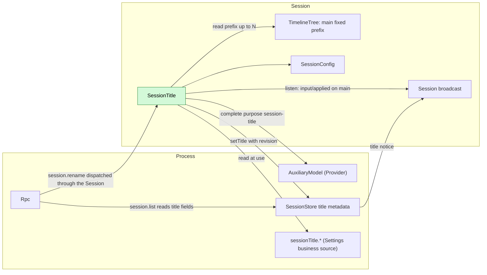
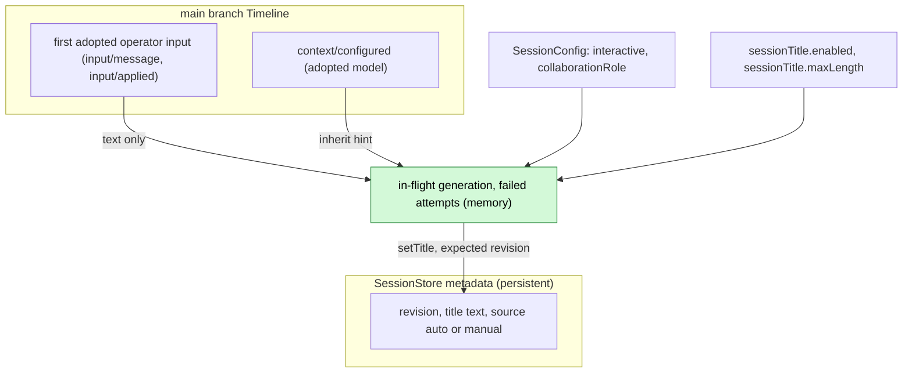
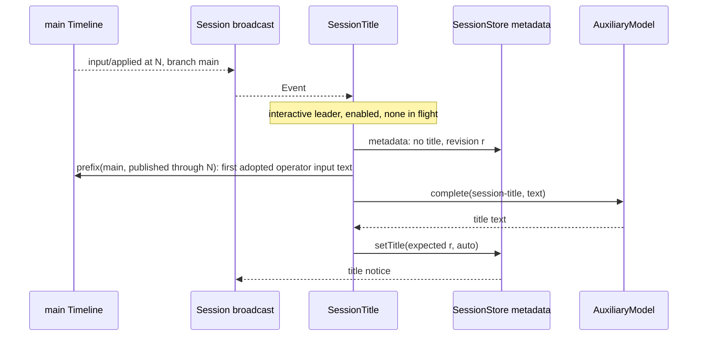
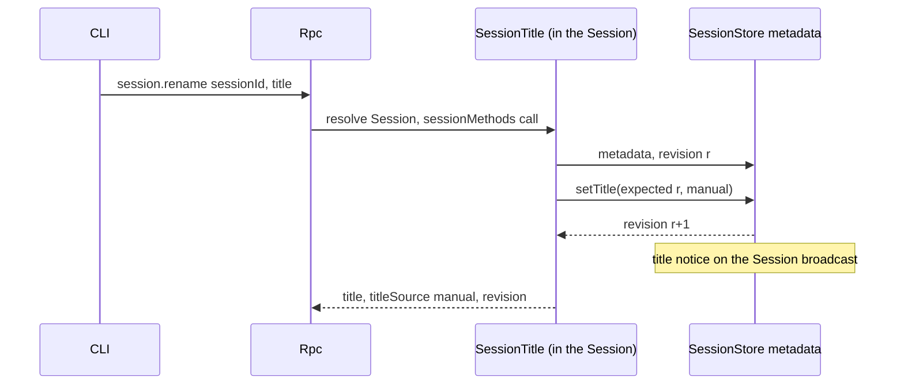
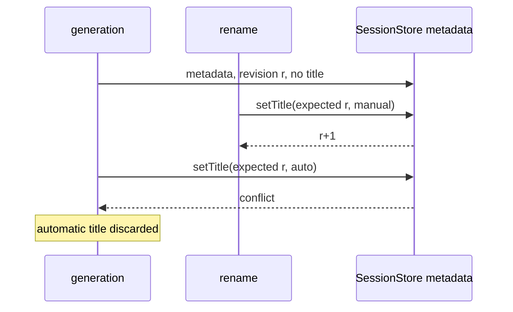

# SessionTitle

Status: Draft. Overall design: [overview](../overview.md) (SessionTitle). Phase: P1. Language: TypeScript first. Scope: [ADR 002](../../adr/002-plugin-scope.md) (Session).

SessionTitle is a Session plugin that gives an interactive leader Session a title stored through SessionStore metadata. It observes its own Session through the existing Session broadcast; when the first operator input on `main` is adopted (`input/applied`), it generates a title from that input's text alone through the Provider `AuxiliaryModel` under the purpose key `session-title`. The title is SessionStore state: SessionTitle writes it only through SessionStore's typed `setTitle` operation, and SessionStore announces each change with a Session broadcast notice that clients consume (the generic notice record is a runtime requirement in [§9](#9-requirements-raised-to-mechanism-owners); the SessionStore title metadata and the Rpc forwarding are supplements in [overview Appendix B.2](../overview.md#b2-app-server-process-plugins)). It serves `session.rename` through the Session-scoped `sessionMethods` service keyed `session.rename` ([methods and tool contributions](../contracts/session-boundary.md)). It writes no Timeline event and has no model-visible effect. Contracts are given in neutral form ([ADR 002 D5](../../adr/002-plugin-scope.md#d5-contracts-are-language-neutral)); the Rust binding is in Appendix G.

## 1. Structure



| Part | Scope | Depends on | Provides |
| --- | --- | --- | --- |
| `SessionTitle` | Session | Session broadcast of its Session, TimelineTree (fixed prefix of `main`), `SessionConfig`; process services SessionStore title metadata, Provider `AuxiliaryModel`, Settings business source | `sessionMethods` key `session.rename` (declared in its `provides`); purpose key `session-title`; business keys `sessionTitle.enabled`, `sessionTitle.maxLength` |

Every dependency is at the Session scope or the enclosing process scope. Most are existing typed services; SessionStore title metadata, the title notice and Settings business sources are proposed supplements ([overview Appendix B.2](../overview.md#b2-app-server-process-plugins); shapes in A.2). Exposing them by name to the TypeScript implementation is issue [#4](https://github.com/arcships/dim/issues/4)'s work, stated in [session-access §9](../contracts/session-access.md#9-requirements-raised-to-mechanism-owners). A reload of SessionStore, Provider or Settings reloads SessionTitle, which cancels an in-flight generation; this is accepted ([ADR 002 D3](../../adr/002-plugin-scope.md#d3-dependencies-follow-scope-rare-restarts-are-accepted)). Business configuration changes never reload ([D4](../../adr/002-plugin-scope.md#d4-structural-configuration-and-business-configuration-are-separate)).

## 2. Data and state



SessionStore owns the title: it keeps the text, source and revision counter and accepts changes only through its typed `setTitle` operation, which SessionTitle alone calls. After each committed change SessionStore emits a title notice on the Session broadcast (A11); the title never enters the Timeline. Each decision reads metadata first, then the fixed prefix. In-memory state is lost on reload or Session unload, which only allows another attempt.

## 3. Flows

### 3.1 Automatic title from the first user input



Generation starts when the input is adopted, not after the turn. Only the text of the first adopted operator input on `main` is sent; a deleted input is never adopted, so it never titles the Session and its text never reaches the auxiliary model.

### 3.2 Manual rename



Rpc resolves the Session as for any Session method, loading it if needed. On `conflict` SessionTitle rereads and retries up to 3 times.

## 4. Timing and conflicts



The revision check is the recheck: a manual title always wins.

| Scenario | Order | Outcome | Owner |
| --- | --- | --- | --- |
| Member, workflow-stage or other non-interactive Session | `SessionConfig` | Never generated; rename allowed | SessionTitle |
| Second input before generation finishes | — | Skipped (in flight) | SessionTitle |
| First input deleted | input < `input/deleted` | Never adopted: no title from it; the next adopted operator input triggers (A9) | SessionTitle |
| Generation failed | — | Next adopted `main` input while untitled retries from the first adopted input (A5) | SessionTitle |
| Reload or Session unload mid-generation | — | Cancelled, nothing written; next adopted `main` input triggers | Lifecycle |

Full table: [Appendix B](#appendix-b-full-conflict-table).

## 5. Context mapping

No model-visible effect: SessionTitle writes no input, tool, prompt source or event. The auxiliary request is a separate one-shot call:

| Part | Content |
| --- | --- |
| System | `Write a short title for this conversation: at most 8 words, in the language of the user's message, no quotes, no trailing punctuation. Reply with the title only.` (A2) |
| User message | Text blocks of the first adopted operator `input/message` on `main` (one with `input/applied`), joined by newlines, cut to 2000 characters (A2) |

Never sent: images, raw input blocks, deleted inputs, later inputs, assistant output, system prompt, tool calls and results, child-branch events. Diagnostics record outcome and duration only.

## 6. Interfaces (summary)

| Interface | Kind | Purpose |
| --- | --- | --- |
| `session.rename {sessionId, title \| null}` | `sessionMethods` key `session.rename` | Set or clear a manual title |
| `session-title` | Provider purpose key | Model policy for title generation; unconfigured inherits |
| `sessionTitle.enabled`, `sessionTitle.maxLength` | Business configuration (Settings source) | Turn generation off; title length |
| `title`, `titleSource` in `session.list`/`session.summaries` | Rpc protocol fields read from SessionStore | Display |
| Title notice `{sessionId, title, titleSource, revision}` | Session broadcast notice emitted by SessionStore (generic record, §9; SessionStore supplement) | Live title update for subscribed clients |

## 7. Security

The first input's text is sent to the model chosen for `session-title`; with the default inherit policy that is the Session's provider. Titles may contain user content and are returned to every client that can list Sessions. No credentials, host settings or tool output enter the request. Rename input is validated by SessionTitle's method (A.1).

## 8. Rule check

| Rule | How this document complies |
| --- | --- |
| Principles §4 rule 1 (commands for others' state) | The title is SessionStore's process-level state with no Timeline; SessionTitle changes it only through SessionStore's typed `setTitle`, and SessionStore decides through its revision check (principles §4 rule 9). |
| Principles §4 rule 2 (handover) | SessionTitle reads an input only after its handover (`input/applied`) and never acts on the input itself. |
| Principles §4 rule 3 (before callbacks only) | No intervention before a write; rename rules are checked by SessionTitle's own method, not at an entry. |
| Principles §4 rule 4 (no business meaning in core) | The Session broadcast notice requested in §9 is a generic record for any owner of process-level Session state. |
| Principles §4 rule 5 (batch) | The trigger acts on `input/applied` when it is consumed, in sequence order. |
| Principles §4 rule 6 (context from handed-over events) | SessionTitle adds nothing to model context; the auxiliary request contains only adopted input text. |
| Principles §4 rule 7 (public events and services only) | It uses the Session broadcast, fixed-prefix read, SessionStore `setTitle`, `AuxiliaryModel` and Settings, all public. |
| Principles §4 rule 8 (requirements to mechanism owners) | The runtime requirement (generic broadcast notice record) is stated in §9; #4 is stated in [session-access §9](../contracts/session-access.md#9-requirements-raised-to-mechanism-owners). Requirements to other plugins (SessionStore title metadata and notice emission, Rpc forwarding of notices) are listed in [overview Appendix B.2](../overview.md#b2-app-server-process-plugins). |
| Principles §4 rule 9 (only facts later decisions use) | The title is process-level SessionStore state: it never enters the Timeline, changes through `setTitle` and reaches UIs as a Session broadcast notice. |
| Principles §1 (Capability and App Server boundary) | SessionTitle is a Session Capability in its own plugin package; Rpc only dispatches `session.rename` and reads title fields from SessionStore. |
| ADR 002 D1 (scope follows state) | Session scope: the title belongs to the Session; the stored title is SessionStore's. |
| ADR 002 D2 (no wiring modules) | No wiring module; all dependencies are declared services. |
| ADR 002 D3 (dependencies follow scope) | Dependencies are in the Session or enclosing process scope; their reload cancels a generation, which is accepted. |
| ADR 002 D4 (structural vs business configuration) | Enabling is structural; `sessionTitle.*` is business configuration in its own Settings source, read at use. |
| ADR 002 D5 (language-neutral contracts) | Contracts are neutral; the Rust form is Appendix G. |

## 9. Requirements raised to mechanism owners

**R1. Session broadcast notice for process-level state.**

| Item | Content |
| --- | --- |
| Blocked by | Principles §4 rules 9 and 4: process-level state such as the SessionStore title must not enter the Timeline, yet clients must see title changes live; the Session broadcast carries only `Event`, `Fence` and `Closed` records ([session_broadcast.rs](../../../crates/dim-agent-capabilities/src/session_broadcast.rs)). |
| Existing mechanisms considered | A `session/titled` Timeline event (puts process state on the Timeline; rejected in overview §7); client polling of `session.list` (no live update); a title-specific channel (a business-specific port, rule 8). |
| Generic capability | A notice record `{source, kind, data}` on a Session's broadcast channel, emitted by the owner of process-level state about that Session after a committed change; no business meaning. The title notice is this record with `source: "SessionStore"`, `kind: "title"`, `data: {sessionId, title, titleSource, revision}`; that record is the wire form. |
| Effect on sequence, batch, interrupt, reload | No sequence number and no batch; not replayed: a client that resubscribes reads current state through the owner's query (`session.list`); interrupts do not apply; a reload of the emitter only stops notices. |
| Owner and issue | Runtime (Session broadcast); no issue yet. Rpc forwarding of the record to subscribed clients unchanged is an App Server entry change listed with the SessionStore supplement in [overview Appendix B.2](../overview.md#b2-app-server-process-plugins). |

#4 (typed services by name for non-Rust parts) is stated in [session-access §9](../contracts/session-access.md#9-requirements-raised-to-mechanism-owners).

## Appendix A. Interface details

### A.1 `session.rename`

Served through `sessionMethods` (Session, key `session.rename`): `describe(): async -> MethodDecl[]` returns one declaration `{name: "session.rename", mutating: true}`; `call(MethodCall): async -> MethodReply` handles it. A dropped call is cancelled before `setTitle` or completes atomically after it.

| Params | Result | Errors |
| --- | --- | --- |
| `{sessionId, title: string \| null}` | `{title: string \| null, titleSource: "auto" \| "manual" \| null, revision}` | `invalid_params`, `session_not_found`, `service_reloading`, `storage_failed`; dispatch errors per [session-boundary](../contracts/session-boundary.md) |

`title` is trimmed; 1..=`sessionTitle.maxLength` characters, no line breaks or control characters (A3). `null` clears the title (A6).

### A.2 Depended-on shapes (owners define them)

| Service | Method | Kind | Request | Reply and errors |
| --- | --- | --- | --- | --- |
| SessionStore metadata (supplement) | `metadata` | async | `{sessionId}` | `{revision, title?: {text, source: "auto" \| "manual"}}`; errors `not_found`, `storage` |
| SessionStore metadata (supplement) | `setTitle` | async | `{sessionId, expectedRevision, title: {text, source} \| null}` | New `revision`; errors `conflict`, `not_found`, `storage`. After a commit SessionStore emits the title notice |
| SessionStore (supplement) | title notice | Session broadcast notice (generic record, §9) | — | `{source: "SessionStore", kind: "title", data: {sessionId, title, titleSource, revision}}` on the Session's broadcast channel; no sequence number, not replayed |
| Provider `AuxiliaryModel` | `complete` | async | `{purpose: "session-title", inherit?: model selection, request: {system, user}}` | Text; errors as data. The inherit hint is SessionTitle's assumption (A1). Cancelled by a cancel request or by dropping the call |

### A.3 Configuration

`sessionTitle.enabled: bool` default `true`; `sessionTitle.maxLength: u32` default 80, range 10..=200 (A3). Business configuration read at each decision; it is written only through Settings typed operations into SessionTitle's business source, whose schema SessionTitle declares; a change is a data update with notification, never a reload. Enabling the plugin is structural configuration. Provider policy for `session-title` lives in Provider's per-purpose policy; unconfigured inherits the Session's model (A1).

### A.4 Mechanics

| Step | Path |
| --- | --- |
| Listen | On apply: Session broadcast listener for `input/applied` events on `main`, removed on unload |
| Eligibility | `SessionConfig.interactive && collaborationRole = leader` |
| Trigger | On `input/applied` at `N`: skip if not eligible, disabled, in flight or failed attempts ≥ 3 (A5); otherwise start a generation task owned by the plugin's lifetime |
| Check | `metadata(session)`: skip if any title exists; keep revision `r` |
| Read | Fixed prefix of `main` published through `N` (session-access A.5, `atLeast = N`); the first operator input (`user` content; A10) that has an `input/applied`, and its text. No such input or no text: no title (A8) |
| Generate | `complete({purpose: "session-title", inherit: model of the latest context/configured in the prefix, request})`, 30 s budget (A4). Normalized: first line, quotes and trailing punctuation removed, whitespace collapsed, cut at `maxLength` |
| Write | `setTitle({sessionId, expectedRevision: r, title: {text, source: "auto"}})`; `conflict` or `not_found` discards |
| Timeline | No writes, no Dispatcher registration, no `StateCell` |
| Reload / unload | Generation cancelled with the plugin; nothing written; events in the gap are not replayed |

## Appendix B. Full conflict table

| Scenario | Sequence order | Outcome | Owner |
| --- | --- | --- | --- |
| First input's turn interrupted or failed | input < `stop/interrupt` | Generation proceeds | SessionTitle |
| Inputs without `user` content (Goal blocks, source markers) | — | Never trigger, never used | SessionTitle |
| First input withdrawn (`session.input.withdraw`) before it is applied | input < withdraw < `input/deleted` | Never applied: no generation, text never sent; the first applied operator input triggers | SessionTitle |
| First user input carries only images | — | No automatic title (A8) | SessionTitle |
| Rename before the check | rename < check | Title present: skip | SessionTitle |
| Rename during generation | check (r) < rename (r+1) < write | `conflict`: automatic title discarded | SessionStore revision |
| Concurrent renames | revision order | Last committed rename wins | SessionStore |
| Duplicate `session.rename` | — | Rewrites the same text | SessionTitle |
| Steer/Queue/Append inputs after the first | — | Never in the excerpt | SessionTitle |
| Tool batch, compaction | — | Irrelevant: only the input fact is read | — |
| Child branch inputs | branch filter | Never trigger | SessionTitle |
| Member, stage, scheduled or ACP Session | `SessionConfig` | Never generated | SessionTitle |
| Session close during generation | — | Generation cancelled with the Session plugin; nothing written | Lifecycle |
| Session fork | metadata not copied (A7) | Fork untitled; the next adopted operator input on `main` triggers generation from the first adopted operator input in its prefix | SessionTitle |
| SessionTitle, Provider, SessionStore or Settings reload | — | Generation cancelled, nothing written (D3) | Lifecycle |
| Model or policy unavailable | — | Failure counted; after 3 no further attempts until reload (A5) | SessionTitle |
| Resource node offline | — | No effect | — |
| Client detach | — | No effect | — |

## Appendix C. Errors and recovery

| Case | Result |
| --- | --- |
| Model error, timeout, empty output, unavailable policy | No write; diagnostic; failure counted |
| `setTitle` `conflict` on automatic write | Discarded (diagnostic) |
| `setTitle` `storage` | Automatic: failure counted; rename: `storage_failed` |
| Unknown Session on rename | `session_not_found` |
| SessionTitle reloading | `service_reloading`; the rename did not happen |
| Cancellation | Auxiliary call aborted before any write |

## Appendix D. Acceptance

Flow tests through `session.create`/`session.submit`, `session.rename`, `session.list` and a fake auxiliary model:

1. The first `session.submit` on an interactive leader Session produces an `auto` title after the input is applied and before the turn ends; the request contains only the system text and that input's text; one title notice reaches subscribed clients.
2. Interrupting or failing the first turn does not prevent the title.
3. Member Sessions and `interactive: false` Sessions get no title; rename works on them.
4. Rename during generation (fake model held): manual kept, automatic discarded.
5. A titled Session is never regenerated; clearing allows regeneration at the next adopted input, still from the first adopted input's text.
6. Rename of an unloaded Session loads it through Rpc and succeeds.
7. Child-branch inputs and inputs without `user` content never trigger; image-only first input yields no title.
8. Reload during generation writes nothing; the next input generates. Three failures stop attempts.
9. Invalid rename inputs return `invalid_params`.
10. A first input denied by a Hook (withdrawn in its own batch) produces no title and is never sent to the auxiliary model; the next adopted input titles the Session from its own text.

## Appendix E. Assumptions

| # | Assumption | Basis | Effect if rejected |
| --- | --- | --- | --- |
| A1 | `AuxiliaryModel::complete` accepts an inherit hint (model of the latest `context/configured`) | Judgment | Provider resolves inheritance itself |
| A2 | Instruction text, 8-word target, 2000-character excerpt | Judgment | Different prompt or excerpt |
| A3 | Title length default 80 (10..=200), single line | Judgment | Other limits |
| A4 | 30 s generation budget | Judgment | Other timeout |
| A5 | At most 3 failed attempts per Session per plugin generation | Judgment | More retries, or none |
| A6 | `session.rename` with `null` clears the title | Judgment | Manual title permanent |
| A7 | Session fork does not copy the title | Judgment | Fork shows the source title |
| A8 | A first user input without text produces no automatic title | Decision: title from first user input | Later inputs or a placeholder |
| A9 | Generation waits for adoption (`input/applied`); a deleted input never titles the Session | Maintainer decision | Deleted text could reach the auxiliary model |
| A10 | "User input" means operator input: `user` content (source-written inputs carry raw blocks only) | Judgment | Source-written inputs could title a Session |
| A11 | SessionStore announces title changes with a Session broadcast notice; a client that is not subscribed sees the change at its next `session.list` | Principles §4 rule 9 | Clients poll `session.list` |

## Appendix F. Open questions

| Question | Description |
| --- | --- |
| Session list fields | `title`/`titleSource` in `SessionSummary` are an Rpc protocol change to record in the overview |
| Services by name | The TypeScript implementation needs the Session broadcast, fixed-prefix read, SessionStore metadata, `AuxiliaryModel` and Settings exposed by name ([#4](https://github.com/arcships/dim/issues/4), stated in [session-access §9](../contracts/session-access.md#9-requirements-raised-to-mechanism-owners)) |

## Appendix G. Rust binding

| Neutral | Rust |
| --- | --- |
| `sessionMethods` key `session.rename` | `SessionMethodContribution(Arc<dyn MethodProvider>)` at `SessionScope::named_key::<SessionMethodContribution>("session.rename")`, registered with `AgentBuilder::session_methods("session.rename")` |
| Session broadcast listener | Listener on `session_channel(session_id)` for `Event` records, removed by `ctx.effect` |
| Generation task | Spawned under `ctx.effect` |

```rust
// SessionStore metadata supplement
async fn metadata(&self, session_id: &str) -> Result<SessionMetadata, MetadataError>;
async fn set_title(&self, session_id: &str, expected_revision: u64, title: Option<Title>)
    -> Result<u64, MetadataError>;                       // Conflict | NotFound | Storage; emits the title notice after commit
pub struct SessionMetadata { pub revision: u64, pub title: Option<Title> }
pub struct Title { pub text: String, pub source: TitleSource }   // Auto | Manual
// Provider AuxiliaryModel
async fn complete(&self, purpose: &str, inherit: Option<ModelSelection>,
    request: AuxiliaryRequest, cancel: CancellationToken) -> Result<String, AuxiliaryError>;
```
