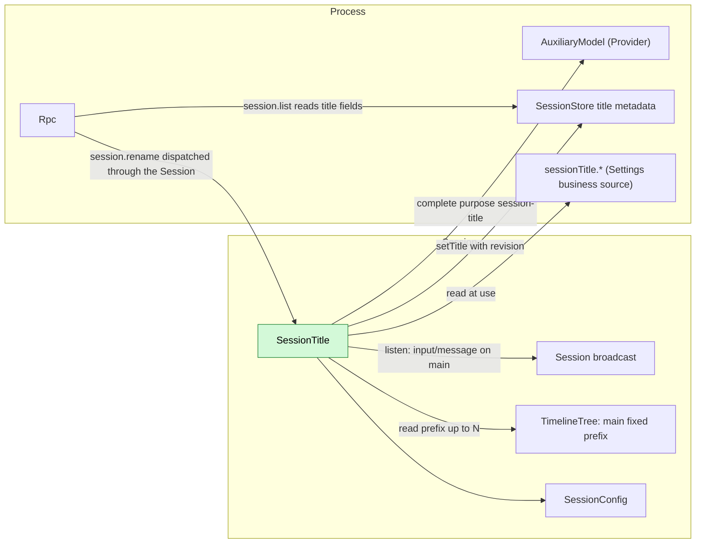
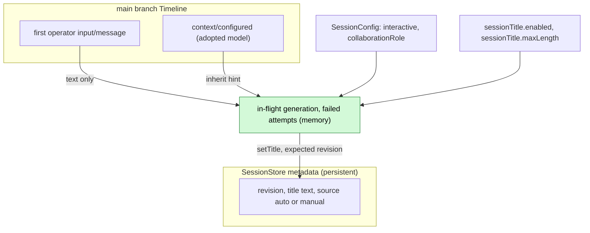
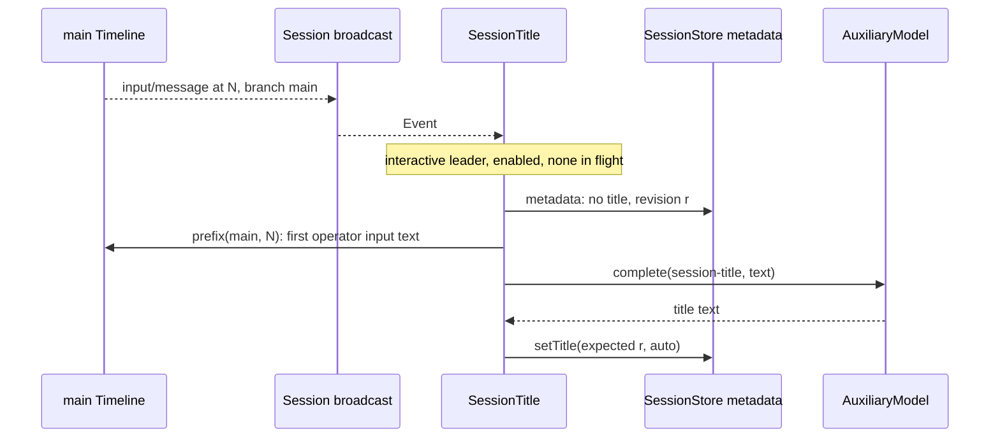
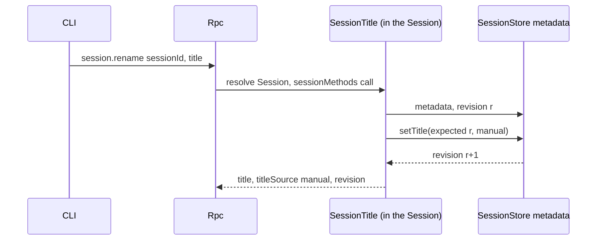
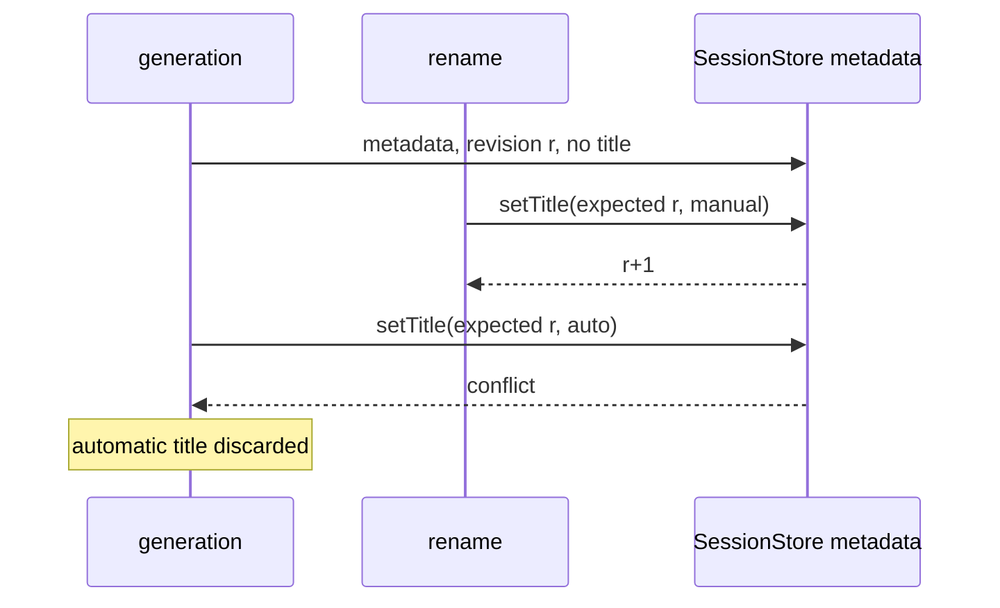

# SessionTitle

Status: Draft. Overall design: [overview](../overview.md) (SessionTitle). Phase: P1. Language: TypeScript first. Scope: [ADR 002](../../adr/002-plugin-scope.md) (Session).

SessionTitle is a Session plugin that gives an interactive leader Session a title stored through SessionStore metadata. It observes its own Session through the existing Session broadcast; when the first user input on `main` is written, it generates a title from that input's text alone through the Provider `AuxiliaryModel` under the purpose key `session-title`. It serves `session.rename` through the Session-scoped `sessionMethods` service keyed `session.rename` ([methods and tool contributions](../contracts/session-boundary.md)). It writes no Timeline event and has no model-visible effect. Contracts are given in neutral form ([ADR 002 D5](../../adr/002-plugin-scope.md#d5-contracts-are-language-neutral)); the Rust binding is in Appendix G.

## 1. Structure



| Part | Scope | Depends on | Provides |
| --- | --- | --- | --- |
| `SessionTitle` | Session | Session broadcast of its Session, TimelineTree (fixed prefix of `main`), `SessionConfig`; process services SessionStore title metadata, Provider `AuxiliaryModel`, Settings business source | `sessionMethods` key `session.rename` (declared in its `provides`), level `session`; purpose key `session-title`; business keys `sessionTitle.enabled`, `sessionTitle.maxLength` |

Every dependency is at the Session scope or the enclosing process scope. All of them are existing typed services (shapes in A.2); exposing them by name to the TypeScript implementation is issue [#4](https://github.com/arcships/dim/issues/4)'s work. A reload of SessionStore, Provider or Settings reloads SessionTitle, which cancels an in-flight generation; this is accepted ([ADR 002 D3](../../adr/002-plugin-scope.md#d3-dependencies-follow-scope-rare-restarts-are-accepted)). Business configuration changes never reload ([D4](../../adr/002-plugin-scope.md#d4-structural-configuration-and-business-configuration-are-separate)).

## 2. Data and state



Only SessionTitle writes title metadata; SessionStore keeps the revision counter. Each decision reads metadata first, then the fixed prefix. In-memory state is lost on reload or Session unload, which only allows another attempt.

## 3. Flows

### 3.1 Automatic title from the first user input



Generation starts when the input is written, not after the turn. Only the text of the first operator input on `main` is sent.

### 3.2 Manual rename



Rpc resolves the Session as for any Session method, loading it if needed. On `conflict` SessionTitle rereads and retries up to 3 times.

## 4. Timing and conflicts



The revision check is the recheck: a manual title always wins.

| Scenario | Order | Outcome | Owner |
| --- | --- | --- | --- |
| Member, workflow-stage or other non-interactive Session | `SessionConfig` | Never generated; rename allowed | SessionTitle |
| Second input before generation finishes | — | Skipped (in flight) | SessionTitle |
| First input deleted | input < `input/deleted` | Title still generated (A9) | SessionTitle |
| Generation failed | — | Next `main` input while untitled retries from the first input (A5) | SessionTitle |
| Reload or Session unload mid-generation | — | Cancelled, nothing written; next `main` input triggers | Lifecycle |

Full table: [Appendix B](#appendix-b-full-conflict-table).

## 5. Context mapping

No model-visible effect: SessionTitle writes no input, tool, prompt source or event. The auxiliary request is a separate one-shot call:

| Part | Content |
| --- | --- |
| System | `Write a short title for this conversation: at most 8 words, in the language of the user's message, no quotes, no trailing punctuation. Reply with the title only.` (A2) |
| User message | Text blocks of the first operator `input/message` on `main`, joined by newlines, cut to 2000 characters (A2) |

Never sent: images, raw input blocks, later inputs, assistant output, system prompt, tool calls and results, child-branch events. Diagnostics record outcome and duration only.

## 6. Interfaces (summary)

| Interface | Kind | Purpose |
| --- | --- | --- |
| `session.rename {sessionId, title \| null}` | `sessionMethods` key `session.rename`, level `session` | Set or clear a manual title |
| `session-title` | Provider purpose key | Model policy for title generation; unconfigured inherits |
| `sessionTitle.enabled`, `sessionTitle.maxLength` | Business configuration (Settings source) | Turn generation off; title length |
| `title`, `titleSource` in `session.list`/`session.summaries` | Rpc protocol fields read from SessionStore | Display |

## 7. Security

The first input's text is sent to the model chosen for `session-title`; with the default inherit policy that is the Session's provider. Titles may contain user content and are returned to every client that can list Sessions. No credentials, host settings or tool output enter the request. Rename input is validated at the RPC boundary.

## Appendix A. Interface details

### A.1 `session.rename`

Served through `sessionMethods` (Session, key `session.rename`): `describe(): async -> MethodDecl[]` returns one declaration `{name: "session.rename", level: "session", mutating: true}`; `call(MethodCall): async -> MethodReply` handles it. A dropped call is cancelled before `setTitle` or completes atomically after it.

| Params | Result | Errors |
| --- | --- | --- |
| `{sessionId, title: string \| null}` | `{title: string \| null, titleSource: "auto" \| "manual" \| null, revision}` | `invalid_params`, `session_not_found`, `service_reloading`, `storage_failed`; dispatch errors per [session-boundary](../contracts/session-boundary.md) |

`title` is trimmed; 1..=`sessionTitle.maxLength` characters, no line breaks or control characters (A3). `null` clears the title (A6).

### A.2 Depended-on shapes (owners define them)

| Service | Method | Kind | Request | Reply and errors |
| --- | --- | --- | --- | --- |
| SessionStore metadata (supplement) | `metadata` | async | `{session_id}` | `{revision, title?: {text, source: "auto" \| "manual"}}`; errors `not_found`, `storage` |
| SessionStore metadata (supplement) | `setTitle` | async | `{session_id, expected_revision, title: {text, source} \| null}` | New `revision`; errors `conflict`, `not_found`, `storage` |
| Provider `AuxiliaryModel` | `complete` | async | `{purpose: "session-title", inherit?: model selection, request: {system, user}}` | Text; errors as data. The inherit hint is SessionTitle's assumption (A1). Cancelled by a cancel request or by dropping the call |

### A.3 Configuration

`sessionTitle.enabled: bool` default `true`; `sessionTitle.maxLength: u32` default 80, range 10..=200 (A3). Business configuration read at each decision; a change is a data update with notification, never a reload. Enabling the plugin is structural configuration. Provider policy for `session-title` lives in Provider's per-purpose policy; unconfigured inherits the Session's model (A1).

### A.4 Mechanics

| Step | Path |
| --- | --- |
| Listen | On apply: Session broadcast listener for `input/message` events on `main`, removed on unload |
| Eligibility | `SessionConfig.interactive && collaborationRole = leader` |
| Trigger | On `input/message` at `N` with `user` content: skip if not eligible, disabled, in flight or failed attempts ≥ 3 (A5); otherwise start a generation task owned by the plugin's lifetime |
| Check | `metadata(session)`: skip if any title exists; keep revision `r` |
| Read | Fixed prefix of `main` up to `N`; the first operator input (user content, no source marker; A10) and its text. No text: no title (A8) |
| Generate | `complete({purpose: "session-title", inherit: model of the latest context/configured in the prefix, request})`, 30 s budget (A4). Normalized: first line, quotes and trailing punctuation removed, whitespace collapsed, cut at `maxLength` |
| Write | `setTitle({session_id, expected_revision: r, title: {text, source: "auto"}})`; `conflict` or `not_found` discards |
| Timeline | No writes, no Dispatcher registration, no `StateCell` |
| Reload / unload | Generation cancelled with the plugin; nothing written; events in the gap are not replayed |

## Appendix B. Full conflict table

| Scenario | Sequence order | Outcome | Owner |
| --- | --- | --- | --- |
| First input's turn interrupted or failed | input < `stop/interrupt` | Generation proceeds | SessionTitle |
| Inputs without `user` content (Goal blocks, source markers) | — | Never trigger, never used | SessionTitle |
| First user input carries only images | — | No automatic title (A8) | SessionTitle |
| Rename before the check | rename < check | Title present: skip | SessionTitle |
| Rename during generation | check (r) < rename (r+1) < write | `conflict`: automatic title discarded | SessionStore revision |
| Concurrent renames | revision order | Last committed rename wins | SessionStore |
| Duplicate `session.rename` | — | Rewrites the same text | SessionTitle |
| Steer/Queue/Append inputs after the first | — | Never in the excerpt | SessionTitle |
| Tool batch, compaction | — | Irrelevant: only the input fact is read | — |
| Child branch inputs | branch filter | Never trigger | SessionTitle |
| Member, stage, scheduled or ACP Session | `SessionConfig` | Never generated | SessionTitle |
| Session close during generation | — | Generation cancelled with the Session plugin; nothing written | Lifecycle |
| Session fork | metadata not copied (A7) | Fork untitled; first new `main` input triggers generation from the first operator input in its prefix | SessionTitle |
| SessionTitle, Provider, SessionStore or Settings reload | — | Generation cancelled, nothing written (D3) | Lifecycle |
| Model or policy unavailable | — | Failure counted; after 3 no further attempts until reload (A5) | SessionTitle |
| Resource node offline | — | No effect | — |
| Client detach | — | No effect | — |

## Appendix C. Errors and recovery

| Case | Result |
| --- | --- |
| Model error, timeout, empty output, unavailable policy | No write; diagnostic; failure counted |
| `setTitle` `conflict` on automatic write | Discarded (diagnostic) |
| `setTitle` `storage` | Automatic: failure counted; rename: `storage_failed` |
| Unknown Session on rename | `session_not_found` |
| SessionTitle reloading | `service_reloading`; the rename did not happen |
| Cancellation | Auxiliary call aborted before any write |

## Appendix D. Acceptance

Flow tests through `session.create`/`session.submit`, `session.rename`, `session.list` and a fake auxiliary model:

1. The first `session.submit` on an interactive leader Session produces an `auto` title before the turn ends; the request contains only the system text and that input's text.
2. Interrupting or failing the first turn does not prevent the title.
3. Member Sessions and `interactive: false` Sessions get no title; rename works on them.
4. Rename during generation (fake model held): manual kept, automatic discarded.
5. A titled Session is never regenerated; clearing allows regeneration at the next input, still from the first input's text.
6. Rename of an unloaded Session loads it through Rpc and succeeds.
7. Child-branch inputs and inputs without `user` content never trigger; image-only first input yields no title.
8. Reload during generation writes nothing; the next input generates. Three failures stop attempts.
9. Invalid rename inputs return `invalid_params`.

## Appendix E. Assumptions

| # | Assumption | Basis | Effect if rejected |
| --- | --- | --- | --- |
| A1 | `AuxiliaryModel::complete` accepts an inherit hint (model of the latest `context/configured`) | Judgment | Provider resolves inheritance itself |
| A2 | Instruction text, 8-word target, 2000-character excerpt | Judgment | Different prompt or excerpt |
| A3 | Title length default 80 (10..=200), single line | Judgment | Other limits |
| A4 | 30 s generation budget | Judgment | Other timeout |
| A5 | At most 3 failed attempts per Session per plugin generation | Judgment | More retries, or none |
| A6 | `session.rename` with `null` clears the title | Judgment | Manual title permanent |
| A7 | Session fork does not copy the title | Judgment | Fork shows the source title |
| A8 | A first user input without text produces no automatic title | Decision: title from first user input | Later inputs or a placeholder |
| A9 | Deletion of the first input (`input/deleted`) does not prevent or remove its title | Judgment (trigger is the write) | Generation waits for consumption |
| A10 | "User input" means operator input: `user` content without a source marker | Judgment | Source-written inputs could title a Session |

## Appendix F. Open questions

| Question | Description |
| --- | --- |
| Session list fields | `title`/`titleSource` in `SessionSummary` are an Rpc protocol change to record in the overview |
| Services by name | The TypeScript implementation needs the Session broadcast, fixed-prefix read, SessionStore metadata, `AuxiliaryModel` and Settings exposed by name ([#4](https://github.com/arcships/dim/issues/4)) |

## Appendix G. Rust binding

| Neutral | Rust |
| --- | --- |
| `sessionMethods` key `session.rename` | `SessionMethodContribution(Arc<dyn MethodProvider>)` at `SessionScope::named_key::<SessionMethodContribution>("session.rename")`, registered with `AgentBuilder::session_methods("session.rename")` |
| Session broadcast listener | Listener on `session_channel(session_id)` for `Event` records, removed by `ctx.effect` |
| Generation task | Spawned under `ctx.effect` |

```rust
// SessionStore metadata supplement
async fn metadata(&self, session_id: &str) -> Result<SessionMetadata, MetadataError>;
async fn set_title(&self, session_id: &str, expected_revision: u64, title: Option<Title>)
    -> Result<u64, MetadataError>;                       // Conflict | NotFound | Storage
pub struct SessionMetadata { pub revision: u64, pub title: Option<Title> }
pub struct Title { pub text: String, pub source: TitleSource }   // Auto | Manual
// Provider AuxiliaryModel
async fn complete(&self, purpose: &str, inherit: Option<ModelSelection>,
    request: AuxiliaryRequest, cancel: CancellationToken) -> Result<String, AuxiliaryError>;
```
