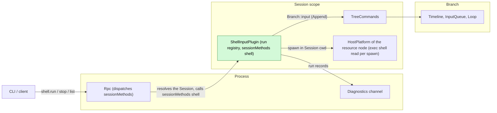
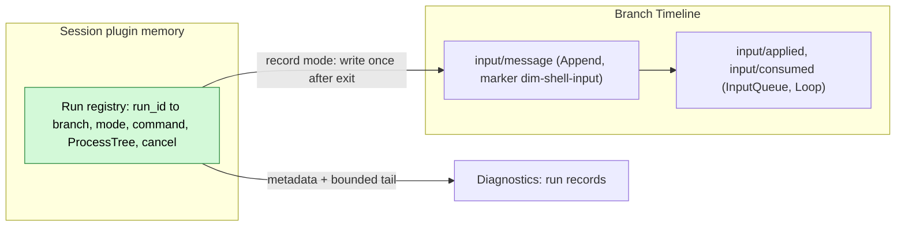
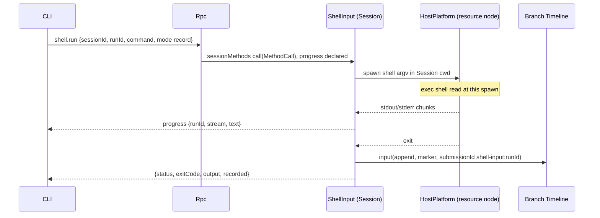
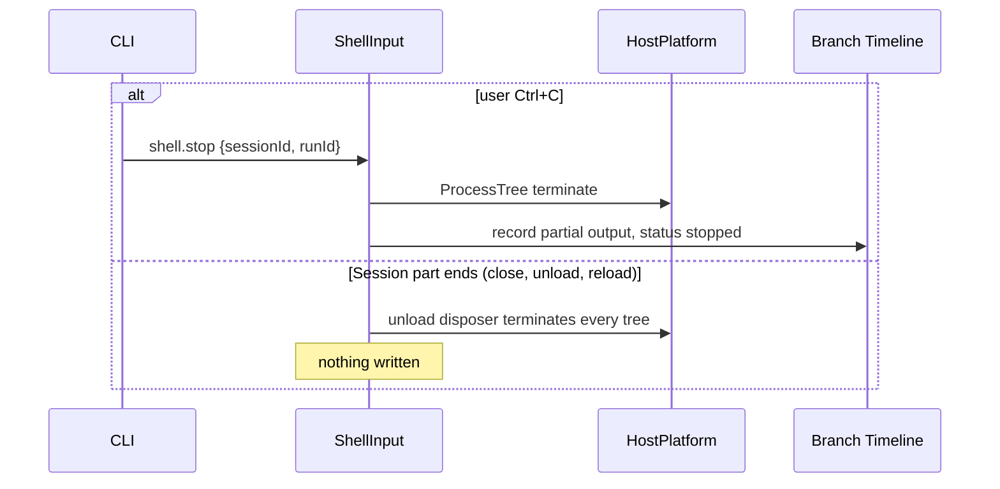
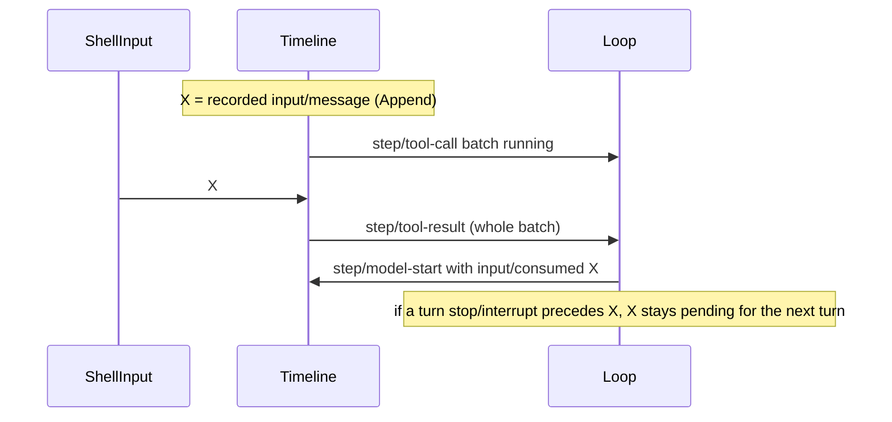

# ShellInput

Status: Draft. Overall design: [overview §4](../overview.md#4-plugin-catalog). Phase: P1. Language: Rust. Scope: Session ([ADR 002](../../adr/002-plugin-scope.md)).

> **Offline resource nodes.** Rows about an offline resource node describe P3 multi-node behaviour. #5 is withdrawn (rutis is an external dependency, and it withdraws imported services when a link drops), so these rows are redesigned with rutis' existing node behaviour in P3. In P1/P2 every Session uses the control node.

Executes `!command` and `!!command` typed by the user in the Session's workspace on its resource node. The result of `!command` (command and bounded output) is written as an Append input, so it enters context with the next model request; the output of `!!command` goes only to the calling client and diagnostics. ShellInput is a Session plugin with no events. It provides `shell.run`, `shell.stop` and `shell.list` through a `sessionMethods` service (Session scope, key `shell`) as ordinary Session methods ([session-boundary](../contracts/session-boundary.md)); contracts are given in language-neutral form, the Rust form is [Appendix G](#appendix-g-rust-binding). At most one command runs per Session; a command ends on `shell.stop` or when the Session part ends (Session close or unload, reload, daemon exit).

## 1. Structure



| Part | Scope | Depends on | Provides |
| --- | --- | --- | --- |
| `ShellInputPlugin` | Session | `S:SessionConfig` (`cwd`), `S:TreeCommands`, the HostPlatform of the Session's resource node (as WorkspaceTools uses it), diagnostics channel | `sessionMethods` key `shell`, declared in the plugin's `provides` |

Contracts depended on: `sessionMethods` and per-call progress ([session-boundary](../contracts/session-boundary.md)); `Branch::input` with boundary validation ([interrupt](../../architecture/rust-agent/interrupt.md)); the HostPlatform process service (start a process tree, read its output, wait for exit, terminate the tree; Rust names in Appendix G); the node's exec shell as business configuration read at each spawn ([ADR 002](../../adr/002-plugin-scope.md) "Existing plugins"); isolation (overview Appendix C supplement); the node-offline rule ([overview §6.3](../overview.md#63-multiple-nodes)): a call on an offline resource node fails `node_unavailable` while ShellInput stays loaded, which requires services imported over a rutis link to stay registered while the link is down and fail calls (requirement on [#5](https://github.com/arcships/dim/issues/5), stated in [ExternalAgent §9](ExternalAgent.md#9-requirements-raised-to-mechanism-owners)); when the link to the resource node drops, that node's own HostPlatform ends the process trees it started (HostPlatform supplement, [overview Appendix B.1](../overview.md#b1-session-and-branch-capabilities)); shell argv construction of the `exec` tool ([exec.rs](../../../crates/dim-agent-capabilities/src/workspace_tools/exec.rs), exposed as a HostPlatform helper, A2).

Contracts defined here: the `shell.*` methods, the source marker `dim-shell-input` (kind `command`) and the `submissionId` prefix `shell-input:`.

## 2. Data and state



The run registry is memory owned by the plugin generation through its unload disposer and is never rebuilt: when the Session part ends, every run is terminated. The only durable result is the existing `input/message`, restored with the Session.

Events: none. A run is started by the user, not by a branch turn, so a branch interrupt does not settle it. The only later-relevant outcome of `!command` is the input; `!!command` affects nothing later. Run records go to diagnostics.

## 3. Flows

### 3.1 `!command` recorded



The write happens once, after the process tree is released. InputQueue applies the Append; Loop consumes it at the next model request of a running turn, or at the first request of the next turn when idle. No turn is started.

### 3.2 Stop and Session end



A turn `stop/interrupt` does not reach the run: `Ctrl+C` first sends `shell.stop`, a second one falls through to the turn stop.

### 3.3 `!!command`

Same as 3.1 without the write: output is streamed and returned to the caller only.

## 4. Timing and conflicts

### 4.1 Result versus turn



Placement is decided by the input owners by sequence; ShellInput has no recheck because its write depends on no Timeline fact.

| Scenario | Outcome |
| --- | --- |
| Second `!` in the same Session while one runs | `shell_busy` |
| Branch close during the run | Write fails `BranchMissing`; reply `recorded: null`, output returned |
| `input/withdraw` of X while InputQueue holds it | `input/deleted`; never applied or consumed; not re-written |
| Session close, idle unload or reload during the run | Tree terminated; nothing written; caller gets `operation_interrupted` (A10) |
| Exec shell configuration changed | Running commands keep their shell; the next spawn reads the new value; nothing reloads |

Full table: Appendix B.

## 5. Context mapping

| Mode | What the model sees | Form and placement |
| --- | --- | --- |
| `!command` | `<dim-shell-input kind="command" status="completed" exit="0" truncated="false">` + `$ command` + bounded output | One unkeyed raw block (user-role message) at the input's consumed position |
| `!!command` | Nothing | — |

No tool declaration, prompt source or key: each run is a one-time observation. After compaction the result survives only through the summary. Child branches inherit it only if consumed before the cut. The model never sees `runId`, `submissionId`, stream separation, durations, diagnostics or terminal escapes.

## 6. Interfaces (summary)

| Interface | Kind | Purpose |
| --- | --- | --- |
| `shell.run` | `sessionMethods` (Session, key `shell`), progress | Run a command (`record` or `private`), stream output, return the result |
| `shell.stop` | Same | Stop a run by `runId`; idempotent |
| `shell.list` | Same | Running runs of the Session |
| Marker `dim-shell-input` kind `command` | Input convention | Model-visible recorded result |
| CLI `!` / `!!` | Client | Maps prefixes to `shell.run` modes |

## 7. Security

`!` and `!!` execute arbitrary commands as the service user on the resource node without Approval (overview §5.3). `shell.*` are ordinary Session methods: any client with access to the Session may call them, including paired remote devices (decision E3), so pairing a device or granting Session access grants command execution on that Session's resource node. Session methods have no level; only management methods are withheld from paired devices ([session-boundary](../contracts/session-boundary.md)). The node's isolation applies (host-local, never from the Timeline). For `!`, command text and output are written to the Timeline and replayed to the model; users must avoid printing secrets. The environment is the service's, never forwarded from clients. Diagnostics carry metadata and the bounded tail only (A13).

## 8. Rule check

Rules: [principles §1 and §4](../../architecture/rust-agent/principles.md), [ADR 002](../../adr/002-plugin-scope.md) D1–D5.

| Rule | How this document complies |
| --- | --- |
| §4.1 Command events for others' state | ShellInput changes no other module's state; its only Timeline effect is an ordinary input that InputQueue and Loop handle. |
| §4.2 No recall after handoff | The recorded input is written once and never re-written; withdrawal goes through InputQueue's own command. |
| §4.3 Only before callbacks, never block | Not applicable: ShellInput registers no before callback and adds no entry check; it validates only its own parameters. |
| §4.4 No business meaning in core | Rpc, InputQueue and Loop need no change; the marker is an ordinary raw block. |
| §4.5 Read the whole batch | Not applicable: ShellInput reads no Timeline event. |
| §4.6 Context only from handed-off events | The output reaches the model only after InputQueue adopts and Loop consumes the input; `!!` output never does. |
| §4.7 Public events and services only | ShellInput uses only `Branch::input`, `S:TreeCommands`, `SessionConfig` and HostPlatform. |
| §4.8 Requirements to mechanism owners | #5 is linked from §9; the Session activity handle for idle unload is an Agents supplement listed in [overview Appendix B.2](../overview.md#b2-app-server-process-plugins) and designed in A.5. |
| §4.9 Only facts later decisions use enter the Timeline | Only the recorded `!` result enters, as an input InputQueue and Loop decide on and the model reads; `!!` output, progress and run records stay in the reply and diagnostics. |
| §1 Capability and App Server boundary | ShellInput is a Session Capability in its own crate; Rpc only dispatches `sessionMethods`. |
| ADR 002 D1 Scope | A run is Session work on the Session's resource node, so the plugin is Session scoped. |
| ADR 002 D2 No wiring modules | Rpc reaches `shell.*` through the Session's `sessionMethods` by name; nothing names ShellInput. |
| ADR 002 D3 Scope dependencies | Dependencies are Session services; a reload terminates runs, which is accepted. |
| ADR 002 D4 Configuration | The exec shell is business configuration read at each spawn; nothing reloads on change. |
| ADR 002 D5 Language-neutral contracts | Methods, marker and recorded input are neutral; Appendix G is the Rust binding. |

## 9. Requirements raised to mechanism owners

None to the runtime or rutis beyond #5. The Session activity handle ShellInput needs is a change to Agents, listed in [overview Appendix B.2](../overview.md#b2-app-server-process-plugins) and designed in [A.5](#a5-changes-to-other-plugins).

Linked: #5 guarantees only that each call on an imported service fails `node_unavailable` while the link is down ([ExternalAgent §9](ExternalAgent.md#9-requirements-raised-to-mechanism-owners)); processes already started on the node are ended by that node's own HostPlatform when the link drops ([overview Appendix B.1](../overview.md#b1-session-and-branch-capabilities), HostPlatform row).

## Appendix A. Interface details

### A.1 Methods

Service `sessionMethods`, Session scope, key `shell`. `describe()` returns one `MethodDecl` per method with `notifications: []`, `reply: direct`; `shell.run` has `mutating: true`, `interruption: report`, `progress: true`; `shell.stop` has `mutating: true`; `shell.list` has `mutating: false`. `call(MethodCall)` takes the params below and replies with the result as `MethodReply`; progress items are sent on the call before the reply; errors are `MethodError` data (Appendix C). A dropped call (client gone) does not stop the run (A12).

| Method | Parameters | Result |
| --- | --- | --- |
| `shell.run` | `{sessionId, branchId?: "main", runId, command, mode: "record" \| "private"}` | On exit: `{runId, status: "completed" \| "failed" \| "stopped", exitCode?, signal?, output, truncated, durationMs, recorded?: {sequence, submissionId} \| null}`. Progress: `{runId, stream: "stdout" \| "stderr", text}`, calling connection only, rate-coalesced (A9) |
| `shell.stop` | `{sessionId, runId}` | `{stopped: bool}`; `false` when already ended |
| `shell.list` | `{sessionId}` | `[{runId, branchId, mode, command, startedAt}]` |

`runId` is generated by the client so `stop` can be sent before the `run` reply.

### A.2 Execution

| Item | Rule |
| --- | --- |
| Host | The HostPlatform of the Session's resource node, the one the Session's workspace tools use |
| Shell | The node's exec shell, read at each spawn (no reload on change), argv built as for `exec` (A2) |
| Working directory | Session cwd; a fresh process per run (A3) |
| Environment | The node's service environment, never the client's; plus `DIM_SESSION_ID` (A5) |
| stdin | Null; interactive programs see EOF |
| Isolation | The node's isolation applied by HostPlatform; a Permission preset never relaxes it |
| Timeout | None; ended by `shell.stop` or the end of the Session part |
| Output | stdout and stderr interleaved in arrival order; decoded as `exec` does (invalid bytes as `<0xNN>`) |
| Bounds | Reply and model-visible output: last 2000 lines within 50 KiB, the `exec` `truncate_preview` rule (A7) |

### A.3 Recorded input

One input written through the branch's input boundary:

| Field | Value |
| --- | --- |
| `submissionId` | `shell-input:<runId>` |
| `blocks` | One raw block: marker `dim-shell-input`, kind `command`, attributes `status`, `exit` (code or signal), `truncated`; body `$ <command>`, newline, bounded output without terminal escapes |
| `user` | none |
| `mode` | `append` |

ANSI/OSC sequences are removed from the body (A8); the reply keeps them for the terminal.

### A.4 Mechanics

| Step | Mechanics |
| --- | --- |
| Start | Validate; reject `shell_busy`/`duplicate_run`; `spawn`; register the run in the generation's tracker |
| Run | A task reads both pipes into a bounded tail buffer and forwards chunks to the progress channel; `select!` on exit and `cancel` |
| Stop | `cancel` → `ProcessTree::terminate` → status `stopped` with partial output |
| Write (`record`) | After resources are released: resolve the branch through `S:TreeCommands`, `Branch::input` → boundary `validate` → `Timeline::append`. Committed sequence returned as `recorded.sequence`. Never retried; the command is never re-run |
| Consumption | InputQueue `input/applied {mode: append}`, Loop `input/consumed` |
| Recheck | None |
| Session part ends | Unload disposer cancels all runs, terminates trees, waits for them, writes no input. Daemon exit: trees die with the process (`ProcessTree` drop kills the tree). This includes reloads following structural operations, an accepted cost ([ADR 002](../../adr/002-plugin-scope.md) D3) |

### A.5 Changes to other plugins

Listed in [overview Appendix B.2](../overview.md#b2-app-server-process-plugins) (Agents row); this section records why ShellInput needs it, in the five items.

#### Session work reported as activity for idle unload (Agents supplement)

| Item | Content |
| --- | --- |
| Blocked by | ADR 002 D1 (a run is Session work and ends with the Session part) and lifecycle rule "detaching a client is not closing a Session": after the caller disconnects, nothing keeps the Session from idle unload, which terminates a long `!` run. |
| Existing mechanisms considered | The per-call `SessionUse` lease Rpc holds (released when the call is dropped, A12); a running turn (a `!` run is not a turn); a process-level owner for runs (moves Session work out of its scope, D1). |
| Generic capability | A Session part can hold an activity handle on its own Session; Agents does not idle-unload a Session while any handle is held. The handle carries no business meaning and is released by `ctx.effect`. |
| Effect on sequence, batch, interrupt, reload | None on sequence or batch. Interrupt: unchanged (runs ignore turn interrupts). Reload: the handle is released with the part; close still terminates runs. |
| Owner and issue | Agents (`AgentIndex`, App Server) with the runtime Session facade; no issue filed yet. |

## Appendix B. Full conflict table

`X` = the recorded `input/message` (Append), `I` = turn `stop/interrupt`.

| Scenario | Sequence order | Outcome | Owner of the decision |
| --- | --- | --- | --- |
| Result before the next request of a running turn | X < `step/model-start` | Consumed with that request | Loop |
| Result while a tool batch runs | X < `step/tool-result` | Consumed at the next request after the batch result | Loop |
| Result while idle | X, no turn | Pending; consumed when the next Queue/Steer starts a turn; never starts one | InputQueue, Loop |
| Turn interrupt before X | I < X | Run unaffected; X pending until the next turn | Loop |
| X applied, then interrupt before consumption | X < I | Pending; consumed by the next turn | Loop |
| X consumed, then interrupt | consumed < I | Stays at its consumed position | Loop |
| `input/withdraw` of X while held | X < withdraw < `input/deleted` | Never applied or consumed; not re-written | InputQueue |
| `input/withdraw` of X after apply | `input/applied` < withdraw | No effect (`notHeld`); X consumed normally | InputQueue |
| Branch-scoped interrupt or branch close during the run | close < X | Run continues; write fails `BranchMissing`; `recorded: null` | Runtime facade; ShellInput |
| Session close or idle unload during the run | — | Tree terminated, nothing written (A10) | ShellInput |
| Concurrent Steer/Queue and X | Timeline order | Each applied by its mode | InputQueue |
| Second run in the same Session | — | `shell_busy` | ShellInput |
| Compaction between X and consumption | X < compaction < consumed | Placed after the summary at its consumed position | ContextPreparation |
| Compaction after consumption | consumed < compaction | Only through the summary | ContextPreparation |
| Child branch cut between X and consumption | X < cut < consumed | Child does not adopt X | InputQueue (child) |
| Child branch cut after consumption | consumed < cut | Inherited in the prefix | History projection |
| `!!` run | — | No Timeline effect | — |
| ShellInput or Session reload mid-run | — | Tree terminated; nothing written; caller `operation_interrupted` (D3) | ShellInput |
| Process restart mid-run | — | Tree dies with the daemon; nothing written | — |
| Commit, then reply lost | X committed | Retry in the same generation → `duplicate_run`; after restart the client checks `session.input_lookup` for `shell-input:<runId>` (A11) | Client |
| Session unloaded at start | — | Rpc restores it before dispatch | Rpc, AgentIndex |
| Resource node offline at start | — | `node_unavailable`; nothing started; ShellInput stays loaded and other Sessions are unaffected (requirement on #5) | ShellInput |
| Resource node lost mid-run | — | The node's own HostPlatform ends the process tree when the link drops; ShellInput's calls fail `node_unavailable` (#5); status `failed`; for `record`, the partial output read so far is written with `status="failed"` (A6) | ShellInput; HostPlatform of the node |
| Duplicate or late `stop` | — | `{stopped: false}` | ShellInput |
| Client detach or disconnect | — | Run continues and is recorded or discarded; progress dropped (A12) | ShellInput |
| Paired remote device | — | Allowed like any client with Session access (E3); the run behaves as from a local client | ShellInput |
| Exec shell changed mid-run | — | Run keeps its shell; next spawn reads the new value | HostPlatform |

## Appendix C. Errors and recovery

| Error (`appError`) | Condition |
| --- | --- |
| `shell_unavailable` | `HostPlatform.shell` unavailable on the node (reason forwarded) |
| `shell_busy` | Another run of the Session is running |
| `duplicate_run` | `runId` already used in this generation |
| `invalid_params` | Empty command, command over 64 KiB, `runId` not `[A-Za-z0-9-]{1,64}` |
| `session_closed` / `branch_missing` | Session or branch gone at start |
| `node_unavailable` | The resource node is unreachable |
| `unknown_method` | ShellInput not enabled in the Session |
| `service_reloading` | The service is reloading at start |
| `operation_interrupted` | The Session part ended while the call ran |

| Case | Result |
| --- | --- |
| Spawn fails | `status: "failed"` with reason; nothing recorded |
| Non-zero exit | `status: "completed"`, `exitCode` set; recorded |
| Write rejected (`SessionClosed`, `BranchMissing`, `Rejected`) | Output returned, `recorded: null` with the error |
| Unload, reload, restart | Runs terminated, never re-executed |

## Appendix D. Acceptance

1. `!echo hi` while idle: Append input with the marker; no turn starts; the next prompt's first request contains it before the prompt.
2. `!` during a turn with a tool batch: consumed after the batch result in the same turn.
3. `!!`: output returned, no Timeline change.
4. Turn stop does not stop a run; `shell.stop` terminates the tree (process absent) and records `stopped`.
5. Second `shell.run` in the same Session → `shell_busy`.
6. 10 MiB output yields the last 2000 lines within 50 KiB and `truncated="true"`.
7. Branch close: `recorded: null`. Session close: tree terminated, nothing written.
8. Session reload and daemon restart mid-run: tree terminated, nothing written, no re-execution.
9. Offline node: `node_unavailable` for that Session only; ShellInput is not reloaded and a later call succeeds once the node is back.
10. Deleted X (`input/deleted`) is never consumed; a paired remote device can run and stop a command.
11. Changing the exec shell: the next run uses the new shell without reloading anything.

## Appendix E. Assumptions

| # | Assumption | Basis | Effect if rejected |
| --- | --- | --- | --- |
| A1 | Methods `shell.run/stop/list` with `mode` | Overview §5.3 (run, stop); `list` and `mode` are judgment | Method set changes |
| A2 | Shell and argv as `exec` | Judgment | ShellInput builds its own argv |
| A3 | Each run is a fresh process | Judgment | A per-Session shell needs lifecycle and state |
| A4 | One running command per Session | Maintainer decision | Concurrent runs, inputs in completion order |
| A5 | `DIM_SESSION_ID` added to the environment | Judgment | Commands cannot identify the Session |
| A6 | Stopped or failed `!` runs record partial output | Judgment | Only completed runs recorded |
| A7 | `exec` preview bounds (2000 lines, 50 KiB) | Existing `exec` constants | Separate limit |
| A8 | Terminal escapes stripped from model-visible text | Judgment | Escapes reach the model |
| A9 | Progress through the call's progress channel, rate-coalesced | [session-boundary](../contracts/session-boundary.md); coalescing is judgment | Output only at completion |
| A10 | A run is Session work: it ends with the Session part (close, reload, and idle unload until the Agents activity handle of A.5 exists) | ADR 002 D1 (Session scope), D3 | Runs would need a process owner |
| A11 | Clients deduplicate by `runId` via `session.input_lookup` | Session public interface | Possible duplicate input |
| A12 | Client disconnect does not stop a run | Lifecycle ("connection close keeps Session work") | Disconnect stops runs |
| A13 | Diagnostics carry only metadata and the bounded tail | Judgment | Full output in diagnostics |

## Appendix F. Open questions

| # | Question | Description |
| --- | --- | --- |
| F1 | Overview §5.3 end conditions | Overview names stop and daemon exit; this design also ends runs when the Session part ends |

## Appendix G. Rust binding

ShellInput is implemented in Rust.

| Neutral contract | Rust binding |
| --- | --- |
| `sessionMethods` key `shell` | `SessionMethodContribution(Arc<dyn MethodProvider>)`, key `SessionScope::named_key::<SessionMethodContribution>("shell")`; `describe` = `methods()`, `call` = `call(MethodCall, CallChannel, CancellationToken)`; progress = `CallChannel::progress` |
| Recorded input (A.3) | `Branch::input` through `S:TreeCommands` |
| Unload disposer | `ctx.effect` |
| Process service | `HostPlatform::spawn(ProcessSpec)` returning `ProcessTree` with `stdout`, `stderr`, `wait`, `terminate` |

```rust
branch.input(InputMessage {
    submission_id: Some(format!("shell-input:{run_id}")),
    blocks: vec![marker("dim-shell-input", "command",
        [("status", status), ("exit", code_or_signal), ("truncated", bool)],
        format!("$ {command}\n{bounded_output_without_terminal_escapes}"))],
    user: None, mode: InputMode::Append,
})
```
