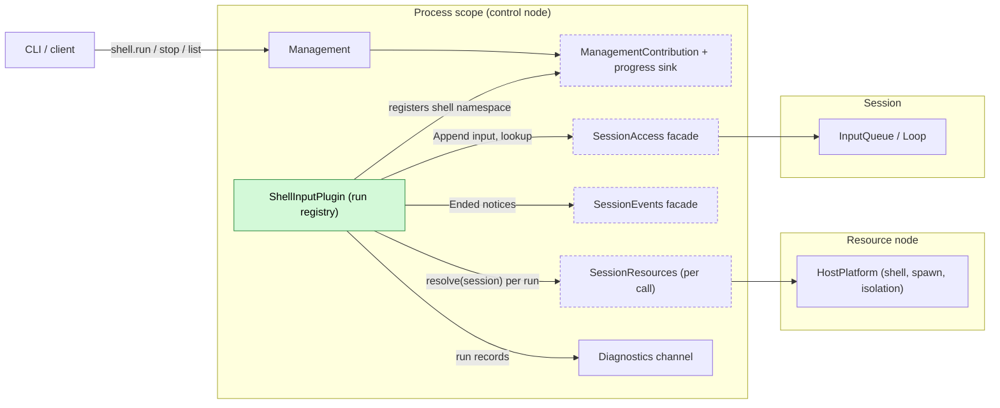
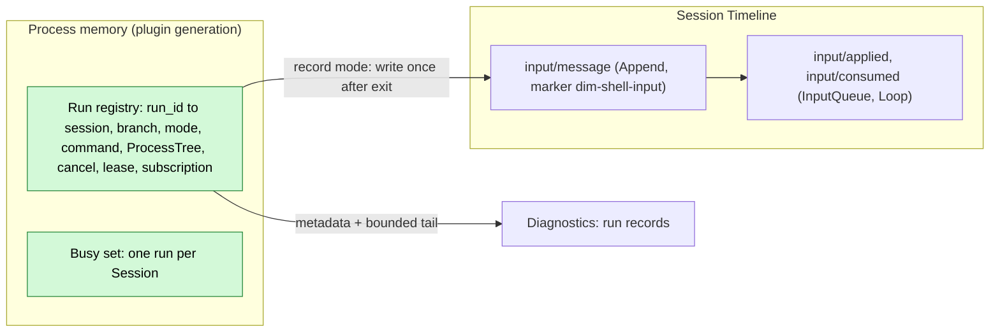
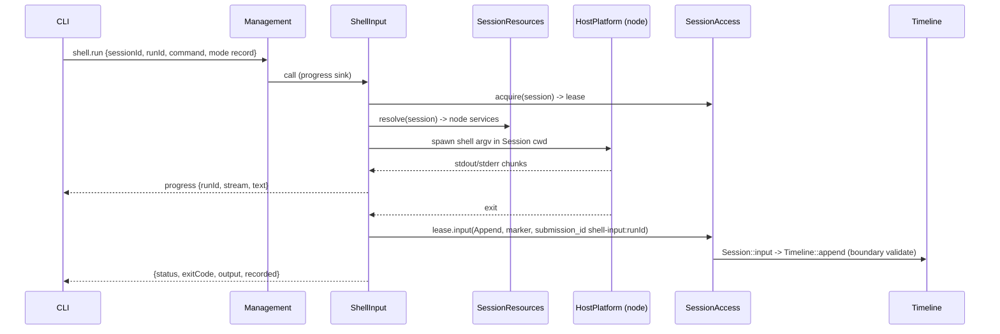
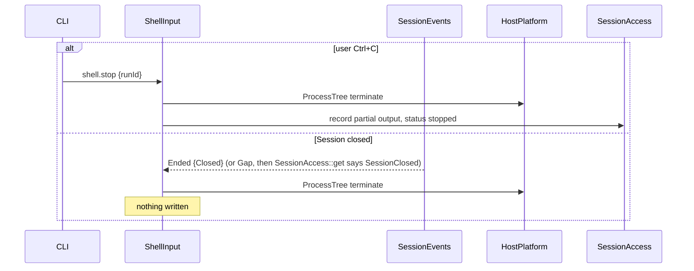
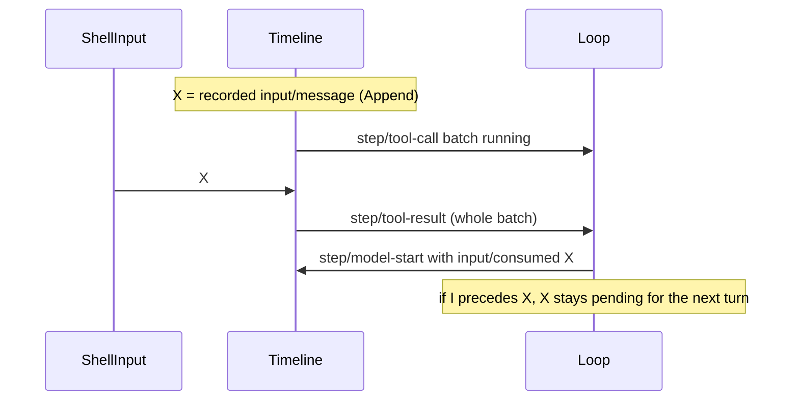
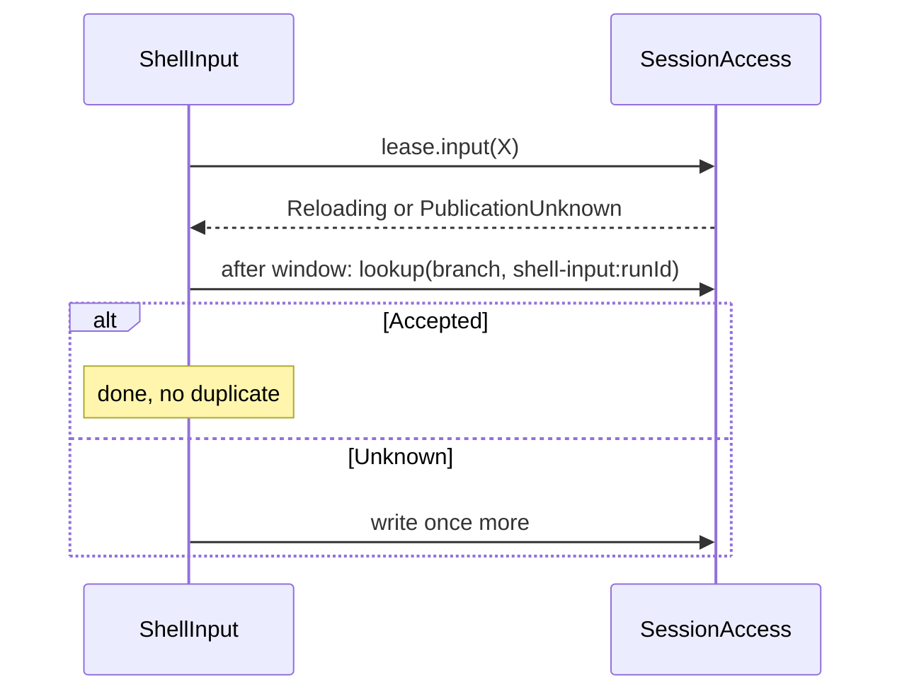

# ShellInput

Status: Draft. Overall design: [overview §5.3](../overview.md#53-shellinput). Phase: P1. Language: Rust.

Executes `!command` and `!!command` typed by the user, at the RPC boundary, on the Session's resource node. The result of `!command` (command and bounded output) is written as an Append input so it enters context with the next model request; the output of `!!command` goes only to the calling client and the diagnostics channel. ShellInput is a process plugin with no events; its `shell.run`, `shell.stop` and `shell.list` methods are a Management contribution. At most one command runs per Session; a command ends on `shell.stop`, Session close, plugin unload or daemon exit.

## 1. Structure



ShellInput touches the Session only through the public SessionAccess/SessionEvents facades and reaches the resource node only through SessionResources resolved per call, so an offline node fails only runs on that node and an Agents reload does not reload ShellInput.

| Part | Scope | Depends on | Provides |
| --- | --- | --- | --- |
| `ShellInputPlugin` | Process (App Server) | `SessionAccess`, `SessionResources` ([session-access](../contracts/session-access.md)); `SessionEvents` ([session-broadcast-subscription](../contracts/session-broadcast-subscription.md)); diagnostics channel | `ManagementContribution` keyed `shell` ([Management](Management.md)), mounted per the [extension-registry](../contracts/extension-registry.md) pattern |

Contracts depended on: `SessionAccess` (`source("shell-input")`, `acquire`, `SessionLease::input`, `lookup`); `SessionResources` (node, cwd, Session-bound `HostPlatform`, isolation; resolved per call); `SessionEvents` (`SessionNotice::Ended`, `Gap`); `ManagementContribution` with the per-call progress sink; `HostPlatform::spawn(ProcessSpec)`, `ProcessTree::{stdout, stderr, wait, terminate}`, `shell: ShellStatus` (existing; isolation parameter is the overview §7.1 supplement); shell argv construction of the `exec` tool ([exec.rs](../../../crates/dim-agent-capabilities/src/workspace_tools/exec.rs), to be exposed as a HostPlatform helper, A2).

Contracts defined here: the `shell.*` management methods, the source marker `dim-shell-input` (kind `command`) and the `submission_id` prefix `shell-input:`. ShellInput never reads Session state or another plugin's internals.

## 2. Data and state



The run registry is memory owned by the plugin generation through `ctx.effect` and is never rebuilt: unload or restart terminates every run. The only durable result is the existing `input/message`, restored with the Session.

Events: none (overview §6 has no `shell/*`). A run is not in-flight work of a branch; it is started by the user at the RPC boundary and is not settled by branch interrupt. The only later-relevant outcome of `!command` is the input, which is the existing `input/message`; `!!command` affects nothing later. Run records go to diagnostics.

## 3. Flows

### 3.1 `!command` recorded



The write happens once, after the process tree is released. InputQueue applies the Append through its Dispatcher subscription; Loop consumes it at the next model request of a running turn, or at the first request of the next turn when idle. No turn is started.

### 3.2 Stop and Session close



A turn `stop/interrupt` does not reach the run: `Ctrl+C` first sends `shell.stop`, a second one falls through to the turn stop.

### 3.3 `!!command`

Same as 3.1 without the write: output is streamed and returned to the caller only; the Timeline is unchanged.

## 4. Timing and conflicts

### 4.1 Result versus turn



Placement is decided by the input owners by sequence; ShellInput has no recheck because its write depends on no Timeline fact.

### 4.2 Uncertain write



The command is never re-run; only the write is retried, and only after `lookup`.

| Scenario | Outcome |
| --- | --- |
| Second `!` in the same Session while one runs | `shell_busy` (one command per Session) |
| Branch close during the run | Write fails `BranchMissing`; reply `recorded: null`, output returned |
| `input/withdrawn` of X before consumption | Never consumed; not re-written |
| Agents reload during the run | Run continues; facade calls return `Reloading` and are retried after the window |
| ShellInput unload or restart mid-run | Tree terminated; nothing written; caller gets `operation_interrupted` or a closed connection |

Full table: Appendix B.

## 5. Context mapping

| Mode | What the model sees | Form and placement |
| --- | --- | --- |
| `!command` | `<dim-shell-input kind="command" status="completed" exit="0" truncated="false">` + `$ command` + bounded output | One unkeyed raw block (user-role message) at the input's consumed position (`input/consumed`) |
| `!!command` | Nothing | — |

No tool declaration, prompt source or key: each run is a one-time observation. After compaction the result survives only through the summary. Child branches inherit it only if consumed before the cut. Non-interactive Sessions: same mapping if a client runs `!` there. The model never sees `runId`, `submission_id`, stream separation, durations, diagnostics or terminal escapes.

## 6. Interfaces (summary)

| Interface | Kind | Purpose |
| --- | --- | --- |
| `shell.run` | Management method, `Interruption::Report`, progress sink | Run a command (`record` or `private`), stream output, return the result |
| `shell.stop` | Management method | Stop a run by `runId`; idempotent |
| `shell.list` | Management method | Running runs, optionally per Session |
| Marker `dim-shell-input` kind `command` | Input convention | Model-visible recorded result |
| CLI `!` / `!!` | Client | Maps prefixes to `shell.run` modes |

## 7. Security

`!` and `!!` execute arbitrary commands as the service user on the resource node without Approval (overview §5.3): authority comes from Management being mounted on the entry, and exporting Management grants host administration (overview §3.1). Paired remote devices may call Session methods but `shell.*` is a management method, available only where Management is mounted. The node's isolation configuration applies (host-local, never from Timeline). For `!`, command text and output are written to the Timeline and replayed to the model; users must avoid printing secrets. The environment is the service's, never forwarded from clients. Diagnostics carry metadata and the bounded tail only (A14).

## Appendix A. Interface details

### A.1 Methods

| Method | Parameters | Result |
| --- | --- | --- |
| `shell.run` | `{sessionId, branchId?: "main", runId, command, mode: "record" \| "private"}` | On exit: `{runId, status: "completed" \| "failed" \| "stopped", exitCode?, signal?, output, truncated, durationMs, recorded?: {sequence, submissionId} \| null}`. Progress on the call's sink: `{runId, stream: "stdout" \| "stderr", text}`, calling connection only, rate-coalesced (A9) |
| `shell.stop` | `{runId}` | `{stopped: bool}`; `false` when already ended |
| `shell.list` | `{sessionId?}` | `[{runId, sessionId, branchId, mode, command, startedAt}]` |

`runId` is generated by the client so `stop` can be sent before the `run` reply.

### A.2 Execution

| Item | Rule |
| --- | --- |
| Node and services | `SessionResources` resolved for the Session at run start; all host access through the returned HostPlatform |
| Shell | `HostPlatform.shell` of that node, argv built as for `exec` (A2) |
| Working directory | Session cwd; a fresh process per run (A3) |
| Environment | The node's service environment, never the client's; plus `DIM_SESSION_ID` (A5) |
| stdin | Null; interactive programs see EOF |
| Isolation | The node's isolation applied by HostPlatform; a Permission preset never relaxes it |
| Timeout | None; ended by `shell.stop`, Session close, plugin unload or daemon exit |
| Output | stdout and stderr interleaved in arrival order; decoded as `exec` does (invalid bytes as `<0xNN>`) |
| Bounds | Reply and model-visible output: last 2000 lines within 50 KiB, the `exec` `truncate_preview` rule (A7) |

### A.3 Recorded input

```rust
lease.input(branch_id, SourceInput {
    submission_id: Some(format!("shell-input:{run_id}")),
    marker: Marker { kind: "command".into(),
        attrs: vec![("status", status), ("exit", code_or_signal), ("truncated", bool)],
        body: format!("$ {command}\n{bounded_output_without_terminal_escapes}"), key: None },
    blocks: vec![], user: None, mode: InputMode::Append,
})
```

ANSI/OSC sequences are removed from the body (A8); the reply keeps them for the terminal.

### A.4 Mechanics

| Step | Mechanics |
| --- | --- |
| Start | Validate; reject `shell_busy`/`duplicate_run`; `SessionAccess::acquire` (restores an unloaded Session) and keep the lease for the run (A10); resolve `SessionResources`; subscribe to `SessionEvents` for this Session (filter `sessions = {id}`, `types = {"input/message"}`, events ignored; `Ended`/`Gap` notices are delivered regardless of `types`); `spawn`; register the run in the generation's tracker |
| Run | A task reads both pipes into a bounded tail buffer and forwards chunks to the progress sink; `select!` on exit and `cancel` |
| Stop | `cancel` → `ProcessTree::terminate` → status `stopped` with partial output |
| Write (`record`) | After resources are released: `lease.input` → `Session::input` → `Branch::input` → boundary `validate` → `Timeline::append` (no registration callback). Committed sequence returned as `recorded.sequence` |
| Uncertain write | `Reloading` (Agents window) or `PublicationUnknown`: retry after the window with `lookup(branch, "shell-input:<runId>")` first; `Accepted` → done; `Unknown` → write once |
| Consumption | InputQueue `input/applied {mode: append}`, Loop `input/consumed`; the input lives in InputQueue's `StateCell<InputSnapshot>` until consumed |
| Recheck | None |
| Session close | `Ended {Closed}` cancels the run; nothing written. After `Gap`, `SessionAccess::get` is called for each Session with a run; `SessionClosed` cancels it (A11). `Ended {Unloaded}` cannot occur while the lease pins the Session |
| Agents reload | SessionAccess/SessionEvents are facades: calls return `Reloading`, the subscription reports `Gap`; ShellInput is not reloaded and the run continues |
| Unload / restart | Unload disposer cancels all runs, terminates trees, waits for them, writes no input. Restart: trees die with the daemon (`ProcessTree` drop kills the tree); nothing was started on the Timeline, so nothing is settled |

## Appendix B. Full conflict table

`X` = the recorded `input/message` (Append), `I` = turn `stop/interrupt`.

| Scenario | Sequence order | Outcome | Owner of the decision |
| --- | --- | --- | --- |
| Result before the next request of a running turn | X < `step/model-start` | Consumed with that request, before its other new inputs by sequence | Loop |
| Result while a tool batch runs | X < `step/tool-result` | Consumed at the next request after the batch result | Loop |
| Result while idle | X, no turn | Pending; consumed when the next Queue/Steer starts a turn; never starts one | InputQueue, Loop |
| Turn interrupt before X | I < X | Run unaffected; X pending until the next turn | Loop |
| X applied, then interrupt before consumption | X < I | Pending; consumed by the next turn | Loop |
| X consumed, then interrupt | consumed < I | Stays at its consumed position | Loop |
| `input/withdrawn` of X | X < withdrawn | Never consumed; ShellInput does not re-write; output was already returned | InputQueue |
| Branch-scoped interrupt or branch close during the run | close < X | Run continues; write fails `BranchMissing`; `recorded: null` | Runtime facade; ShellInput |
| Session close during the run | — | Run cancelled, tree terminated, nothing written | ShellInput |
| `Gap` hides a Session close | Ended lost | `SessionAccess::get` after `Gap` returns `SessionClosed`; run cancelled. Otherwise the write fails `SessionClosed` | ShellInput |
| Concurrent Steer/Queue and X | Timeline order | Each applied by its mode; X never reorders them | InputQueue |
| Second run in the same Session | — | `shell_busy` | ShellInput |
| Compaction between X and consumption | X < compaction < consumed | Placed after the summary at its consumed position | ContextPreparation |
| Compaction after consumption | consumed < compaction | Only through the summary | ContextPreparation |
| Child branch cut between X and consumption | X < cut < consumed | Child does not adopt X | InputQueue (child) |
| Child branch cut after consumption | consumed < cut | Inherited in the prefix | History projection |
| `!!` run | — | No Timeline effect | — |
| Agents reload mid-run | — | Run continues; write retried after the window with `lookup` | ShellInput |
| ShellInput unload mid-run | — | Tree terminated; nothing written; caller `operation_interrupted` (Report) | ShellInput, Management |
| Process restart mid-run | — | Tree dies with the daemon; nothing written | — |
| Commit, then reply lost | X committed | Retry in the same generation → `duplicate_run`; after restart the client checks `session.input_lookup` for `shell-input:<runId>` (A12) | Client |
| Session unloaded at start | — | `acquire` restores it; the lease pins it | AgentIndex |
| Resource node offline at start | — | `node_unavailable`; nothing started; other nodes unaffected | SessionResources |
| Resource node lost mid-run | — | Status `failed`; for `record`, partial output written with `status="failed"` (A6) | ShellInput |
| Duplicate or late `stop` | — | `{stopped: false}` | ShellInput |
| Client detach or disconnect | — | Run continues and is recorded or discarded; progress dropped (A13) | ShellInput |
| Paired remote device | — | `shell.*` unknown unless Management is mounted on that entry | Management |

## Appendix C. Errors and recovery

| Error (`appError`) | Condition |
| --- | --- |
| `shell_unavailable` | `HostPlatform.shell` unavailable on the node (reason forwarded) |
| `shell_busy` | Another run of the Session is running |
| `duplicate_run` | `runId` already used in this generation |
| `invalid_params` | Empty command, command over 64 KiB, `runId` not `[A-Za-z0-9-]{1,64}` |
| `session_closed` / `branch_missing` | From `SessionAccess` at start |
| `node_unavailable` | `SessionResources` cannot reach the node |
| `service_reloading` | `shell` namespace inactive (Management registry rule) or an Agents window at start |
| `operation_interrupted` | ShellInput unloaded while the call ran (Management `Report`) |

| Case | Result |
| --- | --- |
| Spawn fails | `status: "failed"` with reason; nothing recorded |
| Non-zero exit | `status: "completed"`, `exitCode` set; recorded |
| Write rejected (`SessionClosed`, `BranchMissing`, `Rejected`) | Output returned, `recorded: null` with the error |
| Unload, restart | Runs terminated, never re-executed |

## Appendix D. Acceptance

1. `!echo hi` while idle: Append input with the marker; no turn starts; the next prompt's first request contains it before the prompt.
2. `!` during a turn with a tool batch: consumed after the batch result in the same turn.
3. `!!`: output returned, no Timeline change.
4. Turn stop does not stop a run; `shell.stop` terminates the tree (process absent) and records `stopped`.
5. Second `shell.run` in the same Session → `shell_busy`.
6. 10 MiB output yields the last 2000 lines within 50 KiB and `truncated="true"`.
7. Branch close: `recorded: null`. Session close: tree terminated; also when the `Ended` notice is replaced by `Gap`.
8. Agents reload mid-run: run completes and is recorded once.
9. ShellInput unload and daemon restart mid-run: tree terminated, nothing written, no re-execution.
10. Offline node: `node_unavailable` for that Session only; a Session on another node runs.
11. Withdrawn X is never consumed; remote entry without Management: method unknown.

## Appendix E. Assumptions

| # | Assumption | Basis | Effect if rejected |
| --- | --- | --- | --- |
| A1 | Methods `shell.run/stop/list` with `mode` | Overview §5.3 (run, stop; namespace renamed because `session` is reserved by Management); `list` and `mode` are judgment | Method set changes |
| A2 | Shell and argv as `exec` | Judgment | ShellInput builds its own argv |
| A3 | Each run is a fresh process | Judgment | A per-Session shell needs lifecycle and state |
| A4 | One running command per Session | Maintainer decision | Concurrent runs, inputs in completion order |
| A5 | `DIM_SESSION_ID` added to the environment | Judgment | Commands cannot identify the Session |
| A6 | Stopped or failed `!` runs record partial output | Judgment | Only completed runs recorded |
| A7 | `exec` preview bounds (2000 lines, 50 KiB) | Existing `exec` constants; reuse is judgment | Separate limit |
| A8 | Terminal escapes stripped from model-visible text | Judgment | Escapes reach the model |
| A9 | Progress through Management's per-call progress sink, rate-coalesced | [Management](Management.md) contribution contract; coalescing is judgment | Output only at completion |
| A10 | The run holds a `SessionLease` | Session-access; judgment | Session may unload; write re-acquires |
| A11 | Session close ends its run | Maintainer decision; overview §5.3 names stop and daemon exit | Runs outlive the Session and are discarded |
| A12 | Clients deduplicate by `runId` via `session.input_lookup` | Session-access | Possible duplicate input |
| A13 | Client disconnect does not stop a run | Lifecycle ("connection close keeps Session work"); judgment | Disconnect stops runs |
| A14 | Diagnostics carry only metadata and the bounded tail | Judgment | Full output in diagnostics |

## Appendix F. Open questions

| # | Question | Description |
| --- | --- | --- |
| F1 | Overview §5.3 method names | Overview says `session.shell.run/stop`; `session` is reserved by Management, so the overview should read `shell.*` |
| F2 | Overview §5.3 end conditions | Overview names stop and daemon exit; this design also ends runs on Session close and plugin unload |
| F3 | Remote node tree termination | Whether an imported HostPlatform kills process trees when the link drops (#5) |
| F4 | Notices-only subscription | The broadcast contract rejects an empty type set; ShellInput uses a one-type filter to receive notices. A notices-only filter would be cleaner |
