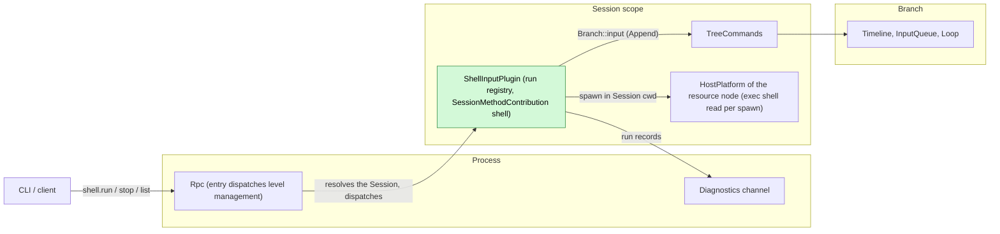
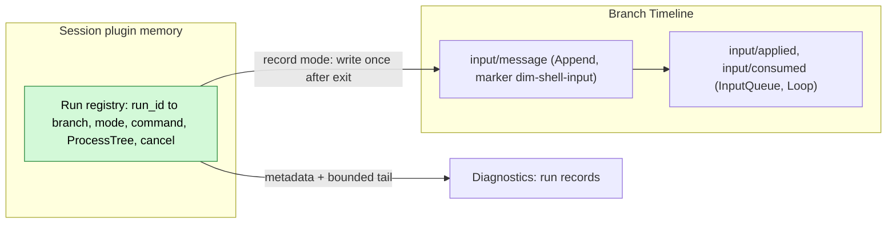
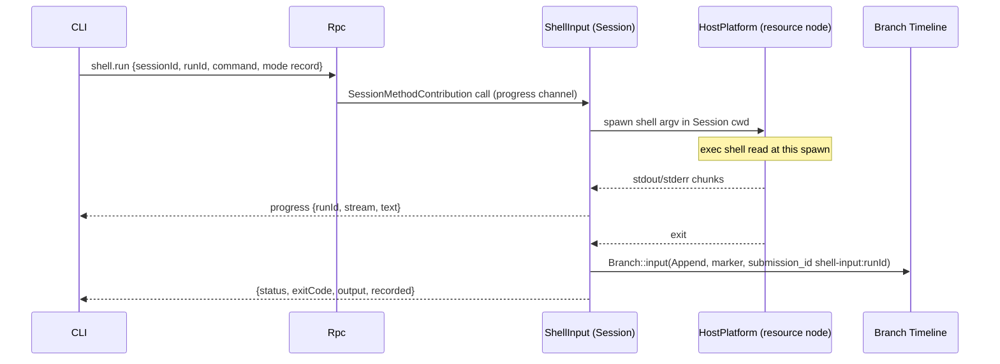
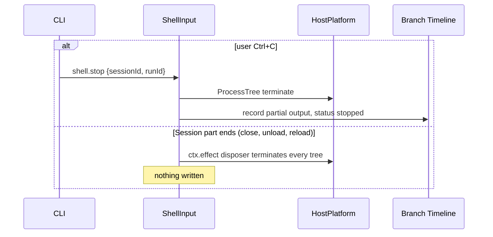
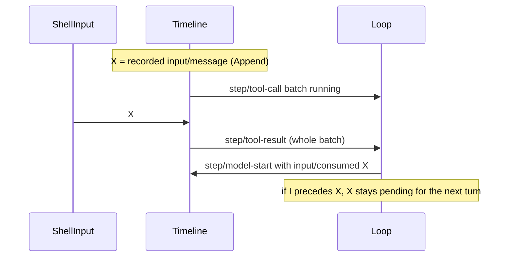

# ShellInput

Status: Draft. Overall design: [overview B.3](../overview.md#4-plugin-catalog). Phase: P1. Language: Rust. Scope: Session ([ADR 002](../../adr/002-plugin-scope.md)).

Executes `!command` and `!!command` typed by the user in the Session's workspace on its resource node. The result of `!command` (command and bounded output) is written as an Append input, so it enters context with the next model request; the output of `!!command` goes only to the calling client and diagnostics. ShellInput is a Session plugin with no events. It contributes `shell.run`, `shell.stop` and `shell.list` as a `SessionMethodContribution` at level `management` ([session-boundary](../contracts/session-boundary.md)). At most one command runs per Session; a command ends on `shell.stop` or when the Session part ends (Session close or unload, reload, daemon exit).

## 1. Structure



| Part | Scope | Depends on | Provides |
| --- | --- | --- | --- |
| `ShellInputPlugin` | Session | `S:SessionConfig` (`cwd`), `S:TreeCommands`, the HostPlatform of the Session's resource node (as WorkspaceTools uses it), diagnostics channel | `S:SessionMethodContribution[shell]` (level `management`) |

Contracts depended on: `SessionMethodContribution` and the call's progress channel ([session-boundary](../contracts/session-boundary.md)); `Branch::input` with boundary validation ([interrupt](../../architecture/rust-agent/interrupt.md)); `HostPlatform::spawn(ProcessSpec)`, `ProcessTree::{stdout, stderr, wait, terminate}`; the node's exec shell as business configuration read at each spawn ([ADR 002](../../adr/002-plugin-scope.md) "Existing plugins"); isolation (overview Appendix C supplement); shell argv construction of the `exec` tool ([exec.rs](../../../crates/dim-agent-capabilities/src/workspace_tools/exec.rs), exposed as a HostPlatform helper, A2).

Contracts defined here: the `shell.*` methods, the source marker `dim-shell-input` (kind `command`) and the `submission_id` prefix `shell-input:`.

## 2. Data and state



The run registry is memory owned by the plugin generation through `ctx.effect` and is never rebuilt: when the Session part ends, every run is terminated. The only durable result is the existing `input/message`, restored with the Session.

Events: none. A run is started by the user, not by a branch turn, so a branch interrupt does not settle it. The only later-relevant outcome of `!command` is the input; `!!command` affects nothing later. Run records go to diagnostics.

## 3. Flows

### 3.1 `!command` recorded



The write happens once, after the process tree is released. InputQueue applies the Append; Loop consumes it at the next model request of a running turn, or at the first request of the next turn when idle. No turn is started.

### 3.2 Stop and Session end



A turn `stop/interrupt` does not reach the run: `Ctrl+C` first sends `shell.stop`, a second one falls through to the turn stop.

### 3.3 `!!command`

Same as 3.1 without the write: output is streamed and returned to the caller only.

## 4. Timing and conflicts

### 4.1 Result versus turn



Placement is decided by the input owners by sequence; ShellInput has no recheck because its write depends on no Timeline fact.

| Scenario | Outcome |
| --- | --- |
| Second `!` in the same Session while one runs | `shell_busy` |
| Branch close during the run | Write fails `BranchMissing`; reply `recorded: null`, output returned |
| `input/withdrawn` of X before consumption | Never consumed; not re-written |
| Session close, idle unload or reload during the run | Tree terminated; nothing written; caller gets `operation_interrupted` (A10) |
| Exec shell configuration changed | Running commands keep their shell; the next spawn reads the new value; nothing reloads |

Full table: Appendix B.

## 5. Context mapping

| Mode | What the model sees | Form and placement |
| --- | --- | --- |
| `!command` | `<dim-shell-input kind="command" status="completed" exit="0" truncated="false">` + `$ command` + bounded output | One unkeyed raw block (user-role message) at the input's consumed position |
| `!!command` | Nothing | — |

No tool declaration, prompt source or key: each run is a one-time observation. After compaction the result survives only through the summary. Child branches inherit it only if consumed before the cut. The model never sees `runId`, `submission_id`, stream separation, durations, diagnostics or terminal escapes.

## 6. Interfaces (summary)

| Interface | Kind | Purpose |
| --- | --- | --- |
| `shell.run` | `SessionMethodContribution`, level `management`, progress | Run a command (`record` or `private`), stream output, return the result |
| `shell.stop` | Same, level `management` | Stop a run by `runId`; idempotent |
| `shell.list` | Same, level `management` | Running runs of the Session |
| Marker `dim-shell-input` kind `command` | Input convention | Model-visible recorded result |
| CLI `!` / `!!` | Client | Maps prefixes to `shell.run` modes |

## 7. Security

`!` and `!!` execute arbitrary commands as the service user on the resource node without Approval (overview §5.3). Authority comes from the entry dispatching level `management`; exporting it grants host administration. Paired remote devices may call Session methods, but `shell.*` is level `management` and RemoteGateway does not dispatch it. The node's isolation applies (host-local, never from the Timeline). For `!`, command text and output are written to the Timeline and replayed to the model; users must avoid printing secrets. The environment is the service's, never forwarded from clients. Diagnostics carry metadata and the bounded tail only (A13).

## Appendix A. Interface details

### A.1 Methods

| Method | Parameters | Result |
| --- | --- | --- |
| `shell.run` | `{sessionId, branchId?: "main", runId, command, mode: "record" \| "private"}` | On exit: `{runId, status: "completed" \| "failed" \| "stopped", exitCode?, signal?, output, truncated, durationMs, recorded?: {sequence, submissionId} \| null}`. Progress: `{runId, stream: "stdout" \| "stderr", text}`, calling connection only, rate-coalesced (A9) |
| `shell.stop` | `{sessionId, runId}` | `{stopped: bool}`; `false` when already ended |
| `shell.list` | `{sessionId}` | `[{runId, branchId, mode, command, startedAt}]` |

`runId` is generated by the client so `stop` can be sent before the `run` reply.

### A.2 Execution

| Item | Rule |
| --- | --- |
| Host | The HostPlatform of the Session's resource node, the one the Session's workspace tools use |
| Shell | The node's exec shell, read at each spawn (no reload on change), argv built as for `exec` (A2) |
| Working directory | Session cwd; a fresh process per run (A3) |
| Environment | The node's service environment, never the client's; plus `DIM_SESSION_ID` (A5) |
| stdin | Null; interactive programs see EOF |
| Isolation | The node's isolation applied by HostPlatform; a Permission preset never relaxes it |
| Timeout | None; ended by `shell.stop` or the end of the Session part |
| Output | stdout and stderr interleaved in arrival order; decoded as `exec` does (invalid bytes as `<0xNN>`) |
| Bounds | Reply and model-visible output: last 2000 lines within 50 KiB, the `exec` `truncate_preview` rule (A7) |

### A.3 Recorded input

```rust
branch.input(InputMessage {
    submission_id: Some(format!("shell-input:{run_id}")),
    blocks: vec![marker("dim-shell-input", "command",
        [("status", status), ("exit", code_or_signal), ("truncated", bool)],
        format!("$ {command}\n{bounded_output_without_terminal_escapes}"))],
    user: None, mode: InputMode::Append,
})
```

ANSI/OSC sequences are removed from the body (A8); the reply keeps them for the terminal.

### A.4 Mechanics

| Step | Mechanics |
| --- | --- |
| Start | Validate; reject `shell_busy`/`duplicate_run`; `spawn`; register the run in the generation's tracker |
| Run | A task reads both pipes into a bounded tail buffer and forwards chunks to the progress channel; `select!` on exit and `cancel` |
| Stop | `cancel` → `ProcessTree::terminate` → status `stopped` with partial output |
| Write (`record`) | After resources are released: resolve the branch through `S:TreeCommands`, `Branch::input` → boundary `validate` → `Timeline::append`. Committed sequence returned as `recorded.sequence`. Never retried; the command is never re-run |
| Consumption | InputQueue `input/applied {mode: append}`, Loop `input/consumed` |
| Recheck | None |
| Session part ends | Unload disposer cancels all runs, terminates trees, waits for them, writes no input. Daemon exit: trees die with the process (`ProcessTree` drop kills the tree). This includes reloads following structural operations, an accepted cost ([ADR 002](../../adr/002-plugin-scope.md) D3) |

## Appendix B. Full conflict table

`X` = the recorded `input/message` (Append), `I` = turn `stop/interrupt`.

| Scenario | Sequence order | Outcome | Owner of the decision |
| --- | --- | --- | --- |
| Result before the next request of a running turn | X < `step/model-start` | Consumed with that request | Loop |
| Result while a tool batch runs | X < `step/tool-result` | Consumed at the next request after the batch result | Loop |
| Result while idle | X, no turn | Pending; consumed when the next Queue/Steer starts a turn; never starts one | InputQueue, Loop |
| Turn interrupt before X | I < X | Run unaffected; X pending until the next turn | Loop |
| X applied, then interrupt before consumption | X < I | Pending; consumed by the next turn | Loop |
| X consumed, then interrupt | consumed < I | Stays at its consumed position | Loop |
| `input/withdrawn` of X | X < withdrawn | Never consumed; not re-written | InputQueue |
| Branch-scoped interrupt or branch close during the run | close < X | Run continues; write fails `BranchMissing`; `recorded: null` | Runtime facade; ShellInput |
| Session close or idle unload during the run | — | Tree terminated, nothing written (A10) | ShellInput |
| Concurrent Steer/Queue and X | Timeline order | Each applied by its mode | InputQueue |
| Second run in the same Session | — | `shell_busy` | ShellInput |
| Compaction between X and consumption | X < compaction < consumed | Placed after the summary at its consumed position | ContextPreparation |
| Compaction after consumption | consumed < compaction | Only through the summary | ContextPreparation |
| Child branch cut between X and consumption | X < cut < consumed | Child does not adopt X | InputQueue (child) |
| Child branch cut after consumption | consumed < cut | Inherited in the prefix | History projection |
| `!!` run | — | No Timeline effect | — |
| ShellInput or Session reload mid-run | — | Tree terminated; nothing written; caller `operation_interrupted` (D3) | ShellInput |
| Process restart mid-run | — | Tree dies with the daemon; nothing written | — |
| Commit, then reply lost | X committed | Retry in the same generation → `duplicate_run`; after restart the client checks `session.input_lookup` for `shell-input:<runId>` (A11) | Client |
| Session unloaded at start | — | Rpc restores it before dispatch | Rpc, AgentIndex |
| Resource node offline at start | — | `node_unavailable`; nothing started | ShellInput |
| Resource node lost mid-run | — | Status `failed`; for `record`, partial output written with `status="failed"` (A6) | ShellInput |
| Duplicate or late `stop` | — | `{stopped: false}` | ShellInput |
| Client detach or disconnect | — | Run continues and is recorded or discarded; progress dropped (A12) | ShellInput |
| Paired remote device | — | `unknown_method`: RemoteGateway does not dispatch level `management` | Rpc |
| Exec shell changed mid-run | — | Run keeps its shell; next spawn reads the new value | HostPlatform |

## Appendix C. Errors and recovery

| Error (`appError`) | Condition |
| --- | --- |
| `shell_unavailable` | `HostPlatform.shell` unavailable on the node (reason forwarded) |
| `shell_busy` | Another run of the Session is running |
| `duplicate_run` | `runId` already used in this generation |
| `invalid_params` | Empty command, command over 64 KiB, `runId` not `[A-Za-z0-9-]{1,64}` |
| `session_closed` / `branch_missing` | Session or branch gone at start |
| `node_unavailable` | The resource node is unreachable |
| `unknown_method` | ShellInput not enabled in the Session, or level not dispatched by the entry |
| `service_reloading` | The contribution is reloading at start |
| `operation_interrupted` | The Session part ended while the call ran |

| Case | Result |
| --- | --- |
| Spawn fails | `status: "failed"` with reason; nothing recorded |
| Non-zero exit | `status: "completed"`, `exitCode` set; recorded |
| Write rejected (`SessionClosed`, `BranchMissing`, `Rejected`) | Output returned, `recorded: null` with the error |
| Unload, reload, restart | Runs terminated, never re-executed |

## Appendix D. Acceptance

1. `!echo hi` while idle: Append input with the marker; no turn starts; the next prompt's first request contains it before the prompt.
2. `!` during a turn with a tool batch: consumed after the batch result in the same turn.
3. `!!`: output returned, no Timeline change.
4. Turn stop does not stop a run; `shell.stop` terminates the tree (process absent) and records `stopped`.
5. Second `shell.run` in the same Session → `shell_busy`.
6. 10 MiB output yields the last 2000 lines within 50 KiB and `truncated="true"`.
7. Branch close: `recorded: null`. Session close: tree terminated, nothing written.
8. Session reload and daemon restart mid-run: tree terminated, nothing written, no re-execution.
9. Offline node: `node_unavailable` for that Session only.
10. Withdrawn X is never consumed; remote entry: `unknown_method`.
11. Changing the exec shell: the next run uses the new shell without reloading anything.

## Appendix E. Assumptions

| # | Assumption | Basis | Effect if rejected |
| --- | --- | --- | --- |
| A1 | Methods `shell.run/stop/list` with `mode` | Overview §5.3 (run, stop); `list` and `mode` are judgment | Method set changes |
| A2 | Shell and argv as `exec` | Judgment | ShellInput builds its own argv |
| A3 | Each run is a fresh process | Judgment | A per-Session shell needs lifecycle and state |
| A4 | One running command per Session | Maintainer decision | Concurrent runs, inputs in completion order |
| A5 | `DIM_SESSION_ID` added to the environment | Judgment | Commands cannot identify the Session |
| A6 | Stopped or failed `!` runs record partial output | Judgment | Only completed runs recorded |
| A7 | `exec` preview bounds (2000 lines, 50 KiB) | Existing `exec` constants | Separate limit |
| A8 | Terminal escapes stripped from model-visible text | Judgment | Escapes reach the model |
| A9 | Progress through the call's progress channel, rate-coalesced | [session-boundary](../contracts/session-boundary.md); coalescing is judgment | Output only at completion |
| A10 | A run is Session work: it ends with the Session part (close, idle unload, reload) | ADR 002 D1 (Session scope), D3 | Runs would need a process owner |
| A11 | Clients deduplicate by `runId` via `session.input_lookup` | Session public interface | Possible duplicate input |
| A12 | Client disconnect does not stop a run | Lifecycle ("connection close keeps Session work") | Disconnect stops runs |
| A13 | Diagnostics carry only metadata and the bounded tail | Judgment | Full output in diagnostics |

## Appendix F. Open questions

| # | Question | Description |
| --- | --- | --- |
| F1 | Overview §5.3 end conditions | Overview names stop and daemon exit; this design also ends runs when the Session part ends |
| F2 | Idle unload during a run | Whether AgentIndex treats a running command as activity; otherwise idle unload terminates it (A10) |
| F3 | Remote node tree termination | Whether an imported HostPlatform kills process trees when the link drops (#5) |
