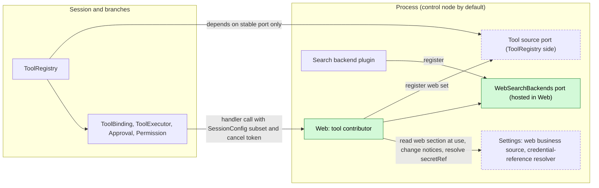
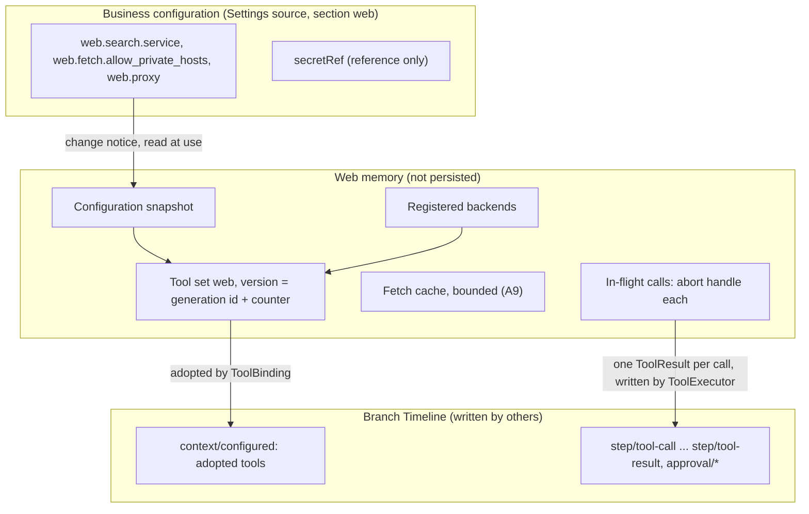
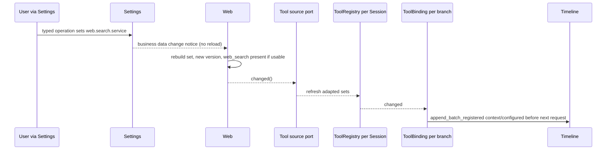
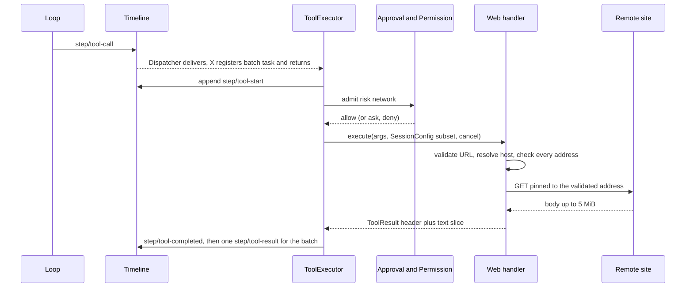
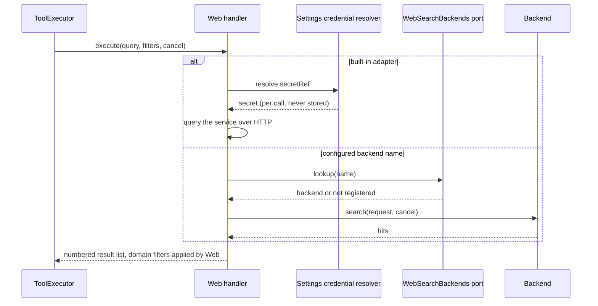
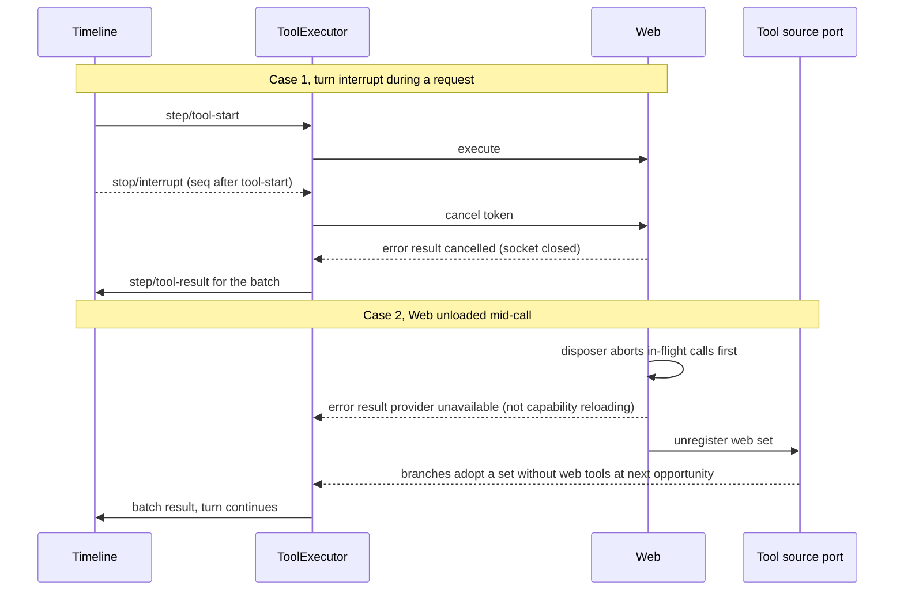

# Web

Status: Draft. Overall design: [overview §B.5](../overview.md#b5-web). Phase: P2. Language: TypeScript first ([overview §F.3](../overview.md#f3-assignment)).

Web is a process plugin that gives the model `web_search` and `web_fetch` by registering into ToolRegistry's tool source port ([process-tool-contribution](../contracts/process-tool-contribution.md), [ADR 002](../../adr/002-plugin-scope.md) D2). Search goes to a configured built-in adapter or to a search backend registered in Web's own `WebSearchBackends` port; fetch downloads one public page and returns bounded text. Web writes no Timeline events: every call and result is already a tool call fact. The `web.*` settings are business configuration read at use time, so editing them never reloads Web; a Web unload only removes its registration.

## 1. Structure



Sessions depend only on the stable tool source port, never on Web, and Web never depends on a backend. A Web unload or a configuration edit therefore never reloads any Session plugin, and a backend unload never reloads Web. Web hosts `WebSearchBackends` itself rather than in a separate stable plugin: backends depend on Web and reload with it, which is accepted because a Web reload already ends every search and backends hold no state that must survive (D2).

| Part | Scope | Depends on | Provides |
| --- | --- | --- | --- |
| `Web` | Process (loader row; control node by default, A2) | Tool source port; Settings business source (section `web`) and credential-reference resolver; diagnostics channel | Registration of the `web` set (removed on unload); the `WebSearchBackends` port |
| Search backend | Process, another plugin | `WebSearchBackends` | Registration of one named backend |

**Contracts depended on:** tool source port and `ProcessToolSource` ([process-tool-contribution](../contracts/process-tool-contribution.md)); ports and configuration placement ([ADR 002](../../adr/002-plugin-scope.md)); Settings business source and credential-reference resolver ([overview §C.2](../overview.md#c2-app-server-process-plugins)); `ToolDefinition.risk = "network"` read by Permission (existing, [permission.rs](../../../crates/dim-agent-capabilities/src/permission.rs)).
**Contracts defined here:** the tool names, parameters and result formats; `WebSearchBackend` and the `WebSearchBackends` port; the `web.*` business configuration. Web knows no search provider's account semantics; a backend knows nothing about tools, Sessions or Web configuration (A1).

**Node.** Network egress happens on the node running Web's row, independent of a Session's resource node, because network access is a process resource ([overview §6.3](../overview.md#63-multiple-nodes), A2). Web never resolves the node-services port, FileStorage or HostPlatform.

## 2. Data and state



Web owns no Timeline state and no `StateCell`. Everything in memory is recomputed on `apply` from Settings and the backend port, and the cache starts empty; nothing needs rebuilding from the Timeline.

## 3. Flows

### 3.1 Configuration publishes or withdraws `web_search`



`web_search` is present only while `web.search.service` names a usable adapter or a registered backend (A3); removing the credential, or the named backend's registration disappearing, publishes a set without it. Whether a backend is required comes only from `web.search.service`, never from loader declarations (D6).

### 3.2 A `web_fetch` call



The handler runs on ToolExecutor's task, never on the Dispatcher, and decides only from its arguments and its own configuration snapshot at call start. Longer pages are read with further calls using `start_char`; a cross-host redirect is returned as a notice so the new host gets its own admission (A10).

### 3.3 `web_search` through a contributed backend



## 4. Timing and conflicts

Web makes no Timeline decision; ordering is decided by ToolExecutor, Approval and the ports.



Case 2 is the contributor-unload rule of [ADR 002](../../adr/002-plugin-scope.md) D2: the per-call outcome is never `capability reloading`, so Loop does not fail the turn and no other Session is affected.

| Scenario | Outcome | Owner |
| --- | --- | --- |
| Configuration edit during a call | Call continues with the snapshot and credential resolved at its start; next call uses the new set version | Web |
| Old-version `web_search` called after the service was removed | Error result `search_unavailable` | Web |
| Backend unloaded mid-search | That call fails `search_unavailable`; Web publishes a set without `web_search`; Web is not reloaded | Web, `WebSearchBackends` |
| Process restart mid-call | ToolExecutor settles the committed call as not surviving recovery; Web never repeats a request | ToolExecutor |
| Compaction after a result | Fetched text survives only through the summary; the model can fetch again | ContextPreparation |

Full table in Appendix B.

## 5. Context mapping

| The model sees | Form | Position |
| --- | --- | --- |
| `web_search`, `web_fetch` name, description, input schema | Tool declarations | Adopted `context/configured.tools`; replaced when a new set version is adopted |
| Search results, fetched text, errors, redirect notices | `ToolResult.content` (text only) | Tool result position of the call's batch |

- Compaction: declarations are configuration and survive as the latest adopted set; results survive only through the summary.
- Child branches inherit declarations and results in their ancestor prefix and adopt the current set version at their own next request.
- Non-interactive Sessions see the same tools (`requires.interactive = false`).
- Never visible: `structured_content`, the service or backend name, configuration, credential references, private-host exceptions, request logs and diagnostics.
- Fetched page text is untrusted third-party content placed in a tool result without instruction framing (A14).

## 6. Interfaces (summary)

| Interface | Kind | Purpose |
| --- | --- | --- |
| `web_search` | Tool, risk `network` | Query the configured service; numbered result list |
| `web_fetch` | Tool, risk `network` | Fetch one public `http(s)` URL; bounded text slice with pagination |
| `ProcessToolSource` key `web` | Registration in the tool source port | One set `web`; removed on unload |
| `WebSearchBackend` / `WebSearchBackends` | Port defined and hosted by Web | Search backends from other plugins (A1) |
| `web.*` configuration | Business configuration in a Settings source, read at use | Search service, private-host exceptions, proxy |

No Session methods, no management methods, no CLI subcommand: configuration goes through Settings' typed operations and `/settings`. Details in Appendix A.

## 7. Security

- Admission: both tools declare `network`; every call passes Approval and Permission (read-only denies, workspace-write asks, FullAccess allows).
- SSRF: Web resolves names itself, checks every address against the blocked ranges and connects only to the checked address; cross-host redirects need a new call and a new admission (Appendix A.4, A10).
- No ambient authority: `GET` only; no cookies, stored site credentials or client certificates; nothing from the Session except the URL the model wrote (A8).
- Credentials: references resolved per call by the Settings resolver; never in definitions, results, `structured_content`, diagnostics or errors.
- Exfiltration through URLs is the inherent risk of the `network` category and is controlled by admission, not by Web.
- With `web.proxy`, the proxy resolves names itself; private-address protection then depends on the proxy (stated to the user).
- Web runs in the App Server process (or its peer row), not under a Session's isolation configuration.

## Appendix A. Interface details

### A.1 Tool set

One set, key `web`. `web_fetch` is present while Web is registered. `web_search` is present only when a service is configured and its adapter is usable or its backend is registered (A3). Both tools: `risk: "network"`, `requires: { interactive: false, roles: None }`. Parameters are validated by the handler (the external boundary); a violation returns an error result without network access.

### A.2 `web_search`

| Parameter | Type | Rule |
| --- | --- | --- |
| `query` | string | Required; 1 to 500 characters after trimming (A4) |
| `max_results` | integer | Optional; 1 to 10; default 5 (A4) |
| `allowed_domains` | string[] | Optional; at most 10 hostnames; results restricted to these hosts and subdomains |
| `blocked_domains` | string[] | Optional; at most 10; mutually exclusive with `allowed_domains` |

Domain filters are passed to the service when supported and applied by Web to the returned list in every case. `ToolResult.content`:

```
Search results for "<query>" (<n> results)

[1] <title>
<url>
<snippet>

[2] ...
```

Titles and snippets are plain text, one line each, snippet at most 500 characters. Zero results yield `No results for "<query>".` (not an error). The service name is not shown. `structured_content` carries `{ results: [{ title, url, snippet, published_at? }] }` for clients. Total time limit 20 s (A5).

### A.3 `web_fetch`

| Parameter | Type | Rule |
| --- | --- | --- |
| `url` | string | Required; absolute `http` or `https`; at most 2048 characters; no userinfo; fragment removed (A6) |
| `start_char` | integer | Optional; default 0; offset into the converted text |
| `max_chars` | integer | Optional; 1000 to 50000; default 20000 (A7) |

`ToolResult.content`:

```
URL: <final url>
Title: <title, if any>
Content-Type: <media type>
Characters: <start>-<end> of <total>
[Truncated: call web_fetch again with start_char=<end> to continue.]
[Download limit reached: the page exceeds <limit> and later content is missing.]

<converted text slice>
```

Bracketed lines appear only when they apply. `structured_content`: `{ url, final_url, status, content_type, title?, start, end, total, truncated, download_limited }`.

| Item | Rule |
| --- | --- |
| Method and headers | `GET` only; `User-Agent: dim-web/<version>`; `Accept` preferring HTML and text; no cookies, credentials or referrer (A8) |
| Limits | Connect 10 s; whole call 30 s; at most 5 MiB decoded body, then the connection is closed and `download_limited` set (A5) |
| Status | 2xx converted; 3xx redirect rules; 4xx/5xx error `http_status` with code and reason phrase, no body |
| Redirects | Up to 5 hops, each revalidated. A redirect to a different host (lowercased, leading `www.` removed) is not followed: non-error notice `Redirected to <url>; call web_fetch with that URL to follow it.` (A10) |
| `text/html`, `application/xhtml+xml` | Charset from header, then `<meta>`, else UTF-8 with replacement; `script`, `style`, `noscript`, `template`, `svg`, `iframe`, navigation and form controls removed; main content preferred; Markdown with absolute links; whitespace normalized |
| `text/plain`, `text/markdown`, `text/csv`, `application/json`, `application/xml`, `text/xml`, `*+json`, `*+xml` | Decoded text as is (valid JSON pretty-printed) |
| Other types | Error `unsupported_content_type` naming the type (A11) |
| Empty conversion | Non-error result with header and `(no text content)` |
| Slicing | By Unicode scalar values `[start_char, start_char + max_chars)`; `start_char >= total` returns an empty slice with the header |
| Cache | Converted text keyed by final URL, 15 minutes, at most 50 MiB, so pagination does not refetch (A9) |

### A.4 Address policy

| Rule | Content |
| --- | --- |
| Resolution | Web resolves the hostname, validates every resolved address and connects only to a validated address (pinned), so DNS rebinding between check and connect is impossible |
| Blocked by default | Loopback (`127.0.0.0/8`, `::1`), unspecified, RFC 1918, link-local (`169.254.0.0/16`, `fe80::/10`, including cloud metadata), CGNAT `100.64.0.0/10`, unique local `fc00::/7`, multicast, broadcast, reserved ranges, IPv4-mapped and IPv4-compatible IPv6 forms of these; hostnames `localhost` and `*.localhost` |
| Literal IPs | Allowed only when public by the same rules |
| Ports | Any port on a public address (A12) |
| Exceptions | `web.fetch.allow_private_hosts`: exact hostnames or CIDRs; empty by default; written only by the user through Settings |
| Proxy | With `web.proxy`, Web still validates its own resolution and sends through the proxy |

### A.5 `WebSearchBackend` and `WebSearchBackends`

```rust
/// Implemented by a backend plugin and registered into WebSearchBackends.
pub trait WebSearchBackend: Send + Sync + 'static {
    fn search(&self, request: SearchRequest, cancel: CancellationToken) -> HostFuture<'_, Vec<SearchHit>>;
}
pub struct SearchRequest { pub query: String, pub max_results: u8,
    pub allowed_domains: Vec<String>, pub blocked_domains: Vec<String> }
pub struct SearchHit { pub title: String, pub url: String, pub snippet: String, pub published_at: Option<String> }

/// Port hosted by Web; backends depend on it and reload with Web.
pub trait WebSearchBackends: Send + Sync + 'static {
    fn register(&self, name: &str, backend: Arc<dyn WebSearchBackend>) -> Registration; // drop = unregister
    fn lookup(&self, name: &str) -> Option<Arc<dyn WebSearchBackend>>;
    fn changed(&self) -> watch::Receiver<u64>;
}
```

Port rules follow [ADR 002](../../adr/002-plugin-scope.md) D2: a backend plugin depends on `WebSearchBackends`, registers in `apply` and unregisters in its `ctx.effect` disposer after its in-flight searches return "provider unavailable". Which backend is required comes only from `web.search.service` (`{backend: name}`); a named backend that is not registered makes `web_search` unavailable. A backend reload is a registration change for Web, never a Web reload.

### A.6 Business configuration (`web` section, Settings source)

| Key | Type | Default |
| --- | --- | --- |
| `web.search.service` | `{ kind: "<built-in adapter id>", endpoint?: string, secretRef?: string }` or `{ backend: "<backend name>" }` or absent | absent (no `web_search`) |
| `web.fetch.allow_private_hosts` | string[] | `[]` |
| `web.proxy` | string (URL) | absent |

All keys are business configuration ([ADR 002](../../adr/002-plugin-scope.md) D5), outside the loader editable layer: Web reads them at use time; a change is a data update plus notification that yields a new tool set version, never a row reload. Only Web's enablement and node binding are structural loader configuration. Built-in adapter ids are an implementation choice listed in the plugin README (A13). Credentials appear only as `secretRef`.

### A.7 Timeline and capability mechanics

| Step | Path |
| --- | --- |
| Register | Web's `apply` reads configuration, builds the set, registers the keyed `web` source in the tool source port and subscribes to Settings notices and backend registration changes, with `ctx.effect` |
| Adopt | ToolRegistry refreshes from the port; ToolBinding adopts into `context/configured` through `Timeline::append_batch_registered` (Prompt's configuration publisher). Web writes nothing |
| Call | ToolExecutor consumes `step/tool-call` on the Dispatcher, registers the batch task and returns; per call `step/tool-start` (`Timeline::append`), admission, handler on the executor's task, `step/tool-completed`, then one `step/tool-result` per batch |
| Dispatcher | Web has no subscription |
| State and recheck | No `StateCell`; no consumed facts; decisions use arguments and the snapshot at call start |
| Terminal facts | Written by ToolExecutor (initiator); Web returns exactly one `ToolResult` per call |
| Web unload or reload | The disposer aborts in-flight requests, returning "provider unavailable" per call, then unregisters; registered backends reload with Web; branches adopt without the `web` set; the new generation registers a set with a new version |
| Process restart | Committed calls without results are settled by ToolExecutor's rebuild; Web never repeats a request |

## Appendix B. Full conflict table

| Scenario | Sequence order | Outcome | Owner |
| --- | --- | --- | --- |
| Turn `stop/interrupt` before dispatch | interrupt < `step/tool-call` consumption | Not executed | ToolExecutor |
| Turn `stop/interrupt` during approval | `approval/request` < interrupt | `approval/cancelled`; no request sent | Approval |
| Turn `stop/interrupt` during the request | `step/tool-start` < interrupt | Token cancelled; socket aborted; error `cancelled`; a response fully converted before the abort is returned as is | ToolExecutor, Web |
| Branch-scoped interrupt or branch close | branch interrupt | As turn interrupt; Web keeps no work | ToolExecutor |
| Batch with another long call | Web returned, other call running | Result held until the batch's `step/tool-result` | ToolExecutor |
| Concurrent Steer/Queue/Append | any | No effect on the call; Steer consumed after the batch result | Loop |
| `input/withdrawn` of a pending input | any | No effect; Web consumes no inputs | InputQueue |
| Compaction after the result | `step/tool-result` < compaction | Text survives only via the summary | ContextPreparation |
| Child branch cut | cut after `step/tool-result` | Child inherits the result; no per-branch state | — |
| Configuration edit while a call runs | new version published during call | Call continues with values resolved at its start | Web |
| Old-version `web_search` after removal | call > new version, bound to old | Error `search_unavailable` | Web |
| Backend unloaded or Pending | not registered | That call `search_unavailable`; set without `web_search` published | Web |
| Web unload or reload mid-call | no result yet | Error "provider unavailable" for that call; batch and turn continue; tools withdrawn until re-registered | Web, ToolExecutor, ToolRegistry |
| Process restart mid-call | committed, no result | Settled as not surviving recovery; not repeated | ToolExecutor |
| Session unload and restore | `branch/resume` | Re-adopt current version; cache unaffected | ToolRegistry, ToolBinding |
| Session resource node offline | — | No effect; Web resolves no node services | — |
| Web's own peer row node offline | Web Pending, not registered | Branches adopt without the `web` set; no Session Pending | Tool source port |
| Duplicate or late handler call after cancellation | token already cancelled | Returns `cancelled` without network access | Web |
| Two branches fetch the same URL | — | Independent requests; cache filled by the first to finish | Web |
| Client detach | — | No effect | — |

## Appendix C. Errors and recovery

Every error is an error `ToolResult` (`is_error: true`) with content `web_fetch failed: <code>: <message>` or `web_search failed: ...`. No error affects other calls or the Session.

| Code | Meaning |
| --- | --- |
| `invalid_input` | Parameter violates Appendix A |
| `blocked_address` | Host or a redirect hop resolves to a blocked address; the message names the rule only |
| `dns_failed`, `connect_failed`, `tls_failed` | Network errors |
| `timeout` | Connect or whole-call limit reached |
| `http_status` | Non-2xx final status |
| `too_many_redirects` | More than 5 same-host hops |
| `unsupported_content_type` | Type not in A.3 |
| `search_unavailable` | No service configured, backend unavailable, or credential unresolvable |
| `search_failed` | Service error or invalid data; message shortened and stripped of secrets |
| `cancelled` | Token cancelled |
| provider unavailable | Returned by the disposer on unload (contract outcome of [process-tool-contribution](../contracts/process-tool-contribution.md)) |

Recovery: Web holds no durable work; unload and restart lose only the cache.

## Appendix D. Acceptance

Flow tests through public interfaces: tool calls in a test Session, a local HTTP server reachable only through a test `allow_private_hosts` entry, a fake backend plugin.

1. Without a service only `web_fetch` is declared; configuring one publishes `web_search` in a new version adopted before the next request, with no Web reload; removing it withdraws it and an old bound call returns `search_unavailable`.
2. `web_search` format, domain filters, zero results, service error; same through a fake backend; unloading the backend withdraws `web_search` without reloading Web or any Session plugin.
3. `web_fetch` HTML header and Markdown; `start_char` pagination to the end; `max_chars`; download limit notice.
4. Plain text, JSON, unsupported type, 404, empty page.
5. Same-host redirects up to 5; sixth fails; cross-host redirect returns the notice.
6. Loopback, private, link-local, IPv4-mapped IPv6, `localhost` and a private-resolving hostname blocked; DNS rebinding test not connected.
7. Permission: read-only denies, workspace-write asks, FullAccess allows.
8. Interrupt before dispatch, during approval and during a slow response (socket closed, one result).
9. Unloading Web during a slow fetch yields "provider unavailable" for that call; the turn continues; other Sessions are unaffected; restart settlement repeats no request.
10. Non-interactive Session declares both tools.
11. Diagnostics and results never contain the resolved credential.

## Appendix E. Assumptions

| # | Assumption | Basis | Effect if rejected |
| --- | --- | --- | --- |
| A1 | Search backends from other plugins (for example account-backed ones) plug in through Web's `WebSearchBackends` port | Feature list ("configuration or account permissions"); overview §6.2 constraint 13 | Account-backed search must be a built-in adapter |
| A2 | Network access happens on the node running Web (control node by default) | Overview §6.3; judgment | A Session-bound network service on each resource node |
| A3 | `web_search` is withdrawn when no service is usable | Judgment | Tool always declared, failing at call time |
| A4 | Query length 500; `max_results` 1 to 10, default 5 | Judgment | Limits change |
| A5 | 10 s connect, 30 s fetch, 20 s search; 5 MiB download | Edge-case reference; judgment | Limits change |
| A6 | Only `http`/`https`, at most 2048 characters, no userinfo | Judgment | Wider input surface |
| A7 | `max_chars` 1000 to 50000, default 20000, `start_char` pagination | Judgment | Different bounding of results |
| A8 | `GET` only, fixed user agent, no cookies or credentials | Judgment | Authenticated fetching needs its own design |
| A9 | Cache 15 minutes, at most 50 MiB, keyed by final URL | Judgment | Each slice refetches; slices may differ |
| A10 | Cross-host redirects reported, not followed | Edge-case reference; judgment | Redirects reach hosts never admitted |
| A11 | PDFs and images not converted | Judgment | Add extraction or image content blocks |
| A12 | Any port on public addresses | Judgment | Restrict to 80/443 |
| A13 | Built-in adapter list is an implementation choice | Overview §B.5 names no service | A service is fixed by the overview or feature list |
| A14 | No framing text around fetched content | Judgment | Model-visible framing to define |

## Appendix F. Open questions

| Question | Description |
| --- | --- |
| Cross-language migration | Overview §B.5 names Web as the first #4 migration target; the TypeScript implementation needs only process services (tool source port, Settings business source, credential resolver) |
| Overview wording | Overview §C.1 ToolRegistry row must describe the tool source port of [ADR 002](../../adr/002-plugin-scope.md) |
