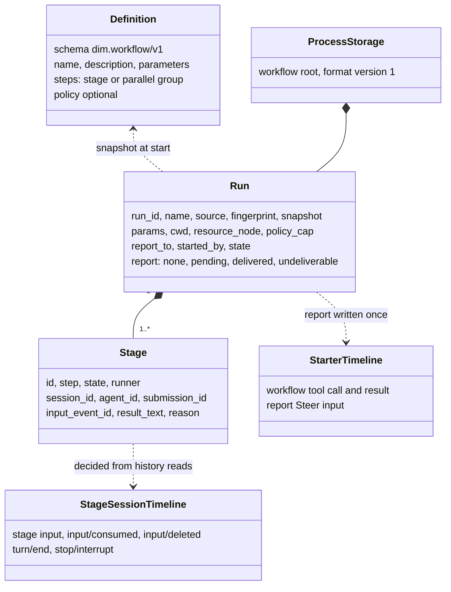
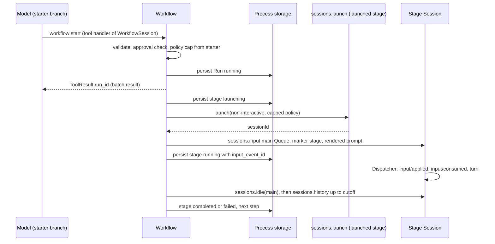
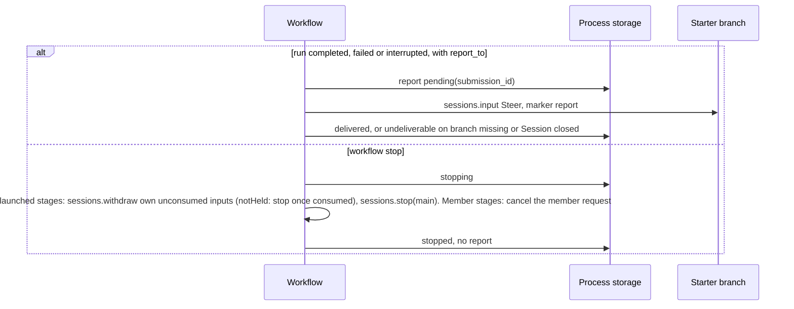
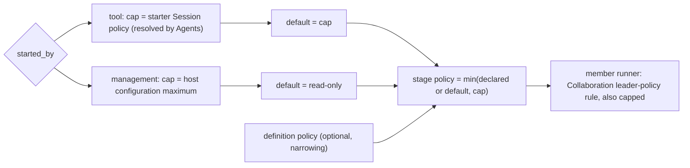
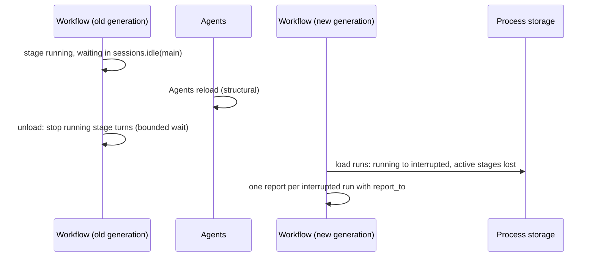

# Workflow

Status: Draft. Overall design: [overview §B.9](../overview.md#4-plugin-catalog); scope: [ADR 002](../../adr/002-plugin-scope.md) (process + Session). Phase: P2. Language: TypeScript first ([overview §F.3](../overview.md#appendix-c-implementation-language)).

Workflow owns workflow definitions and runs. A run advances a fixed list of steps; each stage runs in its own Session, either a new non-interactive Session launched through Agents or a Collaboration member of the starting Session. The process part owns runs and reaches launched Sessions through the process service `sessions` ([session-access](../contracts/session-access.md)), as Collaboration does; it reaches members only through Collaboration's public interface (`establish` and the proposed out-of-branch member request, A.5), never by writing into a member Session itself. The Session part offers the `workflow` tool to interactive Sessions as a `toolContribution`; operators use the `workflow.*` management methods, a `managementMethods` entry. All contracts are language-neutral named services ([ADR 002 D5](../../adr/002-plugin-scope.md#d5-contracts-are-language-neutral)); the Rust forms are in [Appendix G](#appendix-g-rust-binding). When a run ends, its result is reported once to the starting branch as Steer input. Workflow writes no Timeline event of its own.

## 1. Structure


A run spans Sessions, so runs belong to the process ([ADR 002](../../adr/002-plugin-scope.md) D1); the tool is offered by a Session-scoped `toolContribution` (D2). The Session part depends on the process part; the process part depends on Agents, Collaboration, Provider and Settings at the same scope. Dependencies follow scope (D3): an Agents or Collaboration reload reloads Workflow, which settles its runs `interrupted` (A.6), and a Workflow reload reloads its Session parts, failing their in-flight turns. These are rare structural events and an accepted, documented cost. Definition edits and approvals are business configuration (D4): read at use time, never a reload.

| Part | Scope | Depends on | Provides |
| --- | --- | --- | --- |
| `Workflow` | Process (control node) | `sessions` (Agents; `launch` with `policy`), Collaboration (`establish`, member request), Provider model selection, Settings user/project sources and host-local approval service, `PluginContents` (optional, type `workflows`), `pluginFiles` (extended) | Run engine; `workflowRuns` (the tool's access to runs, A.2); `managementMethods` key `workflow` |
| `WorkflowSession` | Session, installed when Workflow is enabled | `workflowRuns` (`Workflow`), Session configuration | `toolContribution` key `workflow`, declared only when `interactive` |

**Contracts depended on**: `sessions` ([session-access](../contracts/session-access.md): `launch` with a starter-capped `policy`, Session configuration fields, `input` with source raw blocks, `history`, `idle`, `stop`, `withdraw`), Collaboration `establish` and the out-of-branch member request (Collaboration supplement, proposed, A.5), `toolContribution` (ToolRegistry accepts named tool services, a supplement; [tool contributions](../../architecture/rust-agent/tool-contributions.md)), `managementMethods` collected by Rpc ([session-boundary](../contracts/session-boundary.md)); [`pluginFiles` (extended)](../../../crates/dim-app-server/README.md#trusted-plugin-storage) (R8; a TypeScript part uses it natively); and existing typed services: Provider purpose policy, Settings sources and host-local approval service (R11), which a TypeScript part reaches by name once [#4](https://github.com/arcships/dim/issues/4) exposes them ([session-access §9](../contracts/session-access.md#9-requirements-raised-to-mechanism-owners)). **Contracts defined here**: definition format `dim.workflow/v1`, the `workflow` tool, the `workflowRuns` service, the `workflow.*` methods, source name `workflow` (marker kinds `stage` and `report`), purpose key `workflow.stage`, content type key `workflows`, the run record.

## 2. Data and state



Definitions are read from their sources per call (A1) and approvals per check; runs live in process storage and are persisted on every transition before the effect they guard. Stage progress is derived from existing facts in each stage Session; only a bounded result text is copied. Nothing is rebuilt from Timeline; Workflow owns no `StateCell` and the Session part holds no state.

## 3. Flows

### 3.1 Start from the tool and run a stage



The handler persists the run and returns at once; stage advancement runs on the process part's task tracker. Completion of a launched stage is decided only from the stage Session's facts up to the `idle` cutoff. A `member` stage instead calls Collaboration's `establish` and then its member request (A.5): Collaboration writes the member input, applies its Team rules and returns the outcome under its own outcome rule; Workflow persists that outcome and never writes into or reads the member Session itself.

### 3.2 Report and stop



An explicit owner stop never wakes the starter ([event-driven flows §3](../../architecture/rust-agent/event-driven-flows.md)). `sessions.lookup` by `submissionId` before any retry guarantees at most one report.

### 3.3 Policy of a stage



A run never widens authority (E2): the `workflow` tool is admitted with the same risk category as Collaboration's `agent` tool, and stage Sessions never exceed the starter's policy.

## 4. Timing and conflicts



Workflow's own reload, a reload of a dependency (Agents, Collaboration) or a restart settles runs `interrupted`; nothing is relaunched (E15). Reloads are rare structural events (D3), so this cost is accepted rather than prevented.

| Scenario | Sequence order | Outcome | Owner |
| --- | --- | --- | --- |
| Starter turn interrupt after the tool result | result < interrupt | Run continues | Workflow |
| Tool batch not settled when the run ends quickly | report < `step/tool-result` | Steer consumed after the batch result; model sees `run_id` first | Loop |
| `workflow.stop` races a stage's own `turn/end` | `turn/end` < `stop/interrupt` | Stage `completed` with result; run `stopped` | Stage Session order |
| Stage input withdrawn (user or stop) while held | input < `input/withdraw` < `input/deleted` | Stage `stopped`; never applied or consumed | InputQueue, Workflow |
| Workflow, Agents or Collaboration reload, or restart | — | Runs `interrupted`, active stages `lost`, nothing relaunched; one report each (E15) | Workflow |
| Leader branch closed with a member stage running | close < report | Member stage continues; report `undeliverable` | Workflow |

Full table: Appendix B.

## 5. Context mapping

| What the model sees | Form | Placement |
| --- | --- | --- |
| `workflow` declaration | Tool declaration in adopted configuration (interactive Sessions only) | Requests whose prefix holds that configuration |
| Start, status, stop | `ToolResult.content` (text incl. `run_id`) | Tool result position of its batch |
| Report | One raw block `<dim-workflow kind="report" run="..." status="...">`; body: per-stage status, bounded preview of the last step's results (A16), how to get full results (`status`) | Consumed position of the Steer input; unkeyed |
| Stage task (stage Session) | Marker `<dim-workflow kind="stage" run="..." stage="...">` then the rendered prompt as user content | First input of a launched Session, or a new input of a member Session |

Report and stage inputs are unkeyed: after compaction they survive only through the summary; child branches inherit them only if consumed before the cut. Stage Sessions are non-interactive (no `ask_user`, no `workflow` tool), so runs never nest. The model never sees unlisted definitions, run records, logs, approvals, fingerprints or diagnostics.

## 6. Interfaces (summary)

| Interface | Kind | Purpose |
| --- | --- | --- |
| `workflow` (`list`, `start`, `status`, `stop`) | `toolContribution` (Session, key `workflow`), risk category of Collaboration's `agent` tool | Model runs workflows |
| `workflow.list/save/start/status/stop/approve/revoke` | `managementMethods` (process, key `workflow`) | Operators manage definitions and runs |
| `/workflow`, `/workflow:save` | CLI | Call the management methods |
| `sessions`, Collaboration `establish` and member request | Depended on | Launched stages: create, input, history, idle, stop, withdraw; member stages: create and request through Collaboration |
| `dim.workflow/v1` | Defined here | Definition format (Appendix A) |

## 7. Security

Project and plugin definitions are executable content: `start` and every stage launch require a grant in the Settings host-local approval service, record `{owner: workflow, node, workspace, source, id: name, fingerprint}`, fingerprint = SHA-256 over the canonical definition document (R11). Grants come only from the `workflow.approve` management method (process plugins only, never served to paired remote devices); the tool, Timeline facts, replay and fork never grant. User definitions need no approval. Stage policy follows 3.3 and a definition can only narrow it. Approvals raised inside a member stage are forwarded to the leader by Collaboration (E6), not by Workflow. Stage Sessions use only their own resource node's services. Params and results become Timeline content of stage and report Sessions; definitions must not carry credentials.

## 8. Rule check

Rules: [principles §1 and §4](../../architecture/rust-agent/principles.md), [ADR 002](../../adr/002-plugin-scope.md) D1–D5.

| Rule | How this document complies |
| --- | --- |
| §4.1 Command events for others' state | Launched stages change only through `sessions` (input, `input/withdraw`, `stop/interrupt`) and members only through Collaboration's requests; the owners write the results. |
| §4.2 No take-back after hand-off | A stage input is withdrawn only before `input/applied`; after `notHeld` Workflow uses `stop` once `input/consumed` is read. |
| §4.3 Intervene only through before callbacks | Not applicable: Workflow adds no entry check and no before callback; definition validation is its own boundary validation. |
| §4.4 Core mechanisms carry no business meaning | The runtime gets nothing Workflow-specific; the Collaboration request it needs is generic member delivery (§9.1). |
| §4.5 Read the whole batch before deciding | Launched-stage decisions read history up to the `sessions.idle` cutoff, a batch boundary (A.6). |
| §4.6 Model context holds only handed-over events | Stage tasks and reports reach models only as consumed inputs; withdrawn inputs are deleted and never seen. |
| §4.7 Only public events and services | Workflow uses `sessions`, Collaboration's public interface, Provider, Settings and `pluginFiles` (extended); it never writes into a Collaboration member. |
| §4.8 Requirements to mechanism owners | The out-of-branch member request is raised in §9.1; #4 is stated in [session-access §9](../contracts/session-access.md#9-requirements-raised-to-mechanism-owners) and #5 in [ExternalAgent §9](ExternalAgent.md#9-requirements-raised-to-mechanism-owners). |
| §4.9 Only facts later decisions use enter the Timeline | Workflow writes no Timeline event; runs stay in process storage, and only stage tasks and reports, which models consume, enter Timelines as inputs. |
| §1 Capability and App Server boundary | Runs are process-level, not a Capability; storage is the `pluginFiles` plugin, not an App Server service. |
| ADR 002 D1 | Runs span Sessions (process part); the tool belongs to a Session (Session part). |
| ADR 002 D2 | No wiring module: Rpc collects `managementMethods`, ToolRegistry collects `toolContribution`. |
| ADR 002 D3 | Agents, Collaboration and Workflow reloads propagate by scope; runs settle `interrupted`, an accepted cost (§4). |
| ADR 002 D4 | Definitions and approvals are business data read at use time; nothing structural changes. |
| ADR 002 D5 | `workflowRuns`, the tool, the methods and the definition format are named services or data; Rust forms are in Appendix G. |

## 9. Requirements raised to mechanism owners

### 9.1 Collaboration: member request from outside a branch

| Item | Content |
| --- | --- |
| Blocked by | Principles §4.1 and §4.7: a member Session's input and Team state belong to Collaboration, so Workflow must not write stage input into a member; Collaboration's request protocol today starts only from a leader turn's tool call (`collaboration/request` carries `turn_id` and `call_id`). |
| Existing mechanisms considered | `sessions.input` into the member: rejected, it bypasses Collaboration's Team rules (§4.7). Writing `collaboration/request` on the leader branch: rejected, Workflow is not the leader turn and would write Collaboration's command outside its contract. Launching a non-member Session instead: loses the leader's Team, cwd and approval forwarding the `member` runner exists for. |
| Generic capability | A Collaboration service method that delivers a task to an existing member of a given leader from outside a branch (`memberRequest`, A.5) and returns the outcome under Collaboration's outcome rule, with cancellation by dropping the call and lookup by `submissionId`; no Workflow meaning. |
| Sequence, batch, interrupt, reload | Collaboration writes the member input and orders it against leader requests by its own rules (`busy`); interrupting the member turn ends the request `stopped`; a Collaboration reload reloads Workflow (D3) and the request ends; Workflow settles the stage `lost`. |
| Owner and issue | Collaboration (App Server process plugin), as part of the Collaboration supplement in [overview Appendix B](../overview.md#appendix-b-supplements-to-existing-plugins); no issue yet. |

## Appendix A. Interface details

### A.1 Definition format `dim.workflow/v1`

YAML (A2). Files: user source `<dim home>/workflows/<name>.yaml`, project source `<workspace>/.dimcode/workflows/<name>.yaml` (E11, A3); packages publish the same documents as `PluginContents` type `workflows`.

```yaml
schema: dim.workflow/v1
name: review-and-fix                 # [a-z0-9-]{1,64}; unique per source
description: Analyze, fix in parallel, summarize
policy: workspace_write              # optional; narrowing only
parameters:
  - { name: target, description: Path to review, required: true }
  - { name: style, default: concise }
steps:
  - stage: { id: analyze, prompt: "Analyze {{params.target}}." }
  - parallel:
      - { id: fix-a, agent: <agent id>, prompt: "Fix part A.\n{{stages.analyze.result}}" }
      - { id: fix-b, runner: member, prompt: "Fix part B.\n{{stages.analyze.result}}" }
  - stage: { id: summarize, model: { provider: p, model: m }, prompt: "Summarize: {{stages.fix-a.result}} {{stages.fix-b.result}}" }
```

| Field | Rule |
| --- | --- |
| `steps` | 1–32 steps in order; a step is one `stage` or a `parallel` group of 2–8 stages (A4) |
| `stage.id` | `[a-z0-9-]{1,32}`, unique in the definition |
| `stage.agent` | Optional Agent id (native or external profile); default: the Agents default Agent |
| `stage.runner` | `session` (default) or `member`; `member` requires `report_to` and Collaboration `establish` |
| `stage.model` | Optional; else the profile's model; else Provider's selection for purpose `workflow.stage` (A5) |
| `stage.prompt` | Template ≤ 32 KiB after rendering (A6); placeholders `{{params.<name>}}`, `{{stages.<id>.result}}` |
| `policy` | `read_only` \| `workspace_write` \| `full_access`; capped (3.3) |
| References | `stages.<id>` must name a stage of an earlier step; plain substitution only (A7) |
| Parameters | Strings; missing required or unknown names → `invalid_parameters`; defaults fill the rest |

Validation happens at the external boundary (file read, `workflow.save`, `start` params); runs use the validated snapshot.

### A.2 Tool `workflow`

`toolContribution` key `workflow`, registered by `WorkflowSession` only in Sessions whose configuration has `interactive: true` (A8). `declaration(): sync -> ToolDeclaration` returns the actions below; `execute(ToolCall): async -> ToolResult` calls the process part's `workflowRuns` service; cancellation is the consumer dropping the call.

`workflowRuns`, process scope, no key, defined here: `call(RunRequest): async -> RunReply`, where `RunRequest = {action, name?, source?, params?, run_id?, caller: {sessionId, branchId, callId, cwd, resourceNode}}` uses the actions below and `RunReply = {content: string, structured: JSON}` or an error `{code}` from the list below. Risk: the category Collaboration's `agent` tool declares (today none, so unclassified: ReadOnly denies, WorkspaceWrite asks, FullAccess allows; E2).

| Action | Parameters | `ToolResult.content` |
| --- | --- | --- |
| `list` | — | Definitions visible for the caller's cwd: name, source, description, parameters, approval state |
| `start` | `name`, `source?` (`project`, then `user`, then `plugin`), `params` | `{"run_id", "status": "running", "stages": [...]}` and a sentence that the result arrives as a report input |
| `status` | `run_id` | State, per-stage state, Session id, bounded result preview, last log entries |
| `stop` | `run_id` | Final state after propagation |

`start` sets `report_to = {session_id, branch_id}` and `cwd`/`resource_node` from the calling Session's configuration, and `policy_cap` from the starter (resolved by Agents). Errors: `definition_not_found`, `invalid_definition`, `invalid_parameters`, `approval_required`, `run_not_found`, `limit_exceeded` (A11).

### A.3 Management methods

`managementMethods` key `workflow`: `describe(): async -> MethodDecl[]` lists the methods below (`mutating` as shown); `call(MethodCall): async -> MethodReply` dispatches them with JSON params and results.

| Method | Params | Result | `mutating` |
| --- | --- | --- | --- |
| `workflow.list` | `cwd` | Definitions with source, fingerprint, approval state, issues | no |
| `workflow.save` | `source: user\|project`, `cwd?`, `document` | `{name, fingerprint}`, written through Settings' source (file authority) | yes |
| `workflow.start` | `name`, `source?`, `cwd`, `resource_node?`, `params`, `report_to?` | `{run_id}`; `policy_cap` = host configuration maximum, default read-only | yes |
| `workflow.status` | `run_id?` | One run or recent runs | no |
| `workflow.stop` | `run_id` | Final run state | yes |
| `workflow.approve`, `workflow.revoke` | `name`, `source`, `cwd` | Approval state bound to node + workspace + fingerprint | yes |

An admitted call completes if the caller disconnects. While Workflow reloads, Rpc answers `service_reloading`; when it is not enabled, `unknown_method`.

### A.4 Run record

```text
Run { run_id, name, source: user|project|plugin, fingerprint, definition (snapshot),
      params, cwd, resource_node, policy_cap, report_to?: {session_id, branch_id},
      started_by: tool{session_id, branch_id, call_id} | management,
      state: running | stopping | completed | failed | stopped | interrupted,
      stages: [Stage], log: [LogEntry] (bounded, A9),
      report: none | pending{submission_id} | delivered | undeliverable{reason} }
Stage { id, step, runner, state: waiting | launching | running | completed | failed | stopped | skipped | lost,
        session_id?, agent_id?, submission_id?, input_event_id?, result_text?, reason? }
```

### A.5 Depended-on contracts

| Contract | Owner | Use |
| --- | --- | --- |
| `sessions.launch {agent, cwd, resourceNode?, model?, policy?, starter?}` → `{sessionId}` (non-interactive; `createdBy = {kind: "launch", source: "workflow"}`) | Agents supplement ([session-access](../contracts/session-access.md)) | Launched stages; Workflow writes the first input itself |
| `establish {leaderSessionId, agentId}: async -> {sessionId}` | Collaboration supplement, a Collaboration service outside `sessions` | Member stages; Collaboration keeps Team rules (single leader, `Busy`), applies the leader's cwd and policy, and forwards member approvals to the leader |
| `memberRequest {leaderSessionId, memberSessionId, submissionId, rawBlocks, content}: async -> {inputId, outcome: completed \| failed \| stopped, resultText?, reason?}`; errors `busy`, `member_not_found`, `member_closed`. Dropping the call cancels the request; `memberRequestLookup {leaderSessionId, submissionId}` → accepted or unknown | Collaboration supplement, proposed (§9.1) | Member stage task; Collaboration writes the member input, applies Team rules (`busy` when the member already runs a request or turn) and decides the outcome by its own outcome rule; Workflow never writes into or reads the member Session |
| `sessions.withdraw {sessionId, branchId, inputId}` of an own input; `sessions.lookup` by `submissionId` | session-access (InputQueue) | Withdraw own unconsumed stage inputs on stop; reply `deleted` or `notHeld` |

### A.6 Timeline and capability mechanics

| Step | Path |
| --- | --- |
| Start | Handler or management call validates, checks approval, resolves the policy cap, persists `Run{running}`, spawns the run task on the process part's task tracker and returns. No Timeline write |
| Stage launch | Recheck in storage (run `running`; approval still valid for the snapshot fingerprint, A12). Persist `launching`; `launch` or `establish`; persist `session_id` and `submission_id = workflow:<uuid>` |
| Stage input | Launched stage: `sessions.input {sessionId, branchId: "main", mode: "queue", submissionId, rawBlocks: [marker {kind: "stage", attrs: [run, stage], body: definition name}], content: [rendered prompt]}` → `{inputId}` stored as `input_event_id`; persist `running`. Member stage: persist `running`, then `memberRequest` with the same marker and prompt |
| Consumption | Stage Session's InputQueue and Loop on their Dispatchers (`input/applied`, `input/consumed`), then turns |
| Completion | Member stage: the `memberRequest` reply decides `completed`/`failed`/`stopped` and carries the result; `busy` → `failed: member_busy` (A17). Launched stage: `sessions.idle {sessionId, branchId: "main"}` returns cutoff `C`; `sessions.history {through: C}` pages. Before `input/consumed{input_event_id}`: `input/deleted` or a following `stop/interrupt` → `stopped`, else wait again. After consumption: the first `turn/end` after it in `(consumed, C]` decides `completed`/`failed`/`stopped`; that turn's last response text is the result (Collaboration's outcome rule) |
| Advance | Persist the stage result; when all stages of a step are terminal, start the next step or end the run; a failed stage stops running siblings and fails the run (A4) |
| Report | On `completed`, `failed` or `interrupted` with `report_to`: persist `pending{submission_id}`, `sessions.input` (mode `steer`) with marker `report` on the starter branch; persist `delivered`, or `undeliverable` on a missing branch or closed Session |
| Stop | Persist `stopping`; waiting stages `skipped`; member stages: the `memberRequest` call is dropped and Collaboration cancels it by its own rules; launched stages: unconsumed stage inputs withdrawn (`sessions.withdraw`; `notHeld` means already applied, so the stage is stopped with `sessions.stop` once `input/consumed` is read); running stages `sessions.stop {sessionId, branchId: "main"}`; completion rule reads the outcome; run `stopped`, no report |
| Reload, restart | Session parts reload with Workflow; an in-flight `workflow` call fails with its turn. On unload the old generation stops running stage turns (launched: `sessions.stop`; member: drops the `memberRequest` call) (bounded wait, A13). The new generation loads runs: `running`/`stopping` → `interrupted`; `launching`/`running` stages → `lost`; nothing relaunched. A `pending` report is looked up with `sessions.lookup` (accepted → `delivered`, unknown → written now); interrupted runs with `report_to` and `report: none` get one report (E15) |

## Appendix B. Full conflict table

| Scenario | Sequence order | Outcome | Owner |
| --- | --- | --- | --- |
| Starter interrupt before the call is dispatched | interrupt < `step/tool-call` | Not executed; no run | ToolExecutor |
| Starter interrupt while the handler runs | `step/tool-start` < interrupt | Persisted run continues; cancelled before persistence → no run | Workflow |
| Starter interrupt after the tool result | result < interrupt | Run continues | Workflow |
| Starter branch-scoped interrupt or branch close | close < report | Run continues; report `undeliverable` | Workflow |
| Tool batch not settled when the run ends | report < `step/tool-result` | Steer consumed after the batch result | Loop |
| Concurrent Steer/Queue on the report branch | Timeline order | Applied by mode; report is an ordinary Steer | InputQueue |
| Report arrives while the starter is idle | — | Steer starts a turn | InputQueue, Loop |
| User withdraws the report input while held | report < `input/withdraw` < `input/deleted` | Report counted `delivered`; not rewritten | InputQueue |
| Compaction between report write and consumption | input < compaction < consumed | Placed after the summary | ContextPreparation |
| Child branch cut between report write and consumption | input < cut < consumed | Child does not see it | InputQueue (child) |
| User stops the stage Session before consumption | input < interrupt | Stage `stopped`; input pending in that Session unless deleted | Workflow |
| Stage input withdrawn while held | input < `input/withdraw` < `input/deleted` | Stage `stopped` | InputQueue, Workflow |
| `workflow.stop` races the stage's `turn/end` | `turn/end` < `stop/interrupt` | Stage `completed`; run `stopped` | Stage Session order |
| `workflow.stop` races apply | `input/applied` < `input/withdraw` | `notHeld`, nothing written; `stop` after `input/consumed` | InputQueue, Workflow |
| `workflow.stop` twice or after the end | — | Idempotent | Workflow |
| Duplicate `start` | — | Two runs (A15) | Workflow |
| Member stage, leader `request`s the same member | Collaboration's order of the two requests | Collaboration's Team rule decides: the second request gets `busy`; if it is the stage, the stage is `failed: member_busy` (A17); Workflow writes nothing into the member | Collaboration, Workflow |
| Leader branch closed with a member stage | close < stage end | Member stage continues; report `undeliverable` | Workflow |
| Leader Session closed with a member stage | — | Member closed by Collaboration; `memberRequest` fails `member_closed` → stage `failed: session_closed`; run `failed` | Collaboration, Workflow |
| Agents or Collaboration reload | — | Workflow reloads; runs `interrupted`, one report each | Workflow |
| Workflow reload during a `workflow` call | — | The calling Session part reloads; that turn fails (D3, accepted) | Loop |
| Stage resource node offline | — | A launch refused for the unavailable node → stage `failed: node_unavailable`; a running stage Session stays loaded (no reload, no Pending), its node-service calls fail `node_unavailable` and its turn ends on its own outcome (requirement on [#5](https://github.com/arcships/dim/issues/5)) | Agents, stage Session |
| Stage Session capability reload mid-turn | turn ends `Failed` | Stage `failed` | Stage Loop |
| Starter Session unloaded at report time | — | `sessions.input` restores it, then writes | Agents |
| Process restart mid-run | — | `interrupted`/`lost`; committed unconsumed stage inputs stay in their Sessions | Workflow |
| Report write uncertain (reload, publication unknown) | — | Lookup before retry; never two reports | Workflow |
| Project definition edited after start | — | Run keeps its snapshot; next stage launch rechecks the snapshot's fingerprint → `failed: approval_revoked` | Workflow |
| Client detach | — | No effect | — |

## Appendix C. Errors and recovery

| Case | Result |
| --- | --- |
| Invalid definition file | Listed with issues; `start` → `invalid_definition` |
| Approval missing or stale | `approval_required` at start; `failed: approval_revoked` at a later launch |
| Declared policy above the cap | `invalid_definition` at start |
| `launch`/`establish` fails | Stage `failed`; run `failed` |
| Stage turn `Failed`/`Cancelled` | Stage `failed`/`stopped`; run `failed` (A4) |
| Session closed or branch missing while waiting | Stage `failed: session_closed` |
| Storage write failure | Run task stops before the guarded effect; settled `interrupted` on next load |

Codes are the tool error codes of A.2; management methods return them as `app_error`.

## Appendix D. Acceptance

Through the tool, management methods and Session history reads:

1. Sequential and parallel steps; result substitution; forward reference rejected at save.
2. Tool start returns `run_id`; the report Steer ends a `wait` and arrives after the batch result.
3. Stop: waiting stages `skipped`, held input deleted (`input/deleted`), applied or running stage interrupted, run `stopped`, no report; repeated stop idempotent.
4. Stop racing a stage `turn/end` keeps the completed result.
5. Starter turn interrupt does not stop the run; starter branch closed → `undeliverable`.
6. Project definition in `.dimcode/workflows/`: unapproved → `approval_required`; approve; edit → next stage `approval_revoked`.
7. Restart, Workflow reload and Agents reload: `interrupted`/`lost`, no relaunch, exactly one report.
8. Policy: tool start under WorkspaceWrite → stages at most WorkspaceWrite; management start → ReadOnly by default; `workflow` denied under ReadOnly.
9. `member` runner: member appears in the leader's Team; the stage task goes through Collaboration's member request; a leader request racing it gets or causes `busy` per Appendix B.
10. Non-interactive stage Sessions have no `workflow` tool.

## Appendix E. Assumptions

| # | Assumption | Basis | Effect if rejected |
| --- | --- | --- | --- |
| A1 | Definitions read per call, not cached | Judgment (file authority) | Cache with change detection |
| A2 | YAML with `schema: dim.workflow/v1` | Judgment | Other syntax |
| A3 | User directory `<dim home>/workflows/` | Judgment; overview §B.9 user source | Path decided by Settings |
| A4 | Stages or parallel groups (≤ 32 steps, ≤ 8 per group); fail-fast | Feature list ("stages"); limits judgment | Per-stage failure policies |
| A5 | Model precedence: stage > profile > purpose `workflow.stage` | Overview §B.9; precedence judgment | Other precedence |
| A6 | Rendered prompt ≤ 32 KiB; stored result ≤ 64 KiB | Judgment | Other bounds |
| A7 | Plain substitution templates | Judgment | Expressions need a sandbox |
| A8 | Tool only for interactive Sessions | Prevents nesting | Depth limit needed |
| A9 | Log ≤ 500 entries; last 100 runs kept | Judgment | Other retention |
| A11 | 4 running runs, 4 concurrent stages per run | Judgment | Other limits |
| A12 | Approval rechecked before each stage launch | MCP precedent | Check only at start |
| A13 | Unload waits up to 10 s for stage stops | Judgment | Other bound |
| A15 | `start` does not deduplicate | Judgment | Idempotency keys |
| A16 | Report preview ≤ 4 KiB | Judgment; `dim-agent-report` precedent | Other bound |
| A17 | A member stage that meets `busy` fails (`member_busy`), not retried | Judgment; Collaboration's Team rule decides | Wait and retry |

Decided: tool risk and stage policy cap (E2), `.dimcode/` (E11), report once after restart (E15), member approval forwarding by Collaboration (E6), `establish` (decisions §2), members only through Collaboration's public interface (user decision), process storage in `pluginFiles` (extended) (R8), withdrawal (R7), host-local approval service (R11), scope ([ADR 002](../../adr/002-plugin-scope.md)).

## Appendix F. Open questions

| Question | Description |
| --- | --- |
| Overview method list | Overview §B.9 lists `workflow.list/save/start/status/stop`; this design adds `workflow.approve/revoke` (D11) |

## Appendix G. Rust binding

One binding of the neutral contracts, for a Rust implementation; a TypeScript implementation uses the same names and data through its rutis-bridge runtime.

| Neutral | Rust |
| --- | --- |
| `toolContribution` key `workflow` | Session-scoped `ToolContribution` registered in `WorkflowSession`'s `provides` |
| `managementMethods` key `workflow` | Entry of `Contributions<ManagementMethods>` collected by Rpc |
| `sessions.launch` | `AgentIndex::launch(LaunchRequest) -> SessionUse` |
| `sessions.input` / `history` / `idle` / `stop` / `withdraw` | `AgentIndex::acquire(id)` lease, then `Session::input`, `local_page`, `idle`, `stop`, `service::<InputQueue>(branch).withdraw` |
| Collaboration `establish` | `Collaboration::establish(leader_session_id, agent_id) -> SessionUse` |
| Collaboration `memberRequest` (proposed) | Method on the Collaboration process service; reply future dropped to cancel |
| `workflowRuns` | Process-scoped named service provided by `Workflow`, consumed by `WorkflowSession` |
| Process storage | `pluginFiles` (extended) scope opened in `apply` |
| Run task | Spawned on the `TaskTracker` held by `ctx.effect` |
