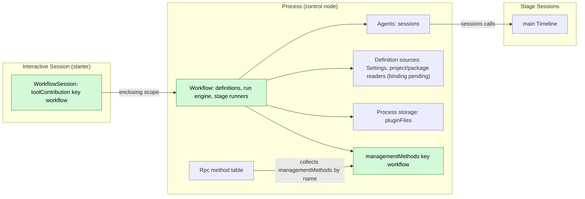
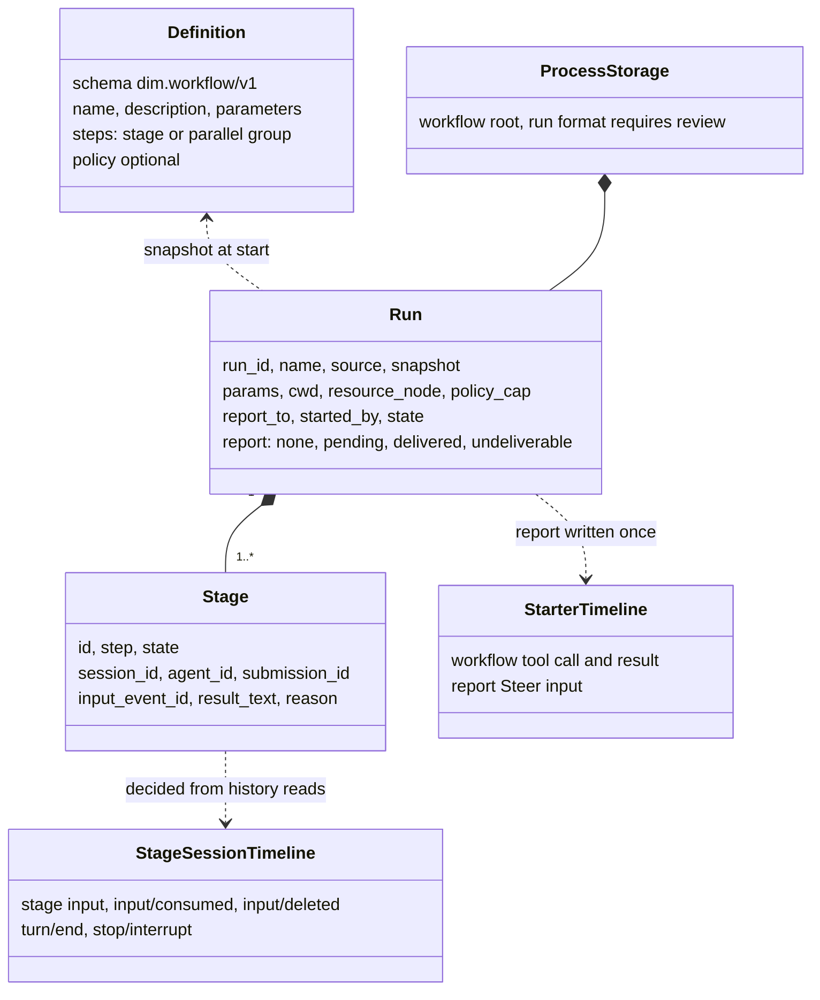
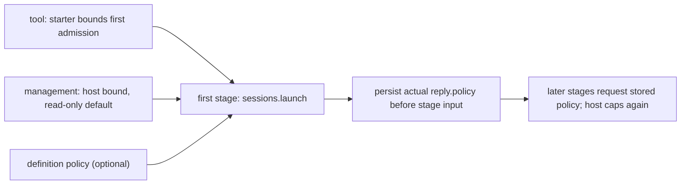
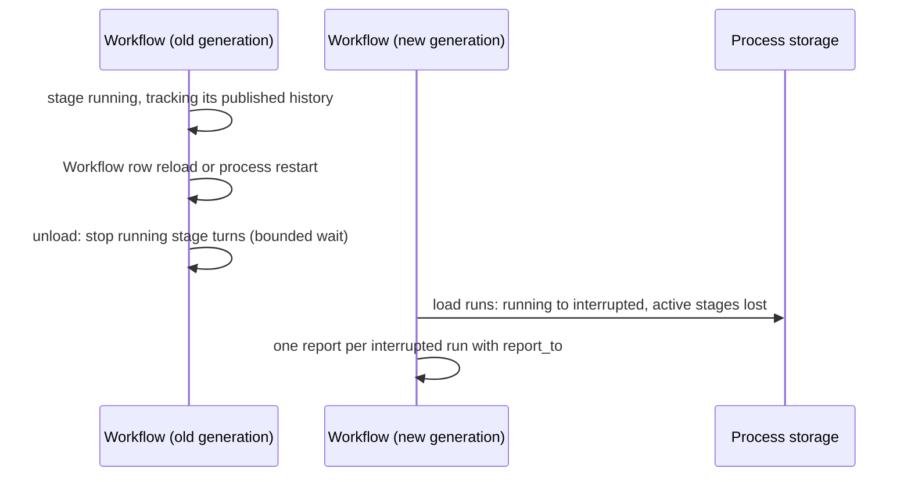

# Workflow

Status: Draft. Overall design: [overview §4](../overview.md#4-plugin-catalog); scope: [ADR 002](../../adr/002-plugin-scope.md) (process + Session). Phase: P2. Language: TypeScript first ([overview Appendix C](../overview.md#appendix-c-implementation-language)).

**Delivery boundary.** Workflow is a design for review, not an implemented plugin. C4 tools, S2 `sessions`, Settings owner read/write/events and versioned pluginFiles text storage are available. The process/package bindings and business decisions in §1.1 and Appendix F must be settled before Ready. No new core or rutis capability is proposed.

> **Offline resource nodes.** Rows about an offline resource node describe P3 multi-node behaviour. #5 is withdrawn (rutis is an external dependency, and it withdraws imported services when a link drops), so these rows are redesigned in P3 following overview §6.3: node services are looked up on each call by `resourceNode`. In P1/P2 every Session uses the control node.

Workflow owns workflow definitions and runs. A run advances a fixed list of steps; each stage runs in its own new non-interactive Session launched through Agents. The process part owns runs and reaches launched Sessions through the process service `sessions` ([session-access](../contracts/session-access.md)), as Collaboration does. User-saved definitions live in Workflow's Settings source `workflow`, project definitions stay project files that Workflow reads through FileStorage, and run records live in `pluginFiles`. The Session part declares the `workflow` tool as a `toolContribution` in every Session, and only interactive Sessions can use it; operators use the `workflow.*` management methods, a `managementMethods` entry. All contracts are language-neutral named services ([ADR 002 D5](../../adr/002-plugin-scope.md#d5-contracts-are-language-neutral)); the Rust forms are in [Appendix G](#appendix-g-rust-binding). When a run ends, its result is reported once to the starting branch as Steer input. Workflow writes no Timeline event of its own.

## 1. Structure



A run spans Sessions, so runs belong to the process ([ADR 002](../../adr/002-plugin-scope.md) D1); the tool belongs to the Session (D2). The process declares the existing `sessions`, `settings` and `pluginFiles` services. Agents' stable directory provides `sessions` and finds the current index on each call, so index reload fails calls with `reloading` without reloading Workflow or Sessions ([S2 D1](../appserver/sessions-service.md#3-decisions), [#35](https://github.com/arcships/dim/issues/35)). Agents also resolves the requested stage/profile/default model; Workflow needs no separate Provider dependency. Per-call `workflowRuns` access still needs a supported binding (§1.1); undeclared `ctx.use` is not a generic optional native lookup. C3 keeps core consumers independent of optional rows. Definition edits are business data read at use, never structural reload.

| Part | Scope | Depends on | Provides |
| --- | --- | --- | --- |
| `Workflow` | Process (control node) | Existing `sessions`, `settings`, `pluginFiles`; source-reader bindings subject to §1.1 | Run engine; proposed `workflowRuns` and management namespace `workflow` |
| `WorkflowSession` | Session, installed when enabled | C4 tool contract, creation configuration; per-call process access subject to §1.1 | `toolContribution:workflow`; handler refuses when `interactive === false` |

**Existing contracts:** [C4 tools](../session-typescript.md), [S2 sessions](../appserver/sessions-service.md), [Settings](../appserver/settings-service.md), [method admission](../contracts/session-boundary.md), [pluginFiles](../../../crates/dim-app-server/README.md#trusted-plugin-storage). **Plugin-owned contracts proposed here:** `dim.workflow/v1`, `toolContribution:workflow`, `workflowRuns.call`, management namespace `workflow`, Settings source `workflow`, stage/report marker text and run records. Project and package definition readers remain an explicit binding decision; no implemented `PluginContents` service is assumed.

### 1.1 Existing bindings and implementation gates

| Surface | Current implementation and consequence |
| --- | --- |
| Tool / process package | C4 supports ordinary Session tool rows with synchronous declaration and asynchronous execution; C3 samples active tools at branch initialization. `ServerConfig.session_typescript` is not generic process-package configuration and rejects other service families. Select process assembly and #35 `workflowRuns` access using existing mechanisms before Ready, without a wiring row or optional-lookup API. |
| Management | Rust `ManagementMethods` supports per-call admission and `report`/`drain`. C4 does not project TypeScript `managementMethods`; a row declaration alone does not expose `workflow.*`. Binding choice stays explicit. |
| Definitions / Settings | Owner read/update/CAS/events are delivered (#175/#177). One source owner declares the user document and user-only project enablement; Session parts do not duplicate it. The source file/scope/schema and semantic-validation boundary need confirmation. FileStorage is typed Rust, and there is no implemented `PluginContents` or named arbitrary-project-file bridge here; do not replace either with direct filesystem access. |
| Storage | `pluginFiles.open()` supplies an owned scope with `withLock`, `quiesce`, `close`, and v1 text read/replace. Confirm Workflow's own run format before persistence; no binary storage extension. |
| Sessions | Use existing `{ok:true,value}` / `{ok:false,error:{code,message,retryable}}` envelopes. `launch` returns `{sessionId,policy}`, `input` returns `{inputId,sequence}`; `lookup` finds committed inputs and does not deduplicate writes. |
| Authority | S2 caps policy at actual stage admission. §3.3 proposes using its returned policy for the run's later stages (A17), rather than inventing a policy-query service or reading creation config as live Permission. |
| Lifetime | Per-call S2 leases do not close a Session when dropped. Existing [#126](https://github.com/arcships/dim/issues/126) is required before shipping repeated stage creation; retention uses existing `sessions.delete` under confirmed ownership. |

A17 moves cap capture from tool start to first stage admission. Permission changes in between affect the first launch bound; confirm this timing change before adopting A17.

### 1.2 Impact

No runtime, facade, loader, event format or rutis change. New business behavior belongs to the Workflow package; source, tool and management namespace are consumed by Settings, ToolRegistry and operators. `workflowRuns` connects the feature's actual two scopes. No registry, readiness service, new context path or App Server business module is added.

## 2. Data and state



Definitions are read from their sources per call (A1); runs live in process storage and are persisted on every transition before the effect they guard. Stage progress is derived from existing facts in each stage Session; only a bounded result text is copied. Nothing is rebuilt from Timeline; Workflow owns no `StateCell` and the Session part holds no state.

## 3. Flows

### 3.1 Start from the tool and run a stage

```mermaid
sequenceDiagram
  participant M as Model (starter branch)
  participant WF as Workflow
  participant ST as Process storage
  participant AG as sessions.launch (launched stage)
  participant SS as Stage Session
  M->>WF: workflow start (tool handler of WorkflowSession)
  WF->>WF: validate definition/params; retain starter identity
  WF->>ST: persist Run running
  WF-->>M: ToolResult run_id (batch result)
  WF->>ST: persist stage launching
  WF->>AG: launch(starter?, policy?, model?)
  AG-->>WF: sessionId, actual policy
  WF->>ST: persist Session and first-stage policy cap (A17)
  WF->>SS: sessions.input main Queue, marker stage, rendered prompt
  WF->>ST: persist stage running with input_event_id
  SS->>SS: Dispatcher: input/applied, input/consumed, turn
  WF->>SS: sessions.history pages through one fixed published cutoff
  WF->>ST: stage completed or failed, next step
```

The handler persists the run and returns at once; stage advancement runs on the process part's task tracker. Completion is decided only after reading the stage Session's whole fixed published prefix (§3.2).

### 3.2 Report and stop

```mermaid
sequenceDiagram
  participant WF as Workflow
  participant ST as Process storage
  participant STB as Starter branch
  alt run completed, failed or interrupted, with report_to
    WF->>ST: report pending(submission_id)
    WF->>STB: sessions.input Steer, marker report
    WF->>ST: delivered, or undeliverable on branch missing or Session closed
  else workflow stop
    WF->>ST: stopping
    WF->>WF: withdraw own stage inputs; notHeld requires history before any branch stop
    WF->>ST: stopped, no report
  end
```

An explicit owner stop never wakes the starter ([event-driven flows §3](../../architecture/rust-agent/event-driven-flows.md)). The report-once requirement (E15) belongs to Workflow's write ownership, settlement and recovery. `sessions.lookup` waits for committed publication and reads by `submissionId`; it is not an atomic write/dedup operation. Before retrying an unknown report, the previous attempt must have settled and no old writer may still commit. Specify and verify that package-owned sequence before Ready (Appendix F); lookup alone is not proof of one report.

Each stage has one owned history tracker using its persisted input receipt. It reads on submission and on a one-second timer, capped by a stop deadline, without leaving a native `idle` wait outstanding. The first `history {after}` reply fixes the published cutoff `H`; subsequent pages keep `through: H`. Finish the prefix before deciding, then keep its final sequence as the next cursor. Match the stage's own `inputId`, preserve its published terminal outcome and never treat an unrelated turn's end as stage completion. A pending approval does not prevent these history reads.

On stop, withdraw only the stage's own input if not yet consumed. `deleted` settles it as stopped. `notHeld` only says that this withdrawal deleted nothing; the input may already have been deleted or consumed. Continue history reads: a matching deletion settles the stage, an existing terminal outcome is preserved, and application without consumption keeps the stop pending. Only observed consumption without a following end permits `sessions.stop`. Keep each admitted mutation owned until settlement; a discarded JavaScript Promise is not native cancellation.

The stop targets a branch, not an expected turn. The observed turn can finish and another can start before the call takes effect. Keep this limit and the polling cadence explicit for confirmation before Ready (Appendix F); no atomic turn targeting, lock, protocol or core requirement is added. Report-writer settlement remains a separate E15 decision and is not resolved by stage tracking.

### 3.3 Policy of a stage



A run never widens authority (E2). **Proposed admission flow (A17):** the first stage uses existing `sessions.launch` with the tool's `{sessionId,branchId}` starter and the definition's optional policy; management starts omit the starter, so S2 supplies the existing host bound and read-only default. Agents resolves the live bound and returns the effective `policy`. Persist that reply as `Run.policy_cap` before any stage input; this field is absent only while first admission has no confirmed reply. Later stages pass that stored policy explicitly and omit the starter: Agents caps it again by current host defaults, so a closed starter does not widen authority or prevent already-owned work from continuing. No fallback is allowed before the first confirmed policy.

If the first step is parallel, obtain and persist the first declared stage's launch reply before admitting its siblings; the existing concurrency limit still applies. A definition policy is converted once at the definition boundary to the existing `PermissionPolicy` shape, and S2 applies its normal cap rather than a second policy-comparison implementation. This changes cap capture to first stage admission and requires A17 confirmation before code; it needs no policy-query method, auxiliary Session or new core capability.

## 4. Timing and conflicts



Workflow's own reload or restart settles runs `interrupted`; nothing is relaunched (E15). An Agents index reload is different: the stable `sessions` service remains, Workflow and stage Sessions stay loaded, and uncertain replies are reconciled with existing S2 calls. A committed input is not submitted again merely because its reply was lost.

| Scenario | Sequence order | Outcome | Owner |
| --- | --- | --- | --- |
| Starter turn interrupt after the tool result | result < interrupt | Run continues | Workflow |
| Tool batch not settled when the run ends quickly | report < `step/tool-result` | Steer consumed after the batch result; model sees `run_id` first | Loop |
| `workflow.stop` races a stage's own `turn/end` | `turn/end` < `stop/interrupt` | Stage `completed` with result; run `stopped` | Stage Session order |
| Stage input withdrawn (user or stop) while held | input < `input/withdraw` < `input/deleted` | Stage `stopped`; never applied or consumed | InputQueue, Workflow |
| Workflow reload or restart | — | Runs `interrupted`, active stages `lost`, nothing relaunched; preserve E15 through the confirmed writer-settlement flow | Workflow |
| Agents index reload | — | Workflow and stage Sessions continue; calls may return `reloading`, uncertain writes require lookup/history | Agents; Workflow |
| Starter branch closed while a stage runs | close < report | Stage continues; report `undeliverable` | Workflow |

Full table: Appendix B.

## 5. Context mapping

| What the model sees | Form | Placement |
| --- | --- | --- |
| `workflow` declaration | Tool declaration in adopted configuration (every Session; usable only in interactive Sessions) | Requests whose prefix holds that configuration |
| Start, status, stop | `ToolResult.content` (text incl. `run_id`) | Tool result position of its batch |
| Report | One raw block `<dim-workflow kind="report" run="..." status="...">`; body: per-stage status, bounded preview of the last step's results (A16), how to get full results (`status`) | Consumed position of the Steer input; unkeyed |
| Stage task (stage Session) | Marker `<dim-workflow kind="stage" run="..." stage="...">` then the rendered prompt as user content | First input of the launched stage Session |

Report and stage inputs are unkeyed: after compaction they survive only through the summary; child branches inherit them only if consumed before the cut. Stage Sessions are non-interactive: `ask_user` and `workflow` stay declared, and their handlers refuse, so runs never nest. Model-actionable run/Session ids, status and result previews belong in `ToolResult.content` or the adopted report input. `structuredContent` is for persistence/UI; stores, logs and diagnostics are not automatically injected into context.

## 6. Interfaces (summary)

| Interface | Kind | Purpose |
| --- | --- | --- |
| `workflow` (`list`, `start`, `status`, `stop`) | `toolContribution` (Session, key `workflow`), risk category of Collaboration's `agent` tool | Model runs workflows |
| `workflow.list/save/start/status/stop` | `managementMethods` (process, key `workflow`) | Operators manage definitions and runs |
| CLI entry | Separate client work after method binding | No implemented CLI command is claimed here |
| `sessions` | Depended on | Stage Sessions: launch, input, history, lookup, stop, withdraw, delete |
| `dim.workflow/v1` | Defined here | Definition format (Appendix A) |

## 7. Security

Workflow has no host-local approval ([overview §6.4](../overview.md#64-conventions)). Starting through the tool is an agent action governed by Approval/Permission; management runs and enabled definitions belong to their configuration/operator. Project definitions start disabled ([ADR 003 D3](../../adr/003-approval-scope.md#d3-enablement-is-ordinary-configuration-project-entries-start-disabled)): a project file cannot enable itself. User-only enablement lives in the user source keyed by workspace/name; the implemented protected client `settings.update` can change it, the owner/tool cannot. Opening a repository runs nothing until enabled; later file edits apply to future runs without another approval (D4). Confirm the source/schema and actual project-reader binding before shipping. Stage authority follows proposed A17; creation config is not a live Permission read. Params/results become adopted input content; definitions contain no credentials.

## 8. Rule check

Rules: [principles §1 and §4](../../architecture/rust-agent/principles.md), [ADR 002](../../adr/002-plugin-scope.md) D1–D5.

| Rule | How this document complies |
| --- | --- |
| §4.1 Command events for others' state | Stage Sessions change only through `sessions` (input, `input/withdraw`, `stop/interrupt`); the owners write the results. |
| §4.2 No take-back after hand-off | Withdrawal only deletes a held input. After `notHeld`, read history; stop requires own consumption without a following terminal outcome (§3.2). |
| §4.3 Intervene only through before callbacks | Not applicable: Workflow adds no entry check and no before callback; definition validation is its own boundary validation. |
| §4.4 Core mechanisms carry no business meaning | The runtime gets nothing Workflow-specific; Workflow uses only the generic `sessions` operations. |
| §4.5 Read the whole batch before deciding | Finish the published prefix `H` fixed by the first history page before deciding; subsequent pages keep that cutoff. S2 pages end on batch boundaries (§3.2, A.6). |
| §4.6 Model context holds only handed-over events | Stage tasks and reports reach models only as consumed inputs; withdrawn inputs are deleted and never seen. |
| §4.7 Only public events and services | Existing sessions/Settings/pluginFiles; Agents resolves models and policy. No private Permission/AgentIndex lease API or speculative file/catalog service. |
| §4.8 Requirements to mechanism owners | None (§9); solve remaining bindings and business flow before Ready, using existing mechanisms. P3 nodes remain separate. |
| §4.9 Only facts later decisions use enter the Timeline | Workflow writes no Timeline event; runs stay in process storage, and only stage tasks and reports, which models consume, enter Timelines as inputs. |
| §1 Capability and App Server boundary | The process plugin owns definitions and runs; the Session Capability offers its tool. Storage uses `pluginFiles`; no App Server business module. |
| ADR 002 D1 | Runs span Sessions (process part); the tool belongs to a Session (Session part). |
| ADR 002 D2 | Existing Rpc/ToolRegistry consume feature-owned methods/tools; no wiring plugin, extra Provider port or registry. TS management binding is not claimed. |
| ADR 002 D3 | Stable sessions isolates index reload; C3 keeps core independent of optional rows; per-call process binding remains explicit. |
| ADR 002 D4 | Definitions and run limits are business data read at use time; nothing structural changes. |
| ADR 002 D5 | `workflowRuns`, the tool, the methods and the definition format are named services or data; Rust forms are in Appendix G. |

## 9. Requirements raised to mechanism owners

None. Use the delivered C3/C4, S2, Settings and pluginFiles contracts. Appendix F records unresolved bindings and business sequences without turning them into core/rutis requests. A report-once requirement does not imply an idempotency extension, generation token or new registry. P3 resource-node behavior remains outside this implementation scope.

## Appendix A. Interface details

### A.1 Definition format `dim.workflow/v1`

YAML (A2). User definitions are entries in the Settings source `workflow` (A3); project definitions remain `<workspace>/.dimcode/workflows/<name>.yaml` under project-file authority (E11); packages contain the same documents. Project/package source bindings must be chosen before Ready (§1.1), without claiming a named file service or implemented PluginContents. Keep the definition format and source authority; do not silently replace them with loader options or a second manifest.

```yaml
schema: dim.workflow/v1
name: review-and-fix                 # [a-z0-9-]{1,64}; unique per source
description: Analyze, fix in parallel, summarize
policy: workspace_write              # optional; narrowing only
parameters:
  - { name: target, description: Path to review, required: true }
  - { name: style, default: concise }
steps:
  - stage: { id: analyze, prompt: "Analyze {{params.target}}." }
  - parallel:
      - { id: fix-a, agent: <agent id>, prompt: "Fix part A.\n{{stages.analyze.result}}" }
      - { id: fix-b, prompt: "Fix part B.\n{{stages.analyze.result}}" }
  - stage: { id: summarize, model: { providerId: p, modelId: m }, prompt: "Summarize: {{stages.fix-a.result}} {{stages.fix-b.result}}" }
```

| Field | Rule |
| --- | --- |
| `steps` | 1–32 steps in order; a step is one `stage` or a `parallel` group of 2–8 stages (A4) |
| `stage.id` | `[a-z0-9-]{1,32}`, unique in the definition |
| `stage.agent` | Optional Agent id (native or external profile); when absent the launch request omits `agent` and Agents uses its default profile |
| `stage.model` | Optional existing `ModelId {providerId,modelId}`; omitted: Agents resolves profile/default selection (A5) |
| `stage.prompt` | Template ≤ 32 KiB after rendering (A6); placeholders `{{params.<name>}}`, `{{stages.<id>.result}}` |
| `policy` | `read_only` \| `workspace_write` \| `full_access`; capped (3.3) |
| References | `stages.<id>` must name a stage of an earlier step; plain substitution only (A7) |
| Parameters | Strings; missing required or unknown names → `invalid_parameters`; defaults fill the rest |

Settings validates/defaults the declared source's schema at its boundary; Workflow uses that document directly without another format check. Parsing project/package documents and validating start params belong at their actual input boundaries. Resolving parameters/templates/references into a run snapshot is Workflow's business transformation; its cross-stage semantic rules must have a concrete owner before Ready, rather than being attributed to generic JSON Schema validation. Runs use the resulting explicit snapshot.

### A.2 Tool `workflow`

`toolContribution:workflow` is declared independently of interactivity (#30). The handler refuses when `config.interactive === false` (A8); omission means true. C4 supplies creation configuration, not current Permission state. Synchronous `declaration()` does no I/O; `execute(ToolCall, cancelled)` uses the existing second by-reference cancellation Promise. Accepted run work belongs to the process owner; cleanup and the pre/post-persistence cancellation behavior use that ownership, not cancellation inferred from a JavaScript Promise. ToolExecutor owns terminal tool facts.

`workflowRuns`, process scope, no key, defined here: `call(RunRequest): async -> RunReply`, where `RunRequest = {action, name?, source?, params?, run_id?, caller: {sessionId, branchId, callId, cwd}}` uses the actions below and `RunReply = {content: string, structured: JSON}` or an error `{code}` from the list below. Risk: the category Collaboration's `agent` tool declares (today none, so unclassified: ReadOnly denies, WorkspaceWrite asks, FullAccess allows; E2).

| Action | Parameters | `ToolResult.content` |
| --- | --- | --- |
| `list` | — | Enabled definitions visible for the caller's cwd: name, source, description, parameters |
| `start` | `name`, `source?` (`project`, then `user`, then `plugin`), `params` | `{"run_id", "status": "running", "stages": [...]}` and a sentence that the result arrives as a report input |
| `status` | `run_id` | State, per-stage state, Session id, bounded result preview, last log entries |
| `stop` | `run_id` | Final state after propagation |

`start` records `report_to = {session_id,branch_id}` and the caller's cwd; first-stage admission captures the actual policy as proposed in §3.3/A17, without pretending that a separate live-policy query exists. `resource_node` is absent until P3. Errors: `definition_not_found` (also for a disabled project definition), `invalid_definition`, `invalid_parameters`, `run_not_found`, `limit_exceeded` (A11).

### A.3 Management methods

`managementMethods` key `workflow`: `describe(): async -> MethodDecl[]` lists the methods below (`mutating` as shown); `call(MethodCall): async -> MethodReply` dispatches them with JSON params and results.

| Method | Params | Result | `mutating` |
| --- | --- | --- | --- |
| `workflow.list` | `cwd` | Definitions with source, enabled state and issues | no |
| `workflow.save` | `source: user\|project`, `cwd?`, `document` | `{name}`; `user`: Workflow's typed write of the entry into the `workflow` document (CAS on its revision); `project`: the project file, written through FileStorage (file authority); saving does not enable a project definition | yes |
| `workflow.start` | `name`, `source?`, `cwd`, `resource_node?` (P3), `params`, `report_to?` | `{run_id}`; first launch records its returned policy (A17); management uses the existing host bound/read-only default | yes |
| `workflow.status` | `run_id?` | One run or recent runs | no |
| `workflow.stop` | `run_id` | Final run state | yes |

After selecting a supported binding, use existing method admission: list/status are `report`; save/start/stop are `drain`, so accepted mutations settle before unload. Rpc returns `service_reloading` for Pending/reloading owners, `service_unavailable` for Failed/Unresolved owners and `unknown_method` for disabled/absent owners. This is not a claim that TypeScript management projection is implemented.

### A.4 Run record

```text
Run { run_id, name, source: user|project|plugin, definition (snapshot),
      params, cwd, resource_node? (absent until P3: control node), policy_cap? (pending first launch reply, A17), report_to?: {session_id, branch_id},
      started_by: tool{session_id, branch_id, call_id} | management,
      state: running | stopping | completed | failed | stopped | interrupted,
      stages: [Stage], log: [LogEntry] (bounded, A9),
      report: none | pending{submission_id} | delivered | undeliverable{reason} }
Stage { id, step, state: waiting | launching | running | completed | failed | stopped | skipped | lost,
        session_id?, agent_id?, submission_id?, input_event_id?, result_text?, reason? }
```

### A.5 Depended-on contracts

| Contract | Owner | Use |
| --- | --- | --- |
| `sessions.launch {agent?,cwd,model?:{providerId,modelId},policy?,starter?:{sessionId,branchId}}` → `{sessionId,policy}` | Existing [S2](../appserver/sessions-service.md) | Agents resolves model and policy; every stage is non-interactive; Workflow writes the first input |
| `sessions.withdraw {sessionId, branchId, inputId}` of an own input; `sessions.lookup` by `submissionId` | session-access (InputQueue) | Withdraw own unconsumed stage inputs on stop; reply `deleted` or `notHeld` |

### A.6 Timeline and capability mechanics

| Step | Path |
| --- | --- |
| Start | Validate definition/params, retain starter identity, persist Run running with first admission pending, then return run_id; advancement belongs to the process task owner. No direct Timeline write. A17 requires confirmation. |
| Stage launch | Recheck run state, persist launching, use S2 launch (omit agent/model when absent). First reply persists sessionId and policy cap before input; remaining launches use the explicit stored policy. Persist `submissionId = workflow:<uuid>`. |
| Stage input | `sessions.input {sessionId,branchId:"main",mode:"queue",submissionId,rawBlocks:[{text:"<dim-workflow …>…</dim-workflow>"}],content:[{type:"text",text:prompt}]}` → `{inputId,sequence}`. Construct/escape marker text at Workflow's input boundary; S2 takes `RawBlock {text,key?}`, not a structured marker object. Persist the receipt before proceeding. |
| Consumption | Stage Session's InputQueue and Loop on their Dispatchers (`input/applied`, `input/consumed`), then turns |
| Completion | Owned history tracker (§3.2), with one fixed published cutoff per read. Before own `input/consumed`: matching `input/deleted` or a following `stop/interrupt` → `stopped`, else wait again. After consumption: the first following `turn/end` decides `completed`/`failed`/`stopped`; that turn's last response text is the result. |
| Advance | Persist the stage result; when all stages of a step are terminal, start the next step or end the run; a failed stage stops running siblings and fails the run (A4) |
| Report | On `completed`, `failed` or `interrupted` with `report_to`: persist `pending{submission_id}`, `sessions.input` (mode `steer`) with marker `report` on the starter branch; persist `delivered`, or `undeliverable` on a missing branch or closed Session |
| Stop | Persist `stopping`; waiting stages `skipped`; follow §3.2 to withdraw own inputs and refresh history after `notHeld`. Preserve published outcomes; application without consumption stays pending; consumption without an end permits branch-scoped `sessions.stop`. Run `stopped`, no report. |
| Reload, restart | Agents index reload does not reload Workflow. For its own unload, stop new work, stop owned stages (A13), and settle admitted writers before cleanup. On recovery, running/stopping runs become interrupted and active stages lost; nothing is relaunched. Reconcile a pending report through lookup only after its prior writer cannot commit; accepted → delivered, unknown → the confirmed package-owned recovery flow. Preserve E15; Appendix F must specify/verify settlement with existing mechanisms. |

## Appendix B. Full conflict table

| Scenario | Sequence order | Outcome | Owner |
| --- | --- | --- | --- |
| Starter interrupt before the call is dispatched | interrupt < `step/tool-call` | Not executed; no run | ToolExecutor |
| Starter interrupt while the handler runs | `step/tool-start` < interrupt | Persisted run continues; cancelled before persistence → no run | Workflow |
| Starter interrupt after the tool result | result < interrupt | Run continues | Workflow |
| Starter branch-scoped interrupt or branch close | close < report | Run continues; report `undeliverable` | Workflow |
| Tool batch not settled when the run ends | report < `step/tool-result` | Steer consumed after the batch result | Loop |
| Concurrent Steer/Queue on the report branch | Timeline order | Applied by mode; report is an ordinary Steer | InputQueue |
| Report arrives while the starter is idle | — | Steer starts a turn | InputQueue, Loop |
| User withdraws the report input while held | report < `input/withdraw` < `input/deleted` | Report counted `delivered`; not rewritten | InputQueue |
| Compaction between report write and consumption | input < compaction < consumed | Placed after the summary | ContextPreparation |
| Child branch cut between report write and consumption | input < cut < consumed | Child does not see it | InputQueue (child) |
| User stops the stage Session before consumption | input < interrupt | Stage `stopped`; input pending in that Session unless deleted | Workflow |
| Stage input withdrawn while held | input < `input/withdraw` < `input/deleted` | Stage `stopped` | InputQueue, Workflow |
| `workflow.stop` races the stage's `turn/end` | `turn/end` < `stop/interrupt` | Stage `completed`; run `stopped` | Stage Session order |
| `workflow.stop` races apply | `input/applied` < `input/withdraw` | `notHeld`; refresh history per §3.2, preserving a published outcome before any stop | InputQueue, Workflow |
| `workflow.stop` follows another deletion | `input/deleted` < `input/withdraw` | `notHeld`; matching deletion settles the stage, never wait for impossible consumption | InputQueue, Workflow |
| `workflow.stop` twice or after the end | — | Idempotent | Workflow |
| Duplicate `start` | — | Two runs (A15) | Workflow |
| Agents index reload | — | Workflow/stage Sessions continue; reconcile uncertain replies with S2; do not interrupt all runs | Agents; Workflow |
| Workflow reload during a tool call | — | Provider settles accepted work; C3 keeps core consumers running; process binding still requires §1.1 confirmation | Workflow; ToolExecutor |
| Stage resource node offline (P3) | — | Outside P1/P2; follows the separate P3 node design, not a requirement on rutis | Agents, stage Session |
| Stage Session capability reload mid-turn | turn ends `Failed` | Stage `failed` | Stage Loop |
| Starter Session unloaded at report time | — | `sessions.input` restores it, then writes | Agents |
| Process restart mid-run | — | `interrupted`/`lost`; committed unconsumed stage inputs stay in their Sessions | Workflow |
| Report write uncertain | — | Settle prior writer, then lookup before retry; E15 requires owner serialization, not lookup alone | Workflow |
| Project definition edited after start | — | Run keeps its snapshot; later stages use the snapshot; later runs of an enabled definition use the edited file without asking again (ADR 003 D4) | Workflow |
| Client detach | — | No effect | — |

## Appendix C. Errors and recovery

| Case | Result |
| --- | --- |
| Invalid definition file | Listed with issues; `start` → `invalid_definition` |
| Definition policy above admission authority | Existing S2 caps it; record the returned policy (proposed A17), without a separate query or wider fallback |
| `launch` fails | Stage `failed`; run `failed` |
| Stage turn `Failed`/`Cancelled` | Stage `failed`/`stopped`; run `failed` (A4) |
| Session closed or branch missing while waiting | Stage `failed: session_closed` |
| Storage write failure | Run task stops before the guarded effect; settled `interrupted` on next load |

Codes are the tool errors of A.2; management wire errors use existing `data.appError`.

## Appendix D. Acceptance

After the Ready decisions are confirmed, through actual tool/management bridge flows and Session history reads:

1. Sequential and parallel steps; result substitution; forward reference rejected at save.
2. Tool start returns `run_id`; the report Steer ends a `wait` and arrives after the batch result.
3. Stop: waiting stages `skipped`, held input deleted (`input/deleted`), applied or running stage interrupted, run `stopped`, no report; repeated stop idempotent.
4. Stop racing a stage `turn/end` keeps the completed result. Include `notHeld` after another withdrawal deleted the input, and an approval keeping `idle` pending after consumption. Neither case waits for an impossible consumption or an idle reply. Keep §3.2's branch-stop race explicit rather than claiming turn-conditional interruption.
5. Starter turn interrupt does not stop the run; starter branch closed → `undeliverable`.
6. Project definition in `.dimcode/workflows/`: after opening the workspace it is listed disabled and `start` returns `definition_not_found`; after the user enables it (a write of the user-only enable record in the `workflow` source) it starts without any approval step; editing it after start leaves the running run's snapshot unchanged, and the next run uses the edit without asking.
7. Workflow reload/restart: interrupted/lost, no relaunch, exactly one report under the confirmed writer-settlement flow. Agents index reload: run/stage instances remain; reconcile only affected calls.
8. Policy: a first tool-stage admission under WorkspaceWrite bounds all stages to at most WorkspaceWrite; management defaults to ReadOnly; the tool is denied under ReadOnly. Verify Permission changes between start and first admission against the confirmed A17 timing.
9. Every stage, parallel ones included, runs in its own launched non-interactive Session; a stage without `agent` runs with Agents' default profile.
10. Non-interactive stage Sessions declare the `workflow` tool, and calling it returns an error result.
11. A17: first launch captures its returned policy before input/sibling launch; later stage authority never exceeds it, even after starter closure or host-policy changes. Missing starter before first admission fails closed.
12. Retention deletes only stage Sessions owned by expired run records through sessions.delete; #126 bounds loaded idle Sessions before shipping. Source readers, owner CAS and project default-disabled behavior use actual bindings, not filesystem bypasses.

## Appendix E. Assumptions

| # | Assumption | Basis | Effect if rejected |
| --- | --- | --- | --- |
| A1 | Definitions read per call, not cached | Judgment (file authority) | Cache with change detection |
| A2 | YAML with `schema: dim.workflow/v1` | Judgment | Other syntax |
| A3 | User-saved definitions are one document in the Settings source `workflow` mapping name to definition; the same document holds the enabled state of project definitions per workspace and name | User decision (round 2 R7); [ADR 003](../../adr/003-approval-scope.md) D3 | Files under the dim home |
| A4 | Stages or parallel groups (≤ 32 steps, ≤ 8 per group); fail-fast | Feature list ("stages"); limits judgment | Per-stage failure policies |
| A5 | Model precedence: stage > profile > Provider's default selection | [Overview §4](../overview.md#4-plugin-catalog); precedence judgment | Other precedence |
| A6 | Rendered prompt ≤ 32 KiB; stored result ≤ 64 KiB | Judgment | Other bounds |
| A7 | Plain substitution templates | Judgment | Expressions need a sandbox |
| A8 | Tool usable only in interactive Sessions; the handler refuses elsewhere | Prevents nesting | Depth limit needed |
| A9 | Log ≤ 500 entries; last 100 runs kept | Judgment | Other retention |
| A11 | 4 running runs, 4 concurrent stages per run; fields of the `workflow` document, read at each start | Judgment | Other limits |
| A13 | Unload waits up to 10 s for stage stops | Judgment | Other bound |
| A15 | `start` does not deduplicate | Judgment | Idempotency keys |
| A16 | Report preview ≤ 4 KiB | Judgment; `dim-agent-report` precedent | Other bound |
| A17 | Capture actual policy at first stage admission; later stages request that explicit policy under the current host bound | Proposed use of existing S2 launch reply; review required | Select another business flow using existing authority mechanisms before code |

Decided: tool risk and stage policy cap (E2), `.dimcode/` (E11), report once after restart (E15), every stage in a launched Session (user decision), user-saved definitions in a Settings business source and run records in `pluginFiles` (user decision), no host-local approval (user decision), withdrawal of own inputs, scope ([ADR 002](../../adr/002-plugin-scope.md)).

## Appendix F. Open questions

| Question | Description |
| --- | --- |
| Stages run by a Collaboration member (possible future feature) | Not designed. A stage could run in a Collaboration member of the starter to reuse that member's context across stages. It would need Collaboration to accept member requests from outside a branch. Today every stage runs in a launched Session. |
| Package binding | Choose process assembly, #35 per-call workflowRuns access and management binding using existing mechanisms. C4 Session rows do not imply these APIs. |
| Definition sources | Confirm the source file/scope/schema, user-only project enablement, project/package readers and semantic-validation boundary. Existing Settings schema validation must not be presented as implementation of arbitrary cross-stage semantic checks. No direct filesystem bypass, new catalog or generic file-service requirement is inferred. |
| Policy flow A17 | Confirm first-admission capture rather than a start-time policy query. The initial pending policy is a real unconfirmed launch outcome, not a default authority. |
| Report once / cleanup | Preserve E15 by specifying and verifying package-owned writer settlement/serialization across unload, recovery and pending native calls. S2 lookup is read-only, not deduplication; do not invent a core idempotency protocol or claim the guarantee without evidence. |
| Stop sequence | Confirm §3.2's history polling and remaining branch-wide stop limit if another input starts a later turn between read and stop. This is not a turn-conditional guarantee; admitted mutations remain owned until settlement. |
| Storage / retention | Confirm the run business format and stage Session ownership; use pluginFiles text and sessions.delete. Existing #126 must land before repeated stage creation ships. |

Known recovery limit: a stage launch can complete after its caller disappears before its Session id is persisted. That stage becomes lost without relaunch, but the unidentified Session cannot be tracked or deleted by run retention. Record this for later unified recovery design; no registry, idempotency extension or infrastructure gate is added for it.

A13 bounds the stage-stop wait; it does not authorize releasing an accepted report writer that can still commit. The report-once flow must account for that distinction through the package's existing cleanup/ownership before implementation.

## Appendix G. Rust binding

Existing bindings do not make every proposed TypeScript surface available; §1.1 and Appendix F remain explicit before Ready.

| Neutral | Rust |
| --- | --- |
| `toolContribution` key `workflow` | Session-scoped `ToolContribution` registered in `WorkflowSession`'s `provides` |
| `managementMethods` key `workflow` | Looked up by Rpc per call, not a dependency of Rpc ([methods Appendix F](../contracts/session-boundary.md#appendix-f-rust-binding)) |
| `sessions` | Public named host service; native request module and AgentIndex::acquire are private implementation details, not an external crate API |
| `workflowRuns` | Proposed feature-owned process service; binding remains a Ready decision |
| Process storage | Existing pluginFiles.open scope; register effect cleanup immediately; confirm business format before persistence |
| Run task | Spawned on the `TaskTracker` held by `ctx.effect` |
