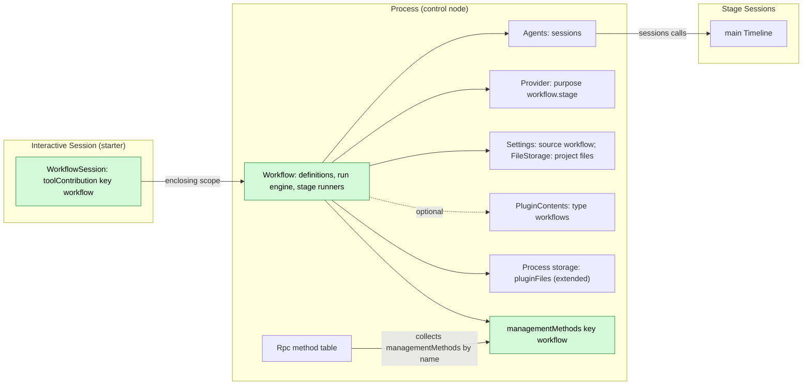
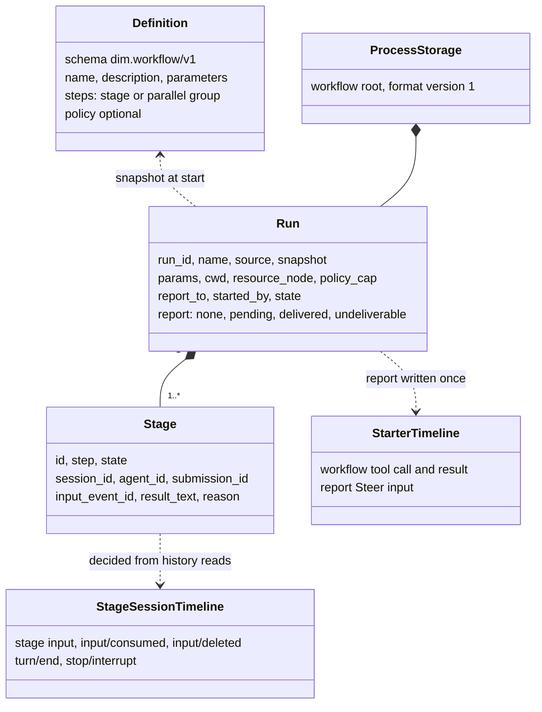
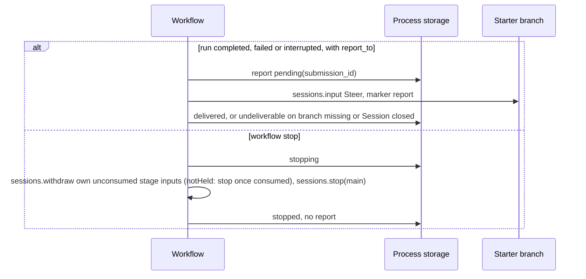
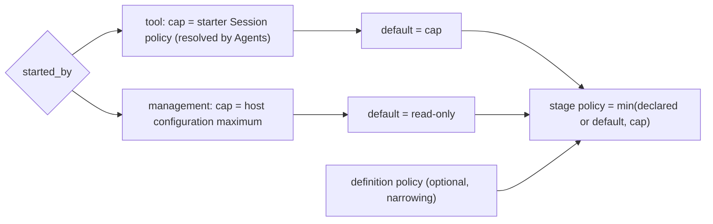
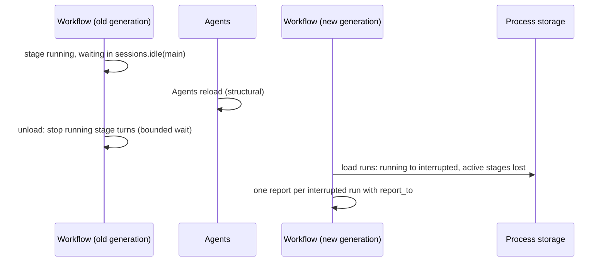

# Workflow

Status: Draft. Overall design: [overview §4](../overview.md#4-plugin-catalog); scope: [ADR 002](../../adr/002-plugin-scope.md) (process + Session). Phase: P2. Language: TypeScript first ([overview Appendix C](../overview.md#appendix-c-implementation-language)).

> **Dependencies to change in design review ([#35](https://github.com/arcships/dim/issues/35)).** The `workflow` tool looks up `workflowRuns` on each call, and the process part gets `sessions` on each use, instead of holding them as dependencies. A reload of Agents or Workflow then fails one call and never reloads every Session.

> **Offline resource nodes.** Rows about an offline resource node describe P3 multi-node behaviour. #5 is withdrawn (rutis is an external dependency, and it withdraws imported services when a link drops), so these rows are redesigned in P3 following overview §6.3: node services are looked up on each call by `resourceNode`. In P1/P2 every Session uses the control node.

Workflow owns workflow definitions and runs. A run advances a fixed list of steps; each stage runs in its own new non-interactive Session launched through Agents. The process part owns runs and reaches launched Sessions through the process service `sessions` ([session-access](../contracts/session-access.md)), as Collaboration does. User-saved definitions live in Workflow's Settings source `workflow`, project definitions stay project files that Workflow reads through FileStorage, and run records live in `pluginFiles` (extended). The Session part declares the `workflow` tool as a `toolContribution` in every Session, and only interactive Sessions can use it; operators use the `workflow.*` management methods, a `managementMethods` entry. All contracts are language-neutral named services ([ADR 002 D5](../../adr/002-plugin-scope.md#d5-contracts-are-language-neutral)); the Rust forms are in [Appendix G](#appendix-g-rust-binding). When a run ends, its result is reported once to the starting branch as Steer input. Workflow writes no Timeline event of its own.

## 1. Structure



A run spans Sessions, so runs belong to the process ([ADR 002](../../adr/002-plugin-scope.md) D1); the tool is offered by a Session-scoped `toolContribution` (D2). The Session part depends on the process part; the process part depends on Agents, Provider and Settings at the same scope. Dependencies follow scope (D3): an Agents reload reloads Workflow, which settles its runs `interrupted` (A.6), and a Workflow reload reloads its Session parts, failing their in-flight turns. These are rare structural events and an accepted, documented cost. Definition edits are business configuration (D4): read at use time, never a reload.

| Part | Scope | Depends on | Provides |
| --- | --- | --- | --- |
| `Workflow` | Process (control node) | `sessions` (Agents; `launch` with `policy`), Provider model selection, Settings source `workflow`, FileStorage (project files, looked up per call), `PluginContents` (optional, type `workflows`), `pluginFiles` (extended) | Run engine; `workflowRuns` (the tool's access to runs, A.2); `managementMethods` key `workflow` |
| `WorkflowSession` | Session, installed when Workflow is enabled | `workflowRuns` (`Workflow`), Session configuration | `toolContribution` key `workflow`, declared in every Session; the handler refuses unless the Session is `interactive` |

**Contracts depended on**: `sessions` ([session-access](../contracts/session-access.md): `launch` with a starter-capped `policy`, Session configuration fields, `input` with source raw blocks, `history`, `idle`, `stop`, `withdraw`; `agent` optional), `toolContribution` (ToolRegistry accepts named tool services, a supplement; [tool contributions](../../architecture/rust-agent/tool-contributions.md)), `managementMethods` collected by Rpc ([session-boundary](../contracts/session-boundary.md)); [`pluginFiles` (extended)](../../../crates/dim-app-server/README.md#trusted-plugin-storage) (run records; a TypeScript part uses it natively); and existing typed services: Provider purpose policy and Settings sources (the `workflow` business source is a Settings supplement, [overview Appendix B](../overview.md#appendix-b-supplements-to-existing-plugins)), which a TypeScript part reaches by name once [#4](https://github.com/arcships/dim/issues/4) exposes them ([session-access §9](../contracts/session-access.md#9-requirements-raised-to-mechanism-owners)). **Contracts defined here**: definition format `dim.workflow/v1`, the `workflow` tool, the `workflowRuns` service, the `workflow.*` methods, source name `workflow` (marker kinds `stage` and `report`), purpose key `workflow.stage`, content type key `workflows`, the run record.

## 2. Data and state



Definitions are read from their sources per call (A1); runs live in process storage and are persisted on every transition before the effect they guard. Stage progress is derived from existing facts in each stage Session; only a bounded result text is copied. Nothing is rebuilt from Timeline; Workflow owns no `StateCell` and the Session part holds no state.

## 3. Flows

### 3.1 Start from the tool and run a stage


The handler persists the run and returns at once; stage advancement runs on the process part's task tracker. Completion of a stage is decided only from the stage Session's facts up to the `idle` cutoff.

### 3.2 Report and stop



An explicit owner stop never wakes the starter ([event-driven flows §3](../../architecture/rust-agent/event-driven-flows.md)). `sessions.lookup` by `submissionId` before any retry guarantees at most one report.

### 3.3 Policy of a stage



A run never widens authority (E2): the `workflow` tool is admitted with the same risk category as Collaboration's `agent` tool, and stage Sessions never exceed the starter's policy.

## 4. Timing and conflicts



Workflow's own reload, a reload of a dependency (Agents) or a restart settles runs `interrupted`; nothing is relaunched (E15). Reloads are rare structural events (D3), so this cost is accepted rather than prevented.

| Scenario | Sequence order | Outcome | Owner |
| --- | --- | --- | --- |
| Starter turn interrupt after the tool result | result < interrupt | Run continues | Workflow |
| Tool batch not settled when the run ends quickly | report < `step/tool-result` | Steer consumed after the batch result; model sees `run_id` first | Loop |
| `workflow.stop` races a stage's own `turn/end` | `turn/end` < `stop/interrupt` | Stage `completed` with result; run `stopped` | Stage Session order |
| Stage input withdrawn (user or stop) while held | input < `input/withdraw` < `input/deleted` | Stage `stopped`; never applied or consumed | InputQueue, Workflow |
| Workflow or Agents reload, or restart | — | Runs `interrupted`, active stages `lost`, nothing relaunched; one report each (E15) | Workflow |
| Starter branch closed while a stage runs | close < report | Stage continues; report `undeliverable` | Workflow |

Full table: Appendix B.

## 5. Context mapping

| What the model sees | Form | Placement |
| --- | --- | --- |
| `workflow` declaration | Tool declaration in adopted configuration (every Session; usable only in interactive Sessions) | Requests whose prefix holds that configuration |
| Start, status, stop | `ToolResult.content` (text incl. `run_id`) | Tool result position of its batch |
| Report | One raw block `<dim-workflow kind="report" run="..." status="...">`; body: per-stage status, bounded preview of the last step's results (A16), how to get full results (`status`) | Consumed position of the Steer input; unkeyed |
| Stage task (stage Session) | Marker `<dim-workflow kind="stage" run="..." stage="...">` then the rendered prompt as user content | First input of the launched stage Session |

Report and stage inputs are unkeyed: after compaction they survive only through the summary; child branches inherit them only if consumed before the cut. Stage Sessions are non-interactive: `ask_user` and `workflow` stay declared, and their handlers refuse with an error result, so runs never nest. The model never sees unlisted definitions, run records, logs or diagnostics.

## 6. Interfaces (summary)

| Interface | Kind | Purpose |
| --- | --- | --- |
| `workflow` (`list`, `start`, `status`, `stop`) | `toolContribution` (Session, key `workflow`), risk category of Collaboration's `agent` tool | Model runs workflows |
| `workflow.list/save/start/status/stop` | `managementMethods` (process, key `workflow`) | Operators manage definitions and runs |
| `/workflow`, `/workflow:save` | CLI | Call the management methods |
| `sessions` | Depended on | Stage Sessions: launch, input, history, idle, stop, withdraw |
| `dim.workflow/v1` | Defined here | Definition format (Appendix A) |

## 7. Security

Workflow has no host-local approval ([overview §6.4](../overview.md#64-conventions)). Starting a run from the `workflow` tool is an agent action, so Approval and Permission govern it through the tool's risk category (E2). A definition (user, project or plugin) and a run started through a management method are the responsibility of that configuration and its operator: an enabled definition runs without approval. Project definitions start disabled ([ADR 003 D3](../../adr/003-approval-scope.md#d3-enablement-is-ordinary-configuration-project-entries-start-disabled)): a project file cannot enable itself; the enabled state lives in the user's Settings source `workflow`, keyed by workspace and definition name. It is a user-only field: the user changes it through the client method `settings.update` (S8b, not implemented; CLI and UI build on it), and the `workflow` tool writes no configuration. Opening a repository with `.dimcode/workflows/` therefore runs nothing until the user enables a definition; after that, edits to the file apply to later runs without asking again (ADR 003 D4). Stage policy follows 3.3 and a definition can only narrow it. Stage Sessions use only their own resource node's services. Params and results become Timeline content of stage and report Sessions; definitions must not carry credentials.

## 8. Rule check

Rules: [principles §1 and §4](../../architecture/rust-agent/principles.md), [ADR 002](../../adr/002-plugin-scope.md) D1–D5.

| Rule | How this document complies |
| --- | --- |
| §4.1 Command events for others' state | Stage Sessions change only through `sessions` (input, `input/withdraw`, `stop/interrupt`); the owners write the results. |
| §4.2 No take-back after hand-off | A stage input is withdrawn only before `input/applied`; after `notHeld` Workflow uses `stop` once `input/consumed` is read. |
| §4.3 Intervene only through before callbacks | Not applicable: Workflow adds no entry check and no before callback; definition validation is its own boundary validation. |
| §4.4 Core mechanisms carry no business meaning | The runtime gets nothing Workflow-specific; Workflow uses only the generic `sessions` operations. |
| §4.5 Read the whole batch before deciding | Stage decisions read history through the cutoff `C` that `sessions.idle` returns and use only events up to `C`; batches commit whole, so no batch is split at `C` (A.6). |
| §4.6 Model context holds only handed-over events | Stage tasks and reports reach models only as consumed inputs; withdrawn inputs are deleted and never seen. |
| §4.7 Only public events and services | Workflow uses `sessions`, Provider, Settings and `pluginFiles` (extended); it writes into no other plugin's state. |
| §4.8 Requirements to mechanism owners | No runtime or rutis requirement of its own (§9); #4 is stated in [session-access §9](../contracts/session-access.md#9-requirements-raised-to-mechanism-owners) and #5 in [ExternalAgent §9](ExternalAgent.md#9-requirements-raised-to-mechanism-owners); the Agents and Settings supplements are in [overview Appendix B](../overview.md#appendix-b-supplements-to-existing-plugins). |
| §4.9 Only facts later decisions use enter the Timeline | Workflow writes no Timeline event; runs stay in process storage, and only stage tasks and reports, which models consume, enter Timelines as inputs. |
| §1 Capability and App Server boundary | Runs are process-level, not a Capability; storage is the `pluginFiles` plugin, not an App Server service. |
| ADR 002 D1 | Runs span Sessions (process part); the tool belongs to a Session (Session part). |
| ADR 002 D2 | No wiring module: Rpc collects `managementMethods`, ToolRegistry collects `toolContribution`. |
| ADR 002 D3 | Agents and Workflow reloads propagate by scope; runs settle `interrupted`, an accepted cost (§4). |
| ADR 002 D4 | Definitions and run limits are business data read at use time; nothing structural changes. |
| ADR 002 D5 | `workflowRuns`, the tool, the methods and the definition format are named services or data; Rust forms are in Appendix G. |

## 9. Requirements raised to mechanism owners

None. Workflow relies on [#4](https://github.com/arcships/dim/issues/4) ([session-access §9](../contracts/session-access.md#9-requirements-raised-to-mechanism-owners)) and [#5](https://github.com/arcships/dim/issues/5) ([ExternalAgent §9](ExternalAgent.md#9-requirements-raised-to-mechanism-owners)). The supplements it needs from other plugins (Agents `sessions` with optional `LaunchRequest.agent`, the Settings business source `workflow`, `pluginFiles` (extended)) are listed in [overview Appendix B](../overview.md#appendix-b-supplements-to-existing-plugins).

## Appendix A. Interface details

### A.1 Definition format `dim.workflow/v1`

YAML (A2). Sources: user definitions saved by the user are entries of the one document in the Settings source `workflow`, which maps name to definition (A3); project definitions are project files `<workspace>/.dimcode/workflows/<name>.yaml` (E11), which are not a Settings source: Workflow reads them itself through FileStorage under project-file authority; packages publish the same documents as `PluginContents` type `workflows`.

```yaml
schema: dim.workflow/v1
name: review-and-fix                 # [a-z0-9-]{1,64}; unique per source
description: Analyze, fix in parallel, summarize
policy: workspace_write              # optional; narrowing only
parameters:
  - { name: target, description: Path to review, required: true }
  - { name: style, default: concise }
steps:
  - stage: { id: analyze, prompt: "Analyze {{params.target}}." }
  - parallel:
      - { id: fix-a, agent: <agent id>, prompt: "Fix part A.\n{{stages.analyze.result}}" }
      - { id: fix-b, prompt: "Fix part B.\n{{stages.analyze.result}}" }
  - stage: { id: summarize, model: { provider: p, model: m }, prompt: "Summarize: {{stages.fix-a.result}} {{stages.fix-b.result}}" }
```

| Field | Rule |
| --- | --- |
| `steps` | 1–32 steps in order; a step is one `stage` or a `parallel` group of 2–8 stages (A4) |
| `stage.id` | `[a-z0-9-]{1,32}`, unique in the definition |
| `stage.agent` | Optional Agent id (native or external profile); when absent the launch request omits `agent` and Agents uses its default profile |
| `stage.model` | Optional; else the profile's model; else Provider's selection for purpose `workflow.stage` (A5) |
| `stage.prompt` | Template ≤ 32 KiB after rendering (A6); placeholders `{{params.<name>}}`, `{{stages.<id>.result}}` |
| `policy` | `read_only` \| `workspace_write` \| `full_access`; capped (3.3) |
| References | `stages.<id>` must name a stage of an earlier step; plain substitution only (A7) |
| Parameters | Strings; missing required or unknown names → `invalid_parameters`; defaults fill the rest |

Validation happens at the external boundary: Settings validates the `workflow` document against Workflow's schema on write and when reading the persisted file, and Workflow does not validate it again; Workflow parses and validates a project file when it reads it through FileStorage, and `start` params when it receives them. Runs use the validated snapshot.

### A.2 Tool `workflow`

`toolContribution` key `workflow`, registered by `WorkflowSession` in every Session: assembly never reads `interactive`, so the tool set stays the same across Sessions (#30). The handler refuses with an error result when `SessionConfig.interactive` is false (A8); this is the nesting guard. `declaration(): sync -> ToolDeclaration` returns the actions below; `execute(ToolCall): async -> ToolResult` calls the process part's `workflowRuns` service; cancellation is the consumer dropping the call.

`workflowRuns`, process scope, no key, defined here: `call(RunRequest): async -> RunReply`, where `RunRequest = {action, name?, source?, params?, run_id?, caller: {sessionId, branchId, callId, cwd}}` uses the actions below and `RunReply = {content: string, structured: JSON}` or an error `{code}` from the list below. Risk: the category Collaboration's `agent` tool declares (today none, so unclassified: ReadOnly denies, WorkspaceWrite asks, FullAccess allows; E2).

| Action | Parameters | `ToolResult.content` |
| --- | --- | --- |
| `list` | — | Enabled definitions visible for the caller's cwd: name, source, description, parameters |
| `start` | `name`, `source?` (`project`, then `user`, then `plugin`), `params` | `{"run_id", "status": "running", "stages": [...]}` and a sentence that the result arrives as a report input |
| `status` | `run_id` | State, per-stage state, Session id, bounded result preview, last log entries |
| `stop` | `run_id` | Final state after propagation |

`start` sets `report_to = {session_id, branch_id}` and `cwd` from the calling Session's configuration (`resource_node` is absent until P3, which means the control node), and `policy_cap` from the starter (resolved by Agents). Errors: `definition_not_found` (also for a project definition the user has not enabled), `invalid_definition`, `invalid_parameters`, `run_not_found`, `limit_exceeded` (A11).

### A.3 Management methods

`managementMethods` key `workflow`: `describe(): async -> MethodDecl[]` lists the methods below (`mutating` as shown); `call(MethodCall): async -> MethodReply` dispatches them with JSON params and results.

| Method | Params | Result | `mutating` |
| --- | --- | --- | --- |
| `workflow.list` | `cwd` | Definitions with source, enabled state and issues | no |
| `workflow.save` | `source: user\|project`, `cwd?`, `document` | `{name}`; `user`: Workflow's typed write of the entry into the `workflow` document (CAS on its revision); `project`: the project file, written through FileStorage (file authority); saving does not enable a project definition | yes |
| `workflow.start` | `name`, `source?`, `cwd`, `resource_node?` (P3; absent means the control node), `params`, `report_to?` | `{run_id}`; `policy_cap` = host configuration maximum, default read-only | yes |
| `workflow.status` | `run_id?` | One run or recent runs | no |
| `workflow.stop` | `run_id` | Final run state | yes |

An admitted call completes if the caller disconnects. While Workflow reloads, Rpc answers `service_reloading`; when it is not enabled, `unknown_method`.

### A.4 Run record

```text
Run { run_id, name, source: user|project|plugin, definition (snapshot),
      params, cwd, resource_node? (absent until P3: control node), policy_cap, report_to?: {session_id, branch_id},
      started_by: tool{session_id, branch_id, call_id} | management,
      state: running | stopping | completed | failed | stopped | interrupted,
      stages: [Stage], log: [LogEntry] (bounded, A9),
      report: none | pending{submission_id} | delivered | undeliverable{reason} }
Stage { id, step, state: waiting | launching | running | completed | failed | stopped | skipped | lost,
        session_id?, agent_id?, submission_id?, input_event_id?, result_text?, reason? }
```

### A.5 Depended-on contracts

| Contract | Owner | Use |
| --- | --- | --- |
| `sessions.launch {agent?, cwd, model?, policy?, starter?}` → `{sessionId}` (non-interactive; absent `agent` = Agents' default profile; request `model` overrides the profile's model) | Agents supplement ([session-access](../contracts/session-access.md)) | Every stage; Workflow writes the first input itself |
| `sessions.withdraw {sessionId, branchId, inputId}` of an own input; `sessions.lookup` by `submissionId` | session-access (InputQueue) | Withdraw own unconsumed stage inputs on stop; reply `deleted` or `notHeld` |

### A.6 Timeline and capability mechanics

| Step | Path |
| --- | --- |
| Start | Handler or management call validates, resolves the policy cap, persists `Run{running}`, spawns the run task on the process part's task tracker and returns. No Timeline write |
| Stage launch | Recheck in storage (run still `running`). Persist `launching`; `launch` (without `agent` when the stage declares none); persist `session_id` and `submission_id = workflow:<uuid>` |
| Stage input | `sessions.input {sessionId, branchId: "main", mode: "queue", submissionId, rawBlocks: [marker {kind: "stage", attrs: [run, stage], body: definition name}], content: [rendered prompt]}` → `{inputId}` stored as `input_event_id`; persist `running` |
| Consumption | Stage Session's InputQueue and Loop on their Dispatchers (`input/applied`, `input/consumed`), then turns |
| Completion | `sessions.idle {sessionId, branchId: "main"}` returns cutoff `C`; `sessions.history {through: C}` pages. Before `input/consumed{input_event_id}`: `input/deleted` or a following `stop/interrupt` → `stopped`, else wait again. After consumption: the first `turn/end` after it in `(consumed, C]` decides `completed`/`failed`/`stopped`; that turn's last response text is the result (Collaboration's outcome rule) |
| Advance | Persist the stage result; when all stages of a step are terminal, start the next step or end the run; a failed stage stops running siblings and fails the run (A4) |
| Report | On `completed`, `failed` or `interrupted` with `report_to`: persist `pending{submission_id}`, `sessions.input` (mode `steer`) with marker `report` on the starter branch; persist `delivered`, or `undeliverable` on a missing branch or closed Session |
| Stop | Persist `stopping`; waiting stages `skipped`; unconsumed stage inputs withdrawn (`sessions.withdraw`; `notHeld` means already applied, so the stage is stopped with `sessions.stop` once `input/consumed` is read); running stages `sessions.stop {sessionId, branchId: "main"}`; completion rule reads the outcome; run `stopped`, no report |
| Reload, restart | Session parts reload with Workflow; an in-flight `workflow` call fails with its turn. On unload the old generation stops running stage turns with `sessions.stop` (bounded wait, A13). The new generation loads runs: `running`/`stopping` → `interrupted`; `launching`/`running` stages → `lost`; nothing relaunched. A `pending` report is looked up with `sessions.lookup` (accepted → `delivered`, unknown → written now); interrupted runs with `report_to` and `report: none` get one report (E15) |

## Appendix B. Full conflict table

| Scenario | Sequence order | Outcome | Owner |
| --- | --- | --- | --- |
| Starter interrupt before the call is dispatched | interrupt < `step/tool-call` | Not executed; no run | ToolExecutor |
| Starter interrupt while the handler runs | `step/tool-start` < interrupt | Persisted run continues; cancelled before persistence → no run | Workflow |
| Starter interrupt after the tool result | result < interrupt | Run continues | Workflow |
| Starter branch-scoped interrupt or branch close | close < report | Run continues; report `undeliverable` | Workflow |
| Tool batch not settled when the run ends | report < `step/tool-result` | Steer consumed after the batch result | Loop |
| Concurrent Steer/Queue on the report branch | Timeline order | Applied by mode; report is an ordinary Steer | InputQueue |
| Report arrives while the starter is idle | — | Steer starts a turn | InputQueue, Loop |
| User withdraws the report input while held | report < `input/withdraw` < `input/deleted` | Report counted `delivered`; not rewritten | InputQueue |
| Compaction between report write and consumption | input < compaction < consumed | Placed after the summary | ContextPreparation |
| Child branch cut between report write and consumption | input < cut < consumed | Child does not see it | InputQueue (child) |
| User stops the stage Session before consumption | input < interrupt | Stage `stopped`; input pending in that Session unless deleted | Workflow |
| Stage input withdrawn while held | input < `input/withdraw` < `input/deleted` | Stage `stopped` | InputQueue, Workflow |
| `workflow.stop` races the stage's `turn/end` | `turn/end` < `stop/interrupt` | Stage `completed`; run `stopped` | Stage Session order |
| `workflow.stop` races apply | `input/applied` < `input/withdraw` | `notHeld`, nothing written; `stop` after `input/consumed` | InputQueue, Workflow |
| `workflow.stop` twice or after the end | — | Idempotent | Workflow |
| Duplicate `start` | — | Two runs (A15) | Workflow |
| Agents reload | — | Workflow reloads; runs `interrupted`, one report each | Workflow |
| Workflow reload during a `workflow` call | — | The calling Session part reloads; that turn fails (D3, accepted) | Loop |
| Stage resource node offline | — | A launch refused for the unavailable node → stage `failed: node_unavailable`; a running stage Session stays loaded (no reload, no Pending), its node-service calls fail `node_unavailable` and its turn ends on its own outcome (requirement on [#5](https://github.com/arcships/dim/issues/5)) | Agents, stage Session |
| Stage Session capability reload mid-turn | turn ends `Failed` | Stage `failed` | Stage Loop |
| Starter Session unloaded at report time | — | `sessions.input` restores it, then writes | Agents |
| Process restart mid-run | — | `interrupted`/`lost`; committed unconsumed stage inputs stay in their Sessions | Workflow |
| Report write uncertain (reload, publication unknown) | — | Lookup before retry; never two reports | Workflow |
| Project definition edited after start | — | Run keeps its snapshot; later stages use the snapshot; later runs of an enabled definition use the edited file without asking again (ADR 003 D4) | Workflow |
| Client detach | — | No effect | — |

## Appendix C. Errors and recovery

| Case | Result |
| --- | --- |
| Invalid definition file | Listed with issues; `start` → `invalid_definition` |
| Declared policy above the cap | `invalid_definition` at start |
| `launch` fails | Stage `failed`; run `failed` |
| Stage turn `Failed`/`Cancelled` | Stage `failed`/`stopped`; run `failed` (A4) |
| Session closed or branch missing while waiting | Stage `failed: session_closed` |
| Storage write failure | Run task stops before the guarded effect; settled `interrupted` on next load |

Codes are the tool error codes of A.2; management methods return them as `app_error`.

## Appendix D. Acceptance

Through the tool, management methods and Session history reads:

1. Sequential and parallel steps; result substitution; forward reference rejected at save.
2. Tool start returns `run_id`; the report Steer ends a `wait` and arrives after the batch result.
3. Stop: waiting stages `skipped`, held input deleted (`input/deleted`), applied or running stage interrupted, run `stopped`, no report; repeated stop idempotent.
4. Stop racing a stage `turn/end` keeps the completed result.
5. Starter turn interrupt does not stop the run; starter branch closed → `undeliverable`.
6. Project definition in `.dimcode/workflows/`: after opening the workspace it is listed disabled and `start` returns `definition_not_found`; after the user enables it (a write of the user-only enable record in the `workflow` source) it starts without any approval step; editing it after start leaves the running run's snapshot unchanged, and the next run uses the edit without asking.
7. Restart, Workflow reload and Agents reload: `interrupted`/`lost`, no relaunch, exactly one report.
8. Policy: tool start under WorkspaceWrite → stages at most WorkspaceWrite; management start → ReadOnly by default; `workflow` denied under ReadOnly.
9. Every stage, parallel ones included, runs in its own launched non-interactive Session; a stage without `agent` runs with Agents' default profile.
10. Non-interactive stage Sessions declare the `workflow` tool, and calling it returns an error result.

## Appendix E. Assumptions

| # | Assumption | Basis | Effect if rejected |
| --- | --- | --- | --- |
| A1 | Definitions read per call, not cached | Judgment (file authority) | Cache with change detection |
| A2 | YAML with `schema: dim.workflow/v1` | Judgment | Other syntax |
| A3 | User-saved definitions are one document in the Settings source `workflow` mapping name to definition; the same document holds the enabled state of project definitions per workspace and name | User decision (round 2 R7); [ADR 003](../../adr/003-approval-scope.md) D3 | Files under the dim home |
| A4 | Stages or parallel groups (≤ 32 steps, ≤ 8 per group); fail-fast | Feature list ("stages"); limits judgment | Per-stage failure policies |
| A5 | Model precedence: stage > profile > purpose `workflow.stage` | [Overview §4](../overview.md#4-plugin-catalog); precedence judgment | Other precedence |
| A6 | Rendered prompt ≤ 32 KiB; stored result ≤ 64 KiB | Judgment | Other bounds |
| A7 | Plain substitution templates | Judgment | Expressions need a sandbox |
| A8 | Tool usable only in interactive Sessions; the handler refuses elsewhere | Prevents nesting | Depth limit needed |
| A9 | Log ≤ 500 entries; last 100 runs kept | Judgment | Other retention |
| A11 | 4 running runs, 4 concurrent stages per run; fields of the `workflow` document, read at each start | Judgment | Other limits |
| A13 | Unload waits up to 10 s for stage stops | Judgment | Other bound |
| A15 | `start` does not deduplicate | Judgment | Idempotency keys |
| A16 | Report preview ≤ 4 KiB | Judgment; `dim-agent-report` precedent | Other bound |

Decided: tool risk and stage policy cap (E2), `.dimcode/` (E11), report once after restart (E15), every stage in a launched Session (user decision), user-saved definitions in a Settings business source and run records in `pluginFiles` (extended) (user decision), no host-local approval (user decision), withdrawal of own inputs, scope ([ADR 002](../../adr/002-plugin-scope.md)).

## Appendix F. Open questions

| Question | Description |
| --- | --- |
| Stages run by a Collaboration member (possible future feature) | Not designed. A stage could run in a Collaboration member of the starter to reuse that member's context across stages. It would need Collaboration to accept member requests from outside a branch. Today every stage runs in a launched Session. |

## Appendix G. Rust binding

One binding of the neutral contracts, for a Rust implementation; a TypeScript implementation uses the same names and data through its rutis-bridge runtime.

| Neutral | Rust |
| --- | --- |
| `toolContribution` key `workflow` | Session-scoped `ToolContribution` registered in `WorkflowSession`'s `provides` |
| `managementMethods` key `workflow` | Looked up by Rpc per call, not a dependency of Rpc ([methods Appendix F](../contracts/session-boundary.md#appendix-f-rust-binding)) |
| `sessions.launch` | `AgentIndex::launch(LaunchRequest) -> SessionUse` |
| `sessions.input` / `history` / `idle` / `stop` / `withdraw` | `AgentIndex::acquire(id)` lease, then `Session::input`, `local_page`, `idle`, `stop`, `service::<InputQueue>(branch).withdraw` |
| `workflowRuns` | Process-scoped named service provided by `Workflow`, consumed by `WorkflowSession` |
| Process storage | `pluginFiles` (extended) scope opened in `apply` |
| Run task | Spawned on the `TaskTracker` held by `ctx.effect` |
