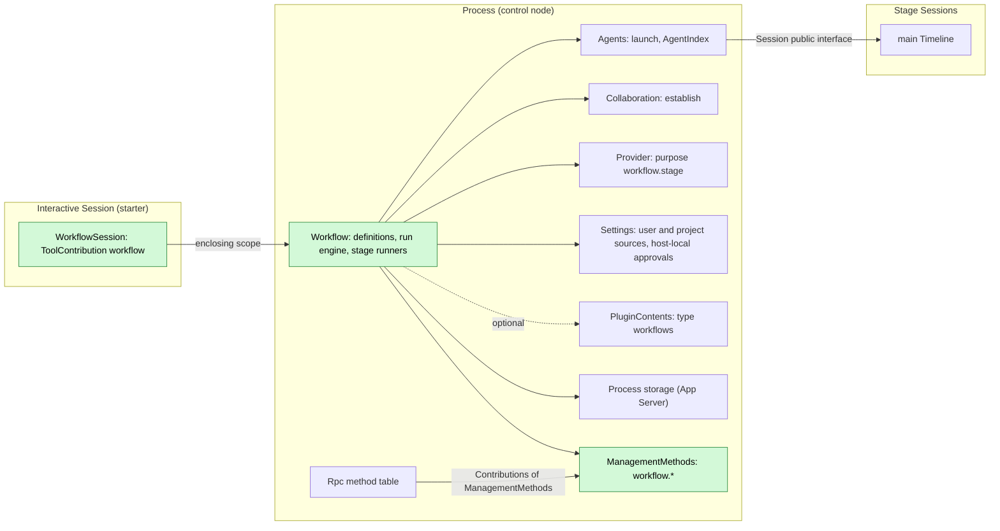
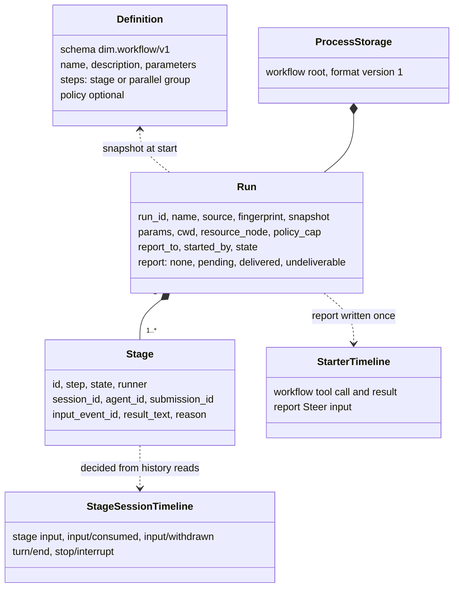
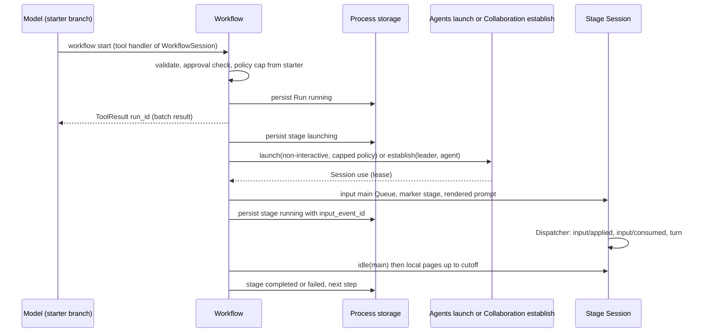
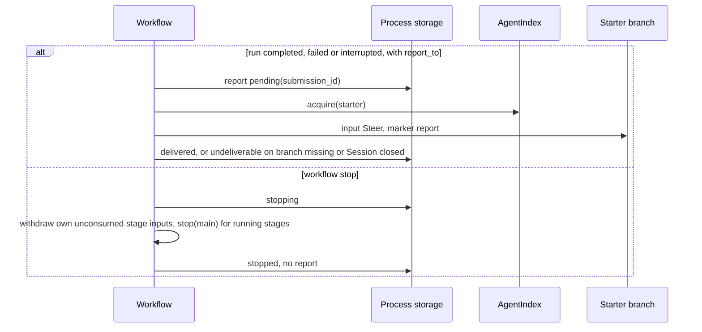
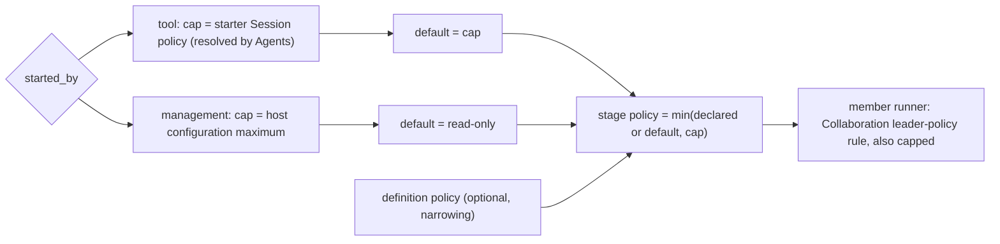

# Workflow

Status: Draft. Overall design: [overview §B.9](../overview.md#b9-workflow); scope: [ADR 002](../../adr/002-plugin-scope.md) (process + Session). Phase: P2. Language: TypeScript first ([overview §F.3](../overview.md#f3-assignment)).

Workflow owns workflow definitions and runs. A run advances a fixed list of steps; each stage runs in its own Session, either a new non-interactive Session launched through Agents or a Collaboration member of the starting Session created with Collaboration's `establish`. The process part owns runs and reaches Sessions through Agents (`AgentIndex`) and the Session public interface ([session-access](../contracts/session-access.md)), as Collaboration does. The Session part offers the `workflow` tool to interactive Sessions; operators use management-level `workflow.*` methods. When a run ends, its result is reported once to the starting branch as Steer input. Workflow writes no Timeline event of its own.

## 1. Structure



A run spans Sessions, so runs belong to the process ([ADR 002](../../adr/002-plugin-scope.md) D1); the tool is offered by a Session-scoped `ToolContribution` (D2). The Session part depends on the process part; the process part depends on Agents, Collaboration, Provider and Settings at the same scope. Dependencies follow scope (D3): an Agents or Collaboration reload reloads Workflow, which settles its runs `interrupted` (A.6), and a Workflow reload reloads its Session parts, failing their in-flight turns. These are rare structural events and an accepted, documented cost. Definition edits and approvals are business configuration (D4): read at use time, never a reload.

| Part | Scope | Depends on | Provides |
| --- | --- | --- | --- |
| `Workflow` | Process (control node) | Agents (`launch` with `policy`, `AgentIndex`), Collaboration (`establish`), Provider model selection, Settings user/project sources and host-local approval service, `PluginContents` (optional, type `workflows`), App Server process storage | Run engine; `ManagementMethods` entry `workflow.*` collected by Rpc |
| `WorkflowSession` | Session, installed when Workflow is enabled | `Workflow`, `S:SessionConfig` | Session-scoped `ToolContribution` `workflow`, contributed only when `interactive` |

**Contracts depended on**: [session-access](../contracts/session-access.md) (Agents `launch` with a starter-capped `policy`, `SessionConfig` fields, input with source raw blocks, history reads, withdrawal), Collaboration `establish(leader, agent)` (Collaboration supplement), Provider purpose policy, Session-scoped `ToolContribution` ([tool contributions](../../architecture/rust-agent/tool-contributions.md)), management-level methods in Rpc's method table ([session-boundary](../contracts/session-boundary.md)), App Server process storage (R8), Settings sources and host-local approval service (R11). **Contracts defined here**: definition format `dim.workflow/v1`, the `workflow` tool, the `workflow.*` methods, source name `workflow` (marker kinds `stage` and `report`), purpose key `workflow.stage`, content type key `workflows`, the run record.

## 2. Data and state



Definitions are read from their sources per call (A1) and approvals per check; runs live in process storage and are persisted on every transition before the effect they guard. Stage progress is derived from existing facts in each stage Session; only a bounded result text is copied. Nothing is rebuilt from Timeline; Workflow owns no `StateCell` and the Session part holds no state.

## 3. Flows

### 3.1 Start from the tool and run a stage



The handler persists the run and returns at once; stage advancement runs on the process part's task tracker. Completion is decided only from the stage Session's facts up to the `idle` cutoff.

### 3.2 Report and stop



An explicit owner stop never wakes the starter ([event-driven flows §3](../../architecture/rust-agent/event-driven-flows.md)). Lookup by `submission_id` before any retry guarantees at most one report.

### 3.3 Policy of a stage



A run never widens authority (E2): the `workflow` tool is admitted with the same risk category as Collaboration's `agent` tool, and stage Sessions never exceed the starter's policy.

## 4. Timing and conflicts


Workflow's own reload, a reload of a dependency (Agents, Collaboration) or a restart settles runs `interrupted`; nothing is relaunched (E15). Reloads are rare structural events (D3), so this cost is accepted rather than prevented.

| Scenario | Sequence order | Outcome | Owner |
| --- | --- | --- | --- |
| Starter turn interrupt after the tool result | result < interrupt | Run continues | Workflow |
| Tool batch not settled when the run ends quickly | report < `step/tool-result` | Steer consumed after the batch result; model sees `run_id` first | Loop |
| `workflow.stop` races a stage's own `turn/end` | `turn/end` < `stop/interrupt` | Stage `completed` with result; run `stopped` | Stage Session order |
| Stage input withdrawn (user or stop) before consumption | input < `input/withdrawn` | Stage `stopped`; never consumed | InputQueue, Workflow |
| Workflow, Agents or Collaboration reload, or restart | — | Runs `interrupted`, active stages `lost`, nothing relaunched; one report each (E15) | Workflow |
| Leader branch closed with a member stage running | close < report | Member stage continues; report `undeliverable` | Workflow |

Full table: Appendix B.

## 5. Context mapping

| What the model sees | Form | Placement |
| --- | --- | --- |
| `workflow` declaration | Tool declaration in adopted configuration (interactive Sessions only) | Requests whose prefix holds that configuration |
| Start, status, stop | `ToolResult.content` (text incl. `run_id`) | Tool result position of its batch |
| Report | One raw block `<dim-workflow kind="report" run="..." status="...">`; body: per-stage status, bounded preview of the last step's results (A16), how to get full results (`status`) | Consumed position of the Steer input; unkeyed |
| Stage task (stage Session) | Marker `<dim-workflow kind="stage" run="..." stage="...">` then the rendered prompt as user content | First input of a launched Session, or a new input of a member Session |

Report and stage inputs are unkeyed: after compaction they survive only through the summary; child branches inherit them only if consumed before the cut. Stage Sessions are non-interactive (no `ask_user`, no `workflow` tool), so runs never nest. The model never sees unlisted definitions, run records, logs, approvals, fingerprints or diagnostics.

## 6. Interfaces (summary)

| Interface | Kind | Purpose |
| --- | --- | --- |
| `workflow` (`list`, `start`, `status`, `stop`) | Session-scoped `ToolContribution`, risk category of Collaboration's `agent` tool | Model runs workflows |
| `workflow.list/save/start/status/stop/approve/revoke` | Management-level methods (`ManagementMethods`) | Operators manage definitions and runs |
| `/workflow`, `/workflow:save` | CLI | Call the management methods |
| Agents `launch`, Collaboration `establish` | Depended on | Create stage Sessions |
| `dim.workflow/v1` | Defined here | Definition format (Appendix A) |

## 7. Security

Project and plugin definitions are executable content: `start` and every stage launch require a grant in the Settings host-local approval service, record `{owner: workflow, node, workspace, source, id: name, fingerprint}`, fingerprint = SHA-256 over the canonical definition document (R11). Grants come only from `workflow.approve` on an entry that serves the `management` level; the tool, Timeline facts, replay and fork never grant. User definitions need no approval. Stage policy follows 3.3 and a definition can only narrow it. Approvals raised inside a member stage are forwarded to the leader by Collaboration (E6), not by Workflow. Stage Sessions use only their own resource node's services. Params and results become Timeline content of stage and report Sessions; definitions must not carry credentials.

## Appendix A. Interface details

### A.1 Definition format `dim.workflow/v1`

YAML (A2). Files: user source `<dim home>/workflows/<name>.yaml`, project source `<workspace>/.dimcode/workflows/<name>.yaml` (E11, A3); packages publish the same documents as `PluginContents` type `workflows`.

```yaml
schema: dim.workflow/v1
name: review-and-fix                 # [a-z0-9-]{1,64}; unique per source
description: Analyze, fix in parallel, summarize
policy: workspace_write              # optional; narrowing only
parameters:
  - { name: target, description: Path to review, required: true }
  - { name: style, default: concise }
steps:
  - stage: { id: analyze, prompt: "Analyze {{params.target}}." }
  - parallel:
      - { id: fix-a, agent: <agent id>, prompt: "Fix part A.\n{{stages.analyze.result}}" }
      - { id: fix-b, runner: member, prompt: "Fix part B.\n{{stages.analyze.result}}" }
  - stage: { id: summarize, model: { provider: p, model: m }, prompt: "Summarize: {{stages.fix-a.result}} {{stages.fix-b.result}}" }
```

| Field | Rule |
| --- | --- |
| `steps` | 1–32 steps in order; a step is one `stage` or a `parallel` group of 2–8 stages (A4) |
| `stage.id` | `[a-z0-9-]{1,32}`, unique in the definition |
| `stage.agent` | Optional Agent id (native or external profile); default: the Agents default Agent |
| `stage.runner` | `session` (default) or `member`; `member` requires `report_to` and Collaboration `establish` |
| `stage.model` | Optional; else the profile's model; else Provider's selection for purpose `workflow.stage` (A5) |
| `stage.prompt` | Template ≤ 32 KiB after rendering (A6); placeholders `{{params.<name>}}`, `{{stages.<id>.result}}` |
| `policy` | `read_only` \| `workspace_write` \| `full_access`; capped (3.3) |
| References | `stages.<id>` must name a stage of an earlier step; plain substitution only (A7) |
| Parameters | Strings; missing required or unknown names → `invalid_parameters`; defaults fill the rest |

Validation happens at the external boundary (file read, `workflow.save`, `start` params); runs use the validated snapshot.

### A.2 Tool `workflow`

Contributed by `WorkflowSession` only in Sessions whose `SessionConfig` has `interactive: true` (A8); the handler calls the process part. Risk: the category Collaboration's `agent` tool declares (today none, so unclassified: ReadOnly denies, WorkspaceWrite asks, FullAccess allows; E2).

| Action | Parameters | `ToolResult.content` |
| --- | --- | --- |
| `list` | — | Definitions visible for the caller's cwd: name, source, description, parameters, approval state |
| `start` | `name`, `source?` (`project`, then `user`, then `plugin`), `params` | `{"run_id", "status": "running", "stages": [...]}` and a sentence that the result arrives as a report input |
| `status` | `run_id` | State, per-stage state, Session id, bounded result preview, last log entries |
| `stop` | `run_id` | Final state after propagation |

`start` sets `report_to = {session_id, branch_id}` and `cwd`/`resource_node` from the calling Session's `SessionConfig`, and `policy_cap` from the starter (resolved by Agents). Errors: `definition_not_found`, `invalid_definition`, `invalid_parameters`, `approval_required`, `run_not_found`, `limit_exceeded` (A11).

### A.3 Management methods

| Method | Params | Result | `mutating` |
| --- | --- | --- | --- |
| `workflow.list` | `cwd` | Definitions with source, fingerprint, approval state, issues | no |
| `workflow.save` | `source: user\|project`, `cwd?`, `document` | `{name, fingerprint}`, written through Settings' source (file authority) | yes |
| `workflow.start` | `name`, `source?`, `cwd`, `resource_node?`, `params`, `report_to?` | `{run_id}`; `policy_cap` = host configuration maximum, default read-only | yes |
| `workflow.status` | `run_id?` | One run or recent runs | no |
| `workflow.stop` | `run_id` | Final run state | yes |
| `workflow.approve`, `workflow.revoke` | `name`, `source`, `cwd` | Approval state bound to node + workspace + fingerprint | yes |

An admitted call completes if the caller disconnects. While Workflow reloads, Rpc answers `service_reloading`; when it is not enabled, `unknown_method`.

### A.4 Run record

```text
Run { run_id, name, source: user|project|plugin, fingerprint, definition (snapshot),
      params, cwd, resource_node, policy_cap, report_to: Option<{session_id, branch_id}>,
      started_by: tool{session_id, branch_id, call_id} | management,
      state: running | stopping | completed | failed | stopped | interrupted,
      stages: [Stage], log: [LogEntry] (bounded, A9),
      report: none | pending{submission_id} | delivered | undeliverable{reason} }
Stage { id, step, runner, state: waiting | launching | running | completed | failed | stopped | skipped | lost,
        session_id?, agent_id?, submission_id?, input_event_id?, result_text?, reason? }
```

### A.5 Depended-on contracts

| Contract | Owner | Use |
| --- | --- | --- |
| `launch` with `interactive: false`, `resource_node`, `policy`; `created_by: Launch { source: "workflow" }` | Agents supplement ([session-access](../contracts/session-access.md)) | Launched stages; Workflow writes the first input itself |
| `establish(leader_session_id, agent_id)` | Collaboration supplement | Member stages; Collaboration keeps Team rules (single leader, `Busy`), applies the leader's cwd and policy, and forwards member approvals to the leader |
| Withdrawal of an own input | session-access (InputQueue) | Withdraw own unconsumed stage inputs on stop |

### A.6 Timeline and capability mechanics

| Step | Path |
| --- | --- |
| Start | Handler or management call validates, checks approval, resolves the policy cap, persists `Run{running}`, spawns the run task on the process part's `TaskTracker` (`ctx.effect`) and returns. No Timeline write |
| Stage launch | Recheck in storage (run `running`; approval still valid for the snapshot fingerprint, A12). Persist `launching`; `launch` or `establish`; persist `session_id` and `submission_id = workflow:<uuid>` |
| Stage input | `Session::input` on `main`: marker `{kind: "stage", attrs: [run, stage], body: definition name}`, rendered prompt, mode Queue → `Timeline::append`; persist `running` with `input_event_id` |
| Consumption | Stage Session's InputQueue and Loop on their Dispatchers (`input/applied`, `input/consumed`), then turns |
| Completion | `Session::idle("main")` returns cutoff `C`; read local pages up to `C`. Before `input/consumed{input_event_id}`: `input/withdrawn` or a following `stop/interrupt` → `stopped`, else wait again. After consumption: the first `turn/end` after it in `(consumed, C]` decides `completed`/`failed`/`stopped`; that turn's last response text is the result (Collaboration's outcome rule) |
| Advance | Persist the stage result; when all stages of a step are terminal, start the next step or end the run; a failed stage stops running siblings and fails the run (A4) |
| Report | On `completed`, `failed` or `interrupted` with `report_to`: persist `pending{submission_id}`, `AgentIndex::acquire`, Steer input with marker `report`; persist `delivered` or `undeliverable` |
| Stop | Persist `stopping`; waiting stages `skipped`; unconsumed stage inputs withdrawn; running stages `Session::stop("main", "workflow stopped")`; completion rule reads the outcome; run `stopped`, no report |
| Reload, restart | Session parts reload with Workflow; an in-flight `workflow` call fails with its turn. On unload the old generation stops running stage turns (bounded wait, A13). The new generation loads runs: `running`/`stopping` → `interrupted`; `launching`/`running` stages → `lost`; nothing relaunched. A `pending` report is looked up (accepted → `delivered`, unknown → written now); interrupted runs with `report_to` and `report: none` get one report (E15) |

## Appendix B. Full conflict table

| Scenario | Sequence order | Outcome | Owner |
| --- | --- | --- | --- |
| Starter interrupt before the call is dispatched | interrupt < `step/tool-call` | Not executed; no run | ToolExecutor |
| Starter interrupt while the handler runs | `step/tool-start` < interrupt | Persisted run continues; cancelled before persistence → no run | Workflow |
| Starter interrupt after the tool result | result < interrupt | Run continues | Workflow |
| Starter branch-scoped interrupt or branch close | close < report | Run continues; report `undeliverable` | Workflow |
| Tool batch not settled when the run ends | report < `step/tool-result` | Steer consumed after the batch result | Loop |
| Concurrent Steer/Queue on the report branch | Timeline order | Applied by mode; report is an ordinary Steer | InputQueue |
| Report arrives while the starter is idle | — | Steer starts a turn | InputQueue, Loop |
| User withdraws the report input | report < `input/withdrawn` | Report counted `delivered`; not rewritten | InputQueue |
| Compaction between report write and consumption | input < compaction < consumed | Placed after the summary | ContextPreparation |
| Child branch cut between report write and consumption | input < cut < consumed | Child does not see it | InputQueue (child) |
| User stops the stage Session before consumption | input < interrupt | Stage `stopped`; input pending in that Session unless withdrawn | Workflow |
| Stage input withdrawn | input < `input/withdrawn` | Stage `stopped` | InputQueue, Workflow |
| `workflow.stop` races the stage's `turn/end` | `turn/end` < `stop/interrupt` | Stage `completed`; run `stopped` | Stage Session order |
| `workflow.stop` races consumption | consumed < withdraw request | Withdraw rejected; `stop` path | InputQueue, Workflow |
| `workflow.stop` twice or after the end | — | Idempotent | Workflow |
| Duplicate `start` | — | Two runs (A15) | Workflow |
| Member stage, leader `request`s the same member | stage input queued, not started | Both inputs queue in the member Session; `Busy` only once a turn runs; the stage result is the first `turn/end` after its own input's consumption | Collaboration, Workflow |
| Leader branch closed with a member stage | close < stage end | Member stage continues; report `undeliverable` | Workflow |
| Leader Session closed with a member stage | — | Member closed by Collaboration → stage `failed: session_closed`; run `failed` | Collaboration, Workflow |
| Agents or Collaboration reload | — | Workflow reloads; runs `interrupted`, one report each | Workflow |
| Workflow reload during a `workflow` call | — | The calling Session part reloads; that turn fails (D3, accepted) | Loop |
| Stage resource node offline | capabilities Pending | `launch` fails at deadline → `failed: node_unavailable`; a running stage waits in `idle` | Agents, rutis lifecycle |
| Stage Session capability reload mid-turn | turn ends `Failed` | Stage `failed` | Stage Loop |
| Starter Session unloaded at report time | — | `acquire` restores, then writes | AgentIndex |
| Process restart mid-run | — | `interrupted`/`lost`; committed unconsumed stage inputs stay in their Sessions | Workflow |
| Report write uncertain (reload, publication unknown) | — | Lookup before retry; never two reports | Workflow |
| Project definition edited after start | — | Run keeps its snapshot; next stage launch rechecks the snapshot's fingerprint → `failed: approval_revoked` | Workflow |
| Client detach | — | No effect | — |

## Appendix C. Errors and recovery

| Case | Result |
| --- | --- |
| Invalid definition file | Listed with issues; `start` → `invalid_definition` |
| Approval missing or stale | `approval_required` at start; `failed: approval_revoked` at a later launch |
| Declared policy above the cap | `invalid_definition` at start |
| `launch`/`establish` fails | Stage `failed`; run `failed` |
| Stage turn `Failed`/`Cancelled` | Stage `failed`/`stopped`; run `failed` (A4) |
| Session closed or branch missing while waiting | Stage `failed: session_closed` |
| Storage write failure | Run task stops before the guarded effect; settled `interrupted` on next load |

Codes are the tool error codes of A.2; management methods return them as `app_error`.

## Appendix D. Acceptance

Through the tool, management methods and Session history reads:

1. Sequential and parallel steps; result substitution; forward reference rejected at save.
2. Tool start returns `run_id`; the report Steer ends a `wait` and arrives after the batch result.
3. Stop: waiting stages `skipped`, unconsumed input withdrawn, running stage interrupted, run `stopped`, no report; repeated stop idempotent.
4. Stop racing a stage `turn/end` keeps the completed result.
5. Starter turn interrupt does not stop the run; starter branch closed → `undeliverable`.
6. Project definition in `.dimcode/workflows/`: unapproved → `approval_required`; approve; edit → next stage `approval_revoked`.
7. Restart, Workflow reload and Agents reload: `interrupted`/`lost`, no relaunch, exactly one report.
8. Policy: tool start under WorkspaceWrite → stages at most WorkspaceWrite; management start → ReadOnly by default; `workflow` denied under ReadOnly.
9. `member` runner: member appears in the leader's Team; leader request racing a queued stage input handled per Appendix B.
10. Non-interactive stage Sessions have no `workflow` tool.

## Appendix E. Assumptions

| # | Assumption | Basis | Effect if rejected |
| --- | --- | --- | --- |
| A1 | Definitions read per call, not cached | Judgment (file authority) | Cache with change detection |
| A2 | YAML with `schema: dim.workflow/v1` | Judgment | Other syntax |
| A3 | User directory `<dim home>/workflows/` | Judgment; overview §B.9 user source | Path decided by Settings |
| A4 | Stages or parallel groups (≤ 32 steps, ≤ 8 per group); fail-fast | Feature list ("stages"); limits judgment | Per-stage failure policies |
| A5 | Model precedence: stage > profile > purpose `workflow.stage` | Overview §B.9; precedence judgment | Other precedence |
| A6 | Rendered prompt ≤ 32 KiB; stored result ≤ 64 KiB | Judgment | Other bounds |
| A7 | Plain substitution templates | Judgment | Expressions need a sandbox |
| A8 | Tool only for interactive Sessions | Prevents nesting | Depth limit needed |
| A9 | Log ≤ 500 entries; last 100 runs kept | Judgment | Other retention |
| A11 | 4 running runs, 4 concurrent stages per run | Judgment | Other limits |
| A12 | Approval rechecked before each stage launch | MCP precedent | Check only at start |
| A13 | Unload waits up to 10 s for stage stops | Judgment | Other bound |
| A15 | `start` does not deduplicate | Judgment | Idempotency keys |
| A16 | Report preview ≤ 4 KiB | Judgment; `dim-agent-report` precedent | Other bound |

Decided: tool risk and stage policy cap (E2), `.dimcode/` (E11), report once after restart (E15), member approval forwarding by Collaboration (E6), `establish` (decisions §2), process storage (R8), withdrawal (R7), host-local approval service (R11), scope ([ADR 002](../../adr/002-plugin-scope.md)).

## Appendix F. Open questions

| Question | Description |
| --- | --- |
| Overview method list | Overview §B.9 lists `workflow.list/save/start/status/stop`; this design adds `workflow.approve/revoke` (D11) |
| Launch contract | The Agents supplement must define `launch` with `policy` and the starter-policy resolution |
