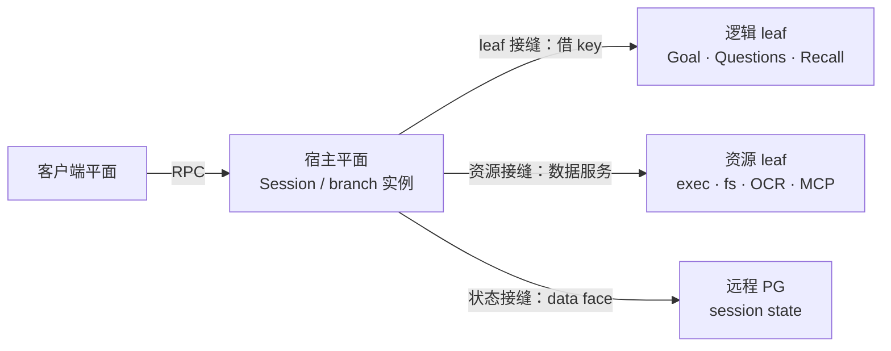
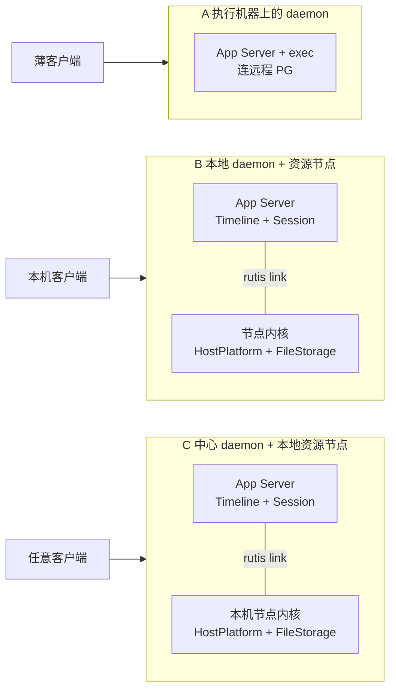
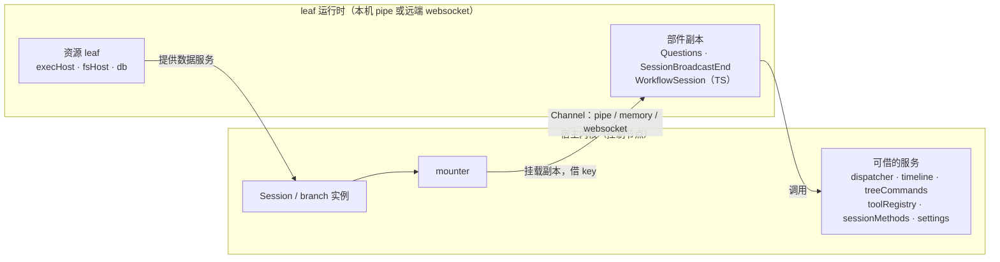
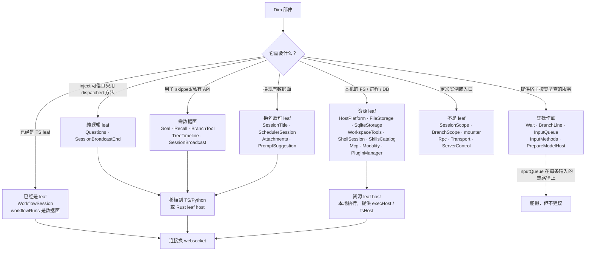

# 插件远程化：可行性与落地路径

状态：Draft（研究稿），不是已接受的设计。父 issue [#1288](https://github.com/arcships/dim/issues/1288)；实现由子 issue [#1289](https://github.com/arcships/dim/issues/1289)–[#1297](https://github.com/arcships/dim/issues/1297) 跟踪。依据 rutis 0.19.3 与当前代码；未实现的部分在文中标注。
相关：[多节点](../overview.md#63-multiple-nodes)、[How Dim uses rutis](../rutis-usage.md)、[插件契约](../plugin-contract.md)、[HostPlatform](../../architecture/rust-agent/plugins/HostPlatform.md)、[#5](https://github.com/arcships/dim/issues/5)、[#38](https://github.com/arcships/dim/issues/38)、[#861](https://github.com/arcships/dim/issues/861)。

交付映射：

| 子 issue | 本文 |
| --- | --- |
| [#1290](https://github.com/arcships/dim/issues/1290) Link | §1.1、§4.2 |
| [#1294](https://github.com/arcships/dim/issues/1294) Leaf runtime | §4.2 |
| [#1293](https://github.com/arcships/dim/issues/1293) Rust leaf host | §4.2 |
| [#1289](https://github.com/arcships/dim/issues/1289) Shape policy | §4.8 |
| [#1300](https://github.com/arcships/dim/issues/1300) Shape inventory | §4.7、§4.9 |
| [#1292](https://github.com/arcships/dim/issues/1292) Data faces | §4.7、§4.9 |
| [#1296](https://github.com/arcships/dim/issues/1296) Resource leaf | §4.6 |
| [#1295](https://github.com/arcships/dim/issues/1295) execHost | §3.1、§3.2 |
| [#1297](https://github.com/arcships/dim/issues/1297) fsHost | §3.3 |
| [#1291](https://github.com/arcships/dim/issues/1291) ADR | 全文 |
| [#1298](https://github.com/arcships/dim/issues/1298) 远程 PG（独立） | §4.10 |

## 需求（用户侧）

| 编号 | 需求 | 可验收的行为 |
| --- | --- | --- |
| R1 | 远程执行 | 用户在任一客户端选择执行机器；命令在那台机器上跑；输出、后台任务、取消、沙箱都在那台机器；断链有明确终态；审批仍在用户侧 |
| R2 | 远程文件 | `read`/`write`/`edit`/`glob`/`grep` 作用在执行机器的文件上；路径授权与 facts 在节点算；Session 文件与 exec 输出在节点；模型看到的路径稳定 |
| R3 | Session state 中心 | Timeline、会话目录、设置、授权、标题、Session file 行都在 PG；Session 由唯一 owner 服务，第二个加载被拒绝；owner 崩溃后 Session 不可用，重启/人工恢复时从 PG 读；客户端无状态 |

非目标：文件字节进 PG、实例级联邦、同一分支并发写、跨控制节点协作。

“远程”是相对客户端或控制面，不等于 daemon 必须在中心。两条拓扑：

| | 执行机器上跑 daemon | 中心 daemon + 资源/工具 leaf |
| --- | --- | --- |
| exec/FS | 本地 | 跨链数据服务 |
| 状态 | 中心 PG | 中心 PG |
| 工具部件 | 本地，不需要改形状 | 需要 leaf 化 WorkspaceTools/facts，或把工具调用做成数据面 |
| 适合 | 用户自己的机器、云开发机、容器 | 手机、不能跑 daemon 的托管执行环境 |
| 代价 | 每台执行机器一个 daemon；Session 由唯一 owner 服务 | 远程 FS 语义、facts 位置、工具形状改造 |

推荐执行机器上跑 daemon：R1/R2 就是“在那台机器上执行”，不需要远程 exec/FS；只有执行环境跑不了 daemon 时才做 B 的 leaf。这条拓扑依赖 #1298 的远程 PG；在 #1298 落地前，它不是一个可交付的拓扑。执行机器上每个 daemon 各自拥有自己的 Session；可以有多个 daemon，但一个 Session 只有一个 owner，不是多写者。

### 存储是独立里程碑（#1298）

远程 PG 由 [#1298](https://github.com/arcships/dim/issues/1298) 交付：远程部署、一个 Session 一个 owner、不做租约、fencing 或接管。本文不重复它的要求，也不把本地 PG、日志复制或多 daemon 接管列为 rollout；本地 PG 或多 daemon 部署是 #1298 之外的替代，不属于本路线。

唯一的跨主题约束：FS 把 Session 钉在节点上。PG 让历史中心化，不让执行可移植；另一个 daemon 能读历史，但文件工具仍要回到文件所在节点，或把文件搬过去、共享挂载。

## 结论

- rutis 已经提供“把另一个内核接进来”的机制：一条 `Channel` 上的 `Session`，对面的插件注册为 `<连接行>:<插件>`，两边的进程级服务互相可见，事件是一条总线。Dim 缺的只是连接行、`websocket` 特性、节点内核，以及“每次调用按名字取服务”的调用面。
- 插件级远程化的单位是 leaf（§4.2）：对端不解析名字，宿主把 key 借给它。TS/Python 插件今天就能这样跑，远程只是把 pipe 换成 websocket；Rust 插件要变成 leaf，先要有 Rust leaf host，且它的依赖必须是可借的数据接口。
- 跨链的边界很硬：只有**进程作用域**、在 `host_key(name)` 上提供 dispatcher、值能被桥编码（数据、引用/回调、Definition）、提供者不是平台插件的服务会过去。Session/branch 作用域的名字不过去，句柄、管道和进程树也不过去。因此“把插件整体搬过去”只对进程级插件成立。
- 四个目标：HostPlatform 先把接口改成 wire 形，然后可以搬；exec 同 HostPlatform，另加输出、后台和取消；基础工具是 Session 部件，单独搬不走——要么把操作推到节点，要么把整个 Session 建在节点（§4.1）。存储由 [#1298](https://github.com/arcships/dim/issues/1298) 单独交付（远程 PG），本文不把它作为插件路线的一部分。
- 进程级服务能不能跨，取决于我们有没有按跨进程写接口（名字 + 数据），不取决于 rutis；实例内的名字能不能跨，取决于实例模型，换写法解决不了。要让部件在远端跑，单位是实例子树加依赖闭包：Session/branch 服务跟实例走，进程级依赖或一起搬、或必须是数据接口（§4.1）。实例级联邦（实例来自 A、子部件来自 B）不是 rutis 0.19 的能力（§4.3）。
- 推荐拓扑：按状态介质放（§4.4）。DB 状态中心化（#1298），FS/OS 状态留在节点，实例内存随实例；执行位置由部署选择决定（§4.5）。
- 默认形状（§4.8）：所有公开服务从第一天就是数据形（id + 操作 + 事件），`internal` 是显式例外。这样插件放到哪里是部署决定，不是重写；作者只写一份实现，本地调用仍是类型化直接调用。
- “本机跑树、状态在服务器”是 §4.4 的组合；它的存储代价属于 #1298，不在这里重复。

## 远程组成模型：平面、接缝与原则

### 四个平面

| 平面 | 内容 | 状态所有权 |
| --- | --- | --- |
| 客户端 | TUI、CLI、Web、手机 | 无；只通过 RPC 读写 Session |
| 宿主 | Session/branch 实例、实例核心、工具编排 | 实例内存与分支顺序 |
| leaf | 逻辑插件与资源插件，本地或远端 | 它自己持有的本地资源；不拥有实例 |
| 状态 | PG：Timeline、目录、设置、授权、文件行 | 一个 Session 一个 owner |

### 三个接缝



每个接缝有自己的契约和失败单位：

| 接缝 | 契约 | 失败 |
| --- | --- | --- |
| leaf | 数据服务 + 借来的 key；不解析名字 | 该调用失败；部件按实例卸载/重载 |
| 资源 | id + 操作；本地 I/O，不传对象 | `node_unavailable`，只影响该调用 |
| 状态 | 同样的仓储操作，PG 实现 | 不能提交，Session 停住；不回退 |

### 判断顺序（任何新模块都先过这四问）

1. **状态是什么介质？** DB → 可远程；FS/OS → 留在节点；实例内存 → 随实例。
2. **它是资源还是逻辑？** 资源 → 资源 leaf；逻辑 → leaf 或宿主。
3. **它的依赖有没有数据面？** 有 → 可 leaf；没有 → 先改形状，或标 `internal` 留宿主。
4. **失败单位是什么？** 调用、提交、实例；按这个设计错误和恢复。

### 原则

1. **状态跟所有者走**：DB 状态可以远程，FS/OS 状态留在节点，实例内存随实例。
2. **实例不联邦**：一个 Session/分支只属于一个内核；部件可以被 leaf 挂载，实例本身不跨内核。
3. **部件可 leaf**：远程化的单位是部件，不是实例；leaf 不解析名字，宿主借 key，leaf 不拥有实例。
4. **资源在原地**：进程、文件、PTY、DB 连接留在资源机器；对外是 id 加操作，不是对象；资源 leaf 可外部挂载。
5. **数据面是契约**：能跨的服务从第一天就是数据形；`internal` 是显式例外；本地调用仍走 typed。
6. **一 Session 一 owner**：唯一写者；第二个加载拒绝；不接管。这是业务约束，不是 DB 机制。
7. **失败按接缝**：leaf 调用失败只影响该调用；store 失败不能提交；owner 失败实例不可用；不静默降级、不自动 fallback。
8. **先形状，后位置**：先定数据面，再定放哪；不要先放远端再补适配。
9. **信任按链路**：leaf 对端是宿主级代码；暴露面是它的服务集；认证在 channel，不在插件。
10. **发布等提交、事实走 Timeline**：远程不新增第二条事实路径。

### 大模块的默认位置

| 大模块 | 默认 | 可远程形态 |
| --- | --- | --- |
| 实例核心（Loop、InputQueue、Permission、ToolExecutor、TimelineTree） | 宿主 | 不远程；热路径与顺序 |
| 会话工具与方法（Questions、SessionBroadcastEnd） | 宿主或 leaf | leaf |
| WorkflowSession | leaf | 已经是 TS leaf |
| Goal、Recall、BranchTool | 宿主 | 需 `tree.info`/`tree.query`、change 写入或 `branchLine` 数据面（§4.2） |
| Wait | 宿主 | `wait` 有操作面后才可 leaf（§4.9） |
| 资源（exec、fs、PTY、OCR、MCP） | 资源 leaf | 外部挂载 |
| 状态（Timeline、目录、设置、授权、文件行） | PG | 远程 PG（#1298） |
| 模型 provider | 宿主或 leaf | 数据服务 |
| 入口（RPC、Transport、UI） | 宿主/客户端 | 客户端平面 |
| 插件管理（loader、PluginManager） | 宿主 | 不远程 |

“完全远程组成”的含义是：每个部件可以在宿主或 leaf，每类资源可以在本地或资源 leaf，持久状态可以在本地或 PG；组合是装配和部署，不是改代码。限制仍然存在：实例机制、锁内回调、OS 对象、明文 secret、契约上不跨的热路径。

## 1. rutis 现在给什么

### 1.1 一条 Channel 上的 Session

rutis-bridge 的 `Session::new(channel)` 把一条 `Channel` 的对端接进本地内核；`Session::handshake(&ctx, channel)` 只握手、不注册，`ctx.plugin(greeted)` 才装载。本端 id 由宿主在根 ctx 提供 `LocalId`，没有默认值。Channel 有三种来源：`pipe`（本机进程）、`memory`（进程内）、`websocket`（`websocket` 特性，默认不开；`ws://` 只允许 loopback，远端必须 `wss://`）。

对面可以是语言运行时，也可以是另一个 rutis 内核。对内核，两边互相看得见进程级服务，事件是一条总线；对面的插件在本端注册为 `<连接行>:<插件>`。loader 通过 `SessionHandle::run` 让对面运行插件，通过 `catalog_key` 拿到本端允许对面运行/发现的插件目录（rutis-loader 已提供）。

### 1.2 什么能过去

判据在 rutis-bridge 的导出实现里，不在 `xtask graph` 的 “Crosses languages” 列：

| 条件 | 说明 |
| --- | --- |
| 进程作用域 | `host_key(name)` 且不在任何实例里；Session/branch 名字不导出 |
| 有 dispatcher | 该名字上提供了 `dyn HostDispatch`，且 `methods()` 声明了方法；参数/返回值必须是桥能编码的值：serde 数据、引用/回调、Definition。进程句柄、锁和未表示的对象不行 |
| 提供者不是平台插件 | rutis 自己的桥插件不导出 |
| 不回流 | 从同一个 session 进来的服务不再发回去 |

导入侧把对面的服务注册为远程插件 `<id>:<plugin>` 提供的 `host_key(name)`。同名冲突按内核规则：后来的被拒绝，那个远程插件失败并说明原因。所以两个节点不能同时提供同一个名字，节点服务必须按节点命名。

### 1.3 事件、取消、错误

- 事件：一条平的总线，对面的监听器是本端总线上的条目；跨过 session 的条目不再次转发，事件只走一跳。
- 取消：会话协议的一部分；调用方丢掉调用或传取消回调。回调按引用跨语言/跨链。
- 错误：`{code, message}` 数据；转发方重抛原错误，边界负责映射。
- 断开：session 卸载 → 对面的插件全部卸载 → 它提供的服务撤下。**本地依赖这些服务的插件会回到 Pending 并重载**，这就是 [#38](https://github.com/arcships/dim/issues/38) 要求“按调用查、不挂依赖”的原因。

### 1.4 认证与信任

Channel 的认证在连接插件里：`dial` 支持 bearer token 或客户端证书，`listen` 在升级时比对 token，双方每 10 秒 ping、30 秒静默断开。握手里的 id 是自报的。接进来的对端能看到本端所有可导出的进程级服务（`sessions`、`settings`、`pluginFiles`、`managementMethods` 的 dispatcher 等），因此它等同宿主代码，不是一个插件沙箱（AGENTS 规则 11）。

### 1.5 不能过去的

- Session/branch 作用域的服务名。`timeline`、`dispatcher`、`toolRegistry`、`sessionMethods`、`sessionLifecycle` 都在实例里，链路上看不到。
- 句柄与管道：`ProcessTree`、`PtyProcessTree`、`FilePath`、`TemporaryDirectory`，以及任何在 commit 锁里同步执行的回调。
- 单独挪一个 Session/branch 部件。`partRegistry` 本身是进程级、可跨的，但部件副本的 `inject` 是实例名；副本在定义它的运行时里跑，用的是挂载它的实例的键。节点内核没有控制节点的实例，这些键在那边解析不出来。跨语言部件能成立，是因为 Node/Python 是叶子运行时：它们自己不解析名字，宿主把实例的 key（`host_key_in`）解析好随行交给它，调用经 session 代理回来。对端是 rutis 内核时，它按自己的树解析名字，宿主不把 key 借给它（`run.rs` 对 `node` 不传 `injects`），所以部件副本不成立。
- 不能单独挪部件，不等于部件不能在远端跑：把实例子树（Session、分支、全部部件）连同它们的依赖闭包建在节点内核上，部件就在那边挂载、在那边解析依赖（§4.1）。问题于是从“部件远程化”变成“闭包里哪些一起搬、哪些跨链调用”和“状态放在哪”。

## 2. Dim 的现状

| 名字 | 作用域 | 现在能跨链吗 | 原因 |
| --- | --- | --- | --- |
| `hostPlatform` | process | 否 | 只有类型键，没有 dispatcher；API 返回 `ProcessTree`/`PtyProcessTree` 句柄 |
| `fileStorage` | process | 否 | 只有类型键；`FilePath` 绑定根与代次，是句柄 |
| `sqliteStorage` | process | 否 | 只有类型键 |
| `timelineStore` | session | 否 | 实例内 |
| `timeline`、`dispatcher` | branch | 否 | 实例内，即使有 dispatcher |
| `toolRegistry`、`sessionMethods` | session | 否 | 实例内 |
| `managementMethods` | process | 是 | 在 `host_key` 上提供了 `ForeignMethods` dispatcher（`crates/dim-app-server/src/methods.rs:109`） |
| `sessions`、`settings`、`pluginFiles`、`sessionMetadata`、`workflowFiles`、`partRegistry` | process | 是 | 有 dispatcher |
| `partRegistry` 的部件副本 | session/branch | 否 | 见 §1.5 |

补充三点：

- `docs/architecture/rust-agent/generated/catalog.md` 的 “Crosses languages” 列描述的是被 `#[rutis::service]` 标记的 Rust 类型，不等于“会跨 link”。实际导出看 `host_key(name)` 上有没有 dispatcher。
- `P:HostPlatform`、`P:FileStorage` 是进程级类型依赖，嵌入在 WorkspaceTools、ShellSession、Hooks、Modality 等部件里。把它们改成可跨的 wire 服务，改的是这些消费者的调用面，不只是 HostPlatform 本身。
- 类型键是 Dim 的写法选择，不是 rutis 的限制：在 `host_key(name)` 上提供 dispatcher 之后，进程级服务就能进导出名单。所以 `hostPlatform`/`fileStorage` 的“不能跨”是接口没按跨进程设计，不是位置不对；代价是接口要改成操作 + 数据，不能保留 `ProcessTree`、`FilePath` 这类对象。实例内的名字（`timeline`、`toolRegistry`）换写法解决不了。

## 3. 四个目标逐个判定

### 3.1 HostPlatform

**判定：接口重写之后可做；不能原样搬。**

现有 API 的形状（`crates/dim-agent-capabilities/src/host_platform.rs`、`host_platform/confined.rs`）：

| API | 形状 | 能否跨 |
| --- | --- | --- |
| `spawn(spec) -> ProcessTree` | 句柄 + stdout/stderr 管道 + `wait`/`terminate` | 否 |
| `spawn_with_stdin(spec, bytes)` | 一次性写入后关闭 | 部分，需改成 `start`/`write`/`close` 三个调用 |
| `spawn_pty(spec, size) -> PtyProcessTree` | 持久 PTY，`write`/`resize`/`take_reader` | 否，需要按块读的通道 |
| `prepare_isolated_process` | 返回 prepared spec + 临时目录 + `Isolation` 标记 | 否，临时目录有生命周期 |
| `persistent_shell`、`exec_root`、`remove_exec_directory` | 本机路径与偏好 | 否，属于节点本地 |
| `spawn_confined(spec, confinement, cancel)` | 一次性请求/响应，输出有界 | **是**，结构上最接近可跨 |

可跨的端口应当是“操作级”的，而不是“进程对象级”的：

```text
execHost.<node>
  start   {command, cwd, env?, taskId} -> {taskId, shell?}
  write   {taskId, bytes}              (持久 shell)
  resize  {taskId, cols, rows}
  kill    {taskId} -> {status?}
  wait    {taskId} -> {status}
  output  {taskId, cursor, limit} -> {bytes, next, eof}   // 或按 task 订阅事件
  shell   {size} -> {taskId}
  home / execRoot / sandboxBackend / execShell
  spawnConfined {confinement, spec} -> {status, stdout, stderr, confined}
```

要点：

- 进程树、进程组/作业对象、临时目录、沙箱后端全部留在节点；控制侧只拿 taskId、状态和有界字节。
- 沙箱开关只能由节点读、在节点执行（ADR 009–011 不变）；控制侧的权限与审批也不变，审批发生在调用之前。
- 断链时，节点自己的 HostPlatform 结束它启动的进程（overview §6.3 已这样规定）。
- 节点侧不需要新写执行逻辑：节点内核挂原来的 HostPlatform，再由一个薄部件把上表实现为 `HostDispatch`。本地也可以在同一套端口后面，避免两条路径。
- 一次性 helper（`spawn_confined`）几乎没有语义损失，适合作为第一个跨链验证；Modality 的 OCR 本来就用它。

**成本**：WorkspaceTools（exec、shell）、ShellSession、Hooks、Modality 的调用面；后台任务与取消；输出落盘位置；一组 flow 测试（见 §5）。

### 3.2 exec

**判定：可做，是四个目标里最大的改造项。**

现在的链路：`build_process_spec` → `prepare_isolated_process` → `spawn` → 两个 pump 把 stdout/stderr 写进 `Output`（内联 tail + 文件 + 截断）→ 前台超时/后台 handoff → `BackgroundExec` 持有进程树 → 取消/终止（`workspace_tools/exec.rs:1300` 起）。

跨链后要决定的不是“能不能跑”，而是这些：

| 问题 | 现在的归属 | 跨链后 |
| --- | --- | --- |
| 输出 | 控制进程内存 + `<home>/.dim/exec/<session>/<branch>/*.log` | 在节点截断并落盘；控制侧拿有界 tail 与游标，分页读走节点 |
| 流式 | 管道直接读 | 不要按原始 stdout 流跨链；事件没有背压，大输出会拖垮链路。按“尾部 + 文件 + 页”跨 |
| 后台 | `BackgroundExec` 持有 `ProcessTree` | 持有远程 taskId；完成事实仍由控制侧分支写入 |
| 取消 | `CancellationToken` + 树终止 | 取消要跨链；断链后的清理由节点负责 |
| 输出文件 | 控制节点 home 下 | 节点 home 下，或节点回传后控制侧写自己的文件（两处都要有归属决定） |
| 审批/权限 | 控制侧分支 | 不变，仍在调用之前 |

如果 `exec` 的模型可见结果只需要“有界预览 + 退出码 + outputPath”，那么远程化后它可以完全不感知进程在另一台机器；需要改的是 `Output`、`BackgroundExec` 和 `session.exec.output` 的实现，而不是工具声明。

### 3.3 基础工具

**判定：作为插件搬不走；要么把操作推到节点，要么把整个 Session 建在节点（§4.1）。**

read/write/edit/glob/grep 是 WorkspaceTools 这个 Session 部件的代码，直接用 `std::fs`，并依赖本机的 canonicalize、元数据、锁、软链接检查与 `FileAccessFacts`（`workspace_tools/files/*`、`file_access.rs`）。Session 部件不能跨链（§1.5），所以有两条路：

1. **远程 FS 原语**（`stat/open/read/rename/...`）：不推荐。grep/glob 会变成成百上千次往返；openat、软链接、大小写、锁、revision 这些保证要么在链路上重新实现，要么丢掉。ADR 014 的 facts 还要在节点重算。
2. **把操作推到节点**：节点提供 `grep{root, pattern, ...}`、`glob{root, ...}`、`read{path, offset, limit}` 这类批操作，搜索与遍历整段在节点完成；控制侧的部件保留审批、结果格式、Timeline 事实。这是“远程工具执行合同”，不是插件远程化。

无论哪条，`workspace`、`home`、系统根、worktree 识别都变成节点的概念；控制侧不能再对路径做本地判断。工作量最大，只有在确实需要“在远端文件上工作”时才值得做。

### 3.4 数据库/存储

**判定：不是把 SQLite 服务挂到链路上；远程 PG 由 [#1298](https://github.com/arcships/dim/issues/1298) 交付。**

Timeline 不是一块可以搬走的存储：分支内的 `Timeline` 拥有 before 链、sequence、热窗口和发布水位，`TimelineStore` 只是它的下层端口（`crates/dim-agent-runtime/src/timeline_store.rs`）。写入是“一轮事务 + fsync，提交后推进发布水位”，`append` 还带一个同步 `PublishCallback`。

跨链要付的代价：

- `append` 的 publish 回调要变成跨链 ack，或者改成异步完成事件；每次写轮一次网络往返，流式输出每秒最多 50 轮的上限会直接受 RTT 影响。
- 读（`query`、`read_segments`、`page`、`checkpoint`、`snapshot`）都要跨链，事件正文是大对象。
- 断链等于不能提交；这与“节点离线只让该调用失败”的既有约定冲突，需要在设计里明确“存储节点离线 = Session 不能工作”。
- `SessionStore` 不只是 Timeline：session 目录、grants、Session files、快照、fork/delete 的分块事务都在它后面。只把 Timeline 搬走会让状态分裂。
- 同一个 Session 不存在多节点写：一个 owner、一个 writer。若将来要多写，需要新的所有权与租约，不属于当前设计，也不是插件远程化能回答的问题。

所以：远程 PG 是 #1298 的存储后端项目；它不是插件远程化的一部分，也不需要把 storage 插件挂到链路上。把 store 端口改成跨链数据接口（`append`/`read`/ack）是另一种做法，但不采用：它把发布语义和网络绑在一起，SessionStore 的其它表也要跟着跨。PG 后端用同一进程内的客户端，不新增链路调用。

## 4. 拓扑



| 拓扑 | 状态在哪 | exec 在哪 | 需要什么 | 适合 |
| --- | --- | --- | --- | --- |
| A 执行机器上跑 daemon | 远程 PG（#1298） | 执行机器 | daemon + #1298 | 云端开发机、团队共享 |
| B 本地 daemon + 资源节点 | 本机 | 另一台机器 | link + wire exec/FS + `resourceNode` | 本地历史 + 远端执行 |
| C 中心 daemon + 本地资源节点 | 远程 PG（#1298） | 用户机器 | 中心 daemon + 资源 leaf | 状态集中 + 本机执行 |

B/C 里“资源节点”不是“远程插件”的自由市场：每个节点是一个受信的 Dim 内核，按配置提供固定的几类进程级服务；Session 创建时绑定节点，之后每次调用按节点查服务。

### 4.1 远程化的单位是实例子树

如果 Session 里某个部件要在远端跑，单位不是这个部件，而是它的实例子树：Session、分支、全部部件，加上这些部件注入的依赖闭包。

- 部件由实例的 mounter 挂载，注入按实例的 key 解析（`host_key_in`）；实例不在那个内核，部件就解析不了。
- 部件的进程级依赖在实例所在的内核解析。所以要么把依赖一起搬过去，要么它必须是能跨链的进程级服务。

依赖闭包按类别分：

| 依赖类别 | 例子 | 放哪 | 原因 |
| --- | --- | --- | --- |
| Session/branch 服务 | `sessionConfig`、`sessionIdentity`、`sessionLifecycle`、`timeline`、`dispatcher`、`toolRegistry`、`sessionMethods`、`timelineTree` | 跟实例一起搬 | 由实例的 SessionScope/BranchScope 提供，只能在实例所在内核解析 |
| 宿主资源 | `hostPlatform`、`fileStorage`、`toolchainSourceHost`、`executionSettingsHost` | 节点本地 | 文件、进程、沙箱、本机配置就在节点；而且都是 Rust-only |
| 其他 Rust-only 进程服务 | `sqliteStorage`、`sessionStore`、`loader`、`settingsService`、`skillsCatalog`、`mcpService`、`uiHost`、`uiExtensions`、`modelHost` | 节点本地，或改写成数据接口 | 跨链只认 `host_key` 上的 dispatcher；不改写就必须在节点挂 |
| 可跨的进程服务 | `sessions`、`settings`、`pluginFiles`、`sessionMetadata`、`managementMethods`、`auxiliaryModel`、`workflowFiles` | 可留在控制节点，按调用取 | 进程作用域 + dispatcher |

闭包会级联。以 WorkspaceTools 为例：它注入 `HostPlatform`（进程，Rust-only）和 `MentionIndex`（进程，由 WorkspaceToolsOwner 提供）；WorkspaceToolsOwner 又注入 `PartRegistry`；再往下是工具、模型、设置。所以“在节点上跑一个 Session”实际接近“在节点上跑一个 Dim daemon”，不是一个最小插件宿主。节点要挂什么，由闭包决定，不由偏好决定。

边界上移之后，剩下的是入口和状态：

| 问题 | 现状 | 搬过去之后 |
| --- | --- | --- |
| 客户端入口 | Rpc 在自己的 `AgentDirectory` 里查 Session | 远端 Session 不在表里；要么客户端直连那个内核，要么控制节点加一个通用调用门 `call(sessionId, namespace, method, args)` |
| Session 方法 | `sessionMethods` 是实例内的表，按 Session 解析 | 跨内核调不到实例表，只能走上面的调用门 |
| 状态 | Timeline 在 Session/branch 里 | 跟着实例到节点；要集中就用 #1298 的 PG 后端（§3.4），这是闭包里唯一可以刻意留下的状态依赖 |
| 生命周期 | 控制节点创建/关闭 Session | 两个内核各自的创建、关闭、重连与恢复；客户端断开不等于 Session 关闭，跨内核同样成立 |

结论：只让 exec/宿主资源在远端，就保留控制节点的 Session，把资源做成数据接口，代价小得多。要让部件在远端跑，就把实例子树连同依赖闭包一起搬，并接受节点是一个完整 daemon、状态跟着实例走；要状态集中，再单独做 #1298 的 PG 后端。两条路线不要在同一个 Session 上混用。

### 4.2 叶子：插件级远程化的单位

leaf 是 rutis 里对端的一种角色，不是实例：

- 判定在握手和 `mount` 回复：对端报 `leaf` 能力、不报 `node`。宿主看到 `!node && supports("leaf")`，就把这一行 `inject` 的名字解析成 key 借给对端（`session/plugin/run.rs:102`–`:104`）；对端不解析名字，调用经 session 回调。
- Node/Python 的 Dim 插件就是 leaf。它们的 Session/branch 部件能挂进宿主的实例，是因为宿主把实例 key（`host_key_in`）借给它们，不是因为共享内核。
- leaf 和传输无关：`Session::new(channel)` 的 channel 可以是 pipe、memory 或 websocket。Dim 现在用 `Launcher`（本机 pipe）起 Node/Python；换成 `websocket::dial` 或一条远程 runtime 行，同一个插件就在另一台机器上跑。0.19 的 `rutis-host/dial` 就是给远程运行时和节点用的。
- 限制有三条：
  1. leaf 侧要有能加载插件的运行时。TS/Python 有；rutis 没有 Rust 的 leaf SDK，Rust 插件要么写成 TS/Python，要么放进一个 Rust leaf host。
  2. leaf 的每个 `inject` 必须是宿主能借的服务，也就是 `host_key` 上有 dispatcher。**但这不限制 leaf 里的代码做什么**：leaf 是资源所在机器上的真实进程，能 spawn 进程、读写文件。宿主资源恰恰应该这样做 leaf：在节点上跑一个资源 leaf，本地执行，对外提供 `execHost`、`fsHost` 这样的数据服务。不能做的是把现有的 Rust `HostPlatform`、`FileStorage` 借给另一个 leaf——它们没有 dispatcher，返回句柄。
  3. leaf 不拥有实例，只跑代码；实例仍在宿主，部件副本由宿主的 mounter 挂载并借 key。资源 leaf 可以是进程级插件，不参与实例。

所以“让一些 plugin 变成 leaf”是成立的方向：纯逻辑插件靠借依赖，资源插件靠本地执行 + 提供数据服务；TS/Python 今天就能做，Rust 需要先有 Rust leaf host；远程只是把 pipe 换成 websocket。

判据除了 inject，还包括 provide：宿主按类型查的服务（`branch.service::<T>()`、`Key<T>`）也算消费者。一个部件提供的服务如果只有 Rust 类型键，leaf 副本无法满足宿主对它的查找。

按依赖和资源位置，Dim 的部件分六档。判据不是“inject 全是数据”：

- 每个 `inject` 在 `host_key` 上有 dispatcher；宿主按类型查的服务（`branch.service::<T>()`、`Key<T>`）也算消费者。
- 部件只能使用 dispatcher 上声明的方法。`#[service(skip)]` 的 `TreeCommands::get`、`branch.service::<BranchLine>()`、`TimelineTree` 的私有方法都不算。
- 部件不能捕获进程内创建的非服务 Rust 状态（例如 `GoalSession` 的 `Changes`）。

三条同时成立，才可能 leaf。

| 档 | 部件 | 怎么 leaf |
| --- | --- | --- |
| 已经是 leaf | WorkflowSession | 本来就是 TypeScript，`workflowRuns` 是 `call: async` 数据面；把 runtime 连接换成远程即可 |
| 纯逻辑 leaf（今天） | Questions、SessionBroadcastEnd | inject 可借，只用 dispatched 方法，且不提供宿主按类型查的服务；移植到 TS/Python 或 Rust leaf host |
| 用了 skipped/私有 API，需数据面 | Goal（`Changes` 捕获、`TreeCommands::get`、`settings`）、Recall（`get`、`branch.sequence/query`）、BranchTool（`get`、`branch.service::<BranchLine>()`）、TreeTimeline（私有 tree）、SessionBroadcast（内部状态） | 先给 `tree.info`/`tree.query`、`branchLine`、Goal 的 change 写入补数据面，或把这些部件留在宿主 |
| 提供类型服务，需操作面 | Wait（`wait` 返回 `WaitResult`、收 `CancellationToken`）、BranchLine（`branchLine`）、InputQueue（`inputQueue`）、InputMethods（`submitChecks`）、PrepareModelHost（`prepareModelHost`） | 宿主用 `branch.service::<T>()` 或 `Key<T>` 查；先加操作面/数据面，或改由宿主自己跑 |
| 换现有数据面后可 leaf | SessionTitle（`settingsService` → `settings`，`sessionStore` → `sessionMetadata`，`auxiliaryModelHost` → `auxiliaryModel`）、SchedulerSession（`scheduleJobs`、`wakeups`）、Attachments（`sessionFilesHost`，目标名 `sessionFiles`）、PromptSuggestion（`modelHost`、`providerConnectionResolver`、`promptSuggestionSettingsHost`） | 把 Rust 类型键的注入换成已有数据面的名字；没有对应数据面的先加 |
| 资源 leaf | HostPlatform、FileStorage、SqliteStorage、WorkspaceTools、ShellSession、SkillsCatalog、Mcp、Modality、ExternalAgent、PluginManager、RuntimeManager | 在资源所在机器上跑，本地 I/O，对外提供数据服务；现有 Rust 实现放进 Rust leaf host 复用 |
| 不是 leaf | SessionScope、BranchScope、mounter、SessionLoader、Rpc、Transport、ServerControl、Connection | 它们定义实例和入口，是 leaf 被挂载、被服务的一方 |

之前把“不能借”说成“不能 leaf”是错的：宿主资源能 leaf，只是不能把现有的对象接口借过去。资源 leaf 的代价是它自己实现本地执行（TS/Python 重写，或 Rust leaf host 复用 `HostPlatform`），宿主侧的使用者改成调用它提供的数据服务。

SessionTitle 不在第一档：它的根部件注入 `SettingsService` 和 `PartRegistry`，Session 部件注入 `SettingsService`、`SessionStore`、`AuxiliaryModelHost`（`crates/dim-session-title/src/lib.rs:79`、`:134`–`:143`）。这四个服务要的操作都已有数据面：`SettingsService` 的 `read_declared`/`register_declared` 是 `settings.read`/`settings.register`，`SessionStore` 的 `metadata`/`set_title` 是 `sessionMetadata.read`/`sessionMetadata.setTitle`，`AuxiliaryModelHost::complete` 是 `auxiliaryModel.complete`（`crates/dim-session-title/src/lib.rs:286`、`:297`、`:368`、`:441`–`:450`）；`PartRegistry::register` 对应跨语言的 `partRegistry.registerDefinition`，其余注入 `sessions`、`sessionIdentity`、`sessionConfig`、`sessionLifecycle`、`sessionMethods` 本来就跨语言。所以它不需要新 dispatcher，只要把这些类型键的调用换成数据面的名字——和 GoalBranch 的 `settingsService` → `settings` 是同一个动作。

“可 leaf”和“应该 leaf”不是一回事：InputQueue 技术上可借，但它在每条输入的必经路径上，远程化只增加延迟和失败面。第一批选 Questions、SessionBroadcastEnd；WorkflowSession 已经是一个 TS leaf，可以直接作为第一个远程 leaf 验证；SessionTitle 换完三个名字后进下一批；Wait 要等操作面，Goal/Recall/BranchTool/TreeTimeline/SessionBroadcast 要先补数据面。





### 4.3 实例级联邦：现在不支持

“一个 agent 实例从远端挂过来，它的子部件再从另一个远端挂”不是部分远程，是实例级组合。rutis 0.19 没有这个能力，原因不是导出规则，是实例所有权：

- 实例的 `InstanceId`、mounter、依赖 gating、重启和清理属于创建它的内核。部件副本要在另一个内核里跑，那个内核必须参与宿主的 fiber 生命周期，并接受宿主解析好的实例 key。
- 行协议能借 key（`host_key_in`），但只借给叶子运行时：`run.rs` 里 `node` 为真时不传 `injects`，让内核自己解析。内核 session 也不能把一个定义交回来：`definitions::read` 要求定义来自语言运行时的 reference，`Definition` 不是 serde 值。
- 所以现在只有三种跨内核组合，都不是联邦：
  1. **peer**：两边各自有实例，只共享进程级服务；
  2. **叶子**：Node/Python 的部件跑在宿主的实例里，宿主把实例 key 借给它；
  3. **门面**：本地放一个 Session/分支代理，把可跨的实例服务转发给远端真正的 Session。实例在远端，本地只有代理，不是把远端实例挂进本地树。

要做到联邦，需要 rutis 新增三件事：内核接受 caller 解析的 key 来挂行、内核能交出定义、跨内核的 fiber 生命周期。这是协议设计，不是 Dim 插件能补的（[principles §4 rule 8](../../architecture/rust-agent/principles.md)）。

### 4.4 状态分类与放置规则

把状态按介质分三类，放置规则就从它直接推出来：

| 状态 | 例子 | 能否远程 | 放在哪 |
| --- | --- | --- | --- |
| DB（可寻址、单写者） | `agent_sessions`、`timeline_events`/`_content`/`_snapshots`/`_branches`、`session_owners`、`session_grants`、`session_metadata`、`session_files` 行（含 `node`）、`settings_documents`、providers、agents、worktree 关联、`session_catalog` | 能，一个写者 | 远程 PG；App Server 直接连（#1298） |
| 节点 FS / OS | workspace 与项目文件、Session files 的字节、exec 输出、`pluginFiles`、Skills、provider auth、runtime 下载、PTY 与进程 | 不能（路径、句柄、进程） | 实例所在的节点；依赖它的部件随实例 |
| 实例内存 | 热窗口、发布水位、InputQueue、Wait、Approval、BackgroundExec、Dispatcher 序列 | 不持久 | 实例所在内核；业务状态按规则从 Timeline 重建 |

四条规则：

1. 部件跑在它的状态介质的地上。DB 状态由 App Server 通过 PG 后端读写，部件仍跟实例；FS 支持的部件必须在节点；实例内存的部件必须跟实例。
2. DB 只保留一个写者。PG 后端替掉 SQLite 实现，写入轮、发布水位仍在实例内；不是把 store 端口变成跨链调用，也不是换成多写者数据库。
3. FS 状态分两种：Session 自有（workspace、Session files、exec 输出）随 Session 的节点；Host 自有（插件包、runtime、auth、Skills）随 host。Session 用到 host FS 时，Session 必须在这个 host 上。
4. 因此一个 Session 只能在它的节点打开。`session_files.node` 就是这个绑定的记录；跨节点打开要搬文件或共享挂载。

结论：接受“FS 部件和实例对齐”，exec/FS 就不需要跨链；历史由 App Server 直接连 PG（#1298），不经过插件链路。架构收敛成“计算节点跑完整实例 + 远程 PG”。反过来，实例必须留在控制节点（共享一个中央 agent、用户只提供执行帮手）时，才需要 §3 的 wire exec/FS。

远程 DB 必须付的代价：

- 每轮写入一次网络往返；流式输出每秒最多 50 轮的节奏受 RTT 影响。
- DB 不可达 = 不能提交，不是“该调用失败”。
- fork/delete 同时改 DB 行和节点上的文件，跨机器后需要两阶段与失败恢复；今天是同一进程里做。
- 读路径（`query`、`segments`、`page`、`snapshot`）都走网络，事件正文是大对象。
- `Timeline` 的热窗口与发布水位仍在实例里，store 只搬持久化。

### 4.5 和“最小资源节点”的关系

§3 的资源节点路线（Session 留在控制节点，exec/FS 做成 wire 服务）和 §4.4 的放置规则互斥：

| | 资源节点 | FS 部件随实例 |
| --- | --- | --- |
| Session 在哪 | 控制节点 | FS 所在节点 |
| exec/FS | 跨链数据接口 | 本地调用 |
| DB | 本地 SQLite | 远程 PG（#1298） |
| 依赖 FS 的部件 | 留在控制节点，调远端 | 随实例 |
| 节点装配 | 最小内核 | 完整实例闭包 |

两条路线都成立，但一个 Session 不能同时用。§4.4 更简单：不需要为 exec/文件设计跨链接口，只需要把 App Server 连到远程 PG（#1298）；代价是节点上跑完整实例，以及远程 DB 的 RTT 与离线语义。

### 4.6 资源 leaf 的外部挂载

资源 leaf 不需要宿主启动它：它可以在自己的机器上起来，主动挂到宿主，或由宿主拨入。这仍然只是一个 `Channel` + 一个 `Session`：

| 方向 | 谁起进程 | 适合 | 认证 |
| --- | --- | --- | --- |
| leaf 拨宿主 | 资源机器（systemd、终端） | 用户机器、NAT/防火墙后 | `wss` + token 或客户端证书 |
| 宿主拨 leaf | 宿主或运维 | 固定地址的服务器、容器 | 同上 |

挂载后：

- leaf 的 `apply` 提供它配置里的资源服务（`execHost`、`fsHost`、`dbHost`）。宿主不需要给它 catalog；只有宿主还要在它上面跑指定插件时，才需要一个内置 catalog 接受 `run`/`rows.*`。
- 宿主侧是一条连接行加一个 leaf id；Session 的 `resourceNode` 指向这个 id。
- 断链：服务撤下，调用失败；leaf 重连后重新提供。执行中的进程要定归属：断链就杀，还是留给 leaf 收尾。
- 多 leaf：进程级名字全局唯一，按 leaf id 命名服务，或由宿主一个目录部件路由。
- 信任：挂进来的 leaf 和宿主代码同级；暴露面就是它提供的服务集，认证在 channel 上。

所以“外部挂载的资源 leaf”和 §4.2 的纯逻辑 leaf 是同一种东西：不解析名字、拿借来的依赖、提供或消费数据；区别只是它提供的是本机资源，而且通常由资源机器的运维启动，不是宿主。

### 4.7 形状盘点与中转规则

盘点对象是 catalog 里的 109 个名字，其中 84 个 Rust-only、25 个跨语言。每个名字按四个问题过：

1. 它要不要跨边界？谁跨：leaf 消费、资源 leaf 提供、PG 后端？
2. 方法是否在 dispatcher 上，且参数/返回值是桥能编码的值（serde 数据、引用/回调、Definition）？
3. 能不能改形状：拆成操作加 id，状态留在所有者？
4. 改不了时，所有者是否提供一个数据面（中转）？

形状四类：

| 形状 | 例子 | 动作 |
| --- | --- | --- |
| 数据形 | `sessions`、`settings`、`treeCommands`、`timeline`、`toolRegistry`、`sessionMethods`、`sessionMetadata`、`auxiliaryModel`、`guideEntries`、`partRegistry`；`managementMethods` 也有 dispatcher | 直接代理，无工作 |
| 数据内容、未标记 | `executionSettingsHost`、`toolchainSourceHost`、`sessionFilesHost`、`historyRenderer`、`selectableModelsHost` | 加 dispatcher；涉及 secret 的（provider/auth）先决定暴露面 |
| 对象/句柄形 | `hostPlatform`、`fileStorage`、`sqliteStorage`、`timelineStore`、`toolHost`、`sessionLoader`、`mcpSession` | 拆成操作加句柄 id；实现留在所有者 |
| 状态机/热路径 | `loopState`、`agentLoop`、`inputQueue`、`permission`、`approval`、`toolBinding`、`toolExecutor` | 不跨；需要时由所有者加数据面 |

中转规则（形状改不了时）：

- 中转属于所有者：同一个 crate、同一个 part，由所有者的 `apply` 注册；不是独立的 wiring 插件（[ADR 002 D2](../../adr/002-plugin-scope.md#d2-no-wiring-modules)）。
- 无状态、不校验、不重试：只把数据映射成对类型服务的调用，错误原样抛。
- 每个中转必须有一个 leaf 消费者；没有消费者的不建。
- 实例内服务的中转按实例挂载（`host_key_in`），进程级的中转在 `host_key`。

第一轮盘点，按插件族：

| 插件/部件 | 现状 | 动作 |
| --- | --- | --- |
| WorkflowSession | 已经是 TypeScript leaf；`workflowRuns` 是 `call: async` 数据面 | 直接作为远程 leaf 验证；不做数据面 |
| Questions、SessionBroadcastEnd | inject 可借，只用 dispatched 方法 | 移植 |
| SessionTitle | 三个 Rust 类型键，数据面已存在 | 换 `settings`、`sessionMetadata`、`auxiliaryModel`，再移植 |
| Goal | `GoalSession` 捕获 `Changes`、调 `TreeCommands::get`（skip）；`GoalBranch` 要 `settingsService` | 给 change 写入、`tree.info`/`tree.query`、`settings` 补数据面，或留宿主 |
| Recall、BranchTool | `TreeCommands::get`、`branch.sequence/query`、`branch.service::<BranchLine>()` | 补 `tree.info`/`tree.query` 和 `branchLine` 数据面，或留宿主 |
| TreeTimeline、SessionBroadcast | 私有 tree / 内部状态 | 留宿主，或先设计数据面 |
| Wait、BranchLine、InputQueue、InputMethods、PrepareModelHost | 提供 `wait`/`branchLine`/`inputQueue`/`submitChecks`/`prepareModelHost`；Wait 收 `CancellationToken`、返回 `WaitResult` | 先加操作面/数据面，或留宿主 |
| SchedulerSession | `scheduleJobs`、`wakeups` | 加两个数据面 |
| PromptSuggestion | `modelHost`、`providerConnectionResolver`、`promptSuggestionSettingsHost` | 换 `auxiliaryModel`，其余加数据面或留宿主 |
| Attachments | `sessionFilesHost`（当前名） | 加数据面；目标名 `sessionFiles` |
| Web | `managedProviders` | 加数据面，或留在宿主 |
| Skills、Hooks、ShellInput/ShellSession、WorkspaceTools、Mcp、Modality | 本机 FS/进程 | 资源 leaf |
| HostPlatform、FileStorage、SqliteStorage | 对象 | 资源 leaf 的数据服务（`execHost`/`fsHost`/`dbHost`） |
| Loop、ModelProvider、Prompt、ContextPreparation、Permission、Approval、ToolBinding、ToolExecutor、TimelineTree | 实例状态机 | 留宿主 |
| PluginManager、RuntimeManager、Transport、RemoteGateway、UiHost | 入口/宿主 | 留宿主；客户端走 RPC |

判据还包括只用 dispatched 方法：`TreeCommands::get` 是 `#[service(skip)]`，`BranchLine` 没有 `#[service]`，`TimelineTree` 的方法是私有的，`GoalSession` 的 `Changes` 不是服务。inject 可借不代表这些调用能跨。

顺序：

1. WorkflowSession 放到远程 runtime（它已经是 TS leaf，不需要形状改造）。
2. 移植 Questions、SessionBroadcastEnd。
3. SessionTitle 换 `settings`、`sessionMetadata`、`auxiliaryModel` 三个名字。
4. Goal、Recall、BranchTool 补 tree/change 数据面；SchedulerSession、Attachments、PromptSuggestion 补各自数据面。
5. 资源 leaf；存储见 #1298，不在本路线。
6. 每改一个形状，catalog 里把它从 Rust-only 变成 `yes`，加对应的 flow 测试；新写或重写的服务必须按 §4.8 的默认形状。

### 4.8 默认形状：所有 Rust 插件

目标不是“有需求再改”，而是新写的 Rust 服务默认就能跨进程、跨语言；不能跨的是例外，必须显式标成 `internal`。

服务面的六条：

1. 新服务默认是数据：参数和返回值都是 serde 类型。不出现句柄、`Arc<dyn Trait>`、`&mut`、迭代器、通道、`PathBuf`/`OsString`；路径用字符串或专门的 wire 类型。导出规则允许引用/回调（`pluginFiles.open`、`partRegistry.registerDefinition` 是例外），但新服务不要用。
2. 身份是值：Session、branch、task、file、root、subscription 都是 id。id 由所有者发放，生命周期由所有者定，不能当授权（principles §4 rule 8）。
3. 操作代替对象：进程是 `start`/`wait`/`kill`/`output`；PTY 是 `shell`/`write`/`resize`/`read`；文件是 `open`/`read`/`write`/`close`；store 是 `append`/`query`/`ack`。对象和句柄留在所有者内部。
4. 流是事件或订阅：不把 channel 放进签名；大输出分页；回调可以按引用跨语言，但不在 commit 锁里。
5. 错误是数据：`{code, message}`；转发方原样抛。
6. 取消是调用：显式 cancel，或调用方丢弃。

例外：`internal` 不是“写个原因就行”，它的定义是**这个服务面不能跨语言、跨进程替换**：不能被另一个语言或进程实现，不能被 leaf 提供，也不能借给 leaf 或跨作用域注入。原因只是解释为什么这个面不能数据化（状态机、锁内回调、OS 对象、secret、热路径），是评审依据，不是运行时行为。

它不表示功能不能重写：功能可以在 leaf 里重新实现，但那时它是一个新的数据服务，不是这个 `internal` 服务；同一个进程内也可以换一个 Rust 实现，只要类型契约不变。作用域与它无关：instance-scoped 的 `timeline`/`dispatcher` 是 `data`，process-scoped 的 `hostPlatform` 是 `internal`。`Loop`、`InputQueue`、`Permission` 这种状态机默认 `internal`；将来有 leaf 消费者时，先加数据面，再改标记。

这不是“所有调用都走 JSON”：

- `#[rutis::service]` 生成 dispatcher，同时保留 Rust 方法。本地调用仍是类型化直接调用，跨语言才走 JSON；一个实现、两个入口，不是两套逻辑。
- 数据面必须委托给同一实现，不允许第二份业务逻辑。
- 热路径的代价只在跨边界时付；进程内调用不变。

落地：

- 新服务必须标 `#[rutis::service]`；标 `internal` 的要写原因。`xtask check` 拒绝没有标记的进程/Session/branch 服务名。
- `xtask graph` 的 catalog 把 `Crosses languages` 换成 `face: data | internal(reason)`，让例外可见。
- 模板和评审清单加一条：“公开服务的方法只有数据；句柄留在哪一层内部？”
- `HostPlatform`、`FileStorage`、`SqliteStorage` 作为第一批参照：内部保留对象，公开面换成 id 加操作。

收益：任何插件放到 leaf、资源 leaf 或 PG 后端，都不需要改契约，只改部署位置；不能搬的插件在 catalog 里是显式的 `internal`。

### 4.9 不能跨的，和要改形状的

真正不能跨的只有四类，其余都是形状问题：

| 类 | 具体 | 原因 |
| --- | --- | --- |
| 实例与装配机制 | `SessionScope`、`BranchScope`、mounter、`PartRegistry` 的 mounter、`SessionLoader`、`TimelineFactory` | 它们创建并拥有实例；leaf 是被挂载的一方。不是能借的服务 |
| 提交锁里的同步回调 | `Timeline` 的 before 注册 | 回调在 commit 锁内同步执行，跨链就是持锁等网络。`timeline` 的其它方法可跨 |
| 原始 OS 对象 | `ProcessTree`、`PtyProcessTree`、`FileStorage::FilePath`、`SqliteStorage` 连接、PTY 读端 | 进程、文件描述符、连接不是数据；能力可跨，对象不行 |
| 明文 secret | provider credential、OAuth token、MCP auth | 策略：只暴露操作，不暴露值；所有者留在 secret 所在处 |

另外两类不是机械不能，而是契约上不应跨：严格本地顺序（`Dispatcher` 的本地有序消费）和每回合/每条输入的热路径（`Loop`、`ToolExecutor`、`InputQueue`）。跨了就要重写顺序和失败语义，收益不成比例。

要改形状的按三类：

| 类型 | 名字 | 改法 |
| --- | --- | --- |
| 数据内容、未标记 | `executionSettingsHost`、`toolchainSourceHost`、`sessionFilesHost`、`historyRenderer`、`selectableModelsHost`、`auxiliaryModelHost`、`promptSuggestionSettingsHost`、`worktreeAssociations`、`listenAddresses`、`sessionClientsHost`、`hooksService`、`mcpService`、`skillsCatalog`、`uiExtensions`、`loader`、`agentIndex`、`collaborationDirectory`、`credentialVariablesHost`、`reservedMethods`、`agentConfig`、`collaborationConfig`、`skillsConfig`、`initialPromptConfiguration`、`promptRegistry`、`toolSourcesView`、`faultReporter`、`branchOpening`、`configurationPublisher`、`configureControl`、`fileReads` | 定义 serde 类型加 `#[rutis::service]`，catalog 标 `data`。带回调的（`submitChecks`、`uiExtensions` 的部分方法）回调按引用跨，但不能在锁里同步调用 |
| 操作服务 / 类型面 | `wait`、`branchLine`、`inputQueue`、`submitChecks`、`prepareModelHost` | 先设计操作面（`start`/`wait`/`result`）或留宿主；`wait` 收 `CancellationToken`、返回 `WaitResult`，不是 serde 数据 |
| 对象→操作 | `hostPlatform`、`fileStorage`、`sqliteStorage`、`sessionStore`、`timelineStore`、`toolHost`、`sessionLoader`、`timelineFactory`、`mcpSession`、`collaborationSession`、`backgroundExec`、`approval`、`permission`、`inputQueue` | 发 id，拆成 `start`/`wait`/`kill`、`open`/`read`/`write`/`close`、`append`/`query`/`ack`、`decide`/`cancel`；实现留在所有者 |
| 新接口直接按数据设计 | `execHost`、`fsHost`、`dbHost` | 资源 leaf 和远程 DB 不包旧对象，直接定义操作 |

每个服务的改造流程：

1. 定 id 与生命周期：谁发 id、活多久、断链后怎么结算。
2. 定数据：serde 请求/回复/错误码/分页；secret 用不透明 ref。
3. 拆操作：把对象方法拆成无状态调用，状态留在所有者。
4. 加 dispatcher：`#[rutis::service]` 或手写 `HostDispatch`；catalog 标 `data`。
5. 迁消费者：本地仍可直接调 typed，跨边界走 dispatcher；公开的 typed 入口删掉或标 `internal`。
6. 验证：catalog check、一个跨边界 flow（leaf 或 loopback session）、一个“wire 类型里没有句柄”的检查。

顺序：先做 `HostPlatform`/`FileStorage`/`SqliteStorage` 的数据面（资源 leaf 和远程 DB 都要），再做五个有 leaf 消费者的（`settings`、`auxiliaryModel`、`scheduleJobs`、`workflowRuns`、`sessionFiles`），其余按接触顺序迁移。

### 4.10 DB：只做存储，业务约束留在上层

独立 issue：[#1298](https://github.com/arcships/dim/issues/1298)。

- 引擎与部署（硬需求）：PG，远程。
- DB 后端只回答一件事：同样的存储操作在 PG 上怎么做。

| 属于 DB 后端 | 内容 |
| --- | --- |
| 行与类型 | schema、JSONB、索引、内容寻址、格式版本 |
| 事务 | 一个原子批次连同目录行、内容行一次提交 |
| 查询 | 按序号读、分页、目录/元数据/设置/文件行的读 |
| 连接 | 池、TLS、认证、断线重连 |
| 迁移 | 一次性 SQLite 导入 |

不属于 DB、不要下沉的：

| 约束 | 归属 |
| --- | --- |
| 一个 Session 一个 owner，第二个加载拒绝 | Session/AgentDirectory |
| owner 崩溃不自动接管 | Session 生命周期 |
| PG 不可达时 Session 停住、不回退 | storage client 的策略 |
| 组提交与等待窗口 | writer；现有写入轮本来就是组提交 |
| 重试去重 | writer：重连后看 branch head，或事件 id 唯一 |
| 一个 agent 实例绑定一个 DB | 业务配置 |
| 发布等提交 | Timeline 的既有规则 |

所以 PG 后端就是“同样的仓储操作，换 SQL 和连接”，没有租约、接管、所有权、多写者逻辑。唯一新增的运行时规则是 writer 侧的重连与去重，而它可以落到“重连后读 head，已写就跳过”这一条。

## 5. 如果要做：分阶段

### 阶段 0：链路与远程进程级插件

- 打开 `rutis-bridge` 的 `websocket` 特性（默认关闭；会引入 rustls/tungstenite，注意体积预算）。
- 写一个连接插件（`Session::new(websocket::dial(...))`，或监听侧 `Session::service()` 的 `sessions.open`），按配置退避重连。
- 节点侧：一个最小 Dim 主机（rutis 根 + loader + `LocalId` + catalog + HostPlatform/FileStorage/ExecutionSettings 行），能回答 `run` 与 `rows.schema`。
- 控制侧：连接行 + `<节点>:<插件>` 行，验证对面的进程级插件能在节点跑、服务能在控制侧读到。
- 验证服务：`spawn_confined` 或一个只读 `nodeInfo`，一次性请求/响应，不碰现有工具。
- 同时确定节点服务的命名与目录：每节点一个名字（`execHost.<node>`），由控制侧一个 “节点目录” 部件按调用路由；它拥有节点配置与 `node_unavailable` 映射，不是纯 wiring。

### 阶段 0b：远程 leaf

- 把 Node/Python runtime row 的 `Launcher`（本机 pipe）换成 websocket 连接，或新增一条远程 runtime 行；同一个 Dim 插件在远端 leaf 里跑，它的 Session/branch 部件挂进宿主实例。
- 先选 WorkflowSession（它已经是 TS leaf），或移植 Questions、SessionBroadcastEnd；不要选依赖 `HostPlatform` 或 `SettingsService` 的。
- 这一步不需要 Rust leaf host；Rust 插件另说。

### 阶段 1：一次性 exec

- `execHost` 端口的 `start/wait/kill/output`，`exec` 工具在无 PTY、无后台、无流式的路径上走它。
- 输出在节点截断；控制侧写自己的 output 文件（或直接读节点的页）。
- 覆盖现有 flow 测试里的前台命令与错误路径；节点离线只让该调用失败。

### 阶段 2：持久 shell、后台、流式

- PTY 的 `shell/write/resize/read/kill`；ShellSession 的所属分支改为持有远程 taskId。
- `BackgroundExec` 持有远程任务；完成事实仍由分支写。
- 输出按页读；不做无背压的原始流。

### 阶段 3：文件与搜索

- 把 `read/write/edit/glob/grep` 的操作推到节点；facts 由节点提供。
- `session.files.search`、mention index、worktree 识别跟着走。

### 存储：不在本路线

远程 PG 是 [#1298](https://github.com/arcships/dim/issues/1298) 的独立里程碑；本路线不包含存储后端、租约或接管。

每个阶段都要跑 `./dev check`、相关 crate 的测试，以及改动作用域的 flow 测试（`host_platform_flow.rs`、`local_execution.rs`、`minimal_execution.rs`、`tests/integration` 里的执行与工具流程）；改装配后跑 `xtask check` / `graph`。

如果选择 §4.1（搬实例子树），阶段 0 之后直接做“Session 门面 + 依赖闭包装配”的尖刀验证，不经过阶段 1–3 的 exec/FS 数据接口；存储不在本路线，见 #1298。两条路不要同时做。

## 6. 风险与明确不做

- **每节点一个服务名**：进程级名字是全局的，两个节点不能都提供 `execHost`。要么按节点命名，要么由控制侧一个目录部件路由（本文推荐后者）。
- **动态节点**：catalog 在 loader 启动前基本固定；“配置里已有的节点”好办，“运行中第一次连上的设备”需要节点目录部件自己按名字查，或走 loader 行创建。与 [#861](https://github.com/arcships/dim/issues/861) 的按调用解析是同一件事。
- **信任边界**：链路对端能看到本端所有可导出的进程级服务，包括 `sessions`、`settings`、`pluginFiles`。节点内核的装配就是暴露面；最小装配是安全措施，不是隔离。
- **输出背压**：事件没有流控，大输出必须在节点截断/落盘。
- **延迟**：跨链只做操作级，不做 `stat/open/read` 原语级。
- **版本**：会话协议版本 4，两端要一起升级；Dim 没有跨版本兼容承诺。
- **沙箱与权限的位置**：沙箱开关和进程边界在节点，审批与权限在控制侧；两者不能互相替代（ADR 009/010）。
- **Session 与文件绑定**：DB 的 `session_files.node` 记录文件在哪个节点；跨节点打开 Session 要搬文件或共享挂载。这是状态分类的结果，不是可选的优化。
- **不做**：实例级联邦（一个实例的子部件来自另一个内核）、把控制节点某个实例里的 Session/branch 部件单独挪到远端、远程 Timeline 读取、跨控制节点协作、把链路当插件沙箱。要部件在远端跑，就按 §4.1 把实例子树搬过去；要组合，用 §4.3 的 peer/叶子/门面。

## 7. 开放问题

1. `SessionConfig.resourceNode` 的字段与创建规则（overview 说 P3；当前代码里没有）。
2. 节点目录部件算不算 ADR 002 D2 禁止的 wiring；如果算，应该把节点配置放在哪个已有的 owner 里。
3. 每节点服务名是否进 catalog；动态节点如何在“catalog 是契约”的规则下成立。
4. 远程工具的审批、facts 与结果归属：审批在控制侧，路径语义在节点，谁对 `workspace` 负责。
5. 是否接受“PG 不可达 = Session 不能提交”；#1298 的前提。
6. 是否把 `spawn_confined` 作为第一个跨链服务（OCR 已经只需要它）。
7. 是否把 §4.1（Session 建在节点）作为与资源节点并列的备选路线，以及通用 Session 调用门是否值得引入。

## 附：断言出处

| 断言 | 出处 |
| --- | --- |
| 只有进程作用域 + dispatcher 的服务导出 | rutis-bridge 0.19.3 `src/session/plugin/services.rs`（`shared_name`、`ExportOne`） |
| 导入注册为 `<id>:<plugin>`，同名拒绝 | 同上；`src/services.rs` |
| 远程插件行 `<连接行>:<插件>` | rutis-loader 0.19.3 `src/runtime/sessions.rs` |
| 事件一条总线、一跳 | rutis-bridge `src/events/link.rs` |
| WebSocket 特性与认证 | rutis-bridge `src/websocket/mod.rs`；`Cargo.toml` 的 `websocket` 特性 |
| 断线撤下服务、消费方 Pending | [#38](https://github.com/arcships/dim/issues/38) 的复现与结论 |
| HostPlatform 的句柄形 API | `crates/dim-agent-capabilities/src/host_platform.rs:415`、`:902`、`:1925`；`host_platform/confined.rs:179` |
| exec 的进程/输出/后台链路 | `crates/dim-agent-capabilities/src/workspace_tools/exec.rs:1300` 起 |
| 文件工具直接用本机 fs | `crates/dim-agent-capabilities/src/workspace_tools/files/*` |
| Timeline 的写入与发布 | `docs/architecture/rust-agent/timeline-storage.md`；`crates/dim-agent-runtime/src/timeline_store.rs:71` |
| 多节点与 `resourceNode` 的既有约定 | `docs/design/overview.md:344`–`:356` |
| 各部件的服务作用域 | `docs/architecture/rust-agent/generated/catalog.md` |
