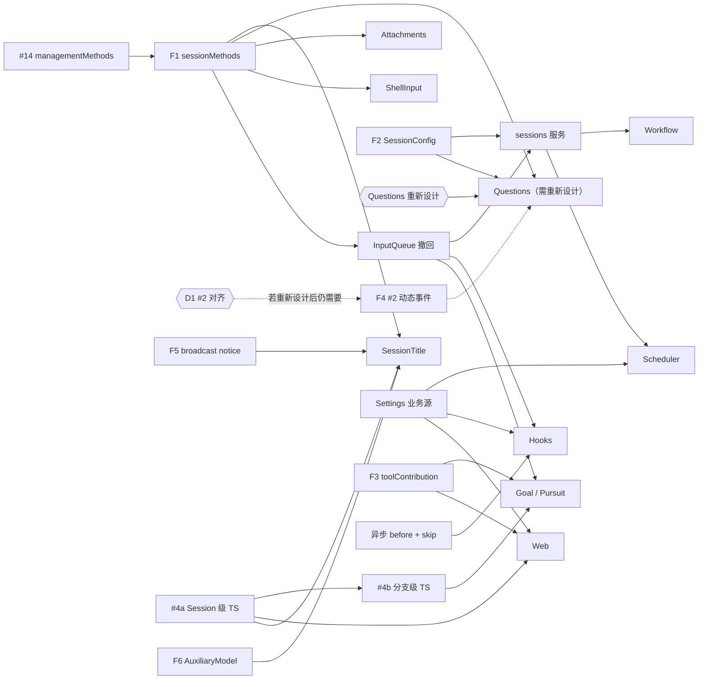

# 开发计划与优先级

Status: Draft. 依据：[总体设计](overview.md) §8 阶段与附录 B/F、[插件设计索引](plugins/README.md)、[ADR 001](../adr/001-harness-foundation.md) 实现状态。基线：`main` @ `3c0c346`（2026-10-15）。

本文只排顺序、依赖和优先级，不重复设计内容。设计文档仍是权威；本文与设计冲突时以设计为准，并回来更新本文。

## 1. 现状

总体设计 P0–P3 几乎全部未实现。已有、可直接扩展的基础：

| 已有 | 位置 | 对应设计项 |
| --- | --- | --- |
| 同步 `Timeline::before`（只能改 draft，不能追加事件，无 timeout/cancel_on） | `dim-agent-runtime/src/core/timeline.rs` | 异步 before 回调 |
| `ToolContribution` / `SessionToolSource`，仅静态注册 | `dim-agent-capabilities/src/tool_registry.rs` | `toolContribution` 按名收集 |
| `history(branch, through)` | `dim-agent-runtime/src/agent.rs` | fixed-prefix 读 |
| `PluginFilesPlugin`（UTF-8、锁） | `dim-app-server/src/plugin_files.rs` | `pluginFiles` 扩展 |
| Settings `subscribe()`，仅 MCP/Skills 源 | `dim-app-server/src/settings.rs` | 业务源 + 变更通知 |
| 自动压缩事实；生产压缩宿主仍是 `ContextModelHost(None)` | `context_preparation.rs`、`main.rs` | 生产压缩宿主 |

进行中的 PR：

| PR | 内容 | 对计划的影响 |
| --- | --- | --- |
| [#14](https://github.com/arcships/dim/pull/14)（Draft） | Session 持有 MCP；`ManagementMethods` 由业务 owner 提供，Rpc 用 `Contributions` 收集；`SessionLifecycle` | 完成 `managementMethods` 的 Rust 部分，是 F1 的前置 |
| [#16](https://github.com/arcships/dim/pull/16) | 移除 `mcp.approve`/`mcp.revoke`（ADR 003） | 还缺 ADR 003 D3：项目源条目默认禁用 |
| [#17](https://github.com/arcships/dim/pull/17) | 实验性 Pursuit 设计（Goal 的替代方案） | 影响 P2 的 Goal 排期，见决策 D3 |

## 2. 排期原则

1. **基础项跟随第一个消费者落地。** 总体设计 P0 有十几个基础项，全部做完再做插件，会推迟所有可见功能，而且契约在没有真实消费者验证前就被冻结。改为：每个基础项与第一个用到它的插件放在同一里程碑，基础项先合入、插件紧随其后。仍满足总体设计 §8 "前置项早于消费者"。
2. **按关键路径排，不按阶段号排。** 阶段号（P1/P2/P3）表示产品优先级；同一里程碑内按依赖解锁的数量排序。
3. **TypeScript first 的插件尽早用 TypeScript 开发，#4 提前。** 用 TypeScript 写，是为了在业务规则还没验证时缩短验证和迭代周期（总体设计附录 C）；开发中设计会变，这些插件最需要快速试错。所以按名访问运行时服务的 [#4](https://github.com/arcships/dim/issues/4) 是基础项，放进 M1 并行轨道，分两段：#4a Session 级（M1，SessionTitle 试点），#4b 分支级（M3，Goal 用）。安全边界、准入、before 回调、输入和 Session 方法边界仍用 Rust（Questions、ShellInput、Attachments、Hooks）。规则稳定后若迁到 Rust，契约、事件名、方法名、存储格式不变，只换 loader 行。
4. **远期设计晚绑定。** 只细化当前和下一个里程碑的设计；更远的设计保持 Draft，等前置机制落地后再细化，避免反复返工。
5. **每个里程碑预留 20–30% 容量**给设计细化、契约调整和返工（见 §5）。里程碑结束时重排下一个里程碑。

## 3. 里程碑

规模：S（几天）、M（1–2 周）、L（数周或需要 spike）。"设计"列指开工前要做的设计细化（§5.2）。

### M0 收尾与对齐（立即）

| 项 | 规模 | 说明 |
| --- | --- | --- |
| 合入 #16，补 ADR 003 D3（项目源默认禁用） | S | 解除总体设计 §6.4 的遗留项 |
| 合入 #14 | M | `managementMethods` Rust 部分、`SessionLifecycle` |
| 决定 Goal / Pursuit（D3） | S | 只决定 P2 做哪个，不阻塞 M1 |
| #2 上下文边界对齐（D1） | S | ADR 001 与 #2 的分歧；#2 目前唯一的消费者 Questions 需要重新设计 |
| 为附录 F 中 "To be opened" 的需求开 issue | S | 异步 before、fixed-prefix 读、调用方来源、assembly 按 `provides` 收集、keyed 服务查找、drain 卸载、跨语言进程事件、call-scoped 请求、broadcast notice |

### M1 Session 边界 + 第一批 P1 交互

目标：用户能在 CLI 里用 `!command`、撤回排队消息、贴大段文本，长会话能手动/自动压缩。

| 顺序 | 项 | 类型 | 依赖 | 解锁 | 规模 | 设计 |
| --- | --- | --- | --- | --- | --- | --- |
| 1 | F1 `sessionMethods`：Session facade 按 namespace 查找，Rpc 经 Session 分发 | 基础 | #14 | 几乎所有 P1/P2 插件、InputQueue 撤回 | M | [session-boundary](contracts/session-boundary.md) A.1 复核 |
| 2 | F2 `SessionConfig` 的 `interactive`/`createdBy`/`resourceNode`（仅控制节点）+ `session.create` 参数；assembly 按 `interactive` 安装可选部件 | 基础 | — | Questions、SessionTitle、Notifications、Scheduler | M | [session-access](contracts/session-access.md) |
| 3 | InputQueue 撤回：`input/withdraw`、`input/deleted`、`session.input.withdraw` | 扩展 | F1 | `Ctrl+S`、`/queue`；Hooks、Scheduler | M | 事件声明方式取决于 D1 |
| 4 | F7 HostPlatform argv helper；F9 Agents Session 活动句柄 | 基础 | — | ShellInput、Hooks | S | — |
| 5 | ShellInput | 插件 | F1、F7、F9 | — | M | 是 |
| 6 | F8 FileStorage 列目录/删除；SessionStore Session 文件 | 基础 | — | Attachments、删除与 fork | M | — |
| 7 | Attachments；ModelProvider 图片能力处理（从 Rpc 移出） | 插件 + 扩展 | F1、F8 | — | S | 是 |
| 8 | 生产压缩宿主、`/compact`、用量查询 | 扩展 | F6（可先用当前模型） | 长会话可用性 | M | ContextPreparation 页 |
| 并行 | F3 `toolContribution` 按名收集（Rust 侧） | 基础 | — | Web、Goal、Notifications | S | — |
| 并行 | #4a Session 级 TS 部件：从 TS 提供 `toolContribution`、`sessionMethods`，按名订阅 Session broadcast、调用 Session 级 typed 服务；TS 部件随 Session 装配和卸载 | 基础 | F1、F3 | SessionTitle、Web、Notifications 及 Scheduler/Workflow 的 Session 部件 | L（先 spike） | [session-access](contracts/session-access.md) §9 |

### M2 其余 P1

| 顺序 | 项 | 类型 | 依赖 | 规模 | 设计 |
| --- | --- | --- | --- | --- | --- |
| 1 | Questions 重新设计：模型从工具结果拿到回答；逐一论证 `question/*` 事件是否需要，以及是否还依赖 #2 | 设计 | — | M | 是（从头设计，不只是复核） |
| 2 | Questions 实现 | 插件 | F1、F2；是否需要 F4 由重新设计决定 | M | — |
| 视需要 | F4 #2 动态事件注册 + client-visible 标志；Connection 转发 | 基础 | D1；只在有消费者需要时做 | L（先 spike） | 是 |
| 3 | F5 Session broadcast notice；SessionStore 标题元数据 + `setTitle` | 基础 | — | M | — |
| 4 | F6 Provider purpose 策略 + `AuxiliaryModel` | 基础 | — | M | — |
| 5 | SessionTitle（TypeScript，#4a 的端到端试点） | 插件 | F1、F2、F5、F6、#4a | S | 是 |
| 6 | SessionStore 删除、清理、fork（fork 重置权限预设） | 扩展 | F8 | M | — |
| 7 | Permission 命令规则；模型参数 effort/fast；`/agent` 切换 | 扩展 | — | M | — |
| 8 | CLI：子命令、图片转换、`/export`、`exec --json` | CLI | 各 owner 的 RPC | M | — |
| 独立轨道 | HostPlatform OS 隔离（seatbelt / landlock 或 bwrap） | 扩展 | — | L（先 spike） | 是 |

### M3 P2 基础

| 顺序 | 项 | 依赖 | 解锁 | 规模 |
| --- | --- | --- | --- | --- |
| 1 | Settings 每插件业务源、typed 写、凭据引用解析 | — | Web、Notifications、Hooks、Scheduler、Workflow、Goal 上限 | M |
| 2 | Permission 类别 `outbound_message`、`persistent_configuration` | — | Notifications、Scheduler | S |
| 3 | 异步 Timeline before 回调（fallback draft、`timeout`、`cancel_on`，append 接受即返回）+ `step/tool-call` 的 `skip` 与 ToolExecutor 处理 | M0 开的 issue | Hooks | L（先 spike） |
| 4 | Agents `sessions` 服务（`launch` 带上限策略、`input`、`idle`、`withdraw`…）；调用方来源 | F2、InputQueue 撤回 | Scheduler、Workflow、fork | L |
| 5 | `pluginFiles` 扩展（二进制、格式版本） | — | Scheduler、Workflow 及 P3 | S |
| 6 | #4b 分支级 TS 部件：按名使用 `Dispatcher` 订阅、`Branch::input`、`TreeCommands`；owned work 的注册 | #4a | Goal 的分支部件 | M |

### M4 P2 插件

| 顺序 | 插件 | 依赖 | 理由 |
| --- | --- | --- | --- |
| 1 | Web（TypeScript） | #4a、Settings 源 | 依赖最少、价值高 |
| 2 | Goal 或 Pursuit（D3，TypeScript） | F1、#4b、InputQueue 撤回（`input/deleted`） | 用户需求明确，规则最需要迭代 |
| 3 | Hooks（用户和项目源） | 异步 before、`skip`、撤回、argv helper、Settings 源 | 运行时改动最大，放在 spike 之后 |
| 4 | Scheduler | `sessions`、Settings、`pluginFiles`、Permission 类别 | — |
| 5 | Workflow | `sessions`、Settings、`pluginFiles` | 与 Scheduler 共享 `sessions` 经验 |
| 6 | Notifications | Settings、凭据、broadcast；可选 Scheduler 通知 | 外部渠道，失败只影响自身 |
| 并行 | ModelProvider `ModelCallScope`、模型调用审批；Collaboration 成员审批转给 leader；Transport `EntryHost`；MCP OAuth | — | ExternalAgent、RemoteGateway 的前置 |

### M5 P3 外部集成

顺序：ExternalAgent + AcpGateway → #3 PluginManager → #5 资源节点 + RemoteGateway → Modality。开工前统一做一次设计细化，因为这些设计依赖的机制在 M1–M4 中可能已经变化。

## 4. 关键路径

Questions 需要重新设计，是否依赖 #2 待定，所以 #2 暂时不在关键路径上。最长链：#14 → F1 → InputQueue 撤回 → `sessions` → Scheduler/Workflow；风险最高的链：#4a → 所有 TypeScript 插件，以及异步 before → Hooks。两条高风险链都先做 spike，不阻塞其它工作。#4a 越早可用，TypeScript 插件越早进入快速迭代。

## 5. 设计变更空间

开发中一定会出现插件设计的细化和变更。以下流程让变更有固定入口，不打断排期。

### 5.1 设计状态

| 状态 | 含义 | 何时进入 |
| --- | --- | --- |
| Draft | 当前所有插件设计 | — |
| Ready | 已按代码现状复核，开放问题已决定或明确推迟，维护者已确认 | 该项开工前的设计细化 PR 合入 |
| Implemented | 代码与设计一致；能力页移入或链接到 `architecture/rust-agent/plugins/`，由 `xtask check` 校验 | 实现 PR 合入 |

只有 Ready 的设计可以开工。远期设计保持 Draft，不提前打磨。

### 5.2 开工前的设计细化

每个标了"设计"的项，先提一个只改文档的小 PR：

1. 按当前代码复核依赖：前置项是否已按设计落地；落地时有偏差的，以代码和已合入契约为准。
2. 决定或推迟附录里的开放问题，推迟的写明不影响本次实现的理由。
3. 列出需要改的共享契约（[session-boundary](contracts/session-boundary.md)、[session-access](contracts/session-access.md)、总体设计附录 B/F），一起改。
4. 重新回答"Rule check"中受影响的行。
5. 维护者确认后合入，状态改为 Ready。

### 5.3 实现中发现的变更

- **只影响本插件**：在实现 PR 里同步改设计文档，PR 描述单列"设计变更"一节。
- **影响共享契约或其它插件**：先停在该点，提契约变更 PR（列出受影响的插件文档），确认后再继续（AGENTS.md："需求与设计冲突时先更新文档并确认"）。其它插件的文档只追加影响说明，不连带细化。
- **向机制 owner 提的新需求**：按设计规则 §4 rule 8 写五项，加到总体设计附录 F，并开 issue。
- **中文译文**：`docs/zh/` 在里程碑结束时统一同步，不要求每个 PR 同步。

### 5.4 容量与重排

- 每个里程碑预留 20–30% 容量给 5.2/5.3 的工作。L 级基础项（#2、异步 before、`sessions`、OS 隔离）先做 spike，spike 结论可能改变设计和本文顺序。
- 里程碑结束时回顾：更新 §1 现状和 §3 后续里程碑；把超出预留的设计变更记为新项排入。

## 6. 待决策

| # | 问题 | 建议 | 影响 |
| --- | --- | --- | --- |
| D1 | #2 的上下文边界：ADR 001（只看 adopted input 和工具结果）vs #2（注册投影规则） | 按 ADR 001 推进，与总体设计一致；投影规则以后作为增量 | F4 的开工时间（若 Questions 重新设计后不再需要 #2，D1 可以推迟） |
| D2 | #4 是否提前，并按 Session 级（#4a）和分支级（#4b）分段交付 | 是（§2 原则 3）；SessionTitle 作为 #4a 试点 | TypeScript 插件何时能进入快速迭代 |
| D3 | Goal 与 Pursuit | M4 前决定；两者互斥，只实现一个，另一个保留为实验设计 | M4 顺序 2 |
| D4 | 基础项跟随消费者，而不是先做完整个 P0 | 是（§2 原则 1） | 整体顺序 |
