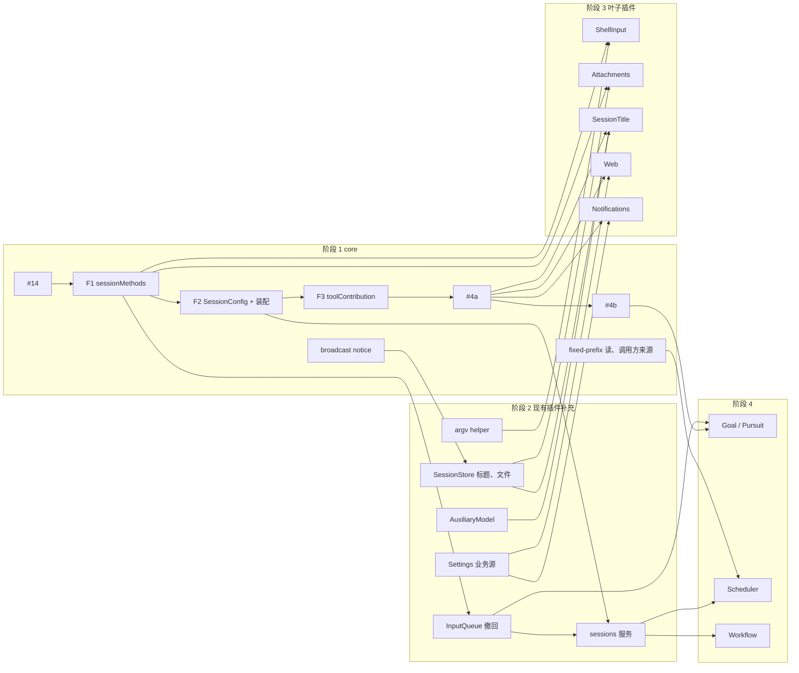

# 开发计划与优先级

Status: Draft. 依据：[总体设计](overview.md) §8 阶段与附录 B/F、[插件设计索引](plugins/README.md)、[ADR 001](../adr/001-harness-foundation.md) 实现状态。基线：`main` @ `3c0c346`（2026-10-15）。

本文只排顺序、依赖和优先级，不重复设计内容。设计文档仍是权威；本文与设计冲突时以设计为准，并回来更新本文。

## 1. 现状

总体设计 P0–P3 几乎全部未实现。已有、可直接扩展的基础：

| 已有 | 位置 | 对应设计项 |
| --- | --- | --- |
| 同步 `Timeline::before`（只能改 draft，不能追加事件，无 timeout/cancel_on） | `dim-agent-runtime/src/core/timeline.rs` | 不变（异步 before 已撤回，#21） |
| `ToolContribution` / `SessionToolSource`，仅静态注册 | `dim-agent-capabilities/src/tool_registry.rs` | `toolContribution` 按名收集 |
| `history(branch, through)` | `dim-agent-runtime/src/agent.rs` | fixed-prefix 读 |
| `PluginFilesPlugin`（UTF-8、锁） | `dim-app-server/src/plugin_files.rs` | `pluginFiles` 扩展 |
| Settings `subscribe()`，仅 MCP/Skills 源 | `dim-app-server/src/settings.rs` | 业务源 + 变更通知 |
| 自动压缩事实；生产压缩宿主仍是 `ContextModelHost(None)` | `context_preparation.rs`、`main.rs` | 生产压缩宿主 |

进行中的 PR：

| PR | 内容 | 对计划的影响 |
| --- | --- | --- |
| [#14](https://github.com/arcships/dim/pull/14)（Draft） | Session 持有 MCP；`ManagementMethods` 由业务 owner 提供，Rpc 用 `Contributions` 收集；`SessionLifecycle` | 完成 `managementMethods` 的 Rust 部分，是 F1 的前置 |
| [#16](https://github.com/arcships/dim/pull/16) | 移除 `mcp.approve`/`mcp.revoke`（ADR 003） | 还缺 ADR 003 D3：项目源条目默认禁用 |
| [#17](https://github.com/arcships/dim/pull/17) | 实验性 Pursuit 设计（Goal 的替代方案） | 影响 P2 的 Goal 排期，见决策 D3 |

## 2. 排期原则

1. **core 先改完，再做插件。** 装配代码、Rpc、Timeline 和 Session facade 是所有插件都要改的地方，并行改一定冲突。先依次把这些 core 机制做完；之后插件按 [ADR 002](../adr/002-plugin-scope.md) 只通过已有机制接入，基本只改自己的 crate，可以大面积并行，插件设计的变更也只影响它自己。
2. **被依赖的先做，不依赖别人的插件先做。** core 之后先做其它插件依赖的现有插件补充（阶段 2），再做不依赖其它插件的插件（阶段 3），最后做依赖阶段 2 的插件（阶段 4）。阶段号（P1/P2/P3）只表示产品优先级，同一阶段内按它解锁的消费者数量排序。
3. **core 项要等消费者的设计通过复核。** 每个 core 项至少要有一个用它的插件设计已经是 Ready（§5.1），才能开工；暂时没有 Ready 消费者的 core 项推迟。反例是 Questions：按原设计先做 #2，现在就白做了。所以阶段 0 先集中复核 P1/P2 插件设计。
4. **core 只做到 P2。** 阶段 1、2 只做 P1/P2 插件需要的机制；P3 的设计离得远、变数大，到阶段 5 再开一轮 core。
5. **TypeScript first 的插件用 TypeScript 开发，#4 放进 core。** 用 TypeScript 写，是为了在业务规则还没验证时缩短验证和迭代周期（总体设计附录 C）。所以按名访问运行时服务的 [#4](https://github.com/arcships/dim/issues/4) 是阶段 1 的 core 项，分两段：#4a Session 级（SessionTitle、Web、Notifications 用），#4b 分支级（Goal 用）。安全边界、准入、before 回调、输入和 Session 方法边界仍用 Rust（Questions、ShellInput、Attachments）。规则稳定后若迁到 Rust，契约、事件名、方法名、存储格式不变，只换 loader 行。
6. **远期设计晚绑定。** 只细化当前和下一个阶段的设计；更远的设计保持 Draft，等前置机制落地后再细化。

代价：阶段 1、2 完成前几乎没有可交付的新插件，第一个用户可见的功能会来得更晚。换来的是阶段 3、4 可以高度并行，返工更少。

## 3. 阶段

规模：S（几天）、M（1–2 周）、L（数周或需要 spike）。"消费者"列是该项的复核门槛：其中至少一个设计 Ready 才开工。

### 阶段 0 收尾与设计复核（立即，只改文档的部分可与阶段 1 并行）

| 项 | 规模 | 说明 |
| --- | --- | --- |
| 合入 #14，再合入 #16 并补 ADR 003 D3（项目源默认禁用） | M | 两个 PR 都改 MCP，先合改动大的 #14 |
| P1/P2 插件设计复核：ShellInput、Attachments、SessionTitle、Web、Notifications、Scheduler、Workflow | M | 按 §5.2 逐个改为 Ready；只改文档，可以并行，但契约文档由一个人统一修改 |
| Questions 重新设计 | M | 从头设计：模型从工具结果拿到回答；逐一论证 `question/*` 事件是否需要，以及是否还依赖 #2 |
| Hooks 待设计 | M | Hooks 是兼容第三方插件机制（Claude、Codex、pi 等）所需的横向机制，单独设计，不复用现有基础设施；异步 before 已撤回（#21）。设计完成前不排期 |
| 决定 Goal / Pursuit（D3），并复核选中的设计 | S | 决定 #4b 是否有消费者 |
| 为附录 F 中 "To be opened" 的需求开 issue | S | fixed-prefix 读、调用方来源、assembly 按 `provides` 收集、keyed 服务查找、drain 卸载、跨语言进程事件、broadcast notice |

### 阶段 1 core 机制

主线改的是同一批文件（`assembly.rs`、App Server `lib.rs`、Rpc 的 `connection.rs`/`protocol.rs`、runtime `config.rs`），依次做；支线改 runtime 里其它文件，可以与主线并行。

| 顺序 | 项 | 消费者（门槛） | 规模 |
| --- | --- | --- | --- |
| 主线 1 | F1 `sessionMethods`：Session facade 按 namespace 查找 keyed 服务，Rpc 经 Session 分发；方法提供者卸载等 drain 调用完成 | ShellInput、Attachments、SessionTitle、InputQueue 撤回 | M |
| 主线 2 | F2 `SessionConfig` 的 `interactive`/`createdBy`/`resourceNode`（仅控制节点）+ `session.create` 参数；Agent assembly 按 `provides` 收集命名服务，按启用插件和 `interactive` 安装可选部件 | SessionTitle、Notifications、Scheduler | M |
| 主线 3 | F3 `toolContribution` 按名收集 | Web、Goal、Notifications | S |
| 主线 4 | #4a Session 级 TypeScript 部件：从 TypeScript 提供 `toolContribution`、`sessionMethods`，按名订阅 Session broadcast、调用 Session 级 typed 服务，随 Session 装配和卸载 | SessionTitle、Web、Notifications | L（先 spike，spike 可以提前单独做） |
| 主线 5 | #4b 分支级 TypeScript 部件：按名使用 `Dispatcher` 订阅、`Branch::input`、`TreeCommands`，owned work 注册 | Goal 或 Pursuit | M |
| 支线 | Session broadcast notice 记录 `{source, kind, data}`；Rpc 原样转发 | SessionTitle | S |
| 支线 | fixed-prefix 历史读；调用方来源由调用插件身份固定 | Notifications、Scheduler、Workflow | S |
| 支线 | 跨语言命名进程事件（rutis） | Scheduler、Notifications；阶段 4 Scheduler 之前完成即可 | M |
| 推迟 | #2 动态事件注册 | 目前没有 Ready 消费者，等 Questions 重新设计的结论 | L |

### 阶段 2 被依赖的现有插件补充

按 owner 分开，彼此改不同的文件，可以并行。

| 项 | 依赖 | 被谁依赖 | 规模 |
| --- | --- | --- | --- |
| InputQueue 撤回：`input/withdraw`、`input/deleted`、`session.input.withdraw` | F1 | Goal、`sessions`、`Ctrl+S`/`/queue` | M |
| Agents `sessions` 服务（`launch` 带上限策略、`input`、`idle`、`withdraw`…）+ Session 活动句柄 | F2、InputQueue 撤回 | Scheduler、Workflow、ShellInput（活动句柄） | L |
| Provider purpose 策略 + `AuxiliaryModel` | — | SessionTitle、生产压缩宿主 | M |
| SessionStore：标题元数据 + `setTitle` 与 notice；Session 文件 | broadcast notice、FileStorage | SessionTitle、Attachments | M |
| FileStorage 列目录、删除 | — | Session 文件、清理 | S |
| HostPlatform argv helper | — | ShellInput | S |
| Settings 每插件业务源、typed 写、凭据引用解析 | — | Web、Notifications、Scheduler、Workflow、Goal | M |
| Permission 类别 `outbound_message`、`persistent_configuration` | — | Notifications、Scheduler | S |
| `pluginFiles` 扩展（二进制、格式版本） | — | Scheduler、Workflow | S |
| ModelProvider 处理图片能力（从 Rpc 移出） | — | Attachments | S |

### 阶段 3 不依赖其它插件的插件（全部并行）

| 项 | 用到的 core / 阶段 2 项 | 语言 |
| --- | --- | --- |
| ShellInput | F1、argv helper、活动句柄 | Rust |
| Attachments | F1、Session 文件、图片处理 | Rust |
| SessionTitle | F1、F2、#4a、notice、`AuxiliaryModel`、`setTitle` | TypeScript |
| Web | F3、#4a、Settings 源 | TypeScript |
| Notifications | F2、F3、#4a、Settings 源、凭据、Permission 类别；Scheduler 通知在阶段 4 前不触发 | TypeScript |
| Questions（重新设计 Ready 后） | 由重新设计决定 | Rust |

同时可以并行做的现有插件功能（不被其它插件依赖）：生产压缩宿主、`/compact`、用量查询；SessionStore 删除、清理、fork；Permission 命令规则；模型参数 effort/fast、`/agent`；MCP OAuth；HostPlatform OS 隔离（L，先 spike）；CLI 子命令、图片转换、`/export`、`exec --json`。

### 阶段 4 依赖阶段 2 的插件（全部并行）

| 插件 | 依赖 | 语言 |
| --- | --- | --- |
| Goal 或 Pursuit（D3） | #4b、InputQueue 撤回 | TypeScript |
| Scheduler | `sessions`、Settings 源、`pluginFiles`、Permission 类别、跨语言进程事件 | TypeScript |
| Workflow | `sessions`、Settings 源、`pluginFiles` | TypeScript |

Scheduler 和 Workflow 可以并行，但都要接入 `sessions`，建议同一个人先后做。

### 阶段 5 P3

先开第二轮 core：#3 loader editable layer 的 typed 操作、#5 rutis link（断线时导入服务保持注册并逐次失败）、`ConnectionEntry {name, deviceId}` 与 Transport `EntryHost`、ModelProvider `ModelCallScope` 与 `approval_ask`、Approval 的 host-source 准入、Collaboration 成员审批转给 leader、call-scoped 请求。开工前同样集中复核 P3 设计。之后 ExternalAgent + AcpGateway、PluginManager、RemoteGateway、Modality 四组基本互不依赖，可以并行。

### 并发规则

- 阶段 1 主线依次合入；支线和阶段 2、3、4 的各项按 owner 分开并行。
- `docs/architecture/rust-agent/generated/` 下的生成文件不手工解冲突：rebase 后重跑 `xtask graph`。
- 存储格式（native 存储，当前 v13）的改动依次做，每次单独做格式决策；SessionStore 的标题、Session 文件、fork 由同一人负责排序。
- 不给还没落地的接口打桩，等接口合入再开工。
- 同时进行的工作数不超过维护者能确认的设计 PR 和实现 PR 数量。

## 4. 依赖图

关键路径是阶段 1 主线：#14 → F1 → F2 → F3 → #4a。#4a 是唯一的 L 级主线项，它的 spike 应在阶段 0 就单独开始。阶段 2 里最长的是 InputQueue 撤回 → `sessions`，它挡住 Scheduler 和 Workflow。风险最高的是 #4a，先做 spike。Questions 需要重新设计，#2 暂时不在任何路径上。

## 5. 设计变更空间

开发中一定会出现插件设计的细化和变更。以下流程让变更有固定入口，不打断排期。

### 5.1 设计状态

| 状态 | 含义 | 何时进入 |
| --- | --- | --- |
| Draft | 当前插件设计（Questions 除外，它需要重新设计） | — |
| Ready | 已按代码现状复核，开放问题已决定或明确推迟，维护者已确认 | 该项开工前的设计细化 PR 合入 |
| Implemented | 代码与设计一致；能力页移入或链接到 `architecture/rust-agent/plugins/`，由 `xtask check` 校验 | 实现 PR 合入 |

只有 Ready 的设计可以开工。远期设计保持 Draft，不提前打磨。

### 5.2 开工前的设计细化

每个标了"设计"的项，先提一个只改文档的小 PR：

1. 按当前代码复核依赖：前置项是否已按设计落地；落地时有偏差的，以代码和已合入契约为准。
2. 决定或推迟附录里的开放问题，推迟的写明不影响本次实现的理由。
3. 列出需要改的共享契约（[session-boundary](contracts/session-boundary.md)、[session-access](contracts/session-access.md)、总体设计附录 B/F），一起改。
4. 重新回答"Rule check"中受影响的行。
5. 维护者确认后合入，状态改为 Ready。

### 5.3 实现中发现的变更

- **只影响本插件**：在实现 PR 里同步改设计文档，PR 描述单列"设计变更"一节。
- **影响共享契约或其它插件**：先停在该点，提契约变更 PR（列出受影响的插件文档），确认后再继续（AGENTS.md："需求与设计冲突时先更新文档并确认"）。其它插件的文档只追加影响说明，不连带细化。
- **向机制 owner 提的新需求**：按设计规则 §4 rule 8 写五项，加到总体设计附录 F，并开 issue。
- **阶段 1 之后的 core 回改**：插件开发中发现 core 缺东西时，插件不自己改 core。需求交给一个负责 core 的人，攒成一批统一改，按阶段 1 主线的方式依次合入。
- **中文译文**：`docs/zh/` 在阶段结束时统一同步，不要求每个 PR 同步。

### 5.4 容量与重排

- 每个阶段预留 20–30% 容量给 5.2/5.3 的工作。L 级项（#4a、`sessions`、OS 隔离）先做 spike，spike 结论可能改变设计和本文顺序。
- 阶段结束时回顾：更新 §1 现状和 §3 后续阶段；把超出预留的设计变更记为新项排入。

## 6. 待决策

| # | 问题 | 建议 | 影响 |
| --- | --- | --- | --- |
| D1 | #2 的上下文边界 | 已决定：插件事件只通过 adopted input 和工具结果进入上下文（ADR 001）；#2 正文已于 2026-10-15 修订为同一口径 | #2 只剩运行时注册事件类型、写入时检查类型已注册 |
| D2 | #4 是否放进阶段 1 core，并按 Session 级（#4a）和分支级（#4b）分段交付 | 是（§2 原则 5） | TypeScript 插件何时能进入快速迭代 |
| D3 | Goal 与 Pursuit | 阶段 0 决定；两者互斥，只实现一个，另一个保留为实验设计 | #4b 是否有消费者；阶段 4 |
| D4 | core 先改完再做插件，还是基础项跟随第一个消费者 | 已决定：core 先行（§2 原则 1），以消费者设计 Ready 为门槛（原则 3） | 整体顺序 |
