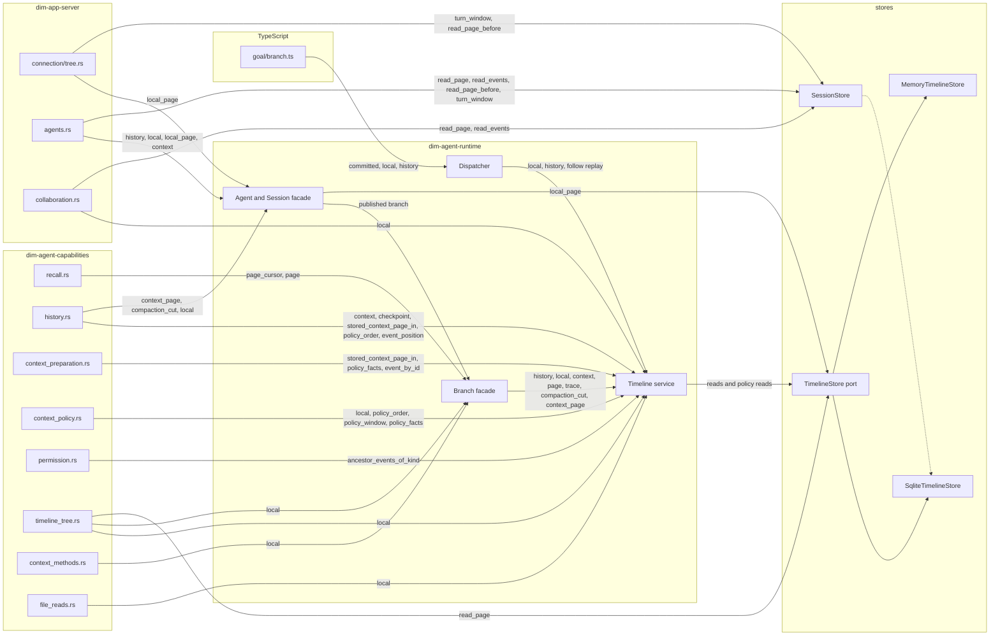

# Timeline read entries

Status: Proposed. Scope: every way a part, the App Server or a TypeScript plugin reads events from a Timeline, which of them the event query ([ADR 019](../adr/019-event-query.md), [plugin contract §5.4](plugin-contract.md#54-the-event-query)) replaces, and what is left. This document holds an audit, not a decision; the questions in §4 need an owner's answer. Language: English.

Base: `origin/main` at `514225777`. Call sites exclude tests and examples. Every row below was read from source, not carried over from an earlier plan.

## 1. The entries

### 1.1 `Timeline` service (`crates/dim-agent-runtime/src/core/timeline.rs`)

| Read | Defined | Production call sites |
| --- | --- | --- |
| `history(through)` | :727 | `dispatcher.rs:269`, `branch.rs:128`, `agent.rs:548` |
| `query(query)` | :756 | none |
| `page_cursor` / `page` | :822 / :835 | `recall.rs:184`, `:187`, `:208` through `branch.rs:133`, `:144` |
| `local(range)` | :898 | 16 sites, see §1.5 |
| `stored_page` | :921 | none |
| `stored_local` | :1071 | none |
| `ancestor_events_of_kind` | :955 | `permission.rs:525` |
| `event_by_id` | :972 | `context_preparation.rs:682`, `timeline.rs:973`, `:990` |
| `event_position` | :978 | `history.rs:163`, `:338`, `context_policy.rs:435`, `timeline.rs:1017` |
| `compaction_cut` | :1007 | `history.rs:989`, `:990` through `branch.rs:172`, `agent.rs:529` |
| `stored_context_page` / `_in` | :1050 / :1026 | `history.rs:1001`, `:204`, `:320`, `context_preparation.rs:648`, `branch.rs:185` |
| `context` | :1099 | `history.rs:246`, `:267`, `:440`, `branch.rs:166`, `agent.rs:525`, `agents.rs:1446` |
| `context_with_checkpoint` | :1322 | `history.rs:243`, `:262` |
| `checkpoint` | :1258 | `history.rs:178`, `:292`, `timeline.rs:1328` |
| `policy_facts` | :1104 | `context_policy.rs:1145`, `context_preparation.rs:550`, `:782` |
| `policy_order` | :1140 | `context_policy.rs:511`, `:584`, `history.rs:289` |
| `policy_window` | :1196 | `context_policy.rs:1062` |
| `trace(sequence)` | :1401 | none; only the facades `branch.rs:190` and `agent.rs:660` reach it |

### 1.2 Same reads on other objects

`Branch` (`branch.rs`): `history` :126, `page_cursor` :132, `page` :138, `local` :146, `context` :164, `compaction_cut` :170, `context_page` :176, `trace` :188.
`Agent` (`agent.rs`): `context` :524, `compaction_cut` :528, `context_page` :532, `history` :543, `local` :550, `local_page` :562, `trace` :659.
Deleting a `Timeline` method alone leaves these reachable.

### 1.3 Dispatcher reads exported to TypeScript (`core/dispatcher.rs`)

`local(start, through)` :257 and `history(through)` :265 read to the *committed* position (`.d.ts` says "committed events"). Replay `follow` :171 reads `local(..=through)` at :194. The one TypeScript part that calls them is `runtime/plugins/goal/branch.ts`: `committed()` :104, `local` :105, :176 and :205, `history` :207. It injects `dispatcher`, not the Timeline service. `npm/branch-services.d.ts` declares the old reads and `query` side by side.

### 1.4 Reads that bypass the service

| Read | Defined | Callers |
| --- | --- | --- |
| `SessionStore::read_page` | `storage/timeline.rs:1258` | `collaboration.rs:1106`, `:2232`, `agents.rs:634` |
| `TimelineStore::read_page`, called by the TimelineTree part itself | `timeline_store.rs:229` | `timeline_tree.rs:425`, `:668` (also behind `TreeTimeline::page` :180) |
| `Agent::local_page` reads the store port directly | `agent.rs:562-585` | `agents.rs:677`, `:1007`, `connection/tree.rs:227`, `agents/sessions.rs:616` |
| `read_page_without_request_bodies` | :1271 | `agents.rs:634` |
| `read_page_before` | :1409 | `agents.rs:763`, `connection/tree.rs:209` |
| `read_events` | :1539 | `agents.rs:688`, `collaboration.rs:1151` |
| `turn_window` | :1304 | `agents.rs:746`, `connection/tree.rs:197` |

These contradict §5.4's "a part reads facts through its branch's `timeline` service".

### 1.5 `local` call sites

`timeline_context.rs:411`, `timeline.rs:309`, `dispatcher.rs:194` (replay), `:262`, `branch.rs:162`, `agent.rs:555`, `collaboration.rs:1080`, `:2726` (`..=committed()`, the collaboration rebuild), `agents.rs:1009`, `context_policy.rs:531`, `timeline_tree.rs:566`, `:2291` (the whole parent prefix, to find the first tool use), `context_methods.rs:81`, `history.rs:981` and `:983` (cut validation), `file_reads.rs:143`.

### 1.6 Store port (`timeline_store.rs`)

`head` :207, `read` :215, `read_page` :229, `event_by_id` :283, `read_context` :319, `read_kind_page` :373, `read_page_without_request_bodies` :437, `query` :464, `read_segments` :471, `policy_facts` :478, `policy_order` :591, `policy_window` :634, `trace` :694, `latest_snapshot` :710. The SQLite implementations are at `storage/timeline.rs:3507-4119`.

### 1.7 Dependency graph

Every edge was read from a call site in this audit. An edge label lists the reads that cross it; the arrow into the store port is summarised because the calls inside `timeline.rs` were only partly enumerated. The dashed edge is the shared storage code, not a call.

Two things the graph shows. The `Agent` facade reaches the store port without the Timeline service (`local_page`), and the TimelineTree part and the App Server reach a store without it as well, so deleting reads from `Timeline` alone leaves five other routes into the same rows.

## 2. What the query expresses

The request is scope, from_event or from_sequence, kinds, flags, event_id, one predicate, order_by, direction, limit and offset. Which of the reads in §1 it replaces has not been verified read by read; the plans on #963-#972 are the only source so far, and each migration re-checks its own reads before it starts.

## 3. What it does not express

| Need | Who | Why |
| --- | --- | --- |
| Read up to the *committed* position | Dispatcher replay, `goal/branch.ts`, the collaboration rebuild `collaboration.rs:2726` | the query clips at the published head |
| Whether a position ends an atomic batch | cut validation, `history.rs:981` | batch ends are storage rows, not event content |
| A chain start by branch and sequence | policy reads at an ancestor's cut, a checkpoint `resume` on an ancestor | `from_sequence` names the queried branch only |
| More than one equality | two reads in `agents.rs` | the predicate is one equality |

## 4. Questions for the owners

1. The published position and the committed position differ. Replay needs the second. Does replay stay on `local`, or does a part's rebuild stop needing it?
2. Does the cut validation need to know a batch end now that a page may end inside a batch?
3. Does the checkpoint store the resume event id so a chain read can start by `from_event`?
4. The reads in §1.4 bypass the service. Which migration owns them?

## 5. Order of work

To be written once §4 is answered. #942 and #975 land first; reads with no dependency on §4 can move independently.
