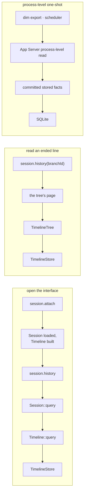

# Timeline read ownership

Status: Draft. Delivery status is tracked in the issue, not here.

Scope: Session and branch.
Issue: #1039.
Rules: [design rules](../architecture/rust-agent/principles.md), [ADR 002](../adr/002-plugin-scope.md), [ADR 021](../adr/021-reads-follow-the-state-owner.md).

## 1. Scope and non-goals

This document states who reads a line's facts, which object serves each read, and which dependencies are allowed. It covers the client history read, the ended line's page, the restore reads of `TimelineTree` and the process-level one-shot read.

It does not restate the query contract ([plugin contract §5.4](plugin-contract.md#54-the-event-query)), the page shape of the client protocol ([session history window](appserver/session-history-window.md)), or the storage layout ([request delta storage](appserver/request-delta-storage.md)). It adds no event, service, state or format change.

## 2. Owners and their reads

| Read | Served by | Reads |
| --- | --- | --- |
| A loaded line's facts | `Timeline::query`, the checkpoint selection, the segments | its own hot window and the store, to the published head, plus the branch's not-yet-published facts when the request asks for them |
| An ended line's page | `TimelineTree`, through the tree's service | the stored facts of a line whose `Timeline` is gone, at its fixed head |
| Branches and their metadata | the store port's branch listing and head | branch records, not events |
| A Session the process does not hold | the App Server's process-level read (ADR 021 D4) | committed stored facts only |
| Session files, titles, grants, fork, delete | `SessionStore` | not events |

A caller does not choose a read because it is cheaper; it reads through the object that owns the state. When that object does not exist, the read is one of the last two rows and says so.

## 3. Read paths



## 4. State and lifecycle

A branch's `Timeline` exists from the moment its Session is loaded until the line ends or the Session unloads. `session.attach` is what loads it, so a client that opens an interface to render messages and a timeline always reads a `Timeline`.

A line that ended keeps its identity in `TimelineTree`: the ended head, the end record and the creation source. That state outlives the line's `Timeline`, which is why the tree, not the App Server, serves its page.

A Session the process does not hold has no assembly and no `Timeline`. Nothing about its facts is in flight — every fact is committed and published — so a read of it is a read of stored facts and carries none of the Timeline's publication semantics.

## 5. Dependencies

Allowed:

| From | To |
| --- | --- |
| `Timeline` | `TimelineStore` |
| `TimelineTree` | `TimelineStore` |
| `TimelineTree` | `TimelineFactory` (branch creation) |
| `Branch`, `Session` | `Timeline` |
| App Server | runtime `Session`, the tree's services, `TimelineStore` as the implementation it registers |

Not allowed:

| From | To |
| --- | --- |
| a capability part other than `TimelineTree` | `TimelineStore` |
| `Session`, `Branch` | `TimelineStore` |
| App Server's client path | a method of `SqliteTimelineStore` that the port does not declare |
| any client | `Timeline`, `TimelineStore` |

## 6. Cross-module requirements

- **Runtime (TimelineStore owner):** the port gains the page read the App Server's process-level read needs — a cursor, a limit, an end bound, whether the page ends on a batch boundary, and the decode policy — and the lookup of a set of event ids. Until then the App Server's process-level read stays on its own storage implementation, and the client path does not use it.
- **App Server (session history owner):** `session.history` requires a loaded Session; the page for a Session the process does not hold moves to the process-level read. `idle-unload.md` acceptance 1 and 2 are rewritten to describe that read.
- **TimelineTree owner:** the restore reads of `branch/ended`, `branch/end`, `branch/create` and the creation check move to the port's query, so the tree reads selections instead of ranges.

## 7. Rule check

- §4 rule 2 (facts and handlers): this document adds no behavior and no handler; it changes which object serves an existing read.
- §4 rule 4 (state belongs to the part that owns it): the read surface follows the owner. The Timeline owns a loaded line's facts, `TimelineTree` owns an ended line's state, and the App Server owns storage of Sessions it does not hold.
- §4 rule 9 (publication): the client path never reads a fact above the published head, and the process-level read sees only committed facts, which are published facts for a Session with no writer.
- §4 rule 10 (context path): no model context is involved.
- ADR 002 D1 (one owner per state): each row of section 2 names one owner.
- Other rules do not apply: this document adds no plugin, no event and no configuration.

## 8. Binding appendix

Current Rust spelling of the reads this document assigns:

```rust
// loaded line
Timeline::query(TimelineQuery) -> Result<TimelineQueryReply>
Session::query(...) / Branch::query(...)   // forward, published bound

// ended line
TreeCommands::page(id: String, after: u64, limit: u64) -> Result<Vec<Arc<AgentEvent>>>

// branches and metadata
TimelineStore::branches(session_id) -> Result<Vec<StoredBranch>>
TimelineStore::head(key) -> Result<u64>

// Session the process does not hold
AgentIndex::history_page(...) -> Result<Vec<Arc<AgentEvent>>>   // process-level, not the client protocol
```
