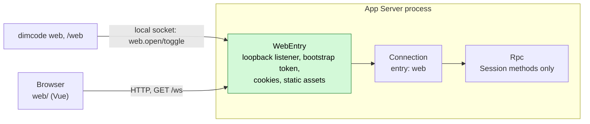

# Web workspace (phase 1)

Status: Accepted for phase 1. Related: [RemoteGateway](plugins/RemoteGateway.md) (the target design), [overview §6.3 multiple nodes](overview.md#63-multiple-nodes), [App Server README](../../crates/dim-app-server/README.md).

The Web workspace is a browser frontend for the App Server, started by `dimcode web` or toggled from `/web` in the TUI. It replaces the TypeScript `dim web` host (Bun server, RCP v2) with the existing App Server protocol v3. Phase 1 ships a **local web entry**: a loopback-only subset of RemoteGateway that does not wait for its prerequisites (PluginManager #3, rutis call-scoped requests #5, extended `pluginFiles`, Settings business sources). When RemoteGateway lands it absorbs this entry; the browser side does not change because it speaks the same Session methods either way.

## 1. Structure



| Part | Where | Purpose |
| --- | --- | --- |
| `WebEntry` | `crates/dim-app-server/src/web_entry.rs`, process scope | Owns the loopback listener, the bootstrap and access tokens (memory only), static assets and the `web.*` management methods |
| `Connection` change | `connection.rs` | A connection accepted by WebEntry carries `entry: Web`; Rpc serves it Session methods (including the execution Session methods, decision E3 of RemoteGateway) and never management methods or `daemon.shutdown` |
| `dimcode web` | `crates/dim-cli` | Holder client: calls `web.open` over the local socket and keeps the connection; no HTTP stack in the CLI |
| TUI `/web` | `crates/dim-cli` | Calls `web.toggle`; the daemon owns the on/off state, so the TUI stays open |
| Frontend | `web/` at the repository root | Vue 3 + Vite app ported from the TypeScript `packages/cli-web`, with its transport rewritten for protocol v3 |

## 2. Local web entry

### 2.1 Lifecycle

The daemon is shared and normally spawned with `--no-ws`, so the entry is opened at runtime by a management method on the local socket rather than by a daemon flag.

The entry has two independent reasons to stay open:

- the daemon-owned `enabled` switch, toggled by the TUI;
- connected holders, such as a foreground `dimcode web`.

It is open while either reason exists and closes only when both are gone. The switch is memory-only and starts off after a daemon restart. `dimcode web` remains a holder: its exit releases that holder, while the TUI switch survives.

| Method | Params | Result |
| --- | --- | --- |
| `web.open` | `{port?}` | `{url, address}`; adds the calling connection as a holder and is idempotent. `url` is `http://127.0.0.1:<port>/#bootstrap=<token>` |
| `web.toggle` | `{port?}` | `{enabled, open, url?, address?}`; flips the daemon switch. Enabling starts the entry; disabling leaves it open if a holder remains. `url` is present while open |
| `web.disable` | `{}` | `{enabled, open, address?, connections}`; used by `dimcode web --off`; it clears the switch but does not disconnect holders |
| `web.status` | `{}` | `{enabled, open, address?, connections}` |

All are management methods (local transport only, protocol v3). Without `port` the entry binds the first free port from 43201 upward; an explicit `port` that is taken fails with `address_in_use`. A local connection that calls `web.open` holds the entry; the TUI switch does not need a holder. When the last reason disappears the listener stops, every token is dropped and web connections detach. Nothing is persisted, so after a daemon restart the entry is off; `dimcode web` opens it again or `/web` enables it. `web.open`/`web.toggle` fail with `web_assets_missing` when the binary was built without the frontend or the override directory has no build (§2.4).

### 2.2 Authentication

| Item | Rule |
| --- | --- |
| Bootstrap token | 32 random bytes, base64url, generated when the entry opens, valid until it closes; delivered only in the URL fragment, so it never reaches server logs or `Referer` |
| Exchange | `POST /api/auth/exchange {token}` → 204 and `Set-Cookie: dim_web=<access>; HttpOnly; SameSite=Strict; Path=/`. The bootstrap token can be exchanged more than once (several tabs) |
| Access token | 32 random bytes per exchange, held as SHA-256 hashes in memory, compared in constant time; dropped when the entry closes |
| Throttle | 5 failed exchanges free, then exponential backoff up to 60 s per entry → 429 with `Retry-After` |
| Origin and Host | Every `POST` and the `/ws` upgrade require `Origin` equal to `http://<Host>`, and `Host` must be the bound address (`127.0.0.1:<port>` or `localhost:<port>`), which blocks DNS rebinding |
| Bind | Loopback only in phase 1. No `Secure` cookie flag because the entry is plaintext loopback |

Tokens never appear in logs, diagnostics, the Timeline or protocol replies other than the `url` returned while opening or toggling the entry.

### 2.3 HTTP surface

| Path | Auth | Behavior |
| --- | --- | --- |
| `GET /api/health` | None | `{ok, serverVersion}` |
| `POST /api/auth/exchange` | Bootstrap token, Origin | §2.2 |
| `GET /api/auth/session` | Cookie | 204 while the cookie is valid, else 401; lets the page tell a revoked sign-in from an entry that is down |
| `POST /api/auth/logout` | Cookie, Origin | 204, clears the cookie and drops that access token |
| `GET /ws` | Cookie, Origin | WebSocket upgrade into an ordinary App Server connection (`entry: Web`), same framing and admission limits as the existing `/ws`; 401 without a valid cookie |
| other `/api/*` | — | 404 `{error:{code,message}}` |
| `GET /assets/*` | None | The frontend directory's files (confined to it; or, with `embedded-web`, the embedded build, gzip when the browser accepts it); `Cache-Control: max-age=31536000, immutable` |
| other `GET` | None | `index.html` (SPA fallback), `Cache-Control: no-store` |

Every response carries `Content-Security-Policy: default-src 'self'; style-src 'self' 'unsafe-inline'; img-src 'self' data: blob:; connect-src 'self'; frame-ancestors 'none'`, plus `X-Content-Type-Options: nosniff` and `Referrer-Policy: no-referrer`.

### 2.4 Assets

The frontend is a separate artifact, `dimcode-web`, not bytes in every `dimcode` executable. `scripts/stage-web.mjs` builds `web/` once per release (`npm ci`, `npm run build`, which runs `vue-tsc`), writes `web/dimcode-web.json` beside the build (`{version, protocolVersion, sourceCommit}`) and packs the same tree as a native archive `dimcode-web-VERSION.tar.gz` and an npm package `dimcode-web`, a platform-independent optional dependency of the `dimcode` wrapper. The entry serves files only from the directory it is given and canonicalizes request paths before opening them; gzip is not pre-applied to directory files.

The App Server takes the directory with `--web-assets DIR`. The CLI finds it, in this order, and passes it when it starts the daemon:

| Source | Set by |
| --- | --- |
| `DIMCODE_WEB_ASSETS` | the npm wrapper (the installed `dimcode-web` package's `web/`), or a developer's `vite build --watch` output (`./dev` passes the variable through) |
| `<executable directory>/../web` | a native archive unpacked beside `bin/` |
| `<product home>/web` | `dimcode web install`, or a user who unpacked the archive into the product home |

A directory counts when it holds `index.html`. One carrying `dimcode-web.json` with another `protocolVersion` is refused when the entry opens (`web_assets_incompatible`); without any directory, or without `index.html`, `web.open` fails with `web_assets_missing`. A daemon started without `--web-assets` but with `--product-home` looks at `<product home>/web` each time the entry opens, so a frontend installed there while it runs is used without a restart.

`dimcode web install` installs the frontend of the CLI's own version into `<product home>/web`, without a daemon: the Web workspace and the App Server protocol move together for now, so it never installs another version. It reads `dimcode-web@VERSION` from the npm registry (`https://registry.npmjs.org`, or `DIMCODE_NPM_REGISTRY` for a mirror), downloads `dist.tarball`, verifies it against `dist.integrity` (`sha512-…`), unpacks the package's `web/` beside the target and replaces the previous directory only once `index.html` is there. Running it again repairs or, after the CLI was upgraded, upgrades the frontend in the product home; when `DIMCODE_WEB_ASSETS` or `web/` beside `bin/` holds a frontend, that one comes first, and the command names it. It is the one place the CLI downloads the frontend; nothing installs it implicitly.

When the entry fails, the CLI says what to do instead of reporting an error. For `web_assets_missing` and `web_assets_incompatible` it is `dimcode web install`; when the CLI itself finds a directory that the daemon lacks, the daemon was started with another source before the frontend was installed, and the CLI says to restart it with `dimcode daemon stop`. `dimcode web` exits 1 after the hint; TUI `/web` shows it as a notice.

For development against the repository checkout, and for a build that must carry the frontend (a single file to copy around), the Cargo feature `embedded-web` of `dim-app-server` (forwarded by `dimcode`) compiles the build in: `build.rs` then runs `npm ci` in `web/` when `package-lock.json` changed and `npm run build` when the frontend sources changed, gzip-compresses the output (fonts and images stay as built) and embeds it, and the entry answers with `Content-Encoding: gzip` or expands the file for a browser that does not accept it. With the feature, a build host without npm fails the build; without it, the build never touches `web/` or npm. A directory, when found, replaces the embedded build either way.

### 2.5 Protocol on the entry

| Item | Rule |
| --- | --- |
| Version | `hello` v3 with `clientKind: "web"`; v1/v2 → `protocol_version` |
| Methods | Rpc Session built-ins and the execution Session methods (`session.permission.*`, `session.exec.stop`, `session.skills`, `session.model.update`, `session.prompt.refresh`, `session.mcp*`), on every Session of the host. All other management methods and `daemon.shutdown` → `-32601 unknown_method` |
| Model list | The read-only management methods `provider.list`, `provider.catalog` and `provider.selection` are also served (decision Q1); their replies carry no credentials (`provider.list` reports only `credentialConfigured` and header names). Switching uses the Session method `session.model.update` |

Compatibility: the bare `/ws` keeps today's rules (`hello` and `daemon.ping` only in protected profiles). Execution Session methods become reachable from the web entry; this is the same widening RemoteGateway records as E3, limited here to loopback connections authenticated by the local user's token.

### 2.6 Differences from RemoteGateway

| RemoteGateway | Phase 1 web entry |
| --- | --- |
| `entryHost` on Transport, call-scoped `authenticate`/`handle` | WebEntry owns its own listener and authenticates in process |
| Pairing codes, per-device tokens in `remote-devices.json`, rotation, revocation | One bootstrap token per open entry, access tokens in memory; closing the entry revokes everything |
| `plugin.set_enabled` and Settings source `remote` `web.open`, held by the calling connection; no persisted state |
| Loopback by default, TLS or explicit plaintext for other addresses | Loopback only |
| `ConnectionEntry {name, deviceId}` | `entry: Web` on the connection |

## 3. CLI

`dimcode web [--port N] [--no-open]` connects to (or spawns) the daemon, calls `web.open`, prints where the workspace is in the welcome panel's box and opens the sign-in URL with `browser::open`. With `--no-open`, `DIMCODE_OAUTH_MANUAL=1` or no browser, it prints the full sign-in URL under the box instead; it is the local user's own terminal. It then stays in the foreground holding the entry until Ctrl+C or SIGTERM; its exit removes that holder and closes the entry only when the daemon switch is also off (§2.1). If the daemon stops first, it reports that and exits. Piped output is plain lines. `dimcode web --off` clears the daemon switch and exits; it does not disconnect a foreground holder.

`/web` in the TUI toggles the daemon switch and stays in the terminal. While the entry is open it opens the browser and reports that it is on; when no browser took the sign-in link, it prints that link instead. The Session keeps running. `/web` again turns the switch off, leaving the entry open if `dimcode web` is still holding it. This works in the daemon-owned leaf because the TUI is not the holder and does not hand the terminal to another process.

```
╭──────────────────────────────────────────────────────────────╮
│ ██████╗ ██╗███╗   ███╗                                       │
│ ██╔══██╗██║████╗ ████║  DIM Web is ready                     │
│ ██║  ██║██║██╔████╔██║  Opened in your browser               │
│ ██████╔╝██║██║╚██╔╝██║                                       │
│ ╚═════╝ ╚═╝╚═╝ ╚═╝ ╚═╝                                       │
│                                                              │
│ Web     http://127.0.0.1:43201/chat/<sessionId>              │
│ Resume  dimcode --resume <sessionId>                         │
│                                                              │
│ Press Ctrl+C to stop the Web workspace.                      │
╰──────────────────────────────────────────────────────────────╯
^C
Web workspace stopped.
```

The frontend directory is fixed when the daemon starts (§2.4); a daemon started without `--web-assets` reads `<product home>/web` on each open, so a frontend installed or replaced there is used without a restart, and an embedded build serves only while that directory has no `index.html`.

## 4. Frontend

`web/` is a Vue 3 + Vite + Pinia + vue-router project built with npm (Node from `.node-version`). It is ported from `packages/cli-web` in the TypeScript repository; components, styles and i18n move with minimal change, while the transport and data model are rewritten. `main.ts` creates the Pinia store before mounting the shell, so `stores/ui.ts` applies the color scheme before the first paint; creating it later flashes the wrong theme on load.

| Layer | Phase 1 |
| --- | --- |
| `rpc/client.ts` | JSON-RPC over `/ws`: `hello` v3 (`clientKind: "web"`), request timeout, heartbeat with `daemon.ping`, reconnect with backoff and re-attach. Strict readers at this boundary; the rest of the app uses typed data |
| `rpc/protocol.ts` | Hand-written types for the v3 methods and notifications the UI uses (`session.*`, `approval.*`, `session.event`, `session.state`, `session.model.progress`) |
| `projection.ts` | Folds `session.history` pages, `session.event` and `session.model.progress` into timeline rows (user, assistant text, thinking, tool call and result, approval), following `crates/dim-cli/src/projection.rs` |
| Sidebar | Workspaces are Session summaries grouped by `cwd`; new Session by `session.create {cwd}` with a typed path or a known workspace |
| Chat | Timeline (markdown, Shiki), composer (submit, stop, model menu), approval prompt (`approval.request` → `approval.respond`) |
| i18n | `en` and `zh-CN` |

Features of the TypeScript UI with no v3 backend yet are left out rather than stubbed: follow-up queue, attachments and file previews, file-history rewind, fork, archive, rename, goal, workflows, subagent panes, settings pages, directory picker, git branch menu. Each returns when its backend method exists (Attachments, SessionTitle, Goal, Workflow, ShellInput and so on).

## 5. Build and release

`cargo build`, `./dev` and the CI workspace build need neither Node nor npm: the frontend is not part of the App Server crate unless `--features embedded-web` is given. The PR check builds the frontend once with `scripts/stage-web.mjs` (which type-checks `web/` through `vue-tsc`), and the release workflow runs the same script in its assembly job, so the frontend is built once per release, not once per platform. `collect-release.mjs` takes its `release-web` directory beside the six platform directories, adds `dimcode-web` to the wrapper's optional dependencies, and `publish-npm.mjs` and `check-native.mjs` expect its npm package and native archive ([release packaging](../release/README.md)).

## 6. Open questions

| # | Question | Proposal |
| --- | --- | --- |
| Q1 | Model selection needs the model list, which only management methods return | Decided: serve `provider.list`, `provider.catalog` and `provider.selection` read-only on the web entry (§2.5) |
| Q2 | Settings pages (providers, MCP, skills) are management | Phase 2: decide whether a loopback web entry may carry management methods; RemoteGateway currently says never |

## 7. Rule check

| Rule | How this document complies |
| --- | --- |
| §1 Capability and App Server boundary | WebEntry is App Server process code, not a Capability; Transport, Connection and Rpc gain only the `entry: Web` record and its method filter |
| §4.1, §4.9 Timeline writes | WebEntry writes no Timeline event; web calls reach Session owners exactly like local calls |
| §4.3 Before callbacks | No check at a Session entry; only the HTTP upgrade is authenticated |
| §4.7 Public events and services | The browser uses only protocol v3 Session methods and notifications |
| ADR 002 D1 Scope | Process-scoped: one entry per daemon |
| ADR 002 D4 Configuration | No configuration is persisted in phase 1; the port is a `web.open` parameter |
| ADR 002 D5 Language-neutral contracts | The HTTP surface and `web.*` methods are given in neutral form above |

## 8. Requirements raised to mechanism owners

None. Phase 1 exists so that the Web workspace does not wait for RemoteGateway's requirements (RemoteGateway §9).
