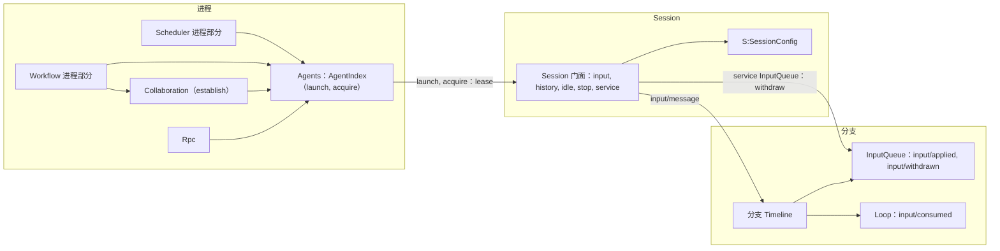
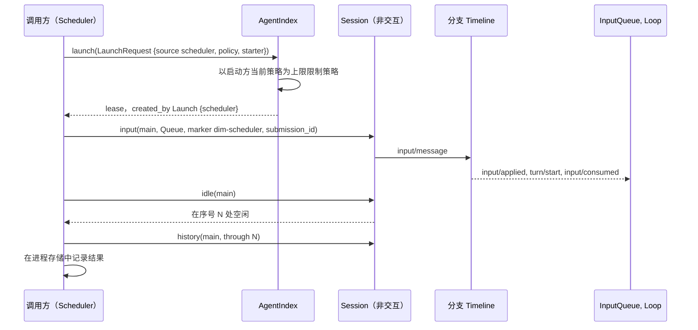
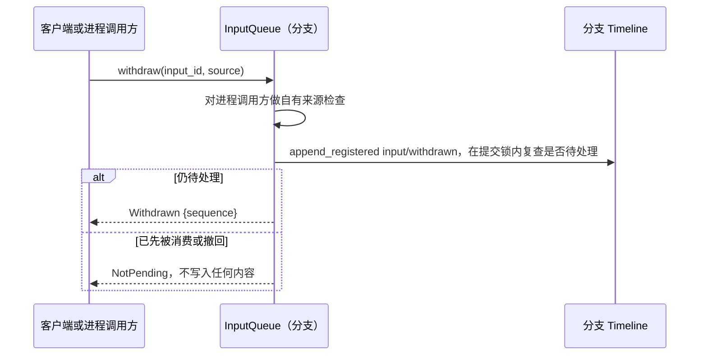

# Session 访问：Agents 与 Session 公共接口补充

状态：草案。总体设计：[总览 §3 集成](../overview.md#3-基于现有机制的集成)、[附录 B Agents 与 InputQueue](../overview.md#附录-b-现有插件的补充)；规则：[ADR 002](../../adr/002-plugin-scope.md) D1–D3。阶段：P0。语言：Rust。

进程插件以 Collaboration 已有的方式访问 Session。它们依赖 Agents（`AgentIndex`），获取或启动一个 Session，并使用公共的 `Session` 门面（`input`、`history`、`local_page`、`sequence`、`idle`、`stop`、`service`）。本文在该接口之上补充 Scheduler、Workflow 和 Collaboration 所需的内容。本文不增加任何宿主或门面插件，依赖 Agents 的调用方随其重载（D3）。

| 补充 | 所有者 | 使用方 |
| --- | --- | --- |
| 策略以启动方为上限的 `AgentIndex::launch` | Agents | Scheduler、Workflow、Collaboration `establish` |
| `SessionConfig` 字段 `interactive`、`resource_node`、`created_by` | Agents | 所有作用域：`S:SessionConfig`、`Session::config()` |
| 带来源 raw 块的输入（标记、key、`submission_id`） | InputQueue 数据合同、运行时门面 | Scheduler、Workflow；Goal 与 Hooks 分支部分写入相同形式 |
| 固定前缀读取 | 运行时门面 | 进程调用方，以及依据 Timeline 事实做决定的分支部分 |
| 撤回（`input/withdrawn`、`session.input.withdraw`、自有来源撤回） | InputQueue | 客户端、AcpGateway、Scheduler |

Session 级与分支级插件不使用此接口访问自己的 Session。它们直接使用 `S:`/`B:` 服务、分支 Dispatcher 和 Session 广播。

## 1. 结构



| 部分 | 作用域 | 状态 |
| --- | --- | --- |
| `AgentIndex::launch`、`acquire` | 进程 | `acquire` 已存在；`launch` 是补充 |
| `SessionConfig` 字段 | Session 记录 | 补充 |
| Session 门面（[agent.rs](../../../../crates/dim-agent-runtime/src/agent.rs)、[branch.rs](../../../../crates/dim-agent-runtime/src/branch.rs)） | Session、分支 | 已存在；输入归属是补充 |
| InputQueue | 分支 | 变更：`input/withdrawn`、撤回服务 |
| Collaboration `establish(leader, agent)` | 进程 | 变更：从分支外部创建成员 |

本文定义的合同：`LaunchRequest`、`SessionOrigin`、三个 `SessionConfig` 字段、`session.create` 的 `interactive` 与 `client` 参数、来源标记、key 与 `submission_id` 约定、`Prefix`、撤回合同以及 `Withdrawal`。使用的合同：运行时门面、`AgentIndex` 装载、`input/message` 数据与消费合同，以及 `context_block::element`。

## 2. 数据与状态

| 状态 | 所有者 | 重建 |
| --- | --- | --- |
| 含新字段的 `SessionConfig` | Agents、Session 记录 | 恢复时从记录重建 |
| 输入及其 applied、consumed 与 withdrawn 事实 | InputQueue、Loop | 重载时从本地历史重建（已有） |
| 租约（`SessionUse`） | AgentIndex | 仅运行时 |
| 带 key 块的效果 | 历史投影（[history.rs](../../../../crates/dim-agent-capabilities/src/history.rs)） | 从固定前缀与压缩事实重建 |
| 调用方进度（运行、待定 `submission_id`） | 调用方的进程存储 | 调用方的文档 |

当没有 `input/consumed` 也没有 `input/withdrawn` 引用某输入的事件 id 时，该输入处于待处理状态。每个“待处理输入”推导（Goal、Notifications、AcpGateway、Scheduler）都严格使用这条规则。

## 3. 流程

### 3.1 启动、写入、等待



调用方不持有锁。在其读取之后提交的事实排在其写入之前，由输入所有者处理。可能在结果不确定后重试的调用方，先查找自己的 `submission_id`。

### 3.2 撤回



每个输入恰好存在 `input/withdrawn` 与 `input/consumed` 之一。客户端通过 Rpc 内建方法 `session.input.withdraw` 撤回（[session-boundary](session-boundary.md#a1-方法贡献)），进程调用方通过 `Session::service::<InputQueue>(branch)` 撤回。

## 4. 时序与冲突

| 场景 | 顺序 | 结果 | 所有者 |
| --- | --- | --- | --- |
| 输入在 turn 的 `stop/interrupt` 之前，未被消费 | applied < interrupt | 保持待处理；由下一个 turn 消费 | Loop |
| 输入在 `stop/interrupt` 之后 | interrupt < input | Queue/Steer 启动 turn，Append 等待 | InputQueue、Loop |
| 在消费前撤回 | input < withdrawn | 永不被消费；不处于待处理 | InputQueue、Loop |
| 撤回与消费竞争 | consumed < withdraw | `NotPending` | InputQueue |
| 调用方持有租约时 Agents 重载 | — | 调用方随 Agents 重载（D3）；已提交的输入保留；调用方重写前先查找 `submission_id` | rutis 生命周期、调用方 |
| 以比启动方更宽的策略启动 | — | 限制为启动方的当前策略 | Agents |

完整表格：附录 B。

## 5. 上下文映射

| 输入形式 | 模型看到的内容 | 位置 |
| --- | --- | --- |
| 标记块 | 一条 user 角色消息，原样包含 `<dim-<source> kind="...">` 元素 | 最先，位于该输入的消费位置 |
| 其他 raw 块 | 每块一条 user 角色消息，原样、按序 | 在标记之后 |
| 用户内容（文本、图像） | 一条用户消息 | 在同一输入的所有块之后 |
| 带 key 的块（`Live`） | 作为 raw 块；每个 key 的最新块保持生效 | 消费位置 |
| Retire 块 | 投递一次；该 key 失效 | 消费位置 |
| 已撤回的输入 | 无 | — |

Queue 输入在 Loop 启动它所驱动的 turn 时被消费。Steer 输入在运行中 turn 的下一个边界被消费，分支空闲时会启动一个 turn。Append 输入随下一次模型请求被消费，从不启动 turn。经过压缩后，已消费的输入只保留在摘要中，但每个生效 key 的最新块会原样重放。子分支看到截至其切点的祖先前缀，包括切点处生效的 key，且从不采纳父分支的待处理输入。模型从不看到 `submission_id`、模式、`SessionConfig` 字段或租约。

## 6. 接口（摘要）

| 接口 | 用途 |
| --- | --- |
| `AgentIndex::launch(LaunchRequest) -> SessionUse` | 为自动化创建 Session，策略受上限约束 |
| `AgentIndex::acquire(id)`（已有） | 租用已装载或已存储的 Session |
| `Session::config()`（已有），新字段 | 创建时配置 |
| `Session::input(InputMessageData, branch)`（已有） | 写入带来源 raw 块的输入 |
| `Session::prefix(branch, at_least) -> Prefix` | 以已发布 head 为界的固定前缀读取 |
| `InputQueue::withdraw(input_id, source)` | 撤回待处理输入 |
| `session.create {interactive, client}` | 非交互创建与客户端来源 |
| Collaboration `establish(leader, agent)` | 从分支外部创建成员（Workflow） |

## 7. 安全

只有进程内插件持有 `AgentIndex`，本文中的内容都不会经 RPC 或 rutis 链接导出。标记、key 与 `submission_id` 都按来源划分作用域。进程调用方只能撤回自己的输入，客户端通过 Rpc 的 Session 授权撤回。写入输入不授予任何权限，因为由此产生的工具调用由 Approval 与 Permission 按该 Session 的策略准入。输入会重放进模型上下文，因此调用方不得把凭据或宿主安全设置放入其中。

## 附录 A. 接口细节

### A.1 启动

```rust
pub struct LaunchRequest {
    pub agent: String,                    // Agent profile id
    pub cwd: PathBuf,
    pub resource_node: Option<NodeId>,
    pub source: String,                   // 记录为 SessionOrigin::Launch { source }
    pub policy: Option<PermissionPolicy>, // 收窄后的请求；None = 启动方策略或只读默认值
    pub starter: Option<SessionRef>,      // 上限；None = 以宿主配置为界
}
impl AgentIndex {
    pub async fn launch(&self, request: LaunchRequest) -> Result<SessionUse, AgentError>;
}
```

启动的 Session 是非交互的。生效策略是请求的策略，并以启动方的当前策略为上限；该策略是启动时读取的 Timeline 事实。没有启动方时，由管理方法启动的运行除非任务或定义声明了更多权限，否则默认只读，并始终受宿主配置约束。Collaboration 的 `establish(leader, agent)` 使用相同的上限。

### A.2 来源输入约定

| 项目 | 规则 |
| --- | --- |
| 标记 | 第一个 raw 块是 `context_block::element("dim-<source>", [("kind", kind), attrs..], body)`。来源只从第一个 raw 块的第一行识别。来源名为 `[a-z][a-z0-9-]*`，由生产方插件拥有且保持稳定。名称 `rule`、`state`、`agent-message`、`agent-report` 和 `branch-task` 为保留名 |
| Key | `KeyUse::Live(name)` 或 `Retire(name)`，存储为 `<source>:<name>`，按分支 Timeline 区分。无法产生 Prompt 的 `rule:`/`state:` 前缀 |
| 提交标识 | `<source>:<uuid>`，每次逻辑提交生成一个。写入不去重；按 `session.input_lookup` 语义查找已提交的输入（`Accepted`、`Unknown`，有歧义时报错） |
| 绝不可能 | 写入 `input/message`、经 InputQueue 的 `input/withdrawn` 和经 `stop` 的 `stop/interrupt` 之外的事件；编辑历史；使用其他来源的标记、key 或 id |

### A.3 SessionConfig 字段

```rust
pub struct SessionConfig {
    // 已有：permission_policy, cwd, model, system_prompt, tools, collaboration_role
    pub interactive: bool,             // false：exec、ACP、自动化；缺少该字段的已存储记录：true
    pub resource_node: Option<NodeId>, // None = 控制节点
    pub created_by: SessionOrigin,
}
pub enum SessionOrigin {
    Client { client: Option<String> },        // session.create；例如 "acp"
    Collaboration { leader_session: String },
    Launch { source: String },                // 例如 "scheduler"、"workflow"
    Fork { source_session: String },
}
```

`session.create` 增加 `interactive?: bool`（默认 `true`）与 `client?: string`。fork 复制 `cwd`、`resource_node`、`interactive` 和 `collaboration_role`。这些字段在创建时固定。Session 装配读取 `interactive` 以决定安装哪些可选插件（非交互 Session 中没有 `ask_user`）。

### A.4 撤回

| 项目 | 内容 |
| --- | --- |
| 数据合同 | `input/withdrawn { input_id }`，由 InputQueue 拥有 |
| 客户端路径 | Rpc 内建方法 `session.input.withdraw {sessionId, branchId, inputId}` → `{sequence}`；错误 `input_not_pending`、`unknown_input` |
| 进程与分支部分路径 | `InputQueue::withdraw(input_id, source)`：只限标记为调用方来源的输入；否则 `Rejected("foreign source")` |
| 写入路径 | `append_registered`，在锁内复查该输入仍待处理 |
| 撤回并作为 Steer 重新提交 | 一个原子批次：`input/withdrawn` 加新的 Steer `input/message` |

### A.5 固定前缀读取

`Session::prefix(branch, at_least)` 把 `through` 固定为调用时的已发布 head。若该 head 低于 `at_least`，则以 `FutureSequence` 失败，否则返回包含祖先的 `history(branch, Some(through))`。分支 Dispatcher 或 Session 广播投递的每个事件都已发布，因此只要分支存在，`at_least = event.sequence` 就会成功。

### A.6 错误

| 错误 | 含义 |
| --- | --- |
| `SessionClosed`、`BranchMissing` | 未写入任何内容 |
| `Reloading` | Agents 或该 Session 的 Capability 正在重载；先查找 `submission_id` 再重试 |
| `Rejected(reason)` | 校验、标记、key、自有来源规则或 `FutureSequence`；未写入任何内容 |
| `PublicationUnknown` | 已提交，发布失败；恢复后查找 |
| `Failed(AgentError)` | Session 故障 |

## 附录 B. 完整冲突表

| 场景 | 序号顺序 | 结果 | 决定所有者 |
| --- | --- | --- | --- |
| 输入在 `stop/interrupt` 之前，未被消费 | applied < interrupt | 随下一个 turn 被消费 | Loop |
| 输入在 `stop/interrupt` 之后 | interrupt < input | Queue/Steer 启动 turn；Append 等待 | InputQueue、Loop |
| 输入被被中断的 turn 消费 | consumed < interrupt | 随该 turn 取消；保留在历史中 | Loop |
| 分支关闭 | close < write | `SessionClosed`/`BranchMissing` | 运行时门面 |
| 并发写入方 | Timeline 顺序 | 按序号顺序依模式应用 | InputQueue |
| 工具批次未结算 | input < `step/tool-result` | Steer 与 Append 在批次之后；Queue 在 `turn/end` 之后 | Loop |
| 消费前的 `input/withdrawn` | input < withdrawn | 永不被消费 | InputQueue、Loop |
| 撤回与消费竞争 | consumed < withdraw | `NotPending` | InputQueue |
| 进程调用方撤回他人来源的输入 | — | `Rejected` | InputQueue |
| 写入与消费之间发生压缩 | input < compaction < consumed | 放在摘要之后 | ContextPreparation |
| 写入与消费之间切出子分支 | input < cut < consumed | 子分支不采纳它 | InputQueue（子分支） |
| 两个写入方，同一 key | Timeline 顺序 | 后者取代前者；命名空间防止跨来源冲突 | 历史投影 |
| 读取决策依据、出现更新的事实、然后写入 | through < fact < write | 写入排在该事实之后 | 输入所有者 |
| Agents 重载 | — | 调用方随之重载（D3）；已提交的输入保留 | rutis 生命周期 |
| 提交后重启，回复丢失 | — | 查找返回 `Accepted`；无重复 | 调用方 |
| Session 未装载 | — | `acquire` 先恢复 | AgentIndex |
| 资源节点离线 | — | 输入已提交；Capability 离开 Pending 后 turn 启动 | rutis 生命周期 |

## 附录 C. 验收

1. `launch` 创建一个非交互 Session，其策略以启动方为上限，且 `created_by = Launch`。
2. `session.create {interactive: false, client: "acp"}` 产生的字段可通过 `Session::config()` 与 `S:SessionConfig` 看到，且没有 `ask_user`。
3. 在工具批次期间写入的 Queue、Steer 与 Append 按文档所述顺序被消费，标记位于用户内容之前。
4. 带 key 的块在压缩后保留，已 retire 的 key 不保留，子分支独立继承 key。
5. 消费前撤回使该输入不被消费；与消费竞争的撤回恰好产生两种事实之一。撤回他人来源的输入得到 `Rejected`。
6. 在已分发的 `turn/end` 之后调用 `prefix`，返回的 `through` ≥ 该序号。

## 附录 D. 假设

| # | 假设 | 依据 | 若被否决的影响 |
| --- | --- | --- | --- |
| A1 | 每个来源输入都以一个标记块开头 | 现有 context-block 格式 | 每个插件自行定义识别方式 |
| A2 | 缺少 `interactive` 的已存储 Session 是交互式的 | 判断 | 客户端必须始终发送该字段 |
| A3 | 进程调用方可以对自己启动的 Session 调用 `idle` 和 `stop` | Collaboration 先例 | 另设停止路径 |
| A4 | 重新提交为 Steer 的批次是 `session.input.withdraw` 的一个参数 | 判断 | 单独的内建方法 |
