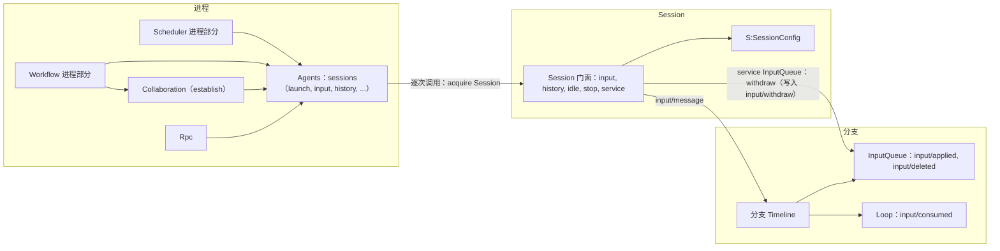
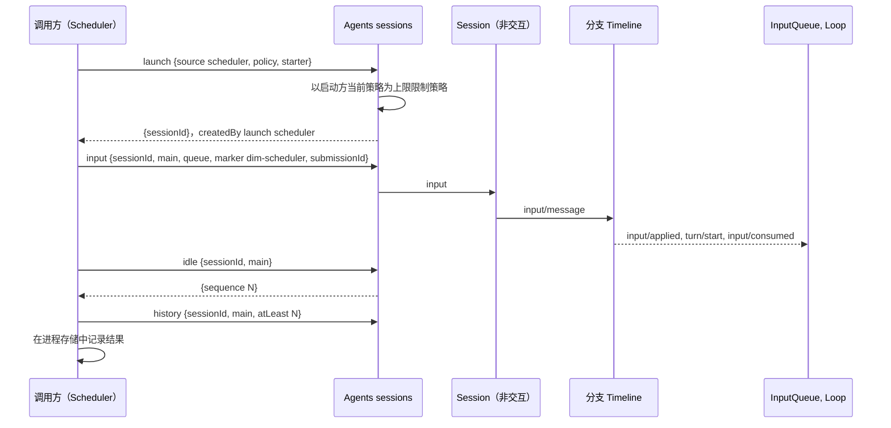
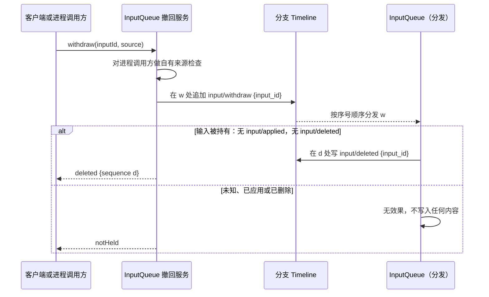

# Session 访问：Agents 与 Session 公共接口补充

状态：草案。总体设计：[总览 §3 集成](../overview.md#3-基于现有机制的集成)、[附录 B Agents 与 InputQueue](../overview.md#附录-b-现有插件的补充)；规则：[ADR 002](../../adr/002-plugin-scope.md) D1–D3、D5。阶段：P0。语言：语言中立合同；Rust 绑定见[附录 E](#附录-e-rust-绑定)。

进程插件以 Collaboration 已有的方式访问 Session：通过 Agents 和公共的 Session 接口。本文把这种访问定义为语言中立的进程服务 `sessions`（ADR 002 D5），由 Agents 提供，因此 TypeScript 或 Python 进程插件（Scheduler、Workflow）可以按名称使用它。其方法为 `launch`、`input`、`lookup`、`history`、`withdraw`、`stop` 和 `idle`，请求与回复均为数据（[A.1](#a1-sessions-服务)）。在 Rust 中，它是 `AgentIndex` 加上 `Session` 门面（[附录 E](#附录-e-rust-绑定)）。本文不增加任何宿主或门面插件，依赖 Agents 的调用方随其重载（D3）。

| 补充 | 所有者 | 使用方 |
| --- | --- | --- |
| `sessions` 服务：按名称、纯数据地访问 Session | Agents | Scheduler、Workflow 进程部分 |
| 策略以启动方为上限的 `launch` | Agents | Scheduler、Workflow、Collaboration `establish` |
| `SessionConfig` 字段 `interactive`、`resourceNode`、`createdBy` | Agents | 所有作用域：`S:SessionConfig`、`Session::config()` |
| 带来源 raw 块的输入（标记、key、`submissionId`） | InputQueue 数据合同、运行时门面 | Scheduler、Workflow；Goal 与 Hooks 分支部分写入相同形式 |
| 固定前缀读取 | 运行时门面 | 进程调用方，以及依据 Timeline 事实做决定的分支部分 |
| 撤回（指令 `input/withdraw`、结果 `input/deleted`、`session.input.withdraw`、自有来源撤回） | InputQueue | 客户端、Hooks、AcpGateway、Scheduler、Workflow |

Session 级与分支级插件不使用此接口访问自己的 Session。它们直接使用 `S:`/`B:` 服务、分支 Dispatcher 和 Session 广播。

## 1. 结构



| 部分 | 作用域 | 状态 |
| --- | --- | --- |
| `sessions`（Agents） | 进程 | 补充；映射到现有的 `acquire` 与门面，外加 `launch` |
| `SessionConfig` 字段 | Session 记录 | 补充 |
| Session 门面（[agent.rs](../../../../crates/dim-agent-runtime/src/agent.rs)、[branch.rs](../../../../crates/dim-agent-runtime/src/branch.rs)） | Session、分支 | 已存在；输入归属是补充 |
| InputQueue | 分支 | 变更：消费 `input/withdraw`，写入 `input/deleted`；撤回服务 |
| Collaboration `establish(leader, agent)` | 进程 | 变更：从分支外部创建成员 |

本文定义的合同：`sessions` 服务及 `LaunchRequest`、`InputWrite`、`RawBlock`、`HistoryRequest`、`HistoryPage`、`WithdrawRequest` 与 `SessionsError`；`SessionOrigin` 与三个 `SessionConfig` 字段；`session.create` 的 `interactive` 与 `client` 参数；来源标记、key 与 `submissionId` 约定；以及撤回合同。使用的合同：运行时门面、Agents 装载、`input/message` 数据与消费合同、`context_block::element`、Session 输入路径（`Session::input`），以及 Timeline before 回调（运行时补充，[总览附录 B](../overview.md#附录-b-现有插件的补充)）。

## 2. 数据与状态

| 状态 | 所有者 | 重建 |
| --- | --- | --- |
| 含新字段的 `SessionConfig` | Agents、Session 记录 | 恢复时从记录重建 |
| 输入及其 applied、consumed 与 deleted 事实；InputQueue 的持有集合 | InputQueue、Loop | 重载时从本地历史重建：某输入既无 `input/applied` 也无 `input/deleted` 时即被持有 |
| `sessions` 调用期间持有的租约 | Agents | 仅运行时 |
| 带 key 块的效果 | 历史投影（[history.rs](../../../../crates/dim-agent-capabilities/src/history.rs)） | 从固定前缀与压缩事实重建 |
| 调用方进度（运行、待定的 `submissionId`） | 调用方的进程存储 | 调用方的文档 |

输入从其 `input/message` 起处于待处理状态，直到引用其事件 id 的 `input/applied` 及随后的 `input/consumed`，或 `input/deleted` 出现为止。单独的 `input/withdraw` 从不改变输入是否待处理；只有 InputQueue 的结果事实会改变。每个“待处理输入”推导（Goal、Notifications、AcpGateway、Scheduler、Workflow）都严格使用这条规则。

## 3. 流程

### 3.1 启动、写入、等待



调用方不持有锁。在其读取之后提交的事实排在其写入之前，由输入所有者处理。可能在结果不确定后重试的调用方，先以其 `submissionId` 调用 `lookup`。匹配其分支上异步 Timeline before 回调的写入在回调之后提交，因此回复可能需要等待它；回调可以在同一批次中为该输入追加 `input/withdraw`（A.4）；随后 InputQueue 为其写入 `input/deleted`，调用方读到该输入为已删除。

### 3.2 撤回



`input/withdraw { input_id }` 是指令事件，`input/deleted { input_id }` 是 InputQueue 的结果事实。合法生产方写入该指令：客户端经 Rpc 内建方法 `session.input.withdraw`（[session-boundary](session-boundary.md#a1-方法贡献)），进程调用方经 `sessions.withdraw`，以及与该输入位于同一原子批次中的 Timeline before 回调（例如 Hooks）。InputQueue 按序号顺序消费指令，且只依据自身的决策状态做决定（[时间总线 §4](../../../architecture/rust-agent/time-bus.md#4-写入前的复核归各状态机)）：只有当 InputQueue 仍持有该 `input/message` 且尚未应用时，指令才生效。一旦 InputQueue 为某输入写入了 `input/applied`，该输入就归 Loop 所有，无法再撤回；Loop 无需改动。InputQueue 只在包含输入的整个原子批次分发之后才决定是否采纳它们，因此该输入自身批次中的撤回总是生效。对于一个输入，`input/applied` 与 `input/deleted` 至多存在其一。

## 4. 时序与冲突

| 场景 | 顺序 | 结果 | 所有者 |
| --- | --- | --- | --- |
| 输入在 turn 的 `stop/interrupt` 之前，未被消费 | applied < interrupt | 保持待处理；由下一个 turn 消费 | Loop |
| 输入在 `stop/interrupt` 之后 | interrupt < input | Queue/Steer 启动 turn，Append 等待 | InputQueue、Loop |
| 输入被持有时撤回 | input < `input/withdraw`，无 `input/applied` | `input/deleted`；永不被应用或消费；不处于待处理 | InputQueue |
| 输入被应用后撤回 | `input/applied` < `input/withdraw` | 无效果，不写入任何内容；回复 `notHeld`；该输入照常被消费 | InputQueue |
| 输入与撤回位于同一批次（before 回调） | input、`input/withdraw` 同一批次 | `input/deleted`；永不被应用；该写入的回复仍携带 `{inputId, sequence}` | 回调所有者、InputQueue |
| `sessions` 调用期间 Agents 重载 | — | 调用方随 Agents 重载（D3）；已提交的输入保留；调用方重写前先调用 `lookup` | rutis 生命周期、调用方 |
| Session 的资源节点离线 | — | 输入已提交；该节点上的工具调用以 `node_unavailable` 失败；没有任何部分进入 Pending | rutis 链接（#5） |
| 以比启动方更宽的策略启动 | — | 限制为启动方的当前策略 | Agents |

完整表格：附录 B。

## 5. 上下文映射

| 输入形式 | 模型看到的内容 | 位置 |
| --- | --- | --- |
| 标记块 | 一条 user 角色消息，原样包含 `<dim-<source> kind="...">` 元素 | 最先，位于该输入的消费位置 |
| 其他 raw 块 | 每块一条 user 角色消息，原样、按序 | 在标记之后 |
| 用户内容（文本、图像） | 一条用户消息 | 在同一输入的所有块之后 |
| 带 key 的块（`Live`） | 作为 raw 块；每个 key 的最新块保持生效 | 消费位置 |
| Retire 块 | 投递一次；该 key 失效 | 消费位置 |
| 已删除的输入（从未应用） | 无：其用户内容与 raw 块从不进入上下文，其带 key 的块从不生效，压缩也从不看到它。客户端可依据 `input/deleted` 将其显示为已删除 | — |

Queue 输入在 Loop 启动它所驱动的 turn 时被消费。Steer 输入在运行中 turn 的下一个边界被消费，分支空闲时会启动一个 turn。Append 输入随下一次模型请求被消费，从不启动 turn。经过压缩后，已消费的输入只保留在摘要中，但每个生效 key 的最新块会原样重放。子分支看到截至其切点的祖先前缀，包括切点处生效的 key，且从不采纳父分支的待处理输入。模型从不看到 `submissionId`、模式、`SessionConfig` 字段或租约。

## 6. 接口（摘要）

| 接口 | 模式 | 用途 |
| --- | --- | --- |
| `sessions.launch(LaunchRequest) -> {sessionId}` | async | 为自动化创建非交互 Session，策略受上限约束 |
| `sessions.input(InputWrite) -> {inputId, sequence}` | async | 写入带来源 raw 块的输入 |
| `sessions.lookup({sessionId, branchId, submissionId}) -> LookupReply` | async | 在结果不确定后查找已提交的输入 |
| `sessions.history(HistoryRequest) -> HistoryPage` | async | 读取历史，可选为以已发布 head 为界的固定前缀 |
| `sessions.withdraw(WithdrawRequest) -> WithdrawReply` | async | 为调用方自有来源的输入写入 `input/withdraw`，并返回 InputQueue 的决定 |
| `sessions.stop({sessionId, branchId}) -> {sequence}` | async | 中断该分支的 turn |
| `sessions.idle({sessionId, branchId}) -> {sequence}` | async | 等待分支空闲 |
| `SessionConfig` 字段 | 数据 | 创建时配置（`interactive`、`resourceNode`、`createdBy`） |
| `session.create {interactive, client}` | RPC | 非交互创建与客户端来源 |
| Collaboration `establish(leader, agent)` | — | 从分支外部创建成员（Workflow）；属于 Collaboration 服务，不在 `sessions` 中 |

## 7. 安全

只有控制节点进程中的插件持有 `sessions`，它从不经 RPC 入口或 rutis 链接导出。标记、key 与 `submissionId` 都按来源划分作用域。Agents 依据调用方的插件身份固定其来源，因此调用方无法以其他来源写入或撤回。进程调用方只能撤回自己的输入，客户端通过 Rpc 的 Session 授权撤回。写入输入不授予任何权限，因为由此产生的工具调用由 Approval 与 Permission 按该 Session 的策略准入。输入会重放进模型上下文，因此调用方不得把凭据或宿主安全设置放入其中。

## 附录 A. 接口细节

### A.1 sessions 服务

`sessions` 是由 Agents 提供的进程服务，没有实例 key。结构为 camelCase 字段的 JSON；字段名后的 `?` 表示可选，`|` 分隔备选项。每次调用都会 acquire 该 Session（必要时恢复），并在回复前保持其已装载。调用方的 `source` 由 Agents 依据调用插件声明的来源名固定。

| 方法 | 模式 | 请求 | 回复 | 错误 |
| --- | --- | --- | --- | --- |
| `launch` | async | `LaunchRequest` | `{sessionId}` | `rejected`、`reloading`、`failed` |
| `input` | async | `InputWrite` | `{inputId, sequence}` | `rejected`、`session_closed`、`branch_missing`、`reloading`、`publication_unknown`、`failed` |
| `lookup` | async | `{sessionId, branchId, submissionId}` | `LookupReply` | `ambiguous`、`session_closed`、`branch_missing` |
| `history` | async | `HistoryRequest` | `HistoryPage` | `future_sequence`、`session_closed`、`branch_missing` |
| `withdraw` | async | `WithdrawRequest` | `WithdrawReply` | `foreign_source`、`session_closed`、`branch_missing` |
| `stop` | async | `{sessionId, branchId}` | `{sequence}` | `session_closed`、`branch_missing` |
| `idle` | async | `{sessionId, branchId}` | `{sequence}` | `session_closed`、`branch_missing` |

```text
// LaunchRequest
{ "agent": "string",                 // Agent profile id
  "cwd": "string",
  "resourceNode?": "string",         // 缺省：控制节点
  "model?": "string",                // 模型 id；缺省：profile 的模型
  "policy?": { /* PermissionPolicy 数据 */ },  // 收窄后的请求；缺省：启动方策略或只读默认值
  "starter?": { "sessionId": "string", "branchId": "string" } } // 上限；缺省：以宿主配置为界
// InputWrite
{ "sessionId": "string", "branchId": "string",
  "mode": "queue" | "steer" | "append",
  "submissionId": "<source>:<uuid>",
  "rawBlocks": [ RawBlock ],         // 第一个块是调用方的标记（A.2）
  "content": [ { "type": "text", "text": "..." } | { "type": "image", "...": "..." } ] }
// RawBlock
{ "text": "string", "key?": { "use": "live" | "retire", "name": "string" } }
// LookupReply
{ "status": "accepted", "inputId": "string", "sequence": 0 } | { "status": "unknown" }
// HistoryRequest
{ "sessionId": "string", "branchId": "string",
  "after?": 0,                        // 不含的下界；缺省：从分支开头
  "through?": 0,                      // 读取到此序号
  "atLeast?": 0 }                     // 固定前缀读取（A.5）
// HistoryPage
{ "through": 0, "events": [ { "sequence": 0, "branchId": "string", "type": "turn/end", "data": {} } ] }
// WithdrawRequest
{ "sessionId": "string", "branchId": "string", "inputId": "string" }
// WithdrawReply
{ "status": "deleted", "sequence": 0 }   // input/deleted 的序号
| { "status": "notHeld" }                  // 未知、已应用或已删除；InputQueue 未写入任何内容
// SessionsError
{ "code": "rejected" | ..., "message": "string", "retryable": false }
```

取消：调用方丢弃 `idle` 或 `history` 调用即结束它，没有任何效果。在回复前丢弃 `input` 会使结果不确定；调用方用 `lookup` 确认。

`launch` 创建一个 `createdBy = {kind: "launch", source}` 的非交互 Session。生效策略是请求的策略，并以启动方的当前策略为上限；该策略是启动时读取的 Timeline 事实。没有启动方时，由管理方法启动的运行除非任务或定义声明了更多权限，否则默认只读，并始终受宿主配置约束。Collaboration 的 `establish(leader, agent)` 使用相同的上限。

### A.2 来源输入约定

| 项目 | 规则 |
| --- | --- |
| 标记 | 第一个 raw 块是 `context_block::element("dim-<source>", [("kind", kind), attrs..], body)`。来源只从第一个 raw 块的第一行识别。来源名为 `[a-z][a-z0-9-]*`，由生产方插件拥有且保持稳定。名称 `rule`、`state`、`agent-message`、`agent-report` 和 `branch-task` 为保留名 |
| Key | `RawBlock.key`，`use` 为 `live` 或 `retire`，存储为 `<source>:<name>`，按分支 Timeline 区分。无法产生 Prompt 的 `rule:`/`state:` 前缀 |
| 提交标识 | `<source>:<uuid>`，每次逻辑提交生成一个。写入不去重；`sessions.lookup`（与 `session.input_lookup` 语义相同）查找已提交的输入（`accepted`、`unknown`，错误 `ambiguous`） |
| 绝不可能 | 写入 `input/message`、经 `withdraw` 的 `input/withdraw` 和经 `stop` 的 `stop/interrupt` 之外的事件；写入 `input/deleted`；编辑历史；使用其他来源的标记、key 或 id |

### A.3 SessionConfig 字段

```text
// SessionConfig（新字段；已有：permissionPolicy, cwd, model, systemPrompt, tools, collaborationRole）
{ "interactive": true,              // false：exec、ACP、自动化；缺少该字段的已存储记录：true
  "resourceNode?": "string",        // 缺省：控制节点
  "createdBy": SessionOrigin }
// SessionOrigin
{ "kind": "client", "client?": "acp" }
| { "kind": "collaboration", "leaderSession": "string" }
| { "kind": "launch", "source": "scheduler" }
| { "kind": "fork", "sourceSession": "string" }
```

`session.create` 增加 `interactive?: bool`（默认 `true`）与 `client?: string`。fork 复制 `cwd`、`resourceNode`、`interactive` 和 `collaborationRole`。这些字段在创建时固定。Session 装配读取 `interactive` 以决定安装哪些可选插件（非交互 Session 中没有 `ask_user`）。

### A.4 撤回

| 项目 | 内容 |
| --- | --- |
| 指令 | `input/withdraw { input_id }`，一个分支指令事件；生产方：撤回服务（客户端、进程调用方），以及该输入自身批次中的 Timeline before 回调。它本身从不是关于该输入的事实 |
| 结果事实 | `input/deleted { input_id }`，只由 InputQueue 写入，且只在它消费 `input/withdraw` 时仍持有该输入、尚未应用的情况下写入 |
| 持有 | InputQueue 从某输入的 `input/message` 起持有它，直到为其写入 `input/applied` 或 `input/deleted`。只在包含该输入的整个原子批次分发之后才决定是否采纳它 |
| 无效果 | 未知 id、输入已应用或已删除：InputQueue 不写入任何内容；调用方收到的回复为 `notHeld` |
| 客户端路径 | Rpc 内建方法 `session.input.withdraw {sessionId, branchId, inputId}` → `{status: "deleted", sequence}` 或 `{status: "notHeld"}` |
| 进程与分支部分路径 | 进程调用方使用 `sessions.withdraw`，分支部分使用 InputQueue 的分支撤回服务：只限标记为调用方来源的输入；否则 `foreign_source`，不写入任何内容 |
| 写入路径 | 该服务追加 `input/withdraw`，然后以 InputQueue 对该指令的决定作答。InputQueue 的复核只使用其自身的决策状态（持有集合），从不对另一所有者的事实加锁 |
| 撤回并作为 Steer 重新提交 | 一个原子批次：针对旧输入的 `input/withdraw` 加新的 Steer `input/message`。撤回只在旧输入仍被持有时生效；新输入无论如何都会写入 |
| 在输入自身批次中撤回 | `input/message` 上的 Timeline before 回调可以向其批次追加针对该输入的 `input/withdraw`；此时 InputQueue 总是写入 `input/deleted`，且从不应用它。针对哪些输入以及原因，由回调所有者的规则决定（例如 [Hooks](../plugins/Hooks.md) `user_prompt_submit`） |
| 应用之后 | 已应用的输入无法撤回；Loop 照常消费它，无需改动 |

### A.5 固定前缀读取

带 `atLeast` 的 `sessions.history` 把 `through` 固定为调用时的已发布 head。若该 head 低于 `atLeast`，则以 `future_sequence` 失败，否则返回截至该 head 的历史（包含祖先）。分支 Dispatcher 或 Session 广播投递的每个事件都已发布，因此只要分支存在，`atLeast = event.sequence` 就会成功。

### A.6 错误

| 错误码 | 含义 |
| --- | --- |
| `session_closed`、`branch_missing` | 未写入任何内容 |
| `reloading` | Agents 或该 Session 的 Capability 正在重载；先 `lookup` 再重试 |
| `rejected` | 校验、标记或 key 规则；未写入任何内容 |
| `foreign_source` | 撤回其他来源的输入；未写入任何内容。未知 id 不是错误：回复为 `notHeld` |
| `future_sequence` | 固定前缀读取超出已发布 head |
| `ambiguous` | `lookup` 匹配到多个输入 |
| `publication_unknown` | 已提交，发布失败；恢复后 `lookup` |
| `node_unavailable` | 不由 `sessions` 返回：对离线资源节点的调用在该 Session 的工具内部失败 |
| `failed` | Session 故障 |

## 附录 B. 完整冲突表

| 场景 | 序号顺序 | 结果 | 决定所有者 |
| --- | --- | --- | --- |
| 输入在 `stop/interrupt` 之前，未被消费 | applied < interrupt | 随下一个 turn 被消费 | Loop |
| 输入在 `stop/interrupt` 之后 | interrupt < input | Queue/Steer 启动 turn；Append 等待 | InputQueue、Loop |
| 输入被被中断的 turn 消费 | consumed < interrupt | 随该 turn 取消；保留在历史中 | Loop |
| 分支关闭 | close < write | `SessionClosed`/`BranchMissing` | 运行时门面 |
| 并发写入方 | Timeline 顺序 | 按序号顺序依模式应用 | InputQueue |
| 输入在 before 回调上待定时，该分支上到来另一写入 | this < other | 另一写入排在它之后；顺序保持 | Timeline |
| before 回调使输入与 `input/withdraw` 位于同一批次 | 同一批次 | `input/deleted`；永不被应用；回复携带 `inputId` | 回调所有者、InputQueue |
| 工具批次未结算 | input < `step/tool-result` | Steer 与 Append 在批次之后；Queue 在 `turn/end` 之后 | Loop |
| 被持有时的 `input/withdraw` | input < withdraw，无 `input/applied` | `input/deleted`；永不被应用或消费 | InputQueue |
| 应用之后的 `input/withdraw` | `input/applied` < withdraw | 无效果；`notHeld`；照常被消费 | InputQueue、Loop |
| 对同一输入的两次撤回 | withdraw₁ < withdraw₂ | 第一次删除（若被持有）；第二次 `notHeld` | InputQueue |
| 撤回未知 id | — | 无效果；`notHeld` | InputQueue |
| 撤回并作为 Steer 重新提交，旧输入已应用 | applied < batch | 旧输入照常被消费；新 Steer 输入照常应用 | InputQueue |
| 进程调用方撤回他人来源的输入 | — | `foreign_source` | InputQueue |
| 写入与消费之间发生压缩 | input < compaction < consumed | 放在摘要之后；已删除的输入从不被压缩看到 | ContextPreparation |
| 写入与消费之间切出子分支 | input < cut < consumed | 子分支不采纳它 | InputQueue（子分支） |
| 两个写入方，同一 key | Timeline 顺序 | 后者取代前者；命名空间防止跨来源冲突 | 历史投影 |
| 读取决策依据、出现更新的事实、然后写入 | through < fact < write | 写入排在该事实之后 | 输入所有者 |
| Agents 重载 | — | 调用方随之重载（D3）；已提交的输入保留 | rutis 生命周期 |
| 提交后重启，回复丢失 | — | `lookup` 返回 `accepted`；无重复 | 调用方 |
| Session 未装载 | — | Agents 在调用前恢复它 | Agents |
| 资源节点离线 | — | 输入已提交；turn 运行，该节点上的调用以 `node_unavailable` 失败；没有依赖方重载或进入 Pending（对 #5 的要求） | rutis 链接 |

## 附录 C. 验收

1. `sessions.launch` 创建一个非交互 Session，其策略以启动方为上限，且 `createdBy.kind = launch`；TypeScript 进程插件可以按名称调用它。
2. `session.create {interactive: false, client: "acp"}` 产生的字段可在该 Session 的 `SessionConfig` 中看到，且没有 `ask_user`。
3. 在工具批次期间写入的 Queue、Steer 与 Append 按文档所述顺序被消费，标记位于用户内容之前。
4. 带 key 的块在压缩后保留，已 retire 的 key 不保留，子分支独立继承 key。
5. InputQueue 持有输入时的 `input/withdraw` 产生 `input/deleted`，且该输入永不被应用；在 `input/applied` 之后则不写入任何内容并回复 `notHeld`；对于一个输入，`input/applied` 与 `input/deleted` 至多存在其一。来自 before 回调的同批次撤回总是删除该输入。已删除输入的 raw 块与带 key 的块从不到达模型。撤回他人来源的输入以 `foreign_source` 失败。
6. 在已分发的 `turn/end` 之后调用带 `atLeast` 的 `history`，返回的 `through` ≥ 该序号。

## 附录 D. 假设

| # | 假设 | 依据 | 若被否决的影响 |
| --- | --- | --- | --- |
| A1 | 每个来源输入都以一个标记块开头 | 现有 context-block 格式 | 每个插件自行定义识别方式 |
| A2 | 缺少 `interactive` 的已存储 Session 是交互式的 | 判断 | 客户端必须始终发送该字段 |
| A3 | 进程调用方可以对自己启动的 Session 调用 `idle` 和 `stop` | Collaboration 先例 | 另设停止路径 |
| A4 | 重新提交为 Steer 的批次是 `session.input.withdraw` 的一个参数 | 判断 | 单独的内建方法 |

## 附录 E. Rust 绑定

| 语言中立 | Rust |
| --- | --- |
| `sessions` | `AgentIndex`（Agents）加上 `Session` 门面（[agent.rs](../../../../crates/dim-agent-runtime/src/agent.rs)、[branch.rs](../../../../crates/dim-agent-runtime/src/branch.rs)）；由生成的绑定按名称暴露 |
| `launch` | `AgentIndex::launch(LaunchRequest) -> Result<SessionUse, AgentError>` |
| 逐次调用的 acquire | `AgentIndex::acquire(id)`（已有），返回 `SessionUse` 租约 |
| `input` | `Session::input(InputMessageData, branch)`（已有），key 为 `KeyUse::Live(name)` / `Retire(name)` |
| `lookup` | 门面上的 `session.input_lookup` 语义 |
| 带 `atLeast` 的 `history` | `Session::prefix(branch, at_least) -> Result<Prefix, AgentError>`（补充）；否则为 `Session::history`，设置了 `after` 时为 `Session::local_page(branch, after, limit, through)` |
| `withdraw` | `Session::service::<InputQueue>(branch)`，然后 `InputQueue::withdraw(input_id, source) -> Result<WithdrawOutcome, AgentError>`：追加 `input/withdraw`，等待 InputQueue 对它的决定；`WithdrawOutcome::Deleted { sequence }` 或 `WithdrawOutcome::NotHeld` |
| `stop`、`idle` | `Session::stop`、`Session::idle`（已有） |
| `SessionConfig`、`SessionOrigin` | 下方的 Rust 结构体 |
| 错误 | `AgentError`：`SessionClosed`、`BranchMissing`、`Reloading`、`Rejected(reason)`（包括 `foreign source`、`FutureSequence`）、`PublicationUnknown`、`Failed` |

```rust
pub struct LaunchRequest {
    pub agent: String,
    pub cwd: PathBuf,
    pub resource_node: Option<NodeId>,
    pub model: Option<String>,            // 缺省：profile 的模型
    pub source: String,                   // 记录为 SessionOrigin::Launch { source }
    pub policy: Option<PermissionPolicy>,
    pub starter: Option<SessionRef>,
}
impl AgentIndex {
    pub async fn launch(&self, request: LaunchRequest) -> Result<SessionUse, AgentError>;
}
pub struct SessionConfig {
    // 已有：permission_policy, cwd, model, system_prompt, tools, collaboration_role
    pub interactive: bool,
    pub resource_node: Option<NodeId>,
    pub created_by: SessionOrigin,
}
pub enum WithdrawOutcome {
    Deleted { sequence: u64 },            // input/deleted 的序号
    NotHeld,                              // 未知、已应用或已删除
}
pub enum SessionOrigin {
    Client { client: Option<String> },
    Collaboration { leader_session: String },
    Launch { source: String },
    Fork { source_session: String },
}
```

Session 级与分支级 Rust 插件以 `S:SessionConfig` 或 `Session::config()` 读取配置。
