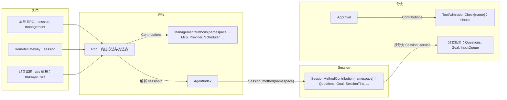
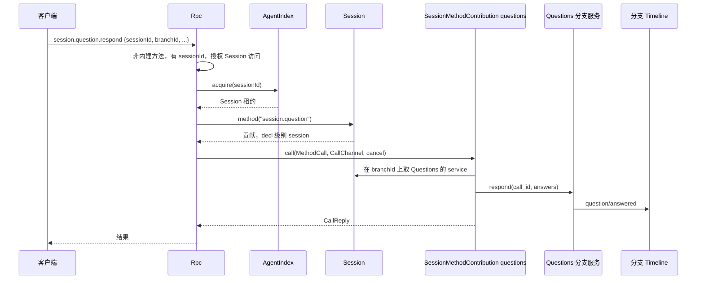
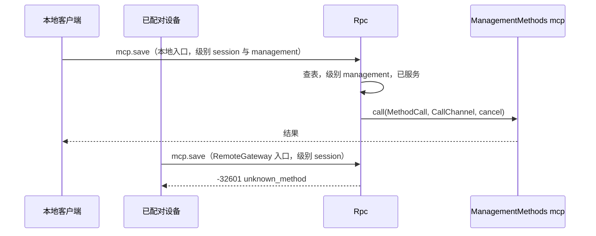
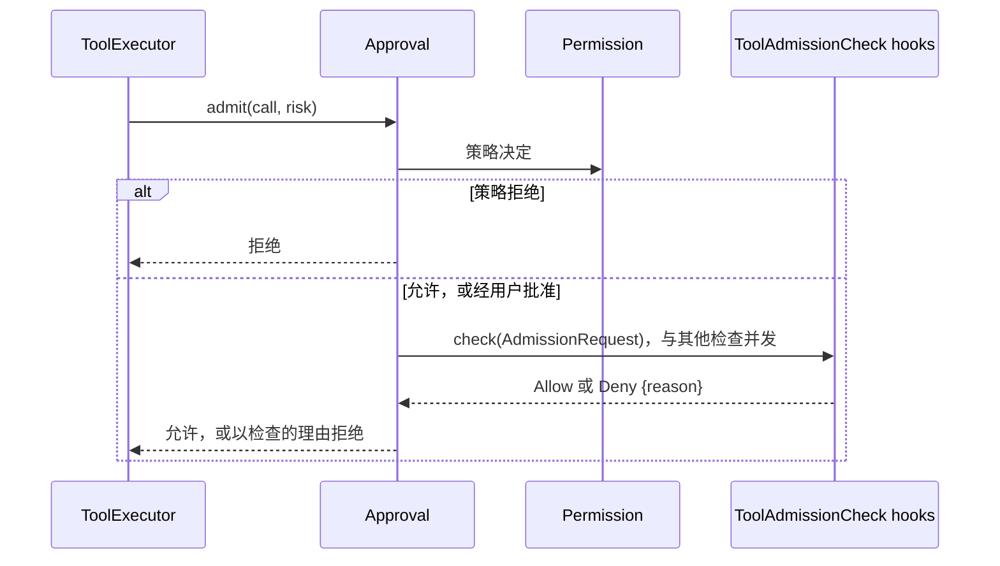

# 方法与准入检查

状态：草案。总体设计：[总览 §3 集成](../overview.md#3-基于现有机制的集成)、[附录 B Rpc 与 Approval](../overview.md#附录-b-现有插件的补充)；规则：[ADR 002](../../adr/002-plugin-scope.md) D2、D3。阶段：P0。语言：Rust。

本合同定义三种贡献，全部建立在运行时已有的机制之上：以 `Contributions<T>` 收集的命名服务，以及 Rpc 现有的经 Session 分发（如今 `approval.respond` 即如此）。

1. **Session 方法。** Session 级插件在自己的命名空间下贡献 `SessionMethodContribution`。Rpc 从 `sessionId` 解析 Session 并经由它分发。
2. **管理方法。** 进程插件在自己的命名空间下贡献 `ManagementMethods`。Rpc 将其以 `Contributions<ManagementMethods>` 收集到方法表中，标记为 `level: management`。
3. **工具准入检查。** 分支级插件贡献 `ToolAdmissionCheck`。Approval 收集这些检查，并对每次工具调用咨询它们。

每个入口（本地 RPC、RemoteGateway、已导出的 rutis 链接）服务其配置的级别。不存在注册表、端口或 Management 插件。贡献方是只在启用时安装的可选插件。贡献方重载会传播到其收集方，这是 D3 所接受的代价。

## 1. 结构



| 贡献 | 作用域 | Key | 装配时由谁注册 | 收集方 | 缺失时 |
| --- | --- | --- | --- | --- | --- |
| `SessionMethodContribution` | Session | `S:SessionMethodContribution[namespace]` | 插件安装到该 Session 时，由 `AgentBuilder::session_methods(namespace)` 注册 | Rpc，经 `Session::method(namespace)` | 对该 Session 返回 `unknown_method` |
| `ManagementMethods` | 进程 | `ManagementMethods[namespace]` | 所有者的 loader 行，启用时 | Rpc，`Contributions<ManagementMethods>` | `unknown_method` |
| `ToolAdmissionCheck` | 分支 | `B:ToolAdmissionCheck[name]` | 插件安装到该分支时，由 `AgentBuilder::tool_admission_check(name)` 注册 | Approval，`Contributions<ToolAdmissionCheck>` | 无检查 |

本文定义的合同：`SessionMethodContribution`、`ManagementMethods`、`MethodProvider`、`MethodDecl`、`MethodLevel`、`Interruption`、`ReplyMode`、`MethodCall`、`CallOrigin`、`CallReply`、`MethodError`、`CallChannel`、`ConnectionNotifier`；`ToolAdmissionCheck`、`AdmissionRequest`、`AdmissionVerdict`。还涵盖入口级别、命名、保留名、现有管理方法的迁移以及兼容性表。使用的合同：`Contributions<T>` 与带 key 的 Session 和分支服务（[工具贡献](../../../architecture/rust-agent/tool-contributions.md)）、`Session::service`、`SessionConfig`（[session-access](session-access.md#a3-sessionconfig-字段)）、Rpc 命令信封、`appError` 代码以及 Approval 的决定流程（[Approval](../../../architecture/rust-agent/plugins/Approval.md)）。

## 2. 数据与状态

没有任何贡献拥有 Timeline 事件或持久化状态。方法表在 Rpc 或 Session 装载时重建。所服务的级别是入口装配数据，在每个连接被接受时记录为 `ConnectionEntry {name, levels, device_id}`，从不由身份推导。链接的管理导出是宿主本地的结构性配置。准入检查不保存状态：其规则在使用时从所有者的业务来源读取。

## 3. 流程

### 3.1 Session 方法



命名空间按该 Session 中所贡献命名空间的最长前缀解析。如果 Session 没有该命名空间（因为插件被禁用，或 Session 是非交互的且未安装该插件），结果为 `unknown_method`。Session 级方法可以声明 `level: management`（`shell.*`），此时只在服务管理级的入口上分发。

### 3.2 管理方法



入口所服务的级别是唯一的检查。服务管理级即授予宿主管理员权限。

### 3.3 工具准入检查



检查在策略决定之后、执行之前运行。任一检查拒绝即拒绝该调用，被拒绝的调用与策略拒绝完全相同地结算（一个错误工具结果，不产生新事件）。检查本身失败时映射到它自己声明的结果（Hooks `pre_tool_use` 默认拒绝）。

## 4. 时序与冲突

| 场景 | 顺序 | 结果 | 所有者 |
| --- | --- | --- | --- |
| Session 级贡献方在调用中途重载 | call < reload | `Report`：`operation_interrupted`；`Drain`：重载等待 | Rpc |
| Session 的 Capability 重载期间的 Session 方法 | — | `service_reloading` | Rpc（来自 `AgentError::Reloading`） |
| 在没有该插件的 Session 上调用 Session 方法 | — | `unknown_method` | Rpc |
| 管理方法所有者重载 | — | Rpc 随之重载（D3）；已打开的连接看到现有的 Rpc 重载行为 | rutis 生命周期 |
| 在仅服务 session 的入口上调用管理方法 | — | `unknown_method` | Rpc |
| 两个贡献方声明同一命名空间 | 装配 | 装配失败；命名空间在每个作用域内唯一 | 装配 |
| 准入检查插件在 turn 期间重载 | check < reload | Approval 及其依赖方重载；在途 turn 以 `Failed` 结束（D3，已接受） | Approval |
| 一个检查拒绝而另一个允许 | — | 拒绝 | Approval |
| 检查期间 turn `stop/interrupt` | interrupt < verdict | 检查被取消；工具调用以中断结算 | Approval、ToolExecutor |
| Hooks 被禁用（结构性） | — | 分支装配时不含该检查；调用照常进行 | 装配 |

完整表格：[附录 B](#附录-b-完整冲突表)。

## 5. 上下文映射

方法没有模型可见的效果。改变模型上下文的方法通过其所有者的输入或 Timeline 事实实现，适用这些所有者的映射。准入拒绝只以错误工具结果的形式到达模型，携带检查的公开理由。

## 6. 接口（摘要）

| 接口 | 用途 |
| --- | --- |
| `SessionMethodContribution(Arc<dyn MethodProvider>)` | Session 级方法命名空间 |
| `ManagementMethods(Arc<dyn MethodProvider>)` | 进程方法命名空间，收集到 Rpc 的表中 |
| `MethodProvider::namespace / methods / call` | 声明与执行 |
| `Session::method(namespace)` | Rpc 使用的运行时查找（`Session::session_service` 的带 key 变体） |
| `CallChannel` | 每次调用的进度、连接绑定的通知、回复移交 |
| `ToolAdmissionCheck(Arc<dyn AdmissionCheck>)` | 由 Approval 咨询的分支级检查 |

## 7. 安全

入口装配是级别的唯一权威：本地 RPC 服务两个级别，RemoteGateway 服务 `session`（已配对设备可调用每个 Session 方法，决定 E3），rutis 链接只在宿主本地链接配置中显式导出时服务 `management`。Rpc 对每个 Session 级方法授权 `sessionId`，方式与其内建方法完全相同，其他参数由贡献方校验。运行命令或修改宿主配置的方法声明 `level: management`。准入检查只能拒绝，从不放宽：检查无法允许策略或用户已拒绝的调用。宿主本地批准（`mcp.approve`、`hooks.approve`、`plugin.approve`、`workflow.approve`）是管理方法。

## 附录 A. 接口细节

### A.1 方法贡献

```rust
/// Session 级；key 为 SessionScope::named_key::<SessionMethodContribution>(namespace)。
pub struct SessionMethodContribution(pub Arc<dyn MethodProvider>);
impl SessionService for SessionMethodContribution {}
impl PublicService for SessionMethodContribution {}

/// 进程级；由 Rpc 以 Contributions<ManagementMethods> 收集。
pub struct ManagementMethods(pub Arc<dyn MethodProvider>);

pub trait MethodProvider: Send + Sync + 'static {
    fn namespace(&self) -> &str;          // 等于注册名
    fn methods(&self) -> Vec<MethodDecl>; // 每个名称都在命名空间内
    fn call(&self, call: MethodCall, channel: CallChannel, cancel: CancellationToken)
        -> HostFuture<'_, Result<CallReply, MethodError>>;
}
pub struct MethodDecl {
    pub name: String,               // 完整线上名称，例如 "session.goal.set"、"mcp.save"
    pub level: MethodLevel,         // ManagementMethods：始终为 Management
    pub mutating: bool,
    pub interruption: Interruption,
    pub progress: bool,
    pub notifications: Vec<String>, // 在命名空间内
    pub reply: ReplyMode,
}
pub enum MethodLevel { Session, Management }
pub enum Interruption { Report, Drain }  // Report：operation_interrupted；Drain：卸载等待
pub enum ReplyMode { Direct, Handoff }   // Handoff：daemon.shutdown
pub enum CallReply { Value(serde_json::Value), HandedOff }
pub struct MethodCall {
    pub method: String,
    pub session_id: Option<String>, // Session 级贡献时为 Some 且已授权
    pub params: serde_json::Value,
    pub origin: CallOrigin,         // 仅用于诊断
}
pub enum CallOrigin { Local { connection_id: String }, Entry { entry: String, connection_id: String }, Link { peer: String } }
pub struct MethodError { pub code: i32, pub app_error: Cow<'static, str>, pub message: String }
```

| 规则 | 内容 |
| --- | --- |
| 命名空间 | `<segment>(.<segment>)*`，段为 `[a-z][a-z0-9_]*`，由贡献方拥有；命名空间本身可以是一个方法（`session.rename`） |
| 所有权 | 一个名称属于在内建方法、进程表和该 Session 的贡献中，作为其前缀或与其相等的最长已贡献命名空间 |
| 为 Rpc 内建方法保留 | `hello`、`daemon`、`agent`、`approval`、裸 `session` 根以及 `session.attach`、`session.branch_create`、`session.close`、`session.create`、`session.detach`、`session.history`、`session.idle`、`session.input_lookup`、`session.list`、`session.state`、`session.stop`、`session.submit`、`session.summaries`、`session.exec`、`session.mcp`、`session.model`、`session.permission`、`session.prompt`、`session.skills`、`session.input`（`session.input.withdraw`，与 `approval.respond` 一样经 `Session::service::<InputQueue>(branch)` 提供，因为 InputQueue 是没有 Session 部分的核心分支 Capability） |
| 优先级 | 内建方法，然后是进程表，然后是该 Session 的贡献；共用一个线上名称空间 |
| Session 级调用 | 需要 `sessionId`（缺少时为 `-32602`）。Rpc 对其授权，经 AgentIndex 获取 Session（必要时恢复），并调用 `Session::method(namespace)`。贡献方经 `Session::service::<T>(branch)` 访问分支 |
| 不分发 | 命名空间未被贡献，或入口不服务该级别 → `-32601 unknown_method`。Session 重载中 → `-32000 service_reloading`。已开始的 `Report` 调用被中断 → `operation_interrupted` |
| `hello.features`（v3） | 入口所服务级别的内建方法与进程表方法。Session 级方法按 Session 列在 `session.state.methods` 中 |
| 就绪闩 | 在 loader 初始装载结算后打开，因此首次 `hello` 时进程贡献已存在 |

已知的 Session 级命名空间：`session.question`（Questions）、`session.goal`（Goal）、`session.rename`（SessionTitle）、`attachment`（Attachments）、`shell`（ShellInput，管理级）。各插件文档对其方法具有权威性。

### A.2 调用通道

```rust
impl CallChannel {
    pub fn progress(&self, data: serde_json::Value);                       // 未声明时为空操作
    pub fn notifier(&self) -> Result<ConnectionNotifier, ChannelError>;    // 链接上为 Unsupported
    pub fn take_final_reply(&self) -> Result<FinalReply, ChannelError>;   // 仅 Handoff
}
impl ConnectionNotifier {
    pub fn send(&self, method: &str, params: serde_json::Value) -> Result<(), ChannelError>;
    pub fn closed(&self) -> impl Future<Output = ()>;
}
pub enum ChannelError { Unsupported, Undeclared, Gone }
```

两个级别的进度都以通知 `management.progress {id, method, data}` 发送，排在响应之前，断连后丢弃。通知名称必须已声明且位于命名空间内。notifier 在连接关闭前一直有效。

### A.3 工具准入检查

```rust
/// 分支级；key 为 BranchScope::named_key::<ToolAdmissionCheck>(name)。
pub struct ToolAdmissionCheck(pub Arc<dyn AdmissionCheck>);
impl BranchService for ToolAdmissionCheck {}

pub trait AdmissionCheck: Send + Sync + 'static {
    fn check(&self, request: &AdmissionRequest, cancel: CancellationToken)
        -> HostFuture<'_, AdmissionVerdict>;
}
pub struct AdmissionRequest {
    pub session_id: String,
    pub branch_id: String,
    pub turn_id: String,
    pub call_id: String,
    pub tool: String,
    pub arguments: serde_json::Value,
    pub risk: RiskCategory,
    pub config: Arc<SessionConfig>,
}
pub enum AdmissionVerdict { Allow, Deny { reason: String } } // reason 是公开的，模型可见
```

| 规则 | 内容 |
| --- | --- |
| 收集 | Approval 把 `Contributions<ToolAdmissionCheck>` 加入其 Deps。名称来自装配，没有提供方的名称会使分支构建失败 |
| 顺序 | 所有检查在策略决定之后并发运行；任一 `Deny` 即拒绝，理由按名称顺序拼接 |
| 取消 | turn 中断会取消检查；该调用以中断结算 |
| 失败 | 由检查自身映射为 `Allow` 或 `Deny` |
| 模型调用审批 | 不受影响：检查只作用于工具调用 |

### A.4 入口级别与导出

| 入口 | 级别 | 说明 |
| --- | --- | --- |
| 本地受保护传输 | `{session, management}` | 现有受保护 profile 规则不变 |
| 裸 WebSocket，受保护 profile | 同现状 | 除 `hello`/`daemon.ping` 外均为 `local_transport_required` |
| RemoteGateway | `{session}` | [RemoteGateway](../plugins/RemoteGateway.md) |
| 已导出的 rutis 链接 | `{management}` | 仅在宿主本地链接配置中导出时。没有调用方接收端时，进度被丢弃，`notifier()` 返回 `Unsupported` |

### A.5 迁移与兼容性

来源：[protocol.rs](../../../../crates/dim-app-server/src/protocol.rs) 中的 `MANAGEMENT_METHODS`、`MCP_METHODS`、`LOCAL_EXECUTION_METHODS`、`Call::is_management`；[connection.rs](../../../../crates/dim-app-server/src/connection.rs) 中的 `validate_call`。

| 方法 | 去向 | 贡献方（命名空间） |
| --- | --- | --- |
| `account.providers/status/recover/logout`、`account.login.*` | `ManagementMethods` | ManagedProviders（`account`） |
| `account.codex.*`、`account.grok.*` | `ManagementMethods` | OpenAI Codex OAuth（`account.codex`）、Grok OAuth（`account.grok`） |
| `provider.*` | `ManagementMethods` | Provider（`provider`） |
| `skills.catalog/set_enabled/refresh` | `ManagementMethods` | SkillsCatalog（`skills`） |
| `mcp.catalog/set_enabled/save/remove/disconnect/approve/revoke` | `ManagementMethods` | Mcp（`mcp`） |
| `daemon.shutdown` | Rpc 内建方法，管理级，回复移交 | — |
| `hello`、`daemon.ping`、`agent.*`、现有 `session.*`、`approval.respond`、新的 `session.input.withdraw` | Rpc 内建方法 | — |
| 新的 Session 方法 | `SessionMethodContribution` | 各所有者（A.1） |

中断行为与现状一致：`mcp.*` 与 `skills.*` 为 `Report`，`account.*` 与 `provider.*` 为 `Drain`。Rpc 的 `When<ProductServices>` 与 `When<ExecutionServices>` 被 `Contributions<ManagementMethods>` 取代，因此 Rpc 不再点名任何所属服务。

| 客户端 | 之前 | 之后 |
| --- | --- | --- |
| v1、v2 | 管理方法 `unknown_method` | 相同 |
| v3 本地，product profile | `hello.features` 含 33 个 product 名称 | 名称相同；参数、结果、代码与 `appError` 不变 |
| v3 本地，execution | `LOCAL_EXECUTION_METHODS` + `MCP_METHODS` | 名称相同 |
| v3 裸 WebSocket，受保护 profile | `local_transport_required` | 相同 |
| v3 RemoteGateway（新） | 不存在；execution Session 方法（`session.permission.get/update`、`session.exec.stop`、`session.skills`、`session.model.update`、`session.prompt.refresh`、`session.mcp`、`session.mcp.refresh`）仅限本地 | **兼容性变更（E3）：** 对已配对设备可用；管理名称 `unknown_method` |
| v3，MCP 禁用 | `mcp.*` `unknown_method` | 相同，使用 Rpc 的消息 |
| v3，Mcp 重载中 | `service_reloading` | Rpc 随 Mcp 重载（D3）；客户端重连并重试 |

不新增协议版本，持久化格式不变。

## 附录 B. 完整冲突表

| 场景 | 序号顺序 | 结果 | 决定所有者 |
| --- | --- | --- | --- |
| 分支 `stop/interrupt` 期间的 Session 方法 | 按所有者的事实 | 由所有者的 Timeline 顺序决定（例如，中断之后的 Questions 回答为 `question/cancelled`） | 所属插件 |
| 在已关闭分支上调用 Session 方法 | — | 所有者的 `BranchMissing` 错误 | 所属插件 |
| 在未装载的 Session 上调用 Session 方法 | — | Rpc 经 AgentIndex 恢复，然后分发 | Rpc |
| Session 级贡献方在调用中途重载 | admitted < reload | `Report`：`operation_interrupted`；`Drain`：等待 | Rpc |
| 进程所有者重载 | — | Rpc 重载（D3） | rutis 生命周期 |
| Rpc 重载时有在途调用 | — | `Report` 被中断，`Drain` 被排空；notifier `closed()` | Rpc |
| 入口不服务该级别 | — | `unknown_method` | Rpc |
| 客户端在调用中途 detach | — | 调用继续；回复丢弃 | Rpc |
| 两个客户端修改同一配置 | 存储修订号 | 后者得到贡献方的冲突错误 | 贡献方 |
| `daemon.shutdown` 与另一调用并发 | 准入 | 停止准入，然后已准入的调用按 `Interruption` 结算 | 进程协调器 |
| 检查待定，turn 被中断 | interrupt < verdict | 取消；工具调用以中断结算 | Approval |
| 检查插件在检查待定时重载 | — | turn 随重载以 `Failed` 结束 | Approval（D3） |
| 未结算的工具批次、压缩、子分支切点、`input/withdrawn` | — | 对方法或检查无影响 | — |
| 进程在调用中途重启 | — | 回复丢失；结果取决于贡献方的持久化；从不重放 | 贡献方 |

## 附录 C. 错误与恢复

| 情况 | 线上结果 |
| --- | --- |
| 未被贡献、入口不服务该级别，或 v1/v2 | `-32601`、`unknown_method` |
| Session 级方法缺少 `sessionId` | `-32602` |
| Session 重载中 | `-32000`、`service_reloading` |
| `Report` 调用被中断 | `-32000`、`operation_interrupted` |
| 贡献方错误 | `-32000`、贡献方的 `appError` |

## 附录 D. 验收

1. Session 级方法经其指定的 Session 分发。在没有该插件的 Session 上返回 `unknown_method`，且 Rpc 从不点名贡献方。
2. 管理方法在本地入口上可达，在 RemoteGateway 上返回 `unknown_method`，在链接上只有导出时才可达。Session 级的 `shell.*` 方法遵循相同的级别规则。
3. 每个已迁移管理方法的录制记录与迁移前的记录一致，且 v3 本地 profile 的 `hello.features` 不变。
4. 在 RemoteGateway 测试入口上，`session.permission.update` 与 `session.exec.stop` 成功。
5. 安装 Hooks 检查后，被拒绝的工具调用产生带理由的错误工具结果。禁用 Hooks 后，同一调用照常进行。在 turn 期间重载 Hooks 会使该 turn 以 `Failed` 结束。
6. 进度先于响应，断连后 notifier 报告 `Gone`。

## 附录 E. 假设

| # | 假设 | 依据 | 若被否决的影响 |
| --- | --- | --- | --- |
| A1 | Session 级命名空间可以使用 `session` 以外的根（`attachment`、`shell`） | 现有线上名称 | 全部移到 `session.` 之下 |
| A2 | `Session::method(namespace)` 是 `Session::session_service` 的带 key 变体 | 现有带 key 的 Session 服务 | Rpc 经由某个 Session 服务枚举贡献 |
| A3 | Session 级方法按 Session 列出，而不列在 `hello.features` 中 | 它们因 Session 而异 | 全局列表加按 Session 的可用性 |
| A4 | 准入检查在用户批准之后运行，而非在提示之前 | 最简单的顺序；检查只做拒绝 | 检查在提示之前运行，并可跳过提示 |
