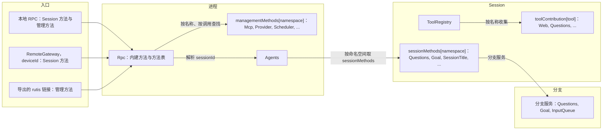
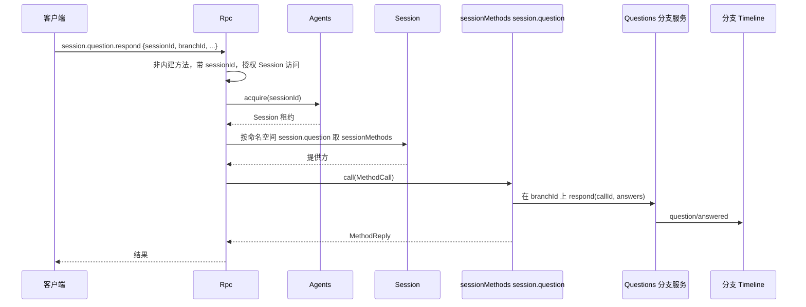
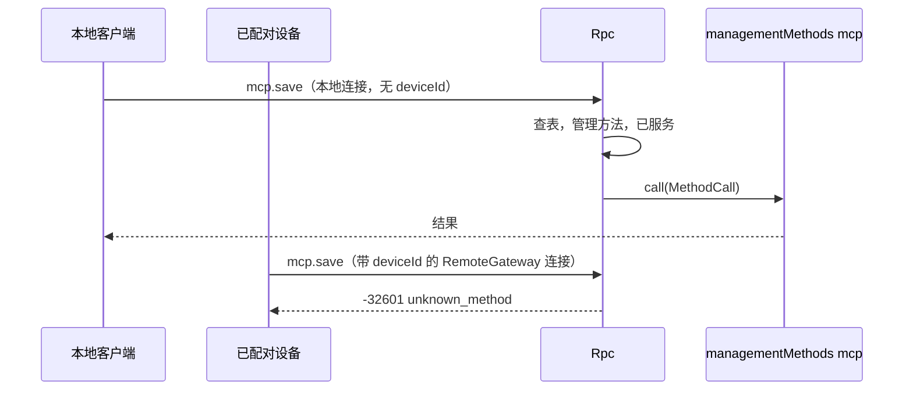

# 方法与工具贡献

状态：草案。总体设计：[总览 §3 集成](../overview.md#3-基于现有机制的集成)、[附录 B Rpc 与 ToolRegistry](../overview.md#附录-b-现有插件的补充)；规则：[ADR 002](../../adr/002-plugin-scope.md) D2、D3、D5。阶段：P0。语言：语言中立合同；Rust 绑定见[附录 F](#附录-f-rust-绑定)。

本合同以 ADR 002 D5 的语言中立形式定义三个具名服务。每个服务由服务名、作用域和实例 key 标识；其方法接收并返回可序列化数据；错误是数据；取消是一个协议动作。任何语言的插件都可以通过在其 `provides`（loader 行）中声明来提供它们，消费方按名称和作用域收集。它们建立在运行时已有的机制之上：按作用域收集的具名服务，以及 Rpc 现有的经 Session 分发（与如今的 `approval.respond` 相同）。

| 服务 | 作用域 | Key | 提供方 | 收集方 |
| --- | --- | --- | --- | --- |
| `sessionMethods` | Session | 命名空间 | Session 级插件部分（Questions、Goal、SessionTitle、Attachments、ShellInput、Hooks、Notifications）和 InputQueue（`session.input`） | Rpc，经 Session 分发 |
| `managementMethods` | 进程 | 命名空间 | 只有进程插件（Mcp、Provider、Settings、Scheduler 等） | Rpc，按调用查找 |
| `toolContribution` | Session | 工具名 | Session 级插件部分（Questions、Goal、Web、Notifications、Scheduler、Workflow） | ToolRegistry（补充：具名工具服务） |

**管理方法**是关于宿主而不是某个 Session 的客户端 RPC 方法：`account.*`、`provider.*`、`mcp.*`、`skills.*` 和设置，以及新进程插件的方法。`daemon.shutdown` 仍是 Rpc 内建方法，同样从不提供给已配对设备。现在 Rpc 直接注入这些服务（[connection.rs](../../../../crates/dim-app-server/src/connection.rs) 中的 `ProductServices` 与 `ExecutionServices`）；本设计改为通过 `managementMethods` 按调用查找，不依赖其提供方。只有进程插件提供管理方法，已配对的远程设备从不获得它们。Session 方法没有级别；唯一的区分是 `sessionMethods`（经 Session 分发）与 `managementMethods`。

Rpc 依据连接的 `ConnectionEntry {name, deviceId}` 决定为它服务什么：本地连接获得 Session 方法和管理方法，带 `deviceId` 的连接（经 RemoteGateway 的已配对设备）从不获得管理方法，导出的 rutis 链接只在导出时获得管理方法。没有注册表、没有端口，也没有 Management 插件。提供方是只在启用时安装的可选插件。Rpc 在每次调用时查找 `managementMethods` 提供方，不依赖它们，因此未启用、Pending、Failed 或正在重载的提供方只影响自己的命名空间（§3.2）。`toolContribution` 提供方重载会传播到 ToolRegistry，这是 D3 所接受的代价。

在工具调用或输入提交前对其作出处理不是本合同的服务。Approval 和 Session 输入路径不变；InputQueue 的撤回是其所有者的变更（[总览附录 B](../overview.md#附录-b-现有插件的补充)）。

## 1. 结构



| 服务 | 缺失时 |
| --- | --- |
| `sessionMethods` | 对该 Session 返回 `unknown_method` |
| `managementMethods` | `unknown_method` |
| `toolContribution` | 不提供该工具 |

本文定义的合同：这三个服务、`MethodDecl`、`MethodCall`、`MethodReply`、`MethodError`、配套服务 `callChannel`、`ToolDeclaration`、`ToolCall`、`ToolResult`、各入口获得的服务范围、命名、保留名、现有管理方法的迁移以及兼容性表。使用的合同：`SessionConfig`（[session-access](session-access.md#a3-sessionconfig-字段)）、来源输入约定（[session-access A.2](session-access.md#a2-来源输入约定)）、Rpc 命令信封以及 `appError` 码。

## 2. 数据与状态

没有任何服务拥有 Timeline 事件或持久化状态。Session 的方法表在 Session 装载时重建；管理方法提供方在每次调用时查找。每个连接在被接受时记录 `ConnectionEntry {name, deviceId}`；它获得的服务范围由这条记录决定（§3.2），从不由用户身份推导。链接的管理方法导出是宿主本地的结构性配置。

## 3. 流程

### 3.1 Session 方法



命名空间按该 Session 中所提供命名空间的最长前缀解析。如果该 Session 没有此命名空间（插件被禁用），结果为 `unknown_method`。Session 方法没有级别：获得 Session 方法的连接获得全部 Session 方法，包括 `shell.*`。

### 3.2 管理方法



连接的入口记录是唯一的检查。获得管理方法即授予宿主管理员权限。

Rpc 在每次调用时，按方法名的前缀从长到短做带 key 的读取，在已激活的进程服务 `managementMethods` 中解析命名空间（附录 F）。Rpc 不依赖这些提供方。提供方的行已启用但处于 Pending 或重载时新旧两代之间的命名空间，返回可重试的 `service_reloading`；行处于 Failed 或 Unresolved 的，返回不可重试的 `service_unavailable`。Rpc 根据 loader 的行状态（`Loader::entries`）区分。没有已启用提供方的命名空间返回 `unknown_method`。Rpc、已打开的连接和其他命名空间都不受影响。提供方卸载前已受理的调用按该方法的 `interruption` 处理（A.1）：卸载中的提供方以 `operation_interrupted` 结束其 `report` 调用，`drain` 调用如何推迟卸载，按 rutis 现有的生命周期处理（§9.2 已撤回）。

## 4. 时序与冲突

| 场景 | 顺序 | 结果 | 所有者 |
| --- | --- | --- | --- |
| Session 级提供方在调用中途重载 | call < reload | `report`：`operation_interrupted`；`drain`：提供方在自己的清理流程中先处理完已受理的调用再卸载（AGENTS.md 规则 8） | Rpc |
| Session 的 Capability 重载期间调用 Session 方法 | — | `service_reloading` | Rpc |
| 对没有该插件的 Session 调用 Session 方法 | — | `unknown_method` | Rpc |
| 管理方法所有者重载 | — | 新一代激活前，调用其命名空间返回 `service_reloading`；已受理的调用按 `interruption` 处理；Rpc 不重载，连接保持打开 | Rpc |
| 在带 `deviceId` 的连接上调用管理方法或 `daemon.shutdown` | — | `unknown_method` | Rpc |
| 两个提供方声明同一命名空间或工具名 | 装配 | 装配失败；key 在每个作用域内唯一 | 装配 |
| 工具贡献提供方在 turn 期间重载 | call < reload | 在途调用失败；该提供方的工具在 Session 下次重载前不可用；ToolRegistry 与 Loop 照常运行（D3） | ToolRegistry |

完整表格：[附录 B](#附录-b-完整冲突表)。

## 5. 上下文映射

方法没有模型可见的效果。改变模型上下文的方法通过其所有者的输入或 Timeline 事实来做到，适用这些所有者的映射。`toolContribution` 与任何工具一样，只通过其声明和 `ToolResult` 到达模型。

## 6. 接口（摘要）

| 服务与方法 | 模式 | 用途 |
| --- | --- | --- |
| `sessionMethods[namespace].describe() -> MethodDecl[]` | async | Session 级方法声明 |
| `sessionMethods[namespace].call(MethodCall) -> MethodReply` | async | 执行 Session 级方法 |
| `managementMethods[namespace].describe / call` | async | 相同结构，进程作用域，管理方法 |
| `callChannel.progress / notify / closed`（Rpc） | sync / async | 逐次调用的进度与绑定连接的通知 |
| `toolContribution[tool].declaration() -> ToolDeclaration` | sync | 工具声明 |
| `toolContribution[tool].execute(ToolCall) -> ToolResult` | async | 工具执行 |

## 7. 安全

连接的 `ConnectionEntry {name, deviceId}` 是其服务范围的唯一权威：本地 RPC 获得 Session 方法和管理方法，带 `deviceId` 的连接（RemoteGateway）只获得 Session 方法（已配对设备可调用所有 Session 方法，包括 `shell.*`，决定 E3），rutis 链接只在宿主本地链接配置中显式导出时才服务管理方法。Rpc 只做外部边界校验：对每个 Session 级方法校验参数格式并授权 `sessionId`，与其内建方法完全相同。功能检查（内容嗅探、大小限制、模型能力）归方法的所有者。`toolContribution` 与每个工具一样，按其声明的风险由 Approval 与 Permission 准入。没有宿主本地批准：Approval 与 Permission 只管 agent 决策引起的动作，按用户或项目配置运行的命令由该配置自己负责，启用即运行（[总览 §6.4](../overview.md#64-约定)）。现有的 `mcp.approve`/`mcp.revoke` 在后续代码变更中删除（A.4）。

## 8. 规则检查

| 规则 | 本文如何遵守 |
| --- | --- |
| §4 第 1 条（指令事件） | 不适用：这些服务自身不写 Timeline 事件；改变分支状态的方法调用状态所有者，由所有者写入（例如 `question/answered`）。 |
| §4 第 2 条（交接） | 不适用：方法与工具贡献不交接任何对象；工具调用按现有 `step/tool-call` 合同交给 ToolExecutor。 |
| §4 第 3 条（只用 before 回调） | Rpc 只校验参数格式和 `sessionId` 授权；功能检查归方法所有者，提交前的处理只用 Timeline before 回调。 |
| §4 第 4 条（核心不带业务含义） | Rpc 与 ToolRegistry 按名称收集服务，从不点名提供方，也不解释方法。 |
| §4 第 5 条（批次） | 不适用：本文没有依据 Timeline 事件做的决定；所有者依据自己的事实决定。 |
| §4 第 6 条（模型上下文） | 方法对模型不可见，`toolContribution` 只通过其声明和 `ToolResult` 到达模型（§5）。 |
| §4 第 7 条（公开事件与服务） | 提供方只通过分支的公开服务到达分支，Rpc 只经 Session 的 `sessionMethods` 分发。 |
| §4 第 8 条（需求） | 按名称查找 Session 服务、收集具名工具在 §9 提出；卸载时等待 drain、列出已激活提供方已撤回（rutis 是外部依赖）。 |
| §4 第 9 条（只有决定用的事实进 Timeline） | 方法表与入口服务范围是装配数据，从不是 Timeline 事实（§2）。 |
| §1（Capability 与 App Server 边界） | Rpc 只收集和分发；每个方法的业务代码在其提供方插件中。 |
| ADR 002 D1 | `sessionMethods` 与 `toolContribution` 是 Session 级，`managementMethods` 是进程级，与其所有者一致。 |
| ADR 002 D2 | 没有注册表、端口或 Management 插件；Rpc 与 ToolRegistry 按名称收集。 |
| ADR 002 D3 | 提供方只依赖自身或外层作用域。`toolContribution` 提供方重载会使 ToolRegistry 重载（§4）；Rpc 不依赖管理方法提供方，它们的重载只影响自己的命名空间（§3.2）。 |
| ADR 002 D4 | 链接的管理方法导出是宿主本地的结构性配置；本文不定义业务配置。 |
| ADR 002 D5 | 每个服务都有名称、作用域、key 和纯数据方法；Rust 类型只出现在附录 F。 |

## 9. 向机制所有者提出的需求

### 9.1 按名称查找带 key 的 Session 服务

| 项 | 内容 |
| --- | --- |
| 被什么挡住 | Rpc 分发 Session 方法时不能点名提供方（§4 第 4 条、ADR 002 D2 与 D5）；Session 门面目前只返回类型化服务。 |
| 考虑过的现有机制 | 类型化的 `Session::service::<T>()`：需要提供方的 Rust 类型，Rpc 就要点名它。列举提供方的 Session 服务：属于接线模块（D2）。 |
| 需要的通用能力 | Session 门面按服务名和实例 key 返回注册的 Session 级服务（按命名空间查 `sessionMethods`），并返回同名的全部 Session 服务（供 ToolRegistry 收集 `toolContribution`）。 |
| 对序号、批次、中断、重载的影响 | 对序号与批次无影响；Session 重载期间查找失败，Rpc 回复 `service_reloading`。 |
| 由谁实现、对应 issue | 运行时（Session 门面）；issue 待开。 |

### 9.2 卸载时等待 `drain` 调用

已撤回：rutis 是外部依赖，不向它提需求。Rpc 卸载前本来就会等它已接受的命令处理完。

| 项 | 内容 |
| --- | --- |
| 被什么挡住 | `drain` 方法（`account.*`、`provider.*`）必须在其提供方卸载前完成（A.4，现有行为）。 |
| 考虑过的现有机制 | 中断所有调用（`report`）：改变 `account.*` 与 `provider.*` 的线上行为。由 Rpc 持有提供方：在生命周期之外保留正在重载的插件。 |
| 需要的通用能力 | 插件卸载时等待它登记为 drain 的在途工作完成，然后继续。 |
| 对序号、批次、中断、重载的影响 | 不影响 Timeline；重载最多延后到这些调用结束。 |
| 由谁实现、对应 issue | rutis 生命周期；issue 待开。 |

### 9.3 列出进程级服务的已激活提供方

已撤回：rutis 是外部依赖，不向它提需求。Rpc 用 rutis 现有的能力（按 key 读取）分发管理方法；`hello.features` 怎么列出它们，是 Rpc 自己的设计。

| 项 | 内容 |
| --- | --- |
| 被什么挡住 | `hello.features` 要列出已激活管理方法提供方的方法（A.1），而 Rpc 必须在不依赖它们的前提下找到它们（§3.2）。正在重载的提供方应得到 `service_reloading`，而不是 `unknown_method`。 |
| 考虑过的现有机制 | 带 key 的读取 `Ctx::get_as` 能按 key 找到一个已激活的提供方，足以分发调用，Mcp 读取其 loader 行就是这样做的；但它不能列出提供方，也分不清已注册但未激活的提供方和不存在的提供方。把提供方声明为依赖可以列出它们，但会让 Rpc 门控在每一个提供方上（§3.2）。 |
| 需要的通用能力 | 在进程作用域列出某个服务名的已激活提供方，并报告某个 key 是否有已注册但未激活的提供方。 |
| 对序号、批次、中断、重载的影响 | 对序号与批次无影响；在某个连接 `hello` 之后才激活的提供方，出现在下一次 `hello` 中。 |
| 由谁实现、对应 issue | rutis 注册表；issue 待开。 |

非 Rust 插件提供的具名服务依赖 #4，其五项说明见 [Session 访问 §9](session-access.md#9-向机制所有者提出的需求)。

## 附录 A. 接口细节

结构为 camelCase 字段的 JSON；字段名后的 `?` 表示可选，`|` 分隔备选项。这些结构是规范形式：插件文档使用这些字段名（Rust 绑定把它们映射为 snake_case）。每个错误都是 `MethodError` 数据。

### A.1 方法贡献

`sessionMethods`（Session，key 为命名空间）与 `managementMethods`（进程，key 为命名空间）具有相同的两个方法。

| 方法 | 模式 | 请求 | 回复 |
| --- | --- | --- | --- |
| `describe` | async | — | `MethodDecl[]` |
| `call` | async | `MethodCall` | `MethodReply`，或 `MethodError` |

```text
// MethodDecl
{ "name": "session.goal.set",          // 命名空间内的完整线上名称
  "mutating": true,
  "interruption": "report" | "drain",  // report：operation_interrupted；drain：卸载等待
  "progress": false,
  "notifications": ["session.goal.changed"], // 位于命名空间内
  "reply": "direct" | "handoff" }      // handoff：daemon.shutdown
// MethodCall
{ "callId": "string", "method": "session.goal.set",
  "sessionId?": "string",              // sessionMethods 时存在且已授权
  "params": {},
  "origin": { "entry?": { "name": "string", "deviceId?": "string" }, // 连接的 ConnectionEntry
              "connectionId?": "string", "peer?": "string" } } // peer：rutis 链接；仅用于诊断
// MethodReply
{ "kind": "value", "value": {} } | { "kind": "handedOff" }
// MethodError
{ "code": -32000, "appError": "string", "message": "string" }
```

取消：`report` 调用被中断时，Rpc 针对 `callId` 发送取消请求（或丢弃该调用）并回复 `operation_interrupted`；`drain` 调用会在提供方卸载前被等待完成。

| 规则 | 内容 |
| --- | --- |
| 命名空间 | `<segment>(.<segment>)*`，段为 `[a-z][a-z0-9_]*`，由提供方拥有；命名空间本身可以是一个方法（`session.rename`） |
| 所有权 | 一个名称属于在内建方法、进程表和该 Session 的提供方中，作为其前缀或与其相等的最长已提供命名空间 |
| 为 Rpc 内建方法保留 | `hello`、`daemon`、`agent`、`approval`、单独的 `session` 根，以及 `session.attach`、`session.branch_create`、`session.close`、`session.create`、`session.detach`、`session.history`、`session.idle`、`session.input_lookup`、`session.list`、`session.state`、`session.stop`、`session.submit`、`session.summaries`、`session.exec`、`session.mcp`、`session.model`、`session.permission`、`session.prompt`、`session.skills`。`session.input` 不保留：InputQueue 通过 `sessionMethods` 提供 `session.input.withdraw`（提议中），因此 Rpc 不点名任何所属服务 |
| 优先级 | 内建方法，然后是进程表，然后是该 Session 的提供方；共用一个线上名称空间 |
| Session 级调用 | 需要 `sessionId`（缺少时 `-32602`）。Rpc 对其授权，经 Agents acquire 该 Session（必要时恢复），并调用该 Session 中对应命名空间的 `sessionMethods`。提供方通过该分支的服务到达某个分支 |
| 不分发 | 命名空间未提供（没有已启用的提供方），或在带 `deviceId` 的连接或未导出的链接上调用管理方法 → `-32601 unknown_method`。Session 正在重载，或管理方法提供方处于 Pending 或新旧两代之间 → `-32000 service_reloading`（可重试）。管理方法提供方的行处于 Failed 或 Unresolved → `-32000 service_unavailable`（不可重试）。已开始的 `report` 调用被中断 → `operation_interrupted` |
| `hello.features`（v3） | 内建方法；连接获得管理方法时，再加上 `hello` 时已激活的管理方法提供方的方法。Rpc 对已启用 loader 行在 `provides` 中声明的每个命名空间做带 key 的读取，列出已激活的那些。Session 级方法按 Session 列在 `session.state.methods` 中 |
| 就绪闩 | 在 loader 的初始装载结算后打开，因此进程提供方在第一个 `hello` 时已存在 |

已知的 Session 级命名空间：`session.question`（Questions）、`session.goal`（Goal）、`session.rename`（SessionTitle）、`session.input`（InputQueue）、`attachment`（Attachments）、`shell`（ShellInput）、`hooks`（Hooks）、`notifications`（Notifications，含 `notifications.test`）。各插件文档对其方法具有权威性。

### A.2 调用通道

Rpc 向方法提供方提供进程服务 `callChannel`。

| 方法 | 模式 | 请求 | 回复 |
| --- | --- | --- | --- |
| `progress` | sync | `{callId, data}` | —（除非方法声明了 `progress`，否则丢弃） |
| `notify` | async | `{connectionId, method, params}` | `{}`，或错误 `unsupported`（链接）、`undeclared`、`gone` |
| `closed` | async | `{connectionId}` | 连接关闭时完成 |
| `takeFinalReply` | async | `{callId}` | 最终回复写出后返回 `{}`；仅限 `handoff` 方法 |

进度对 Session 方法和管理方法都以通知 `management.progress {id, method, data}` 发送，排在响应之前，断开后丢弃。通知名必须声明且位于命名空间内。`connectionId` 在连接关闭前对 `notify` 一直有效。

### A.3 入口与导出

| 入口 | 获得的服务 | 说明 |
| --- | --- | --- |
| 本地受保护传输 | Session 方法与管理方法 | 如今的受保护 profile 规则不变 |
| 裸 WebSocket，受保护 profile | 与如今相同 | 除 `hello`/`daemon.ping` 外都是 `local_transport_required` |
| RemoteGateway（设置了 `deviceId`） | 只有 Session 方法 | [RemoteGateway](../plugins/RemoteGateway.md) |
| 导出的 rutis 链接 | 管理方法 | 仅在宿主本地链接配置中导出时。没有调用方接收端时，进度被丢弃，`notify` 返回 `unsupported` |

### A.4 迁移与兼容性

来源：[protocol.rs](../../../../crates/dim-app-server/src/protocol.rs) 中的 `MANAGEMENT_METHODS`、`MCP_METHODS`、`LOCAL_EXECUTION_METHODS`、`Call::is_management`；[connection.rs](../../../../crates/dim-app-server/src/connection.rs) 中的 `validate_call`。

| 方法 | 去向 | 提供方（命名空间） |
| --- | --- | --- |
| `account.providers/status/recover/logout`、`account.login.*` | `managementMethods` | ManagedProviders（`account`） |
| `account.codex.*`、`account.grok.*` | `managementMethods` | OpenAI Codex OAuth（`account.codex`）、Grok OAuth（`account.grok`） |
| `provider.*` | `managementMethods` | Provider（`provider`） |
| `skills.catalog/set_enabled/refresh` | `managementMethods` | SkillsCatalog（`skills`） |
| `mcp.catalog/set_enabled/save/remove/disconnect` | `managementMethods` | Mcp（`mcp`） |
| `mcp.approve/revoke` | 在后续代码变更中删除（没有宿主本地批准；启用即运行；项目条目默认关闭；[ADR 003](../../../adr/003-approval-scope.md)） | — |
| `daemon.shutdown` | Rpc 内建方法，回复 handoff；从不提供给带 `deviceId` 的连接 | — |
| `hello`、`daemon.ping`、`agent.*`、现有 `session.*`、`approval.respond` | Rpc 内建方法 | — |
| 新的 `session.input.withdraw` | `sessionMethods` | InputQueue（`session.input`） |
| 新的 Session 方法 | `sessionMethods` | 各所有者（A.1） |

中断行为与如今一致：`mcp.*` 与 `skills.*` 为 `report`，`account.*` 与 `provider.*` 为 `drain`。Rpc 的 `When<ProductServices>` 与 `When<ExecutionServices>` 直接删除，不改用收集：Rpc 按调用查找 `managementMethods`（§3.2），不再点名或依赖任何所属服务。如今读取管理服务的内建方法（`session.create` 与 `session.model.update` 的模型选择、`session.mcp` 读取的 Mcp）改为每次调用用同样的带 key 读取，服务缺席时保持现有行为。

| 客户端 | 之前 | 之后 |
| --- | --- | --- |
| v1、v2 | 管理方法 `unknown_method` | 相同 |
| v3 本地，product profile | `hello.features` 含 33 个 product 名称 | 名称相同；参数、结果、错误码和 `appError` 不变 |
| v3 本地，execution | `LOCAL_EXECUTION_METHODS` + `MCP_METHODS` | 名称相同 |
| v3 裸 WebSocket，受保护 profile | `local_transport_required` | 相同 |
| v3 RemoteGateway（新） | 不存在；execution Session 方法（`session.permission.get/update`、`session.exec.stop`、`session.skills`、`session.model.update`、`session.prompt.refresh`、`session.mcp`、`session.mcp.refresh`）仅限本地 | **兼容性变更（E3）：** 对已配对设备可用；管理名称 `unknown_method` |
| v3，MCP 已禁用 | `mcp.*` `unknown_method` | 相同，使用 Rpc 的消息 |
| v3，Mcp 正在重载 | `service_reloading` | 不变：Mcp 重新激活前 `mcp.*` 返回 `service_reloading`；Rpc 不重载，连接保持打开 |

不增加协议版本，持久化格式不变。

### A.5 工具贡献

ToolRegistry 补充：除如今已注册的工具外，ToolRegistry 接受具名工具服务。插件在其 `provides` 中于 Session 作用域声明 `toolContribution[<tool name>]`，ToolRegistry 接入 Session 装载时提供方已可用的工具服务，不对它们形成硬依赖；提供方缺失、Pending 或正在重载时，只是它的工具不存在，其他不受影响；之后才起来的提供方在下次 Session 重载时接入（ADR 002 D3，#34）。名称唯一性、与宿主工具冲突以及通过 `SessionConfig.tools` 启用的现有规则不变（[工具贡献](../../../architecture/rust-agent/tool-contributions.md)）。

| 方法 | 模式 | 请求 | 回复 |
| --- | --- | --- | --- |
| `declaration` | sync | — | `ToolDeclaration` |
| `execute` | async | `ToolCall` | `ToolResult` |

```text
// ToolDeclaration
{ "name": "web_fetch",           // 等于 key
  "description": "string",
  "inputSchema": { /* JSON Schema */ },
  "risk": "network" }            // Permission 类别；新工具必填
// ToolCall
{ "sessionId": "string", "branchId": "string", "turnId": "string", "callId": "string",
  "arguments": {}, "config": { /* SessionConfig 数据 */ } }
// ToolResult
{ "content": [ { "type": "text", "text": "..." } | { "type": "image", "...": "..." } ],
  "structuredContent?": {}, "isError": false }
```

取消：turn 中断时针对 `callId` 发送取消请求（或丢弃调用）；ToolExecutor 把该调用按中断结算。提供方错误以 `isError: true` 的 `ToolResult` 返回。声明可以取决于该 Session 的配置，每个提供方代次读取一次。

## 附录 B. 完整冲突表

| 场景 | 序号顺序 | 结果 | 决定所有者 |
| --- | --- | --- | --- |
| 分支 `stop/interrupt` 期间的 Session 方法 | 按所有者的事实 | 由所有者的 Timeline 顺序决定（例如，中断之后的 Questions 回答是 `question/cancelled`） | 所属插件 |
| 对已关闭分支调用 Session 方法 | — | 所有者的 `BranchMissing` 错误 | 所属插件 |
| 对未装载 Session 调用 Session 方法 | — | Rpc 经 Agents 恢复后再分发 | Rpc |
| Session 级提供方在调用中途重载 | admitted < reload | `report`：`operation_interrupted`；`drain`：等待 | Rpc |
| 进程所有者重载 | — | 重新激活前其命名空间返回 `unknown_method`；已受理的调用按 `interruption` 处理；Rpc 不重载 | Rpc |
| 有在途调用时 Rpc 重载 | — | `report` 被中断，`drain` 被排空；`closed` 完成 | Rpc |
| 在带 `deviceId` 的连接上调用管理方法 | — | `unknown_method` | Rpc |
| 客户端在调用中途 detach | — | 调用继续；回复被丢弃 | Rpc |
| 两个客户端修改同一配置 | 存储修订号 | 后者得到提供方的冲突错误 | 提供方 |
| `daemon.shutdown` 与另一调用并发 | 准入 | 停止准入，然后已准入的调用按 `interruption` 结算 | 进程协调者 |
| turn `stop/interrupt` 期间调用工具贡献 | interrupt < result | 针对 `callId` 发送取消请求；ToolExecutor 把该调用按中断结算 | ToolExecutor |
| 未结算的工具批次、压缩、切出子分支、`input/withdraw`、`input/deleted` | — | 对方法无影响 | — |
| 调用中途进程重启 | — | 回复丢失；结果取决于提供方的持久化；从不重放 | 提供方 |

## 附录 C. 错误与恢复

| 情况 | 线上结果 |
| --- | --- |
| 未提供、提供方未激活、不向该连接提供，或 v1/v2 | `-32601`，`unknown_method` |
| Session 级方法缺少 `sessionId` | `-32602` |
| Session 正在重载，或管理方法提供方处于 Pending 或新旧两代之间 | `-32000`，`service_reloading`（可重试） |
| 管理方法提供方处于 Failed 或 Unresolved | `-32000`，`service_unavailable`（不可重试） |
| `report` 调用被中断 | `-32000`，`operation_interrupted` |
| 提供方错误 | `-32000`，提供方的 `appError` |

## 附录 D. 验收

1. Session 级方法经其指定的 Session 分发。在没有该插件的 Session 上返回 `unknown_method`，且 Rpc 从不点名提供方。
2. 管理方法在本地入口上可达，在 RemoteGateway 上返回 `unknown_method`，只在导出时经链接可达。`shell.*` Session 方法与所有 Session 方法一样可在 RemoteGateway 上调用。
3. 每个迁移后的管理方法的录制记录与迁移前的记录一致，且 v3 本地 profile 的 `hello.features` 不变。
4. 在 RemoteGateway 测试入口上，`session.permission.update` 与 `session.exec.stop` 成功。
5. 由非 Rust 插件以 `toolContribution` 提供的工具，会像 Rust 工具一样被声明给模型，并经 ToolExecutor 执行。
6. 进度先于响应，断开后 `notify` 报告 `gone`。
7. 某个已启用的管理方法提供方处于 Pending 或 Failed 时，`hello` 成功，其他命名空间都正常，该提供方的命名空间返回 `unknown_method`；除非它就是 PluginManager 本身，否则可以用 `plugin.set_enabled` 禁用它。管理方法提供方重载既不会让 Rpc 重载，也不会关闭连接。

## 附录 E. 假设

| # | 假设 | 依据 | 若被否决的影响 |
| --- | --- | --- | --- |
| A1 | Session 级命名空间可以使用 `session` 以外的根（`attachment`、`shell`） | 现有线上名称 | 全部移到 `session.` 之下 |
| A2 | Session 能为 Rpc 按名称查找带 key 的 Session 服务 | 现有带 key 的 Session 服务；作为 §9.1 提出 | Rpc 通过一个 Session 服务枚举提供方 |
| A3 | Session 级方法按 Session 列出，而不在 `hello.features` 中 | 它们因 Session 而异 | 一个全局列表加上按 Session 的可用性 |
| A4 | Rpc 在每次调用时对已激活的提供方做带 key 的读取（`Ctx::get_as`）来分发管理方法 | Mcp 就是这样读取其 loader 行服务的（[publication.rs](../../../../crates/dim-app-server/src/mcp/publication.rs)） | Rpc 依赖每一个提供方，一个未激活的提供方就会挡住全部 RPC |

## 附录 F. Rust 绑定

上述语言中立服务映射到 Rust 如下。Rust 插件可以直接使用这些类型；非 Rust 插件通过 rutis-bridge（`TypeKey::named`、配合 `dyn HostDispatch` 的 `host_key(name)`）按名称提供服务，生成的 Rust 绑定把它们解码为相同的类型。

| 语言中立服务 | Rust 类型与 key | Rust 装配中的注册 | 收集 |
| --- | --- | --- | --- |
| `sessionMethods[ns]` | `SessionMethodContribution(Arc<dyn MethodProvider>)`，`SessionScope::named_key::<SessionMethodContribution>(ns)` | `AgentBuilder::session_methods(ns)` | `Session::method(ns)` |
| `managementMethods[ns]` | `ManagementMethods(Arc<dyn MethodProvider>)`，进程作用域，实例 key 为 `ns` | loader 行 | 按调用：用命名空间 key 执行 `Ctx::get_as::<ManagementMethods>`；不在 Rpc 的 `Deps` 中 |
| `toolContribution[tool]` | `ToolContribution {definition, handler}`，`SessionScope::named_key::<ToolContribution>(tool)` | `AgentBuilder::session_tool(tool)`（已有） | Session 装载时可用则由 ToolRegistry 接入，不形成硬依赖（D3）；现有的 `Contributions<ToolContribution>` 是硬依赖，需要改 |
| `callChannel` | `CallChannel`、传给 `MethodProvider::call` 的 `ConnectionNotifier` | — | — |

```rust
pub trait MethodProvider: Send + Sync + 'static {
    fn namespace(&self) -> &str;
    fn methods(&self) -> Vec<MethodDecl>;
    fn call(&self, call: MethodCall, channel: CallChannel, cancel: CancellationToken)
        -> HostFuture<'_, Result<CallReply, MethodError>>;
}
pub enum Interruption { Report, Drain }
pub enum ReplyMode { Direct, Handoff }
pub enum CallReply { Value(serde_json::Value), HandedOff }
pub struct MethodError { pub code: i32, pub app_error: Cow<'static, str>, pub message: String }

impl CallChannel {
    pub fn progress(&self, data: serde_json::Value);
    pub fn notifier(&self) -> Result<ConnectionNotifier, ChannelError>; // 链接时为 Unsupported
    pub fn take_final_reply(&self) -> Result<FinalReply, ChannelError>; // 仅限 Handoff
}
pub enum ChannelError { Unsupported, Undeclared, Gone }
```

`ToolContribution` 与 `ToolHandler` 是 `dim-agent-capabilities/src/tool_registry.rs` 中的现有类型；来自其他语言的具名工具服务由生成的绑定包装为 `ToolHandler`。
