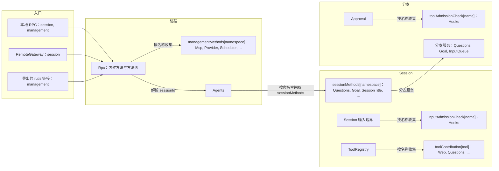
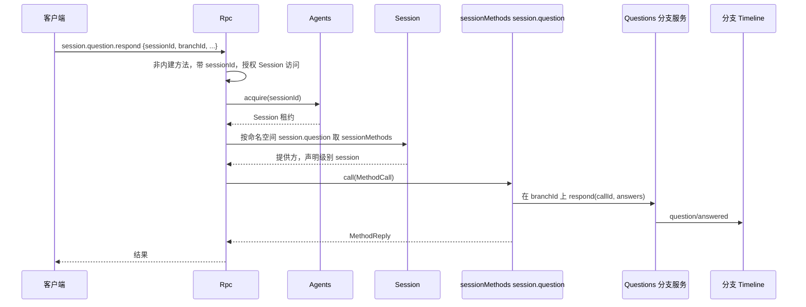
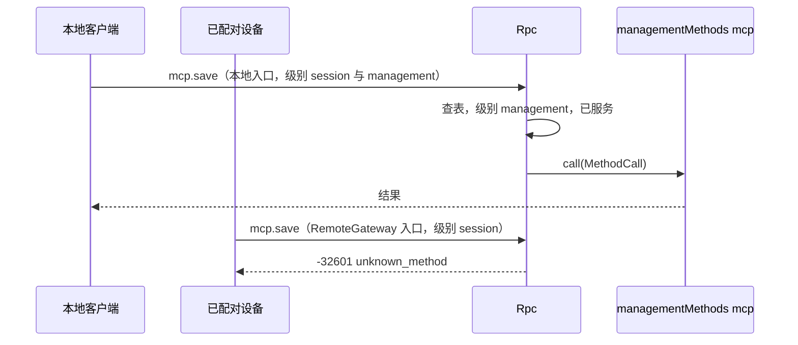
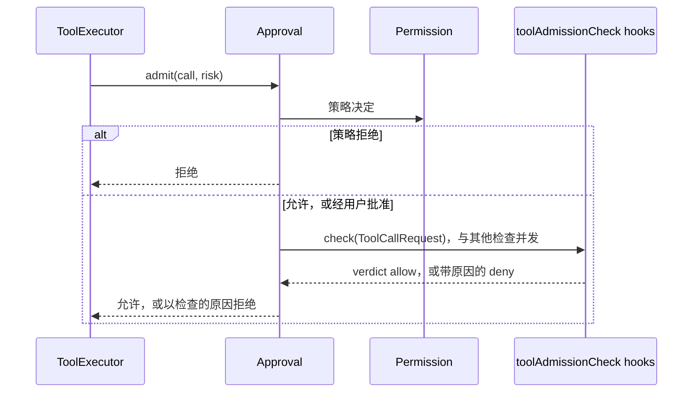
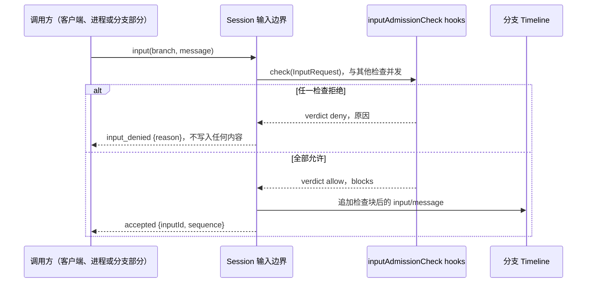

# 方法与准入检查

状态：草案。总体设计：[总览 §3 集成](../overview.md#3-基于现有机制的集成)、[附录 B Rpc 与 Approval](../overview.md#附录-b-现有插件的补充)；规则：[ADR 002](../../adr/002-plugin-scope.md) D2、D3、D5。阶段：P0。语言：语言中立合同；Rust 绑定见[附录 F](#附录-f-rust-绑定)。

本合同以 ADR 002 D5 的语言中立形式定义五个具名服务。每个服务由服务名、作用域和实例 key 标识；其方法接收并返回可序列化数据；错误是数据；取消是一个协议动作。任何语言的插件都可以通过在其 `provides`（loader 行）中声明来提供它们，消费方按名称和作用域收集。它们建立在运行时已有的机制之上：按作用域收集的具名服务，以及 Rpc 现有的经 Session 分发（与如今的 `approval.respond` 相同）。

| 服务 | 作用域 | Key | 提供方 | 收集方 |
| --- | --- | --- | --- | --- |
| `sessionMethods` | Session | 命名空间 | Session 级插件部分（Questions、Goal、SessionTitle、Attachments、ShellInput） | Rpc，经 Session 分发 |
| `managementMethods` | 进程 | 命名空间 | 进程插件（Mcp、Provider、Scheduler 等） | Rpc 的方法表，级别 `management` |
| `toolAdmissionCheck` | 分支 | 检查名 | 分支级插件部分（Hooks） | Approval，针对每次工具调用 |
| `inputAdmissionCheck` | Session | 检查名 | Session 级插件部分（Hooks `user_prompt_submit`） | Session 输入边界，针对每个输入 |
| `toolContribution` | Session | 工具名 | Session 级插件部分（Questions、Goal、Web、Notifications、Scheduler、Workflow） | ToolRegistry（补充：具名工具服务） |

每个入口（本地 RPC、RemoteGateway、导出的 rutis 链接）服务其配置的级别。没有注册表、没有端口，也没有 Management 插件。提供方是只在启用时安装的可选插件。提供方重载会传播到其收集方，这是 D3 所接受的代价。

## 1. 结构



| 服务 | 缺失时 |
| --- | --- |
| `sessionMethods` | 对该 Session 返回 `unknown_method` |
| `managementMethods` | `unknown_method` |
| `toolAdmissionCheck` | 不做检查 |
| `inputAdmissionCheck` | 不做检查；输入照常写入 |
| `toolContribution` | 不提供该工具 |

本文定义的合同：这五个服务、`MethodDecl`、`MethodCall`、`MethodReply`、`MethodError`、配套服务 `callChannel`、`ToolCallRequest`、`InputRequest`、`AdmissionReply`、`ToolDeclaration`、`ToolCall`、`ToolResult`、入口级别、命名、保留名、现有管理方法的迁移以及兼容性表。使用的合同：`SessionConfig`（[session-access](session-access.md#a3-sessionconfig-字段)）、来源输入约定（[session-access A.2](session-access.md#a2-来源输入约定)）、Rpc 命令信封、`appError` 码以及 Approval 的决策流程（[Approval](../../../architecture/rust-agent/plugins/Approval.md)）。

## 2. 数据与状态

没有任何服务拥有 Timeline 事件或持久化状态。方法表在 Rpc 或 Session 装载时重建。服务的级别是入口装配数据，在每个连接被接受时记录为 `ConnectionEntry {name, levels, deviceId}`，从不由身份推导。链接的管理级导出是宿主本地的结构性配置。准入检查不保存状态：其规则在使用时从所有者的业务来源读取。

## 3. 流程

### 3.1 Session 方法



命名空间按该 Session 中所提供命名空间的最长前缀解析。如果该 Session 没有此命名空间（插件被禁用，或 Session 为非交互且未安装该插件），结果为 `unknown_method`。Session 级方法可以声明 `level: management`（`shell.*`），此时只在服务管理级的入口上分发。

### 3.2 管理方法



入口服务的级别是唯一的检查。服务管理级即授予宿主管理员权限。

### 3.3 工具准入检查



检查在策略决定之后、执行之前运行。任一检查拒绝即拒绝该调用，被拒绝的调用与策略拒绝完全相同地结算（一个错误工具结果，不产生新事件）。失败的检查映射为其自身声明的结果（Hooks `pre_tool_use` 默认拒绝）。

### 3.4 输入准入检查



Session 输入边界即运行时的 `Session::input` 路径，每次输入写入都使用它（`session.submit`、`sessions.input`、写入输入的分支部分）。本补充使它收集该 Session 的 `inputAdmissionCheck` 服务，并在写入前运行它们。每个检查都会收到输入的来源，并自行决定其规则适用于哪些输入；Hooks 只把 `user_prompt_submit` 规则应用于不带来源标记的输入（用户输入）。

## 4. 时序与冲突

| 场景 | 顺序 | 结果 | 所有者 |
| --- | --- | --- | --- |
| Session 级提供方在调用中途重载 | call < reload | `Report`：`operation_interrupted`；`Drain`：重载等待 | Rpc |
| Session 的 Capability 重载期间调用 Session 方法 | — | `service_reloading` | Rpc |
| 对没有该插件的 Session 调用 Session 方法 | — | `unknown_method` | Rpc |
| 管理方法所有者重载 | — | Rpc 随之重载（D3）；已打开的连接看到现有的 Rpc 重载行为 | rutis 生命周期 |
| 在仅 session 级的入口上调用管理方法 | — | `unknown_method` | Rpc |
| 两个提供方声明同一命名空间、检查名或工具名 | 装配 | 装配失败；key 在每个作用域内唯一 | 装配 |
| 工具检查插件在 turn 期间重载 | check < reload | Approval 及其依赖方重载；在途 turn 以 `Failed` 结束（D3，已接受） | Approval |
| 一个检查拒绝而另一个允许 | — | 拒绝 | Approval、输入边界 |
| 工具检查期间 turn `stop/interrupt` | interrupt < verdict | 检查被取消；工具调用按中断结算 | Approval、ToolExecutor |
| 输入检查待定，另一输入已提交 | other < this | 顺序在提交时决定；检查从不持有提交锁 | 输入边界 |
| 输入检查插件在检查期间重载 | — | 写入以 `Reloading` 失败；调用方查找 `submissionId` 后重试 | 输入边界 |
| Hooks 被禁用（结构性） | — | 装配时不含这些检查；调用与输入照常进行 | 装配 |

完整表格：[附录 B](#附录-b-完整冲突表)。

## 5. 上下文映射

方法没有模型可见的效果。改变模型上下文的方法通过其所有者的输入或 Timeline 事实来做到，适用这些所有者的映射。工具准入拒绝只以错误工具结果的形式到达模型，携带检查的公开原因。被拒绝的输入从不写入，模型什么也看不到。允许的输入检查返回的块是该输入的 raw 块，位于输入自身 raw 块之后、其用户内容之前（[session-access §5](session-access.md#5-上下文映射)），模型原样看到它们。

## 6. 接口（摘要）

| 服务与方法 | 模式 | 用途 |
| --- | --- | --- |
| `sessionMethods[namespace].describe() -> MethodDecl[]` | async | Session 级方法声明 |
| `sessionMethods[namespace].call(MethodCall) -> MethodReply` | async | 执行 Session 级方法 |
| `managementMethods[namespace].describe / call` | async | 相同结构，进程作用域，管理级 |
| `callChannel.progress / notify / closed`（Rpc） | sync / async | 逐次调用的进度与绑定连接的通知 |
| `toolAdmissionCheck[name].check(ToolCallRequest) -> AdmissionReply` | async | 由 Approval 咨询的分支级检查 |
| `inputAdmissionCheck[name].check(InputRequest) -> AdmissionReply` | async | 在写入输入前运行的 Session 级检查 |
| `toolContribution[tool].declaration() -> ToolDeclaration` | sync | 工具声明 |
| `toolContribution[tool].execute(ToolCall) -> ToolResult` | async | 工具执行 |

## 7. 安全

入口装配是级别的唯一权威：本地 RPC 服务两个级别，RemoteGateway 服务 `session`（已配对设备可调用所有 Session 方法，决定 E3），rutis 链接只在宿主本地链接配置中显式导出时才服务 `management`。Rpc 对每个 Session 级方法授权 `sessionId`，与其内建方法完全相同，其他参数由提供方校验。运行命令或修改宿主配置的方法声明 `level: management`。准入检查只能拒绝、从不放宽：工具检查不能允许被策略或用户拒绝的调用，输入检查只能拒绝输入或添加带归属的块，从不修改调用方的内容或来源。宿主本地批准（`mcp.approve`、`hooks.approve`、`plugin.approve`、`workflow.approve`）是管理方法。

## 附录 A. 接口细节

结构为 camelCase 字段的 JSON；字段名后的 `?` 表示可选，`|` 分隔备选项。这些结构是规范形式：插件文档使用这些字段名（Rust 绑定把它们映射为 snake_case）。每个错误都是 `MethodError` 数据。

### A.1 方法贡献

`sessionMethods`（Session，key 为命名空间）与 `managementMethods`（进程，key 为命名空间）具有相同的两个方法。

| 方法 | 模式 | 请求 | 回复 |
| --- | --- | --- | --- |
| `describe` | async | — | `MethodDecl[]` |
| `call` | async | `MethodCall` | `MethodReply`，或 `MethodError` |

```text
// MethodDecl
{ "name": "session.goal.set",          // 命名空间内的完整线上名称
  "level": "session" | "management",   // managementMethods：始终为 "management"
  "mutating": true,
  "interruption": "report" | "drain",  // report：operation_interrupted；drain：卸载等待
  "progress": false,
  "notifications": ["session.goal.changed"], // 位于命名空间内
  "reply": "direct" | "handoff" }      // handoff：daemon.shutdown
// MethodCall
{ "callId": "string", "method": "session.goal.set",
  "sessionId?": "string",              // sessionMethods 时存在且已授权
  "params": {},
  "origin": { "kind": "local" | "entry" | "link", "entry?": "string",
              "connectionId?": "string", "peer?": "string" } } // 仅用于诊断
// MethodReply
{ "kind": "value", "value": {} } | { "kind": "handedOff" }
// MethodError
{ "code": -32000, "appError": "string", "message": "string" }
```

取消：`report` 调用被中断时，Rpc 针对 `callId` 发送取消请求（或丢弃该调用）并回复 `operation_interrupted`；`drain` 调用会在提供方卸载前被等待完成。

| 规则 | 内容 |
| --- | --- |
| 命名空间 | `<segment>(.<segment>)*`，段为 `[a-z][a-z0-9_]*`，由提供方拥有；命名空间本身可以是一个方法（`session.rename`） |
| 所有权 | 一个名称属于在内建方法、进程表和该 Session 的提供方中，作为其前缀或与其相等的最长已提供命名空间 |
| 为 Rpc 内建方法保留 | `hello`、`daemon`、`agent`、`approval`、单独的 `session` 根，以及 `session.attach`、`session.branch_create`、`session.close`、`session.create`、`session.detach`、`session.history`、`session.idle`、`session.input_lookup`、`session.list`、`session.state`、`session.stop`、`session.submit`、`session.summaries`、`session.exec`、`session.mcp`、`session.model`、`session.permission`、`session.prompt`、`session.skills`、`session.input`（`session.input.withdraw` 像 `approval.respond` 一样经 InputQueue 的分支服务提供，因为 InputQueue 是没有 Session 部分的核心分支 Capability） |
| 优先级 | 内建方法，然后是进程表，然后是该 Session 的提供方；共用一个线上名称空间 |
| Session 级调用 | 需要 `sessionId`（缺少时 `-32602`）。Rpc 对其授权，经 Agents acquire 该 Session（必要时恢复），并调用该 Session 中对应命名空间的 `sessionMethods`。提供方通过该分支的服务到达某个分支 |
| 不分发 | 命名空间未提供，或入口不服务该级别 → `-32601 unknown_method`。Session 正在重载 → `-32000 service_reloading`。已开始的 `report` 调用被中断 → `operation_interrupted` |
| `hello.features`（v3） | 入口所服务级别的内建方法与进程表方法。Session 级方法按 Session 列在 `session.state.methods` 中 |
| 就绪闩 | 在 loader 的初始装载结算后打开，因此进程提供方在第一个 `hello` 时已存在 |

已知的 Session 级命名空间：`session.question`（Questions）、`session.goal`（Goal）、`session.rename`（SessionTitle）、`attachment`（Attachments）、`shell`（ShellInput，管理级）。各插件文档对其方法具有权威性。

### A.2 调用通道

Rpc 向方法提供方提供进程服务 `callChannel`。

| 方法 | 模式 | 请求 | 回复 |
| --- | --- | --- | --- |
| `progress` | sync | `{callId, data}` | —（除非方法声明了 `progress`，否则丢弃） |
| `notify` | async | `{connectionId, method, params}` | `{}`，或错误 `unsupported`（链接）、`undeclared`、`gone` |
| `closed` | async | `{connectionId}` | 连接关闭时完成 |
| `takeFinalReply` | async | `{callId}` | 最终回复写出后返回 `{}`；仅限 `handoff` 方法 |

进度对两个级别都以通知 `management.progress {id, method, data}` 发送，排在响应之前，断开后丢弃。通知名必须声明且位于命名空间内。`connectionId` 在连接关闭前对 `notify` 一直有效。

### A.3 工具准入检查

`toolAdmissionCheck`（分支，key 为检查名）：`check(ToolCallRequest): async -> AdmissionReply`。

```text
// ToolCallRequest
{ "sessionId": "string", "branchId": "string", "turnId": "string", "callId": "string",
  "tool": "web_fetch", "arguments": {}, "risk": "network",
  "config": { /* SessionConfig 数据，session-access A.3 */ } }
// AdmissionReply（工具检查从不返回 blocks）
{ "verdict": "allow" | "deny", "reason?": "string", "blocks?": [ { "marker": "dim-<owner>", "text": "string" } ] }
```

| 规则 | 内容 |
| --- | --- |
| 收集 | Approval 按名称收集其分支的每个 `toolAdmissionCheck`。已声明但没有提供方的名称会使分支构建失败 |
| 顺序 | 所有检查在策略决定之后并发运行；任一 `deny` 即拒绝，原因（公开、模型可见）按名称顺序拼接 |
| 取消 | turn 中断时发送取消请求（或丢弃调用）；工具调用按中断结算 |
| 失败 | 由检查自身映射为 `allow` 或 `deny` |
| 模型调用审批 | 不受影响：检查只作用于工具调用 |

### A.4 入口级别与导出

| 入口 | 级别 | 说明 |
| --- | --- | --- |
| 本地受保护传输 | `{session, management}` | 如今的受保护 profile 规则不变 |
| 裸 WebSocket，受保护 profile | 与如今相同 | 除 `hello`/`daemon.ping` 外都是 `local_transport_required` |
| RemoteGateway | `{session}` | [RemoteGateway](../plugins/RemoteGateway.md) |
| 导出的 rutis 链接 | `{management}` | 仅在宿主本地链接配置中导出时。没有调用方接收端时，进度被丢弃，`notify` 返回 `unsupported` |

### A.5 迁移与兼容性

来源：[protocol.rs](../../../../crates/dim-app-server/src/protocol.rs) 中的 `MANAGEMENT_METHODS`、`MCP_METHODS`、`LOCAL_EXECUTION_METHODS`、`Call::is_management`；[connection.rs](../../../../crates/dim-app-server/src/connection.rs) 中的 `validate_call`。

| 方法 | 去向 | 提供方（命名空间） |
| --- | --- | --- |
| `account.providers/status/recover/logout`、`account.login.*` | `managementMethods` | ManagedProviders（`account`） |
| `account.codex.*`、`account.grok.*` | `managementMethods` | OpenAI Codex OAuth（`account.codex`）、Grok OAuth（`account.grok`） |
| `provider.*` | `managementMethods` | Provider（`provider`） |
| `skills.catalog/set_enabled/refresh` | `managementMethods` | SkillsCatalog（`skills`） |
| `mcp.catalog/set_enabled/save/remove/disconnect/approve/revoke` | `managementMethods` | Mcp（`mcp`） |
| `daemon.shutdown` | Rpc 内建方法，管理级，回复 handoff | — |
| `hello`、`daemon.ping`、`agent.*`、现有 `session.*`、`approval.respond`、新的 `session.input.withdraw` | Rpc 内建方法 | — |
| 新的 Session 方法 | `sessionMethods` | 各所有者（A.1） |

中断行为与如今一致：`mcp.*` 与 `skills.*` 为 `report`，`account.*` 与 `provider.*` 为 `drain`。Rpc 的 `When<ProductServices>` 与 `When<ExecutionServices>` 被收集 `managementMethods` 所取代，因此 Rpc 不再点名任何所属服务。

| 客户端 | 之前 | 之后 |
| --- | --- | --- |
| v1、v2 | 管理方法 `unknown_method` | 相同 |
| v3 本地，product profile | `hello.features` 含 33 个 product 名称 | 名称相同；参数、结果、错误码和 `appError` 不变 |
| v3 本地，execution | `LOCAL_EXECUTION_METHODS` + `MCP_METHODS` | 名称相同 |
| v3 裸 WebSocket，受保护 profile | `local_transport_required` | 相同 |
| v3 RemoteGateway（新） | 不存在；execution Session 方法（`session.permission.get/update`、`session.exec.stop`、`session.skills`、`session.model.update`、`session.prompt.refresh`、`session.mcp`、`session.mcp.refresh`）仅限本地 | **兼容性变更（E3）：** 对已配对设备可用；管理名称 `unknown_method` |
| v3，MCP 已禁用 | `mcp.*` `unknown_method` | 相同，使用 Rpc 的消息 |
| v3，Mcp 正在重载 | `service_reloading` | Rpc 随 Mcp 重载（D3）；客户端重连并重试 |
| v3，输入被检查拒绝（新） | 不存在 | `session.submit` 返回带原因的 `-32000 input_denied` |

不增加协议版本，持久化格式不变。

### A.6 输入准入检查

Session 输入边界补充（运行时门面，`Session::input`）：在写入输入之前，边界运行该 Session 的每个 `inputAdmissionCheck`，只有全部允许时才写入。

`inputAdmissionCheck`（Session，key 为检查名）：`check(InputRequest): async -> AdmissionReply`。

```text
// InputRequest
{ "sessionId": "string", "branchId": "string",
  "mode": "queue" | "steer" | "append",
  "source?": "string",           // 标记来源（session-access 的 A.2）；用户输入时缺省
  "origin": "client" | "process" | "branch",
  "submissionId?": "string",
  "rawBlocks": ["string"],       // 输入自身的 raw 块，标记在前
  "content": [ { "type": "text", "text": "..." } | { "type": "image", "...": "..." } ],
  "config": { /* SessionConfig 数据 */ } }
// AdmissionReply
{ "verdict": "allow" | "deny", "reason?": "string", "blocks?": [ { "marker": "dim-<owner>", "text": "string" } ] }
```

| 规则 | 内容 |
| --- | --- |
| 收集 | Session 装配按名称收集该 Session 的每个 `inputAdmissionCheck`；检查只在其插件启用时存在 |
| 顺序 | 检查在写入前、提交锁之外并发运行；任一 `deny` 即拒绝，原因按名称顺序拼接 |
| 拒绝 | 不写入任何内容。规范错误码为 `input_denied`，拼接后的原因作为 `message`：`session.submit` 返回带 `appError: "input_denied"` 的 `-32000`；`sessions.input` 返回 `{code: "input_denied", message}` |
| 带块允许 | 每个块为 `{marker, text}`：`marker` 是检查所有者的标记（`dim-<owner>`，session-access A.2），`text` 是完整的 raw 块，其第一行必须是该标记元素；否则边界把回复视为 `deny`，原因为 `invalid check reply`。块按检查名顺序追加在输入自身 raw 块之后，并写入同一个 `input/message`。检查块中不允许使用 key |
| 规则范围 | 每个检查依据 `source` 和 `origin` 决定其规则覆盖哪些输入。对于带有自身标记的输入，检查返回 `allow` |
| 取消 | 调用方丢弃写入即取消待定的检查；不写入任何内容 |
| 失败 | 由检查自身映射为 `allow` 或 `deny`。检查正在重载时，写入以 `Reloading` 失败 |

### A.7 工具贡献

ToolRegistry 补充：除如今已注册的工具外，ToolRegistry 接受具名工具服务。插件在其 `provides` 中于 Session 作用域声明 `toolContribution[<tool name>]`，ToolRegistry 按名称收集该 Session 的工具服务。名称唯一性、与宿主工具冲突以及通过 `SessionConfig.tools` 启用的现有规则不变（[工具贡献](../../../architecture/rust-agent/tool-contributions.md)）。

| 方法 | 模式 | 请求 | 回复 |
| --- | --- | --- | --- |
| `declaration` | sync | — | `ToolDeclaration` |
| `execute` | async | `ToolCall` | `ToolResult` |

```text
// ToolDeclaration
{ "name": "web_fetch",           // 等于 key
  "description": "string",
  "inputSchema": { /* JSON Schema */ },
  "risk": "network" }            // Permission 类别；新工具必填
// ToolCall
{ "sessionId": "string", "branchId": "string", "turnId": "string", "callId": "string",
  "arguments": {}, "config": { /* SessionConfig 数据 */ } }
// ToolResult
{ "content": [ { "type": "text", "text": "..." } | { "type": "image", "...": "..." } ],
  "structuredContent?": {}, "isError": false }
```

取消：turn 中断时针对 `callId` 发送取消请求（或丢弃调用）；ToolExecutor 把该调用按中断结算。提供方错误以 `isError: true` 的 `ToolResult` 返回。声明可以取决于该 Session 的配置，每个提供方代次读取一次。

## 附录 B. 完整冲突表

| 场景 | 序号顺序 | 结果 | 决定所有者 |
| --- | --- | --- | --- |
| 分支 `stop/interrupt` 期间的 Session 方法 | 按所有者的事实 | 由所有者的 Timeline 顺序决定（例如，中断之后的 Questions 回答是 `question/cancelled`） | 所属插件 |
| 对已关闭分支调用 Session 方法 | — | 所有者的 `BranchMissing` 错误 | 所属插件 |
| 对未装载 Session 调用 Session 方法 | — | Rpc 经 Agents 恢复后再分发 | Rpc |
| Session 级提供方在调用中途重载 | admitted < reload | `report`：`operation_interrupted`；`drain`：等待 | Rpc |
| 进程所有者重载 | — | Rpc 重载（D3） | rutis 生命周期 |
| 有在途调用时 Rpc 重载 | — | `report` 被中断，`drain` 被排空；`closed` 完成 | Rpc |
| 入口不服务该级别 | — | `unknown_method` | Rpc |
| 客户端在调用中途 detach | — | 调用继续；回复被丢弃 | Rpc |
| 两个客户端修改同一配置 | 存储修订号 | 后者得到提供方的冲突错误 | 提供方 |
| `daemon.shutdown` 与另一调用并发 | 准入 | 停止准入，然后已准入的调用按 `interruption` 结算 | 进程协调者 |
| 工具检查待定，turn 被中断 | interrupt < verdict | 取消；工具调用按中断结算 | Approval |
| 有待定检查时工具检查插件重载 | — | turn 随重载以 `Failed` 结束 | Approval（D3） |
| 输入检查待定，`stop/interrupt` 已提交 | interrupt < input | 输入写在中断之后；按模式应用 | InputQueue、Loop |
| 输入被拒绝，调用方以相同 `submissionId` 重试 | — | 再次检查；之前未写入任何内容 | 输入边界 |
| 输入检查待定，分支已关闭 | close < write | `BranchMissing`；不写入任何内容 | 运行时门面 |
| 输入检查插件重载 | — | 写入以 `Reloading` 失败；调用方查找后重试 | 输入边界 |
| 未结算的工具批次、压缩、切出子分支、`input/withdrawn` | — | 对方法或检查无影响 | — |
| 调用中途进程重启 | — | 回复丢失；结果取决于提供方的持久化；从不重放 | 提供方 |

## 附录 C. 错误与恢复

| 情况 | 线上结果 |
| --- | --- |
| 未提供、入口不服务该级别，或 v1/v2 | `-32601`，`unknown_method` |
| Session 级方法缺少 `sessionId` | `-32602` |
| Session 正在重载 | `-32000`，`service_reloading` |
| `report` 调用被中断 | `-32000`，`operation_interrupted` |
| 输入被检查拒绝 | `-32000`，`input_denied` |
| 提供方错误 | `-32000`，提供方的 `appError` |

## 附录 D. 验收

1. Session 级方法经其指定的 Session 分发。在没有该插件的 Session 上返回 `unknown_method`，且 Rpc 从不点名提供方。
2. 管理方法在本地入口上可达，在 RemoteGateway 上返回 `unknown_method`，只在导出时经链接可达。Session 级 `shell.*` 方法遵循相同的级别规则。
3. 每个迁移后的管理方法的录制记录与迁移前的记录一致，且 v3 本地 profile 的 `hello.features` 不变。
4. 在 RemoteGateway 测试入口上，`session.permission.update` 与 `session.exec.stop` 成功。
5. 安装 Hooks 工具检查时，被拒绝的工具调用产生带原因的错误工具结果。禁用 Hooks 时，同一调用照常进行。turn 期间重载 Hooks 会使该 turn 以 `Failed` 结束。
6. 安装 Hooks 输入检查时，被拒绝的用户提示词返回 `input_denied`，且不写入 `input/message`；带块被允许的提示词写入时，块位于其自身 raw 块之后。
7. 由非 Rust 插件以 `toolContribution` 提供的工具，会像 Rust 工具一样被声明给模型，并经 ToolExecutor 执行。
8. 进度先于响应，断开后 `notify` 报告 `gone`。

## 附录 E. 假设

| # | 假设 | 依据 | 若被否决的影响 |
| --- | --- | --- | --- |
| A1 | Session 级命名空间可以使用 `session` 以外的根（`attachment`、`shell`） | 现有线上名称 | 全部移到 `session.` 之下 |
| A2 | Session 能为 Rpc 按名称查找带 key 的 Session 服务 | 现有带 key 的 Session 服务 | Rpc 通过一个 Session 服务枚举提供方 |
| A3 | Session 级方法按 Session 列出，而不在 `hello.features` 中 | 它们因 Session 而异 | 一个全局列表加上按 Session 的可用性 |
| A4 | 工具准入检查在用户批准之后运行，而不在提示之前 | 最简单的顺序；检查只会拒绝 | 检查在提示之前运行，并可跳过提示 |
| A5 | 每次输入写入都经过 `Session::input` | 运行时门面是输入路径 | 其他每条写入路径自行运行检查 |

## 附录 F. Rust 绑定

上述语言中立服务映射到 Rust 如下。Rust 插件可以直接使用这些类型；非 Rust 插件通过 rutis-bridge（`TypeKey::named`、配合 `dyn HostDispatch` 的 `host_key(name)`）按名称提供服务，生成的 Rust 绑定把它们解码为相同的类型。

| 语言中立服务 | Rust 类型与 key | Rust 装配中的注册 | 收集 |
| --- | --- | --- | --- |
| `sessionMethods[ns]` | `SessionMethodContribution(Arc<dyn MethodProvider>)`，`SessionScope::named_key::<SessionMethodContribution>(ns)` | `AgentBuilder::session_methods(ns)` | `Session::method(ns)` |
| `managementMethods[ns]` | `ManagementMethods(Arc<dyn MethodProvider>)` | loader 行 | `Contributions<ManagementMethods>` |
| `toolAdmissionCheck[name]` | `ToolAdmissionCheck(Arc<dyn AdmissionCheck>)`，`BranchScope::named_key::<ToolAdmissionCheck>(name)` | `AgentBuilder::tool_admission_check(name)` | Approval 的 Deps 中的 `Contributions<ToolAdmissionCheck>` |
| `inputAdmissionCheck[name]` | `InputAdmissionCheck(Arc<dyn InputCheck>)`，`SessionScope::named_key::<InputAdmissionCheck>(name)` | `AgentBuilder::input_admission_check(name)` | Session 输入边界中的 `Contributions<InputAdmissionCheck>` |
| `toolContribution[tool]` | `ToolContribution {definition, handler}`，`SessionScope::named_key::<ToolContribution>(tool)` | `AgentBuilder::session_tool(tool)`（已有） | ToolRegistry 中的 `Contributions<ToolContribution>` |
| `callChannel` | `CallChannel`、传给 `MethodProvider::call` 的 `ConnectionNotifier` | — | — |

```rust
pub trait MethodProvider: Send + Sync + 'static {
    fn namespace(&self) -> &str;
    fn methods(&self) -> Vec<MethodDecl>;
    fn call(&self, call: MethodCall, channel: CallChannel, cancel: CancellationToken)
        -> HostFuture<'_, Result<CallReply, MethodError>>;
}
pub enum MethodLevel { Session, Management }
pub enum Interruption { Report, Drain }
pub enum ReplyMode { Direct, Handoff }
pub enum CallReply { Value(serde_json::Value), HandedOff }
pub struct MethodError { pub code: i32, pub app_error: Cow<'static, str>, pub message: String }

impl CallChannel {
    pub fn progress(&self, data: serde_json::Value);
    pub fn notifier(&self) -> Result<ConnectionNotifier, ChannelError>; // 链接时为 Unsupported
    pub fn take_final_reply(&self) -> Result<FinalReply, ChannelError>; // 仅限 Handoff
}
pub enum ChannelError { Unsupported, Undeclared, Gone }

pub trait AdmissionCheck: Send + Sync + 'static {
    fn check(&self, request: &AdmissionRequest, cancel: CancellationToken)
        -> HostFuture<'_, AdmissionVerdict>;
}
pub enum AdmissionVerdict { Allow, Deny { reason: String } }

pub trait InputCheck: Send + Sync + 'static {
    fn check(&self, request: &InputRequest, cancel: CancellationToken)
        -> HostFuture<'_, InputVerdict>;
}
pub enum InputVerdict { Allow { blocks: Vec<CheckBlock> }, Deny { reason: String } }
pub struct CheckBlock { pub marker: String, pub text: String }
```

`AdmissionRequest` 与 `InputRequest` 携带 A.3 和 A.6 的字段，其中 `config: Arc<SessionConfig>`、`risk: RiskCategory`。`ToolContribution` 与 `ToolHandler` 是 `dim-agent-capabilities/src/tool_registry.rs` 中的现有类型；来自其他语言的具名工具服务由生成的绑定包装为 `ToolHandler`。拒绝时 `Session::input` 返回 `AgentError::Rejected("input_denied: <reason>")`。
