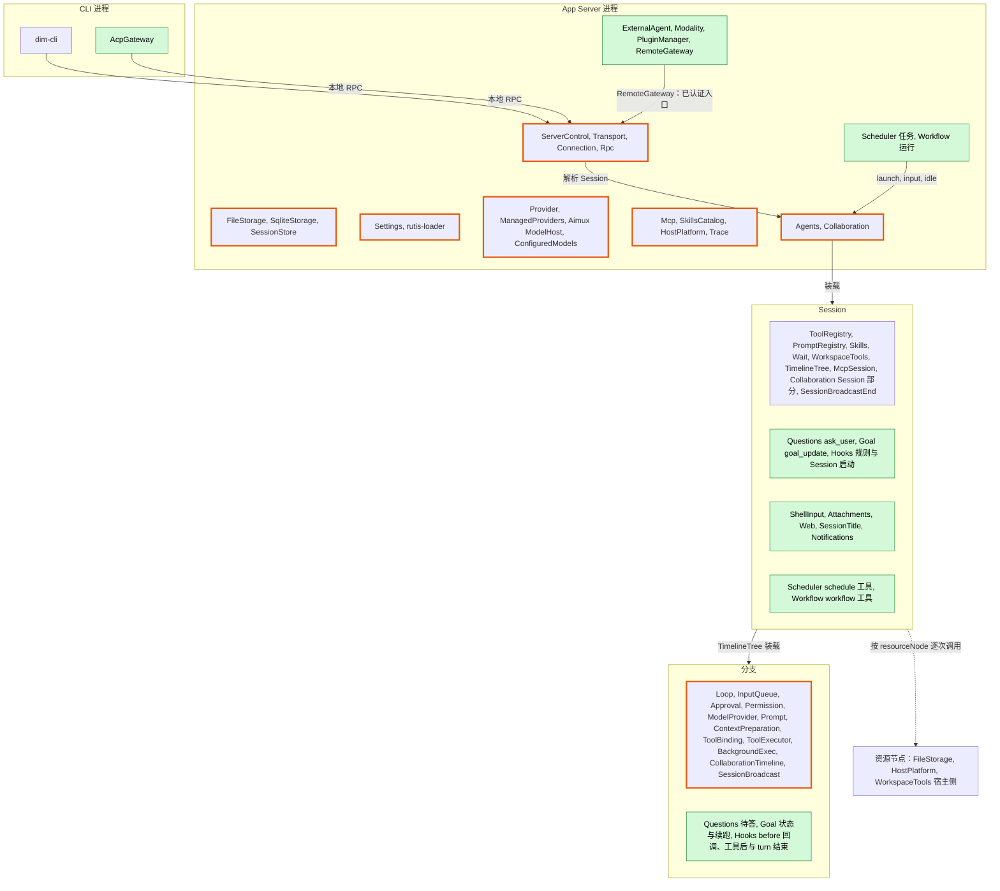
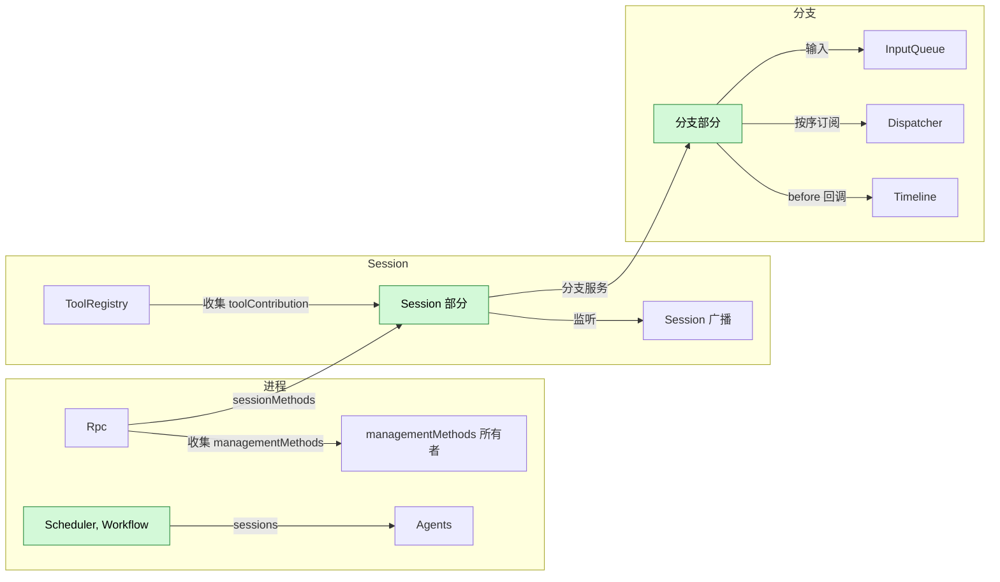
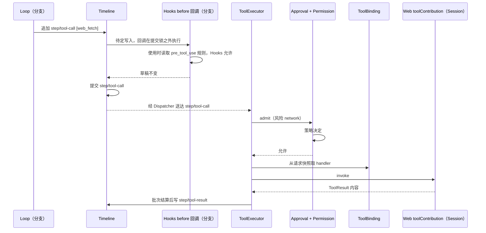
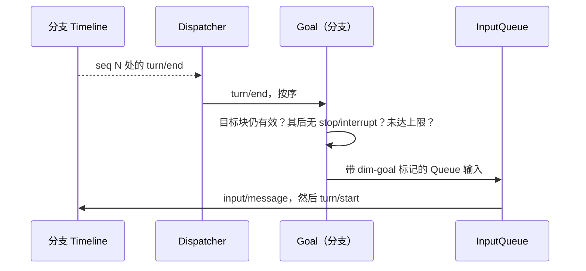
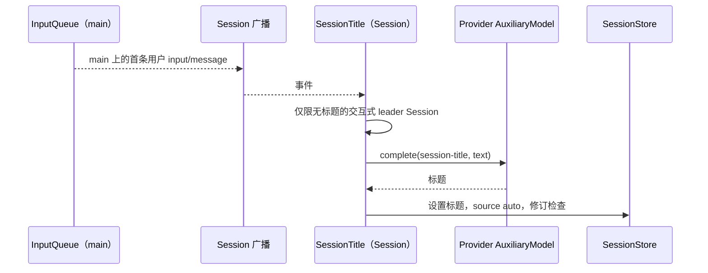
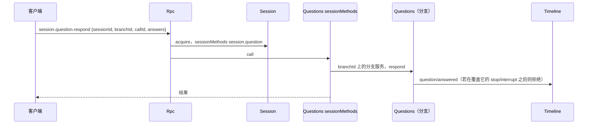
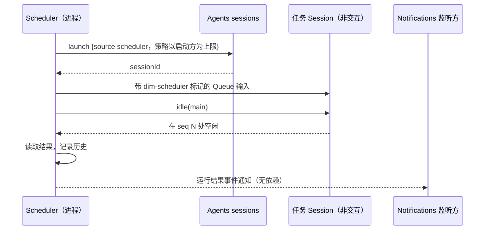
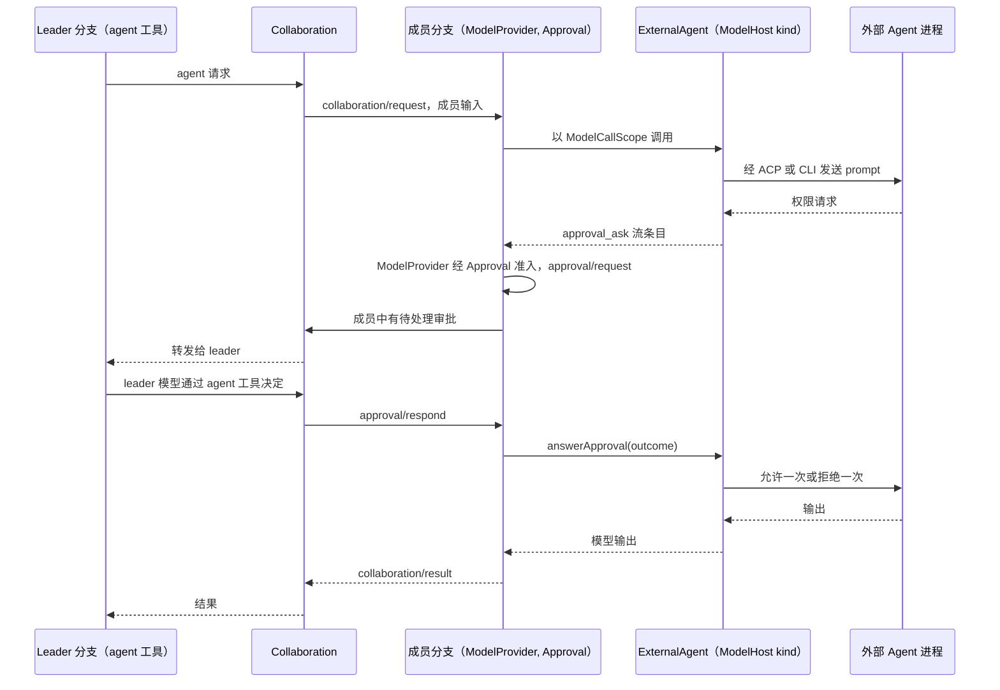

# 总体设计：未设计功能的插件

状态：草案

本文从 [CLI 功能清单](../../feature-list.md)出发，找出现有插件未覆盖的功能，并把新插件放入现有系统。每个新插件在 `docs/design/plugins/<Name>.md` 中设计。对现有插件的补充列在[附录 B](#附录-b-现有插件的补充)，由所属插件设计。

> **作用域规则**（[ADR 002](../adr/002-plugin-scope.md)）：插件的每一部分位于拥有其状态与生命周期的作用域（进程、Session 或分支），各部分只通过运行时已有的机制集成。不引入新机制。每个合同都是语言中立的（D5）：一个带作用域、实例 key 和纯数据方法的具名服务，因此任何语言的插件都可以提供或使用它（[§3.1](#31-合同形式)）。两份合同描述对现有接口的补充：[方法与工具贡献](contracts/session-boundary.md)（Rpc、ToolRegistry）和 [Session 访问](contracts/session-access.md)（Agents、Session 门面、InputQueue）。

正文涵盖前提、作用域图与划分、集成、目录、关键流程、约束、事件、阶段和待对齐问题。附录涵盖功能归属、现有插件的补充、实现语言、CLI 层和文档模板。

## 1. 范围与前提

| 项目 | 约定 |
| --- | --- |
| 终端形态 | 只设计 scrollback。功能清单中标为“仅全屏 TUI”的条目不在范围内 |
| 多模态 | 覆盖全部类别（图像、视频、语音、音乐、音频、3D 资产、动作、实时、OCR）。“仅特定 Desktop 构建”是可用性约束（[Modality](plugins/Modality.md)） |
| 不计划 | Todo 状态与 `plan` Skill |
| 动态事件 | 以 [#2](https://github.com/arcships/dim/issues/2) 为前提：插件在运行时注册自己的事件类型，注册跟随插件生命周期，Timeline 校验写入 |
| 模型上下文 | 依据 [ADR 001](../../adr/001-harness-foundation.md)：模型只看到被采纳的输入和工具结果，插件事件不投影。与 #2 的分歧待对齐（[§9](#9-待对齐问题)） |
| 配置 | [ADR 002](../adr/002-plugin-scope.md) D4：结构性插件配置（启用、路径、节点绑定、监听地址）位于 loader 行（#3 可编辑层），可能重载该行。业务配置位于所有者的业务来源，使用时读取，永不重载。项目文件和宿主本地批准保持各自的权威（ADR 001）。项目目录为 `.dimcode/` |
| 现有设计 | [时间总线](../../architecture/rust-agent/time-bus.md)、[设计规则](../../architecture/rust-agent/principles.md)、[单树装配](../../architecture/rust-agent/single-tree.md)、[生命周期](../../architecture/rust-agent/lifecycle.md)、[事件驱动流程](../../architecture/rust-agent/event-driven-flows.md)、[工具贡献](../../architecture/rust-agent/tool-contributions.md)以及 ADR 001 信任合同均适用 |

## 2. 作用域划分

绿色部分为新增，橙色边框部分为变更。每个新插件部分位于拥有其状态的作用域。跨两个作用域的功能是一个插件包，每个作用域一个部分，与 SkillsCatalog、Skills 和 SkillsBranch 的做法相同。可选的 Session 与分支部分只在插件启用时安装，从不作为占位。

| 插件 | 进程 | Session | 分支 | 理由 |
| --- | --- | --- | --- | --- |
| Questions | — | `ask_user` 工具；`session.question.*` 方法；非交互 Session 中不安装 | 待答问题、`question/*` 事实，沿用 Approval 的做法 | 问题属于某个分支的 turn |
| Goal | — | `goal_update` 工具；`session.goal.*` 方法 | 目标状态作为带 key 的 raw 输入块；通过 Dispatcher 按序依据分支事件决定续跑；写入分支输入 | 目标属于某个分支，续跑按序跟随其事件 |
| Hooks | — | 来自业务来源的规则；Session 启动 Hook | `input/message`（`user_prompt_submit`）与 `step/tool-call`（`pre_tool_use`）上的 before 回调；来自 Dispatcher 的工具后与 turn 结束 Hook | 规则作用于 Session；执行发生在分支 |
| ShellInput | — | `shell.*` 方法（管理级）；在 Session 的工作区中运行并写入其输入 | — | 命令属于 Session |
| Attachments | — | `attachment.put`；通过 SessionStore 管理 Session 文件 | — | 附件是 Session 数据 |
| Web | — | `web_search`、`web_fetch` 工具 | — | 没有跨 Session 共享的状态 |
| SessionTitle | — | 通过 Session 广播观察首条用户输入；`session.rename`；标题由 SessionStore 保存 | — | 标题属于 Session |
| Notifications | — | 观察 Session 广播；`notify` 工具 | — | 触发源是 Session 的事件 |
| Scheduler | 任务、触发器、历史 | `schedule` 工具 | — | 调度跨越多个 Session |
| Workflow | 定义、运行 | `workflow` 工具 | — | 一次运行跨越多个 Session |
| ExternalAgent | 连接、ModelHost kind | — | — | 外部 Agent 连接是共享的 |
| Modality | 任务、实时连接 | — | — | 任务与 provider 连接是共享的 |
| PluginManager | 市场、包 | — | — | 安装以宿主为单位 |
| RemoteGateway | 远程入口、设备 | — | — | 一个外部入口 |
| AcpGateway | CLI 进程 | — | — | 一个客户端 |

管理不是插件。管理方法是收集到 Rpc 方法表中、级别为 `management` 的 `managementMethods` 服务，每个入口服务其配置的级别（[方法](contracts/session-boundary.md)）。

## 3. 基于现有机制的集成

插件从不新增接线插件（ADR 002 D2）。每项需求都对应插件自身作用域已有的机制：

| 需求 | 机制 | 使用方 |
| --- | --- | --- |
| 向 Session 提供工具 | Session 级 `toolContribution`（[方法 A.5](contracts/session-boundary.md#a5-工具贡献)）或 `SessionToolSource`（[工具贡献](../../architecture/rust-agent/tool-contributions.md)） | Questions, Goal, Web, Notifications, Scheduler, Workflow |
| 提供指令 | PromptRegistry 提示词来源 | 现有 |
| 观察 Session 的事件 | 现有的 Session 广播（`session/<id>` 通道），由 Session 级插件监听 | SessionTitle, Notifications, Hooks Session 启动 |
| 按序观察并响应分支事件 | 分支 Dispatcher，由分支级插件订阅 | Goal, Questions, Hooks 工具后与 turn 结束 |
| 把内容放入模型上下文 | 分支输入（raw 块、带 key 的块）或工具结果（[Session 访问](contracts/session-access.md#a2-来源输入约定)） | Goal, Hooks, ShellInput, Scheduler, Workflow |
| 在写入提交前对其作出处理 | 由分支级插件注册的 Timeline before 回调（[single-tree](../../architecture/rust-agent/single-tree.md)），借助运行时补充异步执行（[附录 B.1](#b1-session-与分支-capability)）；回调使用现有事件合同或自身声明的事件来变换草稿，或向同一批次追加事件 | Hooks `user_prompt_submit`、`pre_tool_use` |
| 关于某个 Session 的客户端方法 | `sessionMethods`，由 Rpc 经该 Session 分发（[A.1](contracts/session-boundary.md#a1-方法贡献)） | Questions, Goal, SessionTitle, Attachments, ShellInput |
| 宿主管理方法 | `managementMethods`，由 Rpc 收集到其方法表中，级别 `management` | 现有管理方法, Scheduler, Workflow, Hooks, Notifications, ExternalAgent, Modality, PluginManager, RemoteGateway, Web |
| 访问其他 Session | Agents 的 `sessions` 服务（`launch`、`input`、`history`、`idle` 等），与 Collaboration 的做法相同（[Session 访问](contracts/session-access.md#a1-sessions-服务)） | Scheduler, Workflow |
| 响应另一个进程插件的结果 | 事件通知，而非依赖 | Scheduler 运行结果 |

箭头是依赖边，指向相同或外层作用域（D3）。收集方依赖其贡献（ToolRegistry 依赖工具，Rpc 依赖方法所有者），因此贡献方重载会使其收集方重载。重载只跟随罕见的结构性操作（安装、升级、启用、禁用、崩溃）。其传播（包括使在途 turn 失败）是被接受并记录的代价，不增加任何阻止手段。业务配置变更永不重载（D4）。

### 3.1 合同形式

设计定义或使用的每个合同都是一个具名服务（ADR 002 D5）：服务名（camelCase）、作用域、实例 key，以及标注为 `sync` 或 `async` 的方法，其请求、回复和错误都是可序列化数据。取消是一个取消请求，或消费方丢弃该调用。插件在其 `provides` 和 loader 行中声明它提供的内容；消费方按服务名和作用域收集。rutis 跨语言调用此类服务（rutis-bridge 运行时、`host_key(name)`、`TypeKey::named`），因此 TypeScript 或 Python 部分无需手写 Rust 绑定即可满足合同。Rust trait、`TypeKey`、`Contributions<T>` 和 `AgentBuilder` 调用只出现在各文档的“Rust 绑定”附录中。

| 服务 | 作用域 | Key | 方法 | 定义于 |
| --- | --- | --- | --- | --- |
| `sessionMethods` | Session | 命名空间 | `describe(): async -> MethodDecl[]`；`call(MethodCall): async -> MethodReply` | [方法 A.1](contracts/session-boundary.md#a1-方法贡献) |
| `managementMethods` | 进程 | 命名空间 | 同上 | [方法 A.1](contracts/session-boundary.md#a1-方法贡献) |
| `toolContribution` | Session | 工具名 | `declaration(): sync -> ToolDeclaration`；`execute(ToolCall): async -> ToolResult` | [方法 A.5](contracts/session-boundary.md#a5-工具贡献) |
| `sessions` | 进程 | — | `launch`、`input`、`lookup`、`history`、`withdraw`、`stop`、`idle` | [Session 访问 A.1](contracts/session-access.md#a1-sessions-服务) |
| `modelKind` | 进程 | 种类 | 请求与流均为数据 | [ExternalAgent](plugins/ExternalAgent.md) |

运行时现有的类型化服务（Timeline、Dispatcher、ToolHost 等）保持原样。把它们按名称暴露给非 Rust 的 Session 与分支部分是 [#4](https://github.com/arcships/dim/issues/4) 的工作；rutis 本身已经支持跨语言调用。

## 4. 插件目录

| 插件 | 作用域 | 职责 | 阶段 | 语言 | 文档 |
| --- | --- | --- | --- | --- | --- |
| Questions | Session + 分支 | `ask_user`；待答问题与回答；`session.question.respond` | P1 | Rust | [Questions](plugins/Questions.md) |
| ShellInput | Session | `!command` / `!!command`，作为 `shell.run/stop/list`（管理级） | P1 | Rust | [ShellInput](plugins/ShellInput.md) |
| Attachments | Session | 大段文本的 `attachment.put`；Session 文件 | P1 | Rust | [Attachments](plugins/Attachments.md) |
| SessionTitle | Session | 由首条用户输入生成标题；`session.rename` | P1 | TypeScript 优先 | [SessionTitle](plugins/SessionTitle.md) |
| Goal | Session + 分支 | 目标作为带 key 的输入块；续跑；`goal_update`；`session.goal.*` | P2 | TypeScript 优先 | [Goal](plugins/Goal.md) |
| Web | Session | `web_search`、`web_fetch` | P2 | TypeScript 优先 | [Web](plugins/Web.md) |
| Hooks | Session + 分支 | 命令 Hook：Session 启动、提示词提交与工具前 before 回调、工具后、turn 结束 | P2 | Rust | [Hooks](plugins/Hooks.md) |
| Scheduler | 进程 + Session | 定时任务；`schedule` 工具；运行结果通知 | P2 | TypeScript 优先 | [Scheduler](plugins/Scheduler.md) |
| Workflow | 进程 + Session | 跨 Session 的多阶段运行；`workflow` 工具 | P2 | TypeScript 优先 | [Workflow](plugins/Workflow.md) |
| Notifications | Session | 投递到渠道；`notify` 工具 | P2 | TypeScript 优先 | [Notifications](plugins/Notifications.md) |
| ExternalAgent | 进程 | 外部 Agent 作为 ModelHost provider kind | P3 | TypeScript 优先 | [ExternalAgent](plugins/ExternalAgent.md) |
| AcpGateway | CLI 进程 | 基于本地 RPC 的 ACP 服务器 | P3 | TypeScript 优先 | [AcpGateway](plugins/AcpGateway.md) |
| RemoteGateway | 进程 | 远程入口、配对、设备 | P3 | Rust | [RemoteGateway](plugins/RemoteGateway.md) |
| Modality | 进程 | 多模态任务与实时连接 | P3 | TypeScript 优先 | [Modality](plugins/Modality.md) |
| PluginManager | 进程 | 市场、包、`PluginContents` | P3 | Rust | [PluginManager](plugins/PluginManager.md) |

| 合同 | 所有者 | 定义 |
| --- | --- | --- |
| [方法与工具贡献](contracts/session-boundary.md) | Rpc, ToolRegistry | `sessionMethods`、`managementMethods`、`callChannel`、入口级别、`unknown_method`/`service_reloading`、现有管理方法的迁移与兼容、`toolContribution` |
| [Session 访问](contracts/session-access.md) | Agents, InputQueue | `sessions` 服务；带受限策略的 `launch`、`SessionConfig` 字段 `interactive`/`resourceNode`/`createdBy`、来源 raw 块、固定前缀读取、撤回 |

## 5. 关键流程

### 5.1 使用 Session 工具与 Hooks before 回调的工具调用

被 Hook 拒绝的调用会从批次中移除，并在同一个原子批次中由一个不带 `call_event_id`、携带该 Hook 原因的 `step/tool-result` 关闭；其他调用照常进行（[Hooks](plugins/Hooks.md)）。Approval、ToolExecutor 和 Loop 不变。如果 Hooks 在其回调待定时卸载，该写入按回调的 `on_error` 结算；对 `pre_tool_use` 而言，这会使写入失败，turn 以 `Failed` 结束，这是 D3 所接受的。

### 5.2 由分支 Dispatcher 驱动的 Goal 续跑

Goal 只依据它已按序消费的分支事件做决定，其待处理输入推导排除已删除的输入。`stop/interrupt` 会暂停目标。如果中断落在续跑输入之后，最多多跑一个 turn，模型会看到已暂停的块。

### 5.3 通过 Session 广播的观察者（SessionTitle）

手动标题永不被覆盖。标题是 SessionStore 元数据，不是 Timeline 事实。

### 5.4 经 Session 分发的 Session 方法（Questions）

### 5.5 经 Agents 的定时运行

### 5.6 Collaboration 委派给外部 Agent

权限请求以模型流中的 `approval_ask` 条目到达成员分支；ModelProvider 经该分支的 Approval 对其准入，并以 `answerApproval` 作答，因此它成为普通的 dim 审批（现有的 `approval/request` 与 `approval/respond` 事实）。Collaboration 成员的审批交给 leader 的模型，没有 leader 时由用户决定。从不选择 `always` 选项。

## 6. 通用约束

### 6.1 集成方式

[§3](#3-基于现有机制的集成) 中的表是穷尽的。只有当某作用域上的状态或行为没有现有插件拥有时，才新建插件部分；现有职责内的变化记录在[附录 B](#附录-b-现有插件的补充)。

### 6.2 约束

1. **最少事件**：只为影响后续行为、且无法从工具调用与结果、`input/*`、`turn/*` 或 `stop/interrupt` 推导出的结果新增事件（时间总线规则 3）。进程输出进入诊断。
2. **所有权**：声明事件类型即定义其数据合同。生产方使用所有者的公共服务。谁启动工作，谁写其开始与终态事实。决策只使用已消费的事实，从不使用其他插件的内存。
3. **外部入口**：RPC 从不写事件。它调用所属服务，由该服务校验并写入（先例 `approval.respond`）。竞争由 Timeline 序号裁决。
4. **重载与副作用**：已开始但未终止的工作结算为“未能在恢复后存活”，且从不重新执行。允许通过轮询已保存的 handle 恢复对外部任务的观察。
5. **作用域**：每个部分只依赖自身或外层作用域（D3）。Session 与分支部分读取 `S:SessionConfig`。进程部分只通过 Agents 的 `sessions` 服务读取 Session。
6. **中断**：插件先取消在途工作并释放资源，再写终态事实（[中断](../../architecture/rust-agent/interrupt.md)）。
7. **准入**：新工具声明风险类别。新类别 `outbound_message` 与 `persistent_configuration` 在 FullAccess 下自动允许。由自动化启动的 Session 以启动方的策略为上限，Scheduler 任务和 Workflow 定义可以进一步收窄。由管理方法启动的运行除非另有声明，默认只读，并受宿主配置约束。`workflow` 使用 `agent` 工具的风险类别。
8. **重载代价**：贡献方重载会使其收集方重载，并可能使在途 turn 失败。这一点被接受，并记录在每个插件的冲突表中，从不加以阻止（D3）。
9. **管理面**：运行命令或修改宿主配置的方法声明 `level: management`。本地 RPC 服务两个级别，RemoteGateway 服务 `session`，rutis 链接只在显式导出时服务 `management`（宿主管理员权限）。不存在身份分级。`hello`、`daemon.*`、`agent.*` 和现有的 `session.*` 方法保持为 Rpc 内建方法。
10. **远程 Session 方法**：已配对设备可调用所有 `session` 级方法，包括 `session.permission.update`（兼容性变更，[方法 A.4](contracts/session-boundary.md#a4-迁移与兼容性)）。
11. **在途工作**：没有共享注册表。每个所有者提供自己的查询与停止，由 CLI 汇总。
12. **撤回**：由 InputQueue 拥有的单一合同。`input/withdraw {input_id}` 是一个指令事件，可由任何合法生产方写入：客户端经 Rpc 内建方法 `session.input.withdraw`，进程调用方经 `sessions.withdraw`，以及与该 `input/message` 位于同一原子批次中的 before 回调。InputQueue 按序消费它；只有当它仍持有该输入且尚未应用（无 `input/applied`）时，才写入结果事实 `input/deleted {input_id}`，且永不应用该输入。否则（未知、已应用或已删除）不写入任何内容，调用方收到的回复为 `notHeld`。已应用的输入无法撤回，Loop 不变。InputQueue 只在包含某输入的整个批次分发之后才决定是否采纳它，因此同批次的撤回总是生效。“撤回并作为 Steer 重新提交”是一个原子批次。每个待处理输入推导都排除已删除的输入，它们从不进入模型上下文（其带 key 的块从不生效）。
13. **提交前处理**：插件只能通过 Timeline before 回调，在另一个所有者的写入提交前对其作出处理。回调写入的内容使用现有的公共事件合同（例如同一批次中的 `input/withdraw`）或插件自身声明的事件；该写入的消费方不做任何特定于插件的改动。
14. **低业务耦合**：raw 块标记与 key、配置 key 和方法命名空间都带所有者前缀。传给共享服务的用途是消费方拥有的 key（`session-title`、`compaction`、`collaboration.member`、`modality.<category>`）。收集方从不点名贡献方。
15. **交互式 Session**：`session.create` 设置 `interactive` 和 `createdBy`。Exec、ACP 和自动化创建非交互 Session，其中不安装 Questions。Notifications 与 SessionTitle 只作用于交互式 leader Session。

### 6.3 多节点

rutis 节点通过链接相连，导出和导入服务，在对端运行插件（`peer:<node>/<plugin>`）并转发事件（[rutis 节点](https://github.com/arcships/rutis/blob/main/docs/guide/nodes.md)，[#5](https://github.com/arcships/dim/issues/5)）。

| 规则 | 内容 |
| --- | --- |
| 控制节点 | 承载 App Server：Timeline、Session、配置来源、Provider、调度 |
| 资源节点 | 宿主资源所在之处（文件、进程、shell、隔离、本地 CLI）。每个 Session 绑定一个，记为 `SessionConfig.resourceNode`，创建时固定；默认为控制节点 |
| 宿主服务 | Session 资源节点上的 FileStorage、HostPlatform、隔离以及 WorkspaceTools 宿主侧，通过 Session 的装配解析（对端节点时为导入的服务）。没有 Session 的进程插件（Modality OCR、ExternalAgent 桥接）在自身配置中指定节点 |
| 节点绑定数据 | 宿主本地批准、隔离配置和外部 Agent 目录以节点和路径标识 |
| 离线 | 对离线资源节点的调用以 `node_unavailable` 失败；依赖方不重载，也不进入 Pending。这要求经 rutis 链接导入的服务在链接断开期间保持注册并让调用失败（对 [#5](https://github.com/arcships/dim/issues/5) 的要求） |
| 认证 | 复用 rutis 链接 token；管理级只在配置后才导出 |
| 未来 | 跨控制节点协作不在此设计 |

### 6.4 约定

| 主题 | 约定 |
| --- | --- |
| 上下文 | 模型上下文只经由工具结果和输入；常驻规则经由提示词来源或带 key 的 raw 块 |
| 配置 | 每项一个来源、一条写入路径。结构性条目位于 loader 行；业务条目位于所有者的业务来源（Settings 来源或自有存储）。凭据是引用，由 Settings 凭据解析器解析 |
| 信任 | 来自项目文件或插件的可执行内容（Hooks、MCP、工作流、Capability 插件）需要 Settings 宿主本地批准服务给出的宿主本地批准，记录为 `{owner namespace, node, workspace, source, id, fingerprint}`（对规范化可执行内容做 SHA-256） |
| 安全设置 | 宿主安全设置从不进入 Timeline，回放和 fork 从不恢复或放宽它们。权限预设是 Timeline 事实（`permission/changed`），由子分支继承，fork 时重置为默认值 |
| 持久化 | 进程存储使用 App Server 进程存储合同（每插件根目录、UTF-8 与二进制原子替换、锁、格式版本）。Session 文件位于 SessionStore 之下 |
| 协议 | Rpc 内建方法优先于贡献的方法 |
| 国际化 | 用户可见文本属于 CLI；模型可见文本属于提示词来源 |

## 7. 新增 Timeline 事件

| 事件 | 写入方 | 必要性 |
| --- | --- | --- |
| `question/asked {call_id, turn_id, request_id, questions}` | Questions（分支） | 待答状态无法推导，因为结果只在整个批次完成后才发布（先例 Approval） |
| `question/answered {call_id, answers, declined}` | Questions（分支），经 `session.question.respond` | 通过序号与中断排序 |
| `question/cancelled {call_id, reason}` | Questions（分支） | 在中断、分支关闭或重载时结束待答问题 |
| `input/withdraw {input_id}` | 客户端（Rpc `session.input.withdraw`）、进程调用方（`sessions.withdraw`）、该输入所在批次中的 before 回调 | 一个通过序号与采纳排序的指令 |
| `input/deleted {input_id}` | InputQueue | 结果事实：被持有的输入永不被应用；队列状态必须可重建 |

| 设想 | 处理方式 | 理由 |
| --- | --- | --- |
| `goal/*` | 带 key 的 raw 块，包括终态块 | 目标状态是输入 |
| `shell/*` | `!command` 结果写为 Append 输入 | 不是分支在途工作 |
| `hook/*` | 工具拒绝表现为关闭调用的 `step/tool-result`，提示词拒绝表现为 `input/withdraw`（随后为 `input/deleted`），以及注入的输入、诊断；Hooks 自行声明 `hooks/prompt-blocked`（[Hooks](plugins/Hooks.md)） | 不是核心事件 |
| `external_agent/*` | Collaboration 事实、成员事件、审批事实 | 外部 Agent 是模型连接 |
| `session/titled` | SessionStore 元数据 | 不影响分支行为 |
| `workflow/*`、定时运行结果 | 工具结果、报告输入、进程存储、事件通知 | 进程级结果 |
| 排队消息转 Steer | `input/withdraw` + 新 Steer 输入，在一个批次中 | 无需单独事件 |

## 8. 阶段

前置条件总是落在早于其消费方的阶段。

| 阶段 | 内容 |
| --- | --- |
| P0 基础 | #2 动态事件；由 `session.create` 设置的 `SessionConfig` 字段；带 `launch` 的 `sessions` 服务；`sessionMethods` 分发；Rpc 表中的 `managementMethods` 及现有管理方法的迁移；入口级别；异步 Timeline before 回调；ToolRegistry 中的 `toolContribution`；Permission 类别；带变更通知的 Settings 业务来源、凭据解析器、宿主本地批准服务；App Server 进程存储（含二进制）；Provider 用途策略与 `AuxiliaryModel`；SessionStore 元数据与 Session 文件；FileStorage 列举与删除；HostPlatform argv 辅助 |
| P1 核心交互 | Questions、ShellInput、Attachments、SessionTitle；InputQueue 撤回；Permission 规则；模型参数；SessionStore 删除、清理与 fork；HostPlatform 隔离；Collaboration 补充；#4 为非 Rust 的 Session 与分支部分按名称暴露运行时的类型化服务；CLI 子命令、图像转换、`/export`、`exec --json` |
| P2 能力扩展 | Goal、Web、Hooks（用户与项目来源）、Scheduler、Workflow、Notifications；ModelProvider `ModelCallScope` 与模型调用审批；Transport `EntryHost`；Mcp OAuth；生产环境压缩宿主 |
| P3 外部集成 | ExternalAgent、AcpGateway、RemoteGateway、Modality；PluginManager（#3、#4）；资源节点导入（#5） |

ADR 002 中记录的 HostPlatform exec shell 变更（作为业务配置在每次 spawn 时读取）是独立工作，不阻塞任何阶段。

## 9. 待对齐问题

| 问题 | 状态 |
| --- | --- |
| 事件如何进入上下文 | 待定（需维护者对齐）：#2 主张注册投影规则；ADR 001 主张只有输入和工具结果。本设计遵循 ADR 001 |
| MCP stdio 隔离 | 待定：MCP stdio 进程是否默认隔离 |
| 远程访问取舍 | 待定：认证、断连与 TLS 部署，与 [#5](https://github.com/arcships/dim/issues/5) 相关（[RemoteGateway](plugins/RemoteGateway.md)） |
| TypeScript Session 部分 | 待定：SessionTitle、Goal、Web、Notifications 以及 Scheduler 和 Workflow 的 Session 部分按名称提供语言中立合同；其中还使用运行时类型化服务（Timeline、Dispatcher、InputQueue）的部分，需要 #4 按名称暴露这些服务，否则从 Rust 开始 |
| Notifications 获取定时任务结果 | 已决定：任务 Session 是非交互的，因此 Scheduler 发布运行结果通知，Notifications 监听它，二者无依赖 |
| 定时任务存活 | 已决定：守护进程必须存活（[Scheduler](plugins/Scheduler.md)） |
| FullAccess 与新类别 | 已决定：自动允许（约束 7） |
| 外部 Agent 权限 | 已决定：普通 dim 审批，Collaboration 成员的审批转发给 leader（§5.6，[ExternalAgent](plugins/ExternalAgent.md)） |
| 外部会话延续 | 提议：从分支历史重新初始化（[ExternalAgent](plugins/ExternalAgent.md)） |
| fork 时的权限预设 | 已决定：fork 时重置（§6.4） |
| 重载传播 | 已决定：罕见结构性操作的可接受代价（[ADR 002](../adr/002-plugin-scope.md) D3） |
| 异步 before 与同步写入方 | 待定：Loop 等写入方如今同步追加；当存在待定的 before 回调时，追加必须在被接受时返回、稍后报告提交结果（或 `on_error: fail` 的结果），否则写入方必须等待它 |

## 附录 A. 功能归属

“现有”表示由现有插件覆盖。“扩展”表示现有职责，列于附录 B。“新增”表示新插件（§4）。“CLI”指附录 D。

| 领域 | 功能 | 归属 |
| --- | --- | --- |
| Provider | OAuth / API-key Provider、`/connect`、`/models` | 现有：Provider、ManagedProviders、OAuth 插件、Aimux |
| Provider | `/effort`、`/fast` | 扩展：Prompt、ModelProvider |
| Provider | 子 Agent 与辅助模型 | 扩展：Provider（用途策略、`AuxiliaryModel`） |
| Session | `/new`、`/resume`、Session 列表、`/history` | 现有：Agents、SessionStore |
| Session | `/timeline`、`/export` | CLI |
| Session | Session 标题 | 新增：SessionTitle |
| Session | fork、删除、清理 | 扩展：SessionStore、Agents |
| Session | 请求快照导出 | 扩展：Trace |
| Session | 文件与对话回滚 | 不在范围内（仅全屏 TUI） |
| 交互 | 发送、排队、自动发送、Steer、中断 | 现有：InputQueue、Loop |
| 交互 | `Ctrl+S`、`/queue`、召回、删除排队消息 | 扩展：InputQueue（撤回） |
| 交互 | 多行编辑、历史、补全、引用、粘贴、剪贴板、复制、链接 | CLI |
| 交互 | 大段粘贴、混合附件 | 新增：Attachments；CLI 把图像转换为图像块 |
| 交互 | `!command`、`!!command` | 新增：ShellInput |
| 交互 | 流式输出、运行状态、文件变更反馈 | 现有事件，由 CLI 渲染 |
| 交互 | 工具审批 | 现有：Approval、Permission |
| 交互 | 用户提问 | 新增：Questions |
| 交互 | Todo 状态 | 不计划 |
| 交互 | 查看与停止后台任务 | 各所有者（BackgroundExec、Collaboration、Workflow、ShellInput），由 CLI 汇总 |
| 系统 | `/exit`、`/theme`、`/keys`、升级 | CLI |
| 系统 | `/settings` | 每项属于各自插件；由 CLI 汇总 |
| 系统 | `/usage` | 扩展：ContextPreparation、ManagedProviders |
| 系统 | `/language` | CLI；扩展：PromptSources |
| 系统 | `/debug`、调试日志 | 现有：Trace 诊断 |
| 系统 | `/stats`、鼠标设置 | 不在范围内 |
| Agent 行为 | `/agent` | 扩展：Agents、Prompt |
| Agent 行为 | `/goal`、续跑、Goal 模式 | 新增：Goal（模式由目标状态覆盖） |
| Agent 行为 | `/approvals`、命令规则 | 扩展：Permission、Settings |
| Agent 行为 | 三个权限级别 | 现有：Permission |
| Agent 行为 | 沙箱 | 扩展：HostPlatform |
| Agent 行为 | `/compact`、自动压缩 | 扩展：ContextPreparation |
| Agent 行为 | `/scheduled`、定时任务 | 新增：Scheduler |
| 扩展 | `/plugins`、`/reload-plugins`、市场 | 新增：PluginManager |
| 扩展 | `/skills`、`/reload-skills`、Skill 来源 | 现有：SkillsCatalog、Skills；由 PluginManager 安装 |
| 扩展 | `plan` Skill | 不计划 |
| 扩展 | `AGENTS.md` | 现有：PromptSources |
| 扩展 | `/mcp`、MCP 连接 | 现有：Mcp、Settings；扩展：HTTP/SSE OAuth |
| 扩展 | `/workflow`、`/workflow:save` | 新增：Workflow |
| 扩展 | `/external-agents` | 新增：ExternalAgent，经 Collaboration 委派 |
| 扩展 | 并行子 Agent | 现有：Collaboration；扩展：Provider 模型选择 |
| 扩展 | Hooks | 新增：Hooks |
| 扩展 | Web 搜索与抓取 | 新增：Web |
| 扩展 | Slack 与飞书 | 新增：Notifications |
| 工作区工具 | `read`、`write`、`edit`、`glob`、`grep`、`exec`、`wait` | 现有：WorkspaceTools、BackgroundExec、Wait |
| 远程访问 | JSON-RPC 常驻服务 | 现有：Transport、Rpc |
| 远程访问 | ACP | 新增：AcpGateway |
| 远程访问 | `/web`、`/remote`、手机配对、远程 Session | 新增：RemoteGateway |
| 远程访问 | VS Code | CLI |
| CLI 命令 | 子命令、`exec --json`、`exec --verify` | CLI，调用各插件的 RPC |
| 多模态 | `image generate/edit/enhance`、`modality`、`modality task` | 新增：Modality |
| 多模态 | `image read` | 现有：视觉模型通过 `read` 读取图像 |
| 多模态 | `video`、`speech`、`music`、`audio`、`asset`、`motion`、`realtime` | 新增：Modality（由 provider 执行） |
| 多模态 | `ocr` | 新增：Modality（由宿主执行；OCR 运行时组件） |

## 附录 B. 现有插件的补充

**补充**是增加服务、方法或配置。**变更**是改变现有行为或合同，需要兼容性说明。通过 #2 声明现有事件类型属于 #2 的工作，`input/message` 不变。

### B.1 Session 与分支 Capability

| 插件 | 类型 | 内容 | 理由 |
| --- | --- | --- | --- |
| Timeline（运行时） | 补充 | `Timeline::before` 增加异步回调。当某分支写入匹配已注册的异步回调时，该写入保持其在序号顺序中的位置，只在回调完成后才提交；该分支上后续的写入排在它之后；等待期间不持有提交锁。回调收到草稿（其事件 id 在写入占位时即已固定），返回变换后的草稿和/或追加到同一原子批次的事件；随后同步 `before` 处理器像现在一样在提交锁内应用，追加的事件不再被匹配。注册选项全部由注册方决定：`timeout`；`on_error`（`commit` 原样提交草稿，或 `fail` 让写入向其写入方失败），适用于超时、回调错误、注册方卸载或分支关闭；`cancel_on`（一组事件种类，其排队写入会取消待定回调）。回调从不等待其自身分支上的写入。通用：不含业务语义 | Hooks |
| Approval | 补充 | 在模型步骤打开期间，接受宿主来源的准入（由 ModelProvider 针对 `approval_ask` 流条目发起），写入普通的 `approval/request`、`approval/respond`、`approval/cancelled` 事实 | ExternalAgent |
| InputQueue | 变更 | 按序消费 `input/withdraw {input_id}`，只为它仍持有且未应用的输入写入 `input/deleted {input_id}`（否则不写入，`notHeld`）；只在某输入的整个批次分发后才决定是否采纳；自有来源撤回服务；“撤回并作为 Steer 重新提交”作为一个批次；队列状态从事件重建（[Session 访问 A.4](contracts/session-access.md#a4-撤回)） | `Ctrl+S`、`/queue`；AcpGateway、Scheduler |
| 运行时 Session 门面 | 补充 | 按命名空间查找 `sessionMethods`；固定前缀历史读取 | Rpc；进程调用方 |
| ToolRegistry | 补充 | 除现有注册外，接受具名的 `toolContribution` 服务（[方法 A.5](contracts/session-boundary.md#a5-工具贡献)） | 非 Rust 的 Session 工具 |
| Agent 装配 | 补充 | 收集每个已安装插件在 `provides` 中声明的具名服务；可选的 Session 与分支部分按已启用插件及 `interactive` 安装 | 所有 Session 插件 |
| Permission | 补充 | 类别 `outbound_message`、`persistent_configuration`（FullAccess 下允许）；命令规则在使用时读取 | Notifications、Scheduler；`/approvals` |
| ModelProvider | 补充 | 向 model kind 传递 `ModelCallScope`（session、branch、request 与 step id，`SessionConfig`）；经其分支的 Approval 对 `approval_ask` 流条目准入，并以 `answerApproval` 返回结果；收到 `approval_ask_withdrawn` 时取消该准入 | ExternalAgent |
| Prompt, ModelProvider | 补充 | 模型参数（effort、fast 模式）；切换 Agent 配置作为一次采纳 | `/effort`、`/fast`、`/agent` |
| PromptSources | 补充 | 提示词语言来源 | `/language` |
| ContextPreparation | 补充 | 用量查询；手动压缩；用途为 `compaction` 的生产环境压缩宿主 | `/usage`、`/compact` |
| FileStorage | 补充 | 根目录下的目录列举与删除 | Session 文件、清理 |
| HostPlatform | 补充 | 进程启动时的 OS 隔离（macOS seatbelt、Linux landlock 或 bubblewrap、Windows 明确不可用）、按节点的宿主本地配置；exec argv 辅助；每次 spawn 时读取 exec shell（ADR 002） | 沙箱；ShellInput、Hooks、ExternalAgent |

### B.2 App Server 进程插件

| 插件 | 类型 | 内容 | 理由 |
| --- | --- | --- | --- |
| Rpc | 变更 | 方法表：内建方法，然后是收集到的 `managementMethods`（取代 `When<ProductServices>` 和 `When<ExecutionServices>`），然后是 Session 的 `sessionMethods`；供 provider 使用的 `callChannel`。按连接的入口级别。内建 `session.input.withdraw`。`session.create {interactive, client}`。Session 列表中的 `title`/`titleSource`。`session.submit` 上的图像校验（[方法](contracts/session-boundary.md)） | 所有方法所有者 |
| Transport, Connection | 变更 | 带升级认证器的 `EntryHost`；`ConnectionEntry {name, levels, device_id}` | RemoteGateway |
| Agents | 补充 | `sessions` 服务；`SessionConfig` 字段；策略以启动方为上限的 `launch`；从另一个 Session 的切点创建；以外部 Agent 作为模型的 profile（[Session 访问](contracts/session-access.md)） | Scheduler、Workflow、fork、ExternalAgent |
| Collaboration | 变更 | 按用途 `collaboration.member` 选择成员模型；从分支外部 `establish(leader, agent)`；成员审批转发给 leader | Workflow；ExternalAgent |
| SessionStore | 补充 | 带修订检查的标题元数据；删除与清理；fork（复制切点之前的事实，重置权限预设）；资源节点上的 Session 文件，fork 时共享，随最后一个所有者删除 | SessionTitle、Attachments、fork |
| Settings | 补充 | 带变更通知的业务来源（D4）；凭据引用解析器；宿主本地批准服务 | Hooks、Workflow、Web、Notifications、ExternalAgent、PluginManager、Mcp |
| Provider | 补充 | 按用途的策略，单一写入路径；`AuxiliaryModel::complete(purpose, …)`；按 Modality 类别的非对话连接；外部 Agent 连接类型 | SessionTitle、压缩、Collaboration、Modality、ExternalAgent |
| Aimux / ModelHost | 补充 | 来自其他插件的 provider kind；某 kind 没有 provider 时，其请求在受理前失败 | ExternalAgent |
| App Server | 补充 | 泛化 `pluginFiles` 的进程存储合同 | Scheduler、Workflow、ExternalAgent、Modality、RemoteGateway、PluginManager |
| Mcp, Provider, SkillsCatalog, ManagedProviders, OAuth 插件 | 变更 | 把各自现有的管理方法作为 `managementMethods` 提供（线上兼容） | Rpc 迁移 |
| ManagedProviders | 补充 | 套餐用量查询 | `/usage` |
| Mcp | 补充 | HTTP/SSE OAuth；来自 `PluginContents`（`mcp`）的配置 | MCP；PluginManager |
| SkillsCatalog | 补充 | 来自 `PluginContents`（`skills`）的 Skill 根目录 | PluginManager |
| Trace | 补充 | 模型请求快照导出 | 快照导出 |

## 附录 C. 实现语言

| TypeScript 优先 | Rust |
| --- | --- |
| 业务规则仍需验证 | 安全边界与准入：命令执行、审批、before 回调、隔离、远程入口 |
| 主要是外部 I/O 或协议 | 输入与 Session 方法边界 |
| 不在 turn 热路径上 | 在途工具调用的结算 |
| 失败只影响该功能 | loader 与插件管理；基础服务 |

TypeScript 进程插件如今以 loader 行运行（仅在配置时启动 Node，[App Server](../../../crates/dim-app-server/README.md)）。TypeScript 部分按名称提供和使用 [§3.1](#31-合同形式) 的语言中立合同；还使用运行时类型化服务的 Session 与分支部分，需要 [#4](https://github.com/arcships/dim/issues/4) 按名称暴露这些服务，并需要 #2（§9）。API-key 基线不依赖 Node：TypeScript 优先的功能随固定版本的 Node 发布，没有 Node 时明确不可用。插件从 TypeScript 迁到 Rust 时，其语言中立合同、事件类型、工具与方法名以及存储格式保持不变；迁移只替换 loader 行，流程测试原样通过，且同一时间只装载一个实现。现有插件的补充使用 Rust。

## 附录 D. CLI 层

以下内容只在 CLI 中实现：多行编辑、输入历史、命令补全、`$` 与 `@` 引用、粘贴与拖放路径、剪贴板、消息复制、打开链接、`/timeline`、`/export`、`/exit`、`/theme`、`/keys`、界面语言、升级、VS Code 集成、子命令体系、`exec --json`、`exec --verify` 修复循环、汇总的后台任务，以及附带不可用原因的 Modality 类别列表。

## 附录 E. 插件文档模板

插件与合同文档使用以下布局：

- 头部（状态、总览链接、阶段、语言）和摘要。
- 1 结构：作用域图，以及标明各部分作用域的部分表。
- 2 数据与状态。
- 3 流程：时序图。
- 4 时序与冲突：关键竞争（包括重载传播），用简短表格列出。
- 5 上下文映射。
- 6 接口（摘要）。
- 7 安全。
- 8 规则检查：逐条回答[设计规则 §4](../../architecture/rust-agent/principles.md)的每条规则和 [ADR 002](../adr/002-plugin-scope.md) 的每项决策，不适用的写明原因。
- 9 向机制所有者提出的需求：按 §4 第 8 条的格式填写，没有写“无”。
- 附录：接口细节、完整冲突表（在推导输入处包含 `input/deleted` 行）、错误与恢复、验收、假设和待对齐问题。
