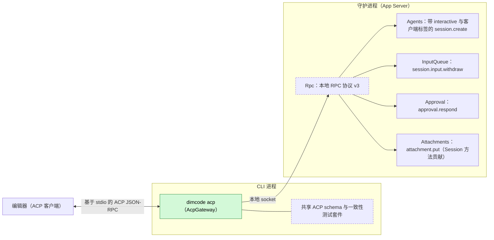
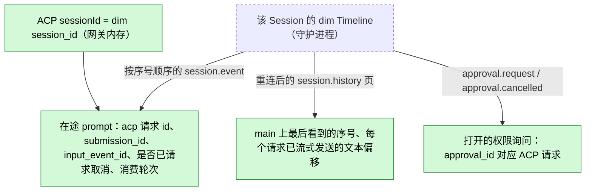
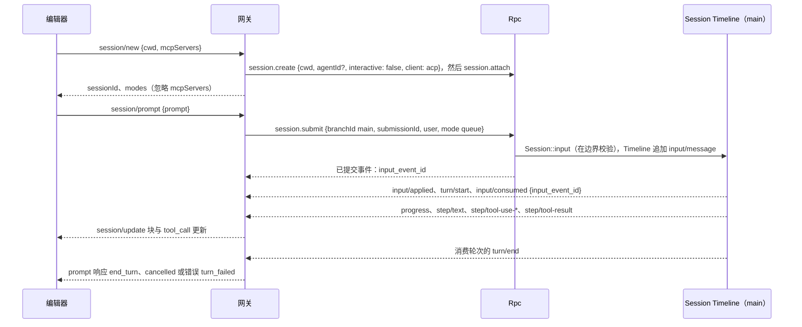
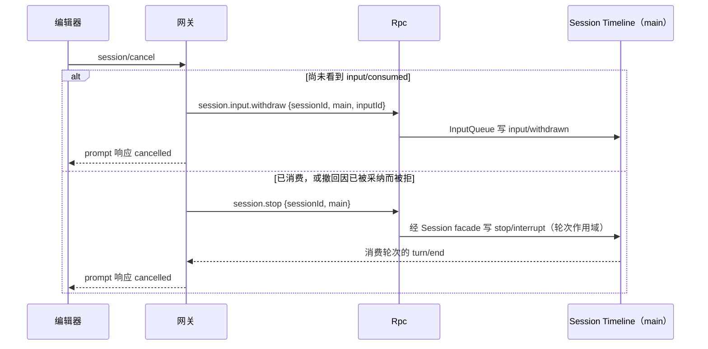
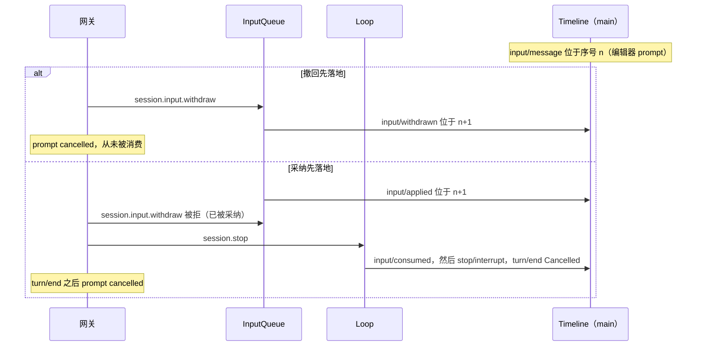

# AcpGateway

状态：草案。总体设计：[overview §B.15](../overview.md)；作用域：[ADR 002](../../adr/002-plugin-scope.md)（CLI 进程）。阶段：P3。语言：先以 TypeScript 作为独立程序实现，随后并入 Rust CLI（[overview §F.3](../overview.md)）。

`dimcode acp` 通过标准输入输出提供 Agent Client Protocol（ACP），使编辑器可以驱动 dim。它是 CLI 进程中的协议适配器：像 CLI 一样通过本地 RPC 连接守护进程，把每个 ACP session 映射为一个非交互 dim Session，把每个 ACP prompt 映射为一次 `session.submit`，把 Session 事件映射为 ACP `session/update` 通知，把 dim 审批请求映射为 ACP 权限请求。它不在守护进程中开辟任何执行路径，除通过 Rpc 内置的 Session 方法和 Session 方法贡献（`SessionMethodContribution`，由 Rpc 经 Session 派发）外不写入任何内容，也不声明任何事件。

## 1. 结构

网关只依赖公共 RPC；没有任何守护进程插件知道它的存在，用基于同一 RPC 的其他 ACP 实现替换它不会改变守护进程中的任何东西。schema 和测试套件与 [ExternalAgent](ExternalAgent.md)（客户端侧）共享；不共享运行时代码。

| 部分 | 作用域 | 依赖 | 提供 |
| --- | --- | --- | --- |
| `dimcode acp` | CLI 进程（不是守护进程插件） | 本地 RPC 协议 v3（[protocol.rs](../../../../crates/dim-app-server/src/protocol.rs)、[tree_protocol.rs](../../../../crates/dim-app-server/src/tree_protocol.rs)）：`hello`、`session.create`（带 `interactive` 和 `client`，Agents 补充）、`session.attach`/`detach`、`session.submit`、`session.input_lookup`、`session.history`、`session.stop`、`session.permission.update`、`approval.respond`；`session.input.withdraw`（Rpc 内置）和 `attachment.put`（[Attachments](Attachments.md)，Session 方法贡献）（[session-boundary](../contracts/session-boundary.md)）；通知 `session.event`、`session.state`、`session.model.progress`、`approval.request`、`approval.cancelled`、`session.closed`；CLI 守护进程发现 | stdio 上的 ACP agent；本文的 ACP↔dim 映射 |

## 2. 数据与状态

所有网关状态都是由通知和 `session.history` 推导出的 CLI 进程内存；它不影响任何分支。连接丢失后，网关重新 attach，并从最后看到的序号之后的历史重建；网关退出时丢失的打开权限询问会让审批在 dim 中保持待处理，留给其他客户端。

## 3. 流程

### 3.1 新建 session 与 prompt

消费轮次是在 `input/consumed {input_event_id}` 的序号处于 `main` 上打开的轮次；它的 `turn/end` 决定响应（`Completed` → `end_turn`，`Cancelled` → `cancelled`，`Failed` → `turn_failed`）。每个判定都使用按分支序号顺序的通知或 `session.history` 页，从不依赖墙钟时间。

### 3.2 取消

先尝试撤回，因为它不在历史中留下痕迹；一旦输入被采纳（`input/applied`），InputQueue 就拒绝撤回，网关退回到 `session.stop`。`session/cancel` 之后，无论轮次结果如何，prompt 总是响应 `cancelled`（ACP 规则）；该 Session 的待处理 ACP 权限请求由客户端侧回答为 `cancelled`。

### 3.3 权限

来自该 Session 任意分支的 `approval.request {sessionId, branchId, requestId, source, call {name, input}, reason}` → `session/request_permission {sessionId, toolCall: {toolCallId: call_id or requestId, title: name, kind, rawInput: input}, options: [{optionId: "allow", kind: "allow_once"}, {optionId: "deny", kind: "reject_once"}]}`。选中 `allow` → `approval.respond {decision: allow}`；`deny` → `deny`；结果 `cancelled` → 不回答（A10）。Approval 在其边界校验回答，写 `approval/respond`，按序号消费它并复查当前 policy。不提供任何 `*_always` 选项。

### 3.4 加载与多客户端

`session/load {sessionId, cwd}` 进行 attach，并在响应前把 `main` 历史作为更新重放（`cwd` 不匹配 → `invalid_params`）。多个 ACP session 共享一个连接并独立流式传输。同时在终端 CLI 中 attach 的 Session 也会把 CLI 的轮次流式传给编辑器；编辑器的 Queue prompt 排在它们之后等待。

## 4. 时序与冲突

撤回与采纳的先后由 InputQueue 依据 Timeline 顺序决定；网关从不根据时间猜测。"已采纳、stop 在消费前落地"这一窄情形会按中断契约让输入保持待处理（附录 B）。

| 场景 | 顺序 | 结果 | 负责方 |
| --- | --- | --- | --- |
| 另一个客户端撤回编辑器的输入 | `input_event_id` 的 `input/withdrawn` | Prompt `cancelled` | InputQueue、网关 |
| stop 落地前轮次已完成 | `turn/end` < `stop/interrupt` | Prompt `cancelled`（已请求取消）；stop 不覆盖任何轮次 | Loop、网关 |
| 已加载的交互式 Session 中模型提问 | `question/asked` | 显示为 `tool_call` 更新 "waiting for an answer in another dim client"（A13）；prompt 等待；`session/cancel` 中断，Questions 写 `question/cancelled` | Questions、网关 |
| 审批已由另一个客户端回答 | `approval/respond` 更早 | 编辑器之后的回答被拒；忽略 | Approval |
| 轮次中守护进程重启 | 轮次结算为 `Failed` | 从历史追赶；`turn_failed`（若已请求取消则 `cancelled`） | Loop |

其余所有行：[附录 B](#附录-b-完整冲突表)。

## 5. 上下文映射

| 来源 | 模型看到的内容 | 位置 |
| --- | --- | --- |
| ACP prompt `text` | `Text` 用户内容 | Queue 输入消费位置上的一条用户消息 |
| ACP `image` | 经 `session.submit` 模型能力校验后的 `Image`（base64） | 同一消息 |
| 嵌入的文本 `resource` ≤ 32 KiB | `Text` `"<uri>\n<text>"`（A6） | 同一消息 |
| 更大的 `resource` | `attachment.put`，然后是指向返回路径的文本引用（A6） | 同一消息 |
| `resource_link` | `Text` 行 `"@<uri>"`（A6） | 同一消息 |
| `session/set_mode` | 无：`permission/changed` 是 Session 配置，不是模型文本 | — |

网关不写 raw 块、key、提示词来源或工具声明。其输入在压缩后只经由摘要保留；子分支在其于切点前被消费时看到它们。ACP Session 是非交互的，因此那里从不声明 `ask_user`；除此之外，上下文与任何 Queue 输入相同。模型从不看到 ACP 身份、`mcpServers`、客户端能力、更新或诊断信息。

## 6. 接口（摘要）

| 接口 | 类型 | 用途 |
| --- | --- | --- |
| `dimcode acp [--agent <agent_id>]` | CLI 入口 | 在 stdio 上启动 ACP agent（[A.1](#a1-cli-入口)） |
| ACP 方法 `initialize`、`session/new`、`session/load`、`session/prompt`、`session/cancel`、`session/set_mode` | ACP（agent 侧） | 映射到 RPC（[A.2](#a2-acp-方法)） |
| `session/update`、`session/request_permission` | ACP（agent → 客户端） | 更新与权限询问（[A.3](#a3-prompt-内容与更新)） |
| ACP schema 与一致性测试套件 | 与 ExternalAgent 共享 | 边界校验与测试 |

## 7. 安全

网关拥有本地 CLI 客户端的权限：本地 socket 的属主检查适用，它只调用 Session 方法和 `session.create`，从不调用 Rpc 方法表中的管理级方法，因此编辑器无法更改宿主配置（隔离、宿主本地批准、插件）。ACP mode 改变 Session 的权限预设，这属于 Session 配置（`permission/changed`，decisions E4），受本地客户端本来就能做的事情约束，并在 fork 时重置。权限回答经由 `approval.respond`，由 Approval 复查当前 policy；从不提供 `allow_always`。客户端提供的 `mcpServers` 从不启动，因此编辑器无法让守护进程运行命令（有文档记录的 ACP 一致性偏差，E13）。嵌入的资源成为用户内容并遵循 Timeline 规则。

## 附录 A. 接口细节

### A.1 CLI 入口

`dimcode acp [--agent <agent_id>]` 像其他 CLI 命令一样连接或启动守护进程（A1）；stdout 只承载 ACP JSON-RPC；诊断信息写入 stderr 和 CLI 日志。`--agent` 为 `session/new` 选择 Agent profile（默认：默认 Agent）。

### A.2 ACP 方法

| ACP | dim | 说明 |
| --- | --- | --- |
| `initialize` | 每个进程一次 `hello {protocolVersion: 3}` | 回复：`agentCapabilities { loadSession: true, promptCapabilities { image: true, audio: false, embeddedContext: true } }`、`authMethods: []`（A2） |
| `authenticate` | — | 不提供；由本地传输认证 |
| `session/new {cwd, mcpServers}` | `session.create {cwd, agentId?, interactive: false, client: "acp"}`（A14），然后 `session.attach` | `sessionId` = dim session id；`modes` = 权限预设，当前值 = 该 Session 的预设（A3）；忽略 `mcpServers`（E13） |
| `session/load {sessionId, cwd, mcpServers}` | `session.attach`，然后从 0 开始读取 `main` 的 `session.history` | 在响应前重放；`cwd` 不匹配 → `invalid_params`；已打开的 session 返回相同映射；Session 保留自己的 `interactive` 事实 |
| `session/prompt {sessionId, prompt}` | `session.submit {sessionId, branchId: "main", submissionId: <uuid>, user, mode: "queue"}` | 消费轮次结束时响应；已有在途 prompt 时的第二个 prompt → `prompt_in_progress`（A4） |
| `session/cancel {sessionId}` | 未消费时 `session.input.withdraw {sessionId, branchId: "main", inputId: input_event_id}`，否则（或被拒时）`session.stop {sessionId, branchId: "main"}` | Prompt 响应 `cancelled` |
| `session/set_mode {sessionId, modeId}` | `session.permission.update` | （A3） |

网关从不调用客户端的 `fs/*` 或 `terminal/*`：dim 在自己的资源节点上工作（A5）。

### A.3 Prompt 内容与更新

`audio` 和二进制 `resource` 块以 `unsupported_content` 拒绝；不提交任何内容。更新来自所映射 Session 的 attach 通知；只有 `main` 产生消息更新（A7）：

| dim | ACP 更新 |
| --- | --- |
| `session.model.progress` 文本和 `step/text`（按请求，Unicode 标量偏移） | `agent_message_chunk`，只含尚未发送的后缀 |
| `step/thinking` | `agent_thought_chunk` |
| 非本网关 session 提交的、带用户内容的 `input/message` | `user_message_chunk`（A8） |
| `step/tool-use-start` | `tool_call {toolCallId: call_id, title: name, kind, status: pending}` |
| `step/tool-use` | `tool_call_update {rawInput, locations}` |
| `step/tool-start` | `tool_call_update {status: in_progress}` |
| `step/tool-result`（每个调用，随整个批次发布） | `tool_call_update {status: completed or failed, content: text of ToolResult.content bounded 16 KiB}` |
| `question/asked`（仅交互式 Session） | 带文本 "waiting for an answer in another dim client" 的 `tool_call_update`（A13） |
| 只含 raw 块的输入、`exec/*`、`collaboration/*`、`context/*`、`branch/*`、`input/withdrawn` | 无消息更新（A8） |

`kind` 由工具名决定：`read`→`read`；`write`、`edit`→`edit`；`glob`、`grep`→`search`；`exec`→`execute`；`web_fetch`、`web_search`→`fetch`；其他 `other`（A9）。存在 `path` 输入字段时 `locations` 使用它。

### A.4 各步骤机制

| 步骤 | 路径 |
| --- | --- |
| Prompt 写入 | `session.submit` → `Session::input`（用户内容，无块）→ 输入边界 `validate` → `Timeline::append` `input/message`；回复携带已提交的事件 |
| 采纳 | InputQueue（Dispatcher）追加 `input/applied`；Loop 追加 `turn/start`、`input/consumed` 并运行轮次 |
| 撤回 | `session.input.withdraw` → InputQueue 校验（本分支、未被采纳）并写 `input/withdrawn` |
| 停止 | `session.stop` 经 Session facade 写轮次作用域的 `stop/interrupt` 并等待结算 |
| 审批 | `approval.respond` → Approval 校验，写 `approval/respond`，按序号消费 |
| 状态 | 无 `StateCell`，无 Dispatcher；只有网关内存 |
| 守护进程重载 | 调用返回 `service_reloading`（Session 方法贡献随其 Session 插件重载，或结构性重载）；网关在 `session.input_lookup` 之后以相同 `submissionId` 重试（`accepted` → 不重新提交） |
| 重启或连接丢失 | 重连，重新 attach 每个已映射的 Session，读取最后看到的序号之后的 `session.history`；在途 prompt 由这些事实判定 |
| 网关退出（stdin EOF） | 对每个 Session 调用 `session.detach`；运行中的轮次继续；不停止任何内容 |

## 附录 B. 完整冲突表

| 场景 | 顺序 | 结果 | 负责方 |
| --- | --- | --- | --- |
| submit 回复前取消 | — | 等待回复，然后取消 | 网关 |
| 采纳前取消 | `input/withdrawn` < `input/applied` | 已撤回；`cancelled`；历史中只有被撤回的输入 | InputQueue |
| 采纳后、消费前取消 | `input/applied` < 撤回尝试 | 撤回被拒；`session.stop`；消费轮次以 `Cancelled` 结束 → `cancelled` | InputQueue、Loop |
| 已采纳，stop 在 `turn/start` 之前落地 | `stop/interrupt` < `input/consumed` | `session.stop` 返回且输入未被消费时 prompt `cancelled`；输入保持待处理（中断契约），随下一个驱动输入运行，并镜像为 `user_message_chunk`（A11） | Loop、网关 |
| 消费后取消 | consumed < `stop/interrupt` | 轮次 `Cancelled`；`cancelled`；已发送的文本保留 | Loop |
| stop 之前轮次已完成 | `turn/end` < `stop/interrupt` | `cancelled` | 网关 |
| 其他客户端撤回该输入 | `input/withdrawn` | `cancelled` | InputQueue |
| 其他客户端停止该轮次 | `stop/interrupt` | `cancelled` | Loop |
| 其他客户端的 Queue 输入待处理 | Timeline 顺序 | 编辑器的 prompt 随消费它的轮次结束 | InputQueue、Loop |
| 来自其他客户端的 Steer | 在同一轮次中被消费 | Prompt 继续；内容被镜像 | Loop |
| 工具批次未结算 | — | 只有批次结果发布后才有 completed 更新 | ToolExecutor |
| 审批已在别处回答 | 更早的 `approval/respond` | 编辑器之后的回答被拒，忽略 | Approval |
| 编辑器询问时审批被 stop 取消 | `approval/cancelled` | ACP 请求无法撤回；之后的回答被忽略 | Approval |
| 已加载的交互式 Session 中的提问 | `question/asked` | 等待其他客户端；取消会中断 → `question/cancelled`（A13） | Questions |
| ACP 创建的 Session | — | 非交互：无 `ask_user` | Agents |
| prompt 期间发生压缩 | — | 无更新；流式传输不受影响 | — |
| 模型创建子分支 | — | 无消息更新；其审批被转发 | 网关（A7） |
| 分支中断或 Session 关闭 | `session.closed` | 在途 prompt `cancelled`；之后 `session_not_found` | 网关 |
| attach 期间 Session 空闲卸载 | — | attach 使其保持加载 | AgentIndex |
| 资源节点离线 | capabilities Pending | Prompt 等待；由 `turn/end` 决定 | rutis 生命周期 |
| submit 中途守护进程重载 | — | 由 `input_lookup` 决定是否重新提交 | 网关 |
| 轮次中守护进程重启 | 轮次结算为 `Failed` | 追赶后 `turn_failed` | Loop |
| 重复 `session/prompt` | — | `prompt_in_progress` | 网关 |
| 两个 ACP session 加载同一个 dim Session | — | 相同映射；一个在途 prompt | 网关 |
| 编辑器断开 | — | detach（不关闭）；轮次继续；审批等待其他客户端 | 连接 |

## 附录 C. 错误与恢复

| 错误（`error.data.code`） | 时机 |
| --- | --- |
| `session_not_found` | 未知或已关闭的 session id |
| `prompt_in_progress` | 同一 ACP session 上的第二个并发 prompt |
| `unsupported_content` | 音频或二进制资源；图片被 `session.submit` 校验拒绝（透传其错误码） |
| `turn_failed` | 消费轮次以 `Failed` 结束且未请求取消 |
| `daemon_unavailable` | 连接丢失且 30 秒内未重新建立（A12） |
| `invalid_params` | ACP 参数校验失败、load 时 `cwd` 不匹配 |

参数在 stdio 边界按共享 schema 校验。网关退出不会在守护进程中结算任何内容。

## 附录 D. 验收

通过 stdio 驱动 `dimcode acp`、连接 mock 模型守护进程的流程测试，外加共享一致性测试套件（agent 侧）：

1. initialize、new、prompt → 块在 progress 和已提交文本之间不重复；`end_turn`；创建的 Session 是非交互的，且不声明 `ask_user`。
2. 工具调用更新；权限允许与拒绝；审批由其他客户端回答。
3. 采纳前取消（撤回）、采纳后取消（stop）、消费后取消；stop 与轮次结束竞争；其他客户端撤回。
4. `session/load` 按顺序重放历史；已加载的交互式 Session 中的提问显示等待更新，取消使其结束。
5. prompt 中途守护进程重启：追赶，`turn_failed`；submit 中途重载时使用 `input_lookup`。
6. 图片和嵌入资源；音频被拒；`mcpServers` 被忽略。
7. 编辑器 EOF 时 detach，不停止轮次。

## 附录 E. 假设

| # | 假设 | 依据 | 若被否决的影响 |
| --- | --- | --- | --- |
| A1 | `dimcode acp` 像其他 CLI 命令一样连接或启动守护进程 | Overview §B.15；启动行为为判断 | 需要已运行的守护进程 |
| A2 | 不提供 ACP 认证方法 | 判断（本地传输） | 增加认证方法 |
| A3 | ACP mode 映射为 dim 权限预设 | 功能清单（policy 级别）；判断 | 无 mode |
| A4 | 每个 ACP session 一个在途 prompt | 判断 | prompt 排队 |
| A5 | 不使用客户端的 `fs`/`terminal` 能力 | Overview §6.3 | 经客户端读取编辑器缓冲区 |
| A6 | 资源转换规则与 32 KiB 阈值 | 判断 | 其他呈现方式 |
| A7 | 消息更新只来自 `main`；审批来自所有分支 | 判断（ACP 没有分支） | 感知分支的更新 |
| A8 | 镜像其他客户端的用户内容；不镜像 raw 块输入 | 判断 | 显示运行时输入 |
| A9 | 按名称表确定工具 kind | 判断 | 从工具元数据取 kind |
| A10 | 客户端 `cancelled` 权限结果不发送回答 | ACP 取消语义；判断 | 回答 `deny` |
| A11 | stop 前已被采纳的输入保持待处理并在之后运行 | 中断契约 | 需要撤回已采纳的输入 |
| A12 | 重连窗口 30 秒 | 判断 | 其他上限 |
| A13 | 已加载的交互式 Session 中的提问显示为等待，不通过 ACP 回答 | Decisions E13；ACP 没有提问请求 | 若有标准化的 ACP elicitation 则映射到它 |
| A14 | `session.create` 增加可选的客户端标签；ACP 传入 `acp`，以带该标签的 `Client` 记录在 `SessionConfig.created_by` 中（Agents 补充） | 判断；不需要 `hello.clientKind` | ACP Session 无法区分 |
| A15 | "ACP Session 显示"（功能清单，`/settings`）是 CLI 拥有的 CLI 显示偏好：`created_by` 带客户端标签 `acp` 的 Session 是否出现在 CLI Session 列表中，默认显示；本适配器中不涉及 | 功能清单只提到该设置 | 在别处定义；适配器不变 |

## 附录 F. 待对齐问题

| 问题 | 说明 |
| --- | --- |
| 客户端标签 | `SessionOrigin::Client` 必须携带 A14 的可选标签；由 Agents 补充负责 |
| "ACP Session 显示" | 与 CLI 设置设计确认 A15 |
