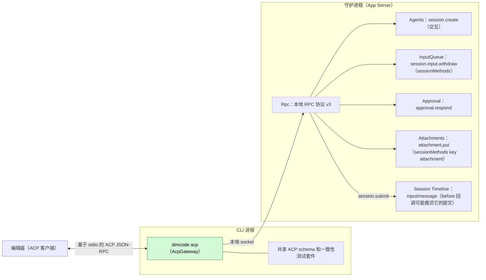
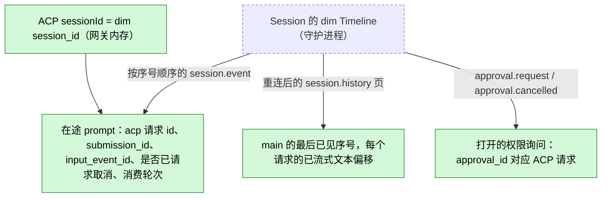
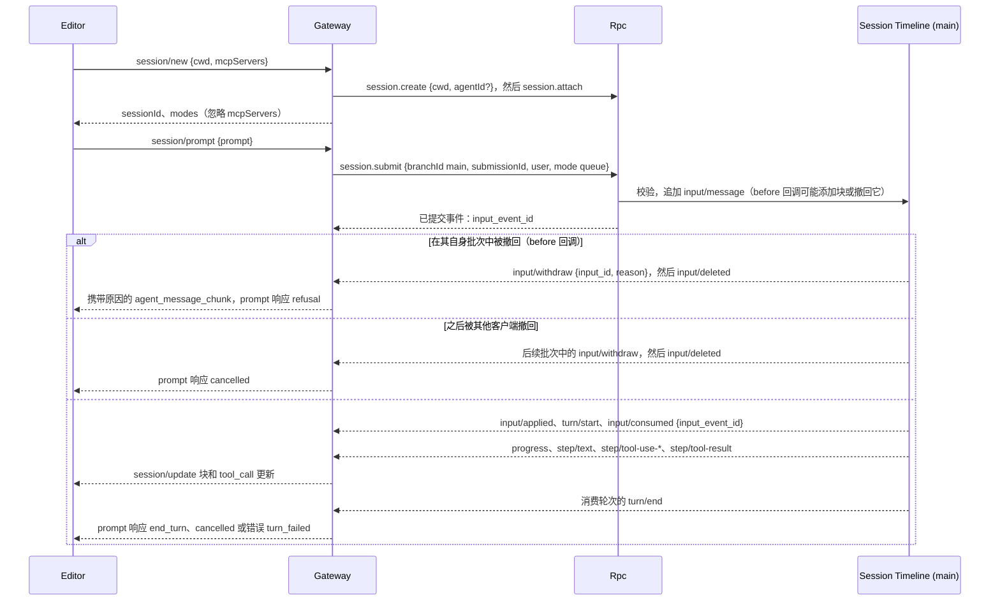
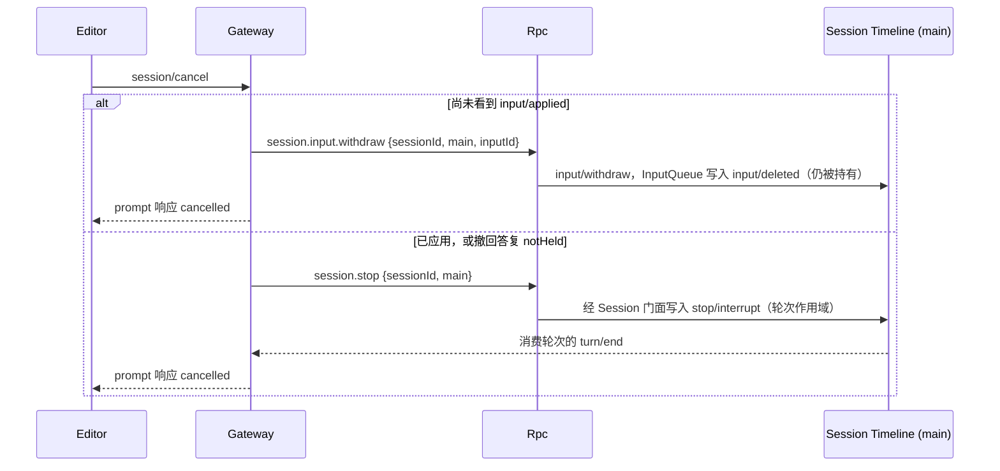
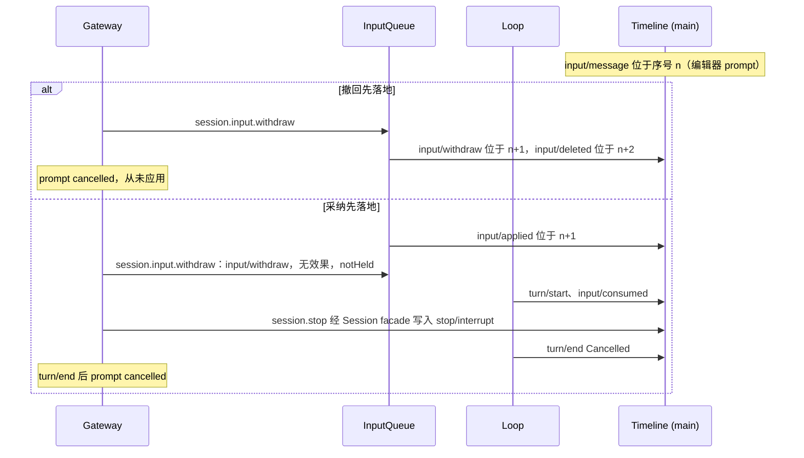

# AcpGateway

状态：草案。总体设计：[overview §4 插件目录](../overview.md)；作用域：[ADR 002](../../adr/002-plugin-scope.md)（CLI 进程）。阶段：P3。语言：先以 TypeScript 独立程序实现，再并入 Rust CLI（[overview 附录 C](../overview.md)）。

> **before 回调相关路径已撤回。** 本文描述的 before 回调行为（推迟 `input/message` 的提交、给它加块、在它自己的批次中撤回它）随 Hooks 一并撤回（[#21](https://github.com/arcships/dim/issues/21)）；before 回调只同步变换草稿。这些段落在 P3 设计复核时删除。

`dimcode acp` 通过标准输入输出提供 Agent Client Protocol（ACP），使编辑器能够驱动 dim。它是 CLI 进程中的协议适配器：与 CLI 完全一样通过本地 RPC 连接守护进程，把每个 ACP session 映射为一个交互 dim Session（编辑器回答它的审批，[session access A.3](../contracts/session-access.md#a3-sessionconfig-字段)），把每个 ACP prompt 映射为一次 `session.submit`，把 Session 事件映射为 ACP `session/update` 通知，把 dim 审批请求映射为 ACP 权限请求。它不在守护进程中开辟任何执行路径，除通过 Rpc 内置的 Session 方法和 `sessionMethods` 服务（由 Rpc 经 Session 分派）外不写入任何内容，也不声明任何事件。运行前被移除的 prompt，其结果由 InputQueue 的结果事件 `input/deleted` 决定：生效的 `input/withdraw` 在该输入自己的批次中时（由 before 回调写入，例如 Hooks `user_prompt_submit` 规则，[Hooks](Hooks.md)），结果为 ACP 停止原因 `refusal`，并把该 `input/withdraw` 的可选 `reason` 作为文本显示；其他情况（网关自己取消，或其他客户端撤回）结果为 `cancelled`。它仅有的契约是 RPC 线协议和 ACP schema，两者都是语言中立的数据，因此没有 Rust 绑定附录（[ADR 002 D5](../../adr/002-plugin-scope.md)）。

## 1. 结构

网关只依赖公共 RPC；没有任何守护进程插件知道它的存在，用基于同一 RPC 的另一个 ACP 实现替换它不会改变守护进程中的任何内容。schema 和测试套件与 [ExternalAgent](ExternalAgent.md)（客户端侧）共享；不共享任何运行时代码。

| 部分 | 作用域 | 依赖 | 提供 |
| --- | --- | --- | --- |
| `dimcode acp` | CLI 进程（不是守护进程插件） | 本地 RPC 协议 v3（[protocol.rs](../../../../crates/dim-app-server/src/protocol.rs)、[tree_protocol.rs](../../../../crates/dim-app-server/src/tree_protocol.rs)）：`hello`、`session.create`（交互，因此不带 `interactive` 字段）、`session.attach`/`detach`、`session.submit`、`session.input_lookup`、`session.history`、`session.stop`、`session.permission.update`、`approval.respond`；`session.input.withdraw`（InputQueue，`sessionMethods`）和 `attachment.put`（[Attachments](Attachments.md)，`sessionMethods` key `attachment`）（[session-boundary](../contracts/session-boundary.md)）；`input/withdraw {input_id, reason?}` 与 `input/deleted` 数据契约（[session access A.4](../contracts/session-access.md)）；通知 `session.event`、`session.state`、`session.model.progress`、`approval.request`、`approval.cancelled`、`session.closed`；CLI 守护进程发现 | stdio 上的 ACP agent；本文档的 ACP↔dim 映射 |

## 2. 数据与状态

所有网关状态都是 CLI 进程内存，由通知和 `session.history` 推导而来；它不影响任何分支。连接丢失后，网关重新 attach，并从最后已见序号之后的历史重建；网关退出时丢失的打开权限询问会让审批在 dim 中保持待处理，留给其他客户端。

## 3. 流程

### 3.1 新建 session 与 prompt

收到 `input/deleted` 的 prompt 立即结束。生效的 `input/withdraw` 在该输入自己的批次中时（只有 before 回调能写在那里，例如 Hook 规则），响应为 `refusal`，有原因时原因作为 `agent_message_chunk` 发送；它在后续批次中时（网关自己取消或其他客户端撤回），响应为 `cancelled`。该输入在历史中只以已删除的形式存在，不运行轮次，ACP session 仍可使用。网关依据 `input/deleted` 做决定，只读取撤回所在批次和 `reason` 来区分这两种结果；从不单凭撤回指令行动。已准入 prompt 的消费轮次是在 `input/consumed {input_event_id}` 的序号处于 `main` 上打开的轮次；其 `turn/end` 决定响应（`Completed` → `end_turn`，`Cancelled` → `cancelled`，`Failed` → `turn_failed`）。所有决策都使用按分支序号顺序的通知或 `session.history` 页，绝不使用墙钟时间。

### 3.2 取消

先尝试撤回，因为已删除的输入从不进入模型上下文；一旦 InputQueue 已应用该输入（`input/applied`），该指令不产生效果，答复为 `notHeld`，网关回退到 `session.stop`。`session/cancel` 之后，无论轮次结果如何，prompt 总是以 `cancelled` 响应（ACP 规则）；该 Session 待处理的 ACP 权限请求由客户端侧以 `cancelled` 回答。

### 3.3 权限

来自 Session 任一分支的 `approval.request {sessionId, branchId, requestId, source, call {name, input}, reason}` → `session/request_permission {sessionId, toolCall: {toolCallId: call_id or requestId, title: name, kind, rawInput: input}, options: [{optionId: "allow", kind: "allow_once"}, {optionId: "deny", kind: "reject_once"}]}`。选择 `allow` → `approval.respond {decision: allow}`；`deny` → `deny`；结果 `cancelled` → 不回答（A10）。Approval 在其边界校验回答，写入 `approval/respond`，按序号消费并复查当前 policy。不提供任何 `*_always` 选项。

### 3.4 加载与多客户端

`session/load {sessionId, cwd}` 先 attach，并在响应前把 `main` 历史作为更新重放（`cwd` 不匹配 → `invalid_params`）。多个 ACP session 共享一个连接并各自独立流式传输。同时在终端 CLI 中 attach 的 Session 也会把 CLI 的轮次流式传给编辑器；编辑器的 Queue prompt 排在它们之后等待。

## 4. 时序与冲突

撤回与采纳的先后由 InputQueue 按 Timeline 顺序决定；网关从不根据时间猜测。“已采纳，stop 在消费前落地”这一窄情形会按中断契约让输入保持待处理（附录 B）。

| 场景 | 顺序 | 结果 | 负责方 |
| --- | --- | --- | --- |
| 另一个客户端撤回编辑器的输入 | 晚于输入批次的 `input/withdraw` < `input_event_id` 的 `input/deleted` | Prompt `cancelled` | InputQueue、Gateway |
| stop 落地前轮次已完成 | `turn/end` < `stop/interrupt` | Prompt `cancelled`（已请求取消）；stop 不覆盖任何轮次 | Loop、Gateway |
| 模型在已加载的交互 Session 中提问 | `question/asked` | 显示为 `tool_call` 更新“waiting for an answer in another dim client”（A13）；prompt 等待；`session/cancel` 中断，Questions 写入 `question/cancelled` | Questions、Gateway |
| 审批已由另一个客户端回答 | 更早的 `approval/respond` | 编辑器之后的回答被拒；忽略 | Approval |
| 轮次中守护进程重启 | 轮次结算为 `Failed` | 从历史追赶；`turn_failed`（若已请求取消则为 `cancelled`） | Loop |
| Hooks `user_prompt_submit` 规则撤回 prompt | input、`input/withdraw {reason}` 在同一批次中 < `input/deleted` | 原因作为 `agent_message_chunk`；prompt 响应 `refusal`；不留下在途 prompt | Hooks、InputQueue、Gateway |

其余所有行：[附录 B](#附录-b-完整冲突表)。

## 5. 上下文映射

| 来源 | 模型看到的内容 | 位置 |
| --- | --- | --- |
| ACP prompt `text` | `Text` 用户内容 | Queue 输入消费位置上的一条用户消息 |
| ACP `image` | `Image`（base64）；模型是否接受图片由 ModelProvider 在构建请求时处理 | 同一消息 |
| ≤ 32 KiB 的嵌入文本 `resource` | `Text` `"<uri>\n<text>"`（A6） | 同一消息 |
| 更大的 `resource` | `attachment.put`，然后是指向返回路径的文本引用（A6） | 同一消息 |
| `resource_link` | `Text` 行 `"@<uri>"`（A6） | 同一消息 |
| `session/set_mode` | 无：`permission/changed` 是 Session 配置，不是模型文本 | — |

网关不写入 raw 块、key、提示词来源或工具声明；before 回调可能向同一输入添加其自身的带归属 raw 块（Hooks `user_prompt_submit` 上下文），放在网关的用户内容之前。其输入在压缩后只经由摘要保留；子分支在切点前已消费时可以看到它们。ACP Session 是交互的，因此 `ask_user` 的提问显示为等待另一个 dim 客户端回答（A13）；除此之外上下文与任何 Queue 输入相同。模型永远看不到 ACP 身份、`mcpServers`、客户端 Capability、更新或诊断信息。

## 6. 接口（摘要）

| 接口 | 类型 | 用途 |
| --- | --- | --- |
| `dimcode acp [--agent <agent_id>]` | CLI 入口 | 在 stdio 上启动 ACP agent（[A.1](#a1-cli-入口)） |
| ACP 方法 `initialize`、`session/new`、`session/load`、`session/prompt`、`session/cancel`、`session/set_mode` | ACP（agent 侧） | 映射到 RPC（[A.2](#a2-acp-方法)） |
| `session/update`、`session/request_permission` | ACP（agent → 客户端） | 更新和权限询问（[A.3](#a3-prompt-内容与更新)） |
| ACP schema 和一致性测试套件 | 与 ExternalAgent 共享 | 边界校验和测试 |

## 7. 安全

网关拥有本地 CLI 客户端的权限：本地 socket 的属主检查适用，它只调用 Session 方法和 `session.create`，绝不调用管理方法，因此编辑器无法更改宿主配置（隔离、插件）。ACP 模式会更改 Session 的权限预设，这属于 Session 配置（`permission/changed`，decisions E4），以本地客户端本就能做的为界，并在 fork 时重置。权限回答经由 `approval.respond`，Approval 在那里复查当前 policy；从不提供 `allow_always`。客户端提供的 `mcpServers` 从不启动，因此编辑器无法让守护进程运行命令（有文档记录的 ACP 一致性偏差，E13）。嵌入资源成为用户内容，遵循 Timeline 规则。

## 8. 规则检查

规则：[principles §1 与 §4](../../../architecture/rust-agent/principles.md)，[ADR 002](../../adr/002-plugin-scope.md) D1–D5。

| 规则 | 本文如何符合 |
| --- | --- |
| §4.1 改别的模块拥有的状态时写指令事件 | 取消是经 InputQueue 的 `session.input.withdraw` 写入的指令 `input/withdraw`，或经 `session.stop` 写入的 `stop/interrupt`；结果由所有者写入，没有生效的撤回不写事件，回复 `notHeld`。 |
| §4.2 交接后不能撤回 | `input/applied` 之后网关不再撤回，改用 Loop 自己的指令 `session.stop`。 |
| §4.3 只用 before 回调在写入前干预 | 网关不注册 before 回调；它只作为客户端在自己的 stdio 边界检查 ACP 内容，Rpc 只保留参数形状检查。 |
| §4.4 核心机制不带业务含义 | 网关不要求 Timeline 或任何核心机制做改动；它用 `session.create` 创建普通的交互 Session（[session access A.3](../contracts/session-access.md#a3-sessionconfig-字段)），守护进程中没有任何 ACP 行为。 |
| §4.5 决定前读完整个批次 | 网关只依据按序号收到的结果事件（`input/deleted`、`input/consumed`、`turn/end`）决定 prompt 结果，且在承载它们的批次之后决定。 |
| §4.6 模型上下文只含交接后被读取的事件 | 网关的 prompt 是普通用户内容，被消费后才进入上下文；被删除的 prompt 从不进入。 |
| §4.7 插件之间只通过公开事件和服务交互 | 网关依据 InputQueue 的 `input/deleted` 做决定，只为显示读取 `input/withdraw` 的公开字段 `reason`，不依赖任何插件内部状态或 Hooks 专用事件。 |
| §4.8 向机制所有者提通用需求 | 不适用：不需要改动任何机制。 |
| §4.9 只有后续决定要用的事实才进 Timeline | 网关不声明事件；它只写用户输入和指令 `input/withdraw`、`stop/interrupt`，自身状态留在 CLI 进程内存中。 |
| §1 Capability 与 App Server 边界 | 网关是 CLI 进程中的客户端，不是 Capability，也不是守护进程插件；它只需要现有的 `session.create`（[session access A.3](../contracts/session-access.md#a3-sessionconfig-字段)）。 |
| ADR 002 D1 作用域跟随状态所有者 | 它的状态属于每个 CLI 进程与每个 ACP 连接，因此放在 CLI 进程中。 |
| ADR 002 D2 不设接线模块 | 没有接线模块；网关只调用公开 RPC。 |
| ADR 002 D3 依赖跟随作用域 | 它没有进程内依赖；守护进程重载表现为 `service_reloading`，由网关重试。 |
| ADR 002 D4 结构性配置与业务配置分离 | 不适用：它唯一的选项是命令行参数 `--agent`。 |
| ADR 002 D5 合同语言中立 | 它的契约是 RPC 线协议与 ACP schema，都是语言中立的数据。 |

## 9. 向机制所有者提出的需求

无。ACP Session 是交互的（[session access A.3](../contracts/session-access.md#a3-sessionconfig-字段)），网关直接使用现有的 `session.create`。

## 附录 A. 接口细节

### A.1 CLI 入口

`dimcode acp [--agent <agent_id>]` 与其他 CLI 命令一样连接或启动守护进程（A1）；stdout 只承载 ACP JSON-RPC；诊断信息写入 stderr 和 CLI 日志。`--agent` 为 `session/new` 选择 Agent profile（默认：默认 Agent）。

### A.2 ACP 方法

| ACP | dim | 说明 |
| --- | --- | --- |
| `initialize` | 每个进程一次 `hello {protocolVersion: 3}` | 回复：`agentCapabilities { loadSession: true, promptCapabilities { image: true, audio: false, embeddedContext: true } }`、`authMethods: []`（A2） |
| `authenticate` | — | 不提供；由本地传输进行认证 |
| `session/new {cwd, mcpServers}` | `session.create {cwd, agentId?}`，然后 `session.attach` | `sessionId` = dim session id；`modes` = 权限预设，当前值 = Session 的预设（A3）；忽略 `mcpServers`（E13） |
| `session/load {sessionId, cwd, mcpServers}` | `session.attach`，然后从 0 开始读取 `main` 的 `session.history` | 响应前重放；`cwd` 不匹配 → `invalid_params`；已打开的 session 返回相同映射；Session 保留其自身的 `interactive` 事实 |
| `session/prompt {sessionId, prompt}` | `session.submit {sessionId, branchId: "main", submissionId: <uuid>, user, mode: "queue"}` | 消费轮次结束时响应；出现 `input/deleted` → 撤回在输入自己的批次中时立即 `refusal`，否则立即 `cancelled`；已有在途 prompt 时的第二个 prompt → `prompt_in_progress`（A4） |
| `session/cancel {sessionId}` | 仍被持有时（未看到 `input/applied`）`session.input.withdraw {sessionId, branchId: "main", inputId: input_event_id}`，否则（或答复为 `notHeld` 时）`session.stop {sessionId, branchId: "main"}` | Prompt 以 `cancelled` 响应 |
| `session/set_mode {sessionId, modeId}` | `session.permission.update` | （A3） |

网关从不调用客户端的 `fs/*` 或 `terminal/*`：dim 在其自身的资源节点上工作（A5）。

### A.3 Prompt 内容与更新

`audio` 和二进制 `resource` 块以 `unsupported_content` 拒绝；不提交任何内容。`image` 块由网关作为客户端在 `session.submit` 之前按共享 schema 检查（媒体类型、base64 数据）；Rpc 只检查参数形状。更新来自所映射 Session 的 attach 通知；只有 `main` 产生消息更新（A7）：

| dim | ACP 更新 |
| --- | --- |
| `session.model.progress` 文本和 `step/text`（每个请求，Unicode 标量偏移） | 仅含尚未发送后缀的 `agent_message_chunk` |
| `step/thinking` | `agent_thought_chunk` |
| 带用户内容、但不是由本网关 session 提交的 `input/message` | `user_message_chunk`（A8） |
| `step/tool-use-start` | `tool_call {toolCallId: call_id, title: name, kind, status: pending}` |
| `step/tool-use` | `tool_call_update {rawInput, locations}` |
| `step/tool-start` | `tool_call_update {status: in_progress}` |
| `step/tool-result`（每个调用，随整个批次发布） | `tool_call_update {status: completed or failed, content: text of ToolResult.content bounded 16 KiB}` |
| `question/asked`（仅交互 Session） | 带文本“waiting for an answer in another dim client”的 `tool_call_update`（A13） |
| 仅含 raw 块的输入、`exec/*`、`collaboration/*`、`context/*`、`branch/*`、`input/withdraw`、`input/deleted` | 无消息更新（A8） |

根据工具名得出 `kind`：`read`→`read`；`write`、`edit`→`edit`；`glob`、`grep`→`search`；`exec`→`execute`；`web_fetch`、`web_search`→`fetch`；其他 `other`（A9）。存在 `path` 输入字段时 `locations` 使用它。

### A.4 各步骤机制

| 步骤 | 路径 |
| --- | --- |
| Prompt 写入 | `session.submit` → `Session::input`（用户内容，无块）：`validate`，然后追加 `input/message`；待定的 before 回调可能推迟提交、添加块，或向该批次追加 `input/withdraw {reason}`；回复携带已提交事件 |
| 采纳 | InputQueue（Dispatcher）追加 `input/applied`；Loop 追加 `turn/start`、`input/consumed` 并运行轮次 |
| 撤回 | `session.input.withdraw`（InputQueue 的 `sessionMethods`）写入 `input/withdraw`；InputQueue 按顺序消费它，若仍持有未应用的该输入则写入 `input/deleted`，否则不写入任何内容（`notHeld`） |
| 停止 | `session.stop` 经 Session 门面写入轮次作用域的 `stop/interrupt` 并等待结算 |
| 审批 | `approval.respond` → Approval 校验、写入 `approval/respond`、按序号消费 |
| 状态 | 无 `StateCell`，无 Dispatcher；仅网关内存 |
| 守护进程重载 | 调用返回 `service_reloading`（随其 Session 插件重载的 `sessionMethods` 服务，或结构性重载）；网关在 `session.input_lookup` 之后以相同 `submissionId` 重试（`accepted` → 不重新提交） |
| 重启或连接丢失 | 重连，重新 attach 每个已映射的 Session，读取最后已见序号之后的 `session.history`；在途 prompt 根据这些事实解析 |
| 网关退出（stdin EOF） | 对每个 Session 执行 `session.detach`；运行中的轮次继续；不停止任何内容 |

## 附录 B. 完整冲突表

| 场景 | 顺序 | 结果 | 负责方 |
| --- | --- | --- | --- |
| submit 回复之前取消 | — | 等待回复，然后取消 | Gateway |
| 采纳前取消 | `input/withdraw` < `input/applied` | `input/deleted`；`cancelled`；历史中只有已删除的输入 | InputQueue |
| 采纳后、消费前取消 | `input/applied` < `input/withdraw` | 无效果，`notHeld`；`session.stop`；消费轮次以 `Cancelled` 结束 → `cancelled` | InputQueue、Loop |
| 已采纳，stop 在 `turn/start` 之前落地 | `stop/interrupt` < `input/consumed` | `session.stop` 返回且输入未消费时 prompt `cancelled`；输入保持待处理（中断契约），随下一个驱动输入运行，并以 `user_message_chunk` 镜像（A11） | Loop、Gateway |
| 消费后取消 | consumed < `stop/interrupt` | 轮次 `Cancelled`；`cancelled`；已发送的文本保留 | Loop |
| stop 之前轮次完成 | `turn/end` < `stop/interrupt` | `cancelled` | Gateway |
| 其他客户端撤回输入 | 后续批次中的 `input/withdraw` < `input/deleted` | `cancelled` | InputQueue |
| 其他客户端停止轮次 | `stop/interrupt` | `cancelled` | Loop |
| 其他客户端的 Queue 输入待处理 | Timeline 顺序 | 编辑器的 prompt 随消费它的轮次结束 | InputQueue、Loop |
| 来自其他客户端的 Steer | 在同一轮次中消费 | Prompt 继续；内容被镜像 | Loop |
| 工具批次未结算 | — | 只有批次结果发布后才发送完成更新 | ToolExecutor |
| 审批已在别处回答 | 更早的 `approval/respond` | 编辑器之后的回答被拒，忽略 | Approval |
| 编辑器询问期间审批被 stop 取消 | `approval/cancelled` | ACP 请求无法收回；之后的回答被忽略 | Approval |
| 已加载交互 Session 中的提问 | `question/asked` | 等待其他客户端；取消会中断 → `question/cancelled`（A13） | Questions |
| ACP 创建的 Session 中的提问 | `question/asked` | 交互：与已装载的 Session 一样显示为等待另一个客户端（A13） | Questions |
| prompt 期间压缩 | — | 无更新；流式传输不受影响 | — |
| 模型创建的子分支 | — | 无消息更新；其审批被转发 | Gateway（A7） |
| Session 关闭 | `session.closed` | 在途 prompt `cancelled`；之后为 `session_not_found` | Gateway |
| attach 期间 Session 因空闲卸载 | — | attach 使其保持加载 | AgentIndex |
| 资源节点离线 | — | Session 保持加载（不重载，不进入 Pending）；对其节点服务的调用失败为 `node_unavailable`，并以失败的工具结果呈现；prompt 在其 `turn/end` 作出决定时结束（对 [#5](https://github.com/arcships/dim/issues/5) 的要求） | Session 的节点服务、Loop |
| Hook 撤回 prompt | input、`input/withdraw {reason}` 在同一批次中 < `input/deleted` | 原因块；`refusal` | Hooks、InputQueue、Gateway |
| submit 中途守护进程重载 | — | 由 `input_lookup` 决定是否重新提交 | Gateway |
| 轮次中守护进程重启 | 轮次结算为 `Failed` | 追赶后 `turn_failed` | Loop |
| 重复 `session/prompt` | — | `prompt_in_progress` | Gateway |
| 两个 ACP session 加载同一个 dim Session | — | 相同映射；一个在途 prompt | Gateway |
| 编辑器断开 | — | detach（不关闭）；轮次继续；审批等待其他客户端 | Connection |

## 附录 C. 错误与恢复

| 错误（`error.data.code`） | 何时 |
| --- | --- |
| `session_not_found` | 未知或已关闭的 session id |
| `prompt_in_progress` | 同一 ACP session 上的第二个并发 prompt |
| `unsupported_content` | 音频或二进制资源，或未通过网关在 stdio 边界自身内容检查的图片 |
| `turn_failed` | 消费轮次以 `Failed` 结束且未请求取消 |
| `daemon_unavailable` | 连接丢失且 30 s 内未重新建立（A12） |
| `invalid_params` | ACP 参数校验失败、load 时 `cwd` 不匹配 |

参数在 stdio 边界按共享 schema 校验。网关退出不会在守护进程中结算任何内容。

## 附录 D. 验收

通过 stdio 驱动 `dimcode acp`，对接 mock 模型守护进程进行流程测试，外加共享一致性测试套件（agent 侧）：

1. initialize、new、prompt → 块在 progress 与已提交文本之间无重复；`end_turn`；创建的 Session 是交互的（记录中没有 `interactive` 字段），它的审批作为权限请求送到编辑器。
2. 工具调用更新；权限 allow 和 deny；由另一个客户端回答的审批。
3. 采纳前取消（已删除）、采纳后取消（`notHeld`，stop）、消费后取消；stop 与轮次结束竞争；另一个客户端的撤回。
4. `session/load` 按顺序重放历史；已加载交互 Session 的提问显示等待更新，取消使其结束。
5. prompt 中途守护进程重启：追赶，`turn_failed`；submit 中途重载并使用 `input_lookup`。
6. 图片和嵌入资源；拒绝音频；忽略 `mcpServers`。
7. 拒绝型 Hooks `user_prompt_submit` 规则使 `session/prompt` 在一个携带 `input/withdraw` 原因的 `agent_message_chunk` 之后以 `refusal` 结束；其他客户端的撤回以 `cancelled` 结束，不发送原因块；网关自己取消后的撤回以 `cancelled` 结束；同一 ACP session 上的下一个 prompt 正常工作。
8. 编辑器 EOF 时 detach，不停止轮次。

## 附录 E. 假设

| # | 假设 | 依据 | 若被否决的影响 |
| --- | --- | --- | --- |
| A1 | `dimcode acp` 与其他 CLI 命令一样连接或启动守护进程 | Overview §4；启动行为为判断 | 需要已运行的守护进程 |
| A2 | 无 ACP 认证方法 | 判断（本地传输） | 增加一种认证方法 |
| A3 | ACP 模式映射到 dim 权限预设 | 功能清单（policy 级别）；判断 | 无模式 |
| A4 | 每个 ACP session 一个在途 prompt | 判断 | prompt 排队 |
| A5 | 不使用客户端 `fs`/`terminal` Capability | Overview §6.3 | 经客户端读取编辑器缓冲区 |
| A6 | 资源转换方式和 32 KiB 阈值 | 判断 | 其他渲染方式 |
| A7 | 消息更新只来自 `main`；审批来自所有分支 | 判断（ACP 没有分支） | 感知分支的更新 |
| A8 | 镜像其他客户端的用户内容；不镜像 raw 块输入 | 判断 | 显示运行时输入 |
| A9 | 按名称表确定工具类型 | 判断 | 从工具元数据得出类型 |
| A10 | 客户端 `cancelled` 权限结果不发送回答 | ACP 取消语义；判断 | 回答 `deny` |
| A11 | stop 之前被采纳的输入保持待处理，稍后运行 | 中断契约 | 需要撤回已采纳的输入 |
| A12 | 重连窗口 30 s | 判断 | 其他上限 |
| A13 | 已加载交互 Session 中的提问显示为等待，不经 ACP 回答 | Decisions E13；ACP 没有提问请求 | 若有标准化的 ACP elicitation 则映射到它 |
| A14 | 推迟：没有客户端标签。在有功能依据它们做决定之前，`session.create` 没有 `client` 参数，`SessionConfig` 没有 `createdBy`；ACP 不传客户端标签 | [session access A.3](../contracts/session-access.md#a3-sessionconfig-字段) | — |
| A15 | 随 A14 推迟：“ACP Session display”（功能清单，`/settings`）是归 CLI 所有的 CLI 显示偏好，在没有客户端标签期间不定义；之后 CLI 若需要过滤，需要客户端标签，因为 ACP Session 和 CLI Session 一样是交互的；本适配器中不涉及 | 功能清单只列出了该设置 | 在别处定义；适配器不变 |

## 附录 F. 待对齐问题

| 问题 | 描述 |
| --- | --- |
| 客户端标签 | 推迟（A14）：有功能依据它做决定时再加入 `session.create` |
| “ACP Session display” | 推迟（A15）；需要时再与 CLI 设置设计确认 |
