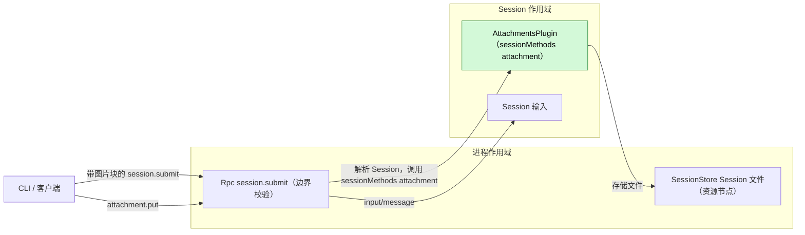
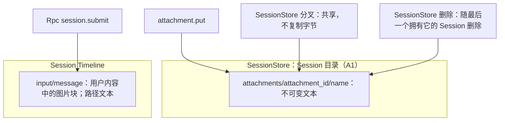
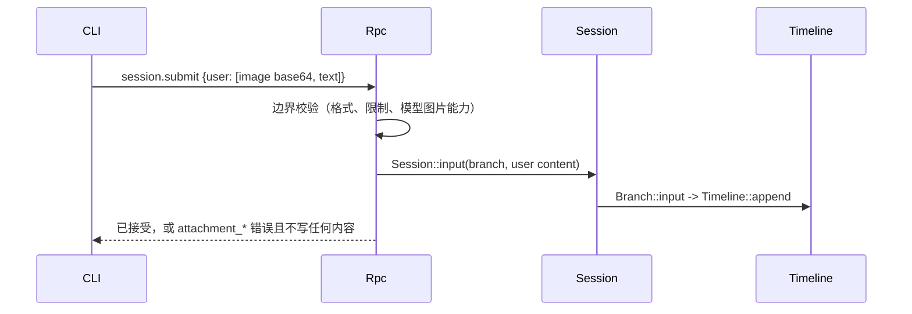

# Attachments

状态：草案。总体设计：[overview B.4](../overview.md)。阶段：P1。语言：Rust。作用域：Session（[ADR 002](../../adr/002-plugin-scope.md)）。

让用户在一次提交中附带图片和大段文本。图片不需要插件：CLI 在 `session.submit` 中把它们作为图片内容块发送，由 Rpc 在提交边界校验。Attachments 是一个小型 Session 插件，通过 `sessionMethods` 服务（Session 作用域，key `attachment`）提供一个 Session 方法 `attachment.put`（[session-boundary](../contracts/session-boundary.md)）；契约以语言中立形式给出，Rust 形式见[附录 G](#附录-g-rust-绑定)。该方法把文本附件（一次大段粘贴）存为由 SessionStore 拥有、位于 Session 资源节点上的不可变 Session 文件，并返回其路径；用户文本引用该路径，模型在需要时用 `read` 读取文件。这些文件的分叉共享和删除属于 SessionStore 的行为。没有事件。

## 1. 结构

Attachments 只依赖 SessionStore，一个外层作用域插件（[ADR 002](../../adr/002-plugin-scope.md) D3）；它从不写 Timeline，从不看到图片，也不拥有任何自己的数据。它在插件的 `provides` 中声明其服务，且只安装在启用了它的 Session 中。

| 部分 | 作用域 | 依赖 | 提供 |
| --- | --- | --- | --- |
| `AttachmentsPlugin` | Session | `S:SessionIdentity`；SessionStore 的 Session 文件补充 | `sessionMethods` key `attachment`（`attachment.put`，级别 `session`） |

依赖的契约：`sessionMethods`（Rpc 解析 Session 并调用它）；一项 SessionStore 补充，在 Session 资源节点上存储不可变文件，分叉时共享，并随最后一个拥有它的 Session 删除（总体设计附录 C，SessionStore）；节点离线规则（[overview §6.3](../overview.md)）：在离线资源节点上的存储以 `node_unavailable` 失败，而 Attachments 保持加载，这要求经 rutis 链路导入的服务在链路断开期间保持注册并让调用失败（对 [#5](https://github.com/arcships/dim/issues/5) 的要求）；Rpc 在 `session.submit` 中对图片块的校验（Rpc 补充）。本文定义的契约：`attachment.put`、其错误码与限制、CLI 引用格式。Attachments 不引用任何其他插件的内部类型。

## 2. 数据与状态

Attachments 没有状态：文件属于 SessionStore 中 Session 的数据，图片只存在于 Rpc 以用户为作者写入的 `input/message` 中。`attachment_id` 是随机 UUID，因此分叉继承的历史中路径仍然有效，因为 SessionStore 共享文件而非复制（A6）。

事件：无。图片是现有 `input/message` 的一部分；文本附件只以路径形式出现在用户文本中。

## 3. 流程

### 3.1 提交时的图片

校验发生在输入写入之前。拒绝时不写任何内容，CLI 保留草稿。

### 3.2 文本粘贴

只有在文件已持久化之后才返回路径。模型之后用 `read` 读取它。

## 4. 时序与冲突

| 场景 | 结果 |
| --- | --- |
| 未启用 Attachments | `attachment.put` 得到 `unknown_method`；图片不受影响 |
| 提交后切换到不支持图片的模型 | 图片到达新模型；其适配器拒绝或丢弃它 |
| 图片输入的 `input/deleted` | 从未被应用或消费；文本文件保留在 Session 中 |
| 分叉与源 Session 的删除竞争 | 由 SessionStore 的分叉/删除顺序决定；文件共享，从不复制 |
| 资源节点离线 | `attachment.put` 以 `node_unavailable` 失败；图片不受影响；对路径的 `read` 与任何 `read` 一样失败；不重载，也不进入 Pending |

完整表格：附录 B。

## 5. 上下文映射

| 附件 | 模型看到的内容 | 位置 |
| --- | --- | --- |
| 图片 | 输入的用户消息中的图片内容块（在其 raw 块之后） | 消费位置（`input/consumed`） |
| 文本附件 | 用户文本中的路径；内容只通过之后的 `read` 结果 | 消费位置的用户消息；内容在该工具结果的位置 |

压缩既不原样保留图片，也不原样保留文件内容，只保留摘要（若摘要保留了路径，路径仍在；文件也仍在）。子分支继承切点之前已消费的输入；分叉的 Session 继承固定前缀，共享的文件仍可读取。插件直接写入的输入不经过 `session.submit` 校验（A8）。模型从不看到附件 id、被拒绝的提交或诊断。

## 6. 接口（摘要）

| 接口 | 类型 | 用途 |
| --- | --- | --- |
| `attachment.put` | `sessionMethods`（Session，key `attachment`），级别 `session` | 把文本附件存入 Session 目录，返回其路径 |
| `session.submit` 中的图片块 | Rpc 边界校验（补充） | 校验格式、限制和模型能力 |
| `attachment_*` 错误 | `session.submit` 和 `attachment.put` 上的 `appError` | 拒绝原因 |

## 7. 安全

图片只为校验头部和限制而解码。文本附件由 SessionStore 写在 Session 目录下，从不写到客户端选择的路径（`name` 只是文件名）。文件可在 Session 的权限策略下通过 `read` 读取；附件不授予额外权限。已配对的远程设备可以像调用任何 Session 方法一样调用 `attachment.put` 和 `session.submit`。内容是重放给模型的用户数据；CLI 不得隐式附加机密。分叉只读取其继承的历史所引用的文件。

## 附录 A. 接口细节

### A.1 `session.submit` 中的图片校验（Rpc 补充）

| 输入块 | 处理 |
| --- | --- |
| `Text` | 不变 |
| 图片，`source` 为 base64 | 解码；按魔数嗅探格式（忽略声明的 `media_type`）；接受 PNG、JPEG、WebP、GIF（功能列表）；设置 `media_type`；执行限制（A2） |
| 图片，`source` 为 URL | 以 `attachment_invalid` 拒绝（A3） |
| 任何图片，已采用的模型不支持图片输入 | 以 `attachment_unsupported_model` 拒绝 |
| 任何图片，能力未知 | 接受；由模型适配器决定（A4） |

限制（A2）：每次提交最多 20 张图片，每张解码后 5 MiB，每边 8000 px；违反即拒绝，从不缩放。块保持其顺序。错误以 `invalid_params` 呈现，附 `appError` `attachment_invalid` / `attachment_too_large` / `attachment_unsupported_model`。

### A.2 `attachment.put`

服务 `sessionMethods`，Session 作用域，key `attachment`。`describe()` 返回一个 `MethodDecl`：`{name: "attachment.put", level: session, mutating: true, interruption: report, progress: false, notifications: [], reply: direct}`。`call(MethodCall)` 接受参数 `{sessionId, name?, text}`，以 `MethodReply` 回复 `{attachmentId, path, bytes, lines}`；错误为 `MethodError` 数据。

| 规则 | 内容 |
| --- | --- |
| `name` | `[A-Za-z0-9._-]{1,64}`，不以点开头；默认 `paste.txt` |
| `text` | UTF-8，最多 10 MiB（A2）；空文本被拒绝 |
| 存储 | SessionStore 在其资源节点上的 Session 附件根目录下原子写入 `attachments/<attachmentId>/<name>`（A1）；节点离线时返回 `node_unavailable` |
| `path` | Session 资源节点上的绝对路径，与 `read` 为该 Session 解析的方式一致 |
| 错误 | `session_closed`、`attachment_invalid`、`attachment_too_large`、`node_unavailable`、`service_reloading`、`unknown_method` |

Rpc 与任何 Session 方法一样解析 Session。对在途调用的取消请求在 SessionStore 提交之前检查。

### A.3 CLI 契约

CLI 读取图片（剪贴板、`@`、粘贴的路径），并在 `session.submit` 中作为 base64 图片块发送；超过其阈值的粘贴通过 `attachment.put`，并插入 `[Pasted text: <path> (<lines> lines)]`（A5）。被拒绝时保留草稿。临时图片文件由 CLI 在收到提交回复后删除。

## 附录 B. 完整冲突表

| 场景 | 序号顺序 | 结果 | 决策归属 |
| --- | --- | --- | --- |
| 轮次运行时提交图片 | 按模式输入 | 与任何输入一样被应用和消费 | InputQueue、Loop |
| 图片输入被消费之前的轮次中断 | 已应用 < I | 待处理；由下一轮消费 | Loop |
| 被持有时对该输入的 `input/withdraw` | 输入 < withdraw < `input/deleted` | 从未被应用或消费；文本文件保留在 Session 中 | InputQueue |
| 校验与写入之间分支关闭 | 关闭 < 写入 | `Session::input` 以 `BranchMissing` 失败；不写任何内容 | 运行时门面 |
| 提交后切换模型 | 输入 < `context/configured` < 已消费 | 新模型的适配器拒绝或丢弃图片 | ModelProvider |
| 并发的 Steer/Queue/Append | Timeline 顺序 | 不受影响 | InputQueue |
| `attachment.put` 之后从未提交 | — | 文件保留在 Session 中；随 Session 删除 | SessionStore |
| `attachment.put` 与 Session 删除竞争 | — | `session_closed`，或文件随删除被移除 | SessionStore |
| 分叉与源 Session 的删除竞争 | — | 按 SessionStore 的分叉/删除顺序 | SessionStore |
| 压缩 | 已消费 < 压缩 | 只通过摘要保留；文件仍在 | ContextPreparation |
| 子分支切出 | 已消费 < 切点 | 子分支继承图片和路径；同一份文件 | 历史投影 |
| Attachments 重载 | — | `attachment.put` 得到 `service_reloading`；提交之前的在途调用以 `operation_interrupted` 结束 | Rpc |
| 提交期间 Rpc 重载 | — | `service_reloading`；客户端检查 `session.input_lookup`，然后以相同的 `submissionId` 重试 | Rpc、客户端 |
| 进程重启 | — | 不丢失状态 | — |
| 重复或迟到的 `attachment.put` | — | 每次调用都是新附件（A7） | Attachments |
| 已配对的远程设备提交 | — | 相同的边界校验 | Rpc |
| Session 卸载/恢复、客户端断开 | — | 无影响 | — |
| `attachment.put` 时资源节点离线 | — | `node_unavailable`；不存储任何内容；Attachments 保持加载；节点恢复后重试成功（对 #5 的要求） | SessionStore |

## 附录 C. 错误与恢复

| 代码 | 含义 |
| --- | --- |
| `attachment_invalid` | 不支持或无法解码的图片、URL 来源、错误的名称、空文本 |
| `attachment_too_large` | 超过 A.1/A.2 的某项限制 |
| `attachment_unsupported_model` | 向不支持图片输入的模型发送图片 |
| `session_closed`、`service_reloading` | 与其他 Session 方法相同 |
| `node_unavailable` | Session 的资源节点不可达 |
| `unknown_method` | Session 中未启用 Attachments |

被拒绝的提交不留下任何事实。存储后没有后续提交的文件随其 Session 删除。任何变更都不会自动重试。

## 附录 D. 验收

1. 接受 PNG/JPEG/WebP/GIF 并使用嗅探出的媒体类型；标错类型的 JPEG 被纠正；拒绝 BMP 和 URL；拒绝时不写任何内容。
2. 非视觉模型：`attachment_unsupported_model`；能力未知：接受。
3. 限制：21 张图片、6 MiB 图片、9000 px 边长均被拒绝。
4. `attachment.put` 返回 `read` 能为该 Session 解析的路径。
5. 分叉后删除源 Session：分叉仍能读取文件；删除分叉：文件被移除；不复制字节。
6. 未启用 Attachments：`attachment.put` 得到 `unknown_method`；图片提交不受影响。
7. 通过公开 RPC 覆盖中断、撤回和分支关闭各行。
8. 离线资源节点：`attachment.put` 以 `node_unavailable` 失败且不重载 Attachments；节点恢复后成功。

## 附录 E. 假设

| # | 假设 | 依据 | 若被否决的影响 |
| --- | --- | --- | --- |
| A1 | 文本附件是由 SessionStore 拥有的 Session 文件，存储在 Session 资源节点上每个 Session 的附件根目录下；SessionStore 在控制节点上保存所有权记录。对于位于控制节点上的 Session，这就是 Session 目录 | 判断；`read` 在资源节点上运行 | 其他布局或内联文本内容 |
| A2 | 限制：20 张图片、5 MiB、8000 px、10 MiB 文本；拒绝而非缩放 | 边界情况参考；判断 | 不同的限制或缩放 |
| A3 | 拒绝 URL 图片来源 | 总体设计"最终内容"；判断 | 由提供方获取 URL |
| A4 | 模型能力未知时接受图片 | 判断 | 未知即拒绝 |
| A5 | CLI 选择粘贴阈值和引用格式 | 总体设计附录 E（CLI）；判断 | 由服务端返回格式化的引用 |
| A6 | 分叉共享不可变文件（SessionStore 行为） | 维护者决定；把字节复制到新路径会破坏继承的路径 | 复制字节并重写路径，对固定历史不可能实现 |
| A7 | 不去重 | 判断 | 内容寻址的 id |
| A8 | 只有 `session.submit` 校验图片 | 判断 | 其他写入方校验各自的图片 |
| A9 | 分叉保持源 Session 的资源节点；分叉到其他节点不在范围内 | 维护者决定 | 文件必须在其他节点上可用 |

## 附录 F. 待对齐问题

| # | 问题 | 说明 |
| --- | --- | --- |
| F1 | 边界处的图片能力 | Rpc 需要 Session 已采用模型的图片能力（已发布的 `context/configured` 加上 Provider 目录）；没有它，所有图片都被接受（A4） |

## 附录 G. Rust 绑定

Attachments 用 Rust 实现。

| 中立契约 | Rust 绑定 |
| --- | --- |
| `sessionMethods` key `attachment` | `SessionMethodContribution(Arc<dyn MethodProvider>)`，key `SessionScope::named_key::<SessionMethodContribution>("attachment")`；`describe` = `methods()`，`call` = `call(MethodCall, CallChannel, CancellationToken)`；取消请求 = `CancellationToken` |
| 图片内容块 | `ContentBlock::Image { source: Base64 \| Url, media_type }` |
