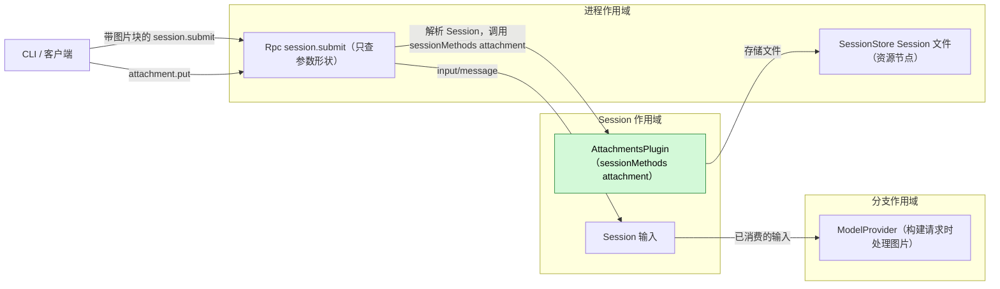
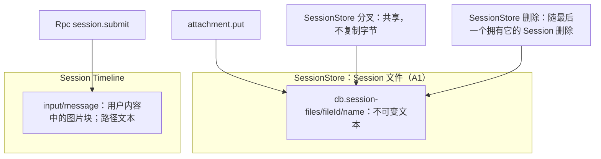
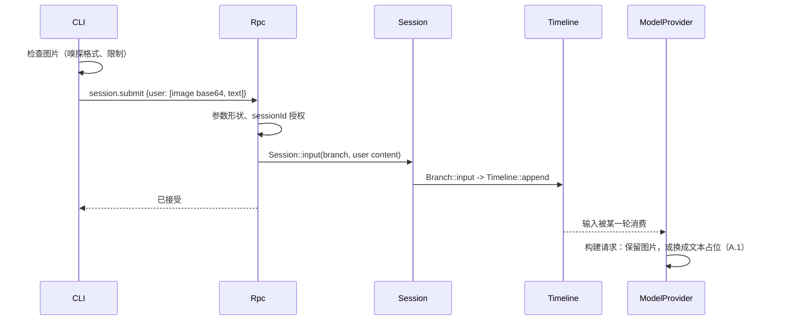
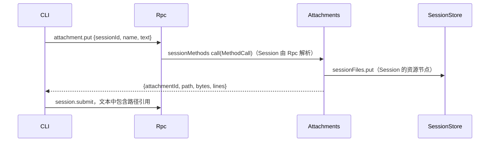

# Attachments

状态：草案。总体设计：[overview §4](../overview.md#4-插件目录)。阶段：P1。语言：Rust。作用域：Session（[ADR 002](../../adr/002-plugin-scope.md)）。

> **离线资源节点。** 关于资源节点离线的各行描述的是 P3 多节点行为。#5 已撤回（rutis 是外部依赖，链接断开时会撤掉导入的服务），这些行在 P3 按总览 §6.3 重新设计：节点服务在每次调用时按 `resourceNode` 查找。P1/P2 中每个 Session 都使用控制节点。

让用户在一次提交中附带图片和大段文本。图片不需要插件：CLI 检查图片（嗅探格式、限制），再在 `session.submit` 中把它们作为图片内容块发送；Rpc 只检查参数形状，模型的图片能力由 ModelProvider 在构建每个请求时处理（拟议的 ModelProvider 补充，[总体设计附录 B.1](../overview.md#b1-session-与分支-capability)）。Attachments 是一个小型 Session 插件，通过 `sessionMethods` 服务（Session 作用域，key `attachment`）提供一个 Session 方法 `attachment.put`（[session-boundary](../contracts/session-boundary.md)）；契约以语言中立形式给出，Rust 形式见[附录 G](#附录-g-rust-绑定)。该方法把文本附件（一次大段粘贴）存为由 SessionStore 拥有、位于 Session 资源节点上的不可变 Session 文件，并返回其路径；用户文本引用该路径，模型在需要时用 `read` 读取文件。这些文件的分叉共享和删除属于 SessionStore 的行为。没有事件。

## 1. 结构

Attachments 只依赖 SessionStore，一个外层作用域插件（[ADR 002](../../adr/002-plugin-scope.md) D3）；它从不写 Timeline，从不看到图片，也不拥有任何自己的数据。它在插件的 `provides` 中声明其服务，且只安装在启用了它的 Session 中。

| 部分 | 作用域 | 依赖 | 提供 |
| --- | --- | --- | --- |
| `AttachmentsPlugin` | Session | `S:SessionIdentity`；SessionStore `sessionFiles` | `sessionMethods` key `attachment`（`attachment.put`） |

依赖的契约：`sessionMethods`（Rpc 解析 Session 并调用它）；一项 SessionStore 补充，即进程服务 `sessionFiles`，在 Session 资源节点上存储不可变文件，分叉时共享，并随最后一个拥有它的 Session 删除（[Session 文件](../appserver/session-files.md)，[总体设计附录 B.2](../overview.md#b2-app-server-进程插件)）；节点离线规则（[overview §6.3](../overview.md)）：在离线资源节点上的存储以 `node_unavailable` 失败，而 Attachments 保持加载，因为 SessionStore 每次调用时查找该节点的 FileStorage（[#38](https://github.com/arcships/dim/issues/38)，[Session 文件 §2](../appserver/session-files.md#2-结构)）；ModelProvider 构建请求时对图片的处理（拟议补充，见 A.1 和 [总体设计附录 B.1](../overview.md#b1-session-与分支-capability)）。本文定义的契约：`attachment.put`、其错误码与限制、CLI 的图片检查与引用格式。Attachments 不引用任何其他插件的内部类型。

## 2. 数据与状态

Attachments 没有状态：文件属于 SessionStore 中 Session 的数据，图片只存在于 Rpc 以用户为作者写入的 `input/message` 中。`attachmentId` 是该 Session 文件的 id，由 SessionStore 选定的随机 UUID。分叉继承的历史中路径仍然有效，因为 SessionStore 共享文件而非复制，且文件所在目录不属于任何单个 Session（A6）。

事件：无。图片是现有 `input/message` 的一部分；文本附件只以路径形式出现在用户文本中。

## 3. 流程

### 3.1 提交时的图片

不支持或过大的图片由 CLI 在发送前拒绝，并保留草稿。Rpc 不检查图片。ModelProvider 按每个请求所用的模型决定，历史中的输入从不改变。

### 3.2 文本粘贴

只有在文件已持久化之后才返回路径。模型之后用 `read` 读取它。

## 4. 时序与冲突

| 场景 | 结果 |
| --- | --- |
| 未启用 Attachments | `attachment.put` 得到 `unknown_method`；图片不受影响 |
| 提交后切换到不支持图片的模型 | ModelProvider 用文本占位代替图片发送（A.1） |
| 图片输入的 `input/deleted` | 从未被应用或消费；文本文件保留在 Session 中 |
| 分叉与源 Session 的删除竞争 | 分叉先提交则保留文件，共享而不复制；否则分叉失败（[Session 文件 §6](../appserver/session-files.md#6-删除崩溃恢复与串行化)） |
| 资源节点离线 | `attachment.put` 以 `node_unavailable` 失败；图片不受影响；对路径的 `read` 与任何 `read` 一样失败；不重载，也不进入 Pending |

完整表格：附录 B。

## 5. 上下文映射

| 附件 | 模型看到的内容 | 位置 |
| --- | --- | --- |
| 图片 | 输入的用户消息中的图片内容块（在其 raw 块之后）；请求所用模型无法接收时为文本占位（A.1） | 消费位置（`input/consumed`） |
| 文本附件 | 用户文本中的路径；内容只通过之后的 `read` 结果 | 消费位置的用户消息；内容在该工具结果的位置 |

压缩既不原样保留图片，也不原样保留文件内容，只保留摘要（若摘要保留了路径，路径仍在；文件也仍在）。子分支继承切点之前已消费的输入；分叉的 Session 继承固定前缀，共享的文件仍可读取。任何写入方写入的图片都经过同样的 ModelProvider 处理（A8）。模型从不看到附件 id、被 CLI 拒绝的图片或诊断。

## 6. 接口（摘要）

| 接口 | 类型 | 用途 |
| --- | --- | --- |
| `attachment.put` | `sessionMethods`（Session，key `attachment`） | 把文本附件存为 Session 文件，返回其路径 |
| CLI 图片检查 | 客户端契约（A.1、A.3） | 提交前嗅探格式、执行限制 |
| 构建请求时的图片处理 | ModelProvider 补充（拟议，A.1） | 按请求所用模型发送图片块，或换成文本占位 |
| `attachment_*` 错误 | `attachment.put` 上的 `appError` | 拒绝原因 |

## 7. 安全

CLI 只为检查头部和限制而解码图片；ModelProvider 只为检查请求的适配器能否接收而解码；Rpc 不检查图片。文本附件由 SessionStore 写在它的 Session 文件目录下，从不写到客户端选择的路径（`name` 只是文件名）。文件可在 Session 的权限策略下通过 `read` 读取；附件不授予额外权限。已配对的远程设备可以像调用任何 Session 方法一样调用 `attachment.put` 和 `session.submit`；它们的图片不经过 CLI 检查，服务端由 ModelProvider 的处理兜底。内容是重放给模型的用户数据；CLI 不得隐式附加机密。分叉只读取其继承的历史所引用的文件。

## 8. 规则检查

| 规则 | 本文如何遵守 |
| --- | --- |
| 原则 §4 第 1 条（改别人的状态写指令） | Attachments 不改其他模块的 Timeline 状态；文件通过 SessionStore 自己的类型化操作存储，与没有 Timeline 的进程级状态一样。 |
| 原则 §4 第 2 条（交接） | Attachments 不处理输入；图片只在 `input/message` 中进入，照常由 `input/applied` 交给 Loop。 |
| 原则 §4 第 3 条（只用 before 回调） | RPC 入口和 Session 入口不加检查：Rpc 只查参数形状，图片检查在 CLI 和 ModelProvider 构建请求时进行（原则 §4 第 3 条）。 |
| 原则 §4 第 4 条（核心不带业务含义） | 不改核心；ModelProvider 的图片处理对所有图片块一样，不区分写入方。 |
| 原则 §4 第 5 条（批次） | 不适用：Attachments 不依据事件做决定。 |
| 原则 §4 第 6 条（上下文只含交接后的事件） | 图片只从已消费的输入进入模型；被删除的输入不进入上下文。 |
| 原则 §4 第 7 条（只用公开事件和服务） | Attachments 只使用 `sessionMethods` 和 SessionStore 公开的 Session 文件操作。 |
| 原则 §4 第 8 条（向机制所有者提需求） | 没有运行时或 rutis 需求：离线规则依靠 SessionStore 每次调用时查找该节点的 FileStorage（#38），而不是已撤回的 #5。ModelProvider 补充是对其他插件的需求，列在[总体设计附录 B.1](../overview.md#b1-session-与分支-capability)，理由见 A.1。 |
| 原则 §4 第 9 条（只有后续决定要用的事实才进 Timeline） | Attachments 不写事件；文本文件是 SessionStore 的状态，图片放在现有的 `input/message` 中。 |
| 原则 §1（Capability 与 App Server 边界） | Attachments 是放在自己 crate 中的 Session Capability；Rpc 不含图片逻辑。 |
| ADR 002 D1（作用域跟随状态） | Session 作用域：`attachment.put` 为自己的 Session 工作。文本文件是该 Session 的数据，因为分叉要共享它们，由进程作用域的 SessionStore 保存。 |
| ADR 002 D2（不设接线模块） | 没有接线模块；Attachments 只依赖 SessionStore。 |
| ADR 002 D3（依赖跟随作用域） | 唯一依赖 SessionStore 位于外层进程作用域；SessionStore 重载会重载 Attachments。 |
| ADR 002 D4（结构配置与业务配置分离） | 启用是结构配置；Attachments 没有业务配置（限制是固定值，A2）。 |
| ADR 002 D5（合同语言中立） | 契约语言中立；Rust 形式见附录 G。 |

## 9. 向机制所有者提出的需求

没有自己对运行时或 rutis 的需求。离线规则依靠 SessionStore 每次调用时查找该节点的 FileStorage（[#38](https://github.com/arcships/dim/issues/38)），而不是已撤回的 [#5](https://github.com/arcships/dim/issues/5)。

ModelProvider 补充（构建请求时的图片处理）是对其他插件的需求，列在[总体设计附录 B.1](../overview.md#b1-session-与分支-capability)，具体规则见 A.1。

## 附录 A. 接口细节

### A.1 图片处理（CLI 检查与 ModelProvider 补充）

Rpc 只检查 `session.submit` 的参数形状（内容块格式正确）和 `sessionId` 授权；不解码、不嗅探、不限制图片（原则 §4 第 3 条）。

CLI 在提交前检查：

| 图片 | 处理 |
| --- | --- |
| 文件、剪贴板或粘贴的路径 | 解码；按魔数嗅探格式（忽略声明的类型）；接受 PNG、JPEG、WebP、GIF（功能列表）；设置 `media_type`；执行限制（A2） |
| URL | 从不发送（A3） |
| 被拒绝 | 不发送；保留草稿并显示原因 |

限制（A2）：每次提交最多 20 张图片，每张解码后 5 MiB，每边 8000 px；违反即拒绝，从不缩放。块保持其顺序。

ModelProvider 补充（拟议，[总体设计附录 B.1](../overview.md#b1-session-与分支-capability)），在构建模型请求时作用于每个图片块：

| 图片块 | 请求内容 |
| --- | --- |
| 请求所用模型接受图片输入，且适配器接受该块的格式和大小 | 原样发送 |
| 模型不接受图片输入（Provider 目录） | 文本 `[Image omitted: the current model does not accept images.]` |
| 能力未知 | 原样发送；由提供方决定（A4） |
| URL 来源、无法解码的数据，或适配器不接受的格式或大小 | 文本 `[Image omitted: the image cannot be sent to this model.]`（A10） |

历史从不改变；每个请求按自己的模型重新决定。

为什么放在 ModelProvider：图片检查不能放在 RPC 入口或 App Server（原则 §4 第 3 条和 §1），CLI 的检查覆盖不到原始客户端和其他写入方。不采用的做法：在 `session.submit` 上由 Rpc 校验（入口检查）；`input/message` 上的 before 回调（写入时还不知道消费它的请求用哪个模型）；Attachments 上传方法（覆盖不到其他写入方）。这项补充不写事件，历史不变；每个请求按已采用的 `context/configured` 和 Provider 目录决定，中断和重载只影响正在构建的请求。

### A.2 `attachment.put`

服务 `sessionMethods`，Session 作用域，key `attachment`。`describe()` 返回一个 `MethodDecl`：`{name: "attachment.put", mutating: true, interruption: report, progress: false, notifications: [], reply: direct}`。`call(MethodCall)` 接受参数 `{sessionId, name?, text}`，以 `MethodReply` 回复 `{attachmentId, path, bytes, lines}`；错误为 `MethodError` 数据。

| 规则 | 内容 |
| --- | --- |
| `name` | `[A-Za-z0-9._-]{1,64}`，不以点开头；默认 `paste.txt` |
| `text` | UTF-8，最多 10 MiB（A2）；空文本被拒绝 |
| 存储 | SessionStore 的 `sessionFiles.put` 在 Session 资源节点上的 `<db>.session-files/<fileId>/<name>`（位于原生数据库 `<db>` 旁边）只写一次、以只读方式保存文本，`attachmentId` 即该 `fileId`（A1，[Session 文件](../appserver/session-files.md)）；节点离线时返回 `node_unavailable` |
| `path` | Session 资源节点上的绝对路径，与 `read` 为该 Session 解析的方式一致 |
| 错误 | `session_closed`、`attachment_invalid`、`attachment_too_large`、`node_unavailable`、`service_reloading`、`unknown_method` |

Rpc 与任何 Session 方法一样解析 Session。对在途调用的取消请求在 SessionStore 提交之前检查。

### A.3 CLI 契约

CLI 读取图片（剪贴板、`@`、粘贴的路径），检查后（A.1）在 `session.submit` 中作为 base64 图片块发送；超过其阈值的粘贴通过 `attachment.put`，并插入 `[Pasted text: <path> (<lines> lines)]`（A5）。被拒绝时保留草稿。临时图片文件由 CLI 在收到提交回复后删除。

## 附录 B. 完整冲突表

| 场景 | 序号顺序 | 结果 | 决策归属 |
| --- | --- | --- | --- |
| 轮次运行时提交图片 | 按模式输入 | 与任何输入一样被应用和消费 | InputQueue、Loop |
| 图片输入被消费之前的轮次中断 | 已应用 < I | 待处理；由下一轮消费 | Loop |
| 被持有时对该输入的 `input/withdraw` | 输入 < withdraw < `input/deleted` | 从未被应用或消费；文本文件保留在 Session 中 | InputQueue |
| 提交与写入之间分支关闭 | 关闭 < 写入 | `Session::input` 以 `BranchMissing` 失败；不写任何内容 | 运行时门面 |
| 提交后切换模型 | 输入 < `context/configured` < 已消费 | 新模型不接受图片时使用占位（A.1） | ModelProvider |
| 适配器无法接收的图片（无法解码、格式不支持、过大） | 已消费 < 请求 | 每个请求中使用占位；历史中的输入不变 | ModelProvider |
| 并发的 Steer/Queue/Append | Timeline 顺序 | 不受影响 | InputQueue |
| `attachment.put` 之后从未提交 | — | 文件保留在 Session 中；随 Session 删除 | SessionStore |
| `attachment.put` 与 Session 删除竞争 | — | `session_closed`，或文件随删除被移除 | SessionStore |
| 分叉与源 Session 的删除竞争 | — | 分叉先提交则保留文件；否则分叉失败（[Session 文件 §6](../appserver/session-files.md#6-删除崩溃恢复与串行化)） | SessionStore |
| 压缩 | 已消费 < 压缩 | 只通过摘要保留；文件仍在 | ContextPreparation |
| 子分支切出 | 已消费 < 切点 | 子分支继承图片和路径；同一份文件 | 历史投影 |
| Attachments 重载 | — | `attachment.put` 得到 `service_reloading`；提交之前的在途调用以 `operation_interrupted` 结束 | Rpc |
| 提交期间 Rpc 重载 | — | `service_reloading`；客户端检查 `session.input_lookup`，然后以相同的 `submissionId` 重试 | Rpc、客户端 |
| 进程重启 | — | 不丢失状态 | — |
| 重复或迟到的 `attachment.put` | — | 每次调用都是新附件（A7） | Attachments |
| 已配对的远程设备提交 | — | 没有 CLI 检查；适用 ModelProvider 的处理（A.1） | ModelProvider |
| Session 卸载/恢复、客户端断开 | — | 无影响 | — |
| `attachment.put` 时资源节点离线 | — | `node_unavailable`；不存储任何内容；Attachments 保持加载；节点恢复后重试成功（SessionStore 每次调用时查找该节点的 FileStorage，#38） | SessionStore |

## 附录 C. 错误与恢复

| 代码 | 含义 |
| --- | --- |
| `attachment_invalid` | 错误的名称、空文本 |
| `attachment_too_large` | 文本超过 A.2 的限制 |
| `session_closed`、`service_reloading` | 与其他 Session 方法相同 |
| `node_unavailable` | Session 的资源节点不可达 |
| `unknown_method` | Session 中未启用 Attachments |

被 CLI 拒绝的图片从不发送。存储后没有后续提交的文件随其 Session 删除。任何变更都不会自动重试。

## 附录 D. 验收

1. CLI：接受 PNG/JPEG/WebP/GIF 并使用嗅探出的媒体类型；标错类型的 JPEG 被纠正；BMP 和 URL 在发送前被拒绝；保留草稿。
2. 非视觉模型：请求中是占位，历史中的输入不变；能力未知：发送图片。
3. CLI 限制：21 张图片、6 MiB 图片、9000 px 边长在发送前被拒绝。原始客户端用 `session.submit` 发送无法解码的图片时，Rpc 接受，请求中换成占位。
4. `attachment.put` 返回 `read` 能为该 Session 解析的路径。
5. 分叉后删除源 Session：分叉仍能读取文件；删除分叉：文件被移除；不复制字节。
6. 未启用 Attachments：`attachment.put` 得到 `unknown_method`；图片提交不受影响。
7. 通过公开 RPC 覆盖中断、撤回和分支关闭各行。
8. 离线资源节点：`attachment.put` 以 `node_unavailable` 失败且不重载 Attachments；节点恢复后成功。

## 附录 E. 假设

| # | 假设 | 依据 | 若被否决的影响 |
| --- | --- | --- | --- |
| A1 | 文本附件是由 SessionStore 拥有的 Session 文件，存储在 Session 资源节点上的 `<db>.session-files/<fileId>/` 下；这个目录不属于任何单个 Session，因此路径在分叉和源 Session 删除后仍然有效。SessionStore 在控制节点上保存所有权行（[Session 文件](../appserver/session-files.md)） | 判断；`read` 在资源节点上运行 | 其他布局或内联文本内容 |
| A2 | 限制：20 张图片、5 MiB、8000 px（CLI），10 MiB 文本（`attachment.put`）；拒绝而非缩放 | 边界情况参考；判断 | 不同的限制或缩放 |
| A3 | CLI 从不发送 URL 图片来源；ModelProvider 把它们换成占位 | 总体设计"最终内容"；判断 | 由提供方获取 URL |
| A4 | 模型能力未知时 ModelProvider 发送图片 | 判断 | 未知即换成占位 |
| A5 | CLI 选择粘贴阈值和引用格式 | [总体设计附录 D](../overview.md#附录-d-cli-层)（CLI）；判断 | 由服务端返回格式化的引用 |
| A6 | 分叉共享不可变文件（SessionStore 行为） | 维护者决定；把字节复制到新路径会破坏继承的路径 | 复制字节并重写路径，对固定历史不可能实现 |
| A7 | 不去重 | 判断 | 内容寻址的 id |
| A8 | 图片处理在 ModelProvider 构建请求时进行，因此覆盖所有写入方的图片 | 维护者决定：功能检查归其所有者 | 各写入方自行检查图片 |
| A9 | 分叉保持源 Session 的资源节点；分叉到其他节点不在范围内 | 维护者决定 | 文件必须在其他节点上可用 |
| A10 | 请求无法携带的图片换成文本占位，而不是让模型调用失败 | 判断：输入留在历史中，调用失败会在每一轮重复 | 在输入离开上下文之前模型调用一直失败 |

## 附录 F. 待对齐问题

无。图片能力由 ModelProvider 在构建请求时处理（A.1、[总体设计附录 B.1](../overview.md#b1-session-与分支-capability)）。

## 附录 G. Rust 绑定

Attachments 用 Rust 实现。

| 中立契约 | Rust 绑定 |
| --- | --- |
| `sessionMethods` key `attachment` | `SessionMethodContribution(Arc<dyn MethodProvider>)`，key `SessionScope::named_key::<SessionMethodContribution>("attachment")`；`describe` = `methods()`，`call` = `call(MethodCall, CallChannel, CancellationToken)`；取消请求 = `CancellationToken` |
| 图片内容块 | `ContentBlock::Image { source: Base64 \| Url, media_type }` |
