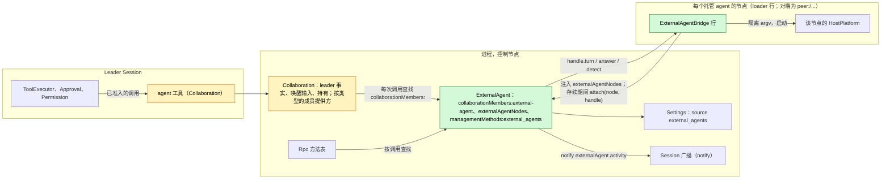
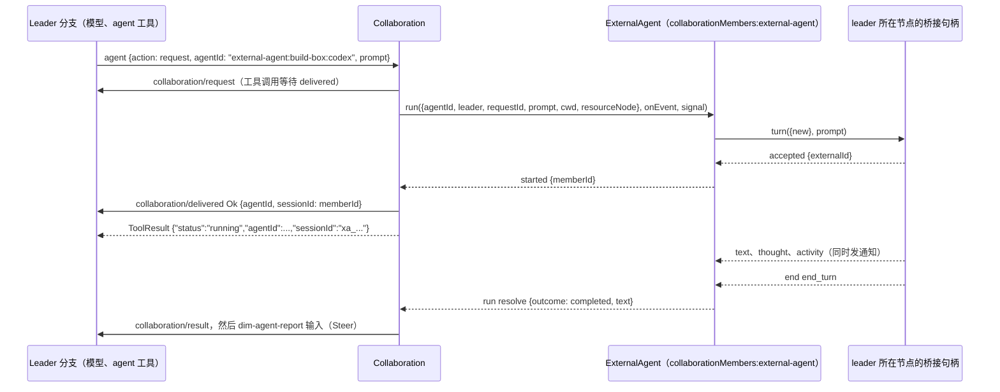
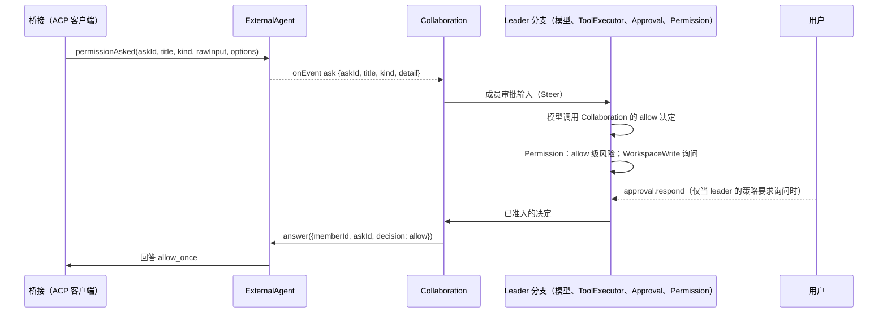

# ExternalAgent

状态：草案（第二次重新设计，[#145](https://github.com/arcships/dim/issues/145)）。它取代 [#182](https://github.com/arcships/dim/pull/182) 的"外部 agent 作为模型"框架。维护者 2026-10-22 的决定记录在[附录 F](#附录-f-已记录的决定)；达到 Ready 还缺的内容见 [§10](#10-ready-状态)。总体设计：[overview §4](../overview.md#4-插件目录)；作用域：[ADR 002](../../adr/002-plugin-scope.md)（进程，另有按节点的桥接行）。阶段：P3。语言：优先 TypeScript（[overview 附录 C](../overview.md#附录-c-实现语言)）。

ExternalAgent 让 Session 的模型像委派给子 agent 一样，把工作委派给本地安装的编码 agent（Claude Code、Codex、Cursor、OpenCode、ZCode 等）。外部 agent **是子 agent，不是模型**：委派方 Session 保留自己的模型，经 Collaboration 的 `agent` 工具给外部 agent 一个任务，之后以成员结果的形式收到它的最终报告。外部 agent 在自己的会话里用自己的工具工作；dim 从不把它的输出当作 dim 的模型输出。

ExternalAgent 是 dim 现有子 agent 机制 Collaboration（[collaboration.rs](../../../../crates/dim-app-server/src/collaboration.rs)）的又一种**成员类型**，而不是并行的另一套机制。委派仍归 Collaboration：`agent` 工具、leader 的 `collaboration/*` 事实、`dim-agent-report` 唤醒输入、取消、重载了结以及对 leader Session 的持有。ExternalAgent 提供成员：启动外部会话，把任务和消息送过去，报告活动和权限询问，并返回最终文本。agent 为自己的动作请求权限时，询问走 Collaboration 的成员审批路径（[#29](https://github.com/arcships/dim/issues/29)，已在 #19 决定）到 leader 的模型，它的决定是一次普通的工具调用，受 leader 自己的 Approval 与 Permission 约束。agent 进程位于由 loader 管理的按节点桥接行中。所有契约都是语言中立的具名服务（[ADR 002 D5](../../adr/002-plugin-scope.md)）；Rust 形式见[附录 G](#附录-g-rust-绑定)。

## 0. 为什么是 Collaboration 成员

| 形态 | 需要什么 | 结论 |
| --- | --- | --- |
| **外部 agent 作为 Collaboration 的又一种成员类型**（本设计） | Collaboration 每次调用按类型查找成员提供方，把现有操作转给它；ExternalAgent 实现提供方 | 采用：模型只看到一个委派入口，脱离工作只有一个所有者，其契约已覆盖投递、结果、唤醒、取消、关闭、重载与重启（[event-driven flows §3](../../../architecture/rust-agent/event-driven-flows.md)）。已持久化的 `collaboration/*` 数据不变 |
| ExternalAgent 自有的 `external_agent` 工具和自有的脱离工作事件 | 第二个请求/结果/唤醒/取消所有者，模型面前第二个子 agent 工具 | 否决：重复 Collaboration 的所有者规则，模型要在两个委派入口间选择 |
| 由外部 agent 执行轮次的成员 Session（#182 的框架） | Provider 条目、model kind 以及 ModelHost/ModelProvider 改动，使 agent 的工作在 dim Session 中表现为 dim 的模型输出 | 维护者否决：外部 agent 是子 agent，不是模型 |

相对 #182（本设计取代它）的变化：

| #182（模型框架） | 本设计 |
| --- | --- |
| Provider 条目 `external-agent:<node>:<agent>`、`modelKind:external-agent`、`ModelConnection::Kind`、`ModelCallScope`、ModelHost 查找 | 删除。没有 Provider、Aimux、ModelProvider 或输出块映射的补充 |
| ExternalAgent 写入的、以外部模型为模型的 Agents profile | 删除。Collaboration 从 ExternalAgent 的目录列出外部 agent |
| 依据调用方分支 Timeline 的投递决定（记录、cursor、转写初始化） | 删除。成员只收到任务和 leader 的消息，与 dim 成员相同 |
| `external_agent_allow` / `external_agent_reject` 工具、Session 部分与客户端路径 | 删除。询问走 Collaboration 的成员审批路径（§3.2）；ExternalAgent 没有 Session 部分 |
| SessionTitle 与 AuxiliaryModel 对 `external-agent:*` 模型的排除 | 删除；不存在这种模型 |
| 只在内存的成员记录 | 成员把 `{memberId, externalId, ...}` 持久化到 ExternalAgent 自己的 `pluginFiles` 存储，ExternalAgent 重载或 dim 重启后用 ACP `session/load`（或 CLI resume）重新打开（§3.5，D5） |
| 保留 | 挂接到 ExternalAgent 的按节点桥接 loader 行、由 ExternalAgent 自己发出通知、Settings 中的业务配置、共享 ACP schema |

## 1. 结构



外部 agent 连接与在用会话是共享的宿主资源，因此 ExternalAgent 是进程插件（ADR 002 D1）。agent 进程是某个节点的宿主资源，因此属于该节点上的插件：`ExternalAgentBridge` 是进程插件，每个托管 agent 的节点一行 loader 行。只要 ExternalAgent 启用，控制节点的行就是产品 profile 的一部分。对端节点的行是 `peer:<node>/external-agent-bridge`，只由 PluginManager 的结构性操作增删（ADR 002 D4：节点绑定是结构性的）。对端行在其节点或链路不在时等待，恢复后再次装载。桥接的资源在行卸载时由它自己的 `ctx.effect` 释放。

桥接行注入 `externalAgentNodes`（在对端经链路导入），并在 `apply` 中为自己的节点以引用挂接一个句柄。挂接与行同生共死：行的 effect 解除挂接；链路断开或运行时退出会关闭引用，ExternalAgent 视为已解除。这是 #37 认可的注册形式。TypeScript 行不能按次查找服务（[sessions-service D1](../appserver/sessions-service.md)、[process TypeScript §5.1](../../../design/process-typescript.md#51-proposed-p6p7-access-through-declared-feature-dependencies)），因此 ExternalAgent 从不查找桥接。

Collaboration 是原生插件，每次调用不建立依赖地查找 `collaborationMembers:<kind>`，与 Rpc 查找 `managementMethods` 相同。没有核心部分、也没有 Session 依赖 ExternalAgent；它只注入从不重载的 `settings` 与 `pluginFiles`。ExternalAgent 没有 Session 部分：委派与决定工具都是 Collaboration 的。

| 部分 | 作用域 | 依赖（`inject`） | 提供 |
| --- | --- | --- | --- |
| `ExternalAgent` | 进程行，控制节点 | `settings`、`pluginFiles` | `collaborationMembers:external-agent`；`externalAgentNodes`；`managementMethods:external_agents`；Settings source `external_agents`；`externalAgent.activity` 通知 |
| `ExternalAgentBridge` | 进程行，每个托管 agent 的节点一行 | `externalAgentNodes`；该节点 HostPlatform 的 exec-argv 辅助 | 无具名服务；经 `attach` 以引用提供 `BridgeHandle` |
| Collaboration（变更，§9.2） | 现有的进程、Session 与分支部分 | 每次调用查找成员提供方 | 把非 Session 成员的操作转给其类型的提供方 |

**依赖的契约。** [`pluginFiles`](../../../../crates/dim-app-server/README.md#trusted-plugin-storage)（存储信封版本 1，位于已预置目录 `external-agent/` 下的一个文件）；Collaboration 的 `agent` 工具、`collaboration/*` 事件与脱离工作行为，加上成员提供方变更（§9.2）与成员审批路径（§9.3）；Settings 的类型化写入与 `settings.changed`；Session 广播通知及 §9.1 的 TypeScript 绑定；经 #4 的进程行与管理方法（[process TypeScript](../../../design/process-typescript.md)）；每个节点 HostPlatform 的 exec-argv 辅助与隔离（overview 附录 B，P3）；`SessionConfig.resourceNode`（P3）；把 `externalAgentNodes` 导出到相连节点的 rutis 链路。

**本文定义的契约。** 成员提供方契约 `collaborationMembers:<kind>`（与 Collaboration 共同，§9.2）及其 `external-agent` 实现；成员存储载荷格式 1（§2）；`externalAgentNodes` 与 `BridgeHandle`；`externalAgent.activity` 通知；业务配置与方法 `external_agents.*`；与 [AcpGateway](AcpGateway.md) 共享的 ACP schema 与一致性测试（客户端侧）。

Provider、Agents、Aimux、ModelProvider、Approval 与 Permission 从不提及本插件。Collaboration 只把成员类型当作查找键。

## 2. 数据与状态

**业务配置**（[ADR 002](../../adr/002-plugin-scope.md) D4）是 Settings source `external_agents` 中的一份用户作用域文档，由 ExternalAgent 的进程行声明：`{ nodes: { <node>: { <agent>: { enabled, description?, executable?, args?, env?, reasoning? } } } }`。Settings 校验并填默认值；ExternalAgent 在使用时读取，并随每次桥接调用传入该条目。它只经 ExternalAgent 的管理方法写入（A.1）。`env` 值可能包含 agent 的凭据；它们归 ExternalAgent 所有（[settings-service §1.2](../appserver/settings-service.md#12-决定密钥归其所有者)），该来源没有项目作用域。变更是一次数据更新加 `settings.changed`，从不重载。

**Loader 行。** 每个节点的 `external-agent-bridge` 行是结构性的：它说明哪些节点可以运行 agent，而不是哪些 agent 在那里运行。

**已挂接的桥接。** ExternalAgent 内存中的 `node -> {registration, handle}`，从 `attach` 起，到 `detach` 或引用关闭为止。

**成员记录。** 每个外部成员一条。持久部分在 ExternalAgent 的成员存储中，在用部分只在内存中：

```text
StoredMember {                  // 持久，成员存储载荷格式 1
  memberId: "xa_<uuid>",        // 该成员在 Collaboration 数据中的 sessionId
  leaderSessionId: String,      // 唯一可以访问它的 Session
  agentId: "external-agent:<node>:<agent>", node, agent, protocol: "acp" | "cli",
  cwd: String,
  externalId: String,           // ACP sessionId 或 CLI 会话 id
  restorable: bool,             // ACP agent 声明了 loadSession，或 CLI 适配器有 resume 形式
  queued: [{content, mode}],    // 已为空闲成员接受、尚未发出的消息
  createdAt, usedAt: RFC 3339 时间戳,
}
LiveMember {                    // 只在内存
  state: dormant | idle | running { requestId },
  activity: 200 条的环形缓冲,   // 供 read 与通知使用
  asks: { askId -> {title, kind, detail} },
}
```

成员一直存在，直到 Collaboration 关闭它（显式 `close`，或 leader Session 的业务关闭）、它的恢复失败，或 30 天未使用而被淘汰（A10）。ExternalAgent 重载或 dim 重启不会结束它：记录以 `dormant` 状态装载，下一次操作重新打开会话（§3.5）。

**成员存储。** 一个 `pluginFiles` 文件 `external-agent/members.json`，其信封文本是载荷 `{"format": 1, "members": [StoredMember]}`。`external-agent/` 目录由宿主预置。`pluginFiles` 没有删除或列举操作，因此所有记录共用这一个文件。ExternalAgent 每次变更都在一次 `withLock` 租约内重写它（读取、修改自己的记录、`replace`）；它是唯一写入方，因此租约是所有者在串行化自己的状态，不是跨所有者的先读后写。格式决定（AGENTS.md）：载荷格式 1 是新的；不兼容的变更提升 `format`。读到未知 `format` 或无效载荷时，不重写、重置或迁移文件：ExternalAgent 经 `external_agents.list` 与诊断报告它，在运维者决定前不提供任何已存成员，新成员只在内存中。凭据从不存放在这里；`env` 留在 Settings。

| 变更 | 写入 |
| --- | --- |
| 新成员到达 `accepted` | 先加入记录，再发出 `started`（两者之间崩溃会留下没有记录的外部会话和一个未投递的操作，由 Collaboration 按 closed 了结） |
| 为空闲或 dormant 成员接受消息 | 追加到 `queued`，然后回复 |
| 排队消息在某个 prompt 中发出 | 该 prompt 被接受后清除它们 |
| 一次 run 开始 | 更新 `usedAt` |
| `close`、恢复失败、重启后不可恢复、淘汰 | 删除记录 |

卸载、重载与关机从不删除记录；只有上表的业务事件会。

**Timeline。** ExternalAgent 不写任何 Timeline，不声明事件。leader 分支得到 Collaboration 的普通事实：`collaboration/request`、`collaboration/delivered`、`collaboration/message`、`collaboration/cancel`、`collaboration/close`、`collaboration/result`、`dim-agent-report` 输入，以及询问时 Collaboration 成员审批路径的输入、工具调用与审批事实。这些数据格式不变：外部成员创建时是 `CollaborationTarget::Agent { agent_id: "external-agent:<node>:<agent>" }`，之后是 `Member { agent_id, session_id: <member_id> }`。

**不进 Timeline**（principles §4 规则 9）：配置、挂接、成员记录（在成员存储中）、活动、进程。客户端经通知看到活动。恢复后成员过去的请求与结果仍在 leader 自己的 `collaboration/*` 事实中。

## 3. 流程

### 3.1 委派



1. leader 的模型以外部 `agentId`（新成员），或以已有外部成员的 `agentId` + `sessionId`（下一个任务）调用 `agent` `request`。Collaboration 照常写 `collaboration/request`。
2. Collaboration 按 agent id 的类型查找提供方并调用 `run`。ExternalAgent 检查条目（已启用、节点已挂接、节点等于 leader 的资源节点），创建或复用成员，用任务文本启动外部轮次。`accepted` 时它发出 `started {memberId}`，Collaboration 写 `collaboration/delivered`；工具调用返回。`started` 之前的拒绝成为带 Collaboration 错误码和 ExternalAgent 详情的 `collaboration/delivered Error`。
3. 请求是 Collaboration 拥有的脱离工作：它持有 leader Session，leader 的轮次中断不会停止它，它的结果唤醒 leader。
4. 运行期间，`append` 消息排队，在当前 prompt 结束时作为同一会话的后续 prompt 发出；`steer` 消息取消当前 prompt 并以该消息重新 prompt。当某个 prompt 结束且没有排队消息时，请求完成。
5. `run` 以结果和最终文本 resolve（A3）。Collaboration 写 `collaboration/result` 及其 `dim-agent-report` 输入，与 Session 成员完全相同。

成员在 leader 的 cwd 中、在 leader 的资源节点上工作，与 Collaboration 的 Session 成员相同。每个成员同一时间只有一个任务：对运行中成员的 `run` 被拒绝为 `busy`。

### 3.2 权限询问

agent 自己的动作不是 dim 的工具调用，因此 dim 的 Approval 不准入它（[ADR 003](../../adr/003-approval-scope.md) D1）。它是成员的工作，而 #19 已决定成员审批去哪里：作为输入送到 leader 分支，由 leader 的模型用一个 Collaboration 工具决定，该工具调用经过 leader 的 Approval 与 Permission（[overview 附录 B](../overview.md#附录-b-现有插件的补充)，Collaboration）。外部成员的询问走同一条路径。



- ExternalAgent 提供 `title`、粗粒度的 `kind`（A5）和 `detail`（agent 的原始输入，上限 4 KiB）。输入文本、决定工具及其结果归 Collaboration。
- allow 选择 `allow_once` 选项，reject 选择 `reject_once`；缺少所需选项时回答 agent `cancelled`。从不选择 `*_always`。
- 询问在没有回答时结束（run 被取消或结束、agent 撤回、桥接解除挂接、ExternalAgent 卸载），若 agent 仍在等待，ExternalAgent 回答 `cancelled` 并发出 `askEnded`；Collaboration 撤回尚未 applied 的输入，之后的决定得到 `not_pending`。
- 总有一个委派方分支。它关闭或被停止时，Collaboration 取消 run，询问随之结束。ExternalAgent 没有自己的客户端路径：当 leader 的策略要求询问时，用户经 leader 的 Approval 参与。
- 非交互 CLI 适配器没有请求通道。它们以 agent 自身不自动批准的模式启动，因此 agent 拒绝它无法询问的动作（A6）。

### 3.3 取消、关闭、中断

| 操作 | 效果 |
| --- | --- |
| `agent` `cancel` | Collaboration 中止 `run` 的 signal；桥接发送 ACP `session/cancel`（或给 CLI 发信号），排空，10 秒后杀掉（A4）；询问结束；`run` resolve 为 `cancelled`；报告写 `cancelled by leader`。成员保留，可接下一个任务 |
| `agent` `close` | 先按上一行取消，再 `close`：关闭该会话的进程并删除记录 |
| leader 轮次 `stop/interrupt` | 不影响运行中的任务（脱离工作契约） |
| leader 分支停止或关闭 | Collaboration 中止 run，与 Session 成员相同 |
| leader Session 关闭 | Collaboration 关闭它的成员，包括外部成员 |

### 3.4 桥接生命周期

| 事件 | 执行者 | 效果 |
| --- | --- | --- |
| 产品 profile 中启用 ExternalAgent | Loader | 控制节点的桥接行在 ExternalAgent 之后装载并挂接 |
| PluginManager 在对端节点 `n` 上启用桥接 | Loader | 增加 `peer:n/external-agent-bridge`；链路就绪后该行在 `n` 上装载，导入 `externalAgentNodes` 并挂接 `n`；ExternalAgent 对其运行 `detect` |
| 到 `n` 的链路断开 | Loader（对端行行为） | 行停止：其 effect 取消轮次并杀掉进程；引用关闭，因此 ExternalAgent 使 `n` 上运行中的成员失败（`run` 以 `external_agent_exited` reject）并关闭它们；对 `n` 的新请求以 `node_unavailable` 被拒绝；链路恢复后行再次挂接 |
| 在某节点上启用或停用 agent | ExternalAgent（业务配置） | 不改行，不重载；目录变化；对已停用 agent 的请求被拒绝；运行中的成员完成 |
| 桥接崩溃或重载 | Loader | 同链路断开，只影响该节点 |
| ExternalAgent 重载 | Loader | 桥接随之重载；每个运行中的 `run` 以 `provider_unavailable` reject；成员从存储以 `dormant` 装载，下次使用时重新打开（§3.5） |

### 3.5 重载或重启后的恢复

```mermaid
sequenceDiagram
  participant L as Leader（模型）
  participant C as Collaboration
  participant X as ExternalAgent（已重启）
  participant S as pluginFiles members.json
  participant B as 桥接句柄
  X->>S: apply 时读取；记录变为 dormant
  Note over C: 旧一代打开的请求已由 Collaboration 了结为失败
  L->>C: agent request {agentId, sessionId: xa_...}
  C->>X: run({memberId, leader, prompt, ...})
  X->>X: leader 与记录一致；节点已挂接且等于 leader 的资源节点
  X->>B: turn({load: {externalId}}, 排队消息 + prompt)
  alt 加载成功
    B-->>X: accepted（丢弃重放的历史）
    X-->>C: started；请求按 §3.1 继续
  else 加载失败或不支持
    B-->>X: 错误 load_failed / not_supported
    X->>S: 删除记录
    X-->>C: reject member_closed "could not restore ...; request a new member"
  end
```

- **了结仍归其所有者。** ExternalAgent 重载或 dim 重启时打开的请求只由 Collaboration 了结一次：ExternalAgent 重载使 `run` 以 `provider_unavailable` reject，重启由 Collaboration 的重建了结（失败的 `collaboration/result`）。ExternalAgent 从不为旧一代的 run 报告结果，也从不续跑它。恢复只带回会话；成员处于 `idle`（或 `dormant`），把下一个请求当作新请求接下。只有 Collaboration 写结果，因此不会重复了结。
- **惰性重新打开。** 记录在 apply 时以 `dormant` 装载；在某个操作需要会话之前不启动任何进程。`request` 重新打开它；`message` 只排队（已持久化）；`read` 从内存回答空页，并说明重启前的活动未保留；`close` 不启动进程就删除记录。
- **ACP。** 桥接启动 agent，检查 `agentCapabilities.loadSession`，发送 `session/load {sessionId: externalId, cwd, mcpServers: []}`。加载重放的更新被丢弃（不算活动，也不发通知）。随后用 `session/prompt` 发出排队消息和任务。
- **CLI。** 适配器数据声明了 resume 形式（例如 `--resume <id>` 参数）的，下一次启动按会话 id 继续，这就是 CLI 的重新打开。没有 resume 形式的适配器把其成员标为 `restorable: false`。
- **失败是明确的拒绝，从不悄悄开新会话。** 缺少 `loadSession`、`session/load` 失败、CLI 不支持 resume、节点改变或节点未挂接，都会让 `run` 在 `started` 之前 reject。Collaboration 报告带 ExternalAgent 详情的 `member_closed`，例如 `could not restore the conversation of Codex (build-box): session/load failed (session not found); request a new member`，或 `Codex (build-box) cannot resume conversations after a restart; request a new member`。加载失败或不支持会删除记录；节点未挂接则保留记录（节点可能恢复）。
- **归属检查在重启后依然有效。** 存储的 `leaderSessionId` 授权每次操作，因此恢复的成员只回应它的 leader。leader 的 fork 有另一个 Session id，会被拒绝，与 Collaboration 的 fork 规则一致（#127）。

## 4. 时序与冲突

到达 leader 的一切由 Collaboration 的事实定序；ExternalAgent 的内存只为与 agent 的在用交换定序。

| 场景 | 顺序 | 结果 | 所有者 |
| --- | --- | --- | --- |
| 请求尚未 delivered 时 leader 轮次被中断 | interrupt < `delivered` | Collaboration 现有规则：操作被压制，run 被中止 | Collaboration |
| 询问在等 leader 决定时被取消 | — | 询问以 `cancelled` 结束；撤回未 applied 的询问输入；之后的决定 `not_pending`；报告 `cancelled` | ExternalAgent、Collaboration |
| 决定先于取消被准入 | — | 决定送达 agent，然后取消 | ExternalAgent |
| Leader 处于 ReadOnly | — | allow 决定被 Permission 拒绝；仍可 reject；否则询问等待 | Permission |
| 询问长时间待决 | — | dim 无超时；leader 可以取消（A7） | Leader |
| 运行中的 append 消息 | `collaboration/message` | 排队；作为同一请求中的下一个 prompt 发出 | ExternalAgent |
| 运行中的 steer 消息 | `collaboration/message` steer | 取消当前 prompt；该消息成为下一个 prompt；已产生的文本留在活动中 | ExternalAgent |
| 发给空闲成员的消息 | — | 排队；加在下一个任务之前 | ExternalAgent |
| 请求发给运行中的成员 | — | `busy` | ExternalAgent |
| run 期间 ExternalAgent 重载 | — | `run` 以 `provider_unavailable` reject；Collaboration 写失败的 `collaboration/result`；成员以 `dormant` 重新装载，下一个请求重新打开会话（§3.5） | Collaboration、ExternalAgent |
| run 期间 Collaboration（leader）重载 | — | Collaboration 现有的了结中止 run 并写失败结果；成员保留并接下一个请求 | Collaboration |
| run 期间 dim 重启 | — | 桥接的进程随旧进程结束；Collaboration 的重建写失败结果；ExternalAgent 以 `dormant` 装载成员；下一个请求重新打开它（§3.5） | Collaboration、ExternalAgent |
| run 期间桥接行停止 | — | `run` 以 `external_agent_exited` reject；结果失败 | 桥接、Collaboration |
| leader Session 被 fork | — | Collaboration 的 fork 规则：复制的请求指向源 Session 的成员，它继续为源工作（[#127](https://github.com/arcships/dim/issues/127)） | Collaboration |

其余各行：[附录 B](#附录-b-完整冲突表)。

## 5. 模型看到什么

全部经 Collaboration 现有的工具结果与输入到达（模型读的是 `ToolResult.content`）：

| 时刻 | leader 模型读到 |
| --- | --- |
| `list` | `agents` 中的外部 agent：`{"agentId": "external-agent:build-box:codex", "name": "Codex (build-box)", "description": "..."}`；`participants` 中的外部成员，带其 `sessionId`（成员 id）与状态 |
| `inspect` | `{"agentId": ..., "profile": {"name", "description", "kind": "external-agent", "node", "agent", "version"}}` |
| `request` 被接受 | `{"status": "running", "agentId": "external-agent:build-box:codex", "sessionId": "xa_..."}`；工作在脱离状态下继续 |
| `request` 被拒绝 | Collaboration 的拒绝文本，例如 `member_create_failed: codex is not enabled on build-box`、`member_create_failed: node build-box is unavailable`、`member_create_failed: codex needs its own login (run "codex login" on build-box)`、`busy: ...` |
| 进度 | 不推入上下文。`read` 返回成员最近的活动，`{entries: [{seq, kind: "text" \| "thought" \| "tool" \| "ask", ...}], nextCursor}`；恢复之后，恢复前的活动不保留，`read` 会说明 |
| 权限询问 | Collaboration 的成员审批输入（§3.2），写明 agent、成员、动作标题、种类与有上限的详情 |
| 最终报告 | `dim-agent-report` 输入：`Status: completed\|failed\|cancelled.`、最终文本的预览，以及如何用 `result` 读取完整结果 |
| `result` | 来自 leader 自己 `collaboration/result` 的 `{"resultId", "result": {agentId, sessionId, text, outcome}}` |
| 取消 | 工具返回 `{"status": "cancelled", ...}`，之后是 `cancelled` 报告 |
| 启动后的错误 | `failed` 报告，原因写明（`external agent exited`、`node build-box disconnected`、`external agent reloaded; the member can take a new task`、`refusal`、`max_turn_requests`） |
| 恢复被拒绝 | `member_closed: could not restore the conversation of Codex (build-box): ...; request a new member` 或 `member_closed: Codex (build-box) cannot resume conversations after a restart; request a new member` |

外部 agent 只看到它的任务文本、leader 的消息和它自己的会话。它从不看到 leader 的历史、dim 提示词、工具声明或其他插件的数据。leader 的上下文只在报告与询问输入 applied 之后才包含它们，被撤回的询问输入从不进入。

## 6. 接口（摘要）

| 接口 | 类别 | 用途 |
| --- | --- | --- |
| `collaborationMembers:external-agent` | 进程服务，由 Collaboration 每次调用查找 | 目录与成员操作（[A.2](#a2-成员提供方)） |
| `externalAgentNodes` | 进程服务，由桥接行注入 | 挂接 / 解除某节点的 `BridgeHandle`（[A.3](#a3-桥接与适配器)） |
| `BridgeHandle` | 某个桥接行的引用对象 | 某节点上的 `detect`、`turn`、`answer`（[A.3](#a3-桥接与适配器)） |
| `externalAgent.activity` | leader Session 上的 Session 广播通知，source `ExternalAgent` | 给客户端的实时进度（[A.4](#a4-活动与通知)） |
| `external_agents.list` / `set_enabled` / `configure` | `managementMethods:external_agents` | 检测、启用、配置（[A.1](#a1-管理方法)） |
| ACP schema 与一致性测试 | 与 AcpGateway 共享 | 客户端侧（[A.5](#a5-共享-acp-schema)） |

**流式调用。** `run` 与 `BridgeHandle.turn` 产出一个序列。在 rutis-bridge 0.12.1 上，它们是 `async` 方法，请求以引用携带一个 sink 函数（`onEvent`、`onUpdate`）和一个 AbortSignal：被调用方每个元素调用一次 sink，并在下一个之前等待这次调用完成；序列结束时调用 resolve，以结束它的错误 reject。中止 signal 即取消；引用关闭使调用失败。

## 7. 安全

- 外部 agent 以它们自己的账号和工具运行。dim 只在它们询问时、只经 leader 的模型并在 leader 的 Approval 与 Permission 下决定它们的动作。它无法阻止 agent 不询问就做的动作。节点 HostPlatform 的隔离是强制边界；适配器以 agent 最倾向于询问的模式启动它们（A6）。
- 权限是 leader 的：allow 决定需要 leader 的 preset 与规则所要求的一切，因此 ReadOnly 的 leader 不能 allow，WorkspaceWrite 的 leader 会询问其用户。从不选择 `*_always`。
- 凭据是 ExternalAgent 在轮次时从自己的用户作用域文档读取的 `env` 值，经已认证的链路传给桥接。它们从不写入 Timeline、通知、诊断、活动或回复。
- 启用 agent 是业务配置，不是审批（[ADR 003](../../adr/003-approval-scope.md) D2），只经管理方法更改，管理方法从不提供给配对设备。模型不能启用 agent。为节点增加桥接是 PluginManager 的结构性操作。可执行文件在节点上解析，从不来自项目文件。
- `externalAgentNodes` 只经已认证的链路导出；桥接只挂接自己的节点，挂接不运行任何东西。

## 8. 规则检查

规则：[principles §1 与 §4](../../../architecture/rust-agent/principles.md)、[ADR 002](../../adr/002-plugin-scope.md) D1–D5。

| 规则 | 本文如何遵守 |
| --- | --- |
| §4.1 改他人状态用指令事件 | ExternalAgent 不写事件。leader 的事实归 Collaboration；决定是由 leader 的 Approval 与 Permission 裁决的 leader 工具调用；撤回询问输入是 Collaboration 的 `input/withdraw` 指令。 |
| §4.2 交接后不撤回 | 交给 agent 的任务只能取消，不能收回；已 applied 的询问输入从不撤回，迟到的决定得到 `not_pending`。 |
| §4.3 before 回调 | 不适用。 |
| §4.4 核心机制不带业务含义 | 核心契约不变。Collaboration 按类型查找提供方，不提及任何插件。 |
| §4.5 读完整批次 | ExternalAgent 不读 Timeline。 |
| §4.6 模型上下文只含已交接事件 | leader 只经已 applied 的报告与询问输入以及工具结果看到外部工作（§5）。 |
| §4.7 只用公开事件与服务 | ExternalAgent 经 `collaborationMembers` 与管理方法被访问，经挂接的句柄访问桥接，经 `notify` 访问客户端。 |
| §4.8 基础设施默认不变 | Timeline、Dispatcher、信封、loader 与门面不变。请求一项绑定（§9.1）；Collaboration 各项是插件变更（§9.2、§9.3）。 |
| §4.9 只有后续决定要用的事实进 Timeline | 请求、投递、结果与决定是 Collaboration 的事实；配置、成员记录（在 ExternalAgent 自己的存储中）、活动与进程不进入。恢复只读所有者自己的存储，从不从 Timeline 推导状态。 |
| §1 Capability 与 App Server 边界 | 只有进程行；agent 进程是桥接行的资源，由其 effect 释放；挂接与行同生共死；服务图无环（桥接 → ExternalAgent → Settings、pluginFiles；Collaboration 按次查找）。 |
| ADR 002 D1 | 在用会话是共享宿主资源（进程）；agent 进程属于节点（每节点一个桥接行）。按 Session 的工作仍归 Collaboration。 |
| ADR 002 D2 | 没有接线模块：Collaboration 与 Rpc 每次调用按名查找；桥接经注入的服务挂接。 |
| ADR 002 D3 | ExternalAgent 只注入从不重载的 `settings` 与 `pluginFiles`；除它自己的桥接外没有东西依赖它，因此它缺席只让外部委派失败。 |
| ADR 002 D4 | agent 条目是业务配置；桥接行是结构性的，由 PluginManager 更改。 |
| ADR 002 D5 | `collaborationMembers`、`externalAgentNodes`、`BridgeHandle`、通知与方法都是具名服务与数据。 |

## 9. 向机制所有者提出的需求

向机制所有者请求一项绑定（§9.1）。两项是插件 Collaboration 的变更，写明以便其所有者接受（§9.2、§9.3）。

### 9.1 Session 通知的 TypeScript 绑定

| 项 | 内容 |
| --- | --- |
| 受阻 | ExternalAgent 拥有成员活动，必须在自身变化后发出 `externalAgent.activity`（[session notices §4](../appserver/session-notices.md#4-发出)：由所有者发出）。它的进程行是 TypeScript，没有绑定 |
| 考虑过的机制 | 由 Collaboration 转发活动：它不拥有该状态；Timeline 事件：仅供显示的数据，principles §4 规则 9 禁止；只靠 `read`：客户端没有实时显示 |
| 需要 | 为 TypeScript 进程行提供 `notify(sessionId, {source, kind, data})`，原生契约不变：同步、无依赖、无人监听时丢弃、不重放 |
| 对序号、批次、中断、重载的影响 | 无：通知不是事件 |
| 由谁实现 | Session 通知 / #4 TypeScript 绑定（dim 运行时）。接受后以本节内容开 issue |

### 9.2 Collaboration 成员提供方

Collaboration 的成员目前都是 dim Session：每个操作都经成员的 `Session`（input、idle、stop、history）。本变更增加由其他插件按类型提供的成员：

- 形如 `<kind>:<rest>`、且其类型有提供方（`collaborationMembers:<kind>`，每次调用按名查找，无依赖）的 `agentId` 是外部成员。Agents 的 id 从不含这样的前缀。
- `list` / `inspect` 加入提供方 `catalog()` 的条目；`request`、`message`、`cancel`、`close` 与 `read` 调用提供方（A.2）；`result` 不变（读 leader 自己的事实）。
- 在提供方 `started` 时写 `collaboration/delivered`；在 `run` resolve 或 reject 时写 `collaboration/result`。leader 持有、唤醒输入、中断、分支停止、leader 关闭、卸载与重建了结照常适用，凡停止 Session 成员之处改为中止 `run` 的 signal。
- Collaboration 不为提供方成员保留关系：它的目录在内存中，重启后不存在，而外部成员会保留。提供方按 Collaboration 传入的 `leader`（它存储的 `leaderSessionId`）授权每次调用，`list` 从 `members({leader})` 取得该 leader 这一类型的参与者。
- 只有业务关闭才调用提供方的 `close`：`close` 操作与 leader Session 的关闭（Collaboration 已把它视为删除）。卸载、重载与关机会中止 run，但从不关闭提供方成员，因此恢复的成员仍在。
- 事件与持久化格式不变：目标与成员 id 本来就是字符串。

### 9.3 成员审批路径接受提供方的询问

#19 决定成员审批经一个 Collaboration 工具送到 leader 的模型，该工具调用经过 leader 的 Approval 与 Permission（[overview 附录 B](../overview.md#附录-b-现有插件的补充)；尚未详细设计）。对外部成员，该路径从提供方 `run` 的事件（`ask`、`askEnded`）接收询问，并经提供方的 `answer` 返回决定。对其设计的约束：allow 决定必须带一个 ReadOnly 拒绝、WorkspaceWrite 询问的 Permission 风险（工具的风险是静态的，因此 allow 与 reject 是两个工具，或决定工具按 allow 级别分类）。

### 9.4 链路断开期间导入的服务保持登记（#5）

已撤回：rutis 是外部依赖，因此不向它提需求。离线节点遵循 rutis 的现有行为与 [overview §6.3](../overview.md#63-多节点)：链路断开会停止对端桥接行，其 effect 结束它的进程，并关闭其句柄引用（§3.4）。其他文档为此决定链接到 §9。

## 10. Ready 状态

| 项 | 需要谁 |
| --- | --- |
| 确认 D5 的持久化设计（§2 成员存储、§3.5） | 维护者 |
| 接受 §9.2 与 §9.3 | Collaboration 所有者 |
| 设计本设计使用的 Collaboration 成员审批路径（#19） | Collaboration 所有者 |
| 接受并提交 §9.1 | 维护者、通知所有者 |
| P3 前提：`SessionConfig.resourceNode`、HostPlatform 的 exec-argv 辅助与隔离、链路导出 `externalAgentNodes` | P3 所有者 |

[#241](https://github.com/arcships/dim/issues/241) 不再适用：ExternalAgent 不提供工具。

## 附录 A. 接口细节

### A.1 管理方法

ExternalAgent 进程行上的 `managementMethods:external_agents`：

| 方法 | 参数 | 结果 | `mutating` |
| --- | --- | --- | --- |
| `external_agents.list` | `refresh?` | 每个已配置或已挂接的节点：`attached` 或 `unavailable`；每个 agent：可执行文件、版本、协议（ACP 或 CLI）、是否启用、描述、配置（仅引用） | 否 |
| `external_agents.set_enabled` | `node`、`agent`、`enabled` | 新状态 | 是 |
| `external_agents.configure` | `node`、`agent`、`description?`、`executable?`、`args?`、`env?: {name: value}`、`reasoning?` | 新配置 | 是 |

桥接挂接时及 `refresh` 时调用其 `detect`（A1）。检测到的 agent 在启用前保持停用（A2）。写入以读到的修订号（CAS）经 Settings 的类型化写入完成；ExternalAgent 不经重载应用 `settings.changed`。启用不写任何其他东西：目录由这份文档推出。

### A.2 成员提供方

`collaborationMembers:<kind>`，进程作用域；ExternalAgent 提供类型 `external-agent`。

| 方法 | 模式 | 请求 | 回复 |
| --- | --- | --- | --- |
| `catalog` | async | `{leader: {sessionId}, resourceNode}` | `[{agentId, name, description, profile}]`：该节点上已启用的 agent |
| `members` | async | `{leader: {sessionId}}` | 该 leader 的 `[{agentId, sessionId: memberId, name, status: running \| idle \| dormant}]` |
| `run` | async，流式（§6） | `{agentId, memberId?, leader: {sessionId, branchId}, requestId, prompt, cwd, resourceNode}`、`onEvent`、signal | 事件 `{started: {memberId}}`、`{activity: Entry}`、`{ask: {askId, title, kind, detail}}`、`{askEnded: {askId, outcome}}`；resolve 为 `{outcome: completed \| failed \| cancelled, reason?, text}`；`started` 之前以 `{code, detail}` reject |
| `message` | async | `{memberId, leader, content, mode: append \| steer}` | `{}` 或 `{code: member_closed}` |
| `answer` | async | `{memberId, askId, decision: allow \| reject}` | `{outcome: allowed \| rejected}` 或 `{code: not_pending}` |
| `read` | async | `{memberId, leader, after, limit}` | `{entries, nextCursor}` 或 `member_closed` |
| `close` | async | `{memberId, leader}` | `{}` |

`started` 之前的代码映射到 Collaboration 的拒绝：`not_enabled`、`node_unavailable`、`wrong_node`、`not_installed`、`auth_required`、`launch_failed` → 带 ExternalAgent 详情文本的 `member_create_failed`；`busy` → `busy`；`member_closed`、`restore_failed`、`not_restorable` → 带详情的 `member_closed`。成员只能由它的 leader 访问：与存储不同的 `leader` 得到 `member_closed`。对 `dormant` 成员的 `run` 先重新打开它（§3.5）。

`text` 是请求最后一个 prompt 中 agent 在最后一次工具活动之后的消息文本；该 prompt 没有用工具时为它的全部消息文本（A3）。

### A.3 桥接与适配器

`externalAgentNodes`，进程作用域，由 ExternalAgent 提供并导出到相连节点：

| 方法 | 模式 | 请求 | 回复 |
| --- | --- | --- | --- |
| `attach` | async | `{node, handle: BridgeHandle}` | `{registration}`；取代同一节点先前的挂接，其轮次随之按解除挂接失败 |
| `detach` | async | `{registration}` | `{}`；已被取代或已关闭时无效果 |

`BridgeHandle`，引用，每个桥接行一个：

| 方法 | 模式 | 请求 | 回复 |
| --- | --- | --- | --- |
| `detect` | async | `{adapters}` | `[{agent, executable, version, protocol: acp \| cli}]` |
| `turn` | async，流式 | `TurnSpec {turnId, agent, config（该条目，含 env）, cwd, conversation: {new} \| {continue: {externalId}} \| {load: {externalId}}, prompt: text}`、`onUpdate`、signal | `{accepted: {externalId}}`、`{text}`、`{thought}`、`{activity: {id, title, status}}`、`{permissionAsked: {askId, title, kind, rawInput?, options}}`、`{permissionWithdrawn: {askId}}`；resolve 为 `{end: end_turn \| max_tokens \| max_turn_requests \| refusal \| cancelled}`；以 `{code}` reject（`{load}` 在 `accepted` 之前可为 `load_failed`、`load_unsupported`） |
| `answer` | async | `{turnId, askId, answer: allow \| reject \| cancelled}` | `{}` |

| 适配器 | 打开 | 轮次 | 取消 |
| --- | --- | --- | --- |
| ACP 客户端 | 用节点 HostPlatform 的 exec-argv 辅助启动（cwd、隔离）；`initialize` 时关闭 fs 与 terminal 客户端能力；`session/new {cwd, mcpServers: []}`，或对 `{load}` 在声明了 `loadSession` 时 `session/load {sessionId, cwd, mcpServers: []}`（丢弃重放的更新） | `session/prompt`；`session/update` → text、thought、activity；`session/request_permission` → `permissionAsked` | `session/cancel`，以 `cancelled` 回答待决请求，排空；10 秒后杀掉（A4） |
| 非交互 CLI | 每个 prompt 启动一次；继续与 `{load}` 都用适配器的 resume 形式加会话 id，没有该形式时 `{load}` 为 `load_unsupported`；限制性的权限参数（A6） | prompt 经 stdin，结构化输出按适配器解析 | 中断信号、宽限、杀掉 |

每个成员一个 ACP 进程，在成员关闭时或空闲 30 分钟后关闭（A9）；因空闲关闭的会话与重启后一样用 `{load}` 重新打开（§3.5）。适配器定义是桥接包内的数据。

结果映射：`end_turn` → `completed`；`max_tokens`、`max_turn_requests`、`refusal`、CLI 非零退出 → 带该原因的 `failed`；我方取消后的 `cancelled` → `cancelled`。

### A.4 活动与通知

每个 `text`、`thought`（按块折叠）、`activity` 与询问都成为成员环形缓冲（200 条）中的一条活动 `{seq, kind, ...}`，并在 leader Session 上发出 `externalAgent.activity {memberId, agentId, entry}` 通知（source `ExternalAgent`，§9.1）。通知不重放；之后挂接的客户端只看到新活动，leader 的模型用 `read` 读取过去的活动。

### A.5 共享 ACP schema

固定的协议版本、各语言生成的类型，以及与 AcpGateway 共享的、基于转写的一致性测试：initialize、new/load、prompt、流式更新、prompt 期间取消、以 allow、reject 和 cancelled 回答的权限请求、取消期间的权限请求，以及 prompt 中途进程退出。不共享运行时代码。

## 附录 B. 完整冲突表

| 场景 | 顺序 | 结果 | 所有者 |
| --- | --- | --- | --- |
| `started` 之前取消 | — | run 被中止；若轮次已开始则取消它；`delivered` 遵循 Collaboration 的 interrupted/closed 规则 | Collaboration |
| `started` 之后取消 | — | 轮次被取消；询问结束；结果 `cancelled` | ExternalAgent、Collaboration |
| 宽限期内取消未被确认 | — | 进程被杀；结果 `cancelled`；下一个请求用 `{load}` 重新打开（§3.5） | 桥接 |
| 一次 run 中有多个询问 | — | 相互独立，按到达顺序路由 | ExternalAgent、Collaboration |
| 取消排空期间到达的权限请求 | — | 桥接回答 `cancelled` | 桥接 |
| agent 撤回其请求 | `permissionWithdrawn` | `askEnded`；路径撤回其输入 | ExternalAgent、Collaboration |
| leader 的 allow 被其 Approval 拒绝或驳回 | — | 不回答；询问等待；模型可以拒绝 | Approval、Permission |
| 同一询问的两次决定 | 到达 ExternalAgent 的顺序 | 先到者胜；后到者 `not_pending` | ExternalAgent |
| 询问等待时 leader 关闭 | — | Collaboration 关闭成员；询问 `cancelled`；进程关闭 | Collaboration、ExternalAgent |
| 运行中 `read` | — | 返回截至当前的条目；`nextCursor` 继续 | ExternalAgent |
| 请求的 agent 位于 leader 资源节点之外的节点 | — | `member_create_failed`（`wrong_node`） | ExternalAgent |
| 成员运行时 agent 被停用 | `settings.changed` | 运行中的任务完成；新请求被拒绝 | ExternalAgent |
| agent 需要登录 | `started` 之前 | `member_create_failed`，写明登录命令 | ExternalAgent |
| 重复 `set_enabled` | — | 幂等 | ExternalAgent |
| 桥接被新一代取代 | 新的 `attach` | 旧注册的轮次以 `external_agent_exited` 失败；迟到的 `detach` 无效果 | ExternalAgent |
| leader fork | — | fork 不拥有源 Session 的成员（Collaboration，#127） | Collaboration |
| 发给 dormant 成员的消息 | — | 排队并持久化；重新打开后随下一个任务发出 | ExternalAgent |
| `close` 一个 dormant 成员 | — | 删除记录；不启动进程 | ExternalAgent |
| fork 出的 leader 访问恢复的成员 | — | `member_closed`（存储的 leader 不同） | ExternalAgent |
| 恢复时节点未挂接 | — | 带 `node unavailable` 的 `member_closed`；记录保留，等节点恢复 | ExternalAgent |
| 成员存储格式未知 | 装载 | 不提供任何已存成员；文件不动；在 `external_agents.list` 中报告 | ExternalAgent |
| 客户端分离 | — | 无影响 | — |

## 附录 C. 错误

| 代码 | 时机 | 模型看到 |
| --- | --- | --- |
| `not_enabled`、`not_installed`、`auth_required`、`launch_failed`、`node_unavailable`、`wrong_node` | `started` 之前 | `member_create_failed: <detail>` |
| `busy` | 请求发给运行中的成员 | `busy` |
| `member_closed` | 成员已不在（已关闭、已淘汰、属于另一个 leader） | `member_closed` |
| `restore_failed`、`not_restorable` | 重载或重启后重新打开失败或不可能 | `member_closed: <detail>`，写明 agent 并要求新建成员 |
| `external_agent_exited` | `started` 之后进程退出或句柄关闭 | `failed` 报告 |
| `provider_unavailable` | ExternalAgent 正在卸载 | `failed` 报告；成员保留 |
| `refusal`、`max_tokens`、`max_turn_requests` | agent 以此结束其 prompt | 带原因的 `failed` 报告 |

## 附录 D. 验收

在实际 Node 运行时中，用脚本化的 ACP agent 与脚本化 CLI，经公开接口做流程测试：

1. `list` 显示 leader 所在节点上已启用的外部 agent；`request` 返回带成员 id 的 `running`；最终文本作为一条 `dim-agent-report` 输入到达，`result` 返回它。
2. 对同一成员的第二次 `request` 继续其会话；发给运行中成员的请求为 `busy`。
3. append 与 steer 消息按 §3.1 第 4 步工作；发给已关闭成员的消息为 `member_closed`。
4. `started` 之前与之后取消；close 移除成员；leader 轮次中断不停止任务；leader 分支停止会停止它。
5. 权限询问经 Collaboration 的成员审批路径到达 leader；WorkspaceWrite 询问用户；批准 → `allow_once`；拒绝 → `reject_once`；ReadOnly 拒绝 allow；等待时取消会撤回未 applied 的输入，之后的决定为 `not_pending`；没有 `allow_once` 选项 → `cancelled`。
6. `started` 之前的拒绝（已停用、未安装、节点不对、节点不可用）产生带详情的 `member_create_failed`；`started` 之后的失败产生 `failed` 报告。
7. run 期间 ExternalAgent 重载写出一次失败结果，Collaboration、Provider、ModelProvider 与 Session 保持装载；桥接重新挂接；对该成员的下一个请求用 `session/load` 重新打开，最终文本照常作为报告到达。
8. dim 重启后（一次性 home），已存成员列为 `dormant`，排队消息保留，下一个请求重新打开会话，且 Collaboration 对重启时打开的请求恰好写了一次失败结果。
9. 没有 `loadSession` 的 agent、失败的 `session/load` 与不支持 resume 的 CLI，都让下一个请求以带恢复详情的 `member_closed` 被拒绝并删除记录；fork 出的 leader 不能访问源 Session 的成员。
10. 未知的成员存储 `format` 不改动文件，不提供任何已存成员。
11. 停止对端桥接行只让该节点的成员失败；它恢复后重新挂接。
12. 不存在为外部 agent 准备的 Provider 条目、Agents profile 或 model kind；leader 的模型与请求不变。
13. 共享 ACP 一致性测试在客户端侧通过，包括 `session/load`。

## 附录 E. 假设

| # | 假设 | 依据 | 若被否决 |
| --- | --- | --- | --- |
| A1 | 在挂接时与显式刷新时检测 | 判断 | 后台轮询 |
| A2 | 检测到的 agent 在启用前保持停用 | 它们消耗用户的账号 | 默认启用 |
| A3 | 结果文本是最后一个 prompt 中 agent 的最终消息（最后一次工具活动之后） | 与 Collaboration 对 Session 成员取"最后一个轮次文本"一致 | 完整转写 |
| A4 | 取消宽限 10 秒 | 判断 | 其他上限 |
| A5 | ACP 工具种类以粗粒度类别展示；决定的风险固定 | Permission 风险按工具静态声明 | 按种类的决定 |
| A6 | agent 以其最倾向于询问的模式启动；CLI 适配器无法询问 dim，改为拒绝 | CLI 没有请求通道 | 按 CLI 的权限桥接 |
| A7 | 询问没有超时 | Approval 没有 | 超时后回答 reject |
| A8 | 成员只由 `close` 或其 leader Session 的关闭而关闭 | 成员属于一个 leader | 孤立的会话 |
| A9 | ACP 进程空闲 30 分钟后关闭 | 判断 | 其他上限 |
| A10 | 30 天未使用的已存成员在装载时淘汰 | 存储没有删除接口，leader 可能在 ExternalAgent 不在时被删除，需要给存储设上限 | 其他上限，或不淘汰 |

## 附录 F. 已记录的决定

维护者于 2026-10-22 决定（[#254](https://github.com/arcships/dim/pull/254)）：

| # | 决定 | 记录 |
| --- | --- | --- |
| D1 | 形态 | Collaboration 的又一种成员类型（§0） |
| D2 | 审批入口 | #19 的 Collaboration 成员审批路径（§3.2）；ExternalAgent 没有决定工具 |
| D3 | 成员 id 字段 | `agent` 工具的 `sessionId` 承载外部成员 id；schema 不变 |
| D4 | ReadOnly 的 leader 能否委派 | 允许；每个 allow 都被 leader 的 Permission 拒绝 |
| D5 | 持久化成员 | 持久化并恢复：`{memberId, externalId, ...}` 存在 ExternalAgent 的 `pluginFiles` 存储中，ExternalAgent 重载或 dim 重启后用 ACP `session/load` 或 CLI resume 重新打开；无法恢复的成员以明确的报告失败（§2、§3.5） |
| D6 | 桥接行 | 由 PluginManager 更改的结构性行（ADR 002 D4） |

**非目标：并发成员的工作区隔离。** 外部成员与 Collaboration 的 Session 成员一样在 leader 的 cwd 中工作，因此两个成员（无论是否外部）可能编辑同一批文件。本设计不做隔离（例如每个成员一个 worktree）：那是影响 dim 成员的 Collaboration 全局变更，还需要另行决定如何把结果合并回来。可以单独向 Collaboration 提出。

待议问题（除非维护者想要别的值，否则不影响 Ready）：已存成员 30 天未使用即淘汰（A10）。

## 附录 G. Rust 绑定

| 中立 | Rust |
| --- | --- |
| `collaborationMembers:<kind>` | Collaboration 每次调用以 `TypeKey::named` 查找的具名进程服务，没有 `Deps` 项 |
| 成员存储 | `pluginFiles` 文件 `external-agent/members.json`，载荷 `{format: 1, members: [StoredMember]}` |
| `externalAgentNodes` | 每个桥接 `Deps` 中的进程服务；`attach` 返回一个注册，丢弃即解除 |
| 通知 | `session_broadcast::notify(ctx, leader_session_id, Notice { source: "ExternalAgent", kind: "activity", data })` |
| `managementMethods:external_agents` | Rpc 每次调用查找 |

```rust
trait MemberProvider { // collaborationMembers:<kind>
    async fn catalog(&self, leader: &str, node: &str) -> Vec<CatalogEntry>;
    async fn members(&self, leader: &str) -> Vec<MemberEntry>;
    async fn run(&self, request: RunRequest, events: mpsc::Sender<MemberEvent>,
                 cancel: CancellationToken) -> Result<RunOutcome, MemberError>;
    async fn message(&self, member: &str, leader: &str, content: String, mode: MessageMode) -> Result<(), MemberError>;
    async fn answer(&self, member: &str, ask: &str, decision: Decision) -> Result<AskOutcome, MemberError>;
    async fn read(&self, member: &str, leader: &str, after: u64, limit: usize) -> Result<ActivityPage, MemberError>;
    async fn close(&self, member: &str, leader: &str);
}
enum MemberEvent { Started { member_id: String }, Activity(Entry),
                   Ask { ask_id: String, title: String, kind: String, detail: Option<JsonObject> },
                   AskEnded { ask_id: String, outcome: AskOutcome } }
```
