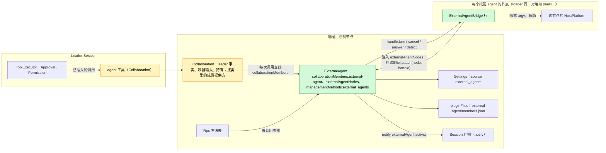
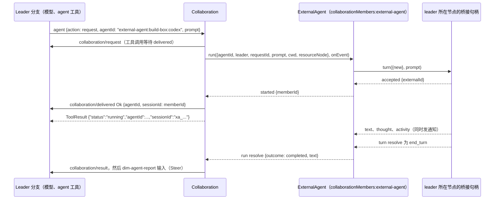
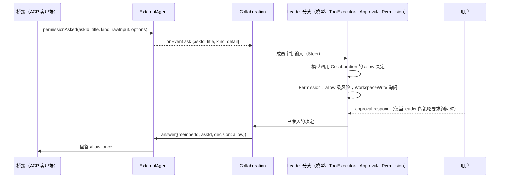

# ExternalAgent

状态：草案（第二次重新设计，[#145](https://github.com/arcships/dim/issues/145)）。它取代 [#182](https://github.com/arcships/dim/pull/182) 的"外部 agent 作为模型"框架。维护者的决定记录在[附录 F](#附录-f-已记录的决定)（[决定记录](https://github.com/arcships/dim/pull/254#issuecomment-6335998061)，其中部分已被[成员生命周期决定](https://github.com/arcships/dim/pull/254#issuecomment-6343856343)取代）；达到 Ready 还缺的内容见 [§10](#10-ready-状态)。总体设计：[overview §4](../overview.md#4-插件目录)；作用域：[ADR 002](../../adr/002-plugin-scope.md)（进程，另有按节点的桥接行）。阶段：P3。语言：优先 TypeScript（[overview 附录 C](../overview.md#附录-c-实现语言)）。

ExternalAgent 让 Session 的模型像委派给子 agent 一样，把工作委派给本地安装的编码 agent（Claude Code、Codex、Cursor、OpenCode、ZCode 等）。外部 agent **是子 agent，不是模型**：委派方 Session 保留自己的模型，经 Collaboration 的 `agent` 工具给外部 agent 一个任务，之后以成员结果的形式收到它的最终报告。外部 agent 在自己的会话里用自己的工具工作；dim 从不把它的输出当作 dim 的模型输出。

ExternalAgent 是 dim 现有子 agent 机制 Collaboration（[collaboration.rs](../../../../crates/dim-app-server/src/collaboration.rs)）的又一种**成员类型**，而不是并行的另一套机制。委派仍归 Collaboration：`agent` 工具、leader 的 `collaboration/*` 事实、`dim-agent-report` 唤醒输入、取消、重载了结以及对 leader Session 的持有。ExternalAgent 提供成员：启动外部会话，把任务和消息送过去，报告活动和权限询问，返回最终文本，并拥有在重载与重启后仍保留的成员记录。agent 为自己的动作请求权限时，询问走 Collaboration 的成员审批路径（[#29](https://github.com/arcships/dim/issues/29)，已在 #19 决定）到 leader 的模型，它的决定是一次普通的工具调用，受 leader 自己的 Approval 与 Permission 约束。agent 进程位于由 loader 管理的按节点桥接行中。所有契约都是语言中立的具名服务（[ADR 002 D5](../../adr/002-plugin-scope.md)）；Rust 形式见[附录 G](#附录-g-rust-绑定)。

## 0. 为什么是 Collaboration 成员

| 形态 | 需要什么 | 结论 |
| --- | --- | --- |
| **外部 agent 作为 Collaboration 的又一种成员类型**（本设计） | Collaboration 把某一类型的现有操作转给每次调用查找的成员提供方；ExternalAgent 实现提供方 | 采用（D1）：模型只看到一个委派入口，脱离工作只有一个所有者，其契约已覆盖投递、结果、唤醒、取消、关闭、重载与重启（[event-driven flows §3](../../../architecture/rust-agent/event-driven-flows.md)）。已持久化的 `collaboration/*` 数据不变 |
| ExternalAgent 自有的 `external_agent` 工具和自有的脱离工作事件 | 第二个请求/结果/唤醒/取消所有者，模型面前第二个子 agent 工具 | 否决：重复 Collaboration 的所有者规则 |
| 由外部 agent 执行轮次的成员 Session（#182 的框架） | Provider 条目、model kind 以及 ModelHost/ModelProvider 改动，使 agent 的工作表现为 dim 的模型输出 | 维护者否决：外部 agent 是子 agent，不是模型 |

相对 #182（本设计取代它）的变化：

| #182（模型框架） | 本设计 |
| --- | --- |
| Provider 条目 `external-agent:<node>:<agent>`、`modelKind:external-agent`、`ModelConnection::Kind`、`ModelCallScope`、ModelHost 查找 | 删除。没有 Provider、Aimux、ModelProvider 或输出块映射的补充 |
| ExternalAgent 写入的、以外部模型为模型的 Agents profile | 删除。Collaboration 从 ExternalAgent 的目录列出外部 agent |
| 依据调用方分支 Timeline 的投递决定（记录、cursor、转写初始化） | 删除。成员只收到任务和团队的消息，与 dim 成员相同 |
| `external_agent_allow` / `external_agent_reject` 工具、Session 部分与客户端路径 | 删除。询问走 Collaboration 的成员审批路径（§3.2）；ExternalAgent 没有 Session 部分 |
| SessionTitle 与 AuxiliaryModel 对 `external-agent:*` 模型的排除 | 已删除，设计与 SessionTitle 包中均已删除 |
| 只在内存的会话记录 | 成员持久化在 ExternalAgent 自己的 `pluginFiles` 存储中，ExternalAgent 重载或 dim 重启后用 ACP `session/load`（或 CLI resume）重新打开（§2、§3.5，D5） |
| 保留 | 挂接到 ExternalAgent 的按节点桥接 loader 行、由 ExternalAgent 自己发出通知、Settings 中的业务配置、共享 ACP schema |

## 1. 结构



外部 agent 连接与在用会话是共享的宿主资源，因此 ExternalAgent 是进程插件（ADR 002 D1）。agent 进程是某个节点的宿主资源，因此属于该节点上的插件：`ExternalAgentBridge` 是进程插件，每个托管 agent 的节点一行 loader 行。只要 ExternalAgent 启用，控制节点的行就是产品 profile 的一部分。对端节点的行是 `peer:<node>/external-agent-bridge`，只由 PluginManager 的结构性操作增删（ADR 002 D4、D6）。对端行在其节点或链路不在时等待，恢复后再次装载。桥接的资源在行卸载时由它自己的 `ctx.effect` 释放。

桥接行注入 `externalAgentNodes`（在对端经链路导入），并在 `apply` 中为自己的节点以引用挂接一个句柄；其 effect 解除挂接，链路断开或运行时退出会关闭引用，ExternalAgent 视为已解除。loader 按顺序运行同一行的各代，因此一个节点至多一个挂接。这是 #37 认可的注册形式。TypeScript 行不能按次查找服务（[sessions-service D1](../appserver/sessions-service.md)、[process TypeScript §5.1](../../../design/process-typescript.md#51-proposed-p6p7-access-through-declared-feature-dependencies)），因此 ExternalAgent 从不查找桥接。

Collaboration 是原生插件，每次调用不建立依赖地查找 `collaborationMembers:<kind>`，与 Rpc 查找 `managementMethods` 相同。没有核心部分、也没有 Session 依赖 ExternalAgent；它只注入从不重载的 `settings` 与 `pluginFiles`。ExternalAgent 没有 Session 部分：委派与决定工具都是 Collaboration 的。

| 部分 | 作用域 | 依赖（`inject`） | 提供 |
| --- | --- | --- | --- |
| `ExternalAgent` | 进程行，控制节点 | `settings`、`pluginFiles` | `collaborationMembers:external-agent`；`externalAgentNodes`；`managementMethods:external_agents`；Settings source `external_agents`；`externalAgent.activity` 通知 |
| `ExternalAgentBridge` | 进程行，每个托管 agent 的节点一行 | `externalAgentNodes`；该节点 HostPlatform 的 exec-argv 辅助 | 无具名服务；经 `attach` 以引用提供 `BridgeHandle` |
| Collaboration（变更，§9.2） | 现有的进程、Session 与分支部分 | 每次调用查找成员提供方 | 把非 Session 成员的操作转给其类型的提供方 |

**依赖的契约。** [`pluginFiles`](../../../../crates/dim-app-server/README.md#trusted-plugin-storage)（存储信封版本 1，位于由安装方预置的目录 `external-agent/` 下的一个文件）；Collaboration 的 `agent` 工具、`collaboration/*` 事件与脱离工作行为，加上 §9.2 的变更与 §9.3 的成员审批路径；Settings 的类型化写入与 `settings.changed`；Session 广播通知及 §9.1 的 TypeScript 绑定；经 #4 的进程行与管理方法（[process TypeScript](../../../design/process-typescript.md)）；每个节点 HostPlatform 的 exec-argv 辅助与隔离（overview 附录 B，P3）；`SessionConfig.resourceNode`（P3）；把 `externalAgentNodes` 导出到相连节点的 rutis 链路。

**本文定义的契约。** 成员提供方契约 `collaborationMembers:<kind>`（与 Collaboration 共同，§9.2）及其 `external-agent` 实现；成员存储载荷格式 1（§2）；`externalAgentNodes` 与 `BridgeHandle`；`externalAgent.activity` 通知；业务配置与方法 `external_agents.*`；与 [AcpGateway](AcpGateway.md) 共享的 ACP schema 与一致性测试（客户端侧）。

Provider、Aimux、ModelProvider、Approval 与 Permission 从不提及本插件。Collaboration 与 Agents 只把成员类型与 Session 当作数据。

## 2. 数据与状态

**业务配置**（[ADR 002](../../adr/002-plugin-scope.md) D4）是 Settings source `external_agents` 中的一份用户作用域文档，由 ExternalAgent 的进程行声明：`{ nodes: { <node>: { <agent>: { enabled, description?, executable?, args?, env?, reasoning? } } } }`。Settings 校验并填默认值；ExternalAgent 在使用时读取，并随每次桥接调用传入该条目。它只经 ExternalAgent 的管理方法写入（A.1）。`env` 值可能包含 agent 的凭据；它们归 ExternalAgent 所有（[settings-service §1.2](../appserver/settings-service.md#12-决定密钥归其所有者)），该来源没有项目作用域。变更是一次数据更新加 `settings.changed`，从不重载。

**Loader 行。** 每个节点的 `external-agent-bridge` 行是结构性的：它说明哪些节点可以运行 agent，而不是哪些 agent 在那里运行。

**已挂接的桥接。** ExternalAgent 内存中的 `node -> handle`，从 `attach` 起，到 `detach` 或引用关闭为止。

**成员记录。** 每个外部成员一条。持久部分在成员存储中，在用部分只在内存中：

```text
StoredMember {                  // 持久，成员存储载荷格式 1
  memberId: "xa_<uuid>",        // 该成员在 Collaboration 数据中的 sessionId
  leaderSessionId: String,      // leader 与成员的关系：唯一可以访问它的 Session
  agentId: "external-agent:<node>:<agent>", node, agent, protocol: "acp" | "cli",
  cwd: String,
  externalId: String,           // ACP sessionId 或 CLI 会话 id
  restorable: bool,             // ACP agent 声明了 loadSession，或 CLI 适配器有 resume 形式
  queued: [{content, mode, from}], // 已为空闲成员接受、尚未发出的消息
}
LiveMember {                    // 只在内存
  state: dormant | idle | running { requestId },
  activity: [Entry],            // 当前或最近一个请求的活动；供 read 与通知使用
  asks: { askId -> {title, kind, detail} },
}
```

外部成员只在显式的 `agent` `close`（Collaboration 的业务操作）或恢复失败时结束（[成员生命周期决定](https://github.com/arcships/dim/pull/254#issuecomment-6343856343)）。一个 Session 的关闭并不意味着关闭相关的 Session；是否关闭成员是 Collaboration 的业务决定，不是生命周期的推论。因此 leader 的关闭、卸载、重载、正常关机与重启都不是成员的结束。它们结束的是 I/O：leader 卸载时，Collaboration 调用提供方的 `release {leader}`，结束该 leader 运行中的轮次与其成员的进程，并保留所有记录（§3.3）。随后成员处于 `dormant`（记录保留、不启动任何进程），下一个请求用 `{load}` 重新打开会话（§3.5）。`release` 不是成员的结束。

leader 的删除同样不级联（[删除与分叉](../appserver/session-deletion-and-fork.md)：删除不移除其他所有者的记录）。删除一个已装载的 leader 会先关闭它，因此 `release` 已经结束了它运行中的轮次与进程；未装载的 leader 不持有任何进程。记录留在存储中。已删除 leader 的成员记录就这样保留，与已删除 leader 的 dim 成员 Session 一样。没有 Session 能再访问它，因为每个记录调用都按 `leaderSessionId` 授权；也没有专门的清理入口，确有需要时再加。这样的记录不持有进程：其 leader 关闭时已经 release。

**成员存储。** 一个 `pluginFiles` 文件 `external-agent/members.json`，其信封文本是载荷 `{"format": 1, "members": [StoredMember]}`。与 Scheduler 的 `scheduler/`、Workflow 的 `workflow/` 一样，`external-agent/` 目录由安装 ExternalAgent 的一方在启用它之前预置：目前是提供这些行的嵌入宿主，以后是 PluginManager（[process TypeScript §5.2](../../../design/process-typescript.md#52-public-pluginfiles-binding)）；文件接口不会创建父目录。`pluginFiles` 没有删除或列举操作，因此所有记录共用这一个文件。ExternalAgent 每次变更都在一次 `withLock` 租约内重写它（读取、修改自己的记录、`replace`）；它是唯一写入方，因此租约是所有者在串行化自己的状态。格式决定（AGENTS.md）：载荷格式 1 是新的；不兼容的变更提升 `format`。ExternalAgent 在 `apply` 中读取一次存储。目录缺失（`io`）、文件不可读、未知 `format` 或无效载荷都会把存储置于 `unavailable` 状态：不重写、重置或迁移文件，不提供任何已存成员，每个新的 `request` 都在启动任何进程之前被拒绝（`member_create_failed: external agent storage is unavailable (<code>)`），并经 `external_agents.list` 报告该状态，直到运维者修复并重载 ExternalAgent。不存在只在内存中的退路。凭据从不存放在这里。

| 变更 | 写入 | 若进程在其间退出 |
| --- | --- | --- |
| 新成员到达 `accepted` | 先加入记录，再发出 `started` | 记录已写、`started` 未发出：Collaboration 把该操作按 closed 了结；重启后该成员以没有任务的 `dormant` 列出，leader 可以给它任务或关闭它 |
| 为空闲或 dormant 成员接受消息 | 追加到 `queued`，然后回复 | 消息未保存：回复从未发出，因此 Collaboration 的操作未投递，按 closed 了结 |
| 排队消息在某个 prompt 中发出 | 该 prompt 被接受后清除它们 | prompt 已接受、队列未清除：这些消息随下一个 prompt 再发一次 |
| `close`、恢复失败、重启后不可恢复 | 删除记录 | 删除未写入：下一次 `close` 或恢复尝试会删除它 |

`accepted` 之后的写入失败时，ExternalAgent 取消轮次，`run` 以带存储代码的 `member_create_failed` reject；成员不存在。`started` 的 sink 调用本身失败时（Collaboration 已丢弃该调用）同样处理：ExternalAgent 取消轮次并删除新记录。

**Timeline。** ExternalAgent 不写任何 Timeline，不声明事件。leader 分支得到 Collaboration 的普通事实：`collaboration/request`、`collaboration/delivered`、`collaboration/message`、`collaboration/cancel`、`collaboration/close`、`collaboration/result`、`dim-agent-report` 输入，以及询问时 Collaboration 成员审批路径的输入、工具调用与审批事实。这些数据格式不变：外部成员创建时是 `CollaborationTarget::Agent { agent_id: "external-agent:<node>:<agent>" }`，之后是 `Member { agent_id, session_id: <member_id> }`。

**不进 Timeline**（principles §4 规则 9）：配置、挂接、成员记录（在成员存储中）、活动、进程。客户端经通知看到活动。

## 3. 流程

### 3.1 委派



1. leader 的模型以外部 `agentId`（新成员），或以已有外部成员的 `agentId` + `sessionId`（下一个任务）调用 `agent` `request`。Collaboration 照常写 `collaboration/request`。
2. Collaboration 按 agent id 的类型查找提供方并调用 `run`，一直等待它了结。ExternalAgent 检查条目（已启用、节点已挂接、节点等于 leader 的资源节点、存储可用），创建或复用成员，用任务文本启动外部轮次。`accepted` 时它写入记录并发出 `started {memberId}`，Collaboration 写 `collaboration/delivered`；工具调用返回。`started` 之前的拒绝成为带 Collaboration 错误码和 ExternalAgent 详情的 `collaboration/delivered Error`。若 `started` 到达时已有停止覆盖该操作（与 Collaboration 写入 dim 成员任务前的复核相同），Collaboration 回以 `delivered Error` 并对新成员调用 `close`，因此不会留下一个从未报告过的成员。
3. 请求是 Collaboration 拥有的脱离工作：它持有 leader Session，leader 的轮次中断不会停止它，它的结果唤醒 leader。
4. 运行期间，`append` 消息排队，在当前 prompt 结束时作为同一会话的后续 prompt 发出；`steer` 消息让 ExternalAgent 调用句柄的 `cancel`，等轮次结束后以该消息重新 prompt。当某个 prompt 结束且没有排队消息时，请求完成。
5. `run` 以结果和最终文本 resolve（A3）。Collaboration 写 `collaboration/result` 及其 `dim-agent-report` 输入，与 Session 成员完全相同。

成员在 leader 的 cwd 中、在 leader 的资源节点上工作，与 Collaboration 的 Session 成员相同。每个成员同一时间只有一个任务：对运行中成员的 `run` 被拒绝为 `busy`。

### 3.2 权限询问

agent 自己的动作不是 dim 的工具调用，因此 dim 的 Approval 不准入它（[ADR 003](../../adr/003-approval-scope.md) D1）。它是成员的工作，而 #19 已决定成员审批去哪里：作为输入送到 leader 分支，由 leader 的模型用一个 Collaboration 工具决定，该工具调用经过 leader 的 Approval 与 Permission（[overview 附录 B](../overview.md#附录-b-现有插件的补充)，Collaboration）。外部成员的询问走同一条路径（D2）。



- ExternalAgent 提供 `title`、粗粒度的 `kind`（A5）和 `detail`（agent 的原始输入）。输入文本、决定工具及其结果归 Collaboration。
- allow 选择 `allow_once` 选项，reject 选择 `reject_once`；缺少所需选项时回答 agent `cancelled`。从不选择 `*_always`。
- 询问在没有回答时结束（run 被取消或结束、agent 撤回、桥接解除挂接、ExternalAgent 卸载），若 agent 仍在等待，ExternalAgent 回答 `cancelled` 并发出 `askEnded`；Collaboration 撤回尚未 applied 的输入，之后的决定得到 `not_pending`。
- 总有一个委派方分支。它被停止或关闭时，Collaboration 取消 run，询问随之结束。ExternalAgent 没有自己的客户端路径：当 leader 的策略要求询问时，用户经 leader 的 Approval 参与。
- leader 的 preset 只约束 agent 询问的动作，不约束 agent 不询问就做的动作：ReadOnly 的 leader 会拒绝每个 allow，但被配置为不询问就行动的 agent 仍会行动。适配器以 agent 最倾向于询问的模式启动它们（A6）；节点 HostPlatform 的隔离是强制边界。
- 非交互 CLI 适配器没有请求通道。它们以 agent 自身不自动批准的模式启动，因此 agent 拒绝它无法询问的动作（A6）。

### 3.3 取消、关闭、中断

取消始终是一次显式调用，从不是中止调用：rutis-bridge 会连同迟到的回复一起丢弃被中止的调用。因此 `run` 与 `turn` 一直等到它们了结；唯一的例外是 Collaboration 自己的重载，它调用 `cancel`、自行了结请求并丢弃调用。每个触发条件一行：

| 操作 | 效果 |
| --- | --- |
| `agent` `cancel` | Collaboration 调用提供方的 `cancel` 并继续等待 `run`；ExternalAgent 调用句柄的 `cancel`，它发送 ACP `session/cancel`（或给 CLI 发信号）并以 `cancelled` 回答待决询问；agent 以停止原因 `cancelled` 结束 prompt（或 CLI 退出）时轮次结束，这是 agent 自己的终态事实；`run` 随后 resolve 为 `cancelled`，报告写 `cancelled by leader`。成员保留，可接下一个任务 |
| agent 不理会取消 | `run` 保持打开，直到 agent 结束 prompt；leader 可以 `close` 该成员，或 leader 关闭时的 `release` 会结束其进程 |
| `agent` `close` | 提供方 `close`：运行中则先按上一行取消，关闭该会话的进程，删除记录 |
| leader 轮次 `stop/interrupt` | `delivered` 之前：Collaboration 现有规则压制该操作并调用 `cancel {requestId}`；`run` 以 `cancelled` reject，`delivered` 为 `interrupted` 错误。`delivered` 之后：不影响运行中的任务（脱离工作契约） |
| leader 分支停止（分支范围中断） | Collaboration 调用 `cancel`，等待 `run`，并以它为 Session 成员预设的结果了结 |
| leader 关闭：业务关闭、删除开始时的关闭、正常关机 | Collaboration 从 leader Session 的卸载中调用 `release {leader}`，等待打开的 `run`，并把它们了结为 `cancelled (leader closed)`，与关闭中的卸载为 dim 成员等待 `session.stop` 相同。成员变为 `dormant`；记录保留 |
| leader 空闲卸载 | 打开的请求会持有 leader，因此没有打开的 `run`；`release {leader}` 结束其成员的空闲进程。成员变为 `dormant`；记录保留 |
| run 打开时 Collaboration 重载 | Collaboration 调用 `cancel`，不等待即把请求了结为 `failed (reloading)` 并丢弃调用；不调用 `release`，空闲进程保留。成员保留 |
| leader Session 删除 | 若已装载，先适用其关闭那一行；记录保留，无法访问（§2） |

### 3.4 桥接生命周期

| 事件 | 执行者 | 效果 |
| --- | --- | --- |
| 产品 profile 中启用 ExternalAgent | Loader | 控制节点的桥接行在 ExternalAgent 之后装载并挂接 |
| PluginManager 在对端节点 `n` 上启用桥接 | Loader | 增加 `peer:n/external-agent-bridge`；链路就绪后该行在 `n` 上装载，导入 `externalAgentNodes` 并挂接 `n`；ExternalAgent 对其运行 `detect` |
| 到 `n` 的链路断开 | Loader（对端行行为） | 行停止：其 effect 取消轮次并杀掉进程；引用关闭，因此 `n` 上运行中的 `run` 以 `external_agent_exited` reject。记录保留：这些成员变为 `dormant`。在行再次挂接前，`n` 上的新成员以 `member_create_failed` 被拒绝，已有成员以不可用被拒绝（A.2） |
| 在某节点上启用或停用 agent | ExternalAgent（业务配置） | 不改行，不重载；目录变化；对已停用 agent 的请求被拒绝；运行中的成员完成 |
| 桥接崩溃或重载 | Loader | 同链路断开，只影响该节点 |
| ExternalAgent 重载 | Loader | 桥接随之重载；每个运行中的 `run` 以 `provider_unavailable` reject；成员从存储以 `dormant` 装载，下次使用时重新打开（§3.5） |

### 3.5 重载或重启后的恢复

```mermaid
sequenceDiagram
  participant L as Leader（模型）
  participant C as Collaboration
  participant X as ExternalAgent（已重启）
  participant S as pluginFiles members.json
  participant B as 桥接句柄
  X->>S: apply 时读取；记录变为 dormant
  Note over C: 旧一代打开的请求已了结：正常关机时在 leader 卸载中了结为 cancelled，崩溃时由重建了结为 failed
  L->>C: agent request {agentId, sessionId: xa_...}
  C->>X: run({memberId, leader, prompt, ...})
  X->>X: leader 与记录一致；节点已挂接且等于 leader 的资源节点
  X->>B: turn({load: {externalId}}, 排队消息 + prompt)
  alt 加载成功
    B-->>X: accepted（丢弃重放的历史）
    X-->>C: started；请求按 §3.1 继续
  else 加载失败或不支持
    B-->>X: 以 load_failed / load_unsupported reject
    X->>S: 删除记录
    X-->>C: reject member_closed "could not restore ...; request a new member"
  end
```

- **了结仍归其所有者。** 此时打开的请求只由 Collaboration 了结一次：ExternalAgent 重载使 `run` 以 `provider_unavailable` reject（了结为 `failed`）；正常重启在 leader 卸载中、`release` 之后把它了结为 `cancelled (leader closed)`；崩溃则交给 Collaboration 的重建，了结为 `failed`。ExternalAgent 从不为旧一代的 run 报告结果，也从不续跑它。恢复只带回会话；成员把下一个请求当作新请求接下。
- **惰性重新打开。** 记录以 `dormant` 装载；在某个请求需要会话之前不启动任何进程。`message` 只排队（已持久化）；`read` 回答空页，并说明重启前的活动未保留；`close` 不启动进程就删除记录。
- **ACP。** 桥接启动 agent，检查 `agentCapabilities.loadSession`，发送 `session/load {sessionId: externalId, cwd, mcpServers: []}`。加载重放的更新被丢弃。随后用 `session/prompt` 发出排队消息和任务。
- **CLI。** 适配器数据声明了 resume 形式（例如 `--resume <id>`）的，下一次启动按会话 id 继续。没有该形式的适配器把其成员标为 `restorable: false`。
- **失败是明确的拒绝，从不悄悄开新会话。** 缺少 `loadSession`、`session/load` 失败或 CLI 不支持 resume，都会让 `run` 在 `started` 之前 reject；Collaboration 报告带 ExternalAgent 详情的 `member_closed`，例如 `could not restore the conversation of Codex (build-box): session/load failed (session not found); request a new member`，或 `Codex (build-box) cannot resume conversations after a restart; request a new member`。记录被删除。节点未挂接属于不可用，不是恢复失败：记录保留。
- **归属在重启后依然有效。** 存储的 `leaderSessionId` 授权每次操作（§9.2），因此不需要向 Collaboration 重新登记任何东西。

## 4. 时序与冲突

到达 leader 的一切由 Collaboration 的事实定序；ExternalAgent 的内存与存储只为它自己的成员定序。

| 场景 | 顺序 | 结果 | 所有者 |
| --- | --- | --- | --- |
| 请求尚未 delivered 时 leader 轮次被中断 | interrupt < `delivered` | Collaboration 现有规则：操作被压制，run 被取消 | Collaboration |
| 询问在等 leader 决定时被取消 | — | 询问以 `cancelled` 结束；撤回未 applied 的询问输入；之后的决定 `not_pending`；报告 `cancelled` | ExternalAgent、Collaboration |
| 决定先于取消被准入 | — | 决定送达 agent，然后取消 | ExternalAgent |
| Leader 处于 ReadOnly | — | allow 决定被 Permission 拒绝；仍可 reject；否则询问等待 | Permission |
| 询问长时间待决 | — | dim 无超时；leader 可以取消（A7） | Leader |
| 运行中的 append 消息 | `collaboration/message` | 排队；作为同一请求中的下一个 prompt 发出 | ExternalAgent |
| 运行中的 steer 消息 | `collaboration/message` steer | 句柄 `cancel`；轮次结束后该消息成为下一个 prompt；已产生的文本留在活动中 | ExternalAgent |
| steer 等待重新 prompt 时收到 `cancel {requestId}` | cancel < 重新 prompt | `run` resolve 为 `cancelled`；已接受的 steer 消息留在 `queued` 中，供下一个任务使用 | ExternalAgent |
| 发给空闲或 dormant 成员的消息 | — | 排队并持久化；加在下一个任务之前 | ExternalAgent |
| 请求发给运行中的成员 | — | `busy` | ExternalAgent |
| run 期间 ExternalAgent 重载 | — | `run` 以 `provider_unavailable` reject；Collaboration 写失败的 `collaboration/result`；成员以 `dormant` 重新装载（§3.5） | Collaboration、ExternalAgent |
| run 期间 Collaboration（leader）重载 | — | Collaboration 取消并不等待即了结为 `failed (reloading)`；成员保留 | Collaboration |
| run 期间 leader 关闭 | leader close | `release`；`run` resolve 为 `cancelled`；了结为 `cancelled (leader closed)`；成员 `dormant` | Collaboration、ExternalAgent |
| run 期间正常重启 | 关机关闭 leader | 与 leader 关闭相同：`release`，了结为 `cancelled (leader closed)`；重启后成员以 `dormant` 装载 | Collaboration、ExternalAgent |
| run 期间崩溃 | — | 桥接的进程随旧进程结束；Collaboration 的重建把打开的请求了结为 `failed`；成员以 `dormant` 装载 | Collaboration、ExternalAgent |
| leader 被删除 | 删除的关闭 < 删除 | 关闭先 release；不级联：记录保留，没有 Session 能访问它（§2） | ExternalAgent |
| run 期间桥接行停止 | — | `run` 以 `external_agent_exited` reject；结果失败；记录保留 | 桥接、Collaboration |
| leader Session 被 fork | — | fork 有另一个 Session id，以不在团队中被拒绝，与 Collaboration 的 fork 规则一致（[#127](https://github.com/arcships/dim/issues/127)） | ExternalAgent |

其余各行：[附录 B](#附录-b-完整冲突表)。

## 5. 模型看到什么

全部经 Collaboration 现有的工具结果与输入到达（模型读的是 `ToolResult.content`）：

| 时刻 | leader 模型读到 |
| --- | --- |
| `list` | `agents` 中的外部 agent：`{"agentId": "external-agent:build-box:codex", "name": "Codex (build-box)", "description": "..."}`；`participants` 中的外部成员，带其 `sessionId`（成员 id）与状态 |
| `inspect` | `{"agentId": ..., "profile": {"name", "description", "kind": "external-agent", "node", "agent", "version"}}` |
| `request` 被接受 | `{"status": "running", "agentId": "external-agent:build-box:codex", "sessionId": "xa_..."}`；工作在脱离状态下继续 |
| `request` 被拒绝 | Collaboration 的拒绝文本，例如 `member_create_failed: codex is not enabled on build-box`、`member_create_failed: node build-box is unavailable`、`member_create_failed: codex needs its own login (run "codex login" on build-box)`、`busy: ...`、`team_member_not_found: ...` |
| 进度 | 不推入上下文。`read` 返回成员当前或最近一个请求的活动，`{entries: [{seq, kind: "text" \| "thought" \| "tool" \| "ask", ...}], nextCursor}`；恢复之后会说明更早的活动未保留 |
| 权限询问 | Collaboration 的成员审批输入（§3.2），写明 agent、成员、动作标题、种类与详情 |
| 最终报告 | `dim-agent-report` 输入：`Status: completed\|failed\|cancelled.`、最终文本的预览，以及如何用 `result` 读取完整结果 |
| `result` | 来自 leader 自己 `collaboration/result` 的 `{"resultId", "result": {agentId, sessionId, text, outcome}}` |
| 取消 | 工具返回 `{"status": "cancelled", ...}`，之后是 `cancelled` 报告 |
| 启动后的错误 | `failed` 报告，原因写明（`external agent exited`、`node build-box disconnected`、`external agent reloaded; the member can take a new task`、`refusal`、`max_turn_requests`） |
| 恢复被拒绝 | `member_closed: could not restore the conversation of Codex (build-box): ...; request a new member` 或 `member_closed: Codex (build-box) cannot resume conversations after a restart; request a new member` |
| 提供方或节点不可用 | `closed: member provider external-agent is unavailable; try again later`（Collaboration 的通用文本）或 `closed: node build-box is unavailable; try again later`（提供方的详情） |

外部 agent 只看到它的任务文本、团队的消息（每条都以发送方为前缀：leader，或按名字标出的队友，§9.2）和它自己的会话。它从不看到 leader 的历史、dim 提示词、工具声明或其他插件的数据。leader 的上下文只在报告与询问输入 applied 之后才包含它们，被撤回的询问输入从不进入。

## 6. 接口（摘要）

| 接口 | 类别 | 用途 |
| --- | --- | --- |
| `collaborationMembers:external-agent` | 进程服务，由 Collaboration 每次调用查找 | 目录、成员列表与成员操作（[A.2](#a2-成员提供方)） |
| `externalAgentNodes` | 进程服务，由桥接行注入 | 挂接 / 解除某节点的 `BridgeHandle`（[A.3](#a3-桥接与适配器)） |
| `BridgeHandle` | 某个桥接行的引用对象 | 某节点上的 `detect`、`turn`、`cancel`、`answer`（[A.3](#a3-桥接与适配器)） |
| `externalAgent.activity` | leader Session 上的 Session 广播通知，source `ExternalAgent` | 给客户端的实时进度（[A.4](#a4-活动与通知)） |
| `external_agents.list` / `set_enabled` / `configure` | `managementMethods:external_agents` | 检测、启用、配置（[A.1](#a1-管理方法)） |
| ACP schema 与一致性测试 | 与 AcpGateway 共享 | 客户端侧（[A.5](#a5-共享-acp-schema)） |

**流式调用。** `run` 与 `BridgeHandle.turn` 产出一个序列。在 rutis-bridge 0.12.1 上，它们是 `async` 方法，请求以引用携带一个 sink 函数（`onEvent`、`onUpdate`）：被调用方每个元素调用一次 sink，并在下一个之前等待这次调用完成；序列结束时调用 resolve，以结束它的错误 reject。它们不带 AbortSignal：中止会连同迟到的回复一起丢弃调用，因此取消是单独的 `cancel` 方法，调用一直等到结束。引用关闭使调用失败。

**客户端。** `agentId` 含 `:` 的成员是提供方成员（`<kind>:<rest>`）；Agents 的 id 是 UUID（[agents.rs](../../../../crates/dim-app-server/src/agents.rs) `create`），从不含 `:`。对这类成员，`sessionId` 不是 dim Session：客户端不用它调用 `session.attach`、`session.history` 或 `session.stop`。它的视图是 leader 自己的 `collaboration/*` 事实，加上客户端挂接 leader 期间收到的 `externalAgent.activity` 通知。用户没有按成员的停止，与任何脱离工作相同：`session.stop` 只作用于轮次，已投递的 Collaboration 工作不受它影响。用户的选择是让 leader 的模型 `cancel` 该成员，或者关闭 leader Session，这会 `release` 其成员（§3.3），而成员保留。

## 7. 安全

- 外部 agent 以它们自己的账号和工具运行。dim 只在它们询问时、只经 leader 的模型并在 leader 的 Approval 与 Permission 下决定它们的动作。leader 的 preset 不约束 agent 不询问就做的动作（§3.2）。节点 HostPlatform 的隔离是强制边界；适配器以 agent 最倾向于询问的模式启动它们（A6）。
- 权限是 leader 的：allow 决定需要 leader 的 preset 与规则所要求的一切，因此 ReadOnly 的 leader 不能 allow，WorkspaceWrite 的 leader 会询问其用户。从不选择 `*_always`。
- 凭据是 ExternalAgent 在轮次时从自己的用户作用域文档读取的 `env` 值，经已认证的链路传给桥接。它们从不写入 Timeline、通知、诊断、活动、回复或成员存储。
- 启用 agent 是业务配置，不是审批（[ADR 003](../../adr/003-approval-scope.md) D2），只经管理方法更改，管理方法从不提供给配对设备。模型不能启用 agent。为节点增加桥接是 PluginManager 的结构性操作。可执行文件在节点上解析，从不来自项目文件。
- `externalAgentNodes` 只经已认证的链路导出；桥接只挂接自己的节点，挂接不运行任何东西。

## 8. 规则检查

规则：[principles §1 与 §4](../../../architecture/rust-agent/principles.md)、[ADR 002](../../adr/002-plugin-scope.md) D1–D5。

| 规则 | 本文如何遵守 |
| --- | --- |
| §4.1 改他人状态用指令事件 | ExternalAgent 不写事件。leader 的事实归 Collaboration；决定是由 leader 的 Approval 与 Permission 裁决的 leader 工具调用；撤回询问输入是 Collaboration 的 `input/withdraw` 指令。 |
| §4.2 交接后不撤回 | 交给 agent 的任务只能取消，不能收回；已 applied 的询问输入从不撤回，迟到的决定得到 `not_pending`。 |
| §4.3 before 回调 | 不适用。 |
| §4.4 核心机制不带业务含义 | Collaboration 按类型查找提供方，不提及任何插件；没有给 Session 的关闭或删除增加任何生命周期推论。 |
| §4.5 读完整批次 | ExternalAgent 不读 Timeline。 |
| §4.6 模型上下文只含已交接事件 | leader 只经已 applied 的报告与询问输入以及工具结果看到外部工作（§5）。 |
| §4.7 只用公开事件与服务 | ExternalAgent 经 `collaborationMembers` 与管理方法被访问；它经挂接的句柄访问桥接，经 `notify` 访问客户端。 |
| §4.8 基础设施默认不变 | Timeline、Dispatcher、信封、loader 与门面不变。请求的是通知绑定（§9.1）与成员提供方家族的原生投影（§9.5）；Collaboration 各项是插件变更。 |
| §4.9 只有后续决定要用的事实进 Timeline | 请求、投递、结果与决定是 Collaboration 的事实；成员记录在 ExternalAgent 自己的存储中。配置、活动与进程不进入。 |
| §1 Capability 与 App Server 边界 | 只有进程行；agent 进程是桥接行的资源，由其 effect 释放；挂接与行同生共死；服务图无环（桥接 → ExternalAgent → Settings、pluginFiles；Collaboration 按次查找）。 |
| ADR 002 D1 | 在用会话与成员记录是共享的宿主状态（进程）；agent 进程属于节点（每节点一个桥接行）。按 Session 的工作仍归 Collaboration。 |
| ADR 002 D2 | 没有接线模块：Collaboration 与 Rpc 每次调用按名查找；桥接经注入的服务挂接。 |
| ADR 002 D3 | ExternalAgent 只注入从不重载的服务；除它自己的桥接外没有东西依赖它，因此它缺席只让外部委派失败。 |
| ADR 002 D4 | agent 条目是业务配置；桥接行是结构性的，由 PluginManager 更改。 |
| ADR 002 D5 | `collaborationMembers`、`externalAgentNodes`、`BridgeHandle`、通知、方法与存储格式都是具名服务与数据。 |

## 9. 向机制所有者提出的需求

请求两项绑定：TypeScript 通知绑定（§9.1）与成员提供方家族的装配投影（§9.5）。其余各项是插件 Collaboration 的变更，写明以便其所有者接受。

### 9.1 Session 通知的 TypeScript 绑定

| 项 | 内容 |
| --- | --- |
| 受阻 | ExternalAgent 拥有成员活动，必须在自身变化后发出 `externalAgent.activity`（[session notices §4](../appserver/session-notices.md#4-发出)：由所有者发出）。它的进程行是 TypeScript，没有绑定 |
| 考虑过的机制 | 由 Collaboration 转发活动：它不拥有该状态；Timeline 事件：仅供显示的数据，principles §4 规则 9 禁止；只靠 `read`：客户端没有实时显示 |
| 需要 | 为 TypeScript 进程行提供 `notify(sessionId, {source, kind, data})`，原生契约不变：同步、无依赖、无人监听时丢弃、不重放 |
| 对序号、批次、中断、重载的影响 | 无：通知不是事件 |
| 由谁实现 | Session 通知 / #4 TypeScript 绑定（dim 运行时） |

### 9.2 Collaboration 成员提供方

Collaboration 的成员目前都是 dim Session：每个操作都经成员的 `Session`（input、idle、stop、history）。本变更增加由其他插件按类型提供的成员：

- 形如 `<kind>:<rest>`、且其类型有提供方（`collaborationMembers:<kind>`，每次调用按名查找，无依赖）的 `agentId` 是提供方成员。Agents 的 id 是 UUID，从不含 `:`。
- `list` / `inspect` 加入提供方 `catalog()` 与 `members()` 的条目；`request`、`message`、`cancel`、`close` 与 `read` 调用提供方（A.2）；`result` 不变（读 leader 自己的事实）。
- 在提供方 `started` 时写 `collaboration/delivered`；在 `run` resolve 或 reject 时写 `collaboration/result`。凡 Collaboration 停止或中断 Session 成员之处，它都作用于提供方：`delivered` 之前的轮次中断、`cancel` 与分支停止调用 `cancel`，按传给 `run` 的 `requestId` 定位，因此 `started` 之前也能取消；重载调用 `cancel` 并不等待即了结为 `failed (reloading)`；leader Session 除重载外的每次卸载（业务关闭、删除开始时的关闭、正常关机、空闲卸载）都为每个已配置类型调用 `release {leader}`，关闭时还等待打开的 `run` 并把它们了结为 `cancelled (leader closed)`。这些都不关闭成员。leader 持有、唤醒输入与重建了结照常适用。在新成员 `started` 之前已覆盖其操作的停止，会让 Collaboration `close` 该成员（§3.1）。
- **记录的所有者持有关系。** Collaboration 不为提供方成员保留关系。ExternalAgent 存储的 `leaderSessionId` 就是这一关系，每次提供方调用都带上 Collaboration 为调用方解析出的 leader：调用方本身是 leader 时即它自己；dim 成员访问外部队友（`message`、`read`）时即调用方所在团队的 leader，并用 `from` 写明发送方。提供方按这个 leader id 回答；另一个 leader、fork 或未知 id 得到 `not_in_team`，报告为 Collaboration 现有的 `team_member_not_found`，不透露该成员是否存在。这已足够，因为授权与列举是提供方本来就拥有并持久化的记录的纯函数；登记或对账协议会把它们复制给第二个所有者，后者每次重启都要重建。
- **类型。** Collaboration 从装配得到已配置的类型：装配读取各行声明的 `collaborationMembers:<kind>` 服务，把名字交给 Collaboration，就像它把 TypeScript 行声明的 `managementMethods:*` 读入 Rpc 的 `Owners`。Collaboration 不提及任何插件。`list` 为每个找得到提供方的已配置类型调用 `catalog` 与 `members`。这需要 §9.5 的装配项。
- **提供方不可用。** 找不到某类型的提供方时，对它的操作以 Collaboration 现有的 `closed` 拒绝，带通用详情 `member provider <kind> is unavailable; try again later`；不写任何东西，`list` 省略该类型，提供方恢复后同一个 `sessionId` 又可以使用。
- **`agent` 工具的风险（D4 需要）。** `agent` 工具目前不声明风险，因此 Permission 把它视为未分类：ReadOnly 拒绝、WorkspaceWrite 询问、FullAccess 允许（[permission.rs](../../../../crates/dim-agent-capabilities/src/permission.rs)）。D4 要求 ReadOnly 的 leader 能够委派，因此该工具声明风险 `session`（委派是一项 Session 操作）。对 dim 成员的影响：ReadOnly 的 leader 现在可以委派给它们，而成员仍在 leader 的 ReadOnly 策略下运行，因此权限没有扩大；WorkspaceWrite 的 leader 不再为每次 `agent` 调用被要求审批。成员自己经 `agent` 工具的 `message`、`read` 与 `list` 调用在 ReadOnly 下也变为允许。成员所做之事的权限仍归成员自己的 Permission（dim 成员）或 leader 对询问的决定（外部成员）。Workflow 的工具目前沿用 `agent` 工具的风险（[Workflow](Workflow.md) `workflowRuns`，E2），这会让 ReadOnly 的 leader 能启动工作流；因此二者解耦，Workflow 保留自己的未分类风险 `workflow`，与其包已声明的一致。
- 事件与持久化格式不变：目标与成员 id 本来就是字符串。

### 9.3 成员审批路径接受提供方的询问

#19 决定成员审批经一个 Collaboration 工具送到 leader 的模型，该工具调用经过 leader 的 Approval 与 Permission（[overview 附录 B](../overview.md#附录-b-现有插件的补充)；尚未详细设计）。对提供方成员，该路径从提供方 `run` 的事件（`ask`、`askEnded`）接收询问，并经提供方的 `answer` 返回决定。对其设计的约束：allow 决定必须带一个 ReadOnly 拒绝、WorkspaceWrite 询问的 Permission 风险（工具的风险是静态的，因此 allow 与 reject 是两个工具，或决定工具按 allow 级别分类）。

### 9.4 链路断开期间导入的服务保持登记（#5）

已撤回：rutis 是外部依赖，因此不向它提需求。离线节点遵循 rutis 的现有行为与 [overview §6.3](../overview.md#63-多节点)：链路断开会停止对端桥接行，其 effect 结束它的进程，并关闭其句柄引用（§3.4）。其他文档为此决定链接到 §9。

### 9.5 成员提供方的原生投影（装配）

| 项 | 内容 |
| --- | --- |
| 受阻 | Collaboration（原生）每次调用 `MemberProvider`，并需要已配置的类型。ExternalAgent 的进程行是 TypeScript。装配只把 TypeScript 行的固定几类投影为原生服务（`sessionMethods`、`managementMethods`、工具、观察者；[session_typescript.rs](../../../../crates/dim-app-server/src/session_typescript.rs)）；其他声明的服务只登记为裸的共享 `HostDispatch`，`CollaborationPlugin::new` 也不接收类型 |
| 考虑过的机制 | 由 Collaboration 直接调用裸 `HostDispatch`：没有类型化契约、没有方法模式检查，且流式 `run` 需要以引用传入原生 sink；由 Collaboration 的 Settings 来源列出类型：重复了各行已声明的内容，还可能与之不一致 |
| 需要 | 装配在进程行（TypeScript 或原生）上接受 `collaborationMembers:<kind>` 家族：在配置边界检查声明的方法模式，把 TypeScript 提供方投影为原生 `MemberProvider`（附录 G；`run` 以引用带 sink，其余方法 `async`），并把已配置的类型交给 `CollaborationPlugin::new`，就像它由声明的 `managementMethods:*` 构建 Rpc 的 `Owners` |
| 对序号、批次、中断、重载的影响 | 不影响 Timeline。提供方行的重载与任何可选提供方一样按调用处理：Collaboration 找不到提供方，以 `closed` 拒绝 |
| 由谁实现 | App Server 装配 / #4 TypeScript 绑定 |

## 10. Ready 状态

| 项 | 需要谁 |
| --- | --- |
| 接受 §9.2：成员提供方、提供方持有关系、按 `requestId` 取消、leader 卸载时的 `release`、关闭被覆盖的新成员、已配置的类型，以及 `agent` 工具风险 `session`（D4）及其对 dim 成员与 Workflow 的影响 | Collaboration 所有者 |
| 接受 §9.5：把 TypeScript 进程行的 `collaborationMembers:*` 原生投影，并把已配置的类型交给 Collaboration | App Server 装配所有者（#4 绑定） |
| 接受 §9.3 并设计本设计使用的成员审批路径（#19） | Collaboration 所有者 |
| 接受 §9.1（TypeScript `notify` 绑定） | Session 通知所有者（dim 运行时） |
| 客户端识别提供方成员（§6"客户端"）：`rust-tui` 的停止、[后台任务列表](../../../design/background-task-list.md)的停止与提议中的[成员会话视图](../../../design/member-conversation.md)不得把它们的 `sessionId` 当作 Session | 客户端所有者 |
| P3 前提：`SessionConfig.resourceNode`、HostPlatform 的 exec-argv 辅助与隔离、链路导出 `externalAgentNodes` | P3 所有者 |

[#241](https://github.com/arcships/dim/issues/241) 不再适用：ExternalAgent 不提供工具。

## 附录 A. 接口细节

### A.1 管理方法

ExternalAgent 进程行上的 `managementMethods:external_agents`：

| 方法 | 参数 | 结果 | `mutating` |
| --- | --- | --- | --- |
| `external_agents.list` | `refresh?` | 存储状态（`available`，或带代码的 `unavailable`）；每个已配置或已挂接的节点：`attached` 或 `unavailable`；每个 agent：可执行文件、版本、协议（ACP 或 CLI）、是否启用、描述、配置（仅引用） | 否 |
| `external_agents.set_enabled` | `node`、`agent`、`enabled` | 新状态 | 是 |
| `external_agents.configure` | `node`、`agent`、`description?`、`executable?`、`args?`、`env?: {name: value}`、`reasoning?` | 新配置 | 是 |

桥接挂接时及 `refresh` 时调用其 `detect`（A1）。检测到的 agent 在启用前保持停用（A2）。写入以读到的修订号（CAS）经 Settings 的类型化写入完成；ExternalAgent 不经重载应用 `settings.changed`。启用不写任何其他东西：目录由这份文档推出。

### A.2 成员提供方

`collaborationMembers:<kind>`，进程作用域；ExternalAgent 提供类型 `external-agent`。每个调用都带 `leader: {sessionId}`，即 Collaboration 为调用方解析出的 leader。指向成员记录的调用（带 `memberId` 的 `run`、`message`、`answer`、`read`、`close`）按存储的 `leaderSessionId` 授权；`catalog` 是该 leader 对某节点已启用 agent 的读取，不带 `memberId` 的 `run` 创建归它所有的记录，`cancel` 按 `(leader, requestId)` 定位该 leader 自己的 run，`members` 与 `release` 按它选取记录。

| 方法 | 模式 | 请求 | 回复 |
| --- | --- | --- | --- |
| `catalog` | async | `{leader, resourceNode}` | `[{agentId, name, description, profile}]`：该节点上已启用的 agent |
| `members` | async | `{leader}` | 该 leader 的 `[{agentId, sessionId: memberId, name, status: running \| idle \| dormant}]` |
| `run` | async，流式（§6） | `{agentId, memberId?, leader: {sessionId, branchId}, requestId, prompt, cwd, resourceNode}`、`onEvent` | 事件 `{started: {memberId}}`、`{activity: Entry}`、`{ask: {askId, title, kind, detail}}`、`{askEnded: {askId, outcome}}`；resolve 为 `{outcome: completed \| failed \| cancelled, reason?, text}`；以 `{code, detail}` reject |
| `cancel` | async | `{leader, requestId}` | `{}`；agent 结束其 prompt 时，该 `requestId` 的待决 `run` resolve 为 `cancelled`；`started` 之前则停止启动，`run` 以 `{code: cancelled}` reject |
| `message` | async | `{memberId, leader, from: {role: leader \| member, name}, content, mode: append \| steer}` | `{}` 或一个代码 |
| `answer` | async | `{memberId, leader, askId, decision: allow \| reject}` | `{outcome: allowed \| rejected}` 或 `{code: not_pending}` |
| `read` | async | `{memberId, leader, after, limit}` | `{entries, nextCursor}` 或一个代码 |
| `close` | async | `{memberId, leader}` | `{}` |
| `release` | async | `{leader}` | `{}`：结束该 leader 运行中的轮次（先取消，再关闭进程；进程退出是轮次的终态事实）及其成员的进程，保留所有记录；成员变为 `dormant`。不是成员的结束 |

代码映射到 Collaboration 的拒绝：

| 提供方代码 | 时机 | Collaboration |
| --- | --- | --- |
| `not_enabled`、`wrong_node`、`not_installed`、`auth_required`、`launch_failed`、`storage_unavailable` | 新成员，`started` 之前 | 带详情的 `member_create_failed` |
| `node_unavailable` | 新成员 | 带详情的 `member_create_failed` |
| `node_unavailable` | 已有成员（记录保留） | 带详情 `node <node> is unavailable; try again later` 的 `closed` |
| `busy` | 请求发给运行中的成员 | `busy` |
| `cancelled` | `started` 之前的 `cancel` | 按 Collaboration 现有规则成为 `delivered` 错误 `interrupted`（leader 关闭中则为 `closed`） |
| `not_in_team` | 该 leader 没有这条记录（另一个 leader、fork、未知 id） | `team_member_not_found` |
| `member_closed`、`restore_failed`、`not_restorable` | 成员已不在，或重新打开失败或不可能（记录已删除） | 带详情的 `member_closed` |

对 `dormant` 成员的 `run` 先重新打开它（§3.5）。`text` 是请求最后一个 prompt 中 agent 在最后一次工具活动之后的消息文本；该 prompt 没有用工具时为它的全部消息文本（A3）。ExternalAgent 为每条发出的消息加上发送方前缀（`Message from your team leader:` 或 `Message from teammate <name>:`）。

### A.3 桥接与适配器

`externalAgentNodes`，进程作用域，由 ExternalAgent 提供并导出到相连节点：

| 方法 | 模式 | 请求 | 回复 |
| --- | --- | --- | --- |
| `attach` | async | `{node, handle: BridgeHandle}` | `{}` |
| `detach` | async | `{node}` | `{}` |

`BridgeHandle`，引用，每个桥接行一个：

| 方法 | 模式 | 请求 | 回复 |
| --- | --- | --- | --- |
| `detect` | async | `{adapters}` | `[{agent, executable, version, protocol: acp \| cli}]` |
| `turn` | async，流式 | `TurnSpec {turnId, agent, config（该条目，含 env）, cwd, conversation: {new} \| {continue: {externalId}} \| {load: {externalId}}, prompt: text}`、`onUpdate` | `{accepted: {externalId}}`、`{text}`、`{thought}`、`{activity: {id, title, status}}`、`{permissionAsked: {askId, title, kind, rawInput?, options}}`、`{permissionWithdrawn: {askId}}`；resolve 为 `{end: end_turn \| max_tokens \| max_turn_requests \| refusal \| cancelled}`；以 `{code}` reject（`{load}` 在 `accepted` 之前可为 `load_failed`、`load_unsupported`） |
| `cancel` | async | `{turnId}` | `{}`；agent 结束 prompt 时，待决的 `turn` resolve 为 `{end: cancelled}` |
| `answer` | async | `{turnId, askId, answer: allow \| reject \| cancelled}` | `{}` |

| 适配器 | 打开 | 轮次 | 取消 |
| --- | --- | --- | --- |
| ACP 客户端 | 用节点 HostPlatform 的 exec-argv 辅助启动（cwd、隔离）；`initialize` 时关闭 fs 与 terminal 客户端能力；`session/new {cwd, mcpServers: []}`，或对 `{load}` 在声明了 `loadSession` 时 `session/load {sessionId, cwd, mcpServers: []}`（丢弃重放的更新） | `session/prompt`；`session/update` → text、thought、activity；`session/request_permission` → `permissionAsked` | `session/cancel`，以 `cancelled` 回答待决请求；prompt 响应结束轮次，之后的 prompt 只在它之后发出 |
| 非交互 CLI | 每个 prompt 启动一次；继续与 `{load}` 都用适配器的 resume 形式加会话 id，没有该形式时 `{load}` 为 `load_unsupported`；限制性的权限参数（A6） | prompt 经 stdin，结构化输出按适配器解析 | 中断信号；进程退出结束轮次 |

每个成员一个 ACP 进程，从首次使用起，直到成员关闭、其 leader 的卸载 `release` 它，或桥接行卸载；之后会话用 `{load}` 重新打开（§3.5）。适配器定义是桥接包内的数据。

结果映射：`end_turn` → `completed`；`max_tokens`、`max_turn_requests`、`refusal`、CLI 非零退出 → 带该原因的 `failed`；`cancelled` → `cancelled`。

### A.4 活动与通知

每个 `text`、`thought`（按块折叠）、`activity` 与询问都成为成员当前或最近一个请求的一条活动 `{seq, kind, ...}`（下一个请求开始时清空），并在 leader Session 上发出 `externalAgent.activity {memberId, agentId, entry}` 通知（source `ExternalAgent`，§9.1）。通知不重放；之后挂接的客户端只看到新活动，leader 的模型用 `read` 读取当前请求的活动。

### A.5 共享 ACP schema

固定的协议版本、各语言生成的类型，以及与 AcpGateway 共享的、基于转写的一致性测试：initialize、new/load、prompt、流式更新、prompt 期间取消、以 allow、reject 和 cancelled 回答的权限请求、取消期间的权限请求，以及 prompt 中途进程退出。不共享运行时代码。

## 附录 B. 完整冲突表

| 场景 | 顺序 | 结果 | 所有者 |
| --- | --- | --- | --- |
| `started` 之前取消 | — | 提供方 `cancel`；若轮次已开始则结束它；`delivered` 遵循 Collaboration 的 interrupted/closed 规则 | Collaboration |
| `started` 之后取消 | — | 轮次被取消；询问结束；结果 `cancelled` | ExternalAgent、Collaboration |
| agent 不理会取消 | — | `run` 保持打开；`close` 或 leader 关闭时的 `release` 结束进程 | Leader、桥接 |
| 一次 run 中有多个询问 | — | 相互独立，按到达顺序路由 | ExternalAgent、Collaboration |
| 取消期间到达的权限请求 | — | 桥接回答 `cancelled` | 桥接 |
| agent 撤回其请求 | `permissionWithdrawn` | `askEnded`；路径撤回其输入 | ExternalAgent、Collaboration |
| leader 的 allow 被其 Approval 拒绝或驳回 | — | 不回答；询问等待；模型可以拒绝 | Approval、Permission |
| 同一询问的两次决定 | 到达 ExternalAgent 的顺序 | 先到者胜；后到者 `not_pending` | ExternalAgent |
| 运行中 `read` | — | 返回截至当前的条目；`nextCursor` 继续 | ExternalAgent |
| 请求的 agent 位于 leader 资源节点之外的节点 | — | `member_create_failed`（`wrong_node`） | ExternalAgent |
| 成员运行时 agent 被停用 | `settings.changed` | 运行中的任务完成；新请求被拒绝 | ExternalAgent |
| agent 需要登录 | `started` 之前 | `member_create_failed`，写明登录命令 | ExternalAgent |
| 重复 `set_enabled` | — | 幂等 | ExternalAgent |
| 发给 dormant 成员的消息 | — | 排队并持久化；重新打开后随下一个任务发出 | ExternalAgent |
| `close` 一个 dormant 成员 | — | 删除记录；不启动进程 | ExternalAgent |
| dim 成员给外部队友发消息 | — | 送达，`from` 写明该队友 | Collaboration、ExternalAgent |
| fork 出的 leader 或其他 Session 访问成员 | — | `team_member_not_found` | ExternalAgent |
| 没有已装载提供方时的操作 | — | 带通用详情的 `closed`；记录不动；提供方恢复后即可使用 | Collaboration |
| leader 关闭（业务关闭或删除的关闭） | leader close | `release`；等待打开的 `run` 并了结为 `cancelled (leader closed)`；成员 `dormant`，记录保留 | Collaboration、ExternalAgent |
| 服务器正常关机 | 关机关闭每个 leader | 与 leader 关闭相同；重启后成员以 `dormant` 装载并可重新打开 | Collaboration、ExternalAgent |
| leader 被空闲卸载 | 空闲卸载 | `release` 结束空闲进程；成员 `dormant` | Collaboration、ExternalAgent |
| 停止在 `started` 之前覆盖新成员 | 停止 < `started` | `delivered` 错误；Collaboration `close` 该新成员 | Collaboration、ExternalAgent |
| `started` 的 sink 调用失败（调用已丢弃） | — | ExternalAgent 取消轮次并删除新记录 | ExternalAgent |
| steer 等待重新 prompt 时收到 `cancel {requestId}` | — | `run` resolve 为 `cancelled`；steer 消息保持排队 | ExternalAgent |
| leader 被删除 | 删除的关闭 < 删除 | 由关闭 release；记录保留，无法访问 | ExternalAgent |
| 恢复时节点未挂接 | — | `closed`（节点不可用）；记录保留，等节点恢复 | ExternalAgent |
| 未预置 `external-agent/`，或存储格式未知 | 装载 | 存储 `unavailable`：不提供已存成员，新请求以 `member_create_failed` 被拒绝，不启动进程，文件不动 | ExternalAgent |
| `accepted` 之后记录写入失败 | — | 取消轮次；`member_create_failed`；成员不存在 | ExternalAgent |
| 客户端分离 | — | 无影响 | — |

## 附录 C. 错误

| 代码 | 时机 | 模型看到 |
| --- | --- | --- |
| `not_enabled`、`not_installed`、`auth_required`、`launch_failed`、`wrong_node`、`storage_unavailable` | `started` 之前 | `member_create_failed: <detail>` |
| `node_unavailable` | `started` 之前 | 新成员：`member_create_failed: <detail>`；已有成员：`closed: node <node> is unavailable; try again later` |
| `busy` | 请求发给运行中的成员 | `busy` |
| `cancelled` | `started` 之前的 `cancel` | 作为 Collaboration 的 `delivered` 错误 `interrupted`（或 `closed`） |
| `not_in_team` | 该 leader 没有这条记录 | `team_member_not_found` |
| `member_closed`、`restore_failed`、`not_restorable` | 成员已不在，或重新打开失败或不可能 | `member_closed: <detail>` |
| （无提供方） | 提供方未装载 | `closed: member provider <kind> is unavailable; try again later` |
| `external_agent_exited` | `started` 之后进程退出或句柄关闭 | `failed` 报告 |
| `provider_unavailable` | ExternalAgent 正在卸载 | `failed` 报告；成员保留 |
| `refusal`、`max_tokens`、`max_turn_requests` | agent 以此结束其 prompt | 带原因的 `failed` 报告 |

## 附录 D. 验收

在实际 Node 运行时与一次性 home 中，用脚本化的 ACP agent 与脚本化 CLI，经公开接口做流程测试：

1. `list` 显示 leader 所在节点上已启用的外部 agent；`request` 返回带成员 id 的 `running`；最终文本作为一条 `dim-agent-report` 输入到达，`result` 返回它。
2. 对同一成员的第二次 `request` 继续其会话；发给运行中成员的请求为 `busy`。
3. append 与 steer 消息按 §3.1 第 4 步工作；dim 成员发给外部队友的消息带发送方送达；发给已关闭成员的消息为 `member_closed`。
4. `started` 之前（启动较慢时）与之后的取消，都经按 `requestId` 定位的提供方 `cancel`（没有中止调用），请求只了结一次；close 移除成员；leader 轮次中断不停止任务；leader 分支停止会停止它。
5. 权限询问经 Collaboration 的成员审批路径到达 leader；WorkspaceWrite 询问用户；批准 → `allow_once`；拒绝 → `reject_once`；ReadOnly 的 leader 可以调用 `agent`（风险 `session`），其 allow 被拒绝；等待时取消会撤回未 applied 的输入，之后的决定为 `not_pending`；没有 `allow_once` 选项 → `cancelled`。
6. `started` 之前的拒绝（已停用、未安装、节点不对、节点不可用）产生带详情的 `member_create_failed`；`started` 之后的失败产生 `failed` 报告。
7. run 期间 ExternalAgent 重载写出一次失败结果，Collaboration、Provider、ModelProvider 与 Session 保持装载；桥接重新挂接；对该成员的下一个请求用 `session/load` 重新打开，最终文本照常作为报告到达。
8. 已装载 leader 有运行中成员时正常重启：打开的请求了结为 `cancelled`（leader closed），成员列为 `dormant`，排队消息保留，下一个请求重新打开会话；崩溃后，打开的请求由 Collaboration 的重建了结为 `failed`，成员同样可重新打开。
9. 没有 `loadSession` 的 agent、失败的 `session/load` 与不支持 resume 的 CLI，都让下一个请求以带恢复详情的 `member_closed` 被拒绝并删除记录；fork 出的 leader 得到 `team_member_not_found`；没有已装载提供方时操作以 `closed` 被拒绝，提供方装载后恢复可用；未预置 `external-agent/` 时新请求被拒绝且不启动进程。
10. leader 生命周期：关闭一个有运行中成员的已装载 leader 会 release 该成员（进程结束、记录保留），等待 run 并了结为 `cancelled (leader closed)`；重启后重新打开的 leader 可以访问该成员，它用 `{load}` 重新打开；被空闲卸载的 leader 不持有任何成员进程；删除 leader 后记录留在存储中，没有 Session 能访问它。
11. 未知的成员存储 `format` 不改动文件，不提供任何已存成员。
12. 停止对端桥接行只让该节点运行中的成员失败，并保留其记录；它恢复后重新挂接。
13. 客户端按 `agentId` 识别提供方成员，从不用其成员 id 发送 `session.attach`、`session.history` 或 `session.stop`。
14. 不存在为外部 agent 准备的 Provider 条目、Agents profile 或 model kind；leader 的模型与请求不变。
15. 共享 ACP 一致性测试在客户端侧通过，包括 `session/load`。

## 附录 E. 假设

| # | 假设 | 依据 | 若被否决 |
| --- | --- | --- | --- |
| A1 | 在挂接时与显式刷新时检测 | 判断 | 后台轮询 |
| A2 | 检测到的 agent 在启用前保持停用 | 它们消耗用户的账号 | 默认启用 |
| A3 | 结果文本是最后一个 prompt 中 agent 的最终消息（最后一次工具活动之后） | 与 Collaboration 对 Session 成员取"最后一个轮次文本"一致 | 完整转写 |
| A5 | ACP 工具种类以粗粒度类别展示；决定的风险固定 | Permission 风险按工具静态声明 | 按种类的决定 |
| A6 | agent 以其最倾向于询问的模式启动；CLI 适配器无法询问 dim，改为拒绝 | CLI 没有请求通道 | 按 CLI 的权限桥接 |
| A7 | 询问没有超时 | Approval 没有 | 超时后回答 reject |
| A8 | 成员只因显式关闭或恢复失败而结束；已删除 leader 的记录保留；leader 卸载会 release 其进程 | 维护者决定：一个 Session 的关闭不意味着关闭相关的 Session | 成员会随 leader 结束，与该决定相悖 |

## 附录 F. 已记录的决定

维护者于 2026-10-22 决定，D5 的持久化设计随后获确认，不做自动淘汰（[决定记录](https://github.com/arcships/dim/pull/254#issuecomment-6335998061)，其中部分已被[成员生命周期决定](https://github.com/arcships/dim/pull/254#issuecomment-6343856343)取代）：

| # | 决定 | 记录 |
| --- | --- | --- |
| D1 | 形态 | Collaboration 的又一种成员类型（§0） |
| D2 | 审批入口 | #19 的 Collaboration 成员审批路径（§3.2）；ExternalAgent 没有决定工具 |
| D3 | 成员 id 字段 | `agent` 工具的 `sessionId` 承载外部成员 id；schema 不变 |
| D4 | ReadOnly 的 leader 能否委派 | 允许；每个 allow 都被 leader 的 Permission 拒绝。需要 `agent` 工具风险 `session`（§9.2） |
| D5 | 持久化成员 | 持久化并恢复：`{memberId, externalId, ...}` 存在 ExternalAgent 的 `pluginFiles` 存储中，ExternalAgent 重载或 dim 重启后用 ACP `session/load` 或 CLI resume 重新打开；无法恢复的成员以明确的报告失败；记录只在显式关闭成员或恢复失败时删除；leader 的关闭或删除不级联；leader 卸载会 release 进程并保留记录（[成员生命周期决定](https://github.com/arcships/dim/pull/254#issuecomment-6343856343)；§2、§3.3、§3.5） |
| D6 | 桥接行 | 由 PluginManager 更改的结构性行（ADR 002 D4） |

**非目标：并发成员的工作区隔离。** 外部成员与 Collaboration 的 Session 成员一样在 leader 的 cwd 中工作，因此两个成员（无论是否外部）可能编辑同一批文件。本设计不做隔离（例如每个成员一个 worktree）：那是影响 dim 成员的 Collaboration 全局变更，还需要另行决定如何把结果合并回来。

## 附录 G. Rust 绑定

| 中立 | Rust |
| --- | --- |
| `collaborationMembers:<kind>` | Collaboration 每次调用以 `TypeKey::named` 查找的具名进程服务，没有 `Deps` 项；TypeScript 提供方由装配投影为该 trait（§9.5），装配同时把已配置的类型交给 `CollaborationPlugin::new` |
| 成员存储 | `pluginFiles` 文件 `external-agent/members.json`，载荷 `{format: 1, members: [StoredMember]}` |
| `externalAgentNodes` | 每个桥接 `Deps` 中的进程服务；桥接在其 effect 中解除挂接 |
| 通知 | `session_broadcast::notify(ctx, leader_session_id, Notice { source: "ExternalAgent", kind: "activity", data })` |
| `managementMethods:external_agents` | Rpc 每次调用查找 |

```rust
trait MemberProvider { // collaborationMembers:<kind>
    async fn catalog(&self, leader: &str, node: &str) -> Vec<CatalogEntry>;
    async fn members(&self, leader: &str) -> Vec<MemberEntry>;
    async fn run(&self, request: RunRequest, events: mpsc::Sender<MemberEvent>) -> Result<RunOutcome, MemberError>;
    async fn cancel(&self, leader: &str, request_id: &str) -> Result<(), MemberError>;
    async fn message(&self, member: &str, leader: &str, from: Sender, content: String, mode: MessageMode) -> Result<(), MemberError>;
    async fn answer(&self, member: &str, leader: &str, ask: &str, decision: Decision) -> Result<AskOutcome, MemberError>;
    async fn read(&self, member: &str, leader: &str, after: u64, limit: usize) -> Result<ActivityPage, MemberError>;
    async fn close(&self, member: &str, leader: &str);
    async fn release(&self, leader: &str);
}
enum MemberEvent { Started { member_id: String }, Activity(Entry),
                   Ask { ask_id: String, title: String, kind: String, detail: Option<JsonObject> },
                   AskEnded { ask_id: String, outcome: AskOutcome } }
```
