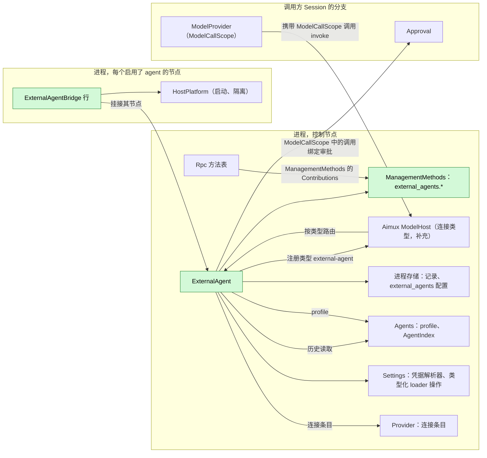
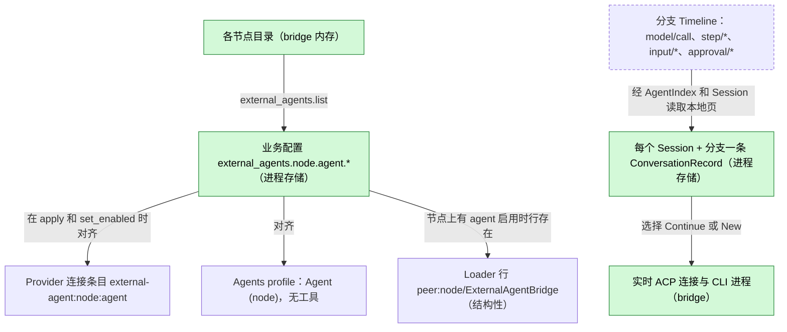
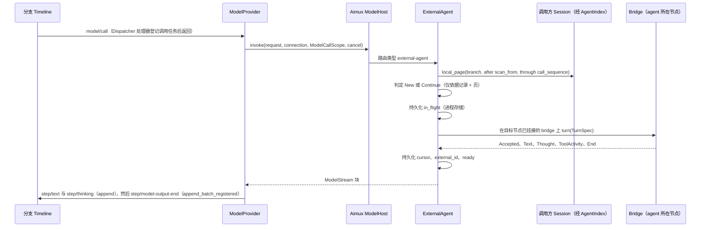
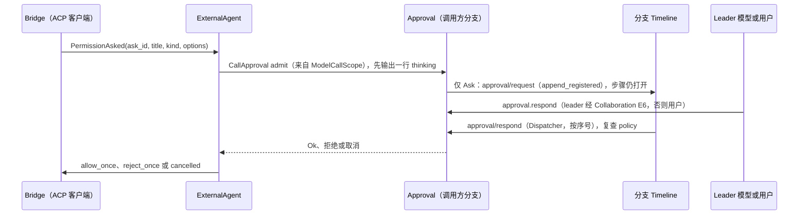
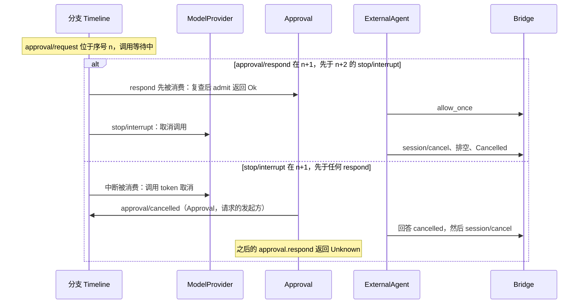

# ExternalAgent

状态：草案。总体设计：[overview §B.10](../overview.md)；作用域：[ADR 002](../../adr/002-plugin-scope.md)（进程）。阶段：P3。语言：优先 TypeScript（[overview §F.3](../overview.md)）。

ExternalAgent 让本地安装的编码 agent（Claude Code、Codex、Cursor、OpenCode、ZCode 等）可以作为一种模型连接使用。模型为外部 agent 的 Session 照常经由 Loop 和 ModelProvider 运行：ExternalAgent 向 Aimux 的 ModelHost 注册连接类型 `external-agent`（Aimux 补充），把每个 dim 模型请求转换为一次外部轮次，并把外部流转换回模型输出块。外部 agent 使用自己的工具；它们的权限请求成为运行该调用的 Session 中的普通 dim 审批。ExternalAgent 不写自己的 Timeline 事件。

## 1. 结构



外部 agent 连接、记录和各节点进程在 Session 之间共享，因此 ExternalAgent 是进程插件（[ADR 002](../../adr/002-plugin-scope.md) D1）。它依赖同一作用域的 Aimux、Agents、Provider 和 Settings。向 ModelHost 注册类型是 Aimux 补充：ModelHost 把解析出的连接类型为 `external-agent` 的请求路由给 ExternalAgent。依赖遵循作用域（D3）：Aimux、Agents、Provider 或 Settings 重载会重载 ExternalAgent 及其 bridge，使它们的在途外部调用失败；这一少见的结构性代价已被接受并有文档记录。ModelProvider 不依赖 ExternalAgent：ExternalAgent 未加载时，该类型的请求在接受前失败（暂时性），其他类型不受影响。每个 `ExternalAgentBridge` 是绑定到一个节点的结构性 loader 行，仅当该节点上至少启用了一个 agent 时存在；它依赖 ExternalAgent 和所在节点的 HostPlatform，并在 `apply` 中把所在节点的 `ExternalAgentNode` 挂接到 ExternalAgent。启用状态变化时，ExternalAgent 通过类型化的 Settings 操作增删 bridge 行（D4）。一个离线节点只使针对它的调用失败。Approval 只通过 ModelProvider 随调用传入的调用绑定审批访问。

| 部分 | 作用域 | 依赖 | 提供 |
| --- | --- | --- | --- |
| `ExternalAgent` | 进程，控制节点 | Aimux（ModelHost 类型注册）、Agents（profile 注册、用于历史读取的 `AgentIndex`）、Provider 连接条目操作、Settings（凭据解析器、bridge 行的类型化 loader 操作）、App Server 进程存储（记录和 `external_agents.*` 业务配置） | 类型 `external-agent`；由 Rpc 收集的 `ManagementMethods` 条目 `external_agents.*`；bridge 的挂接点 |
| `ExternalAgentBridge` | 进程，每个启用了 agent 的节点一个结构性行：本地行，其他节点为 `peer:<node>/ExternalAgentBridge`（[overview §6.3](../overview.md)） | ExternalAgent、该节点的 `HostPlatform` | 所在节点的 `ExternalAgentNode`，通过链路导出 |

**依赖的契约**：Aimux 补充（ModelHost 路由已注册的连接类型；`ModelCallScope`，§A.2）；另外两个补充：**ModelProvider** 在 `ModelCallScope` 中传入调用绑定审批，**Approval** 在模型步骤打开期间接受 `Host` 来源的准入，复用 `approval/request`、`approval/respond` 和 `approval/cancelled`（无新事件）；已有的 `ModelDriver`/`ModelStream`/`ModelChunk`/`HostError`/`ModelFailureFacts` 契约（[host.rs](../../../../crates/dim-agent-capabilities/src/host.rs)）和 ModelProvider 的失败策略（[recovery.rs](../../../../crates/dim-agent-capabilities/src/model_provider/recovery.rs)）；Approval 的 `admit`（[Approval](../../../architecture/rust-agent/plugins/Approval.md)）；Collaboration 补充"成员审批转发给 leader"（decisions E6）；Session 公共接口（[session-access](../contracts/session-access.md)）；Rpc 方法表中的管理级方法（[session-boundary](../contracts/session-boundary.md)）；App Server 进程存储；Settings。**本文定义的契约**：连接类型 `external-agent` 及其目标 `{node, agent}`；`ExternalAgentNode`；会话记录；审批调用形态 `external_agent.<kind>`；业务配置 `external_agents.*`；方法 `external_agents.*`；与 [AcpGateway](AcpGateway.md) 共享的 ACP schema 和一致性测试套件（客户端侧）。Provider、Agents、Approval 和 Collaboration 从不提及本插件。

## 2. 数据与状态



`external_agents.*` 条目是业务配置（[ADR 002](../../adr/002-plugin-scope.md) D4），保存在 ExternalAgent 的进程存储中，在使用时读取；变更是数据更新加通知，从不重载。它们是启用状态的事实来源；连接条目、profile 和 bridge 行通过各自所有者的类型化操作从它们对齐而来，因此可重建。只有 bridge 行是结构性的，增删一行只重载该 bridge。会话记录只保存投递游标和外部身份；每次投递判定都由 Timeline 页加记录重新计算。bridge 不持有任何需要存续的内容。

```text
ConversationRecord {
  key: (session_id, branch_id),
  target: { node, agent },
  external_id: String,          // ACP sessionId or CLI conversation id
  cursor: u64,                  // sequence of the model/call of the last accepted call on this branch
  scan_from: u64,               // lowest local sequence that may hold an input/message not yet consumed
  last_request_id: String,
  state: ready | in_flight { request_id } | uncertain,
}
```

记录存放在 App Server 进程存储中本插件的根目录下（原子替换，带格式版本）。在 `apply` 时，每条 `in_flight` 记录变为 `uncertain`；记录在最后一次使用后保留 30 天（A12）。

## 3. 流程

### 3.1 模型调用（初始化或继续）



判定只读取位于 `call_sequence` 或之前的事实（已派发，因此已发布，且是批次边界）以及记录；从不读取其他插件的内存。记录在外部轮次之前写入，因此重启后能判断某个轮次可能已经开始。

投递判定，给定记录 `R`、请求 `Q`、作用域 `S`：

1. 扫描 `S.branch` 在 `(R.scan_from, S.call_sequence]` 内的本地事件（没有可用记录时扫描整个本地分支）：`input/message`、序号 `> R.cursor` 的 `input/consumed`、序号 `> R.cursor` 的输出事件（`step/text`、`step/thinking`、`step/tool-use-start`）。
2. **初始化**：当没有记录、`R.target` 不同、`R.state = uncertain`，或范围内某个输出属于 `R.last_request_id` 以外的请求（其他模型作答过）时。打开 `New`，发送 `Q.messages` 的转录（§5）以及回答最后一条用户消息的指令。
3. **继续**：其他情况下为 `Continue { external_id }`，按消费顺序附上范围内已消费的输入。
4. 新的 `scan_from` = 已收集的、在 `S.call_sequence` 之前未被消费的 `input/message` 中的最小序号，否则为 `S.call_sequence`。delta 为空时在接受前以 `external_agent_no_input` 失败（A8）。

子分支上的 `Q.messages` 是截至切点的祖先前缀加本地事件，因此子分支从自己的历史初始化，从不触碰父分支的会话；fork（新 Session id）同样如此。

### 3.2 外部权限请求



权限请求是运行外部调用的 Session（对委派的成员而言即成员 Session）中的普通调用准入，经由 §1 中的两个补充：先由 Permission 的预设判定，只有 `Ask` 才写 `approval/request`。转发给 leader 是 Collaboration 的规则（E6）；ExternalAgent 只看到结果。询问前先发出一行 thinking，因此调用在等待时已有可见输出（§4）。

映射：ACP `toolCall.kind` → 调用名 `external_agent.<kind>` 及风险：`read`、`search` → `read_filesystem`；`edit`、`delete`、`move` → `write_filesystem`；`execute` → `execute_process`；`fetch` → `network`；其他 → 未分类（A7）。`admit` 返回 `Ok` 时选择 `allow_once` 选项；拒绝时选择 `reject_once`；缺少所需的一次性选项或询问被取消时，bridge 回答结果 `cancelled`。从不选择 `*_always`。非交互 CLI 适配器没有请求通道：其启动参数让 agent 处于自身的非自动批准模式，因此它无法询问的请求由 agent 自行拒绝（A16）。

### 3.3 委派与中断

1. 资源节点为 `build-box` 的 leader Session 通过 `agent` 工具请求 "Codex (build-box)"。Collaboration 用该 profile 创建成员 Session；成员继承 leader 的资源节点 `build-box`，因此 bridge 在 `build-box` 上于成员的 cwd 中运行 Codex。位于其他节点的 leader 在接受前得到 `external_agent_wrong_node`（A13）。
2. 中断：ModelProvider 取消调用 token；bridge 发送 ACP `session/cancel`（或向 CLI 发信号），把所有待处理权限请求回答为 `cancelled`，排空直到 prompt 响应，并在 10 秒宽限（A4）后终止进程。已收到的文本保留；若取消已被确认，下一个输入继续同一会话。

## 4. 时序与冲突



回答与中断的先后由调用方分支上序号的 Dispatcher 顺序决定；请求总是由 Approval 结束。外部 agent 只得知胜出的那个决定。

| 场景 | 顺序 | 结果 | 负责方 |
| --- | --- | --- | --- |
| 审批长时间待处理、无人回答 | — | dim 不设超时；调用保持打开；用户或 leader 可中断（A17） | Approval、Collaboration |
| dim 询问期间外部 agent 撤回请求或结束其 prompt | bridge `PermissionWithdrawn` | ExternalAgent 取消询问 token；Approval 写 `approval/cancelled`；迟到的回答返回 Unknown | ExternalAgent、Approval |
| Leader 不可用（已卸载、轮次已结束、其对成员的请求已停止） | 按 Collaboration | 由 Collaboration 补充决定投递或回退给用户；停止成员请求会中断成员轮次（见上一行） | Collaboration |
| 审批待处理时 Steer | `input/applied` 在 thinking 行之后 | 不替换（已有可见输出）；Loop 在下一个请求中投递 Steer | Loop |
| 有待处理审批时 ExternalAgent 重载 | — | 调用得到"provider unavailable"（而非 `capability reloading`）；询问被取消；进程被终止；记录 `uncertain`；bridge 随之重载 | ExternalAgent、ModelProvider |
| Agent 节点离线 | 条目已启用，该节点的 bridge 未挂接 | 该节点的调用在接受前以 `node_unavailable` 失败（暂时性）；其他节点不受影响 | ExternalAgent |
| 调用中进程重启 | `model/call` 与 `approval/request` 未结束 | Approval 恢复时写 `approval/cancelled`；ModelProvider 不调用 invoke 直接使调用失败；记录 `uncertain`；不重发任何内容 | Approval、ModelProvider |

其余所有行：[附录 B](#附录-b-完整冲突表)。

## 5. 上下文映射

| 受众 | 看到的内容 | 形式 |
| --- | --- | --- |
| 外部 agent，初始化 | 把 `Q.messages` 作为一个文本提示 `<dim-history>`：`[user]`、`[assistant]`、`[tool call <name>] <input JSON>`、`[tool result] <content text>`，图片为 `[image]`，省略 thinking（A14）；随后是指令 | ACP 文本块或 CLI stdin |
| 外部 agent，继续 | 每个已消费输入：原样的 raw 块文本，然后是用户内容（agent 声明 `promptCapabilities.image` 时图片为 ACP 图片块，否则为 `[image omitted]`） | Prompt 块 |
| 外部 agent，从不 | dim 系统提示词、提示词来源、工具声明、采样参数、`metadata`、其他插件的事件、诊断信息；`config.reasoning` 只通过适配器的 reasoning 标志传递 | — |
| 调用方 Session 的历史 | 外部回复作为 `step/text`；工具活动和权限行作为 `step/thinking`（`[tool] <title>: <status>`、`[permission] <title>: <state>`） | 模型输出事实 |
| Leader 模型（成员审批） | 审批的 `call`（`external_agent.<kind>`，`{agent, title, kind, raw_input}`，上限 4 KiB，A18），由 Collaboration 在 `agent` 工具中呈现 | Collaboration 的工具结果 |
| 用户 | 具有相同调用形态的 `approval.request` | 客户端 UI |

带 key 的块在消费时投递一次；"生效中"和退役在外部没有意义，重新初始化时只发送投影所含的内容。已提交的外部输出像任何模型输出一样进入历史：压缩会摘要它，子分支继承切点之前的部分，之后的原生模型将其视为 assistant 消息，被中断的输出保留文本、丢弃 thinking。Collaboration 和 Workflow 的结果读取最后一个请求的文本，因此工具活动从不污染结果。非交互 Session 的行为完全相同；审批映射也相同，因为审批不是 `ask_user`。

## 6. 接口（摘要）

| 接口 | 类型 | 用途 |
| --- | --- | --- |
| `external_agents.list` / `set_enabled` / `configure` | 方法，级别 `management` | 按节点的检测、启用、配置（[A.1](#a1-方法级别-management)） |
| 类型 `external-agent`，目标 `{node, agent}` | 向 Aimux 的 ModelHost 注册（Aimux 补充） | 外部 profile 的模型调用（[A.2](#a2-provider-注册与调用作用域)） |
| `ExternalAgentNode` | 由每个 bridge 行提供，挂接到 ExternalAgent | `detect`、带可回答权限询问的 `turn`（[A.3](#a3-bridge-服务与适配器)） |
| 审批调用 `external_agent.<kind>` | Approval 准入（Host 来源） | 外部权限请求 |
| ACP schema 与一致性测试套件 | 与 AcpGateway 共享 | 客户端侧（[A.5](#a5-共享-acp-schema)） |

## 7. 安全

外部 agent 以自己的账户和工具运行；dim 只在它们询问时、通过调用方 Session 的 policy 和 Approval 准入其操作，无法阻止 agent 未经询问就执行的操作：节点的 HostPlatform 隔离是执行边界，重放或 fork 从不扩大它。从不选择 `*_always`。凭据是启动时由 Settings 解析器从引用解析出的环境值，从不写入记录、Timeline、诊断信息或回复。启用 agent 属于宿主配置，只能通过 `management` 级方法进行；模型不能启用 agent。可执行文件在节点上解析，从不取自项目文件。

## 附录 A. 接口细节

### A.1 方法（级别 `management`）

| 方法 | 参数 | 结果 | `mutating` |
| --- | --- | --- | --- |
| `external_agents.list` | `refresh?` | 按节点：agent、可执行文件、版本、协议（ACP 或 CLI）、是否启用、配置（仅引用）；离线节点标记为 `node_unavailable` | 否 |
| `external_agents.set_enabled` | `node`、`agent`、`enabled` | 新状态 | 是 |
| `external_agents.configure` | `node`、`agent`、`executable?`、`args?`、`env?: {name: credential reference}`、`reasoning?` | 新配置 | 是 |

检测在加载时和 `refresh` 时运行（A1）；检测到的 agent 在启用前保持禁用（A3）。`set_enabled` 和 `configure` 更新进程存储中的业务配置并发出通知；从不重载 ExternalAgent。在某节点上启用第一个 agent 时添加该节点的 bridge 行，禁用最后一个时移除它。启用 `(node, agent)` 时，通过 Provider 的类型化连接条目操作对齐条目 `external-agent:<node>:<agent>`，其中只有一个模型 `default`（A2），目标为 `{node, agent}`；并通过 Agents 的 profile 注册对齐 profile `{ name: "<Agent> (<node>)", system_prompt: "", tools: [], model: { provider_id: "external-agent:<node>:<agent>", model_id: "default" } }`。禁用时两者都被移除；已有 Session 保留其已采用的模型，并在下次调用时以 `external_agent_disabled` 失败。Profile 像任何 Agent 一样由 `AgentIndex` 列出，因此 Collaboration 的 `agent` 工具可以请求它们。

### A.2 Provider 注册与调用作用域

```rust
// Aimux supplement: ModelHost routes a registered connection kind to its provider;
// ExternalAgent registers kind "external-agent" in apply and unregisters in its ctx.effect.
fn invoke(&self, request: Arc<ModelRequest>, target: ConnectionTarget, scope: ModelCallScope,
          cancel: CancellationToken) -> HostFuture<'_, ModelStream>;
// ModelCallScope (ModelProvider supplement): call identity (session_id, branch_id, turn_id,
// request_id, call_sequence), the SessionConfig subset {cwd, resource_node, interactive,
// collaboration_role}, and the call-bound approval:
trait CallApproval {   // bound by ModelProvider to its branch's Approval
    async fn admit(&self, operation_id: String, call: ApprovalCallData, risk: Option<String>,
                   cancel: CancellationToken) -> Result<(), HostError>;
}
```

调用绑定审批转发到已有的 `Approval::admit(AdmitCall { source: BranchSource::Host { operation_id }, call }, risk, cancel)`；`operation_id = "external-agent:<request_id>:<ask_n>"`。Approval 补充：这类准入在 `step/model-start` 打开期间被接受；其事实是普通审批事实，对模型没有可见影响。当请求已采用的 Provider 连接条目 `external-agent:<node>:<agent>` 存在但该类型未注册时，ModelHost 在接受前使其失败（暂时性）；其他类型不受影响。

### A.3 Bridge 服务与适配器

```rust
trait ExternalAgentNode {   // per node; provided by the bridge row, attached to ExternalAgent in its apply
    async fn detect(&self) -> Vec<Detected>;   // agent, executable, version, protocol
    async fn turn(&self, spec: TurnSpec, cancel: CancellationToken) -> Result<TurnStream, BridgeError>;
}
struct TurnSpec { agent: String, config: AgentConfig, cwd: String, conversation: Conversation, prompt: Vec<PromptBlock> }
enum Conversation { New, Continue { external_id: String } }
enum TurnUpdate { Accepted { external_id: String }, Text(String), Thought(String),
                  ToolActivity { id: String, title: String, status: String },
                  PermissionAsked { ask_id: String, title: String, kind: String,
                                    raw_input: Option<JsonObject>, options: Vec<PermissionOption> },
                  PermissionWithdrawn { ask_id: String }, Usage(Usage), End(EndReason) }
impl TurnStream { fn answer(&self, ask_id: &str, answer: PermissionAnswer); } // Allow | Reject | Cancelled
```

| 适配器 | 打开 | 轮次 | 取消 |
| --- | --- | --- | --- |
| ACP 客户端 | 通过节点的 HostPlatform 启动 ACP 命令（cwd、隔离）；`initialize` 时关闭 fs 和 terminal 客户端能力；`session/new {cwd, mcpServers: []}`，或在声明了 `loadSession` 时对已知 `external_id` 使用 `session/load` | `session/prompt`；`session/update` 流；`session/request_permission` → `PermissionAsked`；请求写出后发出 `Accepted` | `session/cancel`，把待处理权限请求回答为 `cancelled`，排空；宽限后终止（A4） |
| 非交互 CLI | 每个轮次启动一次，继续时带会话 id；限制性权限标志（A16） | 提示词经 stdin 传入，结构化输出按适配器解析；启动并完整写入 stdin 后发出 `Accepted` | 中断信号、宽限、终止 |

每个会话一个 ACP 进程，空闲 10 分钟后关闭（A5）。适配器定义是本插件内的数据（A6）。

### A.4 流映射与请求字段

| 外部 | `ModelChunk` |
| --- | --- |
| `Accepted` | `MessageStart { message_id: "<external_id>:<request_id>" }` |
| 消息块 / CLI 文本 | `Text(delta)`；先关闭打开的 thinking 块 |
| 思考块 / CLI 推理 | `Thinking(delta)`；先用 `TextEnd` 关闭打开的文本块 |
| `tool_call`、`tool_call_update` 状态变化 | `Thinking("[tool] <title>: <status>")`（A9）；从不发出 `ToolStart`（未提供工具；ModelProvider 拒绝未提供的调用） |
| 权限已询问 / 已决定 | `Thinking("[permission] <title>: asked")`，然后是 `allowed`、`denied` 或 `cancelled` |
| `plan`、`available_commands_update`、`current_mode_update`、`session/load` 重放的历史 | 不转发；进入诊断 |
| 适配器报告的用量 | `Usage`（A10） |
| 结束 `end_turn` | 关闭打开的块，`MessageStop { reason: EndTurn }` |
| 结束 `max_tokens` | `MessageStop { reason: MaxTokens }` |
| 结束 `max_turn_requests`、`refusal`、CLI 非零退出 | `HostError::Failed`，非暂时性（A11） |
| 我方取消后的结束 `cancelled` | 流结束且无 `MessageStop`；ModelProvider 报告 `Cancelled` |

不发出 `ModelChunk::Content`。请求字段：`messages` 只在初始化时使用；`system`、`tools`、采样字段、`provider_options`、`metadata`、`capability_snapshot` 不转发。

重试安全：`Accepted` 之前可重试的失败（启动失败、连接被拒、`node_unavailable`）为 `HostError::Failed`，带 `ModelFailureFacts { origin: Transport, transient: true }`；其他所有失败都是非暂时性的。ModelProvider 在遇到非暂时性错误时、以及收到非 `MessageStart` 块之后停止重试，因此 agent 可能已开始的轮次从不会被发送两次。`Accepted` 之前记录不变，因此重试会计算出相同的 delta。

### A.5 共享 ACP schema

固定的协议版本、按语言生成的类型、与 AcpGateway 共享的基于转录的一致性测试套件；fixture 覆盖 initialize、new/load、带文本和图片的 prompt、流式更新、prompt 期间取消、分别以 allow、reject 和 cancelled 回答的权限请求、取消期间的权限请求，以及 prompt 中途进程退出。不共享运行时代码（[overview §B.15](../overview.md)）。

### A.6 各步骤机制

| 步骤 | 路径 |
| --- | --- |
| 请求 | Loop 写 `input/consumed`* 和 `step/model-start`；ContextPreparation 写 `model/call`（`Timeline::append`）；ModelProvider 在其 Dispatcher 上消费它，登记调用任务后返回 |
| 解析 | 在任务中：Provider 解析出 `{kind: external-agent, target}`；ModelHost 携带 `ModelCallScope` 路由到已注册的 provider |
| 读取 | 通过 `AgentIndex` 获取调用方 Session，然后 `Session::local_page(branch_id, after, limit, through = call_sequence)`；无法读取的 Session 在接受前失败，暂时性 |
| 预写 | 发送前持久化 `in_flight`；收到 `Accepted` 时持久化 cursor、`last_request_id`、`scan_from`、`external_id`；在 `Accepted` 之前结束的尝试会恢复记录 |
| 输出 | ModelProvider 提交块（`Timeline::append`），并用 `append_batch_registered` 写 `step/model-output-end`；`StateCell<ModelProgress>` 显示未提交的文本 |
| 审批 | Approval 以 `append_registered` 写 `approval/request`（等待方在提交锁内登记）；`approval/respond` 在分支 Dispatcher 上被消费；其他所有结束方式下由 Approval 写 `approval/cancelled` |
| 结束 | 外部结束或已确认的取消 → `ready`；`Accepted` 之后被终止或链路丢失 → `uncertain` |
| 重载 | `ctx.effect` 的清理函数取消本插件的调用 token（先取消询问）、终止进程，然后注销该类型；每个调用以 provider-unavailable 失败结束，从不是 `CAPABILITY_RELOADING`；bridge 随 ExternalAgent 重载（它们依赖它） |
| 重启 | ModelProvider 重建时使未结束的 `model/call` 失败；Approval 重建时取消未匹配的请求；`apply` 把 `in_flight` 记录标为 `uncertain` |

ExternalAgent 本身不追加任何内容，不订阅任何 Dispatcher，也不拥有 `StateCell`。

## 附录 B. 完整冲突表

| 场景 | 顺序 | 结果 | 负责方 |
| --- | --- | --- | --- |
| `model/call` 被消费前轮次中断 | interrupt < `model/call` | `Cancelled`，不调用 invoke | ModelProvider |
| `Accepted` 之前中断 | — | 尝试取消；未发送任何内容；记录不变 | Bridge、ModelProvider |
| `Accepted` 之后中断 | `model/call` < interrupt | 发送取消；更新持续到 prompt 响应提交；`Cancelled`；记录 `ready`，cursor 前移 | Bridge、ModelProvider |
| 宽限期内取消未被确认 | — | 终止；`Cancelled`；`uncertain`；下次调用初始化 | Bridge |
| `approval/respond` 先于中断 | respond < interrupt | 投递决定；然后按上文取消 | Approval |
| 中断先于 `approval/respond` | interrupt < respond | `approval/cancelled`；询问回答 `cancelled`；迟到的 respond 返回 Unknown | Approval |
| 询问期间 policy 变化 | `permission/changed` < respond | 允许后复查；`Deny` → `approval/cancelled`，询问回答 reject | Approval |
| 预设直接决定、不询问 | — | 立即返回 `Allow`/`Deny`；无事件 | Permission |
| 一次调用中多次询问 | — | 按到达顺序独立审批 | Approval |
| 取消排空期间到达的权限请求 | — | 不询问，直接回答 `cancelled` | Bridge |
| 外部 agent 撤回其请求 | `PermissionWithdrawn` | 询问取消；`approval/cancelled` | ExternalAgent、Approval |
| 成员审批时 leader 不可用 | — | 由 Collaboration 补充决定；ExternalAgent 等待事实 | Collaboration |
| 无回答、无中断 | — | 无限等待（A17） | — |
| 任何可见块之前的 Steer | 调用期间 `input/applied`（Steer） | ModelProvider 替换请求并取消；下一个请求投递该 Steer（以及未被接受的更早输入） | ModelProvider、Bridge |
| 可见输出（含权限行）之后的 Steer | — | 不替换；同一轮次中发起新请求 | Loop |
| 已排队输入的 `input/withdrawn` | 消费前撤回 | 从未被消费，因此从未投递；消费推进越过它后 `scan_from` 也越过它 | InputQueue、Bridge |
| 并发的 Queue/Append 输入 | Timeline 顺序 | 按消费顺序投递 | Loop、Bridge |
| 工具批次未结算 | — | 这些请求中没有 dim 工具调用 | — |
| 调用前发生压缩 | `context/compaction` < `model/call` | 继续不受影响；初始化时包含摘要 | ContextPreparation、Bridge |
| 切出子分支，包括在 `approval/request` 与 respond 之间 | 任意 | 子分支没有记录，进行初始化；Approval 只跟踪本地请求，因此父分支的请求仍归父分支 | Bridge、Approval |
| 调用中分支中断或关闭 | 分支中断 | 同中断；Approval 关闭时取消询问 | ModelProvider、Approval |
| 中间穿插了原生模型 | cursor 之后有外来输出 | 重新初始化 | Bridge |
| 接受前的暂时性失败 | — | 以相同 delta 重试 | ModelProvider |
| 调用中 ExternalAgent 重载 | — | provider-unavailable 失败；终止；`uncertain`；ModelProvider 不重载 | ExternalAgent |
| Agents、Aimux、Provider 或 Settings 重载 | — | ExternalAgent 及其 bridge 重载（D3，已接受）；在途外部调用按其自身重载时的方式失败 | ExternalAgent |
| 调用中进程重启 | 未结束的事实 | 由重建结算；`uncertain`；不重发任何内容 | ModelProvider、Approval |
| Session 卸载与恢复 | — | 记录保留；ACP 进程因空闲关闭；用 `session/load` 重新打开或初始化 | Bridge |
| Agent 节点离线 | bridge 未挂接 | 接受前暂时性 `node_unavailable`，在限度内重试，然后 `Failed`；其他节点不受影响 | ExternalAgent |
| `Accepted` 之后链路丢失 | — | 非暂时性失败；询问取消；`uncertain` | Bridge |
| Session 资源节点与 agent 节点不同 | — | `external_agent_wrong_node`，非暂时性（A13） | ExternalAgent |
| 重复 `set_enabled` | — | 幂等 | ExternalAgent |
| 客户端断开 | — | 无影响；待处理审批等待其他客户端或 leader | — |

## 附录 C. 错误与恢复

| 错误码 | 接受前 | 含义 |
| --- | --- | --- |
| `external_agent_not_installed` | 是，非暂时性 | 节点上找不到可执行文件 |
| `external_agent_auth_required` | 是，非暂时性 | Agent 需要自己登录；呈现时给出命令名 |
| `external_agent_launch_failed` | 是，暂时性 | 启动或连接失败 |
| `node_unavailable` | 是，暂时性 | Agent 在该节点上已启用，但其 bridge 未挂接 |
| `external_agent_disabled`、`external_agent_wrong_node`、`external_agent_no_input` | 是，非暂时性 | A.1、§3.3、§3.1 |
| `external_agent_protocol` | 均可能 | 输出格式错误；终止；若在接受后则 `uncertain` |
| `external_agent_exited` | 否 | 轮次中进程退出或链路丢失；`uncertain` |
| provider unavailable | 均可能 | ExternalAgent 正在卸载；先取消询问 |

错误以 `ModelOutputOutcome::Failed` 呈现；已提交的文本保留。继续失败或记录为 `uncertain` 时重新初始化（A15）。

## 附录 D. 验收

使用脚本化的 ACP agent 和脚本化的 CLI，通过公共接口进行流程测试：

1. 首次调用初始化；第二次只投递新输入；Append 输入随消费它的请求投递；被撤回的 Queue 输入从不投递。
2. 文本、思考和工具活动映射为 `step/text` 和一个 `step/thinking` 块；没有 `step/tool-use-start`。
3. 接受前和接受后的中断；取消被忽略 → `uncertain` → 下次调用初始化。
4. 可见输出之前的 Steer 替换请求；输出（包括权限行）之后的 Steer 成为新请求。
5. 接受前的暂时性失败被重试；接受后的失败不重试。
6. 子分支和原生↔外部切换会初始化；父分支会话不受影响。
7. 存在 `in_flight` 记录和待处理审批时重启 → `uncertain`、`approval/cancelled`；不重发。
8. Collaboration 向外部 profile 发出的请求返回外部回复；位于其他节点的 leader 得到 `external_agent_wrong_node`。
9. 权限：WorkspaceWrite 下 `execute` → `approval/request`；允许 → `allow_once`，拒绝 → `reject_once`；ReadOnly 下 `execute` → 拒绝且无事件；FullAccess → 允许且无事件；没有 `allow_once` 选项 → `cancelled`。
10. 成员 Session：审批经 Collaboration 到达 leader，leader 的决定被投递；没有 leader 时由用户经 `approval.request` 回答。
11. 中断与 `approval.respond` 两种顺序的竞争；外部撤回取消审批；ExternalAgent 重载取消审批且不重载 ModelProvider。
12. 一个离线的 peer 节点只使其自身调用失败；其他节点和原生连接继续工作。
13. 共享 ACP 一致性测试套件在客户端侧通过。

## 附录 E. 假设

| # | 假设 | 依据 | 若被否决的影响 |
| --- | --- | --- | --- |
| A1 | 在加载时和显式 refresh 时检测，不做监听 | 判断 | 后台轮询 |
| A2 | 每个外部 agent 一个模型 `default` | 判断 | 每个 agent 的模型列表 |
| A3 | 检测到的 agent 在启用前保持禁用 | 判断（它们消耗用户的账户） | 默认开启 |
| A4 | 取消宽限 10 秒 | 判断 | 其他上限 |
| A5 | 每个会话一个 ACP 进程，空闲 10 分钟后关闭 | 判断 | 共享进程 |
| A6 | 适配器定义是插件内的数据 | Overview §F.3 | 每个 agent 一个插件 |
| A7 | ACP 工具 kind → 调用名 `external_agent.<kind>` 与风险类别映射 | Decisions E6（普通审批）；映射为判断 | 单一未分类类别（WorkspaceWrite 下总是询问） |
| A8 | 空 delta 使调用失败 | 判断 | 发送一个继续提示 |
| A9 | 外部工具活动呈现为 thinking 行 | 判断 | 文本，或仅进入诊断 |
| A10 | 只在适配器报告时提供用量 | 判断 | — |
| A11 | `max_turn_requests` 和 `refusal` 使请求失败 | 判断 | 映射为 `EndTurn` |
| A12 | 记录在最后一次使用后保留 30 天 | 判断 | 其他保留期或在 Session 关闭时删除 |
| A13 | 外部 agent 只服务资源节点为其所在节点的 Session | Overview §6.3；判断 | 跨节点工作目录 |
| A14 | 转录格式；省略 thinking | Overview §B.10 列出内容；格式为判断 | 其他呈现方式 |
| A15 | 不确定或失败的继续从历史重新初始化 | Overview §9（仍开放） | 显式失败 |
| A16 | CLI 适配器以 agent 自身的非自动批准模式启动；它们无法询问 dim | 判断（无请求通道） | 每个 CLI 的权限桥 |
| A17 | 外部权限审批不设超时 | Approval 没有超时；Questions 先例（E24） | 超时后回答 reject |
| A18 | 审批调用输入为 `{agent, title, kind, raw_input}`，`raw_input` 上限 4 KiB | 判断 | 其他形态 |

## 附录 F. 待对齐问题

| 问题 | 说明 |
| --- | --- |
| 补充的代价 | 调用绑定审批使 ModelProvider 注入 `B:Approval`，因此 Approval 重载会重载 ModelProvider（少见，按 D3 接受） |
| 外部会话继续 | Overview §9；本设计采用重新初始化（A15） |
| Agents profile 注册 | Agents 的 profile 注册和 Provider 的连接条目操作（直接依赖，ADR 002 D3）的形态尚未定义 |
| ACP `session/load` | 进程重启后，`ready` 记录是否应通过 `session/load` 继续，而不是初始化 |
