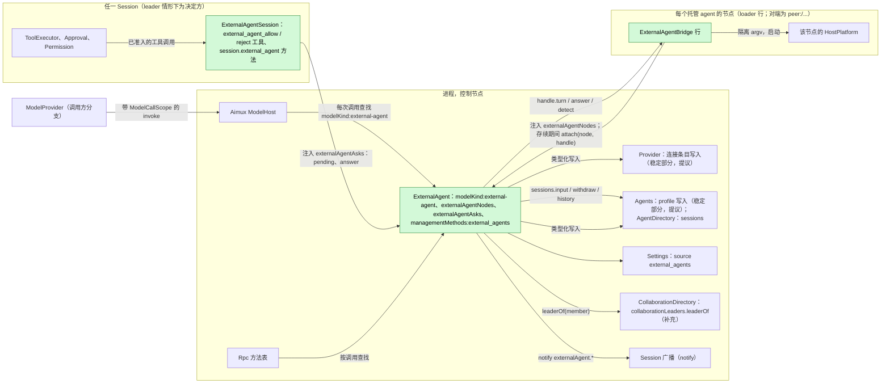
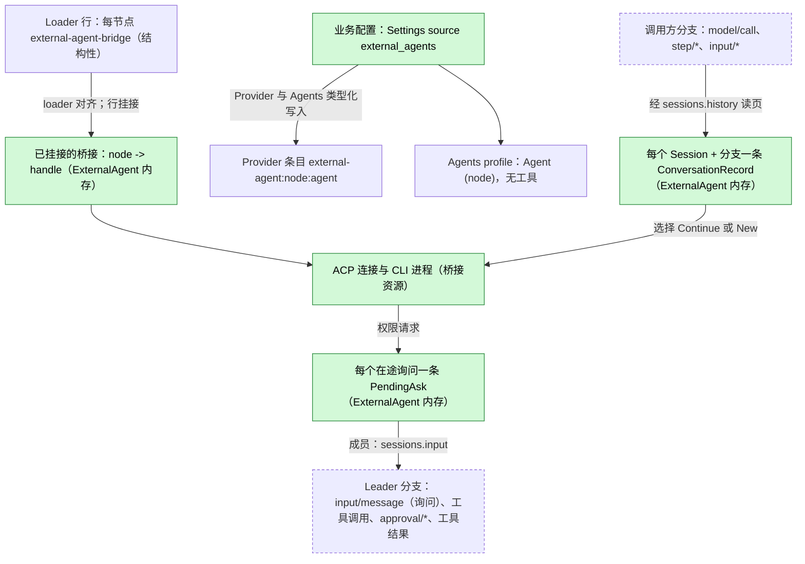
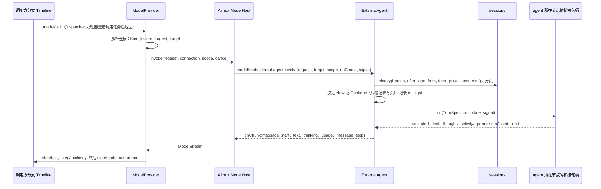
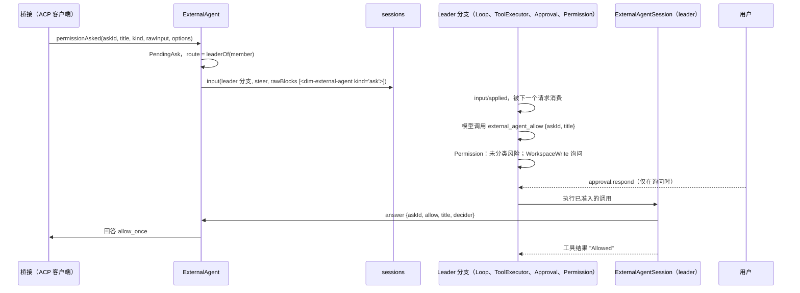
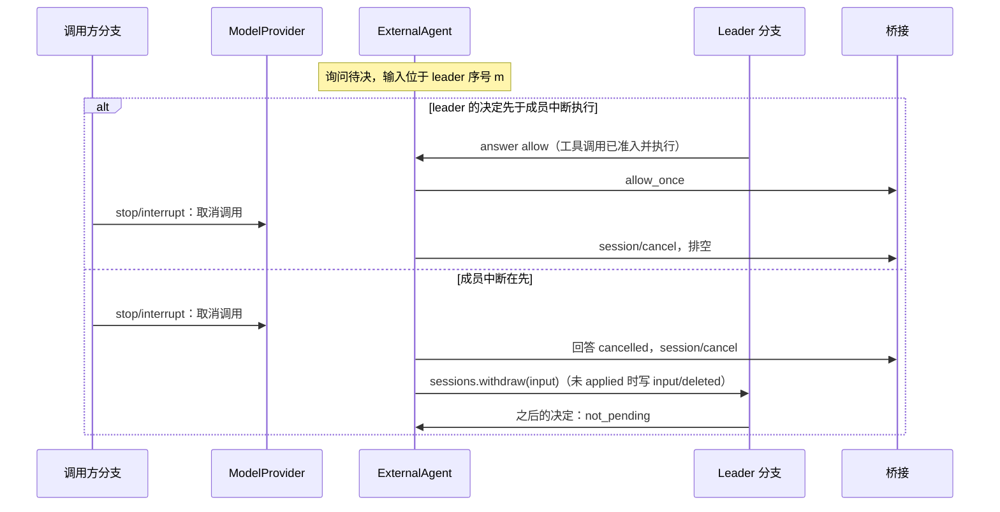

# ExternalAgent

状态：草案，Ready 候选（重新设计，[#145](https://github.com/arcships/dim/issues/145)）；达到 Ready 还缺的内容见 [§10](#10-ready-状态)。总体设计：[overview §4](../overview.md#4-插件目录)；作用域：[ADR 002](../../adr/002-plugin-scope.md)（进程，另有按节点的桥接行和一个 Session 部分）。阶段：P3。语言：优先 TypeScript（[overview 附录 C](../overview.md#附录-c-实现语言)）。

ExternalAgent 让本地安装的编码 agent（Claude Code、Codex、Cursor、OpenCode、ZCode 等）可作为模型使用。已采纳模型为 Provider 条目 `external-agent:<node>:<agent>` 的 Session 照常经由 Loop 与 ModelProvider 运行：该条目是普通的 Provider 条目（[auxiliary model](../appserver/auxiliary-model.md)，S4），Provider 把它解析为种类 `external-agent` 的连接，Aimux 的 ModelHost 对这一种类在每次调用时查找进程服务 `modelKind:external-agent`。ExternalAgent 把每个模型请求转为一次外部轮次，再把 agent 产出的内容转回模型输出块。外部 agent 运行自己的工具。模型流只承载 agent 产出的文本与思考；dim 从不向其中加入审批条目或合成的行。

当 agent 为自己的某个动作请求权限时，ExternalAgent 在模型流之外询问调用方 Session 的交互对方。Collaboration leader 的模型以一条输入收到询问并用工具决定，这次工具调用像其他工具调用一样经过 leader 的 Approval 与 Permission。没有 leader 时，由用户通过 Session 方法回答。没有交互对方的 Session 拒绝询问。agent 进程位于由 loader 管理的按节点桥接行中；每个桥接在自身存续期间把自己挂接到 ExternalAgent。所有契约都是语言中立的命名服务（[ADR 002 D5](../../adr/002-plugin-scope.md)）；Rust 形式见[附录 G](#附录-g-rust-绑定)。

相对上一版草案（已被 [#182](https://github.com/arcships/dim/pull/182) 的重新设计取代）的变化：

| 上一版 | 本设计 | 原因 |
| --- | --- | --- |
| 模型流中有 `approval_ask` / `approval_ask_withdrawn` 条目；ModelProvider 经 Approval 准入并以 `answerApproval` 回答；Approval 宿主来源补充 | 模型契约中没有审批数据。询问以一条输入加一个决定工具送到交互对方，或经 Session 方法送到用户（§3.2）。ModelProvider 与 Approval 不变 | [#28](https://github.com/arcships/dim/issues/28)；[ADR 003](../../adr/003-approval-scope.md) D1；principles §4 规则 4 |
| 每次询问前发一行合成的 thinking，工具活动作为 `[tool]` thinking 行，使 Steer 不会替换请求 | 只有 agent 产出的文本与思考进入流；工具活动是 Session 广播通知。ModelProvider "没有可见输出才替换" 的规则照原样适用（§4） | #28 |
| ExternalAgent 自己启停每个节点一个的桥接 | `ExternalAgentBridge` 是每个节点一行的 loader 行（对端节点为 `peer:<node>/external-agent-bridge`）；由 loader 对齐，其 effect 结束它的进程（§3.4） | [#37](https://github.com/arcships/dim/issues/37)；principles §1 |
| ModelHost 既被描述为收集 `modelKind`（依赖环），又被描述为接受注册 | ModelHost（原生）在每次调用时查找 `modelKind:<kind>`，不依赖其提供方，与 Rpc 查找 `managementMethods` 相同。双方互不依赖（§1） | #37；ADR 002 D3 |
| 会话记录持久化在 `pluginFiles` | 记录作为在用外部会话的句柄保存在 ExternalAgent 内存中，丢失后的下一次调用重新初始化（§2） | #37 附注；principles §4 规则 4 |

本次修订对照 main 核对了每个引用的契约，修正如下：

| #182 中的假设 | 当前 main | 本次修订 |
| --- | --- | --- |
| ExternalAgent（TypeScript）在每次调用时查找 `externalAgentBridge[<node>]` | TypeScript 行只能访问它在 `inject` 中声明的服务；JavaScript API 没有按次查找（[sessions-service D1](../appserver/sessions-service.md)、[process TypeScript §5.1](../../../design/process-typescript.md#51-proposed-p6p7-access-through-declared-feature-dependencies)） | 采用 #37 已认可的注册形式：每个桥接行注入 ExternalAgent 的 `externalAgentNodes`，并在自身存续期间以引用挂接一个句柄（§1、A.3） |
| "async、流式"方法 | rutis-bridge 0.12.1 的方法只有 `sync` 与 `async`；值可以是函数引用和 AbortSignal | 流式回复是一次 `async` 调用：以引用接收一个 sink 函数，流结束时 resolve（§6"流式调用"） |
| `ExternalAgentSession` 从 `watch` 流转发 `externalAgent.*` 通知 | 通知由状态所有者用 `notify` 发出；没有 TypeScript 绑定（[session notices §4](../appserver/session-notices.md#4-发出)） | 拥有待决询问与调用的 ExternalAgent 自己发出通知；删除 `watch` 与转发；`notify` 的 TypeScript 绑定在 §9.1 提出 |
| ModelHost 解析"它不驱动的种类的连接" | `ModelConnection` 是封闭枚举 `Local \| Http \| Bedrock`，`ModelDriver::invoke(request, connection, cancel)` 不带调用作用域（[host.rs](../../../../crates/dim-agent-capabilities/src/host.rs)） | 补充写成确切形式：`ModelConnection::Kind {kind, target}` 与可选的 `ModelCallScope` 参数（§9.2） |
| 询问输入 `{blocks: [raw block {marker, key, text}]}` | `InputWrite.rawBlocks: [{text, key?}]`；标记是第一个原始块，即元素 `<dim-<source> ...>`（[session access A.1、A.2](../contracts/session-access.md#a2-来源输入约定)） | 按契约重写询问输入；删去无用的 key（A.6） |
| ExternalAgent 依赖 Provider 与 Agents 并随其重载，"可接受的代价" | 被 Session 工具行注入的进程所有者必须保持稳定的依赖边界；会重载的依赖会让所有者及每个现有 Session 的工具一起退役（[process TypeScript §5.1](../../../design/process-typescript.md#51-proposed-p6p7-access-through-declared-feature-dependencies)） | ExternalAgent 只注入从不重载的部分；Provider 与 Agents 的写操作要求由这类部分提供（§9.3） |
| 待对齐问题：客户端路径可改用 Questions 的通用交互对方机制 | Questions 重新设计把问题保持为待决的 `ask_user` 工具调用（[Questions](Questions.md)），不提供通用的交互对方服务 | 已解决：保留 `external_agent` 方法与通知（附录 F） |

## 1. 结构



外部 agent 连接、目录与在用会话跨 Session 共享，因此 ExternalAgent 是进程插件（ADR 002 D1）。agent 进程是某个节点的宿主资源，因此属于该节点上的插件：`ExternalAgentBridge` 是进程插件，每个托管 agent 的节点一行 loader 行。只要 ExternalAgent 启用，控制节点的行就是产品 profile 的一部分。对端节点的行是 `peer:<node>/external-agent-bridge`，只由 PluginManager 的结构性操作增删（ADR 002 D4：节点绑定是结构性的）。loader 像对待其他行一样对齐这些行。对端行在其节点或链路不在时等待，恢复后再次装载。桥接的资源在行卸载时由它自己的 `ctx.effect` 释放。在某节点上启用 agent 是业务配置，从不增加行。

桥接行注入 `externalAgentNodes`（在对端经链路导入），并在 `apply` 中为自己的节点以引用挂接一个句柄。挂接与行同生共死：行的 effect 解除挂接；链路断开或运行时退出会关闭引用，ExternalAgent 将其视为已解除。这是 #37 认可的注册形式（易变的一方依赖稳定的所有者，并在自身存续期间注册）。它取代了 TypeScript 调用方做不到的按次查找。

Session 的询问是按 Session 的工作，决定询问的工具提供给 Session，因此插件有一个 Session 部分 `ExternalAgentSession`，它是 C4 TypeScript Session 行，在 ExternalAgent 启用期间装入每个 Session（ADR 002 D2：工具经 `toolContribution`，客户端方法经 `sessionMethods`）。它的装配从不依赖 Session 的模型或角色，因此工具集与提示词前缀在切换模型和 fork 时保持稳定。它不持有状态，也不发出任何东西：通知由拥有询问的 ExternalAgent 发出。

依赖从扩展指向核心，不构成环：

- ModelHost 在每次调用时查找 `modelKind:<kind>`，从不依赖 ExternalAgent。ExternalAgent 不依赖 Aimux。
- 每个桥接行依赖 ExternalAgent（`externalAgentNodes`）和所在节点的 HostPlatform。ExternalAgent 不依赖任何桥接。
- `ExternalAgentSession` 依赖 ExternalAgent（`externalAgentAsks`）。
- ExternalAgent 只依赖从不重载的部分：AgentDirectory（`sessions`）、Settings、CollaborationDirectory，以及提供 Provider 与 Agents 写操作的稳定部分（§9.3）。

因此缺失、Pending 或正在重载的部分只让需要它的调用失败，ExternalAgent 只因自身的结构性变化而重载。

| 部分 | 作用域 | 依赖（`inject`） | 提供 |
| --- | --- | --- | --- |
| `ExternalAgent` | 进程行，控制节点 | `sessions`、`settings`、`collaborationLeaders`（补充）、`providerEntries` 与 `agentProfiles`（提议的写操作，稳定部分） | `modelKind:external-agent`；`externalAgentNodes`；`externalAgentAsks`；`managementMethods:external_agents`；Settings source `external_agents`；`externalAgent.*` 通知 |
| `ExternalAgentBridge` | 进程行，每个托管 agent 的节点一行 | `externalAgentNodes`；该节点 HostPlatform 的 exec-argv 辅助 | 无具名服务；经 `attach` 以引用提供 `BridgeHandle` |
| `ExternalAgentSession` | Session 行（C4） | `externalAgentAsks` | `toolContribution:external_agent_allow`、`toolContribution:external_agent_reject`；`sessionMethods:session.external_agent` |

**依赖的契约。**

- §9.2 的 Aimux、ModelProvider、Provider 补充：`ModelConnection::Kind`、可选的 `ModelCallScope` 参数、按次查找 `modelKind:<kind>`。
- Provider 的外部 agent 连接类型与连接条目写操作，以及 Agents 的 profile 写操作，均由从不重载的部分提供（§9.3；归这些插件所有）。
- 现有的模型输出块与失败数据（[host.rs](../../../../crates/dim-agent-capabilities/src/host.rs)）和共享恢复循环 `invoke_with_recovery`（[recovery.rs](../../../../crates/dim-agent-capabilities/src/model_provider/recovery.rs)）。
- `sessions`（带 `rawBlocks` 的 `input`、`withdraw`、`history`；[session-access A.1](../contracts/session-access.md#a1-sessions-服务)），由 AgentDirectory 实现。
- 经 C4 绑定（[session TypeScript](../../../design/session-typescript.md)）的 `toolContribution` 与 `sessionMethods`（[session-boundary](../contracts/session-boundary.md)）；经 #4（[process TypeScript](../../../design/process-typescript.md)）的进程行与管理方法。
- Session 广播通知（[session notices](../appserver/session-notices.md)）与 `notify` 的 TypeScript 绑定（§9.1）。
- Collaboration 补充 `leaderOf`（§9.4）。
- Settings 对业务来源 `external_agents` 的类型化写入与 `settings.changed`。
- 每个节点 HostPlatform 的 exec-argv 辅助与隔离（overview 附录 B，P3）。
- rutis 链路把 `externalAgentNodes` 从控制节点导出到相连节点（链路配置，overview §6.3）。

**本文定义的契约。**

- `modelKind:external-agent` 及其目标 `{node, agent}`。
- `externalAgentNodes` 与 `BridgeHandle`；`externalAgentAsks`；两个决定工具。
- `session.external_agent` 方法与 `externalAgent.*` 通知。
- 询问输入形式（标记元素 `dim-external-agent`，来源 `external-agent`）。
- 业务配置 `external_agents.*` 与方法 `external_agents.*`。
- 与 [AcpGateway](AcpGateway.md) 共享的 ACP schema 与一致性测试（客户端侧）。

Provider、Agents、Approval、Permission、ModelProvider 与 Collaboration 从不提及本插件。

## 2. 数据与状态



**业务配置**（[ADR 002](../../adr/002-plugin-scope.md) D4）是 Settings source `external_agents` 中的一份文档，由 ExternalAgent 的进程行声明：`{ nodes: { <node>: { <agent>: { enabled, executable?, args?, env?, reasoning? } } } }`。Settings 按 ExternalAgent 的 schema 校验并填默认值；ExternalAgent 在使用时读取，并随每次桥接调用传入该条目，因此桥接不读取自己的配置。它只经 ExternalAgent 的管理方法写入（A.1）。`env` 值是这份文档中的普通字符串，可能包含 agent 的凭据；它们归 ExternalAgent 所有（[settings-service §1.2](../appserver/settings-service.md#12-决定密钥归其所有者)）：该来源只有用户作用域，`env` 从不出现在项目文件中，也不涉及 Settings 解析器。变更是一次数据更新加 `settings.changed`，从不重载。Provider 条目与 Agents profile 经这些所有者公开的类型化写操作请求，可由这份文档重建。

**Loader 行。** 每个节点的 `external-agent-bridge` 行是结构性配置：它说明哪些节点可以运行 agent，而不是哪些 agent 在那里运行。

**已挂接的桥接。** ExternalAgent 在内存中保存 `node -> {registration, handle}`，从 `attach` 起，到 `detach` 或句柄引用关闭为止。它是在用 I/O 资源：从不持久化，只在 ExternalAgent 重载后由桥接重新挂接而重建（桥接依赖它，因此随它重载）。`external_agents.list` 把没有已挂接桥接的已配置节点报告为 `unavailable`。

**会话记录。** 记录作为一个在用外部会话的句柄保存在 ExternalAgent 内存中，从不持久化：

```text
ConversationRecord {
  key: (session_id, branch_id),
  target: { node, agent },
  external_id: String,          // ACP sessionId 或 CLI 会话 id，归桥接所有
  cursor: u64,                  // 本分支最后一次已受理调用的 model/call 序号
  scan_from: u64,               // 可能含尚未消费的 input/message 的最低本地序号
  last_request_id: String,
  state: ready | in_flight { request_id } | uncertain,
}
```

每次投递决定都由 Timeline 页加记录重新计算（§3.1）。丢失记录（ExternalAgent 重载、进程重启、A12 之后的淘汰）只会让该分支的下一次调用从历史初始化（A15）。键包含分支与 Session id，因此有新分支或 Session id 的子分支或 fork 从不继续别的分支的外部会话。

**待决询问。** 外部请求等待回答期间，待决询问保存在 ExternalAgent 内存中。它是在用 I/O 交换的一部分，因此在重载时被了结，而不是重建：

```text
PendingAsk {
  ask_id: String,               // "<request_id>:<n>"，每次调用内唯一
  call: { session_id, branch_id, request_id },
  agent: { node, agent }, title: String, kind: String, raw_input: JSON（上限 4 KiB，A18）,
  route: leader { session_id, branch_id, input_id } | client | none,
}
```

**Timeline。** 调用方分支只得到普通的模型事实。成员情形下，leader 分支得到一条普通输入、一次带普通审批事实的普通工具调用和一个工具结果。ExternalAgent 不声明事件类型，除了经 `sessions` 写输入和撤回之外不写任何东西。

**不进 Timeline**（principles §4 规则 9）：配置、Provider 条目、profile、挂接、记录、待决询问、工具活动、客户端回答、进程。客户端显示的内容经 `externalAgent.*` 通知。

## 3. 流程

### 3.1 模型调用（初始化或继续）



决定只读取 `call_sequence` 及之前的事实（已派发，因此已发布，且是批次边界）和记录；从不读取别的插件的内存。

投递决定，给定记录 `R`、请求 `Q`、作用域 `S`：

1. 按 `sessions.history` 分页扫描 `S.branchId` 在 `(R.scan_from, S.callSequence]` 内的本地事件（没有记录时为整个本地分支）：`input/message`、序号 `> R.cursor` 的 `input/consumed`，以及序号 `> R.cursor` 的输出事件（`step/text`、`step/thinking`、`step/tool-use-start`）。
2. 满足以下任一条件时**初始化**：没有记录；`R.target` 不同；`R.state = uncertain`；或区间内有输出属于 `R.last_request_id` 之外的请求（别的模型回答过）。初始化打开 `New`，发送 `Q.messages` 的转写（§5）以及"回答最后一条用户消息"的指示。
3. 否则**继续**：`Continue { external_id }`，附区间内按消费顺序排列的已消费输入。若桥接已不再持有该会话且无法加载，它在受理前回复 `conversation_lost`，ExternalAgent 在同一次调用内改为初始化，因为什么都还没发出。
4. 新的 `scan_from` 是收集到的、在 `S.callSequence` 时尚未被消费的 `input/message` 的最低序号，否则为 `S.callSequence`。空增量在受理前以 `external_agent_no_input` 失败（A8）。

子分支上的 `Q.messages` 是截至切点的祖先前缀加本地事件，因此子分支从自己的历史初始化，从不触碰父分支的会话；fork 同理。

没有 Session 作用域的调用（例如以 `external-agent:*` 模型调用 `auxiliaryModel.complete`）在受理前以 `external_agent_no_session` 失败。SessionTitle 已对这类模型跳过命名（[auxiliary model §8](../appserver/auxiliary-model.md)）。

### 3.2 外部权限请求

agent 自己的动作不是 dim 的工具调用，因此 dim 的 Approval 不准入它（[ADR 003](../../adr/003-approval-scope.md) D1）。决定归调用方 Session 的交互对方（[overview §6.2](../overview.md#62-约束) 第 15 条）。询问到达时，ExternalAgent 按调用作用域的 `SessionConfig` 选择路径：

| 调用方 Session | 路径 | 谁决定 | 权限来源 |
| --- | --- | --- | --- |
| `collaborationRole = member`，`leaderOf` 返回 leader | `leader`：向 `leaderOf` 指出的分支写一条 `input/message`（Steer）；leader 模型调用 `external_agent_allow` 或 `external_agent_reject` | leader 的模型 | 决定是 leader 的一次工具调用，因此 leader 的 Permission 与 Approval 像对待其他调用一样准入它（WorkspaceWrite 下的 allow 经 leader 的 `approval/request` 询问用户） |
| 否则 `interactive`（包括 leader 已不在的成员） | `client`：在调用方 Session 上发出 `externalAgent.ask` 通知；客户端用 `session.external_agent.answer` 回答 | 用户 | 用户自己的回答；不是 agent 的决定，因此不经 Approval |
| `interactive = false` | `none` | 无人 | 立即回答 `reject`（A19） |



回答规则：

- `externalAgentAsks.answer` 只接受该路径的决定方。leader 路径上是收到输入的那个 Session 与分支，且 allow 必须回显询问的 `title`。client 路径上是调用方 Session 自己的 Session 方法。其他回答返回 `not_yours`；对已结束询问的回答返回 `not_pending`，均无效果。
- allow 选择 `allow_once` 选项，reject 选择 `reject_once`。缺少所需的 once 选项时，桥接回答 `cancelled`。从不选择 `*_always`。
- 询问在没有回答时结束（调用被取消、agent 撤回、桥接解除挂接或 ExternalAgent 卸载），若 agent 仍在等待，ExternalAgent 回答 `cancelled`。leader 路径上，ExternalAgent 经 `sessions.withdraw` 撤回 leader 输入（InputQueue 仅在尚未 applied 时写 `input/deleted`）。client 路径上，ExternalAgent 发出 `externalAgent.askEnded`。之后为该询问调用的决定工具得到 `not_pending`。
- 一次调用中的多个询问相互独立，按到达顺序路由。
- 非交互 CLI 适配器没有请求通道。它们的启动参数让 agent 处于自身不自动批准的模式，因此 agent 自己拒绝它无法询问的动作（A16）。

ACP `toolCall.kind` 的映射（只展示给决定方，A7）：`read`、`search` → 读文件；`edit`、`delete`、`move` → 写文件；`execute` → 运行进程；`fetch` → 网络；其他 → 其他。决定工具的风险不随种类变化：对 leader 的 Permission 来说，允许另一个 agent 的动作总是未分类的（A.6）。

### 3.3 委派与中断

1. 资源节点为 `build-box` 的 leader Session 让 `agent` 工具请求 "Codex (build-box)"。Collaboration 用该 profile 创建成员 Session；成员得到 leader 的 cwd 与权限策略。成员继承 leader 的资源节点，因此 `build-box` 上的桥接在成员的 cwd 中运行 Codex。位于其他节点的 leader 在受理前得到 `external_agent_wrong_node`（A13）。`agent` 工具是脱离的工作，因此 leader 分支继续运行，可以消费询问输入（§3.2）。
2. 中断成员的调用：ModelProvider 取消调用令牌，Aimux 中止 `invoke` 的 signal，ExternalAgent 按 §3.2 结束该调用的待决询问。桥接发送 ACP `session/cancel`（或给 CLI 发信号），排空到 prompt 响应，10 秒宽限后杀掉进程（A4）。已收到的文本保留。若取消被确认，下一条输入继续同一会话。
3. 中断 leader 的轮次会取消尚未执行的决定工具调用。询问保持待决，直到另一次决定、成员被中断，或 Collaboration 停止成员请求（这会中断成员的轮次）。

### 3.4 桥接生命周期

| 事件 | 执行者 | 效果 |
| --- | --- | --- |
| 产品 profile 中启用 ExternalAgent | Loader | 控制节点的桥接行在 ExternalAgent 之后装载并挂接 |
| PluginManager 在对端节点 `n` 上启用桥接 | Loader | 增加 `peer:n/external-agent-bridge`；链路就绪后该行在 `n` 上装载，导入 `externalAgentNodes` 并挂接 `n`；ExternalAgent 对其运行 `detect` |
| 到 `n` 的链路断开 | Loader（对端行行为） | 行停止：其 effect 取消轮次，以 `cancelled` 回答 agent 的待决权限请求并杀掉进程；句柄引用关闭，因此 ExternalAgent 结束该节点的询问，对 `n` 的调用以 `node_unavailable` 失败；链路恢复后行再次装载并挂接 |
| 在某节点上启用或停用 agent | ExternalAgent（业务配置） | 不改行，不重载；对已停用 agent 的调用以 `external_agent_disabled` 失败；桥接关闭该 agent 的空闲连接 |
| 桥接崩溃或重载 | Loader | 同链路断开，只影响该节点 |
| ExternalAgent 重载 | Loader | 每个桥接行随之重载（D3）：所有轮次结束，进程被杀，行挂接到新一代 |

桥接不持有任何必须保留的东西：在用连接、每会话一个的 ACP 进程（空闲 10 分钟后关闭，A5）及其待决权限请求。

## 4. 时序与冲突



询问是 ExternalAgent 与桥接之间的在用交换。由 ExternalAgent 的内存判断决定是否在调用结束前到达，外部 agent 只得知胜出的结果。各分支自己的事实保持 Timeline 顺序：成员分支上的中断，leader 分支上的决定工具调用及其审批。

| 场景 | 顺序 | 结果 | 所有者 |
| --- | --- | --- | --- |
| 询问待决，长时间无决定 | — | dim 无超时；调用保持打开；用户或 leader 可以中断（A17） | 交互对方 |
| 调用方分支在任何可见输出之前收到 Steer（agent 仍在工作或在等询问） | 调用期间 `input/applied`（Steer） | ModelProvider 像对待任何模型一样替换请求并取消；ExternalAgent 取消轮次并结束待决询问；agent 已做的动作保持完成；下一个请求投递该 Steer | ModelProvider、ExternalAgent |
| 可见输出之后的 Steer | — | 不替换；Loop 在下一个请求中投递 | Loop |
| agent 撤回请求或结束其 prompt | 桥接 `permissionWithdrawn` | 按 §3.2 结束询问 | ExternalAgent |
| Leader 处于 ReadOnly | — | leader 的 Permission 拒绝 `external_agent_allow`；模型仍可拒绝；否则询问等待 | Permission |
| Leader Session 在 `ExternalAgentSession` Active 之前采样了工具表 | 分支初始化 | leader 没有决定工具；询问输入仍会到达；询问等到成员被中断。由 [#241](https://github.com/arcships/dim/issues/241) 决定（§10） | ToolRegistry |
| 调用中途 ExternalAgent 重载 | — | 询问结束；流以 `provider_unavailable` 结束；记录与挂接丢弃；桥接随之重载并杀掉进程；现有 Session 保留已退役的决定工具，直到重载（C3 代价，[process TypeScript §5.1](../../../design/process-typescript.md#51-proposed-p6p7-access-through-declared-feature-dependencies)） | ExternalAgent、loader |
| 桥接行停止（链路断开、崩溃、结构性操作） | — | 该节点上的轮次失败：受理前为 `node_unavailable`（瞬时），受理后为 `external_agent_exited`（记录 `uncertain`）；其他节点不受影响 | Loader、桥接 |
| 调用中途进程重启 | 未结束的 `model/call` | ModelProvider 重建时使调用失败；不重发；残留的询问输入得到 `not_pending` | ModelProvider |

其余各行：[附录 B](#附录-b-完整冲突表)。

## 5. 上下文映射

| 受众 | 看到 | 形式 |
| --- | --- | --- |
| 外部 agent，初始化 | `Q.messages` 作为一个文本 prompt `<dim-history>`：`[user]`、`[assistant]`、`[tool call <name>] <input JSON>`、`[tool result] <content text>`，图片为 `[image]`，省略思考（A14）；然后是指示 | ACP 文本块或 CLI stdin |
| 外部 agent，继续 | 每条已消费输入：原样的原始块文本，然后是用户内容（agent 声明 `promptCapabilities.image` 时图片为 ACP 图片块，否则为 `[image omitted]`） | Prompt 块 |
| 外部 agent，从不 | dim 系统提示词、提示词来源、工具声明、采样参数、`metadata`、其他插件的事件、诊断；`config.reasoning` 只经适配器的推理参数 | — |
| 调用方 Session 的历史 | agent 的消息作为 `step/text`，其思考作为 `step/thinking`；没有其他 | 模型输出事实 |
| Leader 模型（成员情形） | 询问输入（A.6）：agent、成员 Session、标题、种类、有上限的原始输入以及如何决定；决定工具的结果 | 已采纳输入、工具结果 |
| 用户 | leader 路径：preset 需要询问时，leader 对 allow 调用的普通 `approval.request`。client 路径：`externalAgent.ask` / `askEnded` 通知。两种路径：`externalAgent.activity` 通知 | 客户端 UI |

已提交的外部输出像任何模型输出一样进入历史：压缩会总结它，子分支继承到切点，之后的原生模型把它看作 assistant 消息，被中断的输出保留文本、丢弃思考。Collaboration 与 Workflow 的结果读取最后一个请求的文本。询问输入是 leader 自身历史中的一个原始块，因此 leader 的上下文只包含已交接（`input/applied`）的询问，从不包含被撤回的。

## 6. 接口（摘要）

| 接口 | 类别 | 用途 |
| --- | --- | --- |
| `modelKind:external-agent`，目标 `{node, agent}` | 进程服务，由 ModelHost 每次调用查找 | 外部 profile 的模型调用（[A.2](#a2-model-kind-与调用作用域)） |
| `externalAgentNodes` | 进程服务，由桥接行注入 | 挂接 / 解除某节点的 `BridgeHandle`（[A.3](#a3-桥接与适配器)） |
| `BridgeHandle` | 某个桥接行的引用对象 | 某节点上的 `detect`、`turn`、`answer`（[A.3](#a3-桥接与适配器)） |
| `externalAgentAsks` | 进程服务，由 `ExternalAgentSession` 注入 | `pending` 与 `answer`（[A.6](#a6-询问)） |
| `external_agent_allow`、`external_agent_reject` | `toolContribution`（Session） | leader 模型的决定（[A.6](#a6-询问)） |
| `session.external_agent.asks` / `answer` | `sessionMethods` 命名空间 `session.external_agent` | client 路径（[A.6](#a6-询问)） |
| `externalAgent.ask`、`externalAgent.askEnded`、`externalAgent.activity` | Session 广播通知，source `ExternalAgent` | 客户端显示（[A.6](#a6-询问)） |
| `external_agents.list` / `set_enabled` / `configure` | `managementMethods` 键 `external_agents` | 检测、启用、配置（[A.1](#a1-管理方法)） |
| ACP schema 与一致性测试 | 与 AcpGateway 共享 | 客户端侧（[A.5](#a5-共享-acp-schema)） |

**流式调用。** `modelKind.invoke` 与 `BridgeHandle.turn` 产出一个序列。在 rutis-bridge 上，它们是 `async` 方法，请求以引用携带一个 sink 函数（`onChunk`、`onUpdate`）和一个 AbortSignal：被调用方每个元素调用一次 sink，并在下一个之前等待这次调用完成，因此元素保持顺序，消费方形成背压；序列结束时调用 resolve，以结束它的错误 reject。中止 signal 即取消请求。引用关闭（链路断开、运行时退出）使调用失败。这只用到 rutis-bridge 0.12.1 已经支持的引用与 signal。

## 7. 安全

- 外部 agent 以它们自己的账号和工具运行。dim 只在它们询问时、只经交互对方决定它们的动作。它无法阻止 agent 不询问就做的动作。节点 HostPlatform 的隔离是强制边界，重放或 fork 从不放宽它。
- leader 路径上，权限是 leader 的：决定是 leader 的一次工具调用，allow 需要 leader 的 preset 与规则所要求的一切。allow 必须回显询问的 title，因此展示给用户的审批写明被允许的动作，title 不匹配则无效果。只有被路由的决定方能回答询问。
- client 路径上，回答是用户自己的，经由该 Session 的任何客户端（包括配对设备，[overview §6.2](../overview.md#62-约束) 第 10 条）都可调用的 Session 方法给出。
- 从不选择 `*_always`。
- 凭据是 ExternalAgent 在轮次时从控制节点上自己的文档读取的 `env` 值（[settings-service §1.2](../appserver/settings-service.md#12-决定密钥归其所有者)）。它们经已认证的链路传给桥接句柄，从不写入记录、Timeline、通知、诊断或回复。ExternalAgent 以后是否改存 OS 钥匙串是它自己的选择，不是 Settings 契约。
- 启用 agent 是功能开关，是普通业务配置，不是审批（[ADR 003](../../adr/003-approval-scope.md) D2）。它只经管理方法更改，管理方法从不提供给配对设备。模型不能启用 agent。为节点增加桥接是 PluginManager 的结构性操作。可执行文件在节点上解析，从不来自项目文件。
- `externalAgentNodes` 只经已认证的 rutis 链路导出到控制节点信任的节点；桥接只挂接自己的节点。挂接不运行任何 agent：轮次只由采纳了已启用条目的 Session 的模型调用启动。

## 8. 规则检查

规则：[principles §1 与 §4](../../../architecture/rust-agent/principles.md)、[ADR 002](../../adr/002-plugin-scope.md) D1–D5。

| 规则 | 本文如何遵守 |
| --- | --- |
| §4.1 改他人状态用指令事件 | ExternalAgent 不声明事件。它只经 `sessions` 写输入来改变分支，只经由 InputQueue 决定结果的 `input/withdraw` 指令移除询问输入。Provider 条目与 Agents profile 只经其所有者的类型化写操作改变。leader 路径上的决定是由 leader 的 Approval 与 Permission 决定的普通工具调用。 |
| §4.2 交接后不撤回 | 只有已消费的输入投递给 agent。询问输入一旦 applied，撤回无效（`notHeld`），迟到的决定得到 `not_pending`。交给 ModelProvider 之后，只能取消调用。 |
| §4.3 只经 before 回调干预 | 不适用：没有入口检查，也没有 before 回调。 |
| §4.4 核心机制不带业务含义 | 模型契约不变：没有审批条目，没有合成输出。`ModelConnection::Kind`、可选的 `ModelCallScope`、按种类的按次查找与 `leaderOf` 都是通用的，不提及任何插件。ModelProvider 的替换规则照原样适用于外部模型。 |
| §4.5 读完整批次再决定 | 投递决定读取至 `callSequence` 的事实，该序号已派发且是批次边界（§3.1）。 |
| §4.6 模型上下文只含已交接事件 | agent 只收到已消费的输入与投影的历史。leader 模型只在询问输入 applied 后看到它，被撤回的询问输入从不进入其上下文（§5）。 |
| §4.7 只用公开事件与服务 | 历史经 `sessions`，leader 经 `collaborationLeaders.leaderOf`，写入经所有者的操作，通知经 `notify`；不读其他插件的内存。 |
| §4.8 基础设施默认不变 | Timeline、Dispatcher、事件信封、loader 与 Session 门面不变。向通知所有者请求一项绑定（§9.1）；其余是插件补充（§9.2–9.4）。 |
| §4.9 只有后续决定要用的事实进 Timeline | 模型输出与 leader 的输入和工具调用之后要用。配置、条目、profile、挂接、记录、询问、客户端回答与工具活动不进入，客户端经通知看到它们。 |
| §1 Capability 与 App Server 边界 | ExternalAgent 及其桥接是进程行；`ExternalAgentSession` 是 Session 行。没有第二个生命周期管理者：agent 进程是桥接行的资源，由其 effect 释放，挂接与行同生共死。服务图无环（§1）。 |
| ADR 002 D1 | 连接与在用会话跨 Session 共享（进程）。agent 进程是节点的宿主资源（每节点一个桥接行）。决定工具与客户端方法按 Session（Session 部分）。 |
| ADR 002 D2 | 没有接线模块。ModelHost 与 Rpc 每次调用按名查找服务，桥接经注入的服务挂接，工具用 `toolContribution`，客户端方法用 `sessionMethods`，其他 Session 经 `sessions` 访问。 |
| ADR 002 D3 | ExternalAgent 只注入从不重载的部分（§1、§9.3），因此只因自身结构性变化而重载。它的重载会让桥接重载，并使现有 Session 的决定工具退役（已接受的 C3 代价）。没有核心部分依赖 ExternalAgent 或桥接，因此它们缺席只让外部 agent 调用失败。 |
| ADR 002 D4 | agent 条目是不经重载生效的业务配置。桥接行是结构性的（节点绑定），由 PluginManager 更改，从不由 ExternalAgent 更改。 |
| ADR 002 D5 | `modelKind`、`externalAgentNodes`、`BridgeHandle`、`externalAgentAsks`、工具、方法、通知与输出块都是具名服务与数据；Rust 形式见附录 G。 |

## 9. 向机制所有者提出的需求

本设计不改变 Timeline、Dispatcher、事件信封、loader 或 Session 门面的契约。rutis 按现状使用：loader 行、对端行、注入的服务、引用与 AbortSignal、链路。向机制所有者请求一项绑定（§9.1）。其余各项是归插件所有的补充，已列在 [overview 附录 B](../overview.md#附录-b-现有插件的补充)，这里写成确切形式，供其所有者接受。

### 9.1 Session 通知的 TypeScript 绑定

| 项 | 内容 |
| --- | --- |
| 受阻 | ExternalAgent 拥有待决询问与调用活动，因此必须在自身变化后发出 `externalAgent.*` 通知（[session notices §4](../appserver/session-notices.md#4-发出)：由所有者发出）。它的进程行是 TypeScript，而 session notices §4"非 Rust 所有者"说明没有绑定 |
| 考虑过的机制 | 由 Session 部分转发 `watch` 流（#182 的形式）：Session 部分不拥有该状态，且同样无法发出；Timeline 事件：principles §4 规则 9 禁止仅供显示的数据进入；客户端轮询的管理方法：失去实时显示，并把 Session 数据移到管理面 |
| 需要 | 为 TypeScript 进程行提供 `notify(sessionId, {source, kind, data})`，原生契约不变：同步、无依赖、无人监听时丢弃、不重放。source 为该行声明的所有者名 |
| 对序号、批次、中断、重载的影响 | 无：通知不是事件。所有者行重载期间不发出任何东西，与原生所有者相同 |
| 由谁实现 | Session 通知 / #4 TypeScript 绑定（dim 运行时）。维护者接受后以本节内容开 issue |

### 9.2 Model kind 补充（Provider, ModelProvider, Aimux）

| 所有者 | 补充 |
| --- | --- |
| Provider | `external-agent` 连接类型，其条目解析为 `ModelConnection::Kind { kind: "external-agent", target: {node, agent} }`，即 [host.rs](../../../../crates/dim-agent-capabilities/src/host.rs) 中请求局部连接数据的一个新变体。它不带凭据，也不需要恢复（`recovery: None`、`failure_policy: None`） |
| ModelProvider | 把 `ModelCallScope {sessionId, branchId, turnId, requestId, callSequence, config: SessionConfig}` 作为 `ModelDriver::invoke` 的新可选参数传入；AuxiliaryModel 不传。重试、恢复与 Steer 替换不变 |
| Aimux | 对 `ModelConnection::Kind`，在该次调用中不建立依赖地查找进程服务 `modelKind:<kind>`，并带 sink 与 AbortSignal 调用 `invoke`（§6）；没有提供方时，调用在受理前以 `ModelFailureFacts {origin: Transport, transient: true}` 失败。它自己的种类忽略作用域 |

### 9.3 所有者的写操作由稳定部分提供（Provider, Agents）

ExternalAgent 被每个 Session 中的 `ExternalAgentSession` 和每个桥接行注入。如果它注入会重载的部分（Provider 的目录部分、Agents 索引），每次这样的重载都会让 ExternalAgent 退役、杀掉所有 agent 进程，并移除每个现有 Session 的决定工具直到重载（[process TypeScript §5.1](../../../design/process-typescript.md#51-proposed-p6p7-access-through-declared-feature-dependencies) 要求为此另做可用性决定）。因此，提议的连接条目写入（`providerEntries`）与 profile 写入（`agentProfiles`）要求由从不重载、每次调用查找当前所有者的部分提供，就像 AgentDirectory 提供 `sessions` 那样（[sessions-service D1](../appserver/sessions-service.md)）。所有者重载期间的调用以 `reloading` 失败，由 ExternalAgent 的管理方法报告。形状与通知仍由所有者定义。

### 9.4 `leaderOf`（Collaboration）

CollaborationDirectory（没有依赖，从不重载）上的一个中立具名服务：`collaborationLeaders.leaderOf({sessionId}) -> {sessionId, branchId} | null`，即成员的 leader Session，以及 Collaboration 向其投递该成员结果的分支（目前为主分支）。它是通用的，不提及任何插件，每个询问读取一次。不复用 Collaboration 自己提议的成员审批路径（[overview 附录 B](../overview.md#附录-b-现有插件的补充)，#29）：那条路径经 Approval 回答成员分支上 dim 的审批，而外部询问不是 dim 的工具调用。

### 9.5 链路断开期间导入的服务保持登记（#5）

已撤回：rutis 是外部依赖，因此不向它提需求。离线节点遵循 rutis 的现有行为与 [overview §6.3](../overview.md#63-多节点)：链路断开会停止 ExternalAgent 的对端桥接行，其 effect 结束它的进程，并关闭其句柄引用，因此对该节点的调用以 `node_unavailable` 失败（§3.4）。其他文档为此决定链接到 §9。

## 10. Ready 状态

本次修订已回答：询问如何在不伪造模型输出的情况下到达交互对方（§3.2）；桥接如何存续与失败（§3.4，注册形式）；轮次如何取消与重载（§3.3、§4、A.7）；流式调用如何跨越 TypeScript 边界（§6）；通知归谁（§9.1）。外部工具调用与结果从不进入 Timeline：agent 的工具是它自己的，dim 只记录它产出的文本与思考（A9）。

达到 Ready 还缺：

| 项 | 需要谁 |
| --- | --- |
| 接受桥接的注册形式（§1）与稳定依赖边界（§9.3） | 维护者 |
| 接受 §9.1 并开 issue | 维护者、通知所有者 |
| 接受 §9.2 与 §9.4 的确切补充 | Provider、ModelProvider、Aimux、Collaboration 的所有者 |
| 决定可选提供方启动期间 Session 工具表的含义（[#241](https://github.com/arcships/dim/issues/241)）；没有决定工具的 leader 无法回答询问 | #241 |
| P3 前提：`SessionConfig.resourceNode`、HostPlatform 的 exec-argv 辅助与隔离、链路导出 `externalAgentNodes` | P3 所有者（overview §6.3、附录 B） |
| 附录 F 的决定 D1–D3 | 维护者 |

## 附录 A. 接口细节

### A.1 管理方法

ExternalAgent 进程行上的 `managementMethods:external_agents`：`describe(): async -> MethodDecl[]` 列出下列方法；`call(MethodCall): async -> MethodReply` 以 JSON 参数与结果分派它们。

| 方法 | 参数 | 结果 | `mutating` |
| --- | --- | --- | --- |
| `external_agents.list` | `refresh?` | 每个已配置或已挂接的节点：桥接状态（`attached`、`unavailable`）；每个 agent：可执行文件、版本、协议（ACP 或 CLI）、是否启用、配置（仅引用） | 否 |
| `external_agents.set_enabled` | `node`、`agent`、`enabled` | 新状态 | 是 |
| `external_agents.configure` | `node`、`agent`、`executable?`、`args?`、`env?: {name: value}`、`reasoning?` | 新配置 | 是 |

桥接挂接时及 `refresh` 时调用其 `detect`（A1）。检测到的 agent 在启用前保持停用（A3）。`set_enabled` 与 `configure` 以读到的修订号（CAS）经 Settings 的类型化写入写 `external_agents` 文档，ExternalAgent 不经重载应用 `settings.changed`。

启用 `(node, agent)` 请求两个条目：

- 经 `providerEntries`（提议，§9.3）：条目 `external-agent:<node>:<agent>`，含一个模型 `default`（A2）与目标 `{node, agent}`。
- 经 `agentProfiles`（提议，§9.3）：profile `{ name: "<Agent> (<node>)", system_prompt: "", tools: [], model: { provider_id: "external-agent:<node>:<agent>", model_id: "default" } }`。

允许在没有已挂接桥接的节点上启用 agent，列为 `unavailable`；在桥接挂接前，其调用以 `node_unavailable` 失败。停用请求移除两个条目；现有 Session 保留已采纳的模型，下一次调用以 `external_agent_disabled` 失败。Agents 像列出其他 Agent 一样列出这些 profile，因此 Collaboration 的 `agent` 工具可以请求它们。因所有者重载而失败的写入会报告给调用方；文档仍是来源，再次启用会重复两次写入。

### A.2 Model kind 与调用作用域

`modelKind:external-agent`，进程作用域，由 ExternalAgent 提供。ModelHost 按 §9.2 访问它。

| 方法 | 模式 | 请求 | 回复 |
| --- | --- | --- | --- |
| `invoke` | async，流式（§6） | `{request: 序列化的 ModelRequest, target: {node, agent}, scope: ModelCallScope}`、`onChunk`、signal | 经 `onChunk` 的输出块（A.4）；`message_stop` 后 resolve，以 `{code, origin, transient}` reject |

中止 signal 即取消；随后该调用的待决询问按 §3.2 结束。ExternalAgent 卸载时，其打开的调用以 `{code: provider_unavailable, transient}` reject，仅在 `message_start` 之前为瞬时。`scope.config` 提供 `cwd`、`resourceNode`、`interactive` 与 `collaborationRole`。没有 `scope` 时，调用以 `external_agent_no_session` 失败。

### A.3 桥接与适配器

`externalAgentNodes`，进程作用域，由 ExternalAgent 提供并导出到相连节点：

| 方法 | 模式 | 请求 | 回复 |
| --- | --- | --- | --- |
| `attach` | async | `{node, handle: BridgeHandle}` | `{registration}`；取代同一节点先前的挂接，其轮次随之按解除挂接失败 |
| `detach` | async | `{registration}` | `{}`；该注册已被取代或已关闭时无效果 |

桥接行在 `apply` 中挂接，在其 effect 中解除。句柄引用关闭视为已解除。

`BridgeHandle`，引用，每个桥接行一个：

| 方法 | 模式 | 请求 | 回复 |
| --- | --- | --- | --- |
| `detect` | async | `{adapters}` | `[{agent, executable, version, protocol: acp \| cli}]` |
| `turn` | async，流式（§6） | `TurnSpec {turnId, agent, config（该条目，含 env）, cwd, conversation: {new} \| {continue: {externalId}}, prompt: PromptBlock[]}`、`onUpdate`、signal | `TurnUpdate` 元素：`{accepted: {externalId}}`、`{text}`、`{thought}`、`{activity: {id, title, status}}`、`{permissionAsked: {askId, title, kind, rawInput?, options}}`、`{permissionWithdrawn: {askId}}`、`{usage}`；resolve 为 `{end: reason}`；reject 为 `{code, transient}`（继续的会话已不存在时，在 `accepted` 之前为 `conversation_lost`） |
| `answer` | async | `{turnId, askId, answer: allow \| reject \| cancelled}` | `{}`；未知询问 → `{}` |

取消：消费方中止 `turn` 的 signal，桥接运行适配器的取消路径。被取消轮次的待决权限请求由桥接自己以 `cancelled` 回答。

| 适配器 | 打开 | 轮次 | 取消 |
| --- | --- | --- | --- |
| ACP 客户端 | 用节点 HostPlatform 的 exec-argv 辅助启动 ACP 命令（cwd、隔离）；`initialize` 时关闭 fs 与 terminal 客户端能力；`session/new {cwd, mcpServers: []}`，或在声明了 `loadSession` 时对已知 `externalId` 用 `session/load` | `session/prompt`；`session/update` 流；`session/request_permission` → `permissionAsked`；请求写出后 `accepted` | `session/cancel`，以 `cancelled` 回答待决权限请求，排空；宽限后杀掉（A4） |
| 非交互 CLI | 每轮启动，继续时带会话 id；限制性的权限参数（A16） | prompt 经 stdin，结构化输出按适配器解析；启动并完整写入 stdin 后 `accepted` | 中断信号、宽限、杀掉 |

每个会话一个 ACP 进程，空闲 10 分钟后关闭（A5）。适配器定义是桥接包内的数据（A6）。

### A.4 流映射与请求字段

中立形式的模型输出块（`kind` 加数据，即现有 `ModelChunk` 的序列化形式）。

| 外部 | 模型输出块 |
| --- | --- |
| `accepted` | `message_start {message_id: "<externalId>:<requestId>"}` |
| 消息块 / CLI 文本 | `text {delta}`；先以 `thinking_end {thinking}`（完整文本）关闭打开的 thinking 块 |
| 思考块 / CLI 推理 | `thinking {delta}`；先以 `text_end` 关闭打开的文本块 |
| `activity`（ACP `tool_call`、`tool_call_update`） | 无输出块；在调用方 Session 上发出 `externalAgent.activity` 通知（A9） |
| `permissionAsked` / `permissionWithdrawn` | 无输出块；§3.2 |
| `plan`、`available_commands_update`、`current_mode_update`、`session/load` 重放的历史 | 不转发；诊断 |
| 适配器报告的用量 | `usage`（A10） |
| 结束 `end_turn` | 关闭打开的块，`message_stop {message_id, reason: end_turn}` |
| 结束 `max_tokens` | 关闭打开的块，`message_stop {message_id, reason: max_tokens}` |
| 结束 `max_turn_requests`、`refusal`、CLI 非零退出 | 失败，非瞬时（A11） |
| 我方取消后结束 `cancelled` | 调用在没有 `message_stop` 时 reject；ModelProvider 报告 `Cancelled` |

从不发出 `tool_start`、`tool_arguments`、`tool_use` 与 `content` 输出块：不提供工具，每个输出块都对应 agent 产出的内容。请求字段：`messages` 只在初始化时使用；`system`、`tools`、采样字段、`provider_options`、`metadata` 与 `capability_snapshot` 不转发。

重试安全：`accepted` 之前可重试的失败（启动失败、连接被拒、`node_unavailable`、`model_kind_unavailable`）是 `{origin: transport, transient: true}` 的失败；其余失败都是非瞬时的。共享恢复循环遇到非瞬时错误、或在收到 `message_start` 之外的输出块后停止，因此 agent 可能已开始的轮次从不重发。`accepted` 之前记录不变，因此重试计算出相同的增量。

### A.5 共享 ACP schema

固定的协议版本、各语言生成的类型，以及与 AcpGateway 共享的、基于转写的一致性测试。fixture 覆盖 initialize、new/load、带文本与图片的 prompt、流式更新、prompt 期间取消、以 allow、reject 和 cancelled 回答的权限请求、取消期间的权限请求，以及 prompt 中途进程退出。不共享运行时代码（[overview §4](../overview.md#4-插件目录)）。

### A.6 询问

**`externalAgentAsks`**（进程，由 ExternalAgent 提供）：

| 方法 | 模式 | 请求 | 回复 |
| --- | --- | --- | --- |
| `pending` | async | `{sessionId}` | 该 Session 中路由为 `client` 的 `AskView[]` |
| `answer` | async | `{askId, decision: allow \| reject, title?, decider: {sessionId, branchId?}}` | `{outcome: allowed \| rejected}` 或错误 `not_pending`、`not_yours`、`title_mismatch` |

`AskView = {askId, requestId, agent: "<Agent> (<node>)", title, kind, rawInput}`。

**询问输入**（leader 路径）：`sessions.input`，参数为

```text
{ sessionId, branchId,            // 来自 leaderOf
  mode: "steer",
  submissionId: "external-agent:<uuid>",
  rawBlocks: [ { text: "<dim-external-agent kind=\"ask\" ask=\"<askId>\">\n...\n</dim-external-agent>" } ],
  content: [] }
```

元素正文（模型可读，保持英文）：

```text
An external agent asks permission for an action.
agent: <Agent> (<node>), working for member session <sessionId>
action: <title>
kind: <kind>
input: <rawInput JSON, at most 4 KiB>
Decide with external_agent_allow {askId: "<askId>", title: "<title>"} or external_agent_reject {askId: "<askId>"}.
```

leader 分支空闲时 Steer 启动一个轮次，否则在下一个边界被消费（A20）。询问未回答就结束时，ExternalAgent 以 `input` 返回的 `inputId` 调用 `sessions.withdraw`。若输入已 applied，预期回复为 `notHeld`。`input` 结果不确定时，撤回前先按 `submissionId` 用 `sessions.lookup` 确认。

**工具**（`toolContribution`，由每个 Session 中的 `ExternalAgentSession` 提供）：

| 工具 | 输入 | 风险 | 执行 | 结果 `content` |
| --- | --- | --- | --- | --- |
| `external_agent_allow` | `{askId, title}` | `external_agent_action`，Permission 视为未分类：ReadOnly 拒绝、WorkspaceWrite 询问、FullAccess 允许 | 由 `ToolCall` 得到 `answer {askId, allow, title, decider: {sessionId, branchId}}` | `Allowed <askId>.`，或 `Ask <askId> is no longer pending.`、`Ask <askId> was not sent to this session.`、`Title does not match ask <askId>.`（`isError`） |
| `external_agent_reject` | `{askId}` | `session`（除非被禁用，所有 preset 都允许） | `answer {askId, reject, decider}` | `Rejected <askId>.` 或同样的错误 |

reject 工具的风险让处于 ReadOnly 的 leader 可以拒绝它无法允许的询问。经已退役提供方代的调用返回 C4 的不可用结果（[process TypeScript §5.1](../../../design/process-typescript.md#51-proposed-p6p7-access-through-declared-feature-dependencies)）；询问保持待决。

**Session 方法**（`sessionMethods` 命名空间 `session.external_agent`）：`session.external_agent.asks {}` → 本 Session 的 `pending`；`session.external_agent.answer {askId, decision}` → 带 `decider: {sessionId}` 的 `answer`。

**通知**（Session 广播，由 ExternalAgent 在调用方 Session 上用 `notify` 发出，source `ExternalAgent`，§9.1）：kind `ask`，数据为 `AskView`（client 路径）；kind `askEnded`，数据为 `{askId, outcome: allowed | rejected | cancelled}`（client 路径）；kind `activity`，数据为 `{requestId, id, title, status}`。之后才挂接的客户端读取 `session.external_agent.asks`；通知不重放。

### A.7 各步骤机制

| 步骤 | 路径 |
| --- | --- |
| 请求 | Loop 写 `input/consumed`* 与 `step/model-start`；ContextPreparation 写 `model/call`；ModelProvider 在其 Dispatcher 上消费它，登记调用任务后返回 |
| 解析 | 在任务中：Provider 解析出 `ModelConnection::Kind {external-agent, target}`；ModelHost 查找 `modelKind:external-agent`，带调用作用域调用 `invoke` |
| 读取 | `sessions.history {sessionId, branchId, after: scan_from, through: callSequence}`，分页；无法读取的 Session 在受理前失败，瞬时 |
| 轮次 | ExternalAgent 取该节点已挂接的句柄（不存在：`node_unavailable`），记录 `in_flight`，调用 `turn`；`accepted` 时更新 cursor、`last_request_id`、`scan_from`、`external_id`；在 `accepted` 之前结束的尝试恢复记录 |
| 输出 | ModelProvider 提交输出块，并像对待任何模型一样写 `step/model-output-end` |
| 询问 | §3.2；leader 路径经 `sessions.input` 与 leader 的 ToolExecutor；client 路径经通知与 Session 方法 |
| 结束 | 外部结束或确认的取消 → `ready`；`accepted` 之后被杀或句柄关闭 → `uncertain` |
| 重载 | ExternalAgent 卸载：结束询问（回答 `cancelled`，撤回 leader 输入），以 `provider_unavailable` reject 打开的调用；丢弃记录与挂接；桥接行随之重载。桥接卸载：其 effect 取消轮次、杀掉进程并解除挂接 |
| 重启 | ModelProvider 重建时使未结束的 `model/call` 失败；ExternalAgent 以没有记录、询问或挂接的状态启动 |

ExternalAgent 本身不追加事件，不订阅 Dispatcher，不拥有分支状态。`ExternalAgentSession` 不持有状态：它转发工具与方法调用。

## 附录 B. 完整冲突表

| 场景 | 顺序 | 结果 | 所有者 |
| --- | --- | --- | --- |
| `model/call` 被消费前中断轮次 | interrupt < `model/call` | 不调用，`Cancelled` | ModelProvider |
| `accepted` 之前中断 | — | 尝试被取消；什么都没发出；记录不变 | 桥接、ModelProvider |
| `accepted` 之后中断 | `model/call` < interrupt | 发出取消；更新持续到 prompt 响应被提交；`Cancelled`；记录 `ready`，cursor 前移 | 桥接、ModelProvider |
| 宽限期内取消未被确认 | — | 被杀；`Cancelled`；`uncertain`；下一次调用初始化 | 桥接 |
| 决定先于成员中断执行 | — | 决定送达；然后按上一行取消 | ExternalAgent |
| 任何决定之前成员被中断 | — | 询问回答 `cancelled`；未 applied 的 leader 输入被撤回；之后的决定 `not_pending` | ExternalAgent、InputQueue |
| leader 的 allow 调用等待 leader 审批期间成员被中断 | — | 询问结束；若用户随后批准，执行的调用返回 `not_pending` | ExternalAgent |
| leader 的 allow 调用被 leader 的 Approval 拒绝或驳回 | — | 不回答；询问保持待决；模型可以拒绝 | Approval、Permission |
| Leader 处于 ReadOnly，或 `disallowedTools` 列出 allow 工具 | — | allow 被拒绝；除非同样被禁用，reject 被允许 | Permission |
| Leader 没有决定工具（提供方未被采样，或在 ExternalAgent 重载后退役） | — | 询问输入到达；无法决定；等到成员被中断（#241） | ToolRegistry |
| title 错误的 allow | — | `title_mismatch`，无效果 | ExternalAgent |
| 来自未被路由该询问的 Session 的决定 | — | `not_yours`，无效果 | ExternalAgent |
| 一次调用中有多个询问 | — | 相互独立，按到达顺序 | ExternalAgent |
| 取消排空期间到达的权限请求 | — | 桥接不经路由回答 `cancelled` | 桥接 |
| agent 撤回其请求 | `permissionWithdrawn` | 询问结束（§3.2） | ExternalAgent |
| 没有 leader 的成员（leader 已关闭，`leaderOf` 为 null） | — | 交互时走 client 路径，否则拒绝 | ExternalAgent |
| 输入之后 leader 分支关闭或 leader Session 卸载 | — | `sessions.withdraw` 失败或 `notHeld`；询问等到成员被中断或 Collaboration 停止它 | Collaboration、ExternalAgent |
| `sessions.input` 结果不确定 | — | 撤回前按 `submissionId` 用 `sessions.lookup` 确认；`unknown` 表示无需撤回 | ExternalAgent |
| client 路径，没有挂接的客户端 | — | 询问等待；之后连接的客户端用 `session.external_agent.asks` 列出它 | 客户端 |
| 两个客户端回答 | ExternalAgent 处的回答顺序 | 先到者胜；后到者 `not_pending` | ExternalAgent |
| 非交互 Session | — | 立即拒绝 | ExternalAgent |
| 无回答、无中断 | — | 无限等待（A17） | — |
| 任何可见输出块之前的 Steer | 调用期间 `input/applied`（Steer） | ModelProvider 替换请求并取消；询问结束；下一个请求投递该 Steer | ModelProvider、ExternalAgent |
| 可见输出之后的 Steer | — | 不替换；同一轮次中的新请求 | Loop |
| 排队输入在被持有期间 `input/withdraw` | input < withdraw < `input/deleted` | 从不被消费，因此从不投递 | InputQueue |
| 并发的 Queue/Append 输入 | Timeline 顺序 | 按消费顺序投递 | Loop、ExternalAgent |
| 调用前发生压缩 | `context/compaction` < `model/call` | 继续不受影响；初始化包含摘要 | ContextPreparation、ExternalAgent |
| 子分支切点 | 任意 | 子分支没有记录，初始化；父分支调用的询问仍属父分支 | ExternalAgent |
| Fork | 任意 | 新 Session id，因此没有记录；初始化 | ExternalAgent |
| 调用中途分支中断或关闭 | 分支中断 | 同中断 | ModelProvider、ExternalAgent |
| 中间用过原生模型 | cursor 之后有他人输出 | 重新初始化 | ExternalAgent |
| 受理前瞬时失败 | — | 以相同增量重试 | ModelProvider |
| 继续的会话已从桥接消失 | `accepted` 之前 `conversation_lost` | 在同一次调用内初始化 | ExternalAgent |
| 调用中途 ExternalAgent 重载 | — | 询问结束；`provider_unavailable`；记录与挂接丢弃；桥接重载并杀掉进程；ModelProvider 与 Aimux 不重载 | ExternalAgent、loader |
| `sessions`、`settings`、`collaborationLeaders` 或写入部分的所有者重载 | — | 按 §9.3 从不发生；所有者索引重载期间的调用以 `reloading` 失败 | 所有者 |
| Aimux 重载 | — | 其在途调用按 Aimux 失败；ExternalAgent 把中止的 signal 视为取消；其他不重载 | Aimux |
| `ExternalAgentSession` 重载 | — | 该 Session 的工具遵循 C3；询问在 ExternalAgent 中继续等待 | ToolRegistry |
| 调用中途进程重启 | 未结束的事实 | 由 ModelProvider 重建了结；不重发；过期的询问输入得到 `not_pending` | ModelProvider |
| Session 卸载与恢复 | — | ExternalAgent 保持装载期间记录留在内存；ACP 进程因空闲关闭；用 `session/load` 重新打开或初始化 | ExternalAgent、桥接 |
| agent 节点离线或桥接行停止 | — | 受理前 `node_unavailable`，瞬时，在上限内重试后失败；其他不重载 | Loader、ExternalAgent |
| `accepted` 之后句柄引用关闭（链路丢失） | — | 非瞬时 `external_agent_exited`；询问结束；桥接的 effect 结束其进程；`uncertain` | 桥接 |
| 某节点的桥接行被新一代取代 | 新的 `attach` | 旧注册被取代；其打开的轮次按解除挂接失败；旧注册迟到的 `detach` 无效果 | ExternalAgent |
| Session 资源节点与 agent 节点不同 | — | `external_agent_wrong_node`，非瞬时（A13） | ExternalAgent |
| 重复 `set_enabled` | — | 幂等 | ExternalAgent |
| 该节点上有调用运行时启用或停用 | `settings.changed` | 不重载；停用让新调用以 `external_agent_disabled` 失败；运行中的轮次完成 | ExternalAgent |
| 客户端分离 | — | 无影响；待决询问继续等待 | — |

## 附录 C. 错误与恢复

| 代码 | 受理前 | 含义 |
| --- | --- | --- |
| `external_agent_not_installed` | 是，非瞬时 | 节点上找不到可执行文件 |
| `external_agent_auth_required` | 是，非瞬时 | agent 需要自己的登录；展示中给出命令 |
| `external_agent_launch_failed` | 是，瞬时 | 启动或连接失败 |
| `node_unavailable` | 是，瞬时 | 该节点没有已挂接的桥接（链路断开、行停止或从未添加） |
| `model_kind_unavailable` | 是，瞬时 | ModelHost 找不到 `modelKind:external-agent`（ExternalAgent 未装载） |
| `external_agent_disabled`、`external_agent_wrong_node`、`external_agent_no_input`、`external_agent_no_session` | 是，非瞬时 | A.1、§3.3、§3.1、A.2 |
| `external_agent_protocol` | 均可 | 输出格式错误；被杀；受理后为 `uncertain` |
| `external_agent_exited` | 否 | 轮次中途进程退出或句柄关闭；`uncertain` |
| `provider_unavailable` | 均可 | ExternalAgent 正在卸载；先结束询问 |

错误表现为失败的模型输出；已提交的文本保留。继续失败或 `uncertain` 记录会重新初始化（A15）。

## 附录 D. 验收

在实际 Node 运行时中，用脚本化的 ACP agent 与脚本化 CLI 经公开接口做流程测试：

1. 第一次调用初始化；第二次只投递新输入；Append 输入随消费它的请求投递；被删除的 Queue 输入从不投递。
2. 文本与思考映射为 `step/text` 与 `step/thinking` 及其结束块；工具活动只产生 `externalAgent.activity` 通知；没有 `step/tool-use-start`，也没有无 agent 对应内容的输出块。
3. 受理前与受理后中断；被忽略的取消 → `uncertain` → 下一次调用初始化。
4. 可见输出之前的 Steer（包括询问待决时）替换请求并结束询问；输出之后它成为新请求。
5. 受理前瞬时失败被重试；受理后失败不重试；`conversation_lost` 在同一次调用内初始化。
6. 子分支、fork 与原生↔外部切换都会初始化；父会话不受影响。
7. 成员 Session：询问以一条 Steer 输入到达 leader 分支，其第一个原始块为 `<dim-external-agent kind="ask" ...>`；WorkspaceWrite 下 leader 模型的 `external_agent_allow` 写出 leader 的 `approval/request`；批准 → `allow_once`；拒绝 → 不回答；`external_agent_reject` → `reject_once`；FullAccess 不经审批直接允许；ReadOnly 拒绝 allow、允许 reject；title 错误 → `title_mismatch`；没有 `allow_once` 选项 → `cancelled`。
8. 决定之前成员被中断：agent 收到 `cancelled`，未 applied 的 leader 输入被删除，之后的决定 `not_pending`。
9. 没有 leader 的交互 Session：`externalAgent.ask` 通知；`session.external_agent.answer` 送达；第二次回答 `not_pending`；之后挂接的客户端列出待决询问。非交互 Session 立即拒绝。
10. 除 §9.2 外，ModelProvider、Approval 与模型输出块类型不变（模型契约中没有审批数据）。
11. 调用中途 ExternalAgent 重载会结束询问与调用，不重载 ModelProvider 或 Aimux，桥接重新挂接；ExternalAgent 缺席时受理前得到 `model_kind_unavailable`。
12. 桥接行：启用 agent 不增加行；停止对端行只让该节点的调用以 `node_unavailable` 失败并结束其进程；行恢复后重新挂接；其他节点与原生连接继续。
13. 对外部 profile 的 Collaboration 请求返回外部回复；位于其他节点的 leader 得到 `external_agent_wrong_node`。
14. Provider 或 Agents 索引重载后，ExternalAgent、其桥接以及现有 Session 的决定工具保持装载（§9.3）。
15. 共享 ACP 一致性测试在客户端侧通过。

## 附录 E. 假设

| # | 假设 | 依据 | 若被否决 |
| --- | --- | --- | --- |
| A1 | 在挂接时与显式刷新时检测，而不是监视 | 判断 | 后台轮询 |
| A2 | 每个外部 agent 一个模型 `default` | 判断 | 按 agent 的模型列表 |
| A3 | 检测到的 agent 在启用前保持停用 | 判断（它们消耗用户的账号） | 默认启用 |
| A4 | 取消宽限 10 秒 | 判断 | 其他上限 |
| A5 | 每个会话一个 ACP 进程，空闲 10 分钟后关闭 | 判断 | 共享进程 |
| A6 | 适配器定义是桥接包内的数据 | [overview 附录 C](../overview.md#附录-c-实现语言) | 按 agent 的插件 |
| A7 | ACP 工具种类以粗粒度类别展示给决定方；决定工具的风险固定 | Permission 风险按工具静态声明（[permission.rs](../../../../crates/dim-agent-capabilities/src/permission.rs)） | 按种类的决定工具 |
| A8 | 空增量使调用失败 | 判断 | 发送继续提示 |
| A9 | 外部工具活动是通知，不是模型输出，也不是 Timeline 事实 | #28（无合成输出）；principles §4 规则 9 | 只进诊断 |
| A10 | 只在适配器报告时才有用量 | 判断 | — |
| A11 | `max_turn_requests` 与 `refusal` 使请求失败 | 判断 | 映射为 `EndTurn` |
| A12 | 内存中的记录 24 小时未使用后淘汰 | 判断 | 其他上限 |
| A13 | 外部 agent 只服务资源节点为其所在节点的 Session | overview §6.3；判断 | 跨节点工作目录 |
| A14 | 转写格式；省略思考 | [overview §4](../overview.md#4-插件目录) 列出内容；格式为判断 | 其他呈现 |
| A15 | 记录丢失、状态不确定或继续失败时从历史重新初始化 | overview §9 | 以 `session/load` 持久化记录（附录 F D3） |
| A16 | CLI 适配器以 agent 自身不自动批准的模式启动；它们无法询问 dim | 判断（没有请求通道） | 按 CLI 的权限桥接 |
| A17 | 询问没有超时 | Approval 没有；Questions 先例 | 超时后回答 reject |
| A18 | 询问中的 `rawInput` 上限 4 KiB | 判断 | 其他上限 |
| A19 | 非交互 Session 立即拒绝询问 | overview §6.2 第 15 条（没有交互对方） | 改为取消调用 |
| A20 | 询问输入使用 Steer | leader 运行时的响应性 | Queue（等 leader 的轮次结束） |

## 附录 F. 决定与已解决的问题

仍待维护者决定（本设计按第一个选项）：

| # | 决定 | 选项 | 建议 |
| --- | --- | --- | --- |
| D1 | 桥接行 | 由 PluginManager 更改的结构性行，按 agent 的启用是业务配置（本设计，ADR 002 D4）；或按 #37 最初的建议，由 ExternalAgent 的业务配置对齐行 | 结构性：ADR 002 D4 中节点绑定是结构性的，插件写 loader 行会成为第二个配置所有者 |
| D2 | 每个 Session 都有决定工具 | 为稳定前缀（#30）在每个 Session 中声明，即使从不担任 leader 的 Session 也多两个声明；或只在可担任 leader 的 Session 中声明，前缀随角色变化 | 每个 Session |
| D3 | 持久化记录 | 只在内存：dim 重启会重新初始化每个外部会话（本设计）；或持久化 `{external_id, cursor}` 以便重启后 `session/load`，代价是一种存储格式以及已删除或 fork 的 Session 的记录（#37 附注） | M2 只在内存；有使用数据后再看 |

本次修订已解决：

| 问题 | 结论 |
| --- | --- |
| client 路径与 Questions | Questions 重新设计把问题保持为经 `session.question.respond` 回答的待决 `ask_user` 工具调用；没有可复用的通用交互对方服务，外部询问也不是 dim 的工具调用。保留 `session.external_agent` 方法与通知 |
| `leaderOf` 的形状 | 已在 §9.4 写成确切形式，供 Collaboration 接受 |
| 所有者的写操作 | 已在 §9.3 说明：由稳定部分提供；形状仍归所有者 |
| ExternalAgent 如何从 TypeScript 访问桥接 | 注册形式（§1、A.3） |
| 通知如何发出 | 由作为所有者的 ExternalAgent 发出，需要 §9.1 的绑定 |

## 附录 G. Rust 绑定

中立契约的一种绑定，供 Rust 实现使用；TypeScript 实现经其 rutis-bridge 运行时使用相同的名字与数据（流式调用见 §6）。

| 中立 | Rust |
| --- | --- |
| `modelKind:external-agent` | 由 ExternalAgent 提供的具名进程服务；ModelHost 每次调用按名查找，没有 `Deps` 项；`invoke(Arc<ModelRequest>, ConnectionTarget, ModelCallScope, CancellationToken) -> HostFuture<ModelStream>` |
| `ModelConnection::Kind` | `ModelConnection::Kind { kind: String, target: serde_json::Value }`（[host.rs](../../../../crates/dim-agent-capabilities/src/host.rs)） |
| `ModelDriver::invoke` | `invoke(request, connection, scope: Option<ModelCallScope>, cancel)` |
| 模型输出块与失败数据 | `ModelChunk::{MessageStart, Text, TextEnd, Thinking, ThinkingEnd, Usage, MessageStop}`，`HostError::Failed` 带 `ModelFailureFacts { origin: Transport, transient }` |
| `externalAgentNodes` | 每个桥接 `Deps` 中 ExternalAgent 的进程服务；`attach` 返回一个注册，丢弃即解除 |
| `externalAgentAsks` | 进程服务；`ExternalAgentSession` 在 `Deps` 中声明它 |
| 工具 | `ExternalAgentSession` 的两个 `toolContribution` 服务 |
| 通知 | `session_broadcast::notify(ctx, session_id, Notice { source: "ExternalAgent", kind, data })` |
| `sessions` | 经 AgentDirectory 的 `AgentIndex` 加 `Session` 门面（[session-access 附录 E](../contracts/session-access.md#附录-e-rust-绑定)） |
| `managementMethods:external_agents` | Rpc 每次调用查找，不是 Rpc 的依赖 |

```rust
trait BridgeHandle {
    async fn detect(&self, adapters: Vec<AdapterDef>) -> Vec<Detected>;
    async fn turn(&self, spec: TurnSpec, cancel: CancellationToken) -> Result<TurnStream, BridgeError>;
    async fn answer(&self, turn_id: &str, ask_id: &str, answer: PermissionAnswer); // Allow | Reject | Cancelled
}
enum Conversation { New, Continue { external_id: String } }
enum TurnUpdate { Accepted { external_id: String }, Text(String), Thought(String),
                  Activity { id: String, title: String, status: String },
                  PermissionAsked { ask_id: String, title: String, kind: String,
                                    raw_input: Option<JsonObject>, options: Vec<PermissionOption> },
                  PermissionWithdrawn { ask_id: String }, Usage(Usage), End(EndReason) }
```
