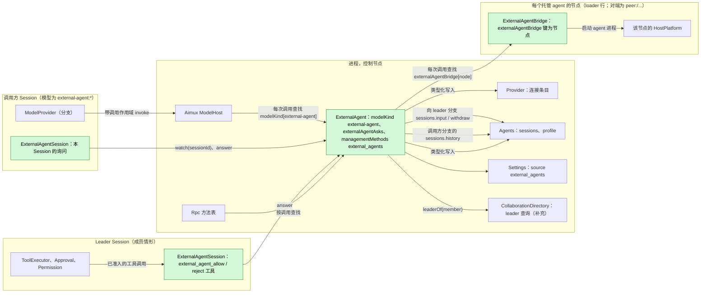
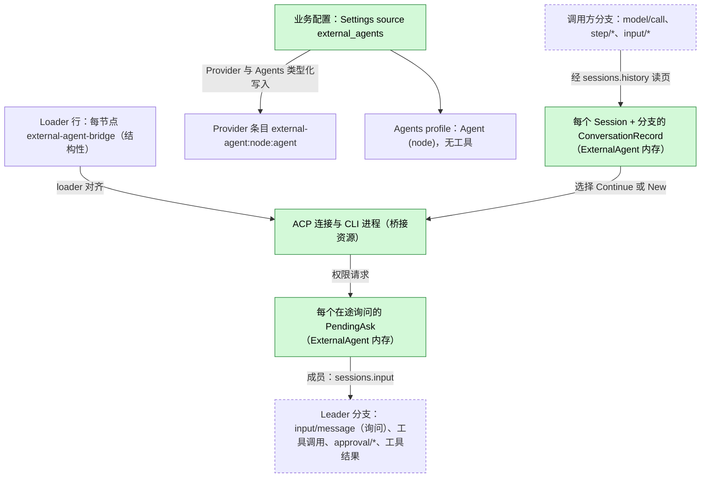
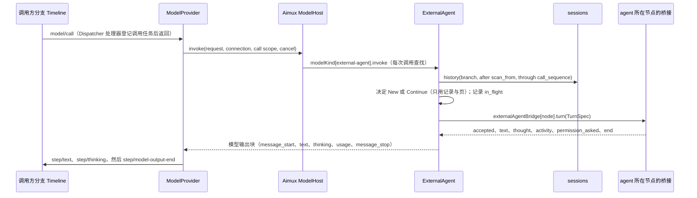
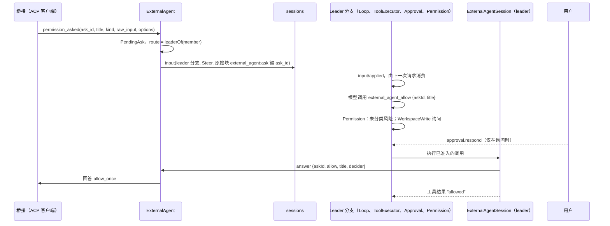
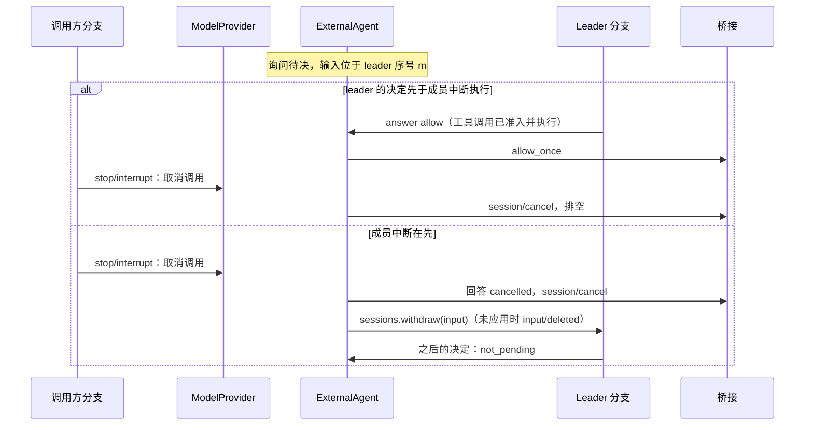

# ExternalAgent

状态：草案（重新设计，[#145](https://github.com/arcships/dim/issues/145)）。总体设计：[overview §4](../overview.md#4-插件目录)；作用域：[ADR 002](../../adr/002-plugin-scope.md)（进程，另有按节点的桥接行和一个 Session 部分）。阶段：P3。语言：优先 TypeScript（[overview 附录 C](../overview.md#附录-c-实现语言)）。

ExternalAgent 让本地安装的编码 agent（Claude Code、Codex、Cursor、OpenCode、ZCode 等）可作为模型使用。已采纳模型为 Provider 条目 `external-agent:<node>:<agent>` 的 Session 照常经由 Loop 与 ModelProvider 运行：该条目是普通的 Provider 条目（[auxiliary model](../appserver/auxiliary-model.md)，S4），Aimux 的 ModelHost 在每次调用时查找键为 `external-agent` 的 `modelKind` 服务。ExternalAgent 把每个模型请求转为一次外部轮次，再把 agent 产出的内容转回模型输出块。外部 agent 运行自己的工具。模型流只承载 agent 产出的文本与思考；dim 从不向其中加入审批条目或合成的行。

当 agent 为自己的某个动作请求权限时，ExternalAgent 在模型流之外询问调用方 Session 的交互对方。Collaboration leader 的模型以一条输入收到询问并用工具决定，这次工具调用像其他工具调用一样经过 leader 的 Approval 与 Permission。没有 leader 时，由用户通过 Session 方法回答。没有交互对方的 Session 拒绝询问。agent 进程位于由 loader 管理的按节点桥接插件中。所有契约都是语言中立的命名服务（[ADR 002 D5](../../adr/002-plugin-scope.md)）；Rust 形式见[附录 G](#附录-g-rust-绑定)。

相对上一版草案（已被取代）的变化：

| 上一版 | 本设计 | 原因 |
| --- | --- | --- |
| 模型流中有 `approval_ask` / `approval_ask_withdrawn` 条目；ModelProvider 经 Approval 准入并以 `answerApproval` 回答；Approval 宿主来源补充 | 模型契约中没有审批数据。询问以一条输入加一个决定工具送到交互对方，或经 Session 方法送到用户（§3.2）。ModelProvider 与 Approval 不变 | [#28](https://github.com/arcships/dim/issues/28)；[ADR 003](../../adr/003-approval-scope.md) D1；principles §4 规则 4 |
| 每次询问前发一行合成的 thinking，工具活动作为 `[tool]` thinking 行，使 Steer 不会替换请求 | 只有 agent 产出的文本与思考进入流；工具活动是 Session 广播通知。ModelProvider "没有可见输出才替换" 的规则照原样适用（§4） | #28 |
| ExternalAgent 自己启停每个节点一个的桥接 | `ExternalAgentBridge` 是每个节点一行的 loader 行（对端节点为 `peer:<node>/external-agent-bridge`）；由 loader 对齐，其 effect 结束它的进程（§3.4） | [#37](https://github.com/arcships/dim/issues/37)；principles §1 |
| ModelHost 既被描述为收集 `modelKind`（依赖环），又被描述为接受注册 | 只有一种接入：ModelHost 在每次调用时查找 `modelKind[<kind>]`，不依赖其提供方，与 Rpc 查找 `managementMethods` 相同。双方互不依赖（§1） | #37；ADR 002 D3 |
| 会话记录持久化在 `pluginFiles` | 记录作为在用外部会话的句柄保存在 ExternalAgent 内存中，丢失后的下一次调用重新初始化（§2） | #37 附注；principles §4 规则 4 |

## 1. 结构



外部 agent 连接、目录与在用会话跨 Session 共享，因此 ExternalAgent 是进程插件（ADR 002 D1）。agent 进程是某个节点的宿主资源，因此属于该节点上的插件：`ExternalAgentBridge` 是进程插件，每个托管 agent 的节点一行 loader 行。只要 ExternalAgent 启用，控制节点的行就是产品 profile 的一部分。对端节点的行是 `peer:<node>/external-agent-bridge`，只由 PluginManager 的结构性操作增删（ADR 002 D4：节点绑定是结构性的）。loader 像对待其他行一样对齐这些行。对端行在其节点或链路不在时等待，恢复后再次装载。桥接的资源在行卸载时由它自己的 `ctx.effect` 释放。在某节点上启用 agent 是业务配置，从不增加行。

Session 的询问是按 Session 的工作，决定询问的工具提供给 Session，因此插件有一个 Session 部分 `ExternalAgentSession`，在 ExternalAgent 启用期间装入每个 Session（ADR 002 D2：工具经 `toolContribution`，客户端方法经 `sessionMethods`，通知经 Session 广播）。它的装配从不依赖 Session 的模型或角色，因此工具集与提示词前缀在切换模型和 fork 时保持稳定。

依赖从扩展指向核心，不构成环：

- ModelHost 在每次调用时查找 `modelKind[<kind>]`，从不依赖 ExternalAgent。ExternalAgent 不依赖 Aimux。
- ExternalAgent 在每次调用时查找 `externalAgentBridge[<node>]`，不依赖任何桥接。桥接不依赖 ExternalAgent。
- `ExternalAgentSession` 依赖外层作用域的进程服务 `externalAgentAsks`。

因此缺失、Pending 或正在重载的部分只让需要它的调用失败。

| 部分 | 作用域 | 依赖 | 提供 |
| --- | --- | --- | --- |
| `ExternalAgent` | 进程，控制节点 | Provider（连接条目写操作，提议）、Agents（profile 写操作，提议；`sessions`）、Settings（source `external_agents`）、CollaborationDirectory（`leaderOf`，补充）；每次调用查找 `externalAgentBridge` | `modelKind` 键 `external-agent`；`externalAgentAsks`；`managementMethods` 键 `external_agents` |
| `ExternalAgentBridge` | 进程，每个托管 agent 的节点一行 loader 行 | 该节点的 `HostPlatform` | `externalAgentBridge` 键 = 节点名（经链路导出到控制节点） |
| `ExternalAgentSession` | Session | `externalAgentAsks` | `toolContribution` `external_agent_allow`、`external_agent_reject`；`sessionMethods` 命名空间 `external_agent`；Session 广播通知 `externalAgent.*` |

**依赖的契约。**

- Aimux 补充：ModelHost 在每次调用时按已解析连接的种类查找 `modelKind`，没有提供方时调用在受理前失败（A.2）。
- 向 model kind 传递 `ModelCallScope` 的 ModelProvider 补充（[overview 附录 B](../overview.md#附录-b-现有插件的补充)）。
- Provider 的外部 agent 连接类型与连接条目写操作，以及 Agents 的 profile 写操作（均为提议，由这些插件拥有；附录 F）。
- 现有的模型输出块与失败数据（[host.rs](../../../../crates/dim-agent-capabilities/src/host.rs)）和 ModelProvider 的失败策略（[recovery.rs](../../../../crates/dim-agent-capabilities/src/model_provider/recovery.rs)）。
- `sessions`（带来源原始块的 `input`、`withdraw`、`history`；[session-access](../contracts/session-access.md)）。
- `toolContribution` 与 `sessionMethods`（[session-boundary](../contracts/session-boundary.md)），以及 Session 广播。
- Collaboration 补充 `leaderOf`（A.6）。
- Settings 对业务来源 `external_agents` 的类型化写入与变更通知。
- 每个节点的 `HostPlatform`。
- [#4](https://github.com/arcships/dim/issues/4) 把现有类型化服务按名字暴露后，TypeScript 部分按名字访问它们。

**本文定义的契约。**

- `modelKind` 键 `external-agent` 及其目标 `{node, agent}`。
- `externalAgentBridge`、`externalAgentAsks` 与两个决定工具。
- `external_agent` Session 方法与通知。
- 询问输入形式（标记 `external_agent:ask`）。
- 业务配置 `external_agents.*` 与方法 `external_agents.*`。
- 与 [AcpGateway](AcpGateway.md) 共享的 ACP schema 与一致性测试（客户端侧）。

Provider、Agents、Approval、Permission、ModelProvider 与 Collaboration 从不提及本插件。

## 2. 数据与状态



**业务配置**（[ADR 002](../../adr/002-plugin-scope.md) D4）是 Settings 来源 `external_agents` 中的一个文档：`{ nodes: { <node>: { <agent>: { enabled, executable?, args?, env?, reasoning? } } } }`。Settings 按 ExternalAgent 的 schema 校验并补默认值；ExternalAgent 在使用时读取，并随每次桥接调用传入该条目，因此桥接不读自己的配置。它只经 ExternalAgent 的管理方法写入（A.1）。`env` 的值是该文档中的普通字符串，可以包含 agent 的凭据，由 ExternalAgent 自己负责（[settings-service §1.2](../appserver/settings-service.md#12-决定密钥归其所有者)）：该来源只有用户文件，因此 `env` 不会出现在项目文件中，也不经任何 Settings 解析器。变更是数据更新加通知，从不重载。Provider 条目与 Agents profile 经这些所有者的公开类型化写操作请求，可由该文档重建。

**Loader 行。** 每个节点的 `external-agent-bridge` 行是结构性配置：它说明哪些节点可以运行 agent，而不是哪些 agent 在运行。`external_agents.list` 把没有活动桥接的节点报告为 `no_bridge`。

**会话记录。** 记录作为一个在用外部会话的句柄保存在 ExternalAgent 内存中，从不持久化：

```text
ConversationRecord {
  key: (session_id, branch_id),
  target: { node, agent },
  external_id: String,          // ACP sessionId 或 CLI 会话 id，由桥接持有
  cursor: u64,                  // 本分支上最后一次已受理调用的 model/call 序号
  scan_from: u64,               // 可能含尚未消费的 input/message 的最低本地序号
  last_request_id: String,
  state: ready | in_flight { request_id } | uncertain,
}
```

每次投递决定都由 Timeline 页加记录重新计算（§3.1）。丢失记录（ExternalAgent 重载、进程重启、按 A12 淘汰）只会让该分支的下一次调用从历史初始化（A15）。键包含分支与 Session id，因此子分支或 fork（分支或 Session id 是新的）从不延续别的分支的外部会话。

**待决询问。** 在外部请求等待回答期间，待决询问保存在 ExternalAgent 内存中。它是在用 I/O 交互的一部分，因此重载时被结算，从不重建：

```text
PendingAsk {
  ask_id: String,               // "<request_id>:<n>"，在一次调用内唯一
  call: { session_id, branch_id, request_id },
  agent: { node, agent }, title: String, kind: String, raw_input: JSON（上限 4 KiB，A18）,
  route: leader { session_id, branch_id, input_id } | client | none,
}
```

**Timeline。** 调用方分支只得到普通的模型事实。成员情形下，leader 分支得到一条普通输入、一次普通工具调用及其普通审批事实、一条工具结果。ExternalAgent 不声明事件类型，除经 `sessions` 写输入与撤回外不写任何东西。

**不进 Timeline**（principles §4 规则 9）：配置、Provider 条目、profile、记录、待决询问、工具活动、客户端回答、进程。展示给客户端的工具活动与询问经 Session 广播通知。

## 3. 流程

### 3.1 模型调用（初始化或继续）



决定只读 `call_sequence` 及之前的事实（已派发，因此已发布，且是批次边界）与记录；从不读其他插件的内存。

投递决定，给定记录 `R`、请求 `Q`、作用域 `S`：

1. 扫描 `S.branch` 在 `(R.scan_from, S.call_sequence]` 内的本地事件（没有记录时为整个本地分支）：`input/message`、序号 `> R.cursor` 的 `input/consumed`、序号 `> R.cursor` 的输出事件（`step/text`、`step/thinking`、`step/tool-use-start`）。
2. 下列任一成立时**初始化**：没有记录，`R.target` 不同，`R.state = uncertain`，或范围内某个输出属于 `R.last_request_id` 以外的请求（另一个模型回答过）。初始化打开 `New`，发送 `Q.messages` 的转录（§5）以及回答最后一条用户消息的指示。
3. 否则**继续**：`Continue { external_id }`，按消费顺序附上范围内已消费的输入。若桥接已不持有该会话且无法加载，它在受理前回复 `conversation_lost`，ExternalAgent 在同一次调用内改为初始化，因为尚未发送任何内容。
4. 新的 `scan_from` 是所收集的、到 `S.call_sequence` 仍未消费的 `input/message` 的最低序号，否则为 `S.call_sequence`。空增量在受理前以 `external_agent_no_input` 失败（A8）。

子分支上的 `Q.messages` 是到切点为止的祖先前缀加本地事件，因此子分支从自己的历史初始化，从不触及父分支的会话；fork 同理。

没有 Session 作用域的调用（例如以 `external-agent:*` 模型调用 `auxiliaryModel.complete`）在受理前以 `external_agent_no_session` 失败。SessionTitle 已对此类模型跳过命名。

### 3.2 外部权限请求

agent 自己的动作不是 dim 工具调用，因此 dim 的 Approval 不准入它（[ADR 003](../../adr/003-approval-scope.md) D1）。决定归调用方 Session 的交互对方（[overview §6.2](../overview.md#62-约束) 第 15 条）。询问到达时，ExternalAgent 按调用作用域的 `SessionConfig` 选择路由：

| 调用方 Session | 路由 | 谁决定 | 权限 |
| --- | --- | --- | --- |
| `collaborationRole = member`，`leaderOf` 返回 leader | `leader`：向 leader 分支写一条 `input/message`（Steer）；leader 模型调用 `external_agent_allow` 或 `external_agent_reject` | leader 的模型 | 决定是一次 leader 工具调用，因此像其他工具调用一样由 leader 的 Permission 与 Approval 准入（WorkspaceWrite 下的 allow 经 leader 的 `approval/request` 询问用户） |
| 其他 `interactive`（含没有 leader 的成员） | `client`：调用方 Session 中的 Session 广播通知；客户端以 `session.external_agent.answer` 回答 | 用户 | 用户自己的回答；不是 agent 决定，因此不经 Approval |
| `interactive = false` | `none` | 无 | 立即回答 `reject`（A19） |



回答规则：

- `externalAgentAsks.answer` 只接受该路由的决定方。leader 路由上是收到输入的 leader Session 与分支，且 allow 形式必须回显询问的 `title`。client 路由上是调用方 Session 自己的 Session 方法。其他回答返回 `not_yours`；针对已结束询问的回答返回 `not_pending`，均无效果。
- allow 选择 `allow_once` 选项，reject 选择 `reject_once`。所需的 once 选项缺失时，桥接回答 `cancelled`。从不选择 `*_always`。
- 询问未经回答就结束时（调用被取消、agent 撤回、桥接或 ExternalAgent 卸载），若 agent 仍在等待，ExternalAgent 回答 `cancelled`。leader 路由上，ExternalAgent 经 `sessions.withdraw` 撤回 leader 输入（InputQueue 仅在尚未应用时写 `input/deleted`）。client 路由上，Session 部分发出 `externalAgent.askEnded`。之后针对该询问调用的决定工具得到 `not_pending`。
- 一次调用中的多个询问相互独立，按到达顺序路由。
- 非交互 CLI 适配器没有请求通道。它们的启动参数让 agent 处于自己的非自动批准模式，因此 agent 自己拒绝无法询问的动作（A16）。

ACP `toolCall.kind` 的映射（只展示给决定方，A7）：`read`、`search` → 读文件；`edit`、`delete`、`move` → 写文件；`execute` → 运行进程；`fetch` → 网络；其他 → 其他。决定工具的风险不随种类变化：允许另一个 agent 的动作，对 leader 的 Permission 而言总是未分类（A.6）。

### 3.3 委派与中断

1. 资源节点为 `build-box` 的 leader Session 向 `agent` 工具请求 "Codex (build-box)"。Collaboration 用该 profile 创建成员 Session。成员继承 leader 的资源节点，因此 `build-box` 上的桥接在成员的 cwd 中运行 Codex。位于其他节点的 leader 在受理前得到 `external_agent_wrong_node`（A13）。`agent` 工具是脱离工作，因此 leader 分支继续运行并能消费询问输入（§3.2）。
2. 中断成员的调用：ModelProvider 取消调用令牌，ExternalAgent 按 §3.2 结束该调用的待决询问。桥接发送 ACP `session/cancel`（或向 CLI 发信号），排空至 prompt 响应，10 s 宽限后杀掉进程（A4）。已收到的文本保留。若取消已被确认，下一条输入延续同一会话。
3. 中断 leader 的 turn 会取消尚未执行的决定工具调用。询问保持待决，直到另一次决定、成员被中断，或 Collaboration 停止成员请求（这会中断成员的 turn）。

### 3.4 桥接生命周期

| 事件 | 谁动作 | 效果 |
| --- | --- | --- |
| 产品 profile 中启用 ExternalAgent | Loader | 控制节点的桥接行随之装载 |
| PluginManager 在对端节点 `n` 上启用桥接 | Loader | 增加 `peer:n/external-agent-bridge`；链路就绪后该行在 `n` 上装载，并经链路在控制节点登记 `externalAgentBridge[n]` |
| 到 `n` 的链路断开 | Loader（对端行行为） | 该行停止：其 effect 取消轮次、对 agent 的待决权限请求回答 `cancelled` 并杀掉进程；查找 `externalAgentBridge[n]` 找不到，因此 `n` 的调用以 `node_unavailable` 失败；链路恢复后该行再次装载 |
| 在某节点上启用或禁用 agent | ExternalAgent（业务配置） | 不改行、不重载；被禁用 agent 的调用以 `external_agent_disabled` 失败；桥接关闭该 agent 的空闲连接 |
| 桥接崩溃或重载 | Loader | 与链路断开相同，只影响该节点 |

桥接不持有任何必须存活的东西：在用连接、按会话的 ACP 进程（空闲 10 min 后关闭，A5）及其待决权限请求。

## 4. 时序与冲突



询问是 ExternalAgent 与桥接之间的在用交互。决定是否先于调用结束到达，由 ExternalAgent 的内存判定，外部 agent 只知道胜出的结果。各分支自己的事实保持 Timeline 顺序：成员分支上的中断，leader 分支上的决定工具调用及其审批。

| 场景 | 顺序 | 结果 | 所有者 |
| --- | --- | --- | --- |
| 询问待决，长时间没有决定 | — | dim 不设超时；调用保持打开；用户或 leader 可中断（A17） | 交互对方 |
| 调用方分支在任何可见输出之前 Steer（agent 仍在工作或在等询问） | 调用期间 `input/applied`（Steer） | ModelProvider 像对任何模型一样替换请求并取消；ExternalAgent 取消轮次并结束待决询问；agent 已做的动作保持已做；下一次请求投递该 Steer | ModelProvider、ExternalAgent |
| 可见输出之后 Steer | — | 不替换；Loop 在下一次请求中投递 | Loop |
| agent 撤回请求或结束 prompt | 桥接 `permission_withdrawn` | 按 §3.2 结束询问 | ExternalAgent |
| leader 处于 ReadOnly | — | `external_agent_allow` 被 leader 的 Permission 拒绝；模型仍可拒绝询问；否则询问等待 | Permission |
| 调用中 ExternalAgent 重载 | — | 询问结束；流以 provider unavailable 结束；记录丢失，下一次调用初始化 | ExternalAgent |
| 桥接行停止（链路断开、崩溃、结构性操作） | — | 该节点上的轮次失败：受理前 `node_unavailable`（瞬时），受理后 `external_agent_exited`（记录 `uncertain`）；其他节点不受影响 | Loader、桥接 |
| 调用中进程重启 | 未结束的 `model/call` | ModelProvider 重建使调用失败；不重发；残留的询问输入得到 `not_pending` | ModelProvider |

其余各行：[附录 B](#附录-b-完整冲突表)。

## 5. 上下文映射

| 对象 | 看到 | 形式 |
| --- | --- | --- |
| 外部 agent，初始化 | `Q.messages` 作为一个文本 prompt `<dim-history>`：`[user]`、`[assistant]`、`[tool call <name>] <input JSON>`、`[tool result] <content text>`，图像为 `[image]`，省略思考（A14）；然后是指示 | ACP 文本块或 CLI stdin |
| 外部 agent，继续 | 每条已消费输入：原始块文本原样，然后是用户内容（agent 声明 `promptCapabilities.image` 时图像为 ACP 图像块，否则为 `[image omitted]`） | Prompt 块 |
| 外部 agent，从不 | dim 系统提示词、提示词来源、工具声明、采样参数、`metadata`、其他插件的事件、诊断；`config.reasoning` 只经适配器的推理标志 | — |
| 调用方 Session 的历史 | agent 的消息为 `step/text`，其思考为 `step/thinking`；别无其他 | 模型输出事实 |
| Leader 模型（成员情形） | 询问输入（A.6）：agent、成员 Session、标题、种类、有界的原始输入以及如何决定；决定工具的结果 | 已采纳输入、工具结果 |
| 用户 | leader 路由：leader 预设要求询问时，针对 allow 调用的普通 `approval.request`。client 路由：`externalAgent.ask` 通知。两种路由：`externalAgent.activity` 通知 | 客户端 UI |

已提交的外部输出像任何模型输出一样进入历史：压缩会总结它，子分支继承到切点，之后的原生模型把它视为 assistant 消息，被中断的输出保留文本、丢弃思考。Collaboration 与 Workflow 的结果读取最后一次请求的文本。询问输入是 leader 自己历史中的带键原始块，因此 leader 的上下文只包含已交接（`input/applied`）的询问，从不包含被撤回的询问。

## 6. 接口（摘要）

| 接口 | 种类 | 用途 |
| --- | --- | --- |
| `modelKind` 键 `external-agent`，目标 `{node, agent}` | 进程服务，由 ModelHost 按调用查找 | 外部 profile 的模型调用（[A.2](#a2-model-kind-与调用作用域)） |
| `externalAgentBridge` 键为节点 | 每个桥接行的进程服务，由 ExternalAgent 按调用查找 | 节点上的探测与轮次（[A.3](#a3-桥接与适配器)） |
| `externalAgentAsks` | 进程服务 | 供 Session 部分使用的 `watch`、`pending`、`answer`（[A.6](#a6-询问)） |
| `external_agent_allow`、`external_agent_reject` | `toolContribution`（Session） | leader 模型的决定（[A.6](#a6-询问)） |
| `session.external_agent.asks` / `answer` | `sessionMethods` 命名空间 `external_agent` | client 路由（[A.6](#a6-询问)） |
| `externalAgent.ask`、`externalAgent.askEnded`、`externalAgent.activity` | Session 广播通知 | 客户端展示（[A.6](#a6-询问)） |
| `external_agents.list` / `set_enabled` / `configure` | `managementMethods` 键 `external_agents` | 探测、启用、配置（[A.1](#a1-管理方法)） |
| ACP schema 与一致性测试 | 与 AcpGateway 共享 | 客户端侧（[A.5](#a5-共享-acp-schema)） |

## 7. 安全

- 外部 agent 以自己的账号和工具运行。dim 只在它们询问时、且只经交互对方决定它们的动作，无法阻止 agent 不经询问的动作。节点的 HostPlatform 隔离是执行边界，回放或 fork 从不放宽它。
- leader 路由上，权限属于 leader：决定是一次 leader 工具调用，allow 需要满足 leader 预设与规则的全部要求。allow 形式必须回显询问标题，因此展示给用户的审批写明被允许的动作，标题不符则无效果。只有被路由到的决定方能回答询问。
- client 路由上，回答是用户自己的，经该 Session 的任何客户端（含配对设备，[overview §6.2](../overview.md#62-约束) 第 10 条）都可调用的 Session 方法给出。
- 从不选择 `*_always`。
- 凭据是轮次开始时 ExternalAgent 在控制节点上从自己文档读取的 `env` 值（[settings-service §1.2](../appserver/settings-service.md#12-决定密钥归其所有者)），经已认证的链路传给桥接，从不写入记录、Timeline、通知、诊断或回复。以后是否改存到 OS 钥匙串由 ExternalAgent 自己决定，不是 Settings 契约。
- 启用 agent 是功能开关，属普通业务配置而非批准（[ADR 003](../../adr/003-approval-scope.md) D2），只经管理方法修改，管理方法从不提供给配对设备。模型不能启用 agent。为节点增加桥接是 PluginManager 的结构性操作。可执行文件在节点上解析，从不来自项目文件。

## 8. 规则检查

规则：[principles §1 与 §4](../../../architecture/rust-agent/principles.md)、[ADR 002](../../adr/002-plugin-scope.md) D1–D5。

| 规则 | 本文如何遵守 |
| --- | --- |
| §4.1 改别人的状态写指令事件 | ExternalAgent 不声明事件。它只经 `sessions` 写输入来影响分支，只经 `input/withdraw` 指令移除询问输入，结果由 InputQueue 决定。Provider 条目与 Agents profile 只经其所有者的类型化写操作修改。leader 路由上的决定是普通工具调用，由 leader 的 Approval 与 Permission 决定。 |
| §4.2 交接后不能撤回 | 只有已消费的输入投递给 agent。询问输入一旦被应用，ExternalAgent 不再撤回它，并对迟到的决定回答 `not_pending`。交给 ModelProvider 之后，只有取消调用适用。 |
| §4.3 只通过 before 回调干预 | 不适用：没有入口检查，也没有 before 回调。 |
| §4.4 核心机制不带业务含义 | 模型契约不变：没有审批条目，没有合成输出。ModelHost 按种类的按调用查找与 `leaderOf` 是通用的，不提及任何插件。ModelProvider 的替换规则对外部模型照原样适用。 |
| §4.5 读完整批次再决定 | 投递决定读取到 `call_sequence` 为止的事实，它已派发且是批次边界（§3.1）。 |
| §4.6 模型上下文只含交接后的事件 | agent 只收到已消费的输入与投影后的历史。leader 模型只在询问输入被应用后看到询问，被撤回的询问输入从不进入其上下文（§5）。 |
| §4.7 只通过公开事件与服务 | 经 `sessions` 读历史，经 CollaborationDirectory 的公开查询得到 leader，经所有者的操作写入；不读其他插件的内存。 |
| §4.8 基础设施默认不变 | Timeline、Dispatcher、事件信封、装配与 Session 门面均不变（§9）。对 Aimux、ModelProvider、Provider、Agents 与 Collaboration 的补充列于 [overview 附录 B](../overview.md#附录-b-现有插件的补充)。 |
| §4.9 只有后续决定要用的事实进 Timeline | 模型输出与 leader 的输入及工具调用后续会用到。配置、条目、profile、记录、询问、客户端回答与工具活动不进 Timeline，客户端经通知看到它们。 |
| §1 Capability 与 App Server 边界 | ExternalAgent 与其桥接是进程插件，作为 loader 行装载。`ExternalAgentSession` 是唯一的 Capability。没有第二个生命周期管理器：agent 进程是桥接行的资源，由其 effect 释放。服务图无环（§1）。 |
| ADR 002 D1 | 连接与在用会话跨 Session 共享（进程）。agent 进程是节点的宿主资源（每节点一个桥接行）。询问与决定工具按 Session（Session 部分）。 |
| ADR 002 D2 | 没有接线模块。ModelHost 与 Rpc 按调用查找命名服务，工具用 `toolContribution`，客户端方法用 `sessionMethods`，其他 Session 经 `sessions` 访问。 |
| ADR 002 D3 | ExternalAgent 依赖 Provider、Agents、Settings 与 CollaborationDirectory；它们重载会重载它，这是接受并记录的代价。没有核心部分依赖 ExternalAgent 或桥接，因此它们缺席只让外部 agent 调用失败。 |
| ADR 002 D4 | agent 条目是不经重载生效的业务配置。桥接行是结构性的（节点绑定），由 PluginManager 修改，从不由 ExternalAgent 修改。 |
| ADR 002 D5 | `modelKind`、`externalAgentBridge`、`externalAgentAsks`、工具、方法、通知与输出块都是命名服务与数据；Rust 形式见附录 G。 |

## 9. 向机制所有者提出的需求

无。本设计不需要修改 Timeline、Dispatcher、事件信封、装配或 Session 门面。rutis 按现状使用：loader 行、对端行、按名字的按调用服务查找、链路。它对其他插件的需要是补充，列于 [overview 附录 B](../overview.md#附录-b-现有插件的补充)：

- Aimux：按种类按调用查找 `modelKind`。
- ModelProvider：`ModelCallScope`。
- Provider：外部 agent 连接类型与连接条目写操作。
- Agents：profile 写操作。
- Collaboration：`leaderOf`。
- HostPlatform：隔离。

### 9.1 链路断开期间导入的服务保持登记（#5）

已撤回：rutis 是外部依赖，不向它提需求。离线节点遵循 rutis 的现有行为与 [overview §6.3](../overview.md#63-多节点)：节点服务在每次调用时查找，针对离线节点的调用以 `node_unavailable` 失败。链路断开会停止 ExternalAgent 的对端桥接行，由该行自己的 effect 结束其进程（§3.4）。其他文档为此决定链接到这里。

## 附录 A. 接口细节

### A.1 管理方法

`managementMethods` 键 `external_agents`：`describe(): async -> MethodDecl[]` 列出下列方法；`call(MethodCall): async -> MethodReply` 以 JSON 参数与结果分派它们。

| 方法 | 参数 | 结果 | `mutating` |
| --- | --- | --- | --- |
| `external_agents.list` | `refresh?` | 每个节点：桥接状态（`active`、`no_bridge`、`node_unavailable`）；每个 agent：可执行文件、版本、协议（ACP 或 CLI）、是否启用、配置（只含引用） | 否 |
| `external_agents.set_enabled` | `node`、`agent`、`enabled` | 新状态 | 是 |
| `external_agents.configure` | `node`、`agent`、`executable?`、`args?`、`env?: {name: 值}`、`reasoning?` | 新配置 | 是 |

探测在装载时与 `refresh` 时调用每个节点桥接的 `detect`（A1）。探测到的 agent 在启用前保持禁用（A3）。`set_enabled` 与 `configure` 以读到的修订号（CAS）经 Settings 的类型化写入修改 `external_agents` 文档，ExternalAgent 不经重载应用变更通知。

启用 `(node, agent)` 请求两项条目：

- 经 Provider 的公开连接条目写操作（提议）：条目 `external-agent:<node>:<agent>`，含一个模型 `default`（A2）与目标 `{node, agent}`。
- 经 Agents 的公开 profile 写操作（提议）：profile `{ name: "<Agent> (<node>)", system_prompt: "", tools: [], model: { provider_id: "external-agent:<node>:<agent>", model_id: "default" } }`。

允许在没有活动桥接的节点上启用 agent，并列为 `no_bridge`；在该节点有桥接行运行之前，其调用以 `node_unavailable` 失败。禁用请求删除这两项条目；现有 Session 保留已采纳的模型，下一次调用以 `external_agent_disabled` 失败。Agents 像列出其他 Agent 一样列出这些 profile，因此 Collaboration 的 `agent` 工具可以请求它们。

### A.2 Model kind 与调用作用域

`modelKind`，进程作用域，键 = 连接种类（`external-agent`）。Aimux 补充：ModelHost 照旧经 Provider 解析请求的连接。对于它自己不驱动的种类的连接，它在该次调用中按名字查找 `modelKind[<kind>]`，不持有对其提供方的依赖。没有提供方时，调用在受理前以 `{code: model_kind_unavailable, origin: transport, transient: true}` 失败，其他种类不受影响。

| 方法 | 模式 | 请求 | 回复 |
| --- | --- | --- | --- |
| `invoke` | async，流式 | `{request: 序列化的模型请求, target: {node, agent}, scope: ModelCallScope {sessionId, branchId, turnId, requestId, callSequence, config: SessionConfig}}` | 模型输出块流（A.4）；以 `message_stop` 或错误 `{code, origin, transient}` 结束 |

取消是协议动作：消费方丢弃流或发送取消请求。该调用的待决询问随后按 §3.2 结束。ExternalAgent 卸载期间，其打开的流以 `{code: provider_unavailable, transient}` 结束，仅在 `message_start` 之前为瞬时。`scope.config` 提供 `cwd`、`resourceNode`、`interactive` 与 `collaborationRole`。没有 `scope` 时调用以 `external_agent_no_session` 失败。

### A.3 桥接与适配器

`externalAgentBridge`，进程作用域，键 = 节点名，由每个桥接行提供并经链路导出到控制节点。

| 方法 | 模式 | 请求 | 回复 |
| --- | --- | --- | --- |
| `detect` | async | `{adapters}` | `[{agent, executable, version, protocol: acp \| cli}]` |
| `turn` | async，流式 | `TurnSpec {turnId, agent, config（条目，含其 env）, cwd, conversation: {new} \| {continue: {externalId}}, prompt: PromptBlock[]}` | `TurnUpdate` 流：`{accepted: {externalId}}`、`{text}`、`{thought}`、`{activity: {id, title, status}}`、`{permissionAsked: {askId, title, kind, rawInput?, options}}`、`{permissionWithdrawn: {askId}}`、`{usage}`、`{end: reason}`；或错误 `{code, transient}`（继续的会话已不存在时，在 `accepted` 之前为 `conversation_lost`） |
| `answer` | async | `{turnId, askId, answer: allow \| reject \| cancelled}` | `{}`；未知询问 → `{}` |

取消：消费方丢弃 `turn` 流或发送取消请求，桥接执行适配器的取消路径。被取消轮次的待决权限请求由桥接自己回答 `cancelled`。

| 适配器 | 打开 | 轮次 | 取消 |
| --- | --- | --- | --- |
| ACP 客户端 | 经节点的 HostPlatform 启动 ACP 命令（cwd、隔离）；`initialize` 时关闭 fs 与 terminal 客户端能力；`session/new {cwd, mcpServers: []}`，或在声明 `loadSession` 时对已知 `externalId` 使用 `session/load` | `session/prompt`；`session/update` 流；`session/request_permission` → `permissionAsked`；请求写出后 `accepted` | `session/cancel`，对待决权限请求回答 `cancelled`，排空；宽限后杀掉（A4） |
| 非交互 CLI | 每轮启动，继续时带会话 id；限制性权限参数（A16） | prompt 经 stdin，按适配器解析结构化输出；启动且 stdin 写完后 `accepted` | 中断信号、宽限、杀掉 |

每个会话一个 ACP 进程，空闲 10 min 后关闭（A5）。适配器定义是桥接包内的数据（A6）。

### A.4 流映射与请求字段

模型输出块以中立形式给出（`kind` 加数据，即现有模型输出块契约的序列化形式）。

| 外部 | 模型输出块 |
| --- | --- |
| `accepted` | `message_start {message_id: "<externalId>:<requestId>"}` |
| 消息块 / CLI 文本 | `text {delta}`；先关闭打开的 thinking 块 |
| 思考块 / CLI 推理 | `thinking {delta}`；先以 `text_end` 关闭打开的 text 块 |
| `activity`（ACP `tool_call`、`tool_call_update`） | 无输出块；调用方 Session 中的 `externalAgent.activity` 通知（A9） |
| `permissionAsked` / `permissionWithdrawn` | 无输出块；§3.2 |
| `plan`、`available_commands_update`、`current_mode_update`、`session/load` 回放的历史 | 不转发；诊断 |
| 适配器报告的用量 | `usage`（A10） |
| 结束 `end_turn` | 关闭打开的块，`message_stop {reason: end_turn}` |
| 结束 `max_tokens` | `message_stop {reason: max_tokens}` |
| 结束 `max_turn_requests`、`refusal`、CLI 非零退出 | 失败，非瞬时（A11） |
| 我方取消后结束 `cancelled` | 流结束且没有 `message_stop`；ModelProvider 报告 `Cancelled` |

从不发出 `tool_start`、`tool_use` 与 `content` 输出块：没有提供工具，每个输出块都对应 agent 产出的内容。请求字段：`messages` 只在初始化时使用；`system`、`tools`、采样字段、`provider_options`、`metadata` 与 `capability_snapshot` 不转发。

重试安全：`accepted` 之前可重试的失败（启动失败、连接被拒、`node_unavailable`、`model_kind_unavailable`）是 `{origin: transport, transient: true}` 的失败；其他失败都是非瞬时的。ModelProvider 遇到非瞬时错误，或收到非 `message_start` 输出块后即停止，因此 agent 可能已开始的轮次从不发送两次。`accepted` 之前记录不变，因此重试计算出相同的增量。

### A.5 共享 ACP schema

固定协议版本、每种语言生成的类型，以及与 AcpGateway 共享的基于转录的一致性测试。样本覆盖 initialize、new/load、带文本与图像的 prompt、流式更新、prompt 期间取消、分别以 allow、reject 与 cancelled 回答的权限请求、取消期间的权限请求，以及 prompt 中途进程退出。不共享运行时代码（[overview §4](../overview.md#4-插件目录)）。

### A.6 询问

**`externalAgentAsks`**（进程，由 ExternalAgent 提供）：

| 方法 | 模式 | 请求 | 回复 |
| --- | --- | --- | --- |
| `watch` | async，流式 | `{sessionId}` | 该 Session 中路由为 `client` 的询问的 `{ask: AskView}` 与 `{ended: {askId, outcome: allowed \| rejected \| cancelled}}`，以及该 Session 外部调用的 `{activity: {requestId, id, title, status}}`；丢弃即结束 |
| `pending` | async | `{sessionId}` | 该 Session 中路由为 `client` 的 `AskView[]` |
| `answer` | async | `{askId, decision: allow \| reject, title?, decider: {sessionId, branchId?}}` | `{outcome: allowed \| rejected}` 或错误 `not_pending`、`not_yours`、`title_mismatch` |

`AskView = {askId, requestId, agent: "<Agent> (<node>)", title, kind, rawInput}`。

**Collaboration 补充 `leaderOf`**：CollaborationDirectory 公开服务上的一个读取 `leaderOf({sessionId}) -> {sessionId, branchId} | none`，即委派给某成员 Session 的 leader 分支。它是通用的（成员的交互对方），不提及任何插件。ExternalAgent 每个询问调用一次。

**询问输入**（leader 路由）：`sessions.input {sessionId, branchId, mode: steer, submissionId: "external_agent:<uuid>", blocks: [原始块 {marker: "external_agent:ask", key: <askId>, text}]}`，文本为：

```text
[external agent permission request]
ask: <askId>
agent: <Agent> (<node>), working for member session <sessionId>
action: <title>
kind: <kind>
input: <rawInput JSON, at most 4 KiB>
Decide with external_agent_allow {askId, title} or external_agent_reject {askId}.
```

leader 分支空闲时 Steer 启动一个 turn，否则在下一个边界被消费（A20）。询问未经回答就结束时，ExternalAgent 以 `input` 返回的 `inputId` 调用 `sessions.withdraw`。若输入已被应用，预期回复为 `notHeld`。

**工具**（`toolContribution`，由 `ExternalAgentSession` 在每个 Session 中提供）：

| 工具 | 输入 | 风险 | 执行 | 结果 `content` |
| --- | --- | --- | --- | --- |
| `external_agent_allow` | `{askId, title}` | `external_agent_action`（未分类：ReadOnly 拒绝，WorkspaceWrite 询问，FullAccess 允许） | 以 `ToolCall` 中的 `{sessionId, branchId}` 为 decider 调用 `answer {askId, allow, title}` | `Allowed <askId>.`，或 `Ask <askId> is no longer pending.`、`Ask <askId> was not sent to this session.`、`Title does not match ask <askId>.`（`isError`） |
| `external_agent_reject` | `{askId}` | `session`（除非被禁用，所有预设都允许） | `answer {askId, reject, decider}` | `Rejected <askId>.` 或同样的错误 |

reject 工具的风险让处于 ReadOnly 的 leader 可以拒绝它无法允许的询问。

**Session 方法**（`sessionMethods` 命名空间 `external_agent`）：`session.external_agent.asks {}` → 本 Session 的 `pending`；`session.external_agent.answer {askId, decision}` → 以 `decider: {sessionId}` 调用 `answer`。

**通知**（Session 广播，由 `ExternalAgentSession` 在 `activated()` 之后根据其 `watch` 流发出）：`externalAgent.ask {AskView}`、`externalAgent.askEnded {askId, outcome}`、`externalAgent.activity {requestId, id, title, status}`。重连的客户端读取 `session.external_agent.asks`。

### A.7 各步骤机制

| 步骤 | 路径 |
| --- | --- |
| 请求 | Loop 写 `input/consumed`* 与 `step/model-start`；ContextPreparation 写 `model/call`；ModelProvider 在其 Dispatcher 上消费，登记调用任务后返回 |
| 解析 | 在任务中：Provider 解析出 `{kind: external-agent, target}`；ModelHost 查找 `modelKind[external-agent]` 并带调用作用域调用 `invoke` |
| 读取 | `sessions.history {sessionId, branchId, after: scan_from, through: call_sequence}`；无法读取的 Session 在受理前失败，瞬时 |
| 轮次 | ExternalAgent 查找 `externalAgentBridge[node]`（缺失：`node_unavailable`），记录 `in_flight`，调用 `turn`；`accepted` 时更新 cursor、`last_request_id`、`scan_from`、`external_id`；在 `accepted` 之前结束的尝试恢复记录 |
| 输出 | ModelProvider 像对任何模型一样提交输出块并写 `step/model-output-end` |
| 询问 | §3.2；leader 路由经 `sessions.input` 与 leader 的 ToolExecutor；client 路由经 `watch` 与 Session 方法 |
| 结束 | 外部结束或已确认的取消 → `ready`；`accepted` 之后被杀或链路丢失 → `uncertain` |
| 重载 | ExternalAgent 卸载：结束询问（回答 `cancelled`，撤回 leader 输入），以 `provider_unavailable` 结束流；丢弃记录。桥接卸载：其 effect 取消轮次并杀掉进程 |
| 重启 | ModelProvider 重建使未结束的 `model/call` 失败；ExternalAgent 启动时没有记录与询问 |

ExternalAgent 自身不追加事件，不订阅 Dispatcher，不拥有分支状态。`ExternalAgentSession` 不拥有状态：它把 `watch` 流转发为通知，并转发工具与方法调用。

## 附录 B. 完整冲突表

| 场景 | 顺序 | 结果 | 所有者 |
| --- | --- | --- | --- |
| `model/call` 被消费前 turn 中断 | interrupt < `model/call` | 不调用，`Cancelled` | ModelProvider |
| `accepted` 之前中断 | — | 尝试取消；未发送任何内容；记录不变 | 桥接、ModelProvider |
| `accepted` 之后中断 | `model/call` < interrupt | 发送取消；更新持续到 prompt 响应提交；`Cancelled`；记录 `ready`，cursor 前移 | 桥接、ModelProvider |
| 宽限内取消未被确认 | — | 杀掉；`Cancelled`；`uncertain`；下一次调用初始化 | 桥接 |
| 决定先于成员中断执行 | — | 决定送达；随后按上述取消 | ExternalAgent |
| 成员中断先于任何决定 | — | 询问回答 `cancelled`；未应用的 leader 输入被撤回；之后的决定 `not_pending` | ExternalAgent、InputQueue |
| leader 的 allow 调用在等 leader 的审批时成员被中断 | — | 询问结束；之后用户若批准，执行的调用返回 `not_pending` | ExternalAgent |
| leader 的 allow 调用被 leader 的 Approval 拒绝 | — | 不回答；询问保持待决；模型可拒绝 | Approval、Permission |
| leader 处于 ReadOnly 或 `disallowedTools` 列出 allow 工具 | — | allow 被拒；reject 被允许，除非也被禁用 | Permission |
| allow 的标题错误 | — | `title_mismatch`，无效果 | ExternalAgent |
| 来自未被路由该询问的 Session 的决定 | — | `not_yours`，无效果 | ExternalAgent |
| 一次调用中多个询问 | — | 按到达顺序的独立询问 | ExternalAgent |
| 取消排空期间到达的权限请求 | — | 桥接不经路由直接回答 `cancelled` | 桥接 |
| agent 撤回请求 | `permissionWithdrawn` | 询问结束（§3.2） | ExternalAgent |
| 没有 leader 的成员（leader 已关闭，`leaderOf` 为 none） | — | 交互时走 client 路由，否则拒绝 | ExternalAgent |
| 输入写入后 leader 分支关闭或 leader Session 卸载 | — | `sessions.withdraw` 失败或 `notHeld`；询问等待，直到成员被中断或 Collaboration 停止它 | Collaboration、ExternalAgent |
| client 路由，没有客户端连接 | — | 询问等待；之后连接的客户端以 `session.external_agent.asks` 列出 | 客户端 |
| 两个客户端回答 | 到达 ExternalAgent 的顺序 | 先到者胜；后者 `not_pending` | ExternalAgent |
| 非交互 Session | — | 立即拒绝 | ExternalAgent |
| 无回答、无中断 | — | 无限期等待（A17） | — |
| 任何可见输出块之前 Steer | 调用期间 `input/applied`（Steer） | ModelProvider 替换请求并取消；询问结束；下一次请求投递该 Steer | ModelProvider、ExternalAgent |
| 可见输出之后 Steer | — | 不替换；同一 turn 中的新请求 | Loop |
| 输入被持有时 `input/withdraw` 排队输入 | input < withdraw < `input/deleted` | 从未被消费，因此从未投递 | InputQueue |
| 并发的 Queue/Append 输入 | Timeline 顺序 | 按消费顺序投递 | Loop、ExternalAgent |
| 调用前压缩 | `context/compaction` < `model/call` | 继续不受影响；初始化包含摘要 | ContextPreparation、ExternalAgent |
| 子分支切点 | 任意 | 子分支没有记录并初始化；父分支调用的询问仍属于父分支 | ExternalAgent |
| Fork | 任意 | 新的 Session id，因此没有记录；初始化 | ExternalAgent |
| 调用中分支中断或关闭 | 分支中断 | 同中断 | ModelProvider、ExternalAgent |
| 中间插入原生模型 | cursor 之后有外来输出 | 重新初始化 | ExternalAgent |
| 受理前的瞬时失败 | — | 以相同增量重试 | ModelProvider |
| 桥接中继续的会话已不存在 | `accepted` 之前 `conversation_lost` | 在同一次调用中初始化 | ExternalAgent |
| 调用中 ExternalAgent 重载 | — | 询问结束；`provider_unavailable`；丢弃记录；ModelProvider 与 Aimux 不重载 | ExternalAgent |
| Agents、Provider、Settings 或 CollaborationDirectory 重载 | — | ExternalAgent 重载（D3，接受）；在途调用如其自身重载时失败 | ExternalAgent |
| Aimux 重载 | — | 其在途调用按 Aimux 规则失败；ExternalAgent 把被丢弃的流视为取消；其他不重载 | Aimux |
| `ExternalAgentSession` 重载 | — | 通知暂停；询问在 ExternalAgent 中继续等待；重新接入的部分恢复 `watch` | ExternalAgentSession |
| 调用中进程重启 | 未结束的事实 | 由 ModelProvider 的重建结算；不重发；过期的询问输入得到 `not_pending` | ModelProvider |
| Session 卸载与恢复 | — | ExternalAgent 保持装载期间记录保留在内存；ACP 进程因空闲关闭；以 `session/load` 重开或初始化 | ExternalAgent、桥接 |
| agent 节点离线或桥接行停止 | — | 受理前 `node_unavailable`，瞬时，在上限内重试，之后失败；其他不重载 | Loader、ExternalAgent |
| `accepted` 之后链路丢失 | — | 非瞬时 `external_agent_exited`；询问结束；桥接的 effect 结束其进程；`uncertain` | 桥接 |
| Session 资源节点与 agent 节点不同 | — | `external_agent_wrong_node`，非瞬时（A13） | ExternalAgent |
| 重复的 `set_enabled` | — | 幂等 | ExternalAgent |
| 该节点上有调用运行时启用或禁用 | 配置变更通知 | 不重载；禁用使新调用以 `external_agent_disabled` 失败；运行中的轮次完成 | ExternalAgent |
| 客户端断开 | — | 无影响；待决询问等待 | — |

## 附录 C. 错误与恢复

| 代码 | 受理前 | 含义 |
| --- | --- | --- |
| `external_agent_not_installed` | 是，非瞬时 | 节点上找不到可执行文件 |
| `external_agent_auth_required` | 是，非瞬时 | agent 需要自己的登录；展示中给出命令 |
| `external_agent_launch_failed` | 是，瞬时 | 启动或连接失败 |
| `node_unavailable` | 是，瞬时 | 该节点没有活动桥接（链路断开、行停止或从未增加） |
| `model_kind_unavailable` | 是，瞬时 | ModelHost 找不到 `modelKind[external-agent]`（ExternalAgent 未装载） |
| `external_agent_disabled`、`external_agent_wrong_node`、`external_agent_no_input`、`external_agent_no_session` | 是，非瞬时 | A.1、§3.3、§3.1、A.2 |
| `external_agent_protocol` | 都可能 | 输出格式错误；杀掉；受理后则 `uncertain` |
| `external_agent_exited` | 否 | 轮次中进程退出或链路丢失；`uncertain` |
| `provider_unavailable` | 都可能 | ExternalAgent 正在卸载；询问先结束 |

错误表现为失败的模型输出；已提交的文本保留。继续失败或 `uncertain` 记录会重新初始化（A15）。

## 附录 D. 验收

经公开接口、使用脚本化 ACP agent 与脚本化 CLI 的流程测试：

1. 第一次调用初始化；第二次只投递新输入；Append 输入随消费它的请求投递；被删除的 Queue 输入从不投递。
2. 文本与思考映射为 `step/text` 与 `step/thinking`；工具活动只产生 `externalAgent.activity` 通知；没有 `step/tool-use-start`，也没有不对应 agent 产出的输出块。
3. 受理前后的中断；被忽略的取消 → `uncertain` → 下一次调用初始化。
4. 可见输出之前的 Steer（包括询问待决时）替换请求并结束询问；输出之后它成为新请求。
5. 受理前的瞬时失败会重试；受理后的失败不重试；`conversation_lost` 在同一次调用内初始化。
6. 子分支、fork 与原生↔外部切换都会初始化；父会话不受影响。
7. 成员 Session：询问作为一条带标记 `external_agent:ask` 的 Steer 输入到达 leader 分支；WorkspaceWrite 下 leader 模型的 `external_agent_allow` 写出 leader 的 `approval/request`；批准 → `allow_once`；拒绝 → 不回答；`external_agent_reject` → `reject_once`；FullAccess 不经审批允许；ReadOnly 拒绝 allow、允许 reject；标题错误 → `title_mismatch`；没有 `allow_once` 选项 → `cancelled`。
8. 决定之前成员被中断：agent 收到 `cancelled`，未应用的 leader 输入被删除，之后的决定 `not_pending`。
9. 没有 leader 的交互 Session：`externalAgent.ask` 通知；`session.external_agent.answer` 送达；第二次回答 `not_pending`；重连客户端列出待决询问。非交互 Session 立即拒绝。
10. ModelProvider、Approval 与模型输出块类型不变（模型契约中没有审批数据）。
11. 调用中 ExternalAgent 重载结束询问与流，不重载 ModelProvider 或 Aimux；ExternalAgent 缺席时在受理前得到 `model_kind_unavailable`。
12. 桥接行：启用 agent 不增加行；停止对端行只让该节点的调用以 `node_unavailable` 失败并结束其进程；行恢复后调用恢复；其他节点与原生连接继续。
13. 对外部 profile 的 Collaboration 请求返回外部回复；位于其他节点的 leader 得到 `external_agent_wrong_node`。
14. 共享 ACP 一致性测试在客户端侧通过。

## 附录 E. 假设

| # | 假设 | 依据 | 被否决时的影响 |
| --- | --- | --- | --- |
| A1 | 装载时与显式刷新时探测，不监视 | 判断 | 后台轮询 |
| A2 | 每个外部 agent 一个模型 `default` | 判断 | 按 agent 的模型列表 |
| A3 | 探测到的 agent 在启用前保持禁用 | 判断（它们消耗用户的账号） | 默认启用 |
| A4 | 取消宽限 10 s | 判断 | 其他上限 |
| A5 | 每个会话一个 ACP 进程，空闲 10 min 后关闭 | 判断 | 共享进程 |
| A6 | 适配器定义是桥接包内的数据 | [overview 附录 C](../overview.md#附录-c-实现语言) | 按 agent 的插件 |
| A7 | ACP 工具种类以粗粒度类别展示给决定方；决定工具的风险固定 | Permission 风险按工具静态声明；判断 | 按种类的决定工具 |
| A8 | 空增量使调用失败 | 判断 | 发送继续提示 |
| A9 | 外部工具活动是通知，不是模型输出 | #28（不合成输出）；principles §4 规则 9 | 只进诊断 |
| A10 | 只在适配器报告时给出用量 | 判断 | — |
| A11 | `max_turn_requests` 与 `refusal` 使请求失败 | 判断 | 映射为 `EndTurn` |
| A12 | 内存中的记录 24 h 未使用后淘汰 | 判断 | 其他上限 |
| A13 | 外部 agent 只服务资源节点为其所在节点的 Session | overview §6.3；判断 | 跨节点工作目录 |
| A14 | 转录格式；省略思考 | [overview §4](../overview.md#4-插件目录) 列出内容；格式为判断 | 其他呈现 |
| A15 | 记录丢失、状态不确定或继续失败时从历史重新初始化 | overview §9（仍待定） | 持久化记录并使用 `session/load`（附录 F） |
| A16 | CLI 适配器以 agent 自己的非自动批准模式启动；它们无法询问 dim | 判断（没有请求通道） | 按 CLI 的权限桥接 |
| A17 | 询问不设超时 | Approval 也没有；Questions 先例 | 超时后回答 reject |
| A18 | 询问中的 `rawInput` 上限 4 KiB | 判断 | 其他上限 |
| A19 | 非交互 Session 立即拒绝询问 | overview §6.2 第 15 条（没有交互对方） | 改为取消调用 |
| A20 | 询问输入使用 Steer | leader 运行期间的响应性 | Queue（等 leader 的 turn 结束） |

## 附录 F. 待对齐问题

| 问题 | 说明 |
| --- | --- |
| 持久化记录 | 记录只在内存中，因此 dim 重启会让每个外部会话重新初始化。持久化 `{external_id, cursor}` 可在重启后使用 `session/load`，代价是一种存储格式，以及处理已删除或 fork 的 Session 的记录（#37 附注） |
| client 路由与 Questions | client 路由类似于向交互对方提问。若 Questions 重新设计（[#144](https://github.com/arcships/dim/issues/144)）提供通用的交互对方机制，`external_agent` 方法与通知可改用它 |
| `leaderOf` 的形式 | 该读取在此提议；确切形式归 Collaboration |
| 所有者的写操作 | Agents 的 profile 写操作与 Provider 的连接条目写操作在此提议（principles §4 规则 9）；其形式与通知由这些所有者定义 |
| 由业务配置产生桥接行 | [#37](https://github.com/arcships/dim/issues/37) 建议行"由业务配置对齐"。本设计让行保持结构性（ADR 002 D4），按 agent 的启用仍是业务配置；loader 依据 loader 配置对齐行 |
| 每个 Session 都有决定工具 | ExternalAgent 启用期间每个 Session 增加两个工具声明，以保持前缀稳定（#30）；只在可能成为 leader 的 Session 中装配它们会让前缀随角色变化 |

## 附录 G. Rust 绑定

中立契约的一种绑定，供 Rust 实现使用；TypeScript 实现经其 rutis-bridge 运行时使用相同的名字与数据。

| 中立 | Rust |
| --- | --- |
| `modelKind` 键 `external-agent` | ExternalAgent 提供的命名服务；ModelHost 每次调用按 `TypeKey::named("modelKind")` 与实例键查找，不列入 `Deps`；`invoke(Arc<ModelRequest>, ConnectionTarget, ModelCallScope, CancellationToken) -> HostFuture<ModelStream>` |
| 模型输出块与失败数据 | `ModelChunk::{MessageStart, Text, Thinking, TextEnd, Usage, MessageStop}`，带 `ModelFailureFacts { origin: Transport, transient }` 的 `HostError::Failed`（[host.rs](../../../../crates/dim-agent-capabilities/src/host.rs)） |
| `externalAgentBridge` 键为节点 | 每个桥接行的命名服务，按调用查找 |
| `externalAgentAsks` | 进程服务；`ExternalAgentSession` 在 `Deps` 中声明它，并在 `SessionLifecycle::activated()` 之后开始 `watch` |
| 工具 | `ExternalAgentSession` 的两个 `toolContribution` 服务 |
| `sessions` | `AgentIndex` 加 `Session` 门面（[session-access 附录 E](../contracts/session-access.md#附录-e-rust-绑定)） |
| `managementMethods` 键 `external_agents` | 由 Rpc 按调用查找，不是 Rpc 的依赖 |

```rust
trait Bridge { // externalAgentBridge
    async fn detect(&self, adapters: Vec<AdapterDef>) -> Vec<Detected>;
    async fn turn(&self, spec: TurnSpec, cancel: CancellationToken) -> Result<TurnStream, BridgeError>;
    async fn answer(&self, turn_id: &str, ask_id: &str, answer: PermissionAnswer); // Allow | Reject | Cancelled
}
enum Conversation { New, Continue { external_id: String } }
enum TurnUpdate { Accepted { external_id: String }, Text(String), Thought(String),
                  Activity { id: String, title: String, status: String },
                  PermissionAsked { ask_id: String, title: String, kind: String,
                                    raw_input: Option<JsonObject>, options: Vec<PermissionOption> },
                  PermissionWithdrawn { ask_id: String }, Usage(Usage), End(EndReason) }
```
