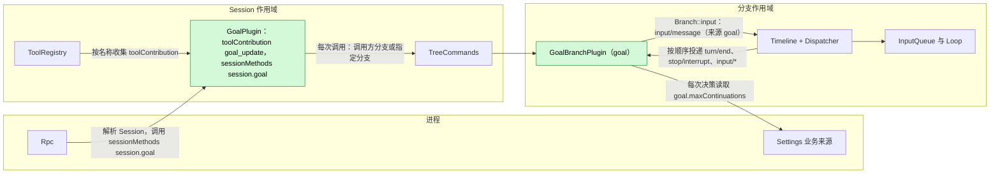
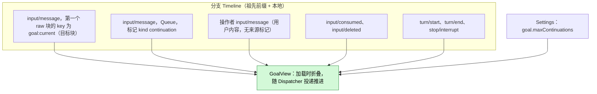
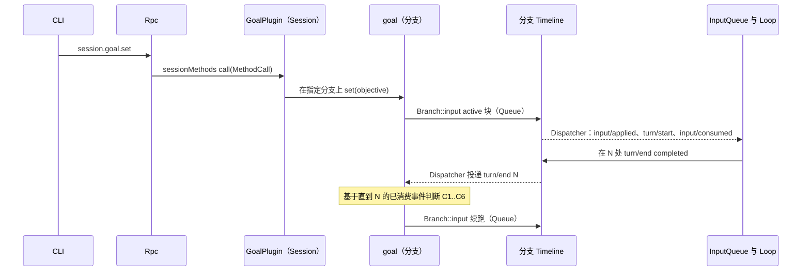
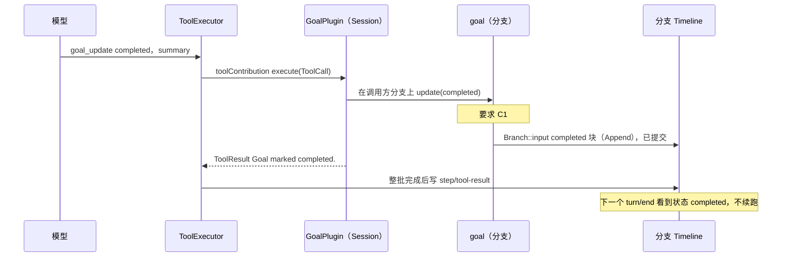
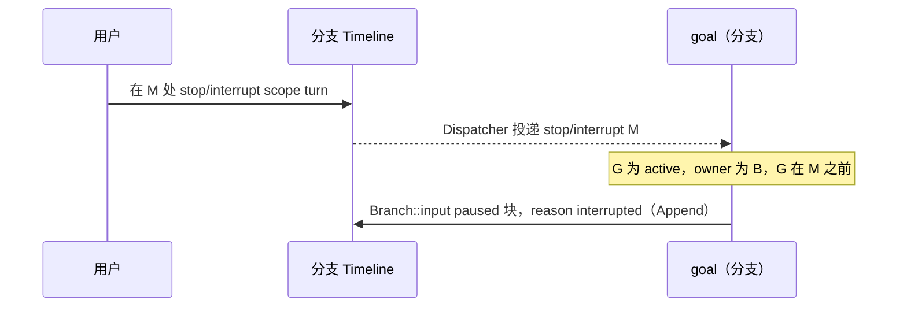
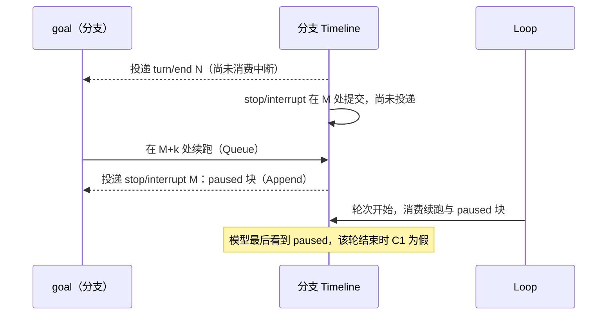

# Goal

状态：草案。总体设计：[overview B.2](../overview.md)。阶段：P2。语言：优先 TypeScript（[overview F.3](../overview.md)）。作用域：Session + 分支（[ADR 002](../../adr/002-plugin-scope.md)）。

Goal 在分支上保持一个常驻目标，并自动续跑该分支，直到模型报告目标已完成或受阻、用户暂停或中断，或达到续跑上限。**分支部分**拥有目标：其状态只以分支 Timeline 上一个带 key 的 raw 输入块存在，续跑由通过分支 Dispatcher 按顺序消费的分支事件决定；它写入分支输入。**Session 部分**以 `toolContribution` 服务（Session 作用域，key `goal_update`）提供 `goal_update` 工具，并通过 `sessionMethods` 服务（Session 作用域，key `session.goal`）提供 `session.goal.*` 方法（[session-boundary](../contracts/session-boundary.md)）；二者都在每次调用时解析分支部分。Goal 不写任何自有事件，也没有单独的"Goal 模式"：目标的存在与状态可通过 `session.goal.get` 和目标块看到，覆盖了功能列表中"切换 Goal 模式"的说法。本文的每个契约都是语言中立的（服务名、作用域、key、带数据形状的方法），因此 TypeScript 实现无需手写 Rust 绑定即可满足；Rust 形式见[附录 G](#附录-g-rust-绑定)。Goal 还使用运行时的类型化服务（`S:TreeCommands`、`B:Timeline`、`B:Dispatcher`）；把它们按名称暴露给非 Rust 的 Capability 部分是 [#4](https://github.com/arcships/dim/issues/4) 的工作（需求见 [session access](../contracts/session-access.md) §9），在此之前 Goal 先用 Rust 实现。Goal 经分支的公开输入入口 `Branch::input` 写入自己的输入。

## 1. 结构

所有模型可见的效果都是由现有 InputQueue 和 Loop 消费的 `input/message` 事实。

| 部分 | 作用域 | 依赖 | 提供 |
| --- | --- | --- | --- |
| `GoalPlugin` | Session | `S:TreeCommands` | `toolContribution` key `goal_update`；`sessionMethods` key `session.goal` |
| `GoalBranchPlugin` | 分支 | `B:Timeline`、`B:Dispatcher`、Settings 业务来源（外层作用域） | `goal`（分支作用域；`update`、`set`、`edit`、`pause`、`resume`、`clear`、`get`），仅供 Session 部分使用；来源 `goal` 下的目标块与续跑格式 |

两个部分都在插件的 `provides` 中声明各自的服务，且只安装在启用了 Goal 的 Session 中；ToolRegistry 和 Rpc 按名称和作用域收集它们。`goal.maxContinuations` 是 Settings 业务来源中的业务配置（[ADR 002](../../adr/002-plugin-scope.md) D4）：每次决策时读取，通过数据更新改变，从不重载。Goal 只读取 `input/message`、`input/consumed`、`input/deleted`、`turn/start`、`turn/end` 和 `stop/interrupt` 的公开数据契约；从不读取其他插件的状态。

## 2. 数据与状态

Goal 不拥有持久状态。分支 `B` 的目标是 `B` 至今已消费事件的纯函数；分支部分在加载时折叠前缀，并在每次 Dispatcher 投递时推进视图。压缩不会改变它，因为视图由事件而非模型上下文构建。

| 字段 | 基于已消费事件的推导 |
| --- | --- |
| `G` | 第一个 raw 块的 key 为 `goal:current` 的最新 `input/message`；不存在或为 `retire` 表示没有目标 |
| `status`、`owner`、`reason`、`objective` | `G` 的标记属性与正文（Goal 只解析自己的格式） |
| `interrupted` | `B` 本地事件中序号大于 `G` 的 `stop/interrupt {scope: turn}` |
| `last_operator` | 最新的操作者输入：带 `user` 内容且未被来源标记的 `input/message`（A5） |
| `count` | 序号大于 `max(G, last_operator)` 的 Goal 续跑输入 |
| `pending_driving` | 有效模式为 Queue 或 Steer、且既无 `input/consumed` 也无 `input/deleted` 的本地 `input/message`（session access §2 待处理规则）。Goal 不解读 InputQueue 的指令 `input/withdraw`；只有 InputQueue 的结果 `input/deleted` 才移除输入 |
| `turn_open` | 最新 `turn/end` 之后存在 `turn/start` |

仅运行时：视图、每个分支一个 worker 队列，以及一个分支本地互斥锁。Dispatcher 处理器只把投递的事件放入队列后返回，从不获取互斥锁，也不等待。Goal 自己的 worker 任务获取互斥锁、推进视图并决策；工具与方法调用获取同一个互斥锁，因此决策与写入保持串行，等待的只有 Goal 自己的任务。它们都由加载折叠重建；新一代从不继承它们。

## 3. 流程

### 3.1 设置与续跑

续跑在决策之后由 Goal 的 worker 写入；InputQueue 和 Loop 通过各自的订阅消费它。Dispatcher 处理器只入队并返回。

### 3.2 通过 `goal_update` 完成

终态块位于该批次的 `step/tool-result` 之前，因此压缩后重放的目标不会再次变为 `active`。

### 3.3 中断暂停目标

`scope: branch` 的中断被忽略：分支正在关闭。

## 4. 时序与冲突

### 4.1 中断在续跑之前提交（最多多一轮）

按序号决定：决策只使用了直到 `N` 的已消费事件，因此续跑成立，之后的 `paused` 块结束目标。这多出的一轮是可接受的（决定 E18）；Goal 不撤回其续跑。

### 4.2 重载

任一部分的重载都发生在罕见的结构性操作之后。Session 部分的重载像任何贡献重载一样传播到 ToolRegistry，可能使在途轮次失败；这是可接受的代价（[ADR 002](../../adr/002-plugin-scope.md) D3）。分支部分的重载会重新折叠视图；若最新的 `turn/end` 之后没有 Goal 写入且目标为 active，新一代会执行该决策一次（C4 和 C5 去重）。重载前已提交的终态块保持有效。

### 4.3 其他关键行

| 场景 | 序号顺序 | 结果 | 归属 |
| --- | --- | --- | --- |
| 决策时有用户 Queue/Steer 输入待处理 | 输入 < `turn/end` N，未消费 | C5 不成立：不续跑；由用户那一轮的结束来决策，计数重置 | Goal |
| 驱动输入被删除 | 输入 < `input/deleted` < N | 不算待处理；续跑继续 | InputQueue；Goal |
| 驱动输入在 N 之后被删除（例如在自身批次中被 Hook 撤回的提示） | 输入 < N < `input/deleted` | N 的决策在 C5 停止；消费 `input/deleted` 时重新做 N 的决策；C1–C6 成立则续跑 | InputQueue；Goal |
| 同一 `turn/end` 之后另一来源的 Queue 后续输入 | 都在 N 之后 | 两个 Queue 输入，按顺序两轮；每个 `turn/end` 最多一次续跑 | InputQueue；Goal |
| 子分支在目标块之后切出 | 已消费 < 切点 | 子分支把父分支的目标视为背景；不续跑；在那里调用 `goal_update` 返回 owner 错误 | Goal |

完整表格：[附录 B](#附录-b-完整冲突表)。

## 5. 上下文映射

| 模型看到的内容 | 形式 | 位置 |
| --- | --- | --- |
| 目标状态（`active`、`paused`、`completed`、`blocked`、已清除） | 一条没有 `user` 内容的 `input/message`，其唯一 raw 块为 `<dim-goal kind="goal" status=... branch=...>`，key 为 `goal:current`（清除使用 `retire`） | 在其 `input/consumed` 位置；Queue 块开启它所驱动的轮次，Append 块加入下一个请求 |
| 续跑 | `input/message`，Queue，`<dim-goal kind="continuation" count=k limit=L>`，无 key | 它所驱动轮次的开头 |
| `goal_update` | 已采用的 `context/configured` 中的固定工具声明；结果在 `ToolResult.content` 中 | 其批次的工具结果位置 |

| 方面 | 规则 |
| --- | --- |
| 压缩 | 基线原样重放最新的存活 `goal:current` 块；已退役的目标不重放；续跑和更早的块只通过摘要保留 |
| 子分支 | 继承切点之前已消费的块；块中写明所属分支，并告诉委派工作不要调用 `goal_update`（A3） |
| 非交互 Session | 映射相同；续跑在没有用户在场时驱动轮次 |
| 始终不可见 | `submissionId`、模式、操作者输入计数、诊断、其他插件的事件 |

确切文本：[附录 A.5](#a5-模型可见文本)。

## 6. 接口（摘要）

| 接口 | 类型 | 用途 |
| --- | --- | --- |
| `goal_update {status, summary}` | `toolContribution`（Session，key `goal_update`），风险 `session` | 模型报告完成或受阻；写入终态块 |
| `session.goal.set/edit/pause/resume/clear` | `sessionMethods`（Session，key `session.goal`） | 用户控制目标；每个方法写一个块 |
| `session.goal.get` | 同一服务 | 分支当前的 `GoalView`，替代任何"模式"查询（A8） |
| `goal` | 分支服务，Goal 内部使用 | 目标状态、决策与写入 |
| `goal.maxContinuations` | 业务配置（Settings） | 续跑上限，每次决策时读取 |

细节：[附录 A](#附录-a-接口细节)。

## 7. 安全

Goal 只在自己的分支上以来源 `goal` 写入 `input/message`；由此产生的轮次在 Session 的 Permission 与 Approval 策略下运行，目标不授予任何权限。用户无法伪造目标块：`session.submit` 不接受 raw 块，且标记渲染器会转义目标文本。`goal_update` 在 `session` 下准入。诊断记录 Session id、分支 id、决策与原因，从不记录目标文本。

## 8. 规则检查

规则：[principles §1 与 §4](../../../architecture/rust-agent/principles.md)，[ADR 002](../../adr/002-plugin-scope.md) D1–D5。

| 规则 | 本文如何符合 |
| --- | --- |
| §4.1 改别的模块拥有的状态时写指令事件 | Goal 只写自己的输入，从不删除或应用输入；它依据 InputQueue 的 `input/deleted`，不读 `input/withdraw`。 |
| §4.2 交接后不能撤回 | Goal 从不撤回自己的续跑；中断后才被应用的续跑多跑一轮，之后的 `paused` 块结束目标。 |
| §4.3 只用 before 回调在写入前干预 | 不适用：Goal 不注册 before 回调，也不加入口检查。 |
| §4.4 核心机制不带业务含义 | Goal 不要求 Timeline、Dispatcher、InputQueue 或 Loop 改动；其标记是普通 raw 块。 |
| §4.5 决定前读完整个批次 | 对 `turn/end`、`stop/interrupt` 与 `input/deleted` 的决定都在读完整个批次后做出。 |
| §4.6 模型上下文只含交接后被读取的事件 | 目标块与续跑只在被采用后进入模型；被删除的输入从不进入。 |
| §4.7 插件之间只通过公开事件和服务交互 | Goal 只读公开的 `input/*`、`turn/*` 与 `stop/interrupt` 契约，并经 `Branch::input` 写入。 |
| §4.8 向机制所有者提通用需求 | 唯一的需求 #4 见 [session access](../contracts/session-access.md) §9。 |
| §1 Capability 与 App Server 边界 | 两个部分都是各自包中的 Capability；Rpc 只分派 `sessionMethods`。 |
| ADR 002 D1 作用域跟随状态所有者 | 工具与方法是 Session 服务；目标及其决策是分支状态。 |
| ADR 002 D2 不设接线模块 | ToolRegistry 与 Rpc 按名字和作用域收集 Goal 的服务；没有模块指名 Goal。 |
| ADR 002 D3 依赖跟随作用域 | 分支部分依赖分支服务与外层的 Settings 来源；重载重新折叠视图，可接受。 |
| ADR 002 D4 结构性配置与业务配置分离 | `goal.maxContinuations` 是每次决策时读取的业务配置。 |
| ADR 002 D5 合同语言中立 | 工具、方法、分支服务与块格式以中立形式给出；附录 G 只是一种绑定。 |

## 9. 向机制所有者提出的需求

| 需求 | 所有者 | 五项内容 |
| --- | --- | --- |
| 运行时服务按名字暴露给非 Rust 的 Capability 部分 | 运行时，[#4](https://github.com/arcships/dim/issues/4) | 见 [session access](../contracts/session-access.md) §9；Goal 的 TypeScript 实现需要 `S:TreeCommands`、`B:Timeline`、`B:Dispatcher` 与 `Branch::input`，在此之前先用 Rust 实现 |

## 附录 A. 接口细节

### A.1 工具 `goal_update`

服务 `toolContribution`，Session 作用域，key `goal_update`：`declaration(): sync -> ToolDeclaration`（名称、A.5 中的描述、下列参数 schema、风险 `session`）；`execute(ToolCall): async -> ToolResult`；取消就是对调用发出取消请求。

| 项 | 值 |
| --- | --- |
| 参数 | `{status: "completed" \| "blocked", summary: string}`；`summary` 1..=2000 个字符（A10） |
| 结果 | `ToolResult.content`：`Goal marked completed.` 或 `Goal marked blocked.`；错误：`No active goal on this branch.`、`The goal belongs to branch <id>; continue your assigned task without calling goal_update.`（A3） |
| 风险类别 | `session`（只写分支输入）（A9） |
| 提供范围 | 启用了 Goal 的每个 Session，所有角色（A9） |
| 处理器 | 通过 `S:TreeCommands` 解析调用方分支的 `goal` 服务并调用 `goal.update`；在分支互斥锁下要求 C1（否则返回错误结果），经 `Branch::input` 以 Append 模式写入终态块，等待提交后返回。在追加之前取消则不写任何内容；一旦追加，写入保持有效 |

### A.2 Session 方法

服务 `sessionMethods`，Session 作用域，key `session.goal`。`describe()` 为每一行返回一个 `MethodDecl`，其中 `interruption: report`、`progress: false`、`notifications: []`、`reply: direct`，除 `get` 外 `mutating: true`。`call(MethodCall)` 接受下列参数，并以 `MethodReply` 回复结果；错误为 `MethodError` 数据（附录 C）。

| 方法 | 参数 | 结果 | 写入 |
| --- | --- | --- | --- |
| `session.goal.set` | `{sessionId, branchId?, objective}` | `{goal, sequence}` | `active` 块，Queue |
| `session.goal.edit` | `{sessionId, branchId?, objective}` | `{goal, sequence}` | 带新目标文本和当前状态的块；`active` 时为 Queue，否则为 Append（A1） |
| `session.goal.pause` | `{sessionId, branchId?}` | `{goal, sequence}` | `paused`（原因 `user`），Append |
| `session.goal.resume` | `{sessionId, branchId?}` | `{goal, sequence?}` | `active`，Queue；目标已为 active 时仅在 `!turn_open && !pending_driving` 时写入，否则不写（A12） |
| `session.goal.clear` | `{sessionId, branchId?}` | `{sequence}` | 退役块，Append |
| `session.goal.get` | `{sessionId, branchId?}` | `{goal: GoalView \| null, through}` | 无（A8） |

`branchId` 默认为 `main`（A13）。`GoalView = {status, objective, reason?, summary?, owner, count, limit, sequence}`。状态转换：`set` 可从任何状态；`edit` 从 `active`、`paused`、`blocked`；`pause` 从 `active`；`resume` 从 `paused`、`blocked`、`active`；`clear` 从任何存活目标。Rpc 解析 Session（若已卸载则恢复）并发送调用；处理器通过 `S:TreeCommands` 解析指定分支的 `goal`。

### A.3 分支服务 `goal`

分支作用域，无 key，由 `GoalBranchPlugin` 提供，只由其 Session 部分调用。所有方法都是 async，并由分支互斥锁串行化；写入类方法在写入提交后返回。

| 方法 | 请求 | 回复 | 错误 |
| --- | --- | --- | --- |
| `update` | `{status: "completed" \| "blocked", summary, callerBranch}` | `{sequence}` | `no_active_goal`、`not_owner {owner}`（工具错误文本见 A.1） |
| `set`、`edit` | `{objective}` | `{goal: GoalView, sequence}` | `invalid_params`、`no_goal`、`goal_not_editable` |
| `pause`、`clear` | `{}` | `{goal?: GoalView, sequence}` | `no_goal`、`goal_not_active` |
| `resume` | `{}` | `{goal: GoalView, sequence?}` | `no_goal`、`goal_not_editable` |
| `get` | `{}` | `{goal: GoalView \| null, through}` | — |

消费方通过取消请求取消；追加之前不写任何内容，追加之后写入保持有效。卸载期间调用以 `service_reloading` 失败。

### A.4 续跑决策

分支 `B` 上序号 `N` 处的 `turn/end` 所在的整个原子批次被消费后，基于直到该批次的已消费事件：

| # | 条件 | 若为假 |
| --- | --- | --- |
| C1 | `G` 存在、未退役、`status = active`、`owner = B` | 停止 |
| C2 | `G` 之后 `B` 上没有轮次级中断 | 写 `paused`（`interrupted`）并停止 |
| C3 | `N` 处的 `turn/end` 为 `completed` | `failed`：写 `paused`（`turn_failed`）（A6）；`cancelled`：由 C2 处理 |
| C4 | `N` 是最新的 `turn/end` 且 `!turn_open` | 停止（更新一轮的结束会触发） |
| C5 | `!pending_driving`（包括 Goal 自己未消费的续跑；不包括已删除的输入） | 停止 |
| C6 | `count < maxContinuations` | 写 `paused`（`limit`）并停止 |
| — | 全部成立 | 写入续跑（Queue），计数为 `count + 1` |

投递 `M` 处的 `stop/interrupt`（`scope: turn`）并读完其批次后：若 C1 成立且 `G < M`，写 `paused`（`interrupted`）。

投递某个 `input/deleted` 时，若被删除的输入曾使最新 `turn/end` 的决策在 C5 停止：基于目前已消费的事件重新做该决策（C4 与 C5 去重；停止的决策没有写续跑）。

### A.5 模型可见文本

每次写入都是一条没有 `user` 内容的 `input/message`，其唯一 raw 块为标记 `<dim-goal kind="..." ...>`、换行、转义后的正文、换行、`</dim-goal>`（A2）。

| 写入 | Key | 模式 | 文本 |
| --- | --- | --- | --- |
| `active` | `goal:current` | Queue（非 active 时 edit 用 Append） | `<dim-goal kind="goal" status="active" branch="B">` / `Objective:` / `<objective>` / 空行 / `This is the user's standing goal for branch B. Keep working toward it across turns. When it is fully achieved, call goal_update with status "completed". If you cannot make progress without the user, call goal_update with status "blocked" and explain why. If you are working on a delegated sub-task started from branch B, treat this goal as background and do not call goal_update.` / `</dim-goal>` |
| `paused` | `goal:current` | Append | `status="paused" reason="interrupted\|user\|limit\|turn_failed"`；正文 `Objective:` / `<objective>` / 空行 / `The goal is paused (<reason phrase>). Do not continue working toward it on your own; respond only to the user's latest input.` |
| `completed` / `blocked` | `goal:current` | Append | `Objective:` / `<objective>` / 空行 / `Result:` 或 `Blocker:` / `
` / 空行 / `The goal is completed.` 或 `The goal is blocked.` + ` Do not continue working toward it.` |
| 清除 | `goal:current`，`retire` | Append | `<dim-goal kind="goal" status="cleared" branch="B">` / `The previous goal was cleared by the user. Disregard it.` |
| 续跑 | 无 | Queue | `<dim-goal kind="continuation" count="k" limit="L">` / `Continue working toward the active goal. If it is completed or blocked, call goal_update.` |

原因短语：`interrupted` "the user interrupted the turn"，`user` "paused by the user"，`limit` "the automatic continuation limit was reached"，`turn_failed` "the last turn failed"。工具声明描述："Report that the current goal is completed or blocked."

### A.6 Timeline 机制

| 步骤 | 路径 |
| --- | --- |
| 加载 | 订阅 Dispatcher（`"Goal"`），在闸门下固定 `S = committed()`，把直到 `S` 的前缀折叠进视图，设置 `rebuilt = S`，提供 `goal`。若最新的 `turn/end` 之后没有 Goal 写入，执行其决策一次 |
| 消费 | Dispatcher 处理器把事件放入队列后返回。worker 在分支互斥锁下跳过 `sequence <= rebuilt`，推进视图，并在每个批次读完后对 `turn/end`、`stop/interrupt` 与 `input/deleted` 决策（A.4），需要时写入 |
| 写入 | 来源为 `goal` 的 `input/message`，`submissionId: "goal:<uuid>"`，带标记和模式，经分支的公开输入入口 `Branch::input` 写入，由它在边界校验并追加 `input/message`（[interrupt](../../../architecture/rust-agent/interrupt.md)） |
| 消费路径 | InputQueue 追加 `input/applied`；Loop 追加 `input/consumed`。Goal 从不写 Steer |
| 复核 | 决策只使用已消费事件，每个事件在读完其整个批次后使用（[time-bus](../../../architecture/rust-agent/time-bus.md) §4）；之后的事实在序号上先于写入，由 InputQueue 和 Loop 解决 |
| 工具与方法调用 | 获取分支互斥锁，基于视图决策，经 `Branch::input` 写入，等待提交，释放。在互斥锁上等待的只有 Goal 的 worker 与调用；Dispatcher 处理器从不等待 |
| 卸载 | 卸载清理函数结束订阅；在互斥锁上等待的调用返回 `service_reloading` 或 Cancelled |
| 重启、Session 恢复 | 与加载相同；已提交但未消费的续跑随 Session 一起恢复 |

## 附录 B. 完整冲突表

| 场景 | 序号顺序 | 结果 | 归属 |
| --- | --- | --- | --- |
| 目标轮次运行时的用户 Queue 输入 | 输入 < `turn/end` N，未消费 | C5 不成立；用户的轮次运行；其结束时以重置后的计数续跑 | Goal、InputQueue |
| 用户输入在 N 之后、续跑之前提交 | N < 输入 < 续跑 | 两者按顺序运行：先用户轮次，再续跑轮次；计数重置 | InputQueue、Loop |
| 续跑之后的用户输入 | 续跑 < 输入 | 先运行续跑轮次；Queue 接着运行；Steer 加入续跑轮次 | InputQueue、Loop |
| 目标轮次中的 Steer | 在轮次中消费 | 同一轮次；若为操作者输入则重置计数（A5） | Loop；Goal |
| `turn/end` 之后、投递给 Goal 之前的 Steer | `turn/end` < steer | Steer 开启一轮；之后的决策中 C4 或 C5 不成立；由那一轮的结束来决策 | Goal |
| 空闲时的 Append 输入 | — | 不驱动；续跑继续；Append 随其第一个请求被消费 | Loop |
| 驱动输入在 N 之前被删除 | 输入 < `input/deleted` < N | 不计入 `pending_driving`；续跑继续 | InputQueue；Goal |
| 驱动输入在 N 之后被删除 | N < `input/deleted` | N 的决策在 C5 停止；消费 `input/deleted` 时重新做 N 的决策：C1–C6 成立则续跑 | Goal |
| 在自身批次中被 Hook 撤回的提示，`input/deleted` 在 N 之后 | 输入 + `input/withdraw` < N < `input/deleted` | 同上：Goal 不理会指令，依据 InputQueue 的 `input/deleted` 重新决策 | InputQueue；Goal |
| Goal 自己的续跑在被持有时被用户撤回 | 续跑 < `input/deleted` | 从未被应用或消费，不算待处理；下一次决策可以再次续跑；计数包含它 | Goal |
| 同一 `turn/end` 之后另一来源的 Queue 后续输入（如 Hooks） | 都在 N 之后 | 按顺序两轮；每个 `turn/end` 最多一次续跑；该输入除非是操作者输入，否则不重置计数 | InputQueue；Goal |
| N 之前中断 | 中断 < N | C2：`paused`，不续跑 | Goal |
| N 与续跑之间中断 | N < 中断 < 续跑 | 多一轮；然后 `paused`（E18） | Loop；Goal |
| 续跑开始其轮次后中断 | 已消费 < 中断 | 轮次取消；`paused` | Loop；Goal |
| 应用之后、消费之前中断 | 已应用 < 中断 | 续跑待处理；其后为 `paused`；下一个驱动输入一并消费两者，模型最后看到 `paused` | Loop；Goal |
| `goal_update` 写入之后中断 | 块 < 中断 | 目标 `completed`/`blocked`；不暂停 | Goal |
| `goal_update` 写入之前中断 | 中断 < 处理器写入 | 处理器被取消，不写入；目标因中断暂停 | ToolExecutor；Goal |
| resume 与更晚投递的中断 | 中断 < resume 块 | 投递时发现 `G > M`：不暂停 | Goal |
| 分支级中断或分支关闭 | 关闭 < 写入 | 不写任何内容；分支部分结束 | 运行时门面 |
| 工具批次未结算 | 终态块 < `step/tool-result` | 块在批次结果之后被消费；`turn/end` 看到非 active 目标 | ToolExecutor、Loop |
| 一个批次中两个 `goal_update` 调用 | 互斥锁顺序 | 第二个发现没有 active 目标：错误结果 | Goal |
| `goal_update` 与 `edit`/`clear` | 互斥锁顺序 | 后者看到前者的块 | Goal |
| 目标写入与其消费之间压缩 | 写入 < 压缩 < 已消费 | 块在摘要之后的消费位置送达；之后的基线重放它 | 历史投影 |
| 多个目标块之后压缩 | — | 只重放最新的 `goal:current` 块；计数读取事件 | 历史投影；Goal |
| 子分支在目标写入与其消费之间切出 | 写入 < 切点 < 已消费 | 子分支不采纳它；`owner ≠ child`：不续跑 | InputQueue（子分支）；Goal |
| 子分支在消费之后切出 | 已消费 < 切点 | 子分支把父目标视为背景；`goal_update` 被拒绝（A3） | Goal |
| 在子分支上设置目标 | — | 子分支 Timeline 上的独立 key | Goal |
| Session 分叉 | 事实被复制 | 分叉的 `main` 拥有复制来的目标（A11） | Goal |
| 未决策的 `turn/end` 之后分支部分重载或重启 | — | 加载时执行一次决策；C4/C5 去重 | Goal |
| `goal_update` 或目标轮次期间 Session 部分重载 | — | 像任何贡献重载一样传播；在途轮次可能失败（结束时 `paused (turn_failed)`）；已提交的块保持有效（D3） | ToolRegistry；Goal |
| Session 空闲卸载 | — | 各部分随 Session 卸载；方法调用会恢复它；恢复时重新折叠 | AgentIndex；Goal |
| Session 关闭 | — | 方法返回 `session_closed` | Rpc |
| 重复 `resume` | — | 第二次看到 `turn_open` 或 `pending_driving`：不写入 | Goal（A12） |
| 重复 `set` | — | 每次都写一个块；计数重置 | Goal（A12） |
| 轮次失败 | `turn/end {failed}` | `paused`（`turn_failed`）（A6） | Goal |
| 达到上限 | count = limit | `paused`（`limit`） | Goal |
| 资源节点离线 | 节点上的调用失败 | Goal 不使用节点服务：输入照常提交，轮次照常运行；工作区工具调用以 `node_unavailable` 作为工具错误失败；不重载，也不进入 Pending（[overview §6.3](../overview.md)） | Goal；WorkspaceTools |
| 客户端断开 | — | 无影响 | — |

## 附录 C. 错误与恢复

| 错误码 | 原因 |
| --- | --- |
| `invalid_params` | 目标文本为空或超长（A10），分支 id 格式错误 |
| `no_goal` | 没有存活目标时调用 `pause`、`resume`、`edit`、`clear` |
| `goal_not_active` | 对非 active 目标调用 `pause` |
| `goal_not_editable` | 对 `completed` 调用 `edit` 或 `resume`（改用 `set`） |
| `session_closed`、`branch_missing` | Session 或分支已不存在 |
| `service_reloading` | Goal 正在重载；写入未发生，或可通过 `get` 查到 |
| `unknown_method` | 此 Session 未启用 Goal |

Goal 从不自行重试写入。进程退出只留下已提交的事实；下次加载重新折叠它们。

## 附录 D. 验收

通过 Session 方法、`goal_update` 工具和 Timeline 事件进行的流程测试（假模型）：

1. 在空闲分支上设置目标会开启一轮；正常结束写入续跑；`goal_update completed` 结束续跑；completed 块位于该批次的 `step/tool-result` 之前。
2. 上限：`maxContinuations = 2` 时，第三次决策写入 `paused (limit)`；操作者输入重置计数；来自其他来源的带标记输入不重置。
3. 中断各行：`turn/end` 之前、在 `turn/end` 与续跑之间提交（最多多一轮）、开始之后、应用之后；`goal_update` 写入之前与之后。
4. 待处理的 Queue/Steer 输入抑制续跑；Append 不抑制；已删除的输入不抑制；在其抑制的 `turn/end` 之后被删除的输入会重新触发该决策。
5. 未决策的 `turn/end` 之后分支部分重载和重启：恰好一次决策。
6. `completed` 之后压缩：基线包含 `completed`，而非 `active`。
7. 子分支：继承块，不续跑，`goal_update` 返回 owner 错误；在子分支上设置的目标是独立的。
8. 已卸载的 Session：`session.goal.pause` 恢复它并写入。未启用 Goal：`unknown_method`。修改 `goal.maxContinuations` 在下一次决策时生效，无需重载 Goal。
9. `edit`、`clear`（退役的 key 不重放）、目标文本中伪造的 `</dim-goal>` 被转义；`session.goal.get` 反映每种状态。

## 附录 E. 假设

| # | 假设 | 依据 | 若被否决的影响 |
| --- | --- | --- | --- |
| A1 | `set`、`resume` 以及对 active 目标的 `edit` 使用 Queue；其他写入使用 Append | 判断（总体设计只为续跑固定了 Queue） | 设置不会在空闲分支上开始工作，或暂停会开启一轮 |
| A2 | 附录 A.5 中的确切块格式与文本 | 判断 | 文本与解析一起改变 |
| A3 | 目标属于其块中指定的分支；其他分支从不续跑或更新它 | 由子分支继承得出的判断 | 子分支会续跑或完成父分支的目标 |
| A4 | `goal.maxContinuations` 默认 20，范围 1..=1000 | 判断 | 不同的默认值 |
| A5 | 计数只在新目标块和操作者输入时重置：带 `user` 内容且第一个 raw 块不是来源标记 | 判断 | 其他插件的自动输入会重置上限 |
| A6 | 失败的轮次暂停目标（`turn_failed`） | 判断（避免因提供方错误进入重试循环） | 失败轮次会继续并消耗上限 |
| A7 | 暂停不中断正在运行的轮次 | 判断 | 暂停也会调用 `stop` |
| A8 | `session.goal.get` 是替代"Goal 模式"的状态查询 | 决定 E18；决定 §3（无 Goal 模式） | CLI 通过解析 Goal 的块推导状态 |
| A9 | `goal_update` 风险为 `session`，提供给所有角色 | 判断 | 工具对某些角色隐藏，或在其他类别下准入 |
| A10 | 目标文本 ≤ 4000 个字符，summary ≤ 2000 | 判断 | 其他限制 |
| A11 | 分叉 Session 的 `main` 继续复制来的目标 | 判断 | 分叉需要退役复制来的 key |
| A12 | 对 active 的空闲目标调用 `resume` 会重新开始工作；重复 `set` 不去重 | 判断 | 重新开始的目标需要再次 `set` |
| A13 | `branchId` 默认为 `main`；任何分支都可以持有目标 | 判断 | Goal 限于 `main` |

## 附录 F. 待对齐问题

| 问题 | 说明 |
| --- | --- |
| 总体设计"事件如何进入上下文" | Goal 只针对已采纳的输入设计 |

## 附录 G. Rust 绑定

Goal 优先使用 TypeScript；Rust 实现（或在 #4 之前先用 Rust 起步）按如下方式绑定中立契约。

| 中立契约 | Rust 绑定 |
| --- | --- |
| `toolContribution` key `goal_update` | `S:ToolContribution`，由 ToolRegistry 作为 `Contributions<ToolContribution>` 的条目 `goal_update` 收集；取消请求 = 批次 `CancellationToken`；`cancelled` = `HostError::Cancelled` |
| `sessionMethods` key `session.goal` | `SessionMethodContribution(Arc<dyn MethodProvider>)`，key `SessionScope::named_key::<SessionMethodContribution>("session.goal")`；`describe` = `methods()`，`call` = `call(MethodCall, CallChannel, CancellationToken)` |
| `goal` | `B:Goal`，key `BranchScope::key::<Goal>()`，async 方法返回 `Result<_, GoalError>`，A.3 的每个错误码对应一个变体 |
| 卸载清理函数 | `ctx.effect` |
| worker | 每个分支一个任务，由 Dispatcher 处理器的队列供给 |
| 写入 | 经 `S:TreeCommands` 调用 `Branch::input` |
