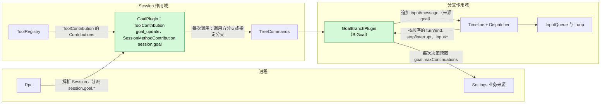
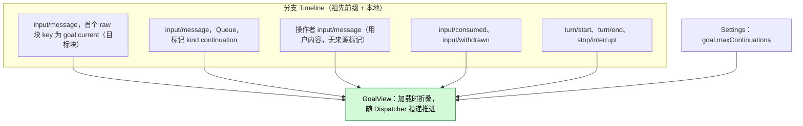
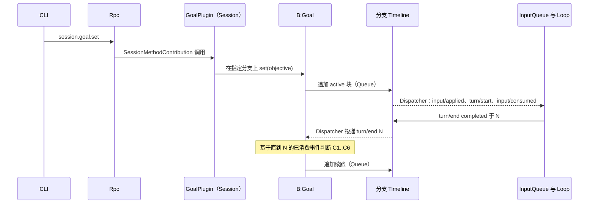
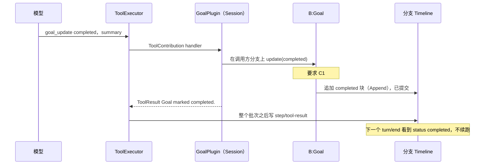
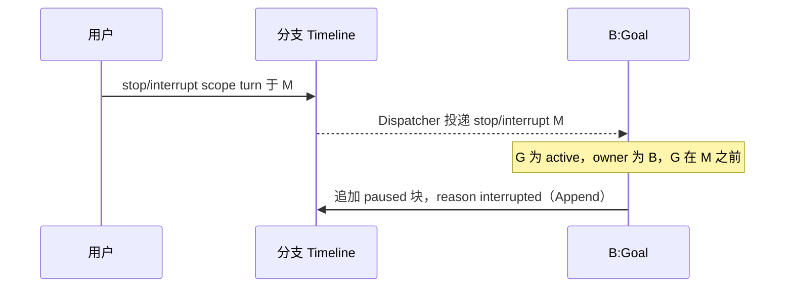
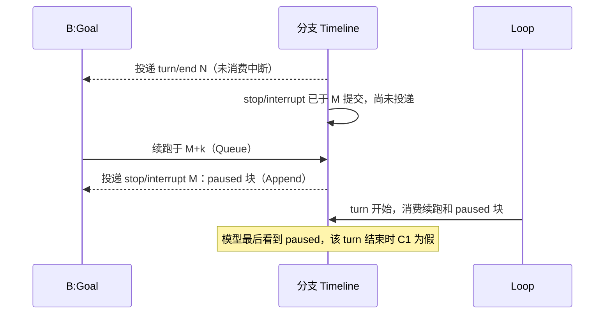

# Goal

状态：草案。总体设计：[overview B.2](../overview.md)。阶段：P2。语言：TypeScript 优先（[overview F.3](../overview.md)）。作用域：Session + 分支（[ADR 002](../../adr/002-plugin-scope.md)）。

Goal 在分支上保持一个常驻目标，并自动继续该分支，直到模型报告目标已完成或受阻、用户暂停或中断，或达到续跑上限。**分支部分**拥有目标：其状态只以带 key 的 raw 输入块存在于分支 Timeline 上，是否续跑由经分支 Dispatcher 按顺序消费的分支事件决定；它写入分支输入。**Session 部分**以 Session 级 `ToolContribution` 提供 `goal_update` 工具，并以 `SessionMethodContribution` 提供 `session.goal.*` 方法（[session-boundary](../contracts/session-boundary.md)）；两者都在每次调用时解析分支部分。Goal 不写自己的事件，也没有单独的"Goal 模式"：通过 `session.goal.get` 和目标块可见的目标存在与否及其状态，覆盖了功能列表中"切换 Goal 模式"的表述。

## 1. 结构

所有模型可见的效果都是由现有 InputQueue 和 Loop 消费的 `input/message` 事实。

| 部分 | 作用域 | 依赖 | 提供 |
| --- | --- | --- | --- |
| `GoalPlugin` | Session | `S:TreeCommands` | `S:ToolContribution[goal_update]`；`S:SessionMethodContribution[session.goal]`（级别 `session`） |
| `GoalBranchPlugin` | 分支 | `B:Timeline`、`B:Dispatcher`、Settings 业务来源（外层作用域） | `B:Goal`（`update`、`set`、`edit`、`pause`、`resume`、`clear`、`get`）；来源 `goal` 下的目标块与续跑格式 |

两个部分都只安装在启用 Goal 的 Session 中。`goal.maxContinuations` 是 Settings 业务来源中的业务配置（[ADR 002](../../adr/002-plugin-scope.md) D4）：每次决策时读取，通过数据更新修改，从不重载。Goal 只读取 `input/message`、`input/consumed`、`input/withdrawn`、`turn/start`、`turn/end` 和 `stop/interrupt` 的公开数据契约；从不读取其他插件的状态。

## 2. 数据与状态

Goal 不拥有任何持久状态。分支 `B` 的目标是 `B` 至今已消费事件的纯函数；分支部分在加载时折叠前缀，并在每次 Dispatcher 投递时推进视图。压缩不改变它，因为视图由事件而非模型上下文构建。

| 字段 | 基于已消费事件的推导 |
| --- | --- |
| `G` | 首个 raw 块 key 为 `goal:current` 的最新 `input/message`；不存在或为 `retire` 表示没有目标 |
| `status`、`owner`、`reason`、`objective` | `G` 标记的属性和正文（Goal 只解析自己的格式） |
| `interrupted` | `B` 的本地事件中序号大于 `G` 的 `stop/interrupt {scope: turn}` |
| `last_operator` | 最新的操作者输入：带 `user` 内容且未被来源标记的 `input/message`（A5） |
| `count` | 序号大于 `max(G, last_operator)` 的 Goal 续跑输入数 |
| `pending_driving` | 有效模式为 Queue 或 Steer、既无 `input/consumed` 也无 `input/withdrawn` 的本地 `input/message` |
| `turn_open` | 最新 `turn/end` 之后存在 `turn/start` |

仅运行时：视图，以及串行化 Dispatcher 决策、工具调用和方法调用的分支本地互斥锁。两者都由加载时的折叠重建；新一代从不继承它们。

## 3. 流程

### 3.1 设定与续跑

续跑在决策之后由 Goal 的 Dispatcher handler 追加；InputQueue 和 Loop 通过各自的订阅消费它。handler 追加后即返回，不等待分派。

### 3.2 通过 `goal_update` 完成

终态块先于批次的 `step/tool-result`，因此压缩后重放的目标不会再次成为 `active`。

### 3.3 中断暂停目标

`scope: branch` 的中断被忽略：分支正在关闭。

## 4. 时序与冲突

### 4.1 中断在续跑之前提交（至多多跑一个 turn）

按序号决定：决策只使用了直到 `N` 的已消费事件，因此续跑成立，之后的 `paused` 块结束目标。这个额外的 turn 是可接受的（决策 E18）；Goal 不撤回自己的续跑。

### 4.2 重载

任一部分的重载都发生在罕见的结构性操作之后。Session 部分的重载与任何贡献重载一样传播到 ToolRegistry，并可能使在途 turn 失败；这是可接受的代价（[ADR 002](../../adr/002-plugin-scope.md) D3）。分支部分的重载重新折叠视图；如果最新的 `turn/end` 之后没有 Goal 写入且目标为 active，新一代对它做一次决策（C4 和 C5 去重）。重载之前提交的终态块保持有效。

### 4.3 其他关键行

| 场景 | 序号顺序 | 结果 | 决定方 |
| --- | --- | --- | --- |
| 决策时有待处理的用户 Queue/Steer 输入 | 输入 < `turn/end` N，未消费 | C5 不成立：不续跑；由用户 turn 的结束来决定，计数重置 | Goal |
| 驱动输入被撤回 | 输入 < `input/withdrawn` < N | 不算待处理；继续续跑 | InputQueue；Goal |
| 同一 `turn/end` 之后另一来源的 Queue 后续输入 | 都在 N 之后 | 两个 Queue 输入，按顺序跑两个 turn；每个 `turn/end` 至多一次续跑 | InputQueue；Goal |
| 子分支切在目标块之后 | 已消费 < 切点 | 子分支把父分支的目标视为背景；不续跑；在那里调用 `goal_update` 返回 owner 错误 | Goal |

完整表格：[附录 B](#附录-b-完整冲突表)。

## 5. 上下文映射

| 模型看到什么 | 形式 | 位置 |
| --- | --- | --- |
| 目标状态（`active`、`paused`、`completed`、`blocked`、已清除） | 一条没有 `user` 内容的 `input/message`，唯一的 raw 块是 `<dim-goal kind="goal" status=... branch=...>`，key 为 `goal:current`（清除使用 `retire`） | 在其 `input/consumed` 位置；Queue 块开启它所驱动的 turn，Append 块并入下一个请求 |
| 续跑 | `input/message`，Queue，`<dim-goal kind="continuation" count=k limit=L>`，无 key | 它所驱动 turn 的开头 |
| `goal_update` | 已采用的 `context/configured` 中的固定工具声明；结果在 `ToolResult.content` 中 | 所在批次的工具结果位置 |

| 方面 | 规则 |
| --- | --- |
| 压缩 | 基线逐字重放最新的有效 `goal:current` 块；已退役的目标不重放；续跑和更早的块只通过摘要保留 |
| 子分支 | 继承切点之前已消费的块；块中写明所属分支，并告知委派工作不要调用 `goal_update`（A3） |
| 非交互 Session | 映射相同；续跑在没有用户在场时驱动 turn |
| 始终不可见 | `submission_id`、模式、操作者输入计数、诊断、其他插件的事件 |

确切文本：[附录 A.4](#a4-模型可见文本)。

## 6. 接口（摘要）

| 接口 | 类型 | 用途 |
| --- | --- | --- |
| `goal_update {status, summary}` | Session `ToolContribution`，风险 `session` | 模型报告完成或受阻；写入终态块 |
| `session.goal.set/edit/pause/resume/clear` | `SessionMethodContribution`，级别 `session` | 用户控制目标；每个方法写一个块 |
| `session.goal.get` | 同一贡献 | 分支当前的 `GoalView`，取代任何"模式"查询（A8） |
| `B:Goal` | 分支服务 | 目标状态、决策与写入 |
| `goal.maxContinuations` | 业务配置（Settings） | 续跑上限，每次决策时读取 |

细节：[附录 A](#附录-a-接口细节)。

## 7. 安全

Goal 只在自己的分支上写来源为 `goal` 的 `input/message`；由此产生的 turn 在 Session 的 Permission 与 Approval 策略下运行，目标不授予任何权限。用户无法伪造目标块：`session.submit` 不接受 raw 块，标记渲染器会转义目标文本。`goal_update` 在 `session` 下准入。诊断记录 Session id、分支 id、决策和原因，从不记录目标文本。

## 附录 A. 接口细节

### A.1 工具 `goal_update`

| 项 | 值 |
| --- | --- |
| 参数 | `{status: "completed" \| "blocked", summary: string}`；`summary` 1..=2000 个字符（A10） |
| 结果 | `ToolResult.content`：`Goal marked completed.` 或 `Goal marked blocked.`；错误：`No active goal on this branch.`、`The goal belongs to branch <id>; continue your assigned task without calling goal_update.`（A3） |
| 风险类别 | `session`（只写分支输入）（A9） |
| 提供范围 | 每个启用 Goal 的 Session，所有角色（A9） |
| Handler | 通过 `S:TreeCommands` 解析调用方分支的 `B:Goal`；在分支互斥锁下要求 C1（否则返回错误结果），以 Append 模式追加终态块，等待提交，返回。追加之前被取消则不写入；一旦追加，写入即成立 |

### A.2 Session 方法

| 方法 | 参数 | 结果 | 写入 |
| --- | --- | --- | --- |
| `session.goal.set` | `{sessionId, branchId?, objective}` | `{goal, sequence}` | `active` 块，Queue |
| `session.goal.edit` | `{sessionId, branchId?, objective}` | `{goal, sequence}` | 带新目标和当前状态的块；`active` 时为 Queue，否则为 Append（A1） |
| `session.goal.pause` | `{sessionId, branchId?}` | `{goal, sequence}` | `paused`（原因 `user`），Append |
| `session.goal.resume` | `{sessionId, branchId?}` | `{goal, sequence?}` | `active`，Queue；对已 active 的目标仅在 `!turn_open && !pending_driving` 时写入，否则不写（A12） |
| `session.goal.clear` | `{sessionId, branchId?}` | `{sequence}` | 退役块，Append |
| `session.goal.get` | `{sessionId, branchId?}` | `{goal: GoalView \| null, through}` | 无（A8） |

`branchId` 默认为 `main`（A13）。`GoalView = {status, objective, reason?, summary?, owner, count, limit, sequence}`。状态转换：`set` 可从任意状态；`edit` 从 `active`、`paused`、`blocked`；`pause` 从 `active`；`resume` 从 `paused`、`blocked`、`active`；`clear` 从任何有效目标。Rpc 解析 Session（若已卸载则恢复）并分派；handler 通过 `S:TreeCommands` 解析指定分支的 `B:Goal`。

### A.3 续跑决策

在分支 `B` 上投递序号为 `N` 的 `turn/end` 时，基于直到 `N` 的已消费事件：

| # | 条件 | 若为假 |
| --- | --- | --- |
| C1 | `G` 存在、未退役、`status = active`、`owner = B` | 停止 |
| C2 | `G` 之后 `B` 上没有 turn 级中断 | 写 `paused`（`interrupted`）并停止 |
| C3 | `N` 处的 `turn/end` 为 `completed` | `failed`：写 `paused`（`turn_failed`）（A6）；`cancelled`：由 C2 处理 |
| C4 | `N` 是最新的 `turn/end` 且 `!turn_open` | 停止（较新 turn 的结束会触发） |
| C5 | `!pending_driving`（包括 Goal 自己未消费的续跑；不包括已撤回的输入） | 停止 |
| C6 | `count < maxContinuations` | 写 `paused`（`limit`）并停止 |
| — | 全部成立 | 以 `count + 1` 写入续跑（Queue） |

投递 `M` 处的 `stop/interrupt`（`scope: turn`）时：若 C1 成立且 `G < M`，写 `paused`（`interrupted`）。

### A.4 模型可见文本

每次写入都是一条没有 `user` 内容的 `input/message`，其唯一的 raw 块是标记 `<dim-goal kind="..." ...>`、换行、转义后的正文、换行、`</dim-goal>`（A2）。

| 写入 | Key | 模式 | 文本 |
| --- | --- | --- | --- |
| `active` | `goal:current` | Queue（非 active 时 edit 用 Append） | `<dim-goal kind="goal" status="active" branch="B">` / `Objective:` / `<objective>` / 空行 / `This is the user's standing goal for branch B. Keep working toward it across turns. When it is fully achieved, call goal_update with status "completed". If you cannot make progress without the user, call goal_update with status "blocked" and explain why. If you are working on a delegated sub-task started from branch B, treat this goal as background and do not call goal_update.` / `</dim-goal>` |
| `paused` | `goal:current` | Append | `status="paused" reason="interrupted\|user\|limit\|turn_failed"`；正文 `Objective:` / `<objective>` / 空行 / `The goal is paused (<reason phrase>). Do not continue working toward it on your own; respond only to the user's latest input.` |
| `completed` / `blocked` | `goal:current` | Append | `Objective:` / `<objective>` / 空行 / `Result:` 或 `Blocker:` / `
` / 空行 / `The goal is completed.` 或 `The goal is blocked.` + ` Do not continue working toward it.` |
| 清除 | `goal:current`，`retire` | Append | `<dim-goal kind="goal" status="cleared" branch="B">` / `The previous goal was cleared by the user. Disregard it.` |
| 续跑 | 无 | Queue | `<dim-goal kind="continuation" count="k" limit="L">` / `Continue working toward the active goal. If it is completed or blocked, call goal_update.` |

原因短语：`interrupted` "the user interrupted the turn"，`user` "paused by the user"，`limit` "the automatic continuation limit was reached"，`turn_failed` "the last turn failed"。工具声明描述："Report that the current goal is completed or blocked."

### A.5 Timeline 机制

| 步骤 | 路径 |
| --- | --- |
| 加载 | 订阅 Dispatcher（`"Goal"`），在闸门下固定 `S = committed()`，把直到 `S` 的前缀折叠进视图，设置 `rebuilt = S`，提供 `B:Goal`。如果最新 `turn/end` 之后没有 Goal 写入，对它做一次决策 |
| 消费 | 在分支互斥锁下，跳过 `sequence <= rebuilt`，推进视图，在 `turn/end` 和 `stop/interrupt` 上决策（A.3），需要时追加并返回 |
| 写入 | 来源为 `goal` 的 `input/message`，`submission_id: "goal:<uuid>"`，带标记和模式，追加到分支 Timeline（Capability 输入直接追加；由生产方保证有效性，[interrupt](../../../architecture/rust-agent/interrupt.md)） |
| 消费处理 | InputQueue 追加 `input/applied`；Loop 追加 `input/consumed`。Goal 从不写 Steer |
| 复查 | 决策只使用已消费事件（[time-bus](../../../architecture/rust-agent/time-bus.md) §4）；更晚的事实在序号上先于写入，由 InputQueue 和 Loop 处理 |
| 工具与方法调用 | 获取分支互斥锁，基于视图决策，追加，等待提交，释放 |
| 卸载 | `ctx.effect` disposer 结束订阅；在互斥锁上等待的调用返回 `service_reloading` 或 Cancelled |
| 重启、Session 恢复 | 与加载相同；已提交但未消费的续跑随 Session 恢复 |

## 附录 B. 完整冲突表

| 场景 | 序号顺序 | 结果 | 决定方 |
| --- | --- | --- | --- |
| 目标 turn 运行期间的用户 Queue 输入 | 输入 < `turn/end` N，未消费 | C5 不成立；用户的 turn 运行；其结束时以重置后的计数续跑 | Goal、InputQueue |
| 用户输入在 N 之后、续跑之前提交 | N < 输入 < 续跑 | 两者按顺序运行：用户 turn，然后续跑 turn；计数重置 | InputQueue、Loop |
| 续跑之后的用户输入 | 续跑 < 输入 | 先运行续跑 turn；Queue 随后；Steer 并入续跑 turn | InputQueue、Loop |
| 目标 turn 期间的 Steer | 在 turn 内消费 | 同一 turn；若为操作者输入则重置计数（A5） | Loop；Goal |
| `turn/end` 之后、投递给 Goal 之前的 Steer | `turn/end` < steer | Steer 开启一个 turn；之后的决策中 C4 或 C5 不成立；由该 turn 的结束决定 | Goal |
| 空闲时的 Append 输入 | — | 不是驱动输入；继续续跑；Append 随其第一个请求被消费 | Loop |
| 驱动输入在 N 之前被撤回 | 输入 < `input/withdrawn` < N | 不计入 `pending_driving`；继续续跑 | InputQueue；Goal |
| 驱动输入在 N 之后被撤回 | N < `input/withdrawn` | 决策已在 C5 停止；由下一个 `turn/end` 或 `resume` 决定；空闲目标等待（A12） | Goal |
| 用户撤回 Goal 自己的续跑 | 续跑 < `input/withdrawn` | 未消费，不算待处理；下一次决策可以再次续跑；计数包含它 | Goal |
| 同一 `turn/end` 之后另一来源的 Queue 后续输入（例如 Hooks） | 都在 N 之后 | 按顺序两个 turn；每个 `turn/end` 至多一次续跑；该输入不重置计数，除非它是操作者输入 | InputQueue；Goal |
| N 之前中断 | 中断 < N | C2：`paused`，不续跑 | Goal |
| 在 N 与续跑之间中断 | N < 中断 < 续跑 | 多跑一个 turn；然后 `paused`（E18） | Loop；Goal |
| 续跑开启 turn 之后中断 | 已消费 < 中断 | turn 取消；`paused` | Loop；Goal |
| 应用之后、消费之前中断 | 已应用 < 中断 | 续跑待处理；其后为 `paused`；下一个驱动输入一并消费两者，模型最后看到 `paused` | Loop；Goal |
| `goal_update` 写入之后中断 | 块 < 中断 | 目标 `completed`/`blocked`；不暂停 | Goal |
| `goal_update` 写入之前中断 | 中断 < handler 写入 | handler 被取消，不写入；目标被中断暂停 | ToolExecutor；Goal |
| Resume 与较晚投递的中断 | 中断 < resume 块 | 投递时发现 `G > M`：不暂停 | Goal |
| 分支级中断或分支关闭 | 关闭 < 写入 | 不写入；分支部分结束 | Runtime facade |
| 工具批次未结算 | 终态块 < `step/tool-result` | 块在批次结果之后被消费；`turn/end` 看到非 active 目标 | ToolExecutor、Loop |
| 一个批次中两次 `goal_update` | 互斥锁顺序 | 第二次发现没有 active 目标：错误结果 | Goal |
| `goal_update` 与 `edit`/`clear` | 互斥锁顺序 | 后者看到前者的块 | Goal |
| 目标写入与其消费之间压缩 | 写入 < 压缩 < 已消费 | 块在摘要之后的消费位置交付；之后的基线重放它 | 历史投影 |
| 多个目标块之后压缩 | — | 只重放最新的 `goal:current` 块；计数读取事件 | 历史投影；Goal |
| 子分支切在目标写入与其消费之间 | 写入 < 切点 < 已消费 | 子分支不采用它；`owner ≠ child`：不续跑 | InputQueue（子分支）；Goal |
| 消费之后子分支切出 | 已消费 < 切点 | 子分支把父目标视为背景；`goal_update` 被拒（A3） | Goal |
| 在子分支上设定目标 | — | 子分支 Timeline 上独立的 key | Goal |
| Session fork | 事实被复制 | fork 的 `main` 拥有复制来的目标（A11） | Goal |
| 未决策的 `turn/end` 之后分支部分重载或重启 | — | 加载时做一次决策；C4/C5 去重 | Goal |
| `goal_update` 或目标 turn 期间 Session 部分重载 | — | 与任何贡献重载一样传播；在途 turn 可能失败（结束时 `paused (turn_failed)`）；已提交的块保持有效（D3） | ToolRegistry；Goal |
| Session 空闲卸载 | — | 各部分随 Session 卸载；方法调用会恢复它；恢复时重新折叠 | AgentIndex；Goal |
| Session 关闭 | — | 方法返回 `session_closed` | Rpc |
| 重复 `resume` | — | 第二次看到 `turn_open` 或 `pending_driving`：不写入 | Goal（A12） |
| 重复 `set` | — | 每次都写一个块；计数重置 | Goal（A12） |
| Turn 失败 | `turn/end {failed}` | `paused`（`turn_failed`）（A6） | Goal |
| 达到上限 | count = limit | `paused`（`limit`） | Goal |
| 资源节点离线 | Session Capability 处于 Pending | 输入照常提交；Capability 恢复后 turn 开始 | Lifecycle |
| 客户端断开 | — | 无影响 | — |

## 附录 C. 错误与恢复

| 错误码 | 原因 |
| --- | --- |
| `invalid_params` | 目标为空或超长（A10），分支 id 格式错误 |
| `no_goal` | 没有有效目标时调用 `pause`、`resume`、`edit`、`clear` |
| `goal_not_active` | 对非 active 目标调用 `pause` |
| `goal_not_editable` | 对 `completed` 调用 `edit` 或 `resume`（应使用 `set`） |
| `session_closed`、`branch_missing` | Session 或分支已不存在 |
| `service_reloading` | Goal 正在重载；写入未发生，或可通过 `get` 查到 |
| `unknown_method` | 该 Session 未启用 Goal |

Goal 从不自行重试写入。进程退出只留下已提交的事实；下一次加载重新折叠它们。

## 附录 D. 验收

通过 Session 方法、`goal_update` 工具和 Timeline 事件进行流程测试（假模型）：

1. 在空闲分支上设定会开启一个 turn；正常结束写入续跑；`goal_update completed` 结束续跑；completed 块先于批次的 `step/tool-result`。
2. 上限：`maxContinuations = 2` 时，第三次决策写 `paused (limit)`；操作者输入重置计数；来自其他来源的带标记输入不重置。
3. 中断各行：`turn/end` 之前；在 `turn/end` 与续跑之间提交（至多多跑一个 turn）；开始之后；应用之后；`goal_update` 写入之前和之后。
4. 待处理的 Queue/Steer 输入抑制续跑；Append 不抑制；已撤回的输入不抑制。
5. 未决策的 `turn/end` 之后分支部分重载和重启：恰好一次决策。
6. `completed` 之后压缩：基线包含 `completed`，而非 `active`。
7. 子分支：继承块，不续跑，`goal_update` 返回 owner 错误；在子分支上设定的目标是独立的。
8. 已卸载的 Session：`session.goal.pause` 恢复它并写入。未启用 Goal：`unknown_method`。修改 `goal.maxContinuations` 在下一次决策生效，无需重载 Goal。
9. `edit`、`clear`（已退役的 key 不重放），目标文本中伪造的 `</dim-goal>` 被转义；`session.goal.get` 反映每种状态。

## 附录 E. 假设

| # | 假设 | 依据 | 若被否决的影响 |
| --- | --- | --- | --- |
| A1 | `set`、`resume` 以及对 active 目标的 `edit` 使用 Queue；其他写入使用 Append | 判断（overview 只规定续跑用 Queue） | 设定不会在空闲分支上开始工作，或暂停会开启一个 turn |
| A2 | 附录 A.4 中的确切块格式与文本 | 判断 | 文本与解析一起改变 |
| A3 | 目标属于其块中指定的分支；其他分支从不续跑或更新它 | 由子分支继承得出的判断 | 子分支会续跑或完成父分支的目标 |
| A4 | `goal.maxContinuations` 默认 20，范围 1..=1000 | 判断 | 默认值不同 |
| A5 | 计数只在新目标块和操作者输入时重置：带 `user` 内容且首个 raw 块不是来源标记 | 判断 | 其他插件的自动输入会重置上限 |
| A6 | 失败的 turn 暂停目标（`turn_failed`） | 判断（避免在 provider 错误上循环重试） | 失败的 turn 会继续并消耗上限 |
| A7 | 暂停不中断正在运行的 turn | 判断 | 暂停也会调用 `stop` |
| A8 | `session.goal.get` 是取代"Goal 模式"的状态查询 | 决策 E18；决策 §3（无 Goal 模式） | CLI 通过解析 Goal 的块推导状态 |
| A9 | `goal_update` 风险为 `session`，向所有角色提供 | 判断 | 工具对部分角色隐藏，或在其他类别下准入 |
| A10 | 目标 ≤ 4000 个字符，summary ≤ 2000 | 判断 | 其他限制 |
| A11 | fork 出的 Session 的 `main` 继续复制来的目标 | 判断 | fork 需要退役复制来的 key |
| A12 | 对 active 的空闲目标 `resume` 会重新开始工作；重复 `set` 不去重 | 判断 | 重新开始的目标需要再次 `set` |
| A13 | `branchId` 默认为 `main`；任何分支都可以持有目标 | 判断 | Goal 仅限 `main` |

## 附录 F. 待对齐问题

| 问题 | 说明 |
| --- | --- |
| Overview "How events enter context" | Goal 只针对已采用的输入进行设计 |
