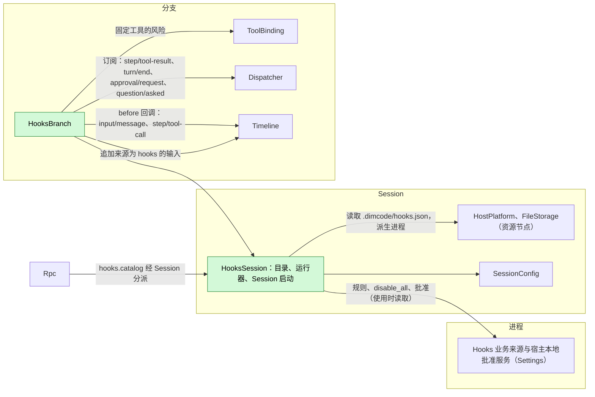
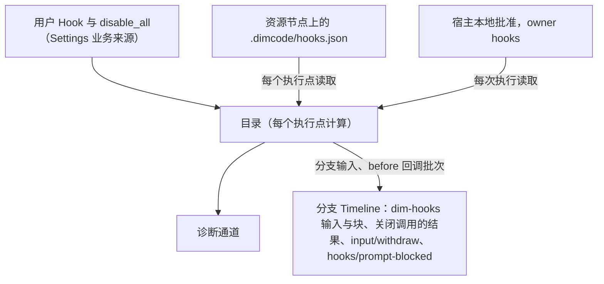
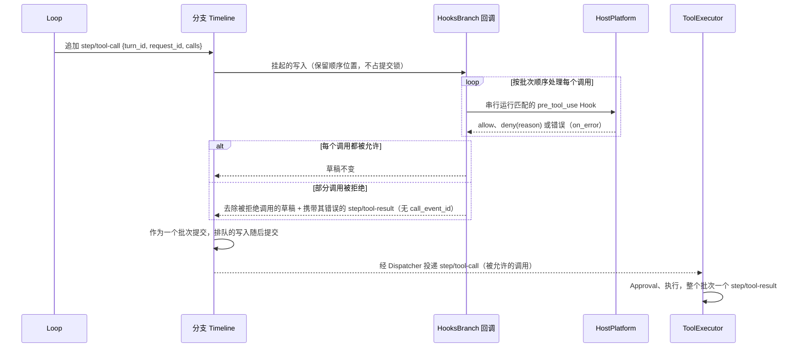
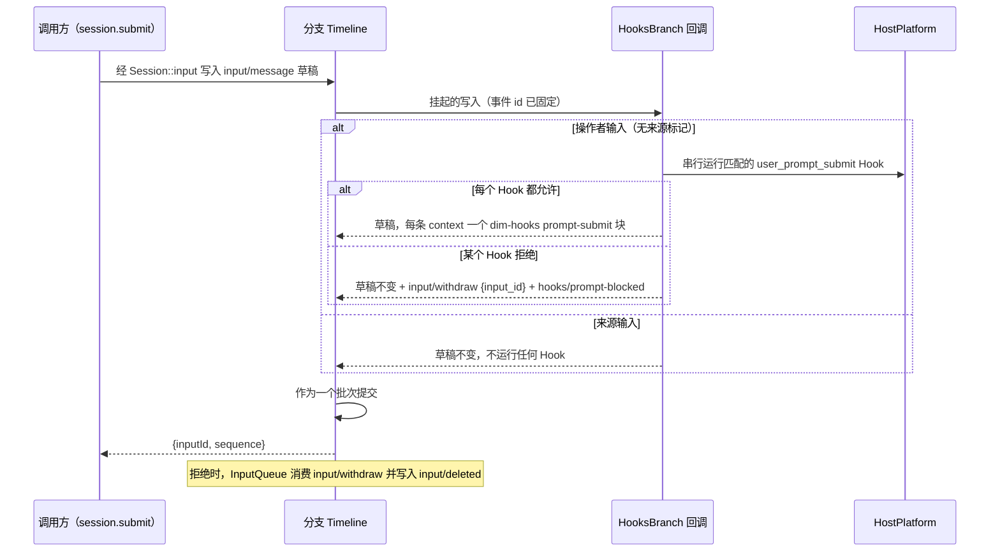
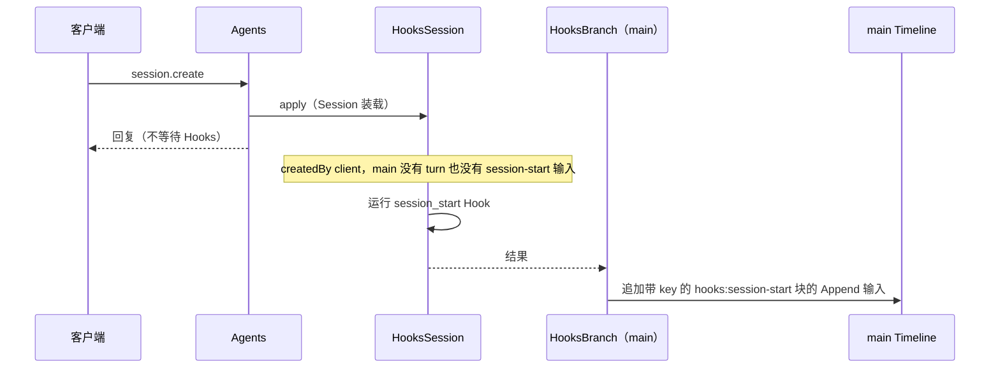
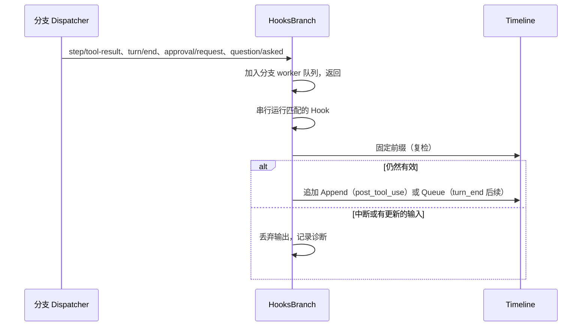
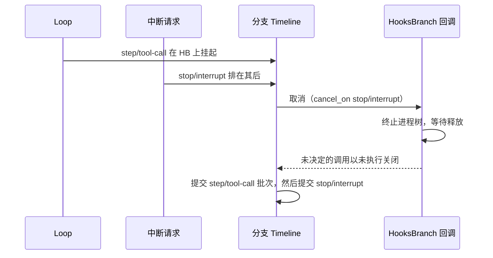

# Hooks

状态：草案。总体设计：[overview](../overview.md)（Hooks）。阶段：P2（用户与项目来源）；插件来源在 #3 之后。语言：Rust。作用域：[ADR 002](../../adr/002-plugin-scope.md)（Session + 分支）。

Hooks 在 Session 工作的固定节点运行用户配置的命令。其 Session 部件持有规则（从业务来源与项目文件读取），并运行 Session 启动 Hook。其分支部件注册两个异步 Timeline before 回调（即 [overview 附录 B.1](../overview.md) 中的运行时补充）：在 `input/message` 上用于 `user_prompt_submit`，在 `step/tool-call` 上用于 `pre_tool_use`；它还从分支 Dispatcher 运行工具后、turn 结束与通知 Hook。回调写入什么由本文决定，并使用既有的公共事件契约（变换后的草稿、`input/withdraw`、一个关闭调用的 `step/tool-result`），外加一个由 Hooks 自己声明的事件 `hooks/prompt-blocked`；Approval、InputQueue、ToolExecutor 与 Loop 不做任何针对 Hooks 的变更。命令经 Session 的 `HostPlatform`（其资源节点）运行；输出只以三种形式进入上下文：来源为 `hooks` 的分支输入、加入操作者输入的块，或被拒绝调用的错误结果。契约以语言中立形式给出（[ADR 002 D5](../../adr/002-plugin-scope.md)）；Rust 绑定见附录 G。

## 1. 结构



| 部件 | 作用域 | 依赖 | 提供 |
| --- | --- | --- | --- |
| `HooksSession` | Session（仅启用时安装） | Settings 业务来源（`hooks` 文档）与宿主本地批准服务；Session 的 `HostPlatform` 与 `FileStorage`；`SessionConfig` | `sessionMethods` key `hooks`，含 `hooks.catalog`，级别 `management`；`main` 的 Session 启动 Hook 结果；供 `HooksBranch` 使用的内部目录与命令运行器（不是契约） |
| `HooksBranch` | 分支 | `HooksSession` 的运行器；分支 Timeline（before 回调、追加）、Dispatcher 与 ToolBinding | `input/message` 与 `step/tool-call` 上的 before 回调，在部件加载时注册、卸载时移除；事件类型 `hooks/prompt-blocked` |

没有任何部件收集 Hooks：回调是分支 Timeline 上的注册，随 `HooksBranch` 的生命周期存在，因此没有消费方依赖 Hooks 或指名它。

**重载。** 启用、禁用或升级 Hooks，或 Settings 重载，只重载 Hooks 部件（[ADR 002 D3](../../adr/002-plugin-scope.md)）。卸载时仍挂起的回调按其注册的 `on_error` 结算（附录 A.4）：挂起的 `step/tool-call` 写入失败，其 turn 以 `Failed` 结束；挂起的操作者输入原样提交。`HooksBranch` 未加载期间提交的写入不经 Hooks 直接通过（附录 F）。编辑规则、批准或 `disable_all` 属于业务配置，从不触发重载（[D4](../../adr/002-plugin-scope.md)）。

**节点。** 资源节点离线时，每次 `HostPlatform` 或 `FileStorage` 调用都以 `node_unavailable` 失败；Hooks 部件及其依赖方既不重载也不进入 Pending，各执行点应用自己的错误规则（附录 C）。这要求经 rutis 链路导入的服务在链路断开期间保持注册并使调用失败（对 [#5](https://github.com/arcships/dim/issues/5) 的要求）。

**依赖的契约：** `sessionMethods`（[方法与工具贡献](../contracts/session-boundary.md)）；异步 Timeline before 回调（运行时补充，[overview 附录 B.1](../overview.md)）；`input/message`、`input/withdraw` 与 `input/deleted`（[session access A.4](../contracts/session-access.md)）、`step/tool-call` 与 `step/tool-result` 数据契约，包括不带 `call_event_id`、用于关闭从未派发的调用的结果（ADR agent-029）；Session `HostPlatform` 与 `FileStorage` 以及分支 ToolBinding（既有类型化服务）；Settings 业务来源与宿主本地批准服务。Hooks 使用 Rust；将类型化服务按名称暴露给非 Rust 部件属于 issue [#4](https://github.com/arcships/dim/issues/4) 的工作。**本文定义的契约：** Hook 配置格式、命令协议、`hooks.catalog`、事件 `hooks/prompt-blocked`、来源名 `hooks`（标记 `dim-hooks`，key 命名空间 `hooks:`）。

## 2. 数据与状态



Hooks 不拥有 `StateCell`；它唯一的自有事件 `hooks/prompt-blocked` 是供客户端使用的记录，Hooks 从不回读。目录在每个执行点从其来源重新计算（A6）；批准在每次执行时读取，从不作为权限缓存；后续计数从固定前缀推导。运行中的进程位于 `ctx.effect` 之下，重载或重启后从不重新运行。

## 3. 流程

### 3.1 工具前 before 回调



回调在 Approval 与 Permission 之前运行，因此被 Hook 拒绝的调用既不会被询问也不会被执行。被拒绝的调用从草稿中移除（其输入从不被编辑），并在同一个原子批次中由一个不带 `call_event_id` 的 `step/tool-result {turn_id, request_id, results}` 关闭，每个结果都是错误 `Hook <source>/<id>: <reason>`；Loop 把这类结果视为关闭调用而不结算批次，历史按 `call_id` 将它们与其调用配对（ADR agent-029）。若所有调用都被拒绝，草稿保留一个空的 `calls` 列表，ToolExecutor 以空批次结果结算它，Loop 继续下一次请求。Hook 出错时应用 `on_error`，默认 `deny`。没有匹配的 Hook 时，回调立即返回，草稿原样提交。

### 3.2 用户提示提交 before 回调



只有操作者输入（不带来源标记的用户内容）会运行 Hook，因此由 Hooks、Goal、Scheduler 或 Workflow 写入的输入从不触发它们（A26）。允许并带 `context`：每条 context 成为一个标记为 `<dim-hooks kind="prompt-submit">` 的 raw 块，加在草稿自身的 raw 块之后、其用户内容之前；用户内容从不被编辑。拒绝：Hooks 在第一个拒绝处停止，丢弃已收集的 context，并向该输入的批次追加 `input/withdraw {input_id}`（InputQueue 的指令契约）与 `hooks/prompt-blocked {input_id, source, hook_id, reason}`。序列为 `input/message`、`input/withdraw`、`hooks/prompt-blocked`，然后是由 InputQueue 写入的 `input/deleted {input_id}`：InputQueue 只在整个批次派发后才决定是否采用，因此同批次的撤回总是胜出，该输入从不被应用，也不会开始任何 turn。调用方的回复是普通的 `{inputId, sequence}`；客户端从 Session 广播上的这些事件得知结果。Hook 出错时应用 `on_error`，默认 `allow`（A27）。调用方丢弃该调用不会取消挂起的写入，写入按回调的结果提交。

### 3.3 Session 启动



Session 启动是失败即放行的，且只对尚未开始 turn 的 `createdBy.kind = "client"` Session 运行（A24、A25）。其上下文在写入后的下一次模型请求中生效，这可能晚于第一条用户输入。

### 3.4 观察 Hook



Dispatcher 按顺序投递分支事件，因此分支部件加载期间不会漏掉任何事件；在其重载期间派发的事件不会运行。

## 4. 时序与冲突



挂起的回调会阻住其分支上所有后续写入，包括 `stop/interrupt`。两个回调都注册 `cancel_on: ["stop/interrupt"]`，因此排队的中断会立即取消它们。工具前：尚未被其所有 Hook 允许的每个调用以错误 `Tool was not executed: interrupted` 关闭；已允许的调用留在批次中，并在中断紧随其后提交时按 ToolExecutor 既有的中断规则结算。提示提交：正在运行的 Hook 被终止并视为错误（应用其 `on_error`），其余 Hook 被跳过，输入先于中断提交。

| 场景 | 序号顺序 | 结果 | 负责方 |
| --- | --- | --- | --- |
| turn 结束后续与用户输入或 Goal 续接 | `turn/end` < 其他输入 < Hook 写入 | 复检看到该输入：不写入。若双方都在任一方写入前读取，两个 Queue 输入都保留 | Hooks、InputQueue |
| 后续输入被用户撤回 | 后续 < `input/deleted` | 从不被应用；不计数 | InputQueue、Hooks |
| 提示提交 Hook 拒绝 | 输入 + `input/withdraw` + `hooks/prompt-blocked` 同一批次 < `input/deleted` | 从不被应用；不开始 turn；客户端看到原因 | Hooks、InputQueue |
| 回调挂起期间分支上的写入 | 挂起 < 排队 | 排队的写入在其后按序提交；分支延迟至多为 Hook 的运行时间（可接受） | Timeline |
| 回调挂起期间的 `stop/interrupt` | 挂起 < 中断 | 回调被取消；见上文 | Hooks、Timeline |
| Hooks 或 Settings 重载 | — | 只重载 Hooks 部件；挂起的回调按 `on_error` 结算（工具前：写入失败，turn `Failed`；提示提交：输入原样提交） | Timeline、Lifecycle |
| 资源节点离线 | 每次调用 | `node_unavailable`，不重载：工具前与提示提交 → `on_error`；观察 → 诊断 | Hooks |

完整表格：附录 B。

## 5. 上下文映射

| 来源 | 模型看到的内容 | 位置 | 压缩 | 子分支 |
| --- | --- | --- | --- | --- |
| `session_start` | 一个 Append 输入：标记 `<dim-hooks kind="session-start">`，每个 Hook 一个 key 为 `hooks:session-start/<source>/<id>` 的 raw 块 | 写入后的下一次模型请求 | 每个 key 的最新块被重放 | 切分时仍有效则继承 |
| `user_prompt_submit` `context` | 操作者输入中的 raw 块，标记 `<dim-hooks kind="prompt-submit">`，每个 Hook 一个 | 位于该输入的用户内容之前，在其被消费的位置 | 仅经摘要 | 同输入 |
| `user_prompt_submit` 拒绝 | 无：输入在被应用前即被删除，因此从不进入上下文；`hooks/prompt-blocked` 不被投影 | — | — | — |
| `pre_tool_use` 拒绝 | 关闭调用的 `step/tool-result` 中的错误文本 `Hook <source>/<id>: <reason>` | 按 `call_id` 与其调用配对，位于下一次模型请求之前 | 仅经摘要 | 若在切分之前 |
| `post_tool_use` | Append 输入，标记 `kind="post-tool" call_id tool` | 该 turn 的下一次模型请求 | 仅经摘要 | 同输入 |
| `turn_end` | Queue 输入，标记 `kind="follow-up"` | 由它驱动的 turn 的开始 | 仅经摘要 | 同输入 |
| `notification` | 无 | — | — | — |

非交互 Session：完全相同，只是 Session 启动 Hook 仅对 `createdBy.kind = "client"` 运行。模型从不看到配置、命令、退出码、stderr（工具前拒绝原因除外）、批准、诊断或 `hooks/prompt-blocked`。

## 6. 接口（摘要）

| 接口 | 类型 | 用途 |
| --- | --- | --- |
| `step/tool-call` 上的 before 回调 | 由 `HooksBranch` 在分支 Timeline 上注册 | 运行 `pre_tool_use` Hook；移除并关闭被拒绝的调用 |
| `input/message` 上的 before 回调 | 由 `HooksBranch` 在分支 Timeline 上注册 | 运行 `user_prompt_submit` Hook；添加 context 块，或撤回该输入 |
| `hooks/prompt-blocked {input_id, source, hook_id, reason}` | 由 Hooks 声明的分支事件 | 提示被撤回的原因，供客户端使用 |
| `hooks.catalog {sessionId}` | `sessionMethods` key `hooks`，级别 `management` | Session 的有效 Hook 及其批准状态 |
| `hooks` 文档 | Settings 业务来源 | 用户 Hook、`disable_all`、启用覆盖 |
| 批准 | Settings 宿主本地批准服务 | 批准或撤销项目与插件 Hook |
| 配置格式、命令协议 | 本文定义 | 附录 A |

## 7. 安全

用户 Hook 无需批准即可运行。项目与插件 Hook 只有在 Settings 宿主本地批准服务中存在批准时才运行，记录为 `{owner: hooks, node, workspace, source, id, event, tools, fingerprint}`，fingerprint = 对不含 `enabled` 的规范化条目计算的 SHA-256；读取配置不授予任何批准，重放、fork 与恢复从不恢复批准。命令在 Session 的资源节点上运行，由 HostPlatform 应用该节点的隔离；Hook 不经 Permission 准入，也从不扩大权限：任何结果都不会准入 Permission 或用户已拒绝的调用，任何输出都不会编辑工具输入或用户的输入文本（工具前 Hook 只移除调用并以错误关闭它；提示提交 Hook 只添加带归属的块或撤回该输入）。回调只写入 A.4 所列事件，且只写入其持有的写入所在的批次。stdin 可能包含提示与工具输入；诊断只保留 Hook id、退出状态、耗时与有界的 stderr 摘录。

## 附录 A. 接口细节

### A.1 配置格式

每个来源一个 JSON 文档，用户配置（Settings 中的 `hooks` 文档）与项目文件 `.dimcode/hooks.json` 形状相同：

```json
{
  "version": 1,
  "hooks": [
    { "id": "guard-writes", "event": "pre_tool_use", "tools": ["write", "edit", "mcp__fs__*"],
      "command": "./scripts/guard.sh", "timeout_ms": 10000, "on_error": "deny", "enabled": true }
  ]
}
```

| 字段 | 类型 | 规则 |
| --- | --- | --- |
| `version` | `1` | 其他值使文档无效（A1） |
| `id` | string `[a-z0-9][a-z0-9_-]{0,63}` | 在来源内唯一；批准与覆盖的身份 |
| `event` | `session_start` \| `user_prompt_submit` \| `pre_tool_use` \| `post_tool_use` \| `turn_end` \| `notification` | 必填（A4） |
| `tools` | 名称模式的 string 数组 | 仅用于 `pre_tool_use`/`post_tool_use`；`*` 匹配任意字符序列；省略 = 所有工具（A5） |
| `kinds` | `approval` \| `question` 的数组 | 仅用于 `notification`；省略 = 两者（A15） |
| `command` | string | 由节点的执行 shell 以 `SessionConfig.cwd` 为工作目录运行（A8） |
| `timeout_ms` | integer 100..=600000 | 默认 60000（A10） |
| `on_error` | `allow` \| `deny` | 仅用于 `pre_tool_use`（默认 `deny`）与 `user_prompt_submit`（默认 `allow`，A27） |
| `enabled` | bool | 默认 `true` |

无效条目列为 `invalid`，从不运行。每个事件内的顺序：用户、项目、插件来源，然后按文档顺序（A12）。

### A.2 命令协议

| 通道 | 内容 |
| --- | --- |
| stdin | 一个 UTF-8 JSON 对象，然后 EOF：`{version: 1, event, hook_id, source, session_id, branch_id, cwd, resource_node, ...event fields}` |
| 环境 | HostPlatform 过滤后的基础环境，外加 `DIM_HOOK_EVENT`、`DIM_SESSION_ID`、`DIM_PROJECT_DIR`（A8） |
| 退出码 0 | 成功。stdout 为空或一个 JSON 对象（`decision`、`reason`、`context`、`follow_up`）；非 JSON 的 stdout 对 `session_start` 视为 `context`，否则忽略（A13） |
| 退出码 2 | 对 `pre_tool_use` 与 `user_prompt_submit` 为拒绝，stderr（前 2 KiB）作为原因；对其他事件为错误 |
| 其他退出码、信号、超时、派生失败、stdout 超过 64 KiB、`node_unavailable` | 错误：记录诊断；`pre_tool_use` 与 `user_prompt_submit` 应用 `on_error` |

事件字段：`user_prompt_submit {mode, text}`（输入的文本块以换行连接；不传图片）；`pre_tool_use {turn_id, request_id, call_id, tool, input, risk}`（`risk` 取自 ToolBinding 中该请求固定的工具声明）；`post_tool_use {turn_id, call_id, tool, input, result: {text, is_error}}`；`turn_end {turn_id, outcome, reason}`；`notification {kind, approval_id | call_id, tool?}`；`session_start {}`。`context` 与 `follow_up` 各自至多 16 KiB（A13）。

### A.3 结果

| 事件 | 允许 / 成功 | 拒绝 | `context` | `follow_up` |
| --- | --- | --- | --- | --- |
| `session_start` | — | 不支持 | 带 key 的 raw 块，Append | 忽略 |
| `user_prompt_submit` | 下一个 Hook | 撤回该输入；`hooks/prompt-blocked`，内容为 `Hook <source>/<id>: <reason>` | 加入该输入的 raw 块（A28） | 忽略 |
| `pre_tool_use` | 下一个 Hook | 移除该调用；关闭调用的错误结果 `Hook <source>/<id>: <reason>` | 忽略（A16） | 忽略 |
| `post_tool_use` | — | 不支持 | 批次之后的 Append 输入 | 忽略 |
| `turn_end` | — | 不支持 | 忽略 | Queue 输入，有界（A14） |
| `notification` | — | 不支持 | 忽略 | 忽略 |

结果在存在既有事件契约时记录于其中：工具拒绝是一个关闭调用的 `step/tool-result`；输入拒绝是 `input/withdraw`（随后 InputQueue 写入 `input/deleted`）加上 Hooks 自有的 `hooks/prompt-blocked`；context 与后续是带 `dim-hooks` 标记的 `input/message` 块；执行记录进入诊断。

### A.4 before 回调与声明的事件

| 回调 | 注册（运行时选项） | 读取的草稿 | 允许时写入 | 拒绝时写入 |
| --- | --- | --- | --- | --- |
| `pre_tool_use` | 分支上的 `step/tool-call`；`timeout` 无（每个 Hook 受其 `timeout_ms` 限制）；`on_error: fail`；`cancel_on: ["stop/interrupt"]` | `{turn_id, request_id, calls: [{id, name, input}]}` | 草稿不变 | 去除被拒绝调用的草稿（全部被拒绝时 `calls` 为空）+ 不带 `call_event_id` 的 `step/tool-result {turn_id, request_id, results: [{call_id, result: error}]}` |
| `user_prompt_submit` | 分支上的 `input/message`；`timeout` 无；`on_error: commit`；`cancel_on: ["stop/interrupt"]` | `{submission_id?, user, blocks, mode}`；来源标记位于 `blocks` 中 | 在其自身块之后加入 `dim-hooks kind="prompt-submit"` raw 块的草稿，或草稿不变 | 草稿不变 + `input/withdraw {input_id}` + `hooks/prompt-blocked` |

```text
// hooks/prompt-blocked (declared by Hooks through #2; branch event)
{ "input_id": "string",        // event id of the withdrawn input/message
  "source": "user" | "project" | "plugin", "hook_id": "string",
  "reason": "string" }          // Hook <source>/<id>: <reason>, at most 2 KiB
```

| 规则 | 内容 |
| --- | --- |
| 超时与错误 | 每次 Hook 运行受其 `timeout_ms` 限制；超时、2 以外的非零退出码、派生失败或 `node_unavailable` 是 Hook 错误，在回调内部按该 Hook 的 `on_error` 映射，因此回调本身正常返回。注册的 `on_error` 只在回调无法完成时适用（注册方卸载、分支关闭、回调故障）：工具前为 `fail`（失败即拒绝：写入失败，turn 以 `Failed` 结束），提示提交为 `commit`（失败即放行，A27） |
| 取消 | `cancel_on` `stop/interrupt`（§4）；分支关闭或卸载：进程由 `ctx.effect` 终止，然后应用注册的 `on_error` |
| 顺序 | 调用按批次顺序；每个调用或输入的 Hook 按 A12 顺序串行运行；第一个拒绝即结束该调用或输入的运行 |
| 归属 | `hooks/prompt-blocked` 是 Hooks 声明的唯一事件；它是面向客户端的记录，不是核心事件，没有任何部件为行为消费它。`input/withdraw` 与 `step/tool-result` 遵循其所有者的数据契约 |

### A.5 `hooks.catalog`

经 `sessionMethods` key `hooks` 提供（`describe(): async -> MethodDecl[]`、`call(MethodCall): async -> MethodReply`）；声明的方法为 `hooks.catalog`，级别 `management`，非变更。

| 参数 | 结果 |
| --- | --- |
| `{sessionId}` | 按来源列出的 Hook：`id`、`source`、`event`、匹配器、`command`、`enabled`、`approval`（`notRequired` \| `required` \| `approved`）、`approvalToken`、`invalid?`；全局 `disabled` |

批准或撤销使用 `approvalToken` 调用 Settings 宿主本地批准服务；启用与 `disable_all` 是对 `hooks` 文档的类型化 Settings 操作（A9）。

### A.6 机制

| 路径 | 机制 |
| --- | --- |
| 工具前 | `HooksBranch` 的 `step/tool-call` 回调在写入挂起时运行，早于 ToolExecutor 与 Approval 看到该批次；它返回变换后的草稿与追加的关闭调用的结果（A.4） |
| 提示提交 | `HooksBranch` 的 `input/message` 回调在写入挂起时运行，仅针对操作者输入；它返回加入块的草稿，或追加了 `input/withdraw` 与 `hooks/prompt-blocked` 的草稿（A.4） |
| Session 启动 | 满足条件时由 `HooksSession` 的 apply 启动运行（A25）；`main` 上的 `HooksBranch` 经其 Timeline 追加一个带标记与带 key 块的 Append 输入；Agents 从不等待 |
| 观察 | `HooksBranch` 在分支 Dispatcher 上订阅；handler 入队后返回；每个分支一个 worker，按序号顺序串行运行（A20） |
| 复检 | 写入前：对 `post_tool_use`，工具结果之后没有 `stop/interrupt`；对 `turn_end`，`turn/end` 之后没有 `stop/interrupt` 也没有未删除的 `input/message`，且连续未删除的后续少于 3 个（A14） |
| 重载或重启 | 运行中的进程由 `ctx.effect` 终止；不重新运行任何 Hook；挂起的后续丢失 |

## 附录 B. 完整冲突表

| 场景 | 序号顺序 | 结果 | 负责方 |
| --- | --- | --- | --- |
| 工具前回调挂起期间 `stop/interrupt` 排队 | 挂起的 `step/tool-call` < 中断 | 回调被取消；进程树被终止；未决定的调用以 `Tool was not executed: interrupted` 关闭；已允许的调用被提交，并按 ToolExecutor 的中断规则结算 | Hooks、ToolExecutor |
| 调用写入前中断已提交 | 中断 < 模型输出结束 | Loop 不写 `step/tool-call`；不运行任何 Hook | Loop |
| 工具前回调挂起期间分支关闭或 `HooksBranch` 卸载 | — | `on_error: fail`：写入失败；turn 以 `Failed` 结束，Loop 关闭未派发的调用 | Timeline、Loop |
| 工具前拒绝批次中的一个调用 | 一个批次 | 调用被移除；同一批次中带关闭调用的错误结果；其他调用运行；ToolExecutor 对其余调用给出一个结果 | Hooks、ToolExecutor |
| 工具前拒绝批次中的每个调用 | 一个批次 | 空 `calls`；空批次结果；下一次模型请求看到这些错误 | Hooks、ToolExecutor、Loop |
| 策略或用户拒绝一个已允许的调用 | 提交之后 | Approval 路径不变；Hooks 已运行 | Approval |
| 提示提交 Hook 拒绝 | 输入 + `input/withdraw` + `hooks/prompt-blocked` < `input/deleted` | 从不被应用；不开始 turn；回复 `{inputId, sequence}` | Hooks、InputQueue |
| 提示提交 Hook 允许并带 context | 一个批次 | 块与用户内容位于同一个 `input/message` | Hooks |
| 回调挂起期间调用方丢弃提交 | — | 无影响：写入按回调结果提交；调用方用 `lookup` 解析它 | Timeline |
| 提示提交回调挂起期间 `stop/interrupt` 排队 | 挂起的输入 < 中断 | 正在运行的 Hook 被终止，应用其 `on_error`；其余 Hook 被跳过；输入先提交，然后是中断；按 InputQueue 的中断规则应用 | Hooks、InputQueue |
| 提示提交回调挂起期间分支关闭或卸载 | — | `on_error: commit`：输入原样提交（或被已关闭的 Timeline 拒绝） | Timeline |
| 同一分支上的两次提交 | 第一次挂起 < 第二次 | 第二次排在第一次之后，并在其后运行自己的回调；按序提交 | Timeline、Hooks |
| 回调挂起期间分支上的其他写入 | 挂起 < 其他 | 排在其后；分支延迟受 Hook 的 `timeout_ms` 限制（可接受） | Timeline |
| 来源输入（Goal、Hooks、Scheduler、Workflow） | — | 不运行 Hook，原样提交（A26） | Hooks |
| 已撤回的提示与另一客户端的 `session.input.withdraw` | 同批次撤回 < 之后的撤回 | 之后的撤回指令无效；回复 `notHeld` | InputQueue |
| 批次的 `post_tool_use` | 带 `call_event_id` 的 `step/tool-result` | 在整个批次之后；每个匹配的调用运行一次；被拒绝调用的关闭结果不运行工具后 Hook | Hooks |
| 工具后 context 与随后的中断 | 结果 < 中断 < 写入 | 不写入 | Hooks |
| turn 结束后续与用户输入 | `turn/end` < 输入 < 写入 | 不写入 | Hooks |
| turn 结束后续与 Goal 续接 | 双方都在任一方写入前读取 | 都写入；各自至多多出一个 turn（可接受） | InputQueue |
| 后续或工具后输入被撤回 | 输入 < `input/deleted` | 从不被应用；不计数 | InputQueue、Hooks |
| 并发 Steer/Queue/Append | Timeline 顺序 | 按模式以序号顺序应用 | InputQueue |
| 压缩 | — | Session 启动的带 key 块被重放；其他经摘要 | 历史投影 |
| 子分支切分位于 Hook 输入与消费之间 | 输入 < 切分 < 消费 | 子分支不采用它；不重新运行 | InputQueue |
| 子分支 | — | 有自己的 `HooksBranch` 与回调 | Hooks |
| Hook 运行期间批准被撤销或文件被编辑 | — | 运行中的进程完成；之后的执行遵循新状态 | Hooks |
| Hooks 或 Settings 重载 | — | 只重载 Hooks 部件；挂起的回调按 `on_error` 结算；窗口期内的写入与事件不经 Hooks 直接通过（D3，附录 F） | Timeline、Lifecycle |
| Session 恢复或卸载 | — | 一旦存在 turn 或 session-start 输入，Session 启动不再重新运行（A25） | Hooks |
| 由 launch、Collaboration 或 fork 创建的 Session | `createdBy.kind` ≠ `"client"` | 无 Session 启动 | Hooks |
| 第一条用户输入早于 Session 启动写入 | 输入 < Hooks Append | context 从下一次模型请求起生效 | InputQueue |
| 资源节点离线 | — | 调用以 `node_unavailable` 失败；不重载也不进入 Pending。工具前与提示提交：`on_error`；项目文件不可读 → 跳过项目 Hook，记录诊断；观察与 Session 启动：诊断 | Hooks |
| 客户端断开 | — | 无影响 | — |

## 附录 C. 错误与恢复

| 情况 | 结果 |
| --- | --- |
| 超时 | 进程树被终止；错误；`pre_tool_use` 与 `user_prompt_submit` 应用 `on_error` |
| `node_unavailable` | 同 Hook 错误；不重载 |
| 未批准的项目或插件 Hook | 跳过；诊断 |
| 批准服务不可读 | 失败即拒绝：项目与插件 Hook 不运行 |
| 无效文档 | 标记为无效；其中的 Hook 都不运行 |
| 追加被拒绝（分支已关闭） | 丢弃输出；诊断 |
| 回调无法完成（卸载、分支关闭、故障） | 运行时应用注册的 `on_error`：工具前 `fail`，提示提交 `commit` |
| 取消 | 终止进程树，等待释放，然后返回 |

## 附录 D. 验收

1. 每个事件下 A.2 的每种退出码与 stdout 情况，包括超时与 `on_error`。
2. 三个调用的批次中工具前拒绝：被拒绝的调用不出现在已提交的 `step/tool-call` 中，并由同一批次中不带 `call_event_id` 的 `step/tool-result` 关闭；另外两个调用运行并得到一个批次结果；被拒绝的调用没有 `approval/request`；下一次模型请求将三个结果全部配对。三个全被拒绝：空批次，Loop 继续。
3. 工具前 Hook 运行期间 `stop/interrupt`：进程立即被终止；未决定的调用以未执行关闭；中断紧随批次之后提交。
4. `.dimcode/hooks.json` 中的项目 Hook：批准前不运行；批准后运行；文件变更后停止运行。
5. Session 启动 context 在压缩后保留；恢复时以及对 launch 启动、成员或 fork 的 Session 不运行。
6. 中断之后的工具后 context 不被写入；后续在达到上限时、在用户输入之后停止，并忽略已删除的后续。
7. 编辑规则或 `disable_all` 在下一个执行点生效，无需重载。
8. 资源节点离线：只有该 Session 的 Hook 以 `node_unavailable` 失败；没有部件重载。
9. `user_prompt_submit`：退出码 2 使输入与携带原因的 `input/withdraw` 和 `hooks/prompt-blocked` 在同一批次提交，随后 InputQueue 写入 `input/deleted`，且不开始 turn；`context` 作为同一 `input/message` 中的 `dim-hooks kind="prompt-submit"` 块到达；采用默认 `on_error` 的超时会提交输入；来源输入不运行 Hook；排在挂起回调之后的写入在其后按序提交。

## 附录 E. 假设

| # | 假设 | 依据 | 若被否决的影响 |
| --- | --- | --- | --- |
| A1 | 每个来源一个带版本的 JSON 文档 | 判断 | 格式改变 |
| A4 | 六个事件：Session 启动、用户提示提交、工具前/工具后、turn 结束、通知 | ADR 002 作用域；异步 before 回调 | 事件更少 |
| A5 | 工具名模式只支持 `*` 通配 | 判断 | 正则匹配 |
| A6 | 每个执行点重新读取项目文件 | 判断 | 需要文件监视 |
| A8 | 在 Session cwd 中使用节点 shell，基础环境加三个变量，无 `env` | 判断 | 带引用的环境配置 |
| A9 | 项目与插件 Hook 的启用覆盖是宿主本地的 Settings 数据 | 判断 | 只能单独禁用用户 Hook |
| A10 | 默认超时 60 s，范围 0.1–600 s | 判断 | 取值改变 |
| A12 | 顺序：用户、项目、插件、文档顺序 | 判断 | 其他顺序 |
| A13 | stdout 为 JSON 或纯文本；stdout 64 KiB，每项输出 16 KiB | 判断 | 限制改变 |
| A14 | `turn_end` 后续会开始一个 turn，至多连续 3 个 | Goal 先例 | 无后续 |
| A15 | 通知 Hook 作用于 `approval/request` 与 `question/asked` | 判断 | 其他触发 |
| A16 | 工具前 Hook 不能注入 context 或修改输入；它们只移除并关闭调用 | 从不扩大权限 | 输入改写规则 |
| A29 | 工具前 Hook 在 Approval 与 Permission 之前、在 `step/tool-call` 提交时运行 | before 回调的位置 | Hooks 需要接入 Approval 的钩子 |
| A30 | 提示拒绝记录为 `input/withdraw`（随后为 `input/deleted`）加 `hooks/prompt-blocked`；调用方得到普通回复，而非错误 | 既有撤回契约 | 需要一个线路错误码 |
| A20 | 观察 Hook 在每个分支内串行运行 | 判断 | 注入顺序可能不同 |
| A24 | Session 创建不等待 Session 启动 Hook；其 context 可能晚于第一条输入 | 产品决定 | 阻塞式创建钩子 |
| A25 | 当 `main` 没有 `turn/start` 也没有 session-start 输入时运行 Session 启动；第一个 turn 之前的恢复可能再次运行它 | 判断 | 需要创建通知 |
| A26 | `user_prompt_submit` 只对任意分支上的操作者输入（用户内容，无来源标记）运行 | 避免经来源输入形成循环 | 来源输入需要自己的匹配器 |
| A27 | `user_prompt_submit` 错误默认 `allow` | 损坏的 Hook 不应把用户锁在外面 | 默认失败即拒绝 |
| A28 | 提示提交 context 不带 key，只经摘要在压缩后保留 | 判断 | 像 Session 启动那样重放带 key 块 |

## 附录 F. 待对齐问题

| 问题 | 描述 |
| --- | --- |
| 插件来源 | 从 PluginManager 的包内容读取插件提供的 Hook 依赖 [#3](https://github.com/arcships/dim/issues/3) |
| 重载窗口 | 注册随 `HooksBranch` 的生命周期存在，因此在其卸载期间（重载、崩溃）提交的工具调用与操作者输入不经 Hooks 直接通过。接受，或让运行时在注册方返回之前保持注册的 `on_error` 生效 |
| 异步追加 | Loop 目前同步追加 `step/tool-call`；运行时补充必须向它报告延迟的提交或 `fail` 结果（[overview §9](../overview.md)） |

## 附录 G. Rust 绑定

| 语言中立 | Rust |
| --- | --- |
| before 回调 | 在分支实例通道上以 key `["step/tool-call"]` 与 `["input/message"]` 进行 `Timeline::before` 异步注册，选项 `{timeout: None, on_error, cancel_on: ["stop/interrupt"]}`；handler 接收 `EventDraft` 与 `CancellationToken`，返回草稿及追加的 `EventKind` |
| `hooks/prompt-blocked` | 由 `HooksBranch` 经 #2 动态事件声明 |
| `sessionMethods` key `hooks` | 位于 `SessionScope::named_key::<SessionMethodContribution>("hooks")` 的 `SessionMethodContribution(Arc<dyn MethodProvider>)` |
| 回调取消 | 由 `cancel_on`、分支关闭或卸载触发的 `CancellationToken` |
| 内部运行器 | Session 服务 `HooksRuntime`，Hooks 私有 |
| Session 启动、观察 | `HooksSession::apply`；`HooksBranch` 的 Dispatcher 订阅；进程位于 `ctx.effect` 之下 |
