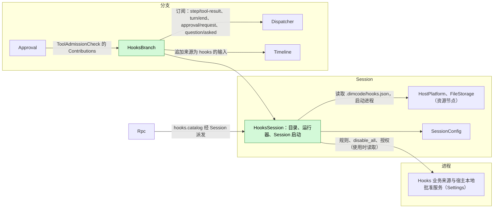
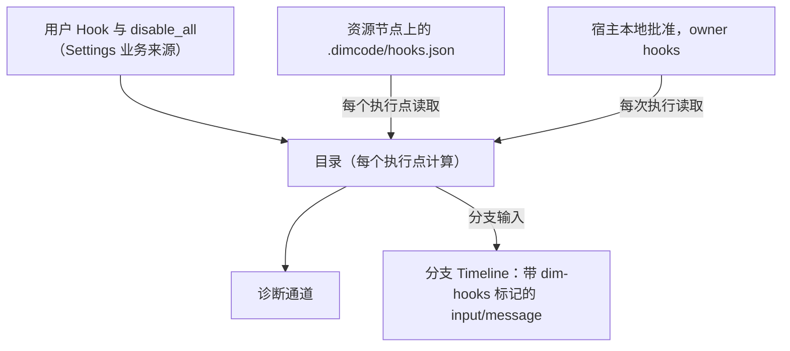
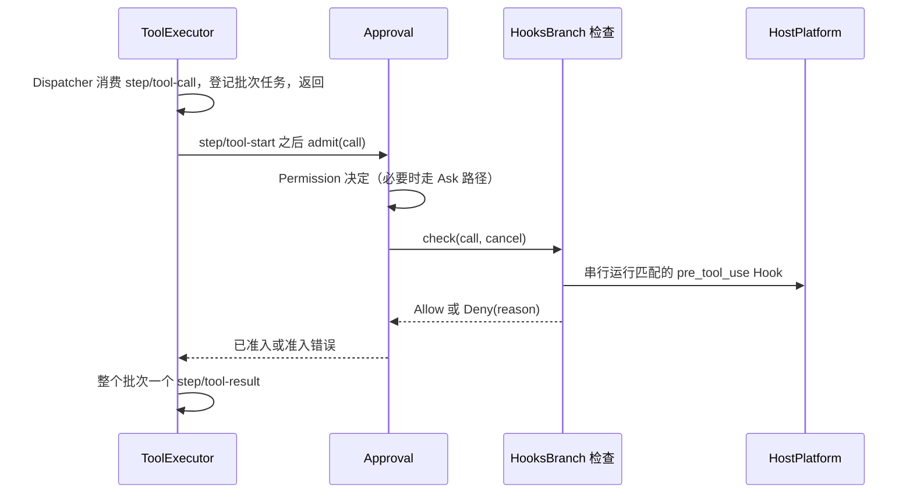
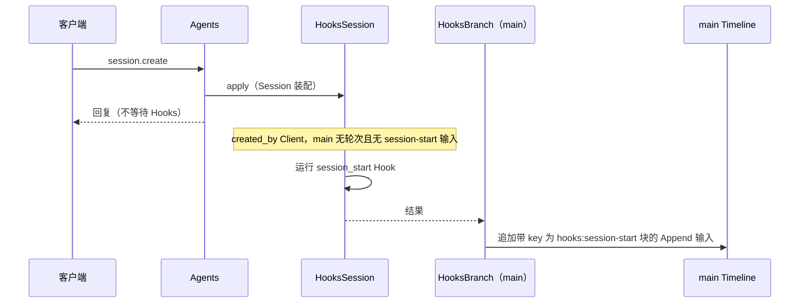
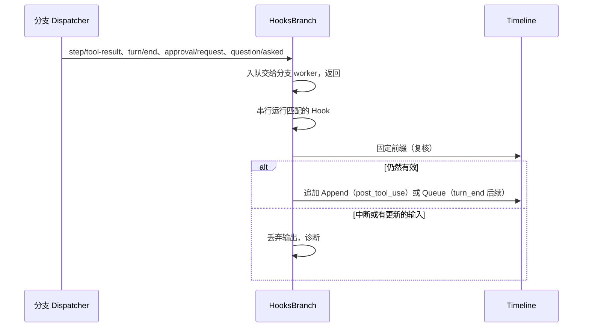

# Hooks

状态：草案。总体设计：[overview](../overview.md)（Hooks）。阶段：P2（用户与项目来源）；插件来源在 #3 之后。语言：Rust。作用域：[ADR 002](../../adr/002-plugin-scope.md)（Session + 分支）。

Hooks 在 Session 工作的固定节点运行用户配置的命令，不新增任何 Timeline 事件。其 Session 部件持有规则（从业务来源与项目文件读取）并运行 Session 启动 Hook；其分支部件贡献一个 `ToolAdmissionCheck`，供 Approval 在每次工具调用前查询，并从分支 Dispatcher 运行工具后、轮次结束与通知 Hook。命令经 Session 的 `HostPlatform`（其资源节点）运行；输出只以来源为 `hooks` 的分支输入进入上下文。

## 1. 结构



| 部件 | 作用域 | 依赖 | 提供 |
| --- | --- | --- | --- |
| `HooksSession` | Session（仅启用时安装） | Settings 业务来源（`hooks` 文档）与宿主本地批准服务；Session 的 `HostPlatform` 与 `FileStorage`；`SessionConfig` | Session 服务 `HooksRuntime`（目录与命令运行器，供 `HooksBranch` 使用）；带 `hooks.catalog` 的 `S:SessionMethodContribution[hooks]`，级别 `management`；`main` 的 Session 启动 Hook 结果 |
| `HooksBranch` | 分支 | `HooksRuntime`、分支 Dispatcher 与 Timeline | `B:ToolAdmissionCheck[hooks]`，以 `AgentBuilder::tool_admission_check("hooks")` 注册，由 Approval 经 `Contributions<ToolAdmissionCheck>` 收集（[session-boundary](../contracts/session-boundary.md)） |

**重载。** Approval 依赖 `hooks` 检查，因此只要 Hooks 已安装，任何工具调用都不会在缺少该检查的情况下获准；不存在单独的失败即拒绝记录。启用、禁用或升级 Hooks，或 Settings 重载，会重载 Hooks 各部件以及 Approval 及其依赖方，使在途轮次失败；这是可接受的（[ADR 002 D3](../../adr/002-plugin-scope.md)）。编辑规则、授权或 `disable_all` 属于业务配置，从不重载（[D4](../../adr/002-plugin-scope.md)）。

**依赖的契约：** `ToolAdmissionCheck` 与 `SessionMethodContribution`（[session-boundary](../contracts/session-boundary.md)）；Session `HostPlatform` 与 `FileStorage`（既有）；Settings 业务来源与宿主本地批准服务。**本文定义的契约：** Hook 配置格式、命令协议、`hooks.catalog`、来源名 `hooks`（标记 `dim-hooks`，key 命名空间 `hooks:`）。

## 2. 数据与状态



Hooks 不拥有 `StateCell`。目录在每个执行点从其来源重新计算（A6）；授权在每次执行时读取，从不作为权威缓存；后续计数从固定前缀推导。运行中的进程位于 `ctx.effect` 之下，重载或重启后从不重新运行。

## 3. 流程

### 3.1 工具前检查



检查在所有提交锁与 Dispatcher handler 之外运行，且不写入任何内容；终态事实由 ToolExecutor 写入。Hook 出错时应用 `on_error`，`pre_tool_use` 的默认值为 `deny`。被取消的检查返回 deny。

### 3.2 Session 启动



Session 启动为失败即放行，只对尚未开始轮次的 `created_by = Client` Session 运行（A24、A25）。其上下文在写入后进入下一次模型请求，这可能晚于第一条用户输入。

### 3.3 观察类 Hook



Dispatcher 按顺序投递分支事件，因此在分支部件加载期间不会跳过任何事件；在其重载期间派发的事件不运行。

## 4. 时序与冲突


`step/tool-start` 之后的中断总是胜过已完成的 Hook。

| 场景 | 序号顺序 | 结果 | 负责方 |
| --- | --- | --- | --- |
| 轮次结束后续对比用户输入或 Goal 延续 | `turn/end` < 其他输入 < Hook 写入 | 复核看到该输入：不写入。若两者都在对方写入前读取，则两条 Queue 输入都成立 | Hooks、InputQueue |
| 后续被用户撤回 | 后续 < `input/withdrawn` | 不被消费；不计数 | InputQueue、Hooks |
| Hooks 或 Settings 重载 | — | Approval 随之重载；在途轮次失败（D3） | Lifecycle |
| 资源节点离线 | 每次调用 | 工具前 → `on_error`（deny）；观察 → 诊断 | Hooks |

完整表格见附录 B。

## 5. 上下文映射

| 来源 | 模型所见 | 位置 | 压缩 | 子分支 |
| --- | --- | --- | --- | --- |
| `session_start` | 一条 Append 输入：标记 `<dim-hooks kind="session-start">`，每个 Hook 一个 raw 块，key 为 `hooks:session-start/<source>/<id>` | 写入后的下一次模型请求 | 每个 key 重放最新块 | 在切出点仍有效则继承 |
| `pre_tool_use` deny | `ToolResult.content` 中的错误文本 | 批次结果中该调用的位置 | 仅摘要 | 若在切出点之前 |
| `post_tool_use` | Append 输入，标记 `kind="post-tool" call_id tool` | 本轮次的下一次模型请求 | 仅摘要 | 同输入 |
| `turn_end` | Queue 输入，标记 `kind="follow-up"` | 其驱动的轮次开头 | 仅摘要 | 同输入 |
| `notification` | 无 | — | — | — |

非交互 Session：相同，只是 Session 启动 Hook 仅对 `created_by = Client` 运行。模型从不看到配置、命令、退出码、stderr（deny 原因除外）、批准或诊断。

## 6. 接口（摘要）

| 接口 | 类型 | 用途 |
| --- | --- | --- |
| `hooks` | `ToolAdmissionCheck`（分支） | 运行 `pre_tool_use` Hook；拒绝或允许 |
| `hooks.catalog {sessionId}` | `SessionMethodContribution`，级别 `management` | Session 的生效 Hook 及其批准状态 |
| `hooks` 文档 | Settings 业务来源 | 用户 Hook、`disable_all`、启用覆盖 |
| 授权 | Settings 宿主本地批准服务 | 批准或撤销项目与插件 Hook |
| 配置格式、命令协议 | 本文定义 | 附录 A |

## 7. 安全

用户 Hook 无需批准即可运行。项目与插件 Hook 只有在 Settings 宿主本地批准服务中存在授权时才运行，记录为 `{owner: hooks, node, workspace, source, id, event, tools, fingerprint}`，fingerprint = 对不含 `enabled` 的规范化条目计算的 SHA-256；读取配置不授予任何权限，重放、分叉与恢复从不恢复授权。命令在 Session 的资源节点上运行，由 HostPlatform 施加该节点的隔离；Hook 不经 Permission 准入，也从不扩大权限：任何结果都不会准入被 Permission 或用户拒绝的调用，任何输出都不会修改工具输入。stdin 可能包含提示词与工具输入；诊断只保留 Hook id、退出状态、耗时与有界的 stderr 摘录。

## 附录 A. 接口细节

### A.1 配置格式

每个来源一个 JSON 文档，用户配置（Settings 中的 `hooks` 文档）与项目文件 `.dimcode/hooks.json` 形态相同：

```json
{
  "version": 1,
  "hooks": [
    { "id": "guard-writes", "event": "pre_tool_use", "tools": ["write", "edit", "mcp__fs__*"],
      "command": "./scripts/guard.sh", "timeout_ms": 10000, "on_error": "deny", "enabled": true }
  ]
}
```

| 字段 | 类型 | 规则 |
| --- | --- | --- |
| `version` | `1` | 其他值使文档无效（A1） |
| `id` | string `[a-z0-9][a-z0-9_-]{0,63}` | 在来源内唯一；授权与覆盖的标识 |
| `event` | `session_start` \| `pre_tool_use` \| `post_tool_use` \| `turn_end` \| `notification` | 必填（A4） |
| `tools` | 名称模式的字符串数组 | 仅 `pre_tool_use`/`post_tool_use`；`*` 匹配任意字符序列；省略 = 所有工具（A5） |
| `kinds` | `approval` \| `question` 的数组 | 仅 `notification`；省略 = 两者（A15） |
| `command` | string | 由节点的执行 shell 运行，工作目录为 `SessionConfig.cwd`（A8） |
| `timeout_ms` | 整数 100..=600000 | 默认 60000（A10） |
| `on_error` | `allow` \| `deny` | 仅 `pre_tool_use`；默认 `deny` |
| `enabled` | bool | 默认 `true` |

无效条目列为 `invalid`，从不运行。每个事件的顺序：用户、项目、插件来源，然后按文档顺序（A12）。

### A.2 命令协议

| 通道 | 内容 |
| --- | --- |
| stdin | 一个 UTF-8 JSON 对象，然后 EOF：`{version: 1, event, hook_id, source, session_id, branch_id, cwd, resource_node, ...event fields}` |
| 环境变量 | HostPlatform 过滤后的基础环境，加上 `DIM_HOOK_EVENT`、`DIM_SESSION_ID`、`DIM_PROJECT_DIR`（A8） |
| 退出码 0 | 成功。stdout 为空或一个 JSON 对象（`decision`、`reason`、`context`、`follow_up`）；非 JSON 的 stdout 对 `session_start` 视为 `context`，其他事件忽略（A13） |
| 退出码 2 | 对 `pre_tool_use` 为阻止，stderr（前 2 KiB）作为原因；对其他事件为错误 |
| 其他退出码、信号、超时、启动失败、stdout 超过 64 KiB、节点不可用 | 错误：诊断；`pre_tool_use` 应用 `on_error` |

事件字段：`pre_tool_use {turn_id, request_id, call_id, tool, input, risk}`；`post_tool_use {turn_id, call_id, tool, input, result: {text, is_error}}`；`turn_end {turn_id, outcome, reason}`；`notification {kind, approval_id | call_id, tool?}`；`session_start {}`。`context` 与 `follow_up` 各至多 16 KiB（A13）。

### A.3 结果

| 事件 | 允许 / 成功 | 拒绝 | `context` | `follow_up` |
| --- | --- | --- | --- | --- |
| `session_start` | — | 不支持 | 带 key 的 raw 块，Append | 忽略 |
| `pre_tool_use` | 进入下一个检查 | 以 `Hook <source>/<id>: <reason>` 拒绝 | 忽略（A16） | 忽略 |
| `post_tool_use` | — | 不支持 | 批次之后的 Append 输入 | 忽略 |
| `turn_end` | — | 不支持 | 忽略 | Queue 输入，有界（A14） |
| `notification` | — | 不支持 | 忽略 | 忽略 |

结果只作为其他所有者的事实记录：拒绝是该调用的错误结果（ToolExecutor）；上下文与后续是来源为 `hooks` 的 `input/message`；执行记录进入诊断。

### A.4 `hooks.catalog`

| 参数 | 结果 |
| --- | --- |
| `{sessionId}` | 按来源列出的 Hook：`id`、`source`、`event`、匹配器、`command`、`enabled`、`approval`（`notRequired` \| `required` \| `approved`）、`approvalToken`、`invalid?`；全局 `disabled` |

批准或撤销通过 Settings 宿主本地批准服务使用 `approvalToken`；启用与 `disable_all` 是对 `hooks` 文档的类型化 Settings 操作（A9）。

### A.5 机制

| 路径 | 机制 |
| --- | --- |
| 工具前 | ToolExecutor 追加 `step/tool-start` 并等待 `Approval::admit`；后者在走完自身请求路径（若为 Ask）后等待各贡献的检查。Hooks 不写入任何内容 |
| Session 启动 | 满足条件时由 `HooksSession::apply` 启动运行（A25）；`main` 上的 `HooksBranch` 经其 Timeline 追加一条带标记与带 key 块的 Append 输入；Agents 从不等待 |
| 观察 | `HooksBranch` 在分支 Dispatcher 上订阅；handler 入队后返回；每个分支一个 worker，按序号顺序串行运行（A20） |
| 复核 | 写入前：对 `post_tool_use`，工具结果之后无 `stop/interrupt`；对 `turn_end`，`turn/end` 之后无 `stop/interrupt` 且无未撤回的 `input/message`，且连续未撤回的后续少于 3 条（A14） |
| 重载或重启 | 运行中的进程由 `ctx.effect` 终止；不重新运行任何 Hook；待写入的后续丢失 |

## 附录 B. 完整冲突表

| 场景 | 序号顺序 | 结果 | 负责方 |
| --- | --- | --- | --- |
| 工具前 Hook 运行时的轮次 `stop/interrupt` | `step/tool-start` < interrupt | 进程树终止；结果 cancelled；输出丢弃 | Approval、ToolExecutor |
| 准入前中断 | interrupt < `step/tool-call` 消费 | 不运行 Hook | ToolExecutor |
| 工具前 Hook 期间分支中断或关闭 | 分支中断 | 同轮次中断 | Approval、ToolExecutor |
| 批次中某一调用被工具前拒绝 | — | 该调用为错误结果；其他调用运行；一个 `step/tool-result` | ToolExecutor |
| 批次的 `post_tool_use` | `step/tool-result` | 整个批次之后；每个匹配调用运行一次 | Hooks |
| 工具后上下文对比随后的中断 | result < interrupt < write | 不写入 | Hooks |
| 轮次结束后续对比用户输入 | `turn/end` < input < write | 不写入 | Hooks |
| 轮次结束后续对比 Goal 延续 | 两者都在对方写入前读取 | 两者都写入；各至多多一轮（可接受） | InputQueue |
| 后续或工具后输入被撤回 | input < `input/withdrawn` | 从不被消费；不计数 | InputQueue、Hooks |
| 并发 Steer/Queue/Append | Timeline 顺序 | 按模式以序号顺序应用 | InputQueue |
| 压缩 | — | Session 启动的带 key 块重放；其他通过摘要 | 历史投影 |
| 子分支在 Hook 输入与消费之间切出 | input < cut < consumed | 子分支不采纳它；不重新运行 | InputQueue |
| 子分支 | — | 有自己的 `HooksBranch` 与检查 | Hooks |
| Hook 运行时授权被撤销或文件被编辑 | — | 运行中的进程完成；后续执行遵循新状态 | Hooks |
| Hooks、Approval 或 Settings 重载 | — | Approval 及其依赖方重载；在途轮次失败；窗口期内的事件不运行（D3） | Lifecycle |
| Session 恢复或卸载 | — | 一旦存在轮次或 session-start 输入，Session 启动不再运行（A25） | Hooks |
| 由 launch、Collaboration 或分叉创建的 Session | `created_by` ≠ `Client` | 无 Session 启动 | Hooks |
| Session 启动写入前已有第一条用户输入 | input < Hooks Append | 上下文从下一次模型请求起生效 | InputQueue |
| 资源节点离线 | — | 工具前：`on_error`；项目文件不可读 → 跳过项目 Hook，诊断；观察：诊断 | Hooks |
| 客户端分离 | — | 无影响 | — |

## 附录 C. 错误与恢复

| 情形 | 结果 |
| --- | --- |
| 超时 | 进程树终止；错误；`pre_tool_use` 应用 `on_error` |
| 未批准的项目或插件 Hook | 跳过；诊断 |
| 批准服务不可读 | 失败即拒绝：项目与插件 Hook 不运行 |
| 文档无效 | 标记为无效；其中的 Hook 均不运行 |
| Append 被拒（分支已关闭） | 输出丢弃；诊断 |
| 取消 | 终止进程树，等待释放，然后返回 |

## 附录 D. 验收

1. A.2 中每种退出码与 stdout 情形按事件逐一覆盖，包括超时与 `on_error`。
2. 三调用批次中的工具前拒绝：一个错误结果，其他调用执行，单个 `step/tool-result`。
3. 工具前 Hook 期间中断：进程终止；结果 cancelled。
4. `.dimcode/hooks.json` 中的项目 Hook：批准前不运行；批准后运行；文件变更后停止。
5. Session 启动上下文在压缩后保留；恢复时以及对 launch、member 或分叉 Session 不运行。
6. 中断后的工具后上下文不写入；后续在达到上限、出现用户输入后停止，并忽略已撤回的后续。
7. 编辑规则或 `disable_all` 在下一个执行点生效，无需重载。
8. 资源节点离线：只有该 Session 的 Hook 失败。

## 附录 E. 假设

| # | 假设 | 依据 | 若被否决的影响 |
| --- | --- | --- | --- |
| A1 | 每个来源一个带版本的 JSON 文档 | 判断 | 格式改变 |
| A4 | 五种事件：Session 启动、工具前/后、轮次结束、通知 | ADR 002 作用域 | 用户提交 Hook 需要提交机制 |
| A5 | 工具名称模式只支持 `*` 通配 | 判断 | 正则匹配 |
| A6 | 项目文件在每个执行点重新读取 | 判断 | 需要文件监视器 |
| A8 | 在 Session cwd 中用节点 shell 运行，基础环境加三个变量，无 `env` | 判断 | 带引用的环境变量配置 |
| A9 | 项目与插件 Hook 的启用覆盖是宿主本地的 Settings 数据 | 判断 | 只有用户 Hook 可单独禁用 |
| A10 | 默认超时 60 s，范围 0.1–600 s | 判断 | 数值改变 |
| A12 | 顺序：用户、项目、插件、文档顺序 | 判断 | 其他顺序 |
| A13 | stdout 为 JSON 或纯文本；stdout 64 KiB，每项输出 16 KiB | 判断 | 限制改变 |
| A14 | `turn_end` 后续会启动一个轮次，至多连续 3 次 | Goal 先例 | 无后续 |
| A15 | 通知 Hook 作用于 `approval/request` 与 `question/asked` | 判断 | 其他触发 |
| A16 | 工具前 Hook 不能注入上下文或修改输入 | 从不扩大权限 | 输入改写规则 |
| A20 | 观察类 Hook 在每个分支内串行运行 | 判断 | 注入顺序可能不同 |
| A24 | Session 创建不等待 Session 启动 Hook；其上下文可能晚于第一条输入 | 产品决定 | 阻塞式创建 hook |
| A25 | 当 `main` 没有 `turn/start` 且没有 session-start 输入时运行 Session 启动；在第一轮次前恢复可能再次运行 | 判断 | 需要创建通知 |

## 附录 F. 待对齐问题

| 问题 | 说明 |
| --- | --- |
| 用户提交 Hook | 在 ADR 002 下，拒绝或标注一次提交没有既有机制；不提供 `user_prompt_submit` |
| 插件来源 | 从 PluginManager 的包内容读取插件提供的 Hook 依赖 #3 |
| 远程资源节点 | 为 Session 使用对等节点的 `HostPlatform` 依赖 #5 |
