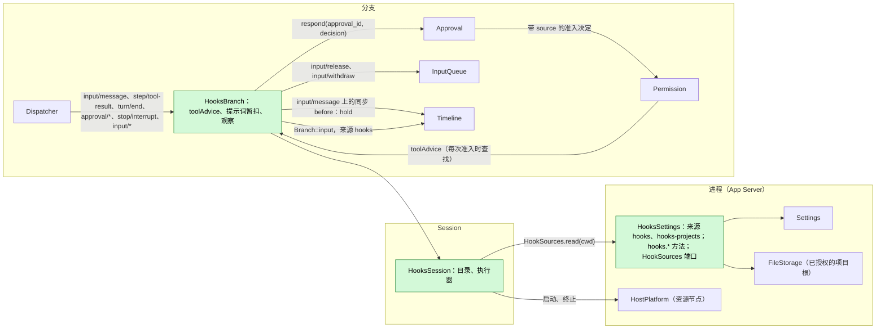
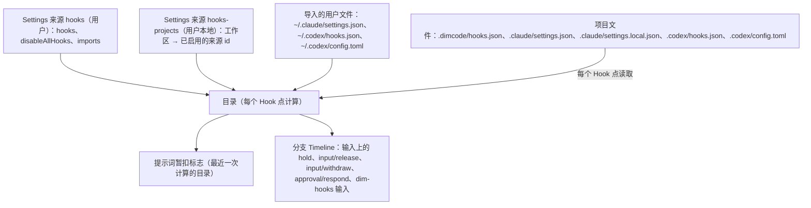
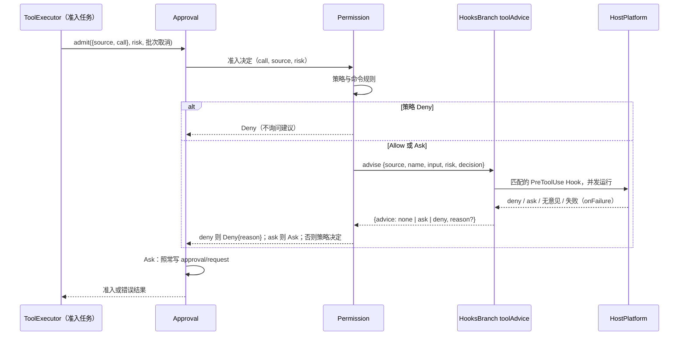
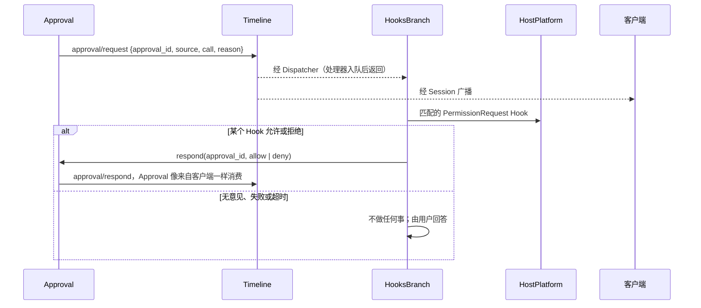
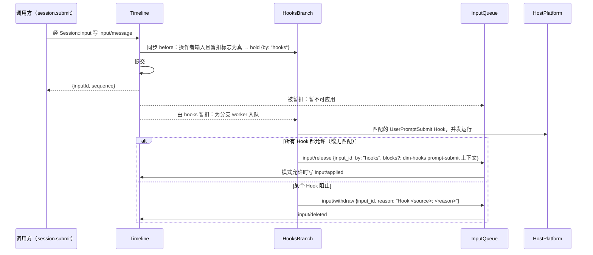
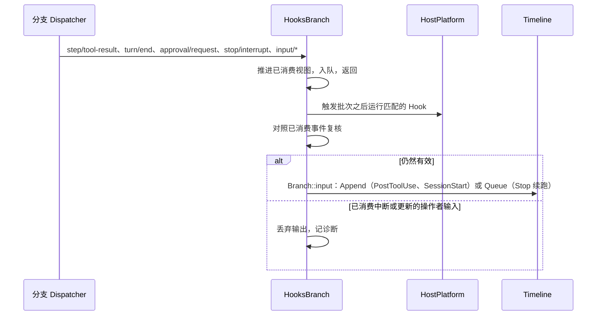

# Hooks

状态：草案，Ready 候选（[#143](https://github.com/arcships/dim/issues/143)）；达到 Ready 还差 §10。总体设计：[overview](../overview.md)（Hooks）。阶段：M2（用户与项目来源）；插件来源在 #3 之后。语言：Rust。作用域：[ADR 002](../../adr/002-plugin-scope.md)（进程 + Session + 分支）。

Hooks 在 Session **业务操作**的固定节点运行用户配置的命令（Claude Code、Codex 与 Dim 的 Hook 文档），并把每个命令的决定交给该操作的所有者。它是第三方兼容机制：为 Claude Code 或 Codex 编写的 Hook 文档，在 Dim 有相同操作的地方原样运行（附录 G）。

Hooks 从不挂在基础设施上。已撤回的设计（[#21](https://github.com/arcships/dim/issues/21)）让 Timeline `before` 回调变成异步，以便命令扣住一次写入；本设计不这样做。Timeline、Dispatcher、事件信封与装配都不变，Hooks 注册的唯一 before 回调是同步的，只设置一个字段。每个 Hook 点改为挂在本来就决定该操作的业务所有者上，经由该所有者的公开事件或服务：

| Hook 点 | 业务操作 | 作决定的所有者 | Hook 的决定如何到达所有者 |
| --- | --- | --- | --- |
| `PreToolUse` | 工具调用的准入 | Permission（由 Approval 的 `admit` 调用） | Permission 在准入决定中询问 Hooks 的 `toolAdvice` 服务（新的通用建议端口，A.6.1） |
| `PermissionRequest` | 审批提问 | Approval | Hooks 像客户端一样经 Approval 的公开 `respond` 回答（现有） |
| `UserPromptSubmit` | 操作者输入的采用 | InputQueue | InputQueue 暂扣该输入；Hooks 写 `input/release` 或 `input/withdraw`（新的通用暂扣，A.6.2） |
| `PostToolUse`、`PostToolUseFailure`、`Stop`、`SessionStart` | 工具结果后、turn 后、Session 启动时的上下文 | InputQueue（输入） | Hooks 写来源为 `hooks` 的分支输入（现有） |
| `Notification` | 等待用户的审批 | —（观察） | 不向任何所有者传递（现有） |

命令经 HostPlatform（Session 的资源节点）运行；Hook 命令只在 Hooks 自己的任务或所有者自己的任务中等待（Permission 的准入决定运行在 ToolExecutor 按调用的准入任务中），从不在 Dispatcher 处理器内或提交锁下等待。契约以语言中立形式给出（[ADR 002 D5](../../adr/002-plugin-scope.md#d5-合同语言中立)）；Rust 绑定见附录 H。

### 所有者检查

每个 Hook 点都对照了其所有者今天在 `main` 上暴露的内容：

| Hook 点 | 所有者现状 | 缺口 | 解决办法 |
| --- | --- | --- | --- |
| `PreToolUse` | `Approval::admit(AdmitCall {source, call}, risk, cancel)` 为准入调用 `Permission::decide(call, risk, cancel)`，并在允许后的复核中再次调用；`decide` 已经会等待命令规则端口；Deny 变成 `HostError::failed(reason)`，即该调用结果的错误文本 | `decide` 无法询问其他方，也收不到 `source`（调用 id 只在 `AdmitCall.source` 中）；它分不清准入与复核 | A.6.1：Approval 只在准入决定时传入 `source`；Permission 在那里询问 `toolAdvice`。ToolExecutor 无需改动 |
| `PermissionRequest` | `approval/request {approval_id, source, call, reason}`；`Approval::respond(approval_id, decision)` 接受消费到的第一个回应，否则 `Unknown`/`Cancelled`/`Closed`；`approval/respond {approval_id, decision}` 没有 reason | 拒绝时没有原因 | 可直接使用；拒绝原因见 §10 决定 7 |
| `UserPromptSubmit` | InputQueue 在消费其 `input/message` 的 Dispatcher 步骤内应用 Steer、Append 或空闲 Queue 输入；`InputQueue::withdraw(InputWithdrawData {input_id, reason?})`（reason 最多 2048 字节） | 命令运行期间无法让已提交的输入保持未应用 | A.6.2（暂扣与放行） |
| `PostToolUse(Failure)` | `step/tool-result {turn_id, request_id, call_event_id?, results: [{call_id, result}]}`、`ToolResult.is_error` | 无 | Dispatcher 订阅 |
| `Stop` | `turn/end {turn_id, status: completed \| failed \| cancelled}` | 无 | Dispatcher 订阅，仅 `completed` |
| `SessionStart` | 没有 Session 启动事实；有 `branch/start`，以及 `main` 上没有 `turn/start` | 无需 | 由历史推导（§3.4） |
| `Notification` | `approval/request` | 无 | Dispatcher 订阅 |
| `PreCompact`、`PostCompact` | `context/compaction-start {trigger: threshold \| provider_output_budget_exhausted \| manual}`（策略已被调用）、`context/compaction {outcome}` | 阻止（Claude 中 `PreCompact` 退出 2）需要 ContextCompaction 中的压缩准入端口 | 暂不支持（§10 决定 6） |
| `SessionEnd` | Session 关闭是生命周期，不是 Timeline 事实；工作必须在服务移除前结算（AGENTS 规则 8） | 关闭时运行命令会拖延关闭 | 不支持 |
| 配置 | Settings 的 `BusinessDocument` 来源，带 CAS；Rust 来源没有通用的客户端写入（`settings.update` 只服务已声明的 TypeScript 来源），所以每个 Rust 所有者保留自己的管理方法（MCP：`mcp.catalog`、`mcp.set_enabled`，项目启用在 `mcp-projects`）；项目根由 Settings 授权并由受信任的宿主向 FileStorage 注册 | 早先草案经 `settings.update` 写启用状态，并经“Session 的 FileStorage”读文件，两者都不存在 | App Server 中的 `HooksSettings`，仿照 MCP（§1、A.7） |

## 1. 结构



| 部件 | 作用域 | 依赖 | 提供 |
| --- | --- | --- | --- |
| `HooksSettings` | 进程，App Server（Settings 与 MCP 的管理所在之处） | Settings（`BusinessDocument` 来源 `hooks`、`hooks-projects`）；FileStorage（Settings 已授权的项目根；用户的 `~/.claude`、`~/.codex` 文件） | 管理方法 `hooks.catalog`、`hooks.save`、`hooks.set_enabled`（A.7）；返回某个 `cwd` 生效来源的 Session 端口 `HookSources`（A.2） |
| `HooksSession` | Session（仅启用时装入） | `HookSources`；HostPlatform；`SessionConfig.cwd` | 供 `HooksBranch` 使用的私有目录与命令执行器 |
| `HooksBranch` | 分支 | `HooksSession` 的执行器；分支 `Timeline`（一个同步 before 回调）、`Dispatcher`、`Approval`、InputQueue 的分支输入服务、`Branch::input` | 供 Permission 消费的分支服务 `toolAdvice`（键 `hooks`）；提示词暂扣及其结算；观察类 Hook |

`HookSources` 沿用 `CommandRulesHost` 与 `SkillSettingsHost` 的现有宿主端口模式：agent 侧部件从不提及 Settings、FileStorage 或 App Server。Permission 每次准入时查找 `toolAdvice`，不依赖 Hooks（[ADR 002 D3](../../adr/002-plugin-scope.md#d3-依赖跟随作用域并从扩展指向核心)）：没有 Hooks 时按现状决定。InputQueue 只暂扣草稿带 `hold` 的输入，而只有已注册的 before 回调会设置它；没有 Hooks 时什么都不暂扣。

**重载。** 启用、停用或升级 Hooks 只重载 Hooks 部件（D3）。在 `HooksBranch` 的服务被移除前，它结算已接受的工作（AGENTS 规则 8）：终止运行中的命令，并按当时运行的 Hook 的 `onFailure` 放行或撤回它暂扣的每个输入（A.5）。建议尚未返回的调用会看到建议调用被丢弃，Permission 在没有建议的情况下决定；它正在回答的审批留给用户。Hooks 未装载期间的写入不经过 Hooks（A14）。编辑 Hook 文档、启用状态或 `disableAllHooks` 是业务配置，在下一个 Hook 点读取，从不重载（[D4](../../adr/002-plugin-scope.md#d4-结构性配置与业务配置分离)）。

**节点。** 资源节点离线时，启动进程与读文件以 `node_unavailable` 失败；每个 Hook 点把它当作 Hook 失败处理（附录 C）。

**依赖的契约：** `Approval::admit` 与 `AdmitCall.source`、`Permission::decide` 与提议的建议端口（A.6.1）；Approval 的 `respond` 与 `approval/request`、`approval/respond`、`approval/cancelled` 事实；带提议 `hold` 字段的 `input/message` 契约与提议的 `input/release` 指令（A.6.2）；`input/withdraw {input_id, reason?}` 与 `input/deleted`（[Session 访问 A.4](../contracts/session-access.md#a4-撤回)）；`step/tool-result`、`turn/start`、`turn/end`、`stop/interrupt`（只读）；来源输入约定（[Session 访问 A.2](../contracts/session-access.md#a2-来源输入约定)）；同步 `Timeline::before`（不变）；Settings 的 `BusinessDocument` 与 `settings.changed`；App Server 的 `ManagementMethods`；HostPlatform 的 `build_process_spec` 与进程监管。**本文定义的契约：** Hook 文档格式、命令协议、Hooks 给出的 `toolAdvice` 回复、`hooks.*` 方法、`HookSources`、来源名 `hooks`（标记 `dim-hooks`，键命名空间 `hooks:`）。Hooks 不声明任何事件。

## 2. 数据与状态



Hooks 不拥有 `StateCell`，不声明事件。目录在每个 Hook 点从 `HookSources` 重新计算（A6）。唯一的缓存值是每个 Session 一个标志“存在已启用的 `UserPromptSubmit` Hook”，取自最近一次计算的目录，并在 `hooks` 与 `hooks-projects` 的 `settings.changed` 时刷新，因为同步 before 回调不能读文件（A15）。Hooks 据以决定的其他一切都是它经 Dispatcher 订阅消费到的分支事实：被暂扣的输入及其结算、审批请求、工具结果、turn 与中断。因此重载后的 `HooksBranch` 从历史重建其未结工作（它暂扣的输入）；命令是副作用，从不重跑。

## 3. 流程

### 3.1 经 Permission 的 PreToolUse



等待发生在 Permission 的异步决定内，它本来就运行在 ToolExecutor 按调用的准入任务中，也本来就等待一个宿主端口（命令规则）。Timeline 与 Dispatcher 上没有任何等待。Hook 只能收紧：`deny` 让 Permission 以 `Hook <source>: <reason>` 拒绝，Approval 将其作为 `HostError::failed` 返回，ToolExecutor 在批次 `step/tool-result` 中把它写为该调用的错误文本；`ask` 把 Allow 变成审批提问。Hook 不能放行；放宽经 `PermissionRequest`（§3.2），并记录为 `approval/respond` 事实。用户回应后 Approval 的复核是普通决定，不再询问建议。中断取消批次令牌，Permission 丢弃建议调用，Hooks 终止命令。工具在请求绑定中未知的调用在 `admit` 之前就失败，不运行任何 Hook。

### 3.2 经 Approval 的 PermissionRequest



这与 Rpc 的 `approval.respond` 使用 Approval 的方式完全相同。由 Approval 决定：它接受消费到的第一个回应，对之后的回应答 `Unknown`，允许后复核策略。若用户先回答，或 Approval 写了 `approval/cancelled`（中断、关闭），Hooks 消费到后终止命令。客户端先看到请求，再像看到其他回应一样看到 Hook 的 `approval/respond`。

### 3.3 经 InputQueue 的 UserPromptSubmit



before 回调是同步的，不等待：当标志表明可能有提示词 Hook 适用时，它只给操作者输入的草稿（用户内容、无来源标记）加上通用的 `hold` 字段。命令在提交后于 `HooksBranch` 的 worker 中运行，每条分支串行，所以放行顺序与提交顺序一致。在放行或撤回之前，InputQueue 不应用该输入，排在它后面的 Queue 输入等待；Loop 看不到它。放行时，InputQueue 让该输入按其模式可应用，如同此刻才到达，放行块放在输入自身的 raw 块之后、用户内容之前。阻止时，输入在应用前被删除，因此从不进入上下文；客户端显示 `input/withdraw` 的原因，Hooks 会把它截断到 InputQueue 的 2048 字节上限。用户对被暂扣输入的撤回（`session.input.withdraw`）照常生效；Hooks 消费到 `input/deleted` 后终止命令，不写任何东西。

### 3.4 观察与上下文类 Hook



`PostToolUse` 对 `step/tool-result` 批次中结果不是错误的每个匹配调用运行，`PostToolUseFailure` 对结果为 `is_error` 的每个匹配调用运行；一个批次写一个 Append 输入。`Stop` 在结果为 `completed` 的 `turn/end` 上运行；阻止会写一个携带原因的 Queue 续跑输入，连续最多 3 次（A11）。`SessionStart` 在 `main` 的历史中没有 `turn/start` 且没有 `hooks:session-start/*` 带键块时运行一次；其 Append 输入与任何空闲 Append 一样，等待第一个驱动输入。`Notification` 在 `approval/request` 上运行，不写任何东西。带 `async: true` 的处理器可在上述任何点运行，没有任何东西等待或读取它们的输出。

## 4. 时序与冲突

| 场景 | 序号顺序 | 结果 | 所有者 |
| --- | --- | --- | --- |
| PreToolUse 运行时中断 | 批次取消 | Permission 丢弃建议；命令终止；调用按取消结算 | ToolExecutor、Permission |
| 用户先于 PermissionRequest Hook 回答 | `approval/respond`（用户）< Hook 的 respond | Hook 的 respond 得到 `Unknown`；消费到用户回应时终止命令 | Approval |
| 提示词被暂扣时中断 | 输入（暂扣）< `stop/interrupt` | Hooks 撤回该输入（`Interrupted before Hooks finished`）；不会由它开启 turn | Hooks、InputQueue |
| 用户撤回被暂扣的提示词 | 输入 < `input/deleted` | 命令终止；Hooks 不写任何东西 | InputQueue |
| 排在被暂扣 Queue 输入后的 Queue 输入 | 暂扣 < 后者 | 后者等待；保持先进先出 | InputQueue |
| Stop 续跑与更新的操作者输入 | `turn/end` < 输入被消费 < 写入 | 不写续跑 | Hooks |
| 提示词被暂扣时 Hooks 重载 | — | 卸载前按 `onFailure` 结算；卸载期间写入的输入不被暂扣（A14） | Hooks、生命周期 |
| 带被暂扣提示词的崩溃 | — | 下次装载 `HooksBranch` 时按 `onFailure` 结算；若 Hooks 不再装载则由用户撤回（D3：不为崩溃设计） | Hooks |
| 资源节点离线 | 按调用 | `node_unavailable` = Hook 失败 → `onFailure` | Hooks |

完整表格：附录 B。

## 5. 上下文映射

| 来源 | 模型看到什么 | 位置 | 压缩 | 子分支 |
| --- | --- | --- | --- | --- |
| `SessionStart` 上下文 | Append 输入，标记 `<dim-hooks kind="session-start">`，每个 Hook 一个带键 `hooks:session-start/<source>/<n>` 的 raw 块 | 随第一个驱动输入 | 每个键重放最新块 | 切点处仍有效则继承 |
| `UserPromptSubmit` 上下文 | 放行块，标记 `<dim-hooks kind="prompt-submit">`，每个 Hook 一个 | 在被放行的输入内，用户内容之前 | 仅摘要 | 同输入 |
| `UserPromptSubmit` 阻止 | 无：输入在应用前被删除 | — | — | — |
| `PreToolUse` 拒绝 | ToolExecutor `step/tool-result` 中的错误文本 `Hook <source>: <reason>` | 与调用配对 | 仅摘要 | 在切点之前则有 |
| `PermissionRequest` | 除 Approval 的普通结果外无 | — | — | — |
| `PostToolUse(Failure)` 上下文或阻止原因 | Append 输入，标记 `kind="post-tool"`，带 `call_id` 与 `tool` | 本 turn 的下一次模型请求 | 仅摘要 | 同输入 |
| `Stop` 阻止原因 | Queue 输入，标记 `kind="follow-up"` | 它驱动的 turn 开始处 | 仅摘要 | 同输入 |
| `Notification`、`async` 处理器 | 无 | — | — | — |

模型从不看到 Hook 配置、命令、退出码、诊断或撤回原因。

## 6. 接口（摘要）

| 接口 | 类型 | 用途 |
| --- | --- | --- |
| `toolAdvice` 键 `hooks` | 由 `HooksBranch` 提供、Permission 查找的分支服务（A.6.1） | `PreToolUse` 决定 |
| `input/message` 上的同步 before | 分支 Timeline 注册（机制不变） | 设置 `hold {by: "hooks"}` |
| `input/release`、`input/withdraw` | 经 InputQueue 分支输入服务发给 InputQueue 的指令 | `UserPromptSubmit` 结果 |
| `Approval.respond` | 现有分支服务 | `PermissionRequest` 结果 |
| `hooks.catalog`、`hooks.save`、`hooks.set_enabled` | App Server 管理方法（键 `hooks`），与 `mcp.*` 类似 | 生效的 Hook、用户文档写入、项目启用（A.7） |
| `HookSources` | App Server 绑定的 Session 端口 | 某个 `cwd` 的生效来源（A.2） |
| `hooks`、`hooks-projects` | Settings 来源（`BusinessDocument`） | 用户文档；用户本地的项目启用（A.1、A.2） |
| Hook 文档格式、命令协议 | 本文定义 | A.1、A.3 |

## 7. 安全

Hook 命令因配置而运行，不是 agent 的决定，因此无需批准，启用即运行（[ADR 003](../../adr/003-approval-scope.md) D2）。用户 Hook 按用户所写启用；其他产品的用户文件只有在用户导入时才读取。项目来源默认停用：仓库中的 `.dimcode/hooks.json`、`.claude/settings.json`、`.claude/settings.local.json`、`.codex/hooks.json` 或 `.codex/config.toml` 在用户为该工作区启用该来源之前什么都不运行（D3）；启用记录在用户本地来源 `hooks-projects` 中，只经 `hooks.set_enabled` 写入，所以项目文件不能启用自己。启用后，文件中的编辑在下一个 Hook 点生效（D4）。没有授权、指纹、哈希或信任提示（不同于 Codex 的哈希绑定信任；G.4）。

Hooks 从不扩大 agent 的权限。`PreToolUse` 只能拒绝或把允许变成提问；它从不准入调用，也从不编辑工具输入。`PermissionRequest` 经与用户相同的路径回答 Approval 提出的问题，Approval 仍复核策略并把回答记录为 `approval/respond`。`UserPromptSubmit` 只撤回输入或加入带署名的块；从不编辑用户文本。Hook 命令本身按 HostPlatform 施加的宿主隔离运行。stdin 包含提示词与工具输入；诊断只保留来源、事件、退出状态、耗时与有界的 stderr 摘录。

## 8. 规则检查

规则：[principles §1 与 §4](../../architecture/rust-agent/principles.md)、[ADR 002](../../adr/002-plugin-scope.md) D1–D5、AGENTS 规则 11 与 [ADR 003](../../adr/003-approval-scope.md)。

| 规则 | 本文如何遵守 |
| --- | --- |
| §4.1 用指令事件改他人状态 | Hooks 只用 `input/release` 与 `input/withdraw` 改变输入，由 InputQueue 决定；审批只经 Approval 的 `respond`；工具准入由 Permission 根据它自己请求的建议决定。Hooks 不写其他所有者的结果。对已不再被暂扣的输入的放行不写任何东西。 |
| §4.2 交接后不可撤回 | 提示词 Hook 在 InputQueue 仍暂扣输入时、`input/applied` 之前作用；工具建议是准入的一部分，在执行之前；交接后 Hooks 只写新的输入。 |
| §4.3 before 回调只同步变换 | 唯一的 before 回调按缓存标志设置通用 `hold` 字段后返回；命令在提交后于 Hooks 自己的任务中运行。草稿表达不了的字段已向其所有者提出（A.6.2）。 |
| §4.4 核心不带业务含义 | Timeline、Dispatcher 与 before 不变；`hold`/`input/release` 与 `toolAdvice` 是 InputQueue 与 Permission 的通用能力，不带 Hooks 语义。 |
| §4.5 读完整批次 | 观察类 Hook 与复核在整个触发批次之后运行；`PostToolUse(Failure)` 每个结果批次写一个输入。 |
| §4.6 上下文只来自已交接事件 | 被阻止的提示词在采用前删除；放行块随被采用的输入进入；拒绝原因经 ToolExecutor 的结果进入；其他输出作为被采用的 Hooks 输入进入。 |
| §4.7 只用公开事件与服务 | Hooks 读取公开事件，调用 `Approval.respond` 与 InputQueue 的输入服务；Permission 调用它查找到的 `toolAdvice`。不读取任何内部状态。 |
| §4.8 基础设施不变 | 无基础设施改动：Timeline、Dispatcher、信封、装配、生命周期与门面均不改。对业务所有者的需求按本规则格式写在 A.6。 |
| §4.9 只有决定所需事实进 Timeline | Hooks 不新增事件；`hold` 与 `input/release` 由 InputQueue 的采用决定读取；`approval/respond` 由 Approval 读取；配置在 Settings 中，诊断在目录中。 |
| §1 Capability 与 App Server 边界 | `HooksSession` 与 `HooksBranch` 是位于独立 crate 的 Capability；`HooksSettings` 与 Settings 并列位于 App Server，与 MCP 的管理类似，并绑定 `HookSources`。 |
| ADR 002 D1 作用域 | 配置及其方法按宿主（进程）；目录与执行器随 Session；建议、暂扣与观察随其所用事实所在的分支。 |
| ADR 002 D2 不设接线模块 | Hooks 经所有者自己的端口挂接；`HookSources` 是 Hooks 自己的配置所有者的 agent 侧端口，不是为他人写的适配器。 |
| ADR 002 D3 依赖 | Hooks 依赖核心部件（Approval、InputQueue、Timeline）；Permission 每次准入时查找建议，没有 Hooks 也能工作。 |
| ADR 002 D4 配置 | Hook 文档、导入与启用是 Settings 来源和文件中使用时读取的业务数据；不重载。 |
| ADR 002 D5 语言中立契约 | 文档格式、命令协议、`toolAdvice`、`input/release`、`HookSources` 与 `hooks.*` 都是中立的；Rust 绑定见附录 H。 |
| AGENTS 11 / ADR 003 | Hook 命令无需批准，启用即运行；项目来源默认停用，只有用户本地的 `hooks-projects` 能启用它们；Approval 与 Permission 仍只管辖工具调用。 |

## 9. 向机制所有者提出的需求

对运行时与 rutis：无。Hooks 不需要基础设施改动。它需要业务所有者提供两项通用能力，按 §4 规则 8 的五项写在 A.6，并列入 [overview 附录 B.1](../overview.md#b1-session-与分支-capability)：

- Permission 与 Approval：在准入决定中询问的工具建议端口，由 Approval 传入调用的 `source`（A.6.1）。
- InputQueue 与历史投影：`input/message` 上的 `hold` 字段与 `input/release` 指令，并由历史渲染放行块（A.6.2）。

不属于需求的：Settings 来源 `hooks` 与 `hooks-projects` 是新增的 `BusinessDocument` 来源（现有机制，v13 中新增 `user/<source>` 行）；`hooks.*` 方法使用现有的 `ManagementMethods`；HostPlatform 现有的 shell 形式 `build_process_spec` 已覆盖 `command`（不支持 exec 形式的 `args`，附录 G）。`approval/respond` 上可选的拒绝原因是维护者的决定（§10），不是需求。

## 10. 迈向 Ready

达到 Ready 需要维护者回答下面每项决定，并需要所有者接受 A.6.1 与 A.6.2 且各开一个 issue。

| # | 决定 | 提议 | 备选 |
| --- | --- | --- | --- |
| 1 | `PreToolUse` 的 `allow`（A3） | 无意见；自动批准只经 `PermissionRequest` | 建议 `allow` 准入调用（由配置扩大权限） |
| 2 | `onFailure` 默认值（A4） | `continue`，同 Claude 与 Codex | `block`（失败关闭） |
| 3 | 项目启用粒度（A7） | 按工作区与来源 id（`dimcode`、`claude`、`codex`），即 ADR 003 D3 的条目 | 按处理器（文档没有处理器 id） |
| 4 | 提示词暂扣触发（A15） | 缓存标志，Settings 变更时刷新；项目文件的编辑从下一个输入起可见 | Hooks 装载期间暂扣每个操作者输入（每个输入多一次 `input/release`） |
| 5 | 配置所有者 | App Server 中的 `HooksSettings`，含来源 `hooks`、`hooks-projects` 与 `hooks.*` 方法，同 MCP | 经 `settings.update` 写入的已声明 JSON 来源（需要 Hooks 成为已声明的非 Rust 所有者） |
| 6 | 支持的事件 | 摘要表中的八个；`PreCompact`、`PostCompact`、`SessionEnd`、`Subagent*` 及其余不支持 | 把 `PostCompact` 作为 `context/compaction` 上的观察加入；`PreCompact` 阻止需要 ContextCompaction 的准入端口 |
| 7 | `PermissionRequest` 拒绝原因 | Approval 的通用文本（不改动） | `approval/respond` 上可选的 `reason?`，属于 Approval 的改动 |
| 8 | stdin 的兼容缺口 | `permission_mode` 为 Dim 的预设值；没有 `transcript_path` | 把预设映射到 Claude 模式；暴露 transcript 文件 |
| 9 | AcpGateway `refusal` | AcpGateway 对带过 `hold` 的输入的撤回报告 `refusal`（AcpGateway 的规则，记录于此；不编辑其文档） | Hooks 的撤回仍报告 `cancelled` |
| 10 | `hold` 与 `input/release` 的持久化格式 | 附加字段与新指令事件；旧读取方会拒绝；由所有者作一次格式决定 | — |

## 附录 A. 接口细节

### A.1 Hook 文档格式

所有来源都使用 Claude Code / Codex 的形状：一个按事件名作键的对象，每个事件包含带命令处理器的匹配组。用户自己的文档是 Settings 来源 `hooks`，还带有 Dim 专属的用户字段。

```json
{
  "hooks": {
    "PreToolUse": [
      { "matcher": "Bash|mcp__fs__.*",
        "hooks": [ { "type": "command", "command": "$DIM_PROJECT_DIR/scripts/guard.sh", "timeout": 10, "onFailure": "block" } ] }
    ],
    "UserPromptSubmit": [ { "hooks": [ { "type": "command", "command": "~/bin/prompt-check" } ] } ]
  },
  "disableAllHooks": false,
  "imports": ["claude", "codex"]
}
```

| 字段 | 规则 |
| --- | --- |
| `hooks.<Event>` | `SessionStart`、`UserPromptSubmit`、`PreToolUse`、`PermissionRequest`、`PostToolUse`、`PostToolUseFailure`、`Stop`、`Notification`。其他事件名（来自 Claude 或 Codex）列为 `unsupported`，从不运行（附录 G） |
| `matcher` | 同 Claude：空、缺省或 `*` 匹配全部；只含字母、数字、`_`、`-`、空格、`,` 和 `|` 的值是按 `|` 或 `,` 拆分的精确名称列表；其余都是不加锚定的正则表达式。工具事件匹配工具名或其兼容别名（G.2）。`SessionStart`：`startup`。`Notification`：`permission_prompt`。对 `UserPromptSubmit` 与 `Stop` 忽略。无效表达式使该组为 `invalid` |
| `hooks[].type` | `command`。其他类型（`http`、`mcp_tool`、`prompt`、`agent`）为 `unsupported` |
| `hooks[].command` | shell 形式，由节点的执行 shell 运行，工作目录为 `SessionConfig.cwd`。存在 `commandWindows`（Codex）时，在 Windows 节点上取代它 |
| `hooks[].timeout` | 正整数秒；默认 600，`UserPromptSubmit` 为 30（Claude 的默认值） |
| `hooks[].onFailure` | `continue`（默认）或 `block`（Claude）；失败、超时或取消的含义（A.5） |
| `hooks[].async` | `true`：运行，但没有东西等待它，其输出被忽略 |
| `hooks[].args`、`hooks[].if` | 该处理器为 `unsupported`，从不运行：exec 形式与权限规则过滤器未实现，而忽略它们会改变实际运行的内容 |
| `hooks[].statusMessage`、其他未知字段 | 忽略 |
| `disableAllHooks` | 仅用户文档（同一来源的 Claude 文件中也遵守）：任何来源的 Hook 都不运行 |
| `imports` | 仅用户文档：读取哪些其他产品的用户文件：`claude`（`~/.claude/settings.json` 的 `hooks` 键）、`codex`（`~/.codex/hooks.json` 与 `~/.codex/config.toml` 中的 `[hooks]`） |

项目启用不在这份文档中，而在用户本地来源 `hooks-projects` 中：`{ "enabled": { "<workspace>": ["dimcode", "claude", "codex"] } }`，形状同 MCP 的 `mcp-projects`，以 Settings 已授权的规范化项目根为键。

### A.2 来源与顺序

| 来源 id | 文件 | 启用 |
| --- | --- | --- |
| `user` | Settings 来源 `hooks` | 按所写 |
| `user:claude`、`user:codex` | `~/.claude/settings.json`；`~/.codex/hooks.json`、`~/.codex/config.toml` | 列在 `imports` 中时 |
| `project:dimcode` | `<workspace>/.dimcode/hooks.json` | `hooks-projects` 为该工作区列出 `dimcode` 时 |
| `project:claude` | `<workspace>/.claude/settings.json` 与 `.claude/settings.local.json`（`hooks` 键） | 列出 `claude` 时 |
| `project:codex` | `<workspace>/.codex/hooks.json`、`<workspace>/.codex/config.toml`（`[hooks]`） | 列出 `codex` 时 |
| `plugin:<id>` | 插件包的 Hook 文档 | #3 之后（§10，附录 F） |

`HookSources.read(cwd, cancel)` 按来源返回其 id、路径、启用状态与解析后的文档或错误。工作区是 Settings 为 `cwd` 授权的项目根；没有已授权项目的 `cwd` 没有项目来源。目录顺序为表中顺序，再按文档顺序。同一 Hook 点上 `command` 字符串相同的处理器只运行一次（Claude 的去重）。文件在每个 Hook 点读取；缺失的文件视为空，无法读取或无效的文件列为 `invalid` 并记诊断，其中的 Hook 都不运行。

### A.3 命令协议

| 通道 | 内容 |
| --- | --- |
| stdin | 一个 UTF-8 JSON 对象，然后 EOF。公共字段：`hook_event_name`、`session_id`、`cwd`、`permission_mode`（Dim 预设：`readOnly`、`workspaceWrite`、`fullAccess`）、turn 范围内时的 `turn_id`，以及 Dim 字段 `branch_id`、`dim_source`。没有 `transcript_path`（§10 决定 8） |
| 环境 | HostPlatform 的基础环境，加 `DIM_PROJECT_DIR`、`DIM_HOOK_EVENT`、`DIM_SESSION_ID`；来自 `claude` 来源的 Hook 另得 `CLAUDE_PROJECT_DIR` |
| 退出 0 | stdout 为空、一个 JSON 对象（A.4），或纯文本（对 `SessionStart` 与 `UserPromptSubmit` 为上下文，其他忽略） |
| 退出 2 | 该事件的阻止结果（A.4）；stderr（前 2 KiB）为原因 |
| 其他退出码、信号、超时、启动失败、stdout 超过 64 KiB、`node_unavailable` | 失败：记诊断，然后按处理器的 `onFailure`（A.5） |

事件字段：

| 事件 | stdin 字段 |
| --- | --- |
| `PreToolUse` | `tool_name`、`tool_input`、`tool_use_id`、`dim_tool_name`、`risk`、`permission_decision`（`allow` 或 `ask`：Permission 自己的决定） |
| `PermissionRequest` | `tool_name`、`tool_input`、`tool_use_id`、`dim_tool_name`、`approval_id`、`reason` |
| `PostToolUse`、`PostToolUseFailure` | `tool_name`、`tool_input`、`tool_use_id`、`dim_tool_name`、`tool_response: {content, is_error}` |
| `UserPromptSubmit` | `prompt`（文本块以换行连接；不传图片）、`mode` |
| `Stop` | `stop_hook_active`（该 turn 由 Hooks 续跑驱动） |
| `SessionStart` | `source: "startup"` |
| `Notification` | `notification_type: "permission_prompt"`、`message` |

`tool_use_id` 是调用的 `source`（`BranchSource::Tool`）中的 `call_id`。对来自 `claude` 与 `codex` 来源的 Hook，存在兼容别名时 `tool_name` 为别名（G.2），否则为 Dim 名；`tool_input` 为 Dim 的输入。

### A.4 结果

| 事件 | 读取的 stdout JSON | 退出 2 | 结果 |
| --- | --- | --- | --- |
| `PreToolUse` | `hookSpecificOutput.permissionDecision`（`deny`、`ask`、`allow`、`defer`）及 `permissionDecisionReason`；旧式 `decision: "block"` 及 `reason` | 拒绝 | `deny` → 建议拒绝；`ask` → 建议提问；`allow`、`defer` → 无意见（G.3） |
| `PermissionRequest` | `hookSpecificOutput.decision.behavior`（`allow`、`deny`）、`message` | 忽略（同 Claude） | `respond(allow)` / `respond(deny)`；无 → 不做任何事 |
| `UserPromptSubmit` | `decision: "block"` 及 `reason`；`hookSpecificOutput.additionalContext` | 阻止 | 阻止 → 撤回；上下文 → 放行块 |
| `PostToolUse(Failure)` | `decision: "block"` 及 `reason`；`hookSpecificOutput.additionalContext` | stderr 作为上下文 | Append 输入 |
| `Stop` | `decision: "block"` 及 `reason`；`hookSpecificOutput.additionalContext` | stderr 作为原因 | Queue 续跑（先原因，后上下文） |
| `SessionStart` | `hookSpecificOutput.additionalContext` | 失败 | 带键 Append 块 |
| `Notification` | — | 失败 | — |

上下文每个 Hook 最多 16 KiB；撤回原因截断到 2048 字节（InputQueue 的上限）。Dim 不支持的字段（`updatedInput`、`updatedPermissions`、`updatedToolOutput`、`continue`、`stopReason`、`suppressOutput`、`systemMessage`、`initialUserMessage`、`sessionTitle`）被忽略并记诊断。

### A.5 并发、合并、超时与失败

| 项 | 规则 |
| --- | --- |
| 并发 | 一个 Hook 点上匹配的处理器并发运行（同 Claude）；结果按目录顺序合并，因此结果与所选原因都与完成顺序无关。提示词 Hook 在同一分支的各输入之间串行 |
| `PreToolUse` | 任一拒绝 → 拒绝；否则任一提问 → 提问；否则无意见。原因取目录顺序中第一个拒绝：一旦得知拒绝，目录顺序中排在它之后的处理器被终止，排在它之前的处理器运行到结束，因为它们的拒绝将优先 |
| `PermissionRequest` | 任一拒绝 → 拒绝；否则任一允许 → 允许；否则不做任何事 |
| `UserPromptSubmit` | 任一阻止 → 撤回（目录顺序中第一个阻止，适用与 `PreToolUse` 相同的提前终止规则）；否则放行，每个上下文为一个块，按目录顺序 |
| `PostToolUse(Failure)`、`Stop` | 全部输出按目录顺序合为一个输入 |
| 超时 | 每个处理器的 `timeout`；终止进程树 |
| 失败 | 失败、超时与取消按处理器的 `onFailure` 映射：`continue` = 无意见（`PreToolUse`）、不做任何事（`PermissionRequest`）、不带其上下文地放行（`UserPromptSubmit`）；`block` = 拒绝、拒绝、以 `Hook <source> did not finish` 撤回。观察类 Hook：只记诊断 |
| 取消 | `PreToolUse`：Permission 丢弃建议调用（批次取消、分支关闭）。`PermissionRequest`：请求已被回答或消费到 `approval/cancelled`。`UserPromptSubmit`：消费到 `stop/interrupt` 则撤回输入（`Interrupted before Hooks finished`），消费到 `input/deleted` 则静默结束。卸载：按 `onFailure` 结算（§1）。进程总是经 `ctx.effect` 结束 |

### A.6 对其他插件的改动

#### A.6.1 Permission 的工具建议

| 项 | 内容 |
| --- | --- |
| 被什么挡住 | §4 规则 3 禁止在 before 回调中等待，规则 8 要求 Timeline 不变，所以 `PreToolUse` 命令不能扣住 `step/tool-call`。规则 7 禁止替 Permission 决定。Permission 是每个调用“能否运行”的所有者，包括其预设无需询问即允许的调用。目前 `Permission::decide(call, risk, cancel)` 只询问它的命令规则端口，收不到调用身份，并且对准入与 Approval 允许后的复核做完全相同的调用。 |
| 考虑过的现有机制 | `step/tool-call` 上的异步 before（已撤回，#21）；订阅 `step/tool-call` 的 Dispatcher（在交接给 ToolExecutor 之后运行，与执行竞争，规则 2）；回答 `approval/request`（只对本来就要提问的调用存在）；`CommandRulesHost`（由 profile 绑定的单一 Session 端口，只用于 `execute_process` 调用的命令，且只能按规则拒绝或批准）。 |
| 需要的通用能力 | Approval 的 `admit` 在准入决定中把 `AdmitCall.source` 传给 Permission；复核仍是普通 `decide`。在准入决定中，策略与命令规则之后、且结果不是 Deny 时，Permission 查找分支服务 `toolAdvice`（任意数量，按键）并逐个调用：`advise {source, name, input, risk, decision: "allow" \| "ask"}` → `{advice: "none" \| "ask" \| "deny", reason?}`（异步；取消 = Permission 丢弃调用）。任一 deny → `Deny {reason}`；否则任一 ask → `Ask {reason}`；否则 Permission 自己的决定。提供方错误视为 `none`。不带业务含义：任何插件都可提供建议；建议永远不能放行。ToolExecutor 不变：它本来就把调用 id 放在 `AdmitCall.source` 中。 |
| 对序号、批次、中断、重载的影响 | 序号与批次：无新事件；被拒调用的错误文本在 ToolExecutor 现有的批次结果中。中断：批次令牌取消决定，从而取消建议调用。重载：调用中途卸载的提供方使调用被丢弃（`none`）；没有提供方时 Permission 按现状决定。一个调用的准入延迟增加建议所需时间。 |
| 由谁实现与 issue | Permission 与 Approval（`dim-agent-capabilities`）；接受本设计后再开 issue（§10）。 |

#### A.6.2 InputQueue 的输入暂扣与放行

| 项 | 内容 |
| --- | --- |
| 被什么挡住 | §4 规则 3（before 回调不能等待命令）与规则 2（InputQueue 一旦写 `input/applied`，输入就归 Loop）。目前 InputQueue 在消费 Steer、Append 或空闲 Queue 输入的同一个 Dispatcher 步骤内就应用它，所以提交后才运行的 `UserPromptSubmit` 命令总是太晚，事后的 `input/withdraw` 也不可靠。 |
| 考虑过的现有机制 | 异步 before（已撤回，#21）；在 Rpc 入口检查（规则 3：入口只校验格式与权限）；`input/withdraw` 后把用户内容作为新输入重新提交（改变调用方的输入 id，并把用户文本变成 Hooks 输入）；把上下文作为单独的 Append 或 Queue 输入（turn 运行期间写入的 Queue 输入会落到错误的 turn）。 |
| 需要的通用能力 | (1) `input/message` 增加可选 `hold: {by: string}`。对从外部到达的输入，校验会拒绝它，所以只有分支 before 回调能添加。被暂扣的输入留在 InputQueue 中不应用，并在 Queue 顺序中算作等待。(2) 新指令 `input/release {input_id, by, blocks?}`，经 InputQueue 的分支输入服务，与 `withdraw` 并列：若 InputQueue 以相同 `by` 暂扣该输入，则它按其模式变为可应用，如同此刻才到达，`blocks`（raw 块，无键）成为输入的一部分，位于其自身 raw 块之后、用户内容之前；否则不写任何东西，回复 `notHeld`。对被暂扣输入的 `input/withdraw` 照常删除它。(3) 历史渲染把放行块并入它所渲染的输入。不带业务含义：任何 before 回调注册方都可暂扣输入，并必须放行或撤回它。 |
| 对序号、批次、中断、重载的影响 | 序号：被暂扣输入的采用移到放行的序号；排在被暂扣 Queue 输入后面的输入等待。批次：放行与撤回都是单条指令。中断：InputQueue 的中断规则不变；被暂扣的输入仍被暂扣（由暂扣方决定，Hooks 会撤回）。重载：暂扣与放行都是事实，因此重建的 InputQueue 恰好暂扣未放行的输入。持久化：`InputMessageData` 使用 `deny_unknown_fields`，所以旧读取方会拒绝该字段与新事件；冻结样本仍有效；由所有者记录格式决定（§10 决定 10）。 |
| 由谁实现与 issue | InputQueue 与历史投影（`dim-agent-types`、`dim-agent-capabilities`）；契约见 [Session 访问 A.4](../contracts/session-access.md#a4-撤回)；接受本设计后再开 issue（§10）。 |

### A.7 管理方法

由 `HooksSettings` 经 App Server `ManagementMethods` 在键 `hooks` 下提供，与 `mcp.*` 类似；从不提供给已配对的远程设备。

| 方法 | 参数 | 结果 |
| --- | --- | --- |
| `hooks.catalog`（不修改状态） | `{cwd?}` | `userRevision`、`projectsRevision`；每个来源：`source`、`path?`、`enabled`、`state`（`ok`、`missing`、带消息的 `invalid`）；每个处理器：`event`、`matcher`、`command`、`timeout`、`onFailure`、`async`、`state`（`ok`、`unsupported`、`invalid`）；`disableAllHooks` |
| `hooks.save` | `{expectedRevision, document}` | `{revision}`；以 CAS 写用户 `hooks` 文档，由其 `BusinessDocument` 校验 |
| `hooks.set_enabled` | `{cwd, source: "dimcode" \| "claude" \| "codex", enabled, expectedRevision}` | `{revision}`；为 Settings 给 `cwd` 授权的项目根以 CAS 写 `hooks-projects` |

Hooks 没有写配置的工具，也没有 agent 可达的写配置路径。

## 附录 B. 完整冲突表

| 场景 | 序号顺序 | 结果 | 所有者 |
| --- | --- | --- | --- |
| 批次中一个调用被 PreToolUse 拒绝 | 一个批次 | 该调用准入失败并带 Hook 原因；其他照常运行；一个批次结果 | Permission、ToolExecutor |
| 宽松预设下 PreToolUse 提问 | — | `approval/request`；由用户（或 PermissionRequest Hook）回答 | Approval |
| 策略拒绝的调用上的 PreToolUse | — | 不询问建议，不运行 Hook | Permission |
| 两个 PreToolUse 拒绝以相反顺序完成 | — | 等待较早的处理器；使用它的原因 | Hooks |
| PreToolUse 期间中断 | 批次取消 | 建议被丢弃、进程树终止、调用取消 | ToolExecutor |
| 已批准调用复核期间策略收紧 | `approval/respond` 之后 | 复核决定；不再询问建议 | Approval、Permission |
| PermissionRequest Hook 允许，用户随后拒绝 | Hook respond < 用户 respond | Hook 的回答生效；用户的得到 `Unknown` | Approval |
| PermissionRequest 期间 `approval/cancelled` | — | 命令终止，不写任何东西 | Approval、Hooks |
| 非交互 Session 中的 PermissionRequest | — | 相同；Hook 可以回答无人会回答的问题 | Approval |
| 提示词被阻止 | 暂扣输入 < `input/withdraw {reason}` < `input/deleted` | 从不应用；不开启 turn | Hooks、InputQueue |
| 带上下文放行提示词 | 暂扣 < `input/release {blocks}` < `input/applied` | 一个被采用的输入，块在用户内容之前 | InputQueue |
| 暂扣后无提示词 Hook 匹配（标志过期） | 暂扣 < `input/release` | 立即放行，不带块 | Hooks |
| 暂扣标志反向过期（项目文件刚被编辑） | — | 第一个输入未被暂扣；之后的会被暂扣（A15） | Hooks |
| turn 运行期间被暂扣的 Steer | 暂扣 < 放行 | 放行时应用，在下一个边界 | InputQueue |
| 同一分支两个提示词 | 第一个 < 第二个 | Hooks 串行运行；按序放行 | Hooks |
| 暂扣期间中断 | 暂扣 < `stop/interrupt` | 被撤回；然后按 InputQueue 的中断规则 | Hooks、InputQueue |
| 暂扣期间用户撤回 | 暂扣 < `input/deleted` | 命令终止；不写任何东西 | InputQueue |
| 对未被暂扣输入的放行（迟到） | 已删除 < 放行 | InputQueue 不写任何东西（`notHeld`） | InputQueue |
| 来源输入（Goal、Hooks、Scheduler、Workflow） | — | 不暂扣；不运行提示词 Hook | Hooks |
| PostToolUse 输出与之后的中断 | 结果 < 中断被消费 < 写入 | 不写 | Hooks |
| Stop 续跑与用户输入 | `turn/end` < 输入被消费 < 写入 | 不写 | Hooks |
| Stop 续跑上限 | 连续 3 次续跑 | 不再续跑；记诊断 | Hooks |
| Stop 续跑与 Goal 续跑 | 都在 `turn/end` 之后 | 两个 Queue 输入都保留，按序 | InputQueue |
| 子分支 | — | 有自己的 `HooksBranch`；被暂扣的输入是分支事实，未应用时不被继承 | Hooks |
| 压缩 | — | 重放 Session 启动的带键块；其他经摘要；不运行任何压缩 Hook | 历史投影 |
| Hooks 或 Settings 重载 | — | Hooks 部件结算暂扣后重载；编辑文档从不重载 | 生命周期、Hooks |
| 提示词被暂扣时停用 Hooks | — | 卸载前按 `onFailure` 结算 | Hooks |
| 首个 turn 前恢复 Session | — | 若未写过 session-start 块则再次运行 `SessionStart` | Hooks |
| Session 分叉 | 复制的 turn | 不运行 `SessionStart` | Hooks |
| `cwd` 在任何已授权项目之外 | — | 没有项目来源；只有用户与导入的来源 | HooksSettings |
| 资源节点离线 | — | Hook 失败 → `onFailure`；文件不可读 → 这些来源 `invalid` | Hooks |
| 客户端断开 | — | 无影响 | — |

## 附录 C. 错误与恢复

| 情况 | 结果 |
| --- | --- |
| 超时、启动失败、错误退出、输出超限、`node_unavailable` | Hook 失败 → `onFailure`（A.5）；记诊断 |
| 无效文档或匹配器 | 列为 `invalid`；其中的 Hook 都不运行 |
| 不支持的事件、处理器类型或处理器字段（`args`、`if`） | 列为 `unsupported`；从不运行 |
| 分支输入被拒（分支已关闭） | 丢弃输出；记诊断 |
| `Approval.respond` 返回 `Unknown`、`Cancelled` 或 `Closed` | 忽略 |
| `input/release` 或 `input/withdraw` 回复 `notHeld` | 忽略 |
| `HookSources` 读取失败 | 所有来源 `invalid`；每个 Hook 点把它当作没有 Hook，被暂扣的提示词除外，它按当时运行的 Hook 的 `onFailure` 结算 |
| 卸载时有被暂扣的输入 | 在服务移除前按 `onFailure` 结算 |
| 装载时有未结算的暂扣（崩溃之后） | 激活时按 `onFailure` 结算；命令不重跑 |

## 附录 D. 验收

1. A.3/A.4 中每个事件的每种退出码与 stdout 情形，包括超时与 `onFailure`。
2. 完全访问预设下，三个调用中一个被 `PreToolUse` 拒绝：没有 `approval/request`，该调用不执行，其错误文本在唯一的批次 `step/tool-result` 中；Hooks 不写 `step/tool-result`。
3. 完全访问预设下 `PreToolUse` 提问产生普通的 `approval/request`；Hook 的 `allow` 不改变任何东西；回答后 Approval 的复核不运行任何 Hook。
4. `PermissionRequest` Hook 允许时经 Approval 写 `approval/respond`，调用在策略复核后运行；用户先回答则 Hook 的回答为 `Unknown`。
5. `UserPromptSubmit` 阻止：已提交的输入带 `hold`，随后是 `input/withdraw {reason}` 与 `input/deleted`；不开启 turn。带上下文允许：`input/release {blocks}` 然后 `input/applied`，模型请求中块位于用户文本之前。在被暂扣输入之后写入的 Queue 输入在它之后应用。
6. 提示词 Hook 期间中断会撤回输入；用户撤回会结束命令，Hooks 不写任何东西。
7. 提示词被暂扣时停用 Hooks 会按 `onFailure` 结算；没有输入一直被暂扣。
8. 带 `.claude/settings.json` Hook 的仓库在 `hooks.set_enabled` 为该工作区启用 `claude` 之前什么都不运行；之后编辑该文件在下一个 Hook 点生效，无需再次询问。
9. 匹配器为 `Bash` 的 Claude `PreToolUse` Hook 对 `exec` 运行，并读取 `tool_input.command`；匹配器为 `apply_patch` 的 Codex Hook 对 `write` 与 `edit` 运行。
10. 两个都拒绝的 `PreToolUse` 处理器若以相反的目录顺序完成，得到第一个处理器的原因。
11. Timeline、Dispatcher 与同步 before 机制不变；没有写入等待 Hook 命令。

## 附录 E. 假设

| # | 假设 | 依据 | 若被否决的影响 |
| --- | --- | --- | --- |
| A1 | 以 Claude/Codex 文档形状作为原生格式 | 兼容是目的；一个解析器 | 需要 Dim 格式加转换器 |
| A2 | 支持八个事件（摘要表） | Dim 有所有者的操作 | 更少或更多的点（§10 决定 6） |
| A3 | `PreToolUse` 不能放行；放宽只经 `PermissionRequest` | 从不扩大权限；回答记录为 `approval/respond` | Permission 需接受建议 `allow` |
| A4 | `onFailure` 默认为 `continue` | Claude 与 Codex 把非 2 退出码视为非阻止 | 默认失败关闭 |
| A5 | 一个点的处理器并发运行；按目录顺序合并 | Claude 的行为；延迟有界 | 串行，延迟累加 |
| A6 | 每个 Hook 点重新读取文件 | 不需要监视器 | 需要监视器 |
| A7 | 项目启用按来源与工作区，而非按处理器 | Claude 文档没有处理器 id；ADR 003 D3 的条目 = 来源 | 需要按处理器的 id |
| A8 | 其他产品的用户文件只在导入时读取 | 由用户决定运行什么 | 总是读取 |
| A9 | 工具别名只涉及名称；`tool_input` 保持 Dim 的形状 | 输入模式不同 | 按工具转换输入 |
| A10 | 提示词 Hook 只看到文本 | 图片不是文本 | 传附件路径 |
| A11 | Stop 续跑连续最多 3 次 | Goal 先例；Claude 的 `stop_hook_active` | 无界循环 |
| A12 | `SessionStart` 只运行 `startup`，对 `main` 没有 turn 的每个 Session | Dim 没有 resume/clear/compact 启动；带键块已能在压缩中保留 | 更多来源 |
| A13 | 被暂扣提示词期间中断会撤回它 | 用户取消待定的提交 | 按 `onFailure` 放行 |
| A14 | Hooks 未装载期间的写入不经过 Hooks | 罕见的结构性操作（D3）；调用仍经过 Permission 与 Approval | 需要比暂扣方活得更久的暂扣 |
| A15 | before 回调按缓存标志暂扣 | 它不能读文件；过期的 `true` 多一次放行，过期的 `false` 在项目文件编辑后漏掉一个输入 | Hooks 装载期间暂扣每个操作者输入 |

## 附录 F. 待对齐问题

| 问题 | 说明 |
| --- | --- |
| 插件来源 | 插件包中的 Hook 文档（Claude 的 `hooks/hooks.json`、Codex 的 `.codex-plugin/plugin.json`、`CLAUDE_PLUGIN_ROOT`）依赖 [#3](https://github.com/arcships/dim/issues/3) 与 PluginManager 的 `pluginContents`；随插件启用，且只来自 Session 资源节点上的来源 |
| 把 Questions 作为通知 | Questions 现在经 `ask_user` 工具调用提问（[Questions](Questions.md)）；Claude `Notification` 的 `elicitation_dialog` 对应物将观察该调用。在 Questions 达到 Ready 之前不支持 |
| pi 扩展 | pi 的 Hook 是 TypeScript 扩展处理器，不是命令；运行它们需要 TypeScript 插件运行时（#4），不属于本机制 |

维护者决定见 §10。

## 附录 G. 兼容映射

### G.1 事件

| Claude Code | Codex | Dim | 说明 |
| --- | --- | --- | --- |
| `PreToolUse` | `PreToolUse` | `PreToolUse` → Permission 建议 | `allow`、`defer` 视为无意见；忽略 `updatedInput` |
| `PermissionRequest` | `PermissionRequest` | `PermissionRequest` → Approval | 忽略 `updatedInput`、`updatedPermissions` |
| `PostToolUse` | `PostToolUse` | `PostToolUse` → Append 输入 | 非错误结果 |
| `PostToolUseFailure` | — | `PostToolUseFailure` → Append 输入 | 错误结果 |
| `UserPromptSubmit` | `UserPromptSubmit` | `UserPromptSubmit` → InputQueue 暂扣 | 只有文本 |
| `Stop` | `Stop` | `Stop` → Queue 续跑 | 有上限（A11） |
| `SessionStart` | `SessionStart` | `SessionStart` → 带键 Append | 只有 `startup` |
| `Notification` | — | `approval/request` 上的 `Notification` | 只有 `permission_prompt` |
| `PreCompact`、`PostCompact` | `PreCompact`、`PostCompact` | 不支持 | §10 决定 6 |
| `SessionEnd`、`SubagentStart`、`SubagentStop` 及其他 | `SessionEnd`、`Interrupt`、`SubagentStart`、`SubagentStop` | 不支持 | 没有所有者事实，或会拖延关闭 |
| `http`、`mcp_tool`、`prompt`、`agent` 处理器 | `mcp_tool`、`prompt`、`agent` | 不支持 | 只支持命令 |

### G.2 工具名别名（用于 `claude`/`codex` 来源的匹配器与 `tool_name`）

| Dim 工具 | Claude 别名 | Codex 别名 |
| --- | --- | --- |
| 风险为 `execute_process` 的任何工具（`exec`，即 shell 工具） | `Bash` | `Bash` |
| `read` | `Read` | — |
| `write` | `Write` | `apply_patch`（Codex 也匹配 `Write`） |
| `edit` | `Edit` | `apply_patch`（Codex 也匹配 `Edit`） |
| `glob` | `Glob` | — |
| `grep` | `Grep` | — |
| MCP 工具 `mcp__<server>__<tool>` | 同名 | 同名 |

匹配器同时对 Dim 名和别名测试，所以 `exec` 与 `Bash` 都能匹配。

### G.3 决定

| Claude/Codex 输出 | Dim 效果 |
| --- | --- |
| PreToolUse `deny` / `block` / 退出 2 | Permission 带原因拒绝 |
| PreToolUse `ask` | 审批提问 |
| PreToolUse `allow` / `defer` | 无意见；要自动批准请配置 `PermissionRequest` |
| PermissionRequest `allow` / `deny` | `approval/respond`（`message` 只进诊断，§10 决定 7） |
| UserPromptSubmit `block` / 退出 2 | 输入被撤回，原因展示给客户端 |
| PostToolUse `block` | 原因作为上下文交给模型 |
| Stop `block` | 带原因的续跑 turn |
| `continue: false`、`stopReason` | 忽略（记诊断） |

### G.4 配置差异

| Claude/Codex | Dim |
| --- | --- |
| Claude 项目的 `disableAllHooks: false` 覆盖用户的 `true` | 只有用户文档与用户导入的 Claude 文件决定；项目文件不能重新启用 Hook |
| Codex 的哈希绑定信任、`/hooks` 审查、`--dangerously-bypass-hook-trust` | 按工作区与来源启用（ADR 003 D3/D4）；没有哈希 |
| Claude 受管策略 Hook、Codex 受管 Hook | 没有受管来源 |
| Claude 的 skill 与 subagent frontmatter Hook | 不读取 |

## 附录 H. Rust 绑定

| 中立 | Rust |
| --- | --- |
| 准入决定 | 提议的 `Permission::admit_decision(call, source: &BranchSource, risk, cancel)`，由 `Approval::admit` 使用；`decide` 保留给复核 |
| `toolAdvice` | 提议的分支级 `ToolAdvice(Arc<dyn AdviseTool>)`，位于 `BranchScope::named_key::<ToolAdvice>("hooks")`；`advise(ToolAdviceRequest, CancellationToken) -> HostFuture<ToolAdviceReply>`；Permission 每次准入时收集各键（A.6.1） |
| `hold`、`input/release` | 提议 `InputMessageData` 上的 `Option<InputHold { by: String }>`；`EventKind::InputRelease(InputReleaseData { input_id, by, blocks: Vec<InputBlock> })`；`InputQueue::release` 与 `InputQueue::withdraw` 并列，回复类似 `Withdrawal` 的 `Released \| NotHeld` |
| before 回调 | 现有的同步 `Timeline::before`，键 `["input/message"]` |
| `Approval.respond` | 经 `InBranch<Approval>` 调用 `Approval::respond(approval_id, ApprovalDecision)` |
| `HookSources` | Session 端口 `HookSourcesHost(Arc<dyn ReadHookSources>)`，由 App Server 绑定，如同 `CommandRulesHost` 与 `SkillSettingsHost` |
| `hooks`、`hooks-projects` | App Server 中的 `BusinessDocument` 类型（`NAMESPACE` 为 `hooks` / `hooks-projects`，`USER_FILE` 为 `hooks.json` / `hooks-projects.json`） |
| `hooks.*` | `ManagementMethods::provide(ctx, "hooks", …)` |
| 执行器 | Session 服务 `HooksRuntime`，Hooks 私有；进程来自 `HostPlatform::build_process_spec` 与 `spawn`，由 `ctx.effect` 持有 |
