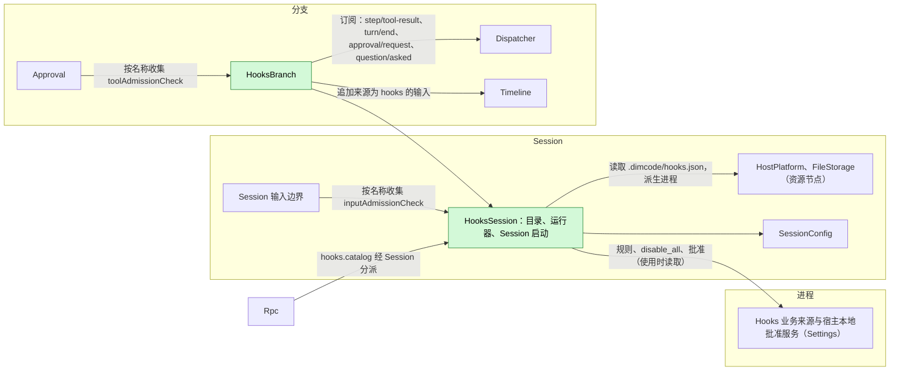
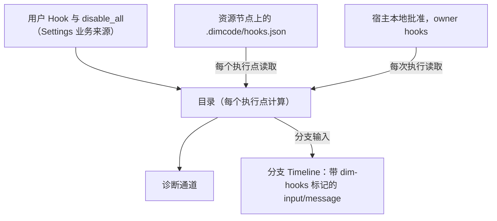
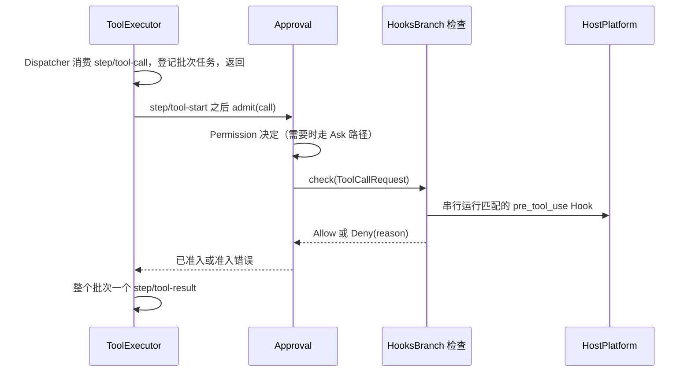
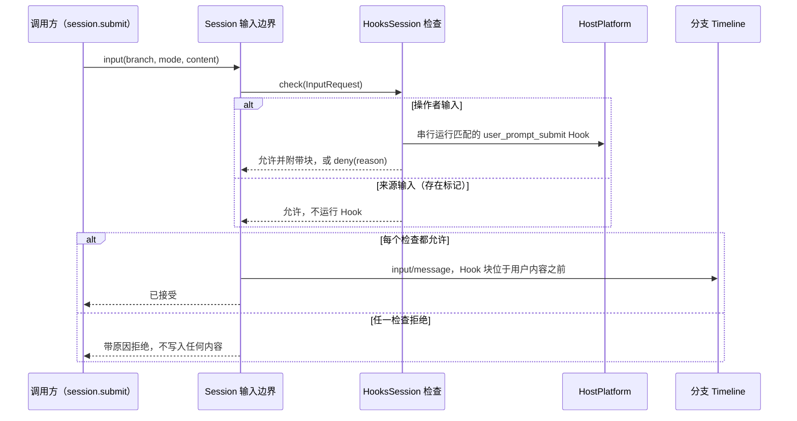
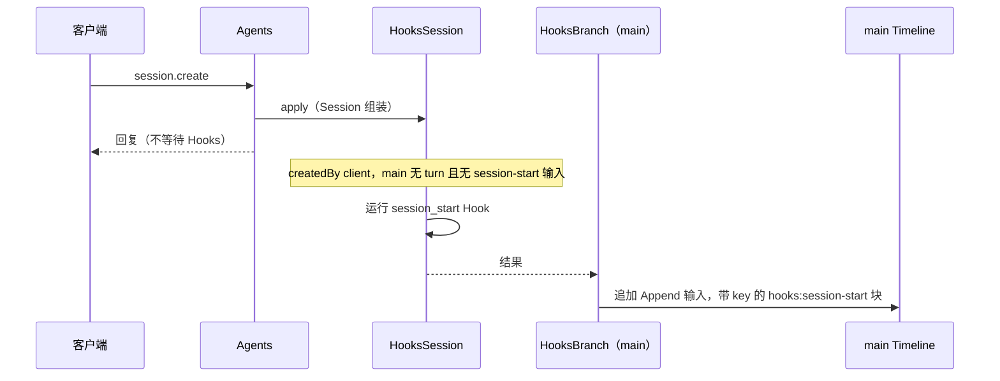
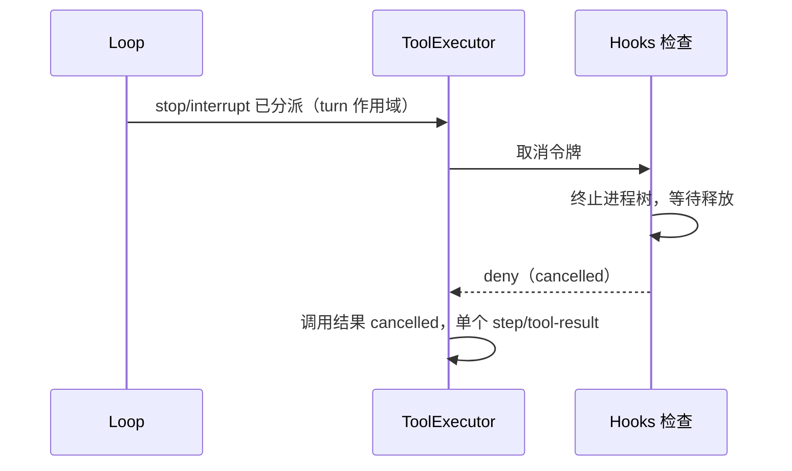

# Hooks

状态：草案。总体设计：[overview](../overview.md)（Hooks）。阶段：P2（用户与项目来源）；插件来源在 #3 之后。语言：Rust。作用域：[ADR 002](../../adr/002-plugin-scope.md)（Session + 分支）。

Hooks 在 Session 工作的固定节点运行用户配置的命令，不新增任何 Timeline 事件。其 Session 部件持有规则（从业务来源与项目文件读取），运行 Session 启动 Hook，并提供 `inputAdmissionCheck` `hooks`，Session 输入边界在写入操作者输入之前会咨询它（`user_prompt_submit`）。其分支部件提供 `toolAdmissionCheck` `hooks`，Approval 在每次工具调用之前咨询它；并从分支 Dispatcher 运行工具后、turn 结束与通知 Hook。命令经 Session 的 `HostPlatform`（其资源节点）运行；输出只以来源为 `hooks` 的分支输入，或以附加到已准入输入上的块的形式进入上下文。契约以语言中立形式给出（[ADR 002 D5](../../adr/002-plugin-scope.md)）；Rust 绑定见附录 G。

## 1. 结构



| 部件 | 作用域 | 依赖 | 提供 |
| --- | --- | --- | --- |
| `HooksSession` | Session（仅启用时安装） | Settings 业务来源（`hooks` 文档）与宿主本地批准服务；Session 的 `HostPlatform` 与 `FileStorage`；`SessionConfig` | `inputAdmissionCheck` key `hooks`（Session），用于 `user_prompt_submit`；`sessionMethods` key `hooks`，含 `hooks.catalog`，级别 `management`；`main` 的 Session 启动 Hook 结果；供 `HooksBranch` 使用的内部目录与命令运行器（不是契约） |
| `HooksBranch` | 分支 | `HooksSession` 的运行器、分支 Dispatcher 与 Timeline | `toolAdmissionCheck` key `hooks`（分支），由 Approval 按名称收集（[方法与准入检查](../contracts/session-boundary.md)） |

两个检查都在 Hooks 的 `provides` 中声明；Session 输入边界与 Approval 按服务名与作用域收集它们，从不指名 Hooks。

**重载。** Approval 依赖 `hooks` 工具检查，Session 输入边界依赖 `hooks` 输入检查，因此只要 Hooks 已安装，没有它们就不会准入任何工具调用或操作者输入；不存在单独的失败即拒绝记录。启用、禁用或升级 Hooks，或 Settings 重载，会重载 Hooks 部件、Approval、输入边界及其依赖方，使在途 turn 与在途提交失败；这是可接受的（[ADR 002 D3](../../adr/002-plugin-scope.md)）。编辑规则、批准或 `disable_all` 属于业务配置，从不触发重载（[D4](../../adr/002-plugin-scope.md)）。

**节点。** 资源节点离线时，每次 `HostPlatform` 或 `FileStorage` 调用都以 `node_unavailable` 失败；Hooks 部件及其依赖方既不重载也不进入 Pending，各执行点应用自己的错误规则（附录 C）。这要求经 rutis 链路导入的服务在链路断开期间保持注册并使调用失败（对 [#5](https://github.com/arcships/dim/issues/5) 的要求）。

**依赖的契约：** `toolAdmissionCheck`、`inputAdmissionCheck` 与 `sessionMethods`（[方法与准入检查](../contracts/session-boundary.md)）；Session `HostPlatform` 与 `FileStorage`（既有类型化服务）；Settings 业务来源与宿主本地批准服务。Hooks 使用 Rust；将类型化服务按名称暴露给非 Rust 部件属于 issue [#4](https://github.com/arcships/dim/issues/4) 的工作。**本文定义的契约：** Hook 配置格式、命令协议、`hooks.catalog`、来源名 `hooks`（标记 `dim-hooks`，key 命名空间 `hooks:`）。

## 2. 数据与状态



Hooks 不拥有 `StateCell`。目录在每个执行点从其来源重新计算（A6）；批准在每次执行时读取，从不作为权限缓存；后续计数从固定前缀推导。运行中的进程位于 `ctx.effect` 之下，重载或重启后从不重新运行。

## 3. 流程

### 3.1 工具前检查



检查在所有提交锁与 Dispatcher handler 之外运行，不写入任何内容；终态事实由 ToolExecutor 写入。Hook 出错时应用 `on_error`，`pre_tool_use` 默认为 `deny`。被取消的检查返回 deny。

### 3.2 用户提示提交



检查在写入之前、所有提交锁之外运行，自身不写入任何内容；输入边界在一次追加中写入带有返回块的输入。只有操作者输入（不带来源标记的用户内容）运行 Hook，因此由 Hooks、Goal、Scheduler 或 Workflow 写入的输入从不触发它们（A26）。Hook 出错时应用 `on_error`，`user_prompt_submit` 默认为 `allow`（A27）。调用方丢弃调用会取消检查：进程被终止，不写入任何内容。

### 3.3 Session 启动



Session 启动为失败即放行，只对尚未开始 turn 的 `createdBy.kind = "client"` Session 运行（A24、A25）。其上下文在写入之后到达下一次模型请求，可能晚于第一条用户输入。

### 3.4 观察类 Hook


Dispatcher 按顺序投递分支事件，因此分支部件加载期间不会跳过任何事件；在其重载期间分派的事件不会运行。

## 4. 时序与冲突



`step/tool-start` 之后的中断总是胜过已完成的 Hook。

| 场景 | 序号顺序 | 结果 | 负责方 |
| --- | --- | --- | --- |
| turn 结束后续 vs 用户输入或 Goal 续接 | `turn/end` < 其他输入 < Hook 写入 | 复检看到该输入：不写入。若双方都在任一方写入前读取，两个 Queue 输入都成立 | Hooks、InputQueue |
| 后续被用户撤回 | 后续 < `input/withdrawn` | 不消费；不计数 | InputQueue、Hooks |
| 提示提交 Hook 拒绝 | check < 无写入 | 无 `input/message`；调用方得到原因；不开始 turn | Session 输入边界 |
| Hooks 或 Settings 重载 | — | Approval 与输入边界随之重载；在途 turn 与提交失败（D3） | Lifecycle |
| 资源节点离线 | 每次调用 | `node_unavailable`，不重载：工具前与提示提交 → `on_error`；观察 → 诊断 | Hooks |

完整表格：附录 B。

## 5. 上下文映射

| 来源 | 模型看到的内容 | 位置 | 压缩 | 子分支 |
| --- | --- | --- | --- | --- |
| `session_start` | 一条 Append 输入：标记 `<dim-hooks kind="session-start">`，每个 Hook 一个 raw 块，key 为 `hooks:session-start/<source>/<id>` | 写入后的下一次模型请求 | 每个 key 的最新块被重放 | 在切分点仍有效时继承 |
| `user_prompt_submit` `context` | 已准入输入中的 raw 块，标记 `<dim-hooks kind="prompt-submit">`，每个 Hook 一个 | 位于输入的用户内容之前，在其被消费的位置 | 仅摘要 | 同输入 |
| `user_prompt_submit` 拒绝 | 无（不写入输入） | — | — | — |
| `pre_tool_use` 拒绝 | `ToolResult.content` 中的错误文本 | 批次结果中该调用的位置 | 仅摘要 | 若在切分点之前 |
| `post_tool_use` | Append 输入，标记 `kind="post-tool" call_id tool` | 本 turn 的下一次模型请求 | 仅摘要 | 同输入 |
| `turn_end` | Queue 输入，标记 `kind="follow-up"` | 它驱动的 turn 的开头 | 仅摘要 | 同输入 |
| `notification` | 无 | — | — | — |

非交互 Session：相同，只是 Session 启动 Hook 只对 `createdBy.kind = "client"` 运行。模型从不看到配置、命令、退出码、stderr（拒绝原因除外）、批准或诊断。

## 6. 接口（摘要）

| 接口 | 类型 | 用途 |
| --- | --- | --- |
| `toolAdmissionCheck` `hooks` | 分支服务，`check(ToolCallRequest): async -> {verdict, reason?}` | 运行 `pre_tool_use` Hook；拒绝或允许 |
| `inputAdmissionCheck` `hooks` | Session 服务，`check(InputRequest): async -> {verdict, reason?, blocks?}` | 运行 `user_prompt_submit` Hook；拒绝，或允许并附带上下文块 |
| `hooks.catalog {sessionId}` | `sessionMethods` key `hooks`，级别 `management` | Session 的有效 Hook 及其批准状态 |
| `hooks` 文档 | Settings 业务来源 | 用户 Hook、`disable_all`、启用覆盖 |
| 批准 | Settings 宿主本地批准服务 | 批准或撤销项目与插件 Hook |
| 配置格式、命令协议 | 本文定义 | 附录 A |

## 7. 安全

用户 Hook 无需批准即可运行。项目与插件 Hook 只有在 Settings 宿主本地批准服务中存在批准时才运行，记录为 `{owner: hooks, node, workspace, source, id, event, tools, fingerprint}`，fingerprint = 对不含 `enabled` 的规范化条目计算的 SHA-256；读取配置不授予任何批准，重放、fork 与恢复从不恢复批准。命令在 Session 的资源节点上运行，由 HostPlatform 应用该节点的隔离；Hook 不由 Permission 准入，也从不扩大权限：任何结果都不会准入 Permission 或用户已拒绝的调用，任何输出都不会编辑工具输入或用户的输入文本（提示提交 Hook 只会添加带归属的块或拒绝）。stdin 可能包含提示词与工具输入；诊断只保留 Hook id、退出状态、耗时与有界的 stderr 摘录。

## 附录 A. 接口细节

### A.1 配置格式

每个来源一个 JSON 文档，用户配置（Settings 中的 `hooks` 文档）与项目文件 `.dimcode/hooks.json` 形状相同：

```json
{
  "version": 1,
  "hooks": [
    { "id": "guard-writes", "event": "pre_tool_use", "tools": ["write", "edit", "mcp__fs__*"],
      "command": "./scripts/guard.sh", "timeout_ms": 10000, "on_error": "deny", "enabled": true }
  ]
}
```

| 字段 | 类型 | 规则 |
| --- | --- | --- |
| `version` | `1` | 其他值使文档无效（A1） |
| `id` | string `[a-z0-9][a-z0-9_-]{0,63}` | 在来源内唯一；批准与覆盖的标识 |
| `event` | `session_start` \| `user_prompt_submit` \| `pre_tool_use` \| `post_tool_use` \| `turn_end` \| `notification` | 必填（A4） |
| `tools` | 名称模式的字符串数组 | 仅用于 `pre_tool_use`/`post_tool_use`；`*` 匹配任意字符序列；省略 = 所有工具（A5） |
| `kinds` | `approval` \| `question` 的数组 | 仅用于 `notification`；省略 = 两者（A15） |
| `command` | string | 由节点的执行 shell 运行，工作目录为 `SessionConfig.cwd`（A8） |
| `timeout_ms` | integer 100..=600000 | 默认 60000（A10） |
| `on_error` | `allow` \| `deny` | 仅用于 `pre_tool_use`（默认 `deny`）与 `user_prompt_submit`（默认 `allow`，A27） |
| `enabled` | bool | 默认 `true` |

无效条目列为 `invalid`，从不运行。每个事件的顺序：用户、项目、插件来源，然后按文档顺序（A12）。

### A.2 命令协议

| 通道 | 内容 |
| --- | --- |
| stdin | 一个 UTF-8 JSON 对象，然后 EOF：`{version: 1, event, hook_id, source, session_id, branch_id, cwd, resource_node, ...event fields}` |
| 环境 | HostPlatform 过滤后的基础环境，加上 `DIM_HOOK_EVENT`、`DIM_SESSION_ID`、`DIM_PROJECT_DIR`（A8） |
| 退出码 0 | 成功。stdout 为空或为一个 JSON 对象（`decision`、`reason`、`context`、`follow_up`）；非 JSON 的 stdout 对 `session_start` 视为 `context`，否则忽略（A13） |
| 退出码 2 | 对 `pre_tool_use` 与 `user_prompt_submit` 为阻止，stderr（前 2 KiB）作为原因；对其他事件为错误 |
| 其他退出码、信号、超时、派生失败、stdout 超过 64 KiB、`node_unavailable` | 错误：诊断；`pre_tool_use` 与 `user_prompt_submit` 应用 `on_error` |

事件字段：`user_prompt_submit {mode, text}`（输入的文本块以换行连接；不传图片）；`pre_tool_use {turn_id, request_id, call_id, tool, input, risk}`；`post_tool_use {turn_id, call_id, tool, input, result: {text, is_error}}`；`turn_end {turn_id, outcome, reason}`；`notification {kind, approval_id | call_id, tool?}`；`session_start {}`。`context` 与 `follow_up` 各至多 16 KiB（A13）。

### A.3 结果

| 事件 | 允许 / 成功 | 拒绝 | `context` | `follow_up` |
| --- | --- | --- | --- | --- |
| `session_start` | — | 不支持 | 带 key 的 raw 块，Append | 忽略 |
| `user_prompt_submit` | 下一个检查 | 以 `Hook <source>/<id>: <reason>` 拒绝输入 | 附加到输入上的 raw 块（A28） | 忽略 |
| `pre_tool_use` | 下一个检查 | 以 `Hook <source>/<id>: <reason>` 拒绝 | 忽略（A16） | 忽略 |
| `post_tool_use` | — | 不支持 | 批次之后的 Append 输入 | 忽略 |
| `turn_end` | — | 不支持 | 忽略 | Queue 输入，有界（A14） |
| `notification` | — | 不支持 | 忽略 | 忽略 |

结果只作为其他所有者的事实被记录：工具拒绝是该调用的错误结果（ToolExecutor）；输入拒绝是调用方收到的拒绝且不写入任何内容（Session 输入边界）；上下文与后续是带 `dim-hooks` 标记的 `input/message` 块；执行记录进入诊断。

### A.4 准入检查

| 服务 | 作用域、key | 方法 | 请求（Hooks 读取的字段） | 回复 |
| --- | --- | --- | --- | --- |
| `toolAdmissionCheck` | 分支，`hooks` | `check`，异步 | `ToolCallRequest {sessionId, branchId, turnId, callId, tool, arguments, risk}` | `AdmissionReply {verdict: "allow" \| "deny", reason?}`；`reason` 对模型可见 |
| `inputAdmissionCheck` | Session，`hooks` | `check`，异步 | `InputRequest {sessionId, branchId, mode, source?, origin, content}` | `AdmissionReply {verdict: "allow" \| "deny", reason?, blocks?: [{marker, text}]}`；`reason` 返回给调用方，`blocks` 随输入写入 |

请求形状由 [方法与准入检查](../contracts/session-boundary.md) 拥有。取消是消费方丢弃调用或发送取消请求（工具检查为 turn 中断，输入检查为调用方离开）；Hooks 终止进程树、等待释放，并回复 `deny`（工具）或不写入任何内容（输入）。错误从不作为调用失败返回：每个 Hook 失败都经 `on_error` 映射为判定。

### A.5 `hooks.catalog`

经 `sessionMethods` key `hooks` 提供（`describe(): async -> MethodDecl[]`，`call(MethodCall): async -> MethodReply`）；声明的方法 `hooks.catalog`，级别 `management`，非变更。

| 参数 | 结果 |
| --- | --- |
| `{sessionId}` | 按来源列出的 Hook：`id`、`source`、`event`、匹配器、`command`、`enabled`、`approval`（`notRequired` \| `required` \| `approved`）、`approvalToken`、`invalid?`；全局 `disabled` |

批准或撤销使用 `approvalToken` 调用 Settings 宿主本地批准服务；启用与 `disable_all` 是针对 `hooks` 文档的类型化 Settings 操作（A9）。

### A.6 机制

| 路径 | 机制 |
| --- | --- |
| 工具前 | ToolExecutor 追加 `step/tool-start` 并等待 Approval 的准入；Approval 在走完自身请求路径（若为 Ask）后等待被收集的 `toolAdmissionCheck`。Hooks 不写入任何内容 |
| 提示提交 | Session 输入边界在写入前等待每个被收集的 `inputAdmissionCheck`；Hooks 为操作者输入串行运行匹配的 `user_prompt_submit` Hook，并返回块或拒绝。Hooks 不写入任何内容 |
| Session 启动 | 符合条件时 `HooksSession` 的 apply 启动运行（A25）；`main` 上的 `HooksBranch` 经其 Timeline 追加一条带标记与 keyed 块的 Append 输入；Agents 从不等待 |
| 观察 | `HooksBranch` 在分支 Dispatcher 上订阅；handler 入队后返回；每个分支一个 worker，按序号顺序串行运行（A20） |
| 复检 | 写入前：对 `post_tool_use`，工具结果之后无 `stop/interrupt`；对 `turn_end`，`turn/end` 之后无 `stop/interrupt` 且无未撤回的 `input/message`，并且连续未撤回的后续少于 3 个（A14） |
| 重载或重启 | 运行中的进程由 `ctx.effect` 终止；不重新运行任何 Hook；待写入的后续丢失 |

## 附录 B. 完整冲突表

| 场景 | 序号顺序 | 结果 | 负责方 |
| --- | --- | --- | --- |
| 工具前 Hook 运行时 turn `stop/interrupt` | `step/tool-start` < interrupt | 进程树终止；结果 cancelled；输出丢弃 | Approval、ToolExecutor |
| 准入之前中断 | interrupt < `step/tool-call` 被消费 | 不运行 Hook | ToolExecutor |
| 工具前 Hook 期间分支中断或关闭 | 分支中断 | 同 turn 中断 | Approval、ToolExecutor |
| 批次中某一调用被工具前拒绝 | — | 该调用为错误结果；其他调用运行；一个 `step/tool-result` | ToolExecutor |
| 提示提交 Hook 拒绝 | check，无写入 | 不写入任何内容；调用方带原因被拒绝 | Session 输入边界 |
| 提示提交 Hook 允许并附带上下文 | check < write | 块与用户内容在同一条 `input/message` 中 | Session 输入边界 |
| 检查期间调用方丢弃提交 | — | 进程树终止；不写入任何内容 | Hooks、Session 输入边界 |
| 提示提交检查期间中断 | — | 相互独立：检查不是 turn 工作；若允许则写入输入 | Session 输入边界 |
| 两个提交被并发检查 | — | 各自独立检查；按提交顺序写入 | Session 输入边界 |
| 来源输入（Goal、Hooks、Scheduler、Workflow） | — | 不运行 Hook 即允许（A26） | Hooks |
| 批次的 `post_tool_use` | `step/tool-result` | 在整个批次之后；每个匹配调用运行一次 | Hooks |
| 工具后上下文 vs 随后的中断 | result < interrupt < write | 不写入 | Hooks |
| turn 结束后续 vs 用户输入 | `turn/end` < input < write | 不写入 | Hooks |
| turn 结束后续 vs Goal 续接 | 双方都在任一方写入前读取 | 都写入；各自至多多出一个 turn（可接受） | InputQueue |
| 后续或工具后输入被撤回 | input < `input/withdrawn` | 从不消费；不计数 | InputQueue、Hooks |
| 并发 Steer/Queue/Append | Timeline 顺序 | 按模式依序号顺序应用 | InputQueue |
| 压缩 | — | Session 启动的 keyed 块被重放；其他经摘要 | History 投影 |
| 子分支在 Hook 输入与其消费之间切分 | input < cut < consumed | 子分支不采用它；不重新运行 | InputQueue |
| 子分支 | — | 有自己的 `HooksBranch` 与检查 | Hooks |
| Hook 运行时批准被撤销或文件被编辑 | — | 运行中的进程完成；之后的执行遵循新状态 | Hooks |
| Hooks、Approval 或 Settings 重载 | — | Approval、输入边界及依赖方重载；在途 turn 与提交失败（`service_reloading`）；窗口内的事件不运行（D3） | Lifecycle |
| Session 恢复或卸载 | — | 一旦存在 turn 或 session-start 输入，Session 启动不再运行（A25） | Hooks |
| 由 launch、Collaboration 或 fork 创建的 Session | `createdBy.kind` ≠ `"client"` | 无 Session 启动 | Hooks |
| Session 启动写入之前的第一条用户输入 | input < Hooks Append | 上下文从下一次模型请求起生效 | InputQueue |
| 资源节点离线 | — | 调用以 `node_unavailable` 失败；不重载也不进入 Pending。工具前与提示提交：`on_error`；项目文件不可读 → 跳过项目 Hook，诊断；观察与 Session 启动：诊断 | Hooks |
| 客户端断开 | — | 无影响 | — |

## 附录 C. 错误与恢复

| 情况 | 结果 |
| --- | --- |
| 超时 | 进程树终止；错误；`pre_tool_use` 与 `user_prompt_submit` 应用 `on_error` |
| `node_unavailable` | 按 Hook 错误处理；不重载 |
| 未批准的项目或插件 Hook | 跳过；诊断 |
| 批准服务不可读 | 失败即拒绝：项目与插件 Hook 不运行 |
| 无效文档 | 标记为无效；其中的 Hook 均不运行 |
| Append 被拒绝（分支已关闭） | 丢弃输出；诊断 |
| 取消 | 终止进程树，等待释放，然后返回 |

## 附录 D. 验收

1. A.2 中每种退出码与 stdout 情形，按事件逐一验证，包括超时与 `on_error`。
2. 三个调用的批次中一次工具前拒绝：一个错误结果，其他调用执行，单个 `step/tool-result`。
3. 工具前 Hook 期间中断：进程被终止；结果 cancelled。
4. `.dimcode/hooks.json` 中的项目 Hook：批准前不运行；批准后运行；文件变更后停止。
5. Session 启动上下文在压缩后保留；恢复时以及对 launch、成员或 fork 出的 Session 不运行。
6. 中断之后的工具后上下文不写入；后续在达到上限、出现用户输入后停止，并忽略已撤回的后续。
7. 编辑规则或 `disable_all` 在下一个执行点生效，无需重载。
8. 资源节点离线：只有该 Session 的 Hook 以 `node_unavailable` 失败；没有部件重载。
9. `user_prompt_submit`：退出码 2 带原因拒绝提交且不写入任何内容；`context` 以 `dim-hooks kind="prompt-submit"` 块出现在同一条 `input/message` 中；默认 `on_error` 下超时会准入输入；来源输入不运行 Hook。

## 附录 E. 假设

| # | 假设 | 依据 | 若被否决的影响 |
| --- | --- | --- | --- |
| A1 | 每个来源一个带版本的 JSON 文档 | 判断 | 格式改变 |
| A4 | 六个事件：Session 启动、用户提示提交、工具前/后、turn 结束、通知 | ADR 002 作用域；Session `inputAdmissionCheck` | 事件更少 |
| A5 | 工具名模式只支持 `*` glob | 判断 | 正则匹配 |
| A6 | 每个执行点重新读取项目文件 | 判断 | 需要文件监视器 |
| A8 | 节点 shell，Session cwd，基础环境加三个变量，无 `env` | 判断 | 带引用的环境配置 |
| A9 | 项目与插件 Hook 的启用覆盖是宿主本地的 Settings 数据 | 判断 | 只有用户 Hook 可以单独禁用 |
| A10 | 默认超时 60 s，范围 0.1–600 s | 判断 | 数值改变 |
| A12 | 顺序：用户、项目、插件、文档顺序 | 判断 | 其他排序 |
| A13 | stdout 为 JSON 或纯文本；stdout 64 KiB，每项输出 16 KiB | 判断 | 限制改变 |
| A14 | `turn_end` 后续会启动一个 turn，至多连续 3 个 | Goal 先例 | 无后续 |
| A15 | 通知 Hook 作用于 `approval/request` 与 `question/asked` | 判断 | 其他触发 |
| A16 | 工具前 Hook 不能注入上下文或修改输入 | 从不扩大权限 | 输入改写规则 |
| A20 | 观察类 Hook 按分支串行运行 | 判断 | 注入顺序可能不同 |
| A24 | Session 创建不等待 Session 启动 Hook；其上下文可能晚于第一条输入 | 产品决定 | 阻塞式创建 Hook |
| A25 | 当 `main` 无 `turn/start` 且无 session-start 输入时运行 Session 启动；第一个 turn 之前的恢复可能再次运行它 | 判断 | 需要创建通知 |
| A26 | `user_prompt_submit` 只对任意分支上的操作者输入（用户内容，无来源标记）运行 | 避免经来源输入形成循环 | 来源输入需要自己的匹配器 |
| A27 | `user_prompt_submit` 出错时默认 `allow` | 损坏的 Hook 不应把用户锁在外面 | 默认失败即拒绝 |
| A28 | 提示提交上下文不带 key，只经摘要在压缩后保留 | 判断 | 像 Session 启动那样重放 keyed 块 |

## 附录 F. 待对齐问题

| 问题 | 描述 |
| --- | --- |
| 插件来源 | 从 PluginManager 的包内容读取插件提供的 Hook 依赖于 [#3](https://github.com/arcships/dim/issues/3) |

## 附录 G. Rust 绑定

| 语言中立 | Rust |
| --- | --- |
| `toolAdmissionCheck` key `hooks` | `ToolAdmissionCheck(Arc<dyn AdmissionCheck>)`，位于 `BranchScope::named_key::<ToolAdmissionCheck>("hooks")`，以 `AgentBuilder::tool_admission_check("hooks")` 注册；Approval 收集 `Contributions<ToolAdmissionCheck>` |
| `inputAdmissionCheck` key `hooks` | [方法与准入检查](../contracts/session-boundary.md) 中的 Session 级输入检查类型，位于名为 `hooks` 的 `SessionScope::named_key`；输入边界收集其 `Contributions` |
| `sessionMethods` key `hooks` | `SessionMethodContribution(Arc<dyn MethodProvider>)`，位于 `SessionScope::named_key::<SessionMethodContribution>("hooks")` |
| `check(…)` 取消 | `CancellationToken` 传给 `check`；返回的 `HostFuture` 可被丢弃 |
| 内部运行器 | Session 服务 `HooksRuntime`，Hooks 私有 |
| Session 启动、观察 | `HooksSession::apply`；`HooksBranch` 的 Dispatcher 订阅；进程位于 `ctx.effect` 之下 |
