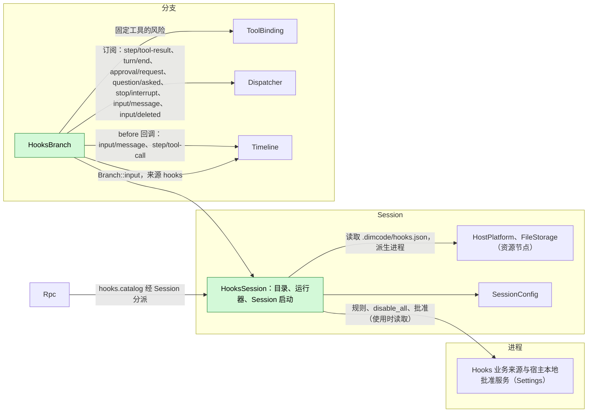
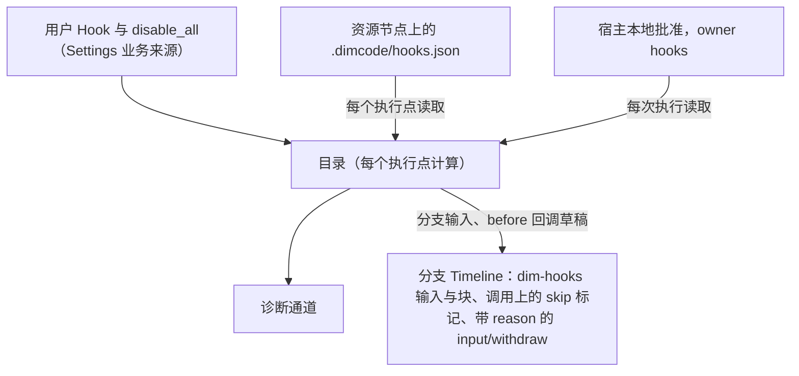
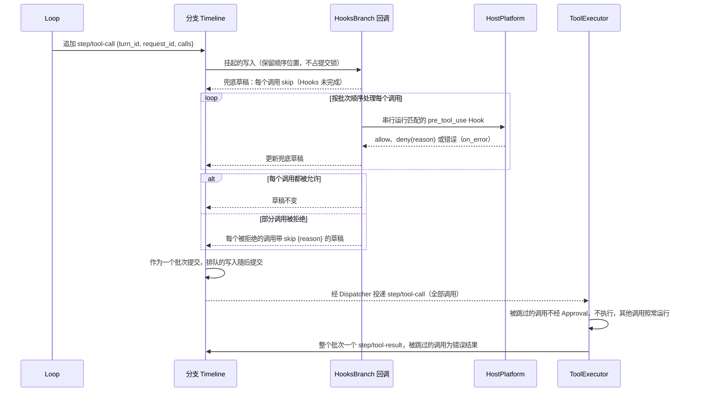
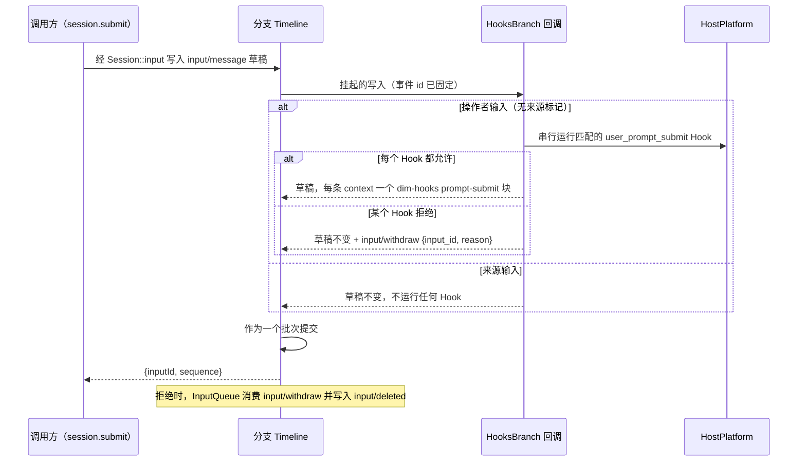
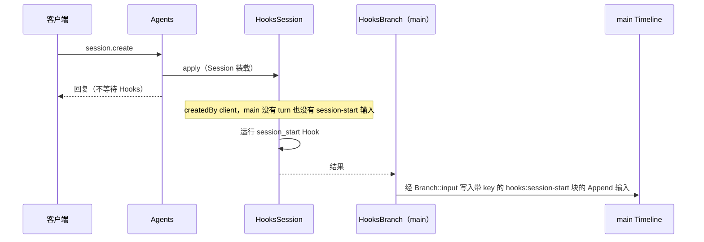
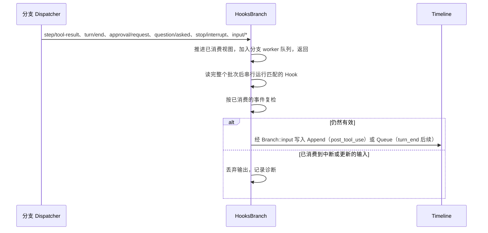
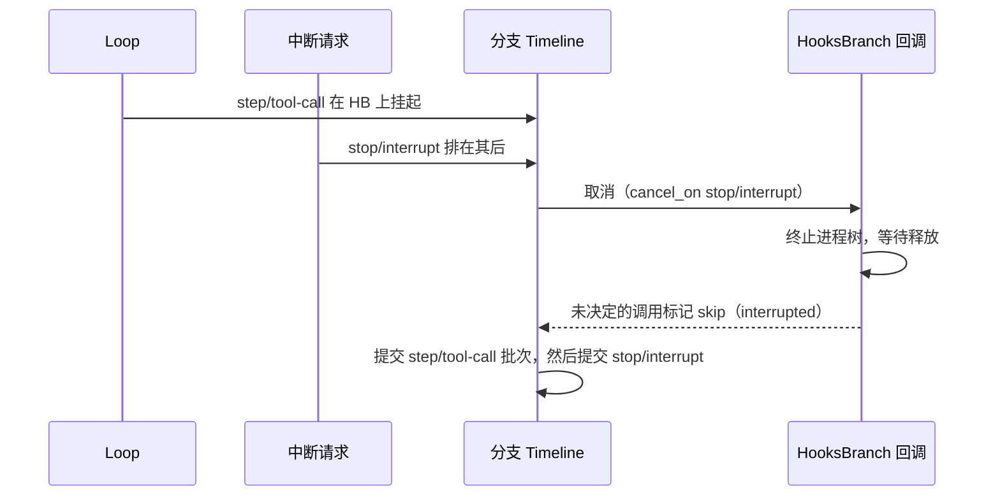

# Hooks

状态：草案。总体设计：[overview](../overview.md)（Hooks）。阶段：P2（用户与项目来源）；插件来源在 #3 之后。语言：Rust。作用域：[ADR 002](../../adr/002-plugin-scope.md)（Session + 分支）。

Hooks 在 Session 工作的固定节点运行用户配置的命令。其 Session 部件持有规则（从业务来源与项目文件读取），并运行 Session 启动 Hook。其分支部件注册两个异步 Timeline before 回调（即 [overview 附录 B.1](../overview.md) 中的运行时补充）：在 `input/message` 上用于 `user_prompt_submit`，在 `step/tool-call` 上用于 `pre_tool_use`；它还从分支 Dispatcher 运行工具后、turn 结束与通知 Hook。回调从不让它持有的写入失败，也不阻止它。回调先改草稿（`step/tool-call` 上按调用的通用 `skip` 字段，见 [§9](#9-向机制所有者提出的需求) 的提议；或加入操作者输入的 context 块），在同一批次只追加给所有者的指令（`input/withdraw {input_id, reason}`，其中通用的 `reason` 字段同样在 §9 提议）。Hooks 不声明任何事件，也从不写别的模块的结果事件，例如 `step/tool-result` 或 `input/deleted`。Approval 与 Loop 不变；ToolExecutor 与 InputQueue 只增加通用的 `skip` 处理和 `reason` 字段，它们不带 Hooks 含义。命令经 Session 的 `HostPlatform`（其资源节点）运行；输出只以三种形式进入上下文：来源为 `hooks` 的分支输入、加入操作者输入的块，或 ToolExecutor 为被跳过调用写入的错误结果。契约以语言中立形式给出（[ADR 002 D5](../../adr/002-plugin-scope.md)）；Rust 绑定见附录 G。

## 1. 结构



| 部件 | 作用域 | 依赖 | 提供 |
| --- | --- | --- | --- |
| `HooksSession` | Session（仅启用时安装） | Settings 业务来源（`hooks` 文档）与宿主本地批准服务；Session 的 `HostPlatform` 与 `FileStorage`；`SessionConfig` | `sessionMethods` key `hooks`，含 `hooks.catalog`；`main` 的 Session 启动 Hook 结果；供 `HooksBranch` 使用的内部目录与命令运行器（不是契约） |
| `HooksBranch` | 分支 | `HooksSession` 的运行器；分支 Timeline（before 回调）、`Branch::input`、Dispatcher 与 ToolBinding | `input/message` 与 `step/tool-call` 上的 before 回调，在部件加载时注册、卸载时移除 |

没有任何部件收集 Hooks：回调是分支 Timeline 上的注册，随 `HooksBranch` 的生命周期存在，因此没有消费方依赖 Hooks 或指名它。

**重载。** 启用、禁用或升级 Hooks，或 Settings 重载，只重载 Hooks 部件（[ADR 002 D3](../../adr/002-plugin-scope.md)）。卸载时仍挂起的回调无法完成，运行时提交它最新的兜底草稿（附录 A.4）：挂起的 `step/tool-call` 提交时，每个尚未被允许的调用都标记 `skip`（经草稿失败即拒绝）；挂起的操作者输入原样提交（失败即放行）。没有写入失败。`HooksBranch` 未加载期间提交的写入不经 Hooks 直接通过；这个窗口可接受（A31），且不授予任何权限，因为这些调用仍经过 Approval 与 Permission。编辑规则、批准或 `disable_all` 属于业务配置，从不触发重载（[D4](../../adr/002-plugin-scope.md)）。

**节点。** 资源节点离线时，每次 `HostPlatform` 或 `FileStorage` 调用都以 `node_unavailable` 失败；Hooks 部件及其依赖方既不重载也不进入 Pending，各执行点应用自己的错误规则（附录 C）。这要求经 rutis 链路导入的服务在链路断开期间保持注册并使调用失败（对 [#5](https://github.com/arcships/dim/issues/5) 的要求，见 [ExternalAgent](ExternalAgent.md) §9）。

**依赖的契约：** `sessionMethods`（[方法与工具贡献](../contracts/session-boundary.md)）；异步 Timeline before 回调（运行时补充，[overview 附录 B.1](../overview.md)；需求见 [§9](#9-向机制所有者提出的需求)）；`input/message`、`input/withdraw`（含提议的 `reason` 字段，§9）与 `input/deleted`（[session access A.4](../contracts/session-access.md)）数据契约；带提议的按调用 `skip` 字段的 `step/tool-call`（§9）；`step/tool-result`（只读）；Hooks 自己的输入使用 `Branch::input`；Session `HostPlatform` 与 `FileStorage` 以及分支 ToolBinding（既有类型化服务）；Settings 业务来源与宿主本地批准服务。Hooks 使用 Rust；将类型化服务按名称暴露给非 Rust 部件属于 issue [#4](https://github.com/arcships/dim/issues/4) 的工作（见 [session access](../contracts/session-access.md) §9）。**本文定义的契约：** Hook 配置格式、命令协议、`hooks.catalog`、来源名 `hooks`（标记 `dim-hooks`，key 命名空间 `hooks:`）。Hooks 不声明事件。

## 2. 数据与状态



Hooks 不拥有 `StateCell`，也不声明事件。目录在每个执行点从其来源重新计算（A6）；批准在每次执行时读取，从不作为权限缓存；后续计数与复检只使用 Hooks 经自己的 Dispatcher 订阅已消费的分支事件，每个事件都在读完所在的整个原子批次后使用。运行中的进程位于 `ctx.effect` 之下，重载或重启后从不重新运行。

## 3. 流程

### 3.1 工具前 before 回调



回调在 Approval 与 Permission 之前运行，因此被 Hook 拒绝的调用既不会被询问也不会被执行。被拒绝的调用留在批次中（其输入从不被编辑），并带上 `skip {reason: "Hook <source>/<id>: <reason>"}`。ToolExecutor 消费 `step/tool-call` 时，不准入也不执行被跳过的调用，并在自己普通的批次 `step/tool-result` 中写入它们的错误结果，错误文本为 `reason`；Loop 照常把结果与调用配对。若所有调用都被拒绝，每个调用都被跳过，ToolExecutor 的批次结果只含错误；不存在空的 `calls` 批次。Hook 出错时应用 `on_error`，默认 `deny`。没有匹配的 Hook 时，回调立即返回，草稿原样提交。

### 3.2 用户提示提交 before 回调



只有操作者输入（不带来源标记的用户内容）会运行 Hook，因此由 Hooks、Goal、Scheduler 或 Workflow 写入的输入从不触发它们（A26）。允许并带 `context`：每条 context 成为一个标记为 `<dim-hooks kind="prompt-submit">` 的 raw 块，加在草稿自身的 raw 块之后、其用户内容之前；用户内容从不被编辑。拒绝：Hooks 在第一个拒绝处停止，丢弃已收集的 context，并向该输入的批次追加 `input/withdraw {input_id, reason}`（InputQueue 的指令契约；`reason` 为 `Hook <source>/<id>: <reason>`，至多 2 KiB）。序列为 `input/message`、`input/withdraw`，然后是由 InputQueue 写入的 `input/deleted {input_id}`：InputQueue 只在整个批次派发后才决定是否采用，因此同批次的撤回总是胜出，该输入从不被应用，也不会开始任何 turn。调用方的回复是普通的 `{inputId, sequence}`；客户端从 Session 广播上的这些事件得知结果，并从 `input/withdraw` 显示原因。Hook 出错时应用 `on_error`，默认 `allow`（A27）。调用方丢弃该调用不会取消挂起的写入，写入按回调的结果提交。

### 3.3 Session 启动



Session 启动是失败即放行的，且只对尚未开始 turn 的 `createdBy.kind = "client"` Session 运行（A24、A25）。其上下文在写入后的下一次模型请求中生效，这可能晚于第一条用户输入。

### 3.4 观察 Hook



Dispatcher 按顺序投递分支事件，因此分支部件加载期间不会漏掉任何事件；在其重载期间派发的事件不会运行。复检只读 Hooks 已消费的事件，从不读已提交但未消费的尾部（[time-bus §4](../../../architecture/rust-agent/time-bus.md)）；复检之后才提交的事实排在 Hooks 的写入之后，由其所有者处理。

## 4. 时序与冲突



挂起的回调会阻住其分支上所有后续写入，包括 `stop/interrupt`。两个回调都注册 `cancel_on: ["stop/interrupt"]`，因此排队的中断会立即取消它们。工具前：尚未被其所有 Hook 允许的每个调用标记 `skip {reason: "Tool was not executed: interrupted"}`；已允许的调用不加标记，并在中断紧随其后提交时按 ToolExecutor 既有的中断规则结算。提示提交：正在运行的 Hook 被终止并视为错误（应用其 `on_error`），其余 Hook 被跳过，输入先于中断提交。

| 场景 | 序号顺序 | 结果 | 负责方 |
| --- | --- | --- | --- |
| turn 结束后续与用户输入或 Goal 续接 | `turn/end` < 其他输入被消费 < Hook 写入 | 复检看到该输入：不写入。若该输入在复检之后才被消费，两个 Queue 输入都保留 | Hooks、InputQueue |
| 后续输入被用户撤回 | 后续 < `input/deleted` | 从不被应用；不计数 | InputQueue、Hooks |
| 提示提交 Hook 拒绝 | 输入 + `input/withdraw {reason}` 同一批次 < `input/deleted` | 从不被应用；不开始 turn；客户端看到原因 | Hooks、InputQueue |
| 回调挂起期间分支上的写入 | 挂起 < 排队 | 排队的写入在其后按序提交；分支延迟至多为 Hook 的运行时间（可接受） | Timeline |
| 回调挂起期间的 `stop/interrupt` | 挂起 < 中断 | 回调被取消；见上文 | Hooks、Timeline |
| Hooks 或 Settings 重载 | — | 只重载 Hooks 部件；挂起的回调无法完成，提交兜底草稿（工具前：尚未允许的调用被跳过；提示提交：输入原样） | Timeline、Lifecycle |
| 资源节点离线 | 每次调用 | `node_unavailable`，不重载：工具前与提示提交 → `on_error`；观察 → 诊断 | Hooks |

完整表格：附录 B。

## 5. 上下文映射

| 来源 | 模型看到的内容 | 位置 | 压缩 | 子分支 |
| --- | --- | --- | --- | --- |
| `session_start` | 一个 Append 输入：标记 `<dim-hooks kind="session-start">`，每个 Hook 一个 key 为 `hooks:session-start/<source>/<id>` 的 raw 块 | 写入后的下一次模型请求 | 每个 key 的最新块被重放 | 切分时仍有效则继承 |
| `user_prompt_submit` `context` | 操作者输入中的 raw 块，标记 `<dim-hooks kind="prompt-submit">`，每个 Hook 一个 | 位于该输入的用户内容之前，在其被消费的位置 | 仅经摘要 | 同输入 |
| `user_prompt_submit` 拒绝 | 无：输入在被应用前即被删除，因此从不进入上下文；`input/withdraw` 不被投影 | — | — | — |
| `pre_tool_use` 拒绝 | ToolExecutor 批次 `step/tool-result` 中该被跳过调用的错误文本 `Hook <source>/<id>: <reason>` | 按 `call_id` 与其调用配对，位于下一次模型请求之前 | 仅经摘要 | 若在切分之前 |
| `post_tool_use` | Append 输入，标记 `kind="post-tool" call_id tool` | 该 turn 的下一次模型请求 | 仅经摘要 | 同输入 |
| `turn_end` | Queue 输入，标记 `kind="follow-up"` | 由它驱动的 turn 的开始 | 仅经摘要 | 同输入 |
| `notification` | 无 | — | — | — |

非交互 Session：完全相同，只是 Session 启动 Hook 仅对 `createdBy.kind = "client"` 运行。模型从不看到配置、命令、退出码、stderr（工具前拒绝原因除外）、批准、诊断或撤回原因。

## 6. 接口（摘要）

| 接口 | 类型 | 用途 |
| --- | --- | --- |
| `step/tool-call` 上的 before 回调 | 由 `HooksBranch` 在分支 Timeline 上注册 | 运行 `pre_tool_use` Hook；给被拒绝的调用标记 `skip` |
| `input/message` 上的 before 回调 | 由 `HooksBranch` 在分支 Timeline 上注册 | 运行 `user_prompt_submit` Hook；添加 context 块，或追加 `input/withdraw {input_id, reason}` |
| `hooks.catalog {sessionId}` | `sessionMethods` key `hooks` | Session 的有效 Hook 及其批准状态 |
| `hooks` 文档 | Settings 业务来源 | 用户 Hook、`disable_all`、启用覆盖 |
| 批准 | Settings 宿主本地批准服务（它自己的管理方法，按所有者命名空间 `hooks` 区分） | 批准或撤销项目与插件 Hook |
| 配置格式、命令协议 | 本文定义 | 附录 A |

## 7. 安全

用户 Hook 无需批准即可运行。项目与插件 Hook 只有在 Settings 宿主本地批准服务中存在批准时才运行，记录为 `{owner: hooks, node, workspace, source, id, event, tools, fingerprint}`，fingerprint = 对不含 `enabled` 的规范化条目计算的 SHA-256；读取配置不授予任何批准，重放、fork 与恢复从不恢复批准。Hooks 不提供批准方法；批准只经 Settings 自己的管理方法进行，配对的远程设备无法调用这些方法。命令在 Session 的资源节点上运行，由 HostPlatform 应用该节点的隔离；Hook 不经 Permission 准入，也从不扩大权限：任何结果都不会准入 Permission 或用户已拒绝的调用，任何输出都不会编辑工具输入或用户的输入文本（工具前 Hook 只把调用标记为跳过；提示提交 Hook 只添加带归属的块或撤回该输入）。回调只修改其持有的草稿，并只向其批次追加 `input/withdraw`（A.4）。stdin 可能包含提示与工具输入；诊断只保留 Hook id、退出状态、耗时与有界的 stderr 摘录。

## 8. 规则检查

规则：[principles §1 与 §4](../../../architecture/rust-agent/principles.md)，[ADR 002](../../adr/002-plugin-scope.md) D1–D5。

| 规则 | 本文如何符合 |
| --- | --- |
| §4.1 改别的模块拥有的状态时写指令事件 | 拒绝提示写指令 `input/withdraw`，由 InputQueue 决定；拒绝调用只在草稿上标记 `skip`，由 ToolExecutor 消费并自己结算，Hooks 不写别人的结果。 |
| §4.2 交接后不能撤回 | Hooks 只在提交前、即交给 InputQueue 或 ToolExecutor 之前干预；提交后只追加新的输入。 |
| §4.3 只用 before 回调在写入前干预 | 两处干预都是 before 回调，先改草稿，只追加指令；回调无法完成时提交兜底草稿，因此没有写入失败。 |
| §4.4 核心机制不带业务含义 | `skip {reason}` 与撤回的 `reason` 是任何生产方都可设置的通用字段（§9）；Timeline 的异步回调不带 Hooks 语义。 |
| §4.5 决定前读完整个批次 | 观察 Hook 与复检只在触发事件所在批次全部消费后才行动。 |
| §4.6 模型上下文只含交接后被读取的事件 | 被删除的提示与跳过原因只经 InputQueue 与 ToolExecutor 自己的事实进入上下文；Hooks 的输入在采用后才进入。 |
| §4.7 插件之间只通过公开事件和服务交互 | Hooks 只读公开事件契约和 `Deps` 中的类型化服务，从不读别的插件的状态。 |
| §4.8 向机制所有者提通用需求 | 异步 before 回调、`skip` 字段与撤回的 `reason` 见 §9；#4 与 #5 给出链接。 |
| §1 Capability 与 App Server 边界 | Session 与分支部件是各自包中的 Capability；App Server 只装配它们并分派 `hooks.catalog`。 |
| ADR 002 D1 作用域跟随状态所有者 | 规则与运行器是 Session 状态；回调与观察跟随分支。 |
| ADR 002 D2 不设接线模块 | 没有模块收集 Hooks；回调是 `HooksBranch` 拥有的 Timeline 注册。 |
| ADR 002 D3 依赖跟随作用域 | 部件只依赖自身或外层作用域；重载时提交兜底草稿，可接受。 |
| ADR 002 D4 结构性配置与业务配置分离 | 规则、`disable_all` 与批准是使用时读取的业务数据，从不触发重载。 |
| ADR 002 D5 合同语言中立 | 配置、命令协议与方法以中立形式给出；Rust 绑定见附录 G。 |

## 9. 向机制所有者提出的需求

本节给出异步 before 回调、`skip` 字段与撤回 `reason` 的五项内容；其他文档链接到这里。

### R1. 异步 Timeline before 回调（运行时）

| 项 | 内容 |
| --- | --- |
| 被哪条规则挡住 | principles §4 第 3 条（写入前只能用 before 回调干预，且不能阻止写入）；目前 `Timeline::before` 在提交锁内同步运行，回调无法等待运行数秒的 Hook 命令。 |
| 考虑过的现有机制 | 同步 `before`（对分支的每次写入都占用提交锁）；Dispatcher 订阅（在提交后、第 2 条的交接之后运行）；在 Rpc、ToolExecutor 或 Approval 中检查（第 3、4 条禁止）。 |
| 需要的通用能力 | 在分支 Timeline 上按事件类型注册的异步 before 回调。匹配的写入保留顺序位置（事件 id 固定），该分支后续写入排在其后；等待时不占提交锁。回调开始时同步返回兜底草稿，运行中可更新；结束时返回变换后的草稿与追加到同一原子批次的事件（追加的事件不再匹配）。选项：`timeout`；`cancel_on`（其排队写入会取消回调的事件类型）。回调无法完成时（超时、故障、注册方卸载、分支关闭），运行时提交最新的兜底草稿；写入从不因回调失败。写入方的追加在被接受时返回，提交经 Dispatcher 得知，因此 Loop 这类同步写入方不阻塞。 |
| 对序号、批次、中断、重载的影响 | 序号：保持接受顺序。批次：追加的事件并入被持有写入的批次。中断：排队的 `stop/interrupt` 等在回调之后；`cancel_on` 限制这段等待。重载：挂起的回调提交兜底草稿；注册方卸载期间的写入不经回调提交。 |
| 由谁实现，对应 issue | 运行时（Timeline）；尚未建 issue；列于 overview §8 P0。 |

### R2. `step/tool-call` 中按调用的 `skip` 字段（Loop/ToolExecutor）

| 项 | 内容 |
| --- | --- |
| 被哪条规则挡住 | principles §4 第 1 条（Hooks 不能写 ToolExecutor 的 `step/tool-result`）、第 3 条（回调不能阻止写入）、第 4 条（核心不为 Hooks 写特殊处理）；目前 `ToolCall` 为 `{id, name, input}` 且 `deny_unknown_fields`，草稿无法表达“不要运行这个调用”。 |
| 考虑过的现有机制 | 移除调用并写不带 `call_event_id` 的 `step/tool-result`（Hooks 写别人的结果，第 1 条）；让写入失败（第 3 条）；空 `calls` 批次（Loop 与 ToolExecutor 需特殊处理）；经 Approval 或 Permission 拒绝（需要 Hooks 接入 Approval，第 4 条）；由 ToolExecutor 消费的 Hooks 指令事件（核心消费插件事件，第 4 条）。 |
| 需要的通用能力 | `step/tool-call` 数据契约中按调用的可选字段 `skip: {reason: string}`，`step/tool-call` 上的任何 before 回调都可设置。ToolExecutor 消费批次时，不为被跳过的调用询问 Approval 或 Permission，也不执行它；它在普通批次 `step/tool-result` 中写入该调用的错误结果，错误文本为 `reason`。字段缺省即普通调用。Loop 不变。 |
| 对序号、批次、中断、重载的影响 | 序号：没有新事件。批次：被跳过的结果属于同一个批次结果。中断：被跳过的调用无需执行，结果在任何情况下都是其跳过原因。重载与恢复：`skip` 是已提交的事实，重载后的 ToolExecutor 以同样方式结算，从不运行它们。持久化：新增可选字段；冻结样本仍然有效；因旧读取方拒绝未知字段，所有者需做明确的格式决定。 |
| 由谁实现，对应 issue | Loop/ToolExecutor 所有者（运行时，`dim-agent-types` 与 `dim-agent-capabilities`）；尚未建 issue。 |

### R3. `input/withdraw` 中可选的 `reason` 字段（InputQueue）

| 项 | 内容 |
| --- | --- |
| 被哪条规则挡住 | principles §4 第 7 条与第 4 条：客户端需要知道提示被撤回的原因，而 Hooks 不能为 InputQueue 的决定另行声明类似结果的事件。 |
| 考虑过的现有机制 | Hooks 自己声明一个携带原因的事件（只是复述 InputQueue 结果的额外事件）；向调用方返回线路错误（before 回调不能让写入失败，第 3 条）；诊断（客户端看不到）。 |
| 需要的通用能力 | `input/withdraw` 指令契约中的可选字符串 `reason`（至多 2 KiB），任何生产方都可写入，供客户端显示；InputQueue 做决定时忽略它。 |
| 对序号、批次、中断、重载的影响 | 无：指令与 `input/deleted` 的顺序与批次规则不变；该字段不投影到模型上下文。 |
| 由谁实现，对应 issue | InputQueue 所有者（运行时）；契约见 [session access A.4](../contracts/session-access.md)；尚未建 issue。 |

链接：#4 按名字暴露类型化服务（见 [session access](../contracts/session-access.md) §9）；#5 链路断开期间的导入服务（见 [ExternalAgent](ExternalAgent.md) §9）。

## 附录 A. 接口细节

### A.1 配置格式

每个来源一个 JSON 文档，用户配置（Settings 中的 `hooks` 文档）与项目文件 `.dimcode/hooks.json` 形状相同：

```json
{
  "version": 1,
  "hooks": [
    { "id": "guard-writes", "event": "pre_tool_use", "tools": ["write", "edit", "mcp__fs__*"],
      "command": "./scripts/guard.sh", "timeout_ms": 10000, "on_error": "deny", "enabled": true }
  ]
}
```

| 字段 | 类型 | 规则 |
| --- | --- | --- |
| `version` | `1` | 其他值使文档无效（A1） |
| `id` | string `[a-z0-9][a-z0-9_-]{0,63}` | 在来源内唯一；批准与覆盖的身份 |
| `event` | `session_start` \| `user_prompt_submit` \| `pre_tool_use` \| `post_tool_use` \| `turn_end` \| `notification` | 必填（A4） |
| `tools` | 名称模式的 string 数组 | 仅用于 `pre_tool_use`/`post_tool_use`；`*` 匹配任意字符序列；省略 = 所有工具（A5） |
| `kinds` | `approval` \| `question` 的数组 | 仅用于 `notification`；省略 = 两者（A15） |
| `command` | string | 由节点的执行 shell 以 `SessionConfig.cwd` 为工作目录运行（A8） |
| `timeout_ms` | integer 100..=600000 | 默认 60000（A10） |
| `on_error` | `allow` \| `deny` | 仅用于 `pre_tool_use`（默认 `deny`）与 `user_prompt_submit`（默认 `allow`，A27） |
| `enabled` | bool | 默认 `true` |

无效条目列为 `invalid`，从不运行。每个事件内的顺序：用户、项目、插件来源，然后按文档顺序（A12）。

### A.2 命令协议

| 通道 | 内容 |
| --- | --- |
| stdin | 一个 UTF-8 JSON 对象，然后 EOF：`{version: 1, event, hook_id, source, session_id, branch_id, cwd, resource_node, ...event fields}` |
| 环境 | HostPlatform 过滤后的基础环境，外加 `DIM_HOOK_EVENT`、`DIM_SESSION_ID`、`DIM_PROJECT_DIR`（A8） |
| 退出码 0 | 成功。stdout 为空或一个 JSON 对象（`decision`、`reason`、`context`、`follow_up`）；非 JSON 的 stdout 对 `session_start` 视为 `context`，否则忽略（A13） |
| 退出码 2 | 对 `pre_tool_use` 与 `user_prompt_submit` 为拒绝，stderr（前 2 KiB）作为原因；对其他事件为错误 |
| 其他退出码、信号、超时、派生失败、stdout 超过 64 KiB、`node_unavailable` | 错误：记录诊断；`pre_tool_use` 与 `user_prompt_submit` 应用 `on_error` |

事件字段：`user_prompt_submit {mode, text}`（输入的文本块以换行连接；不传图片）；`pre_tool_use {turn_id, request_id, call_id, tool, input, risk}`（`risk` 取自 ToolBinding 中该请求固定的工具声明）；`post_tool_use {turn_id, call_id, tool, input, result: {text, is_error}}`；`turn_end {turn_id, outcome, reason}`；`notification {kind, approval_id | call_id, tool?}`；`session_start {}`。`context` 与 `follow_up` 各自至多 16 KiB（A13）。

### A.3 结果

| 事件 | 允许 / 成功 | 拒绝 | `context` | `follow_up` |
| --- | --- | --- | --- | --- |
| `session_start` | — | 不支持 | 带 key 的 raw 块，Append | 忽略 |
| `user_prompt_submit` | 下一个 Hook | 撤回该输入：`input/withdraw {input_id, reason: "Hook <source>/<id>: <reason>"}` | 加入该输入的 raw 块（A28） | 忽略 |
| `pre_tool_use` | 下一个 Hook | 给该调用标记 `skip {reason: "Hook <source>/<id>: <reason>"}`；ToolExecutor 写入错误结果 | 忽略（A16） | 忽略 |
| `post_tool_use` | — | 不支持 | 批次之后的 Append 输入 | 忽略 |
| `turn_end` | — | 不支持 | 忽略 | Queue 输入，有界（A14） |
| `notification` | — | 不支持 | 忽略 | 忽略 |

结果记录在公开事件契约中：工具拒绝是已提交 `step/tool-call` 中的 `skip` 标记，由 ToolExecutor 的批次 `step/tool-result` 结算；输入拒绝是带 `reason` 的 `input/withdraw`（随后 InputQueue 写入 `input/deleted`）；context 与后续是带 `dim-hooks` 标记的 `input/message` 块；执行记录进入诊断。

### A.4 before 回调

| 回调 | 注册（运行时选项） | 读取的草稿 | 兜底草稿 | 允许时写入 | 拒绝时写入 |
| --- | --- | --- | --- | --- | --- |
| `pre_tool_use` | 分支上的 `step/tool-call`；`timeout` 无（每个 Hook 受其 `timeout_ms` 限制）；`cancel_on: ["stop/interrupt"]` | `{turn_id, request_id, calls: [{id, name, input}]}` | 每个尚未被允许的调用标记 `skip {reason: "Tool was not executed: Hooks did not finish"}`；每决定一个调用就更新 | 草稿不变 | 每个被拒绝的调用带 `skip {reason}` 的草稿 |
| `user_prompt_submit` | 分支上的 `input/message`；`timeout` 无；`cancel_on: ["stop/interrupt"]` | `{submission_id?, user, blocks, mode}`；来源标记位于 `blocks` 中 | 草稿不变 | 在其自身块之后加入 `dim-hooks kind="prompt-submit"` raw 块的草稿，或草稿不变 | 草稿不变 + `input/withdraw {input_id, reason}` |

| 规则 | 内容 |
| --- | --- |
| 超时与错误 | 每次 Hook 运行受其 `timeout_ms` 限制；超时、2 以外的非零退出码、派生失败或 `node_unavailable` 是 Hook 错误，在回调内部按该 Hook 的 `on_error` 映射，因此回调本身正常返回。兜底草稿只在回调无法完成时适用（注册方卸载、分支关闭、回调故障）：工具前经草稿失败即拒绝，提示提交失败即放行（A27）。写入从不失败 |
| 取消 | `cancel_on` `stop/interrupt`（§4）：回调把未决定的调用标记 `skip {reason: "Tool was not executed: interrupted"}` 后返回；分支关闭或卸载：进程由 `ctx.effect` 终止，然后提交兜底草稿 |
| 顺序 | 调用按批次顺序；每个调用或输入的 Hook 按 A12 顺序串行运行；第一个拒绝即结束该调用或输入的运行 |
| 归属 | Hooks 不声明事件。它修改持有的草稿，只追加指令 `input/withdraw`；`step/tool-call`、`input/withdraw` 与 `input/deleted` 遵循其所有者的数据契约 |

### A.5 `hooks.catalog`

经 `sessionMethods` key `hooks` 提供（`describe(): async -> MethodDecl[]`、`call(MethodCall): async -> MethodReply`）；声明的方法为 `hooks.catalog`，非变更。

| 参数 | 结果 |
| --- | --- |
| `{sessionId}` | 按来源列出的 Hook：`id`、`source`、`event`、匹配器、`command`、`enabled`、`approval`（`notRequired` \| `required` \| `approved`）、`approvalToken`、`invalid?`；全局 `disabled` |

批准或撤销使用 `approvalToken`，经 Settings 宿主本地批准服务自己的管理方法进行；Hooks 没有批准方法。启用与 `disable_all` 是对 `hooks` 文档的类型化 Settings 操作（A9）。

### A.6 机制

| 路径 | 机制 |
| --- | --- |
| 工具前 | `HooksBranch` 的 `step/tool-call` 回调在写入挂起时运行，早于 ToolExecutor 与 Approval 看到该批次；它在开始时设置兜底草稿，并返回变换后的草稿（A.4） |
| 提示提交 | `HooksBranch` 的 `input/message` 回调在写入挂起时运行，仅针对操作者输入；它返回加入块的草稿，或追加了 `input/withdraw` 的草稿（A.4） |
| Session 启动 | 满足条件时由 `HooksSession` 的 apply 启动运行（A25）；`main` 上的 `HooksBranch` 经 `Branch::input` 写入一个带标记与带 key 块的 Append 输入；Agents 从不等待 |
| 观察 | `HooksBranch` 在分支 Dispatcher 上订阅触发事件以及 `stop/interrupt`、`input/message`、`input/deleted`；handler 推进已消费视图、入队后返回；每个分支一个 worker，在每个触发事件所在批次全部消费后按序号顺序串行运行（A20） |
| 复检 | 写入前，只依据已消费的事件：对 `post_tool_use`，工具结果之后没有 `stop/interrupt`；对 `turn_end`，`turn/end` 之后没有 `stop/interrupt` 也没有未删除的 `input/message`，且连续未删除的后续少于 3 个（A14） |
| 重载或重启 | 运行中的进程由 `ctx.effect` 终止；不重新运行任何 Hook；挂起的后续丢失 |

## 附录 B. 完整冲突表

| 场景 | 序号顺序 | 结果 | 负责方 |
| --- | --- | --- | --- |
| 工具前回调挂起期间 `stop/interrupt` 排队 | 挂起的 `step/tool-call` < 中断 | 回调被取消；进程树被终止；未决定的调用标记 `skip` `Tool was not executed: interrupted`；已允许的调用被提交，并按 ToolExecutor 的中断规则结算 | Hooks、ToolExecutor |
| 调用写入前中断已提交 | 中断 < 模型输出结束 | Loop 不写 `step/tool-call`；不运行任何 Hook | Loop |
| 工具前回调挂起期间分支关闭或 `HooksBranch` 卸载 | — | 提交兜底草稿：尚未被允许的调用被跳过；ToolExecutor 写入它们的错误结果（或被已关闭的 Timeline 拒绝） | Timeline、ToolExecutor |
| 工具前拒绝批次中的一个调用 | 一个批次 | 调用标记 `skip`；其他调用运行；ToolExecutor 的一个批次结果含被跳过调用的错误 | Hooks、ToolExecutor |
| 工具前拒绝批次中的每个调用 | 一个批次 | 每个调用都被跳过；批次结果只含错误；下一次模型请求看到这些错误 | Hooks、ToolExecutor、Loop |
| 策略或用户拒绝一个已允许的调用 | 提交之后 | Approval 路径不变；Hooks 已运行 | Approval |
| 提示提交 Hook 拒绝 | 输入 + `input/withdraw {reason}` < `input/deleted` | 从不被应用；不开始 turn；回复 `{inputId, sequence}` | Hooks、InputQueue |
| 提示提交 Hook 允许并带 context | 一个批次 | 块与用户内容位于同一个 `input/message` | Hooks |
| 回调挂起期间调用方丢弃提交 | — | 无影响：写入按回调结果提交；调用方用 `lookup` 解析它 | Timeline |
| 提示提交回调挂起期间 `stop/interrupt` 排队 | 挂起的输入 < 中断 | 正在运行的 Hook 被终止，应用其 `on_error`；其余 Hook 被跳过；输入先提交，然后是中断；按 InputQueue 的中断规则应用 | Hooks、InputQueue |
| 提示提交回调挂起期间分支关闭或卸载 | — | 兜底草稿：输入原样提交（或被已关闭的 Timeline 拒绝） | Timeline |
| 同一分支上的两次提交 | 第一次挂起 < 第二次 | 第二次排在第一次之后，并在其后运行自己的回调；按序提交 | Timeline、Hooks |
| 回调挂起期间分支上的其他写入 | 挂起 < 其他 | 排在其后；分支延迟受 Hook 的 `timeout_ms` 限制（可接受） | Timeline |
| 来源输入（Goal、Hooks、Scheduler、Workflow） | — | 不运行 Hook，原样提交（A26） | Hooks |
| 已撤回的提示与另一客户端的 `session.input.withdraw` | 同批次撤回 < 之后的撤回 | 之后的撤回指令无效，不写事件；回复 `notHeld` | InputQueue |
| 批次的 `post_tool_use` | `step/tool-result` | 在整个批次之后；每个匹配的调用运行一次；被跳过的调用不运行工具后 Hook | Hooks |
| 工具后 context 与随后的中断 | 结果 < 中断被消费 < 写入 | 不写入 | Hooks |
| turn 结束后续与用户输入 | `turn/end` < 输入被消费 < 写入 | 不写入 | Hooks |
| turn 结束后续与 Goal 续接 | 续接在复检之后才被消费 | 都写入；各自至多多出一个 turn（可接受） | InputQueue |
| 后续或工具后输入被撤回 | 输入 < `input/deleted` | 从不被应用；不计数 | InputQueue、Hooks |
| 并发 Steer/Queue/Append | Timeline 顺序 | 按模式以序号顺序应用 | InputQueue |
| 压缩 | — | Session 启动的带 key 块被重放；其他经摘要 | 历史投影 |
| 子分支切分位于 Hook 输入与消费之间 | 输入 < 切分 < 消费 | 子分支不采用它；不重新运行 | InputQueue |
| 子分支 | — | 有自己的 `HooksBranch` 与回调 | Hooks |
| Hook 运行期间批准被撤销或文件被编辑 | — | 运行中的进程完成；之后的执行遵循新状态 | Hooks |
| Hooks 或 Settings 重载 | — | 只重载 Hooks 部件；挂起的回调提交兜底草稿；窗口期内的写入与事件不经 Hooks 直接通过（D3，A31） | Timeline、Lifecycle |
| Session 恢复或卸载 | — | 一旦存在 turn 或 session-start 输入，Session 启动不再重新运行（A25） | Hooks |
| 由 launch、Collaboration 或 fork 创建的 Session | `createdBy.kind` ≠ `"client"` | 无 Session 启动 | Hooks |
| 第一条用户输入早于 Session 启动写入 | 输入 < Hooks Append | context 从下一次模型请求起生效 | InputQueue |
| 资源节点离线 | — | 调用以 `node_unavailable` 失败；不重载也不进入 Pending。工具前与提示提交：`on_error`；项目文件不可读 → 跳过项目 Hook，记录诊断；观察与 Session 启动：诊断 | Hooks |
| 客户端断开 | — | 无影响 | — |

## 附录 C. 错误与恢复

| 情况 | 结果 |
| --- | --- |
| 超时 | 进程树被终止；错误；`pre_tool_use` 与 `user_prompt_submit` 应用 `on_error` |
| `node_unavailable` | 同 Hook 错误；不重载 |
| 未批准的项目或插件 Hook | 跳过；诊断 |
| 批准服务不可读 | 失败即拒绝：项目与插件 Hook 不运行 |
| 无效文档 | 标记为无效；其中的 Hook 都不运行 |
| 追加被拒绝（分支已关闭） | 丢弃输出；诊断 |
| 回调无法完成（卸载、分支关闭、故障） | 运行时提交最新的兜底草稿：工具前尚未允许的调用被跳过，提示提交原样 |
| 取消 | 终止进程树，等待释放，然后返回 |

## 附录 D. 验收

1. 每个事件下 A.2 的每种退出码与 stdout 情况，包括超时与 `on_error`。
2. 三个调用的批次中工具前拒绝：已提交的 `step/tool-call` 含全部三个调用，被拒绝的那个带 `skip {reason}`；它没有 `approval/request`，也不执行；ToolExecutor 的一个批次 `step/tool-result` 含它的错误与另外两个结果；Hooks 不写 `step/tool-result`。三个全被拒绝：全部被跳过，批次结果只含错误，Loop 继续。
3. 工具前 Hook 运行期间 `stop/interrupt`：进程立即被终止；未决定的调用标记为未执行而被跳过；中断紧随批次之后提交。
4. 工具前 Hook 运行期间 `HooksBranch` 卸载：写入提交，尚未允许的调用被跳过；没有写入失败，turn 不因 Hooks 以 `Failed` 结束。
5. `.dimcode/hooks.json` 中的项目 Hook：批准前不运行；批准后运行；文件变更后停止运行。
6. Session 启动 context 在压缩后保留；恢复时以及对 launch 启动、成员或 fork 的 Session 不运行。
7. 已消费的中断之后，工具后 context 不被写入；后续在达到上限时、在已消费的用户输入之后停止，并忽略已删除的后续。
8. 编辑规则或 `disable_all` 在下一个执行点生效，无需重载。
9. 资源节点离线：只有该 Session 的 Hook 以 `node_unavailable` 失败；没有部件重载。
10. `user_prompt_submit`：退出码 2 使输入与 `input/withdraw {input_id, reason}` 在同一批次提交，随后 InputQueue 写入 `input/deleted`，且不开始 turn；`context` 作为同一 `input/message` 中的 `dim-hooks kind="prompt-submit"` 块到达；采用默认 `on_error` 的超时会提交输入；来源输入不运行 Hook；排在挂起回调之后的写入在其后按序提交。

## 附录 E. 假设

| # | 假设 | 依据 | 若被否决的影响 |
| --- | --- | --- | --- |
| A1 | 每个来源一个带版本的 JSON 文档 | 判断 | 格式改变 |
| A4 | 六个事件：Session 启动、用户提示提交、工具前/工具后、turn 结束、通知 | ADR 002 作用域；异步 before 回调 | 事件更少 |
| A5 | 工具名模式只支持 `*` 通配 | 判断 | 正则匹配 |
| A6 | 每个执行点重新读取项目文件 | 判断 | 需要文件监视 |
| A8 | 在 Session cwd 中使用节点 shell，基础环境加三个变量，无 `env` | 判断 | 带引用的环境配置 |
| A9 | 项目与插件 Hook 的启用覆盖是宿主本地的 Settings 数据 | 判断 | 只能单独禁用用户 Hook |
| A10 | 默认超时 60 s，范围 0.1–600 s | 判断 | 取值改变 |
| A12 | 顺序：用户、项目、插件、文档顺序 | 判断 | 其他顺序 |
| A13 | stdout 为 JSON 或纯文本；stdout 64 KiB，每项输出 16 KiB | 判断 | 限制改变 |
| A14 | `turn_end` 后续会开始一个 turn，至多连续 3 个 | Goal 先例 | 无后续 |
| A15 | 通知 Hook 作用于 `approval/request` 与 `question/asked` | 判断 | 其他触发 |
| A16 | 工具前 Hook 不能注入 context 或修改输入；它们只把调用标记为跳过 | 从不扩大权限 | 输入改写规则 |
| A29 | 工具前 Hook 在 Approval 与 Permission 之前、在 `step/tool-call` 提交时运行 | before 回调的位置 | Hooks 需要接入 Approval 的钩子 |
| A30 | 提示拒绝记录为 `input/withdraw {reason}`（随后为 `input/deleted`）；调用方得到普通回复，而非错误 | 既有撤回契约加 R3 | 需要一个线路错误码 |
| A31 | `HooksBranch` 卸载期间（重载、崩溃）提交的写入不经 Hooks 直接通过 | 少见的结构性操作（D3）；Approval 与 Permission 仍然适用 | 需要运行时提供比注册方存活更久的注册 |
| A20 | 观察 Hook 在每个分支内串行运行 | 判断 | 注入顺序可能不同 |
| A24 | Session 创建不等待 Session 启动 Hook；其 context 可能晚于第一条输入 | 产品决定 | 阻塞式创建钩子 |
| A25 | 当 `main` 没有 `turn/start` 也没有 session-start 输入时运行 Session 启动；第一个 turn 之前的恢复可能再次运行它 | 判断 | 需要创建通知 |
| A26 | `user_prompt_submit` 只对任意分支上的操作者输入（用户内容，无来源标记）运行 | 避免经来源输入形成循环 | 来源输入需要自己的匹配器 |
| A27 | `user_prompt_submit` 错误默认 `allow` | 损坏的 Hook 不应把用户锁在外面 | 默认失败即拒绝 |
| A28 | 提示提交 context 不带 key，只经摘要在压缩后保留 | 判断 | 像 Session 启动那样重放带 key 块 |

## 附录 F. 待对齐问题

| 问题 | 描述 |
| --- | --- |
| 插件来源 | 从 PluginManager 的包内容读取插件提供的 Hook 依赖 [#3](https://github.com/arcships/dim/issues/3) |

## 附录 G. Rust 绑定

| 语言中立 | Rust |
| --- | --- |
| before 回调 | 在分支实例通道上以 key `["step/tool-call"]` 与 `["input/message"]` 进行 `Timeline::before` 异步注册（提议，R1），选项 `{timeout: None, cancel_on: ["stop/interrupt"]}`；handler 接收 `EventDraft` 与 `CancellationToken`，同步返回兜底草稿，可更新它，最后返回草稿及追加的 `EventKind` |
| `skip` | 提议在 `ToolCall` 上增加 `Option<ToolCallSkip { reason: String }>`（R2） |
| 撤回 `reason` | 提议在 `input/withdraw` 数据上增加 `Option<String>`（R3） |
| `sessionMethods` key `hooks` | 位于 `SessionScope::named_key::<SessionMethodContribution>("hooks")` 的 `SessionMethodContribution(Arc<dyn MethodProvider>)` |
| 回调取消 | 由 `cancel_on`、分支关闭或卸载触发的 `CancellationToken` |
| 内部运行器 | Session 服务 `HooksRuntime`，Hooks 私有 |
| Session 启动、观察 | `HooksSession::apply`；`HooksBranch` 的 Dispatcher 订阅；输入经 `Branch::input`；进程位于 `ctx.effect` 之下 |
