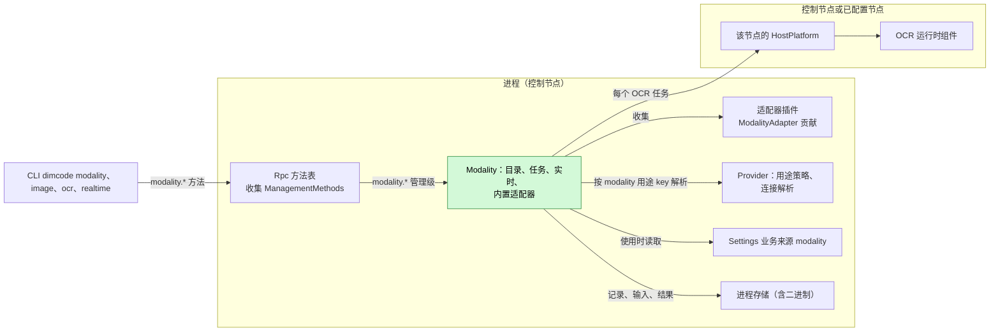
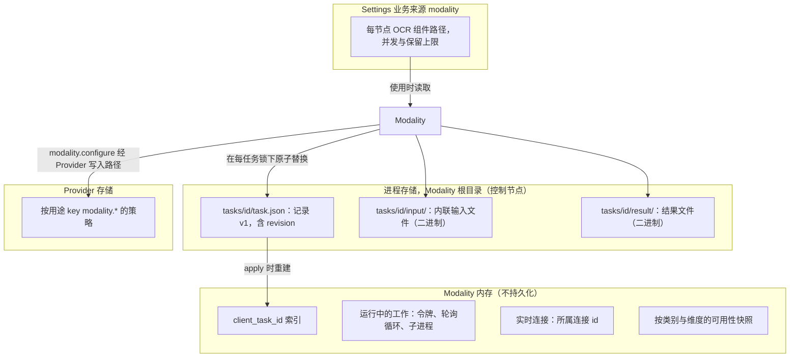
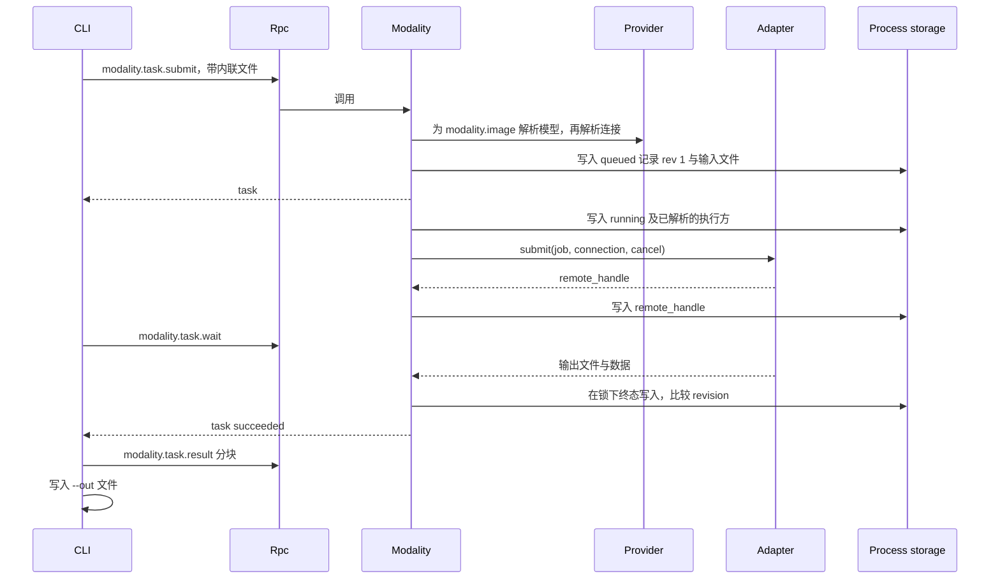
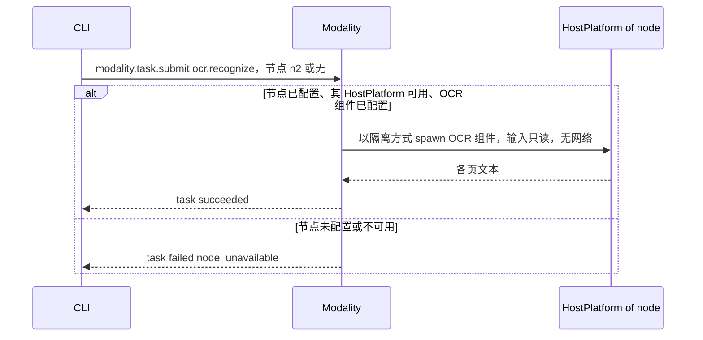
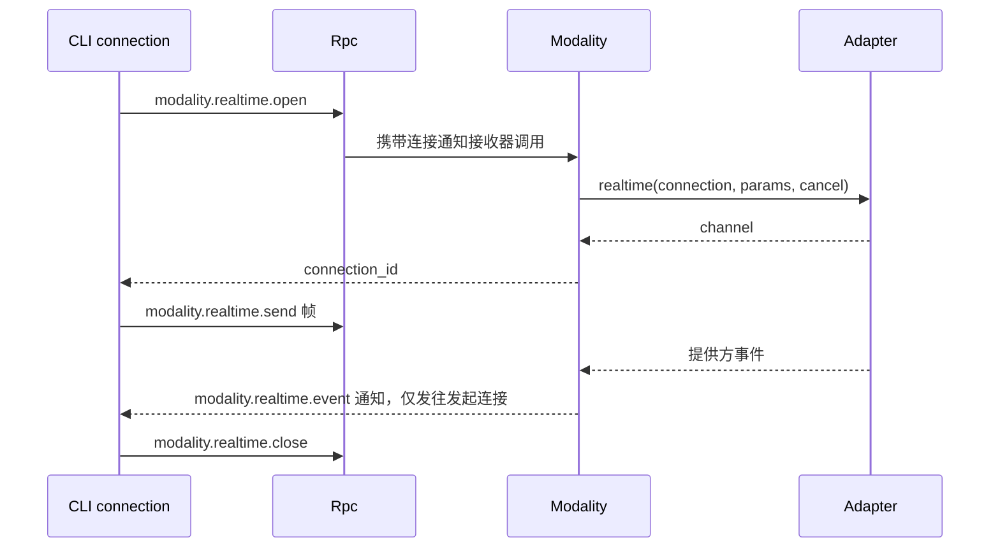
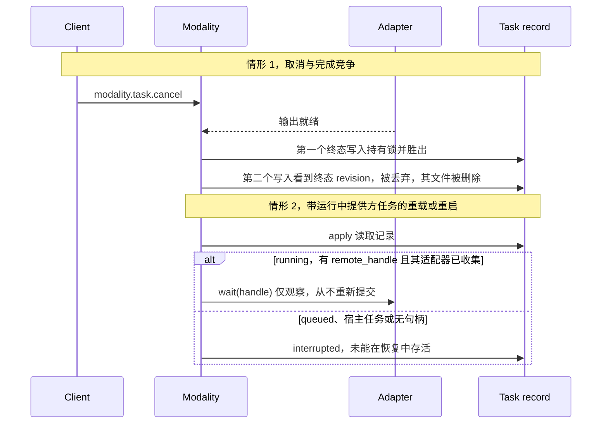

# Modality

状态：草案。总体设计：[overview B.14](../overview.md)，[ADR 002](../../adr/002-plugin-scope.md)。阶段：P3。语言：由提供方执行的类别优先使用 TypeScript；OCR 依赖 OCR 运行时组件（[overview F.3](../overview.md)）。

Modality 是一个进程插件（[ADR 002](../../adr/002-plugin-scope.md)：任务与提供方连接在各 Session 间共享），是九个类别非对话式多模态工作的唯一入口：图像、视频、语音、音乐、音频、3D 资产、动作、实时和 OCR。它按类别报告可用性及原因，按 Modality 自有的用途 key 解析默认模型，运行异步任务（提交、状态、等待、取消）并通过进程存储契约保存，并持有绑定到发起客户端连接的实时连接。提供方适配器内置于 Modality，或由适配器插件在进程作用域贡献；OCR 通过控制节点或某个已配置节点的 HostPlatform 运行。它的方法是 Rpc 方法表中的管理级条目。Modality 的设置是在使用时读取的业务配置。它没有 Session 或分支部分：不写任何 Timeline 事件，也不提供模型可见的工具。

## 1. 结构



所有依赖都是同一作用域的进程服务（[ADR 002 D3](../../adr/002-plugin-scope.md)）。Modality 从适配器插件收集 `Contributions<ModalityAdapter>`，因此适配器重载会重载 Modality；Rpc 收集 Modality 的 `ManagementMethods`，因此 Modality 重载会重载 Rpc。两者都是少见的结构性事件；其传播是可接受的代价，任务恢复（§4）使其影响有界：存有句柄的提供方任务通过轮询恢复，其余变为 `interrupted`。没有 Session 或分支插件依赖 Modality。

| 部分 | 作用域 | 依赖 | 提供 |
| --- | --- | --- | --- |
| `Modality` | 进程（控制节点） | Provider 的用途选择、用途策略写入路径与非对话连接解析；进程存储（UTF-8 与二进制）；Settings 业务来源 `modality`；`Contributions<ModalityAdapter>`；控制节点及每个已配置 OCR 节点的 HostPlatform；诊断 | `ModalityTasks` 进程服务；`ManagementMethods`（`modality.*`），由 Rpc 收集 |
| 适配器插件 | 进程 | 各自的提供方依赖 | `ModalityAdapter` 贡献 |

**依赖的契约：**[方法](../contracts/session-boundary.md)契约（Rpc 方法表中的管理级条目、每次调用的进度接收器、绑定连接的通知）；Provider 的按用途策略存储，含其唯一写入路径与非对话连接解析（[overview C.2](../overview.md)）；App Server 进程存储契约，含二进制原子替换；带隔离的 HostPlatform spawn（[HostPlatform](../../../architecture/rust-agent/plugins/HostPlatform.md)，隔离补充见 [overview C.1](../overview.md)）。
**此处定义的契约：**类别与操作标识符；用途 key `modality.<category>` 与 `modality.<category>.<operation>`（对 Provider 不透明）；`ModalityAdapter`；`modality` 设置文档；`ModalityTasks` 服务；任务记录与结果格式（格式版本 1）；`modality.*` 方法与 `modality.realtime.event` 通知。Provider 对模态一无所知；Modality 在内置适配器之外不了解任何提供方特有语义。

## 2. 数据与状态



任务记录是唯一的持久状态；索引在 `apply` 时从记录重建，非终态记录由启动规则（§4）结算。运行中的工作与实时连接从不重建。默认值只存在于 Provider。Modality 设置是业务配置（[ADR 002 D4](../../adr/002-plugin-scope.md)）：变更是带通知的数据更新，从不触发重载（A16）。适配器插件集合与 OCR 可运行的节点是 loader 行中的结构性配置。没有 Timeline 状态，没有 `StateCell`；竞争写入的顺序由每任务锁下的记录 `revision` 决定。

## 3. 流程

### 3.1 提交、等待与取回（`dimcode image generate`）



CLI 自行读取输入并写出输出；Modality 只在其存储根目录内写入（A7）。

### 3.2 在控制节点或已配置节点上运行 OCR



Modality 没有 Session，因此 OCR 在控制节点上运行，除非调用方指定一个已配置节点（A15）。对端节点的 HostPlatform 是经 rutis 链路导入的那个（[overview 多节点](../overview.md)）。

### 3.3 实时连接



连接在以下情况关闭：`close`、发起它的客户端连接结束、空闲 10 分钟后（A9）、Modality 重载、进程退出。它没有任务记录，也从不恢复。

### 3.4 Capability 列表与默认模型

`dimcode modality` 调用 `modality.capabilities` 并列出全部九个类别。每个不可用的类别或操作都按维度显示原因，例如“not in this build”“OCR component not installed”“no adapter”“not configured”“no adapter for the configured model”（决策 E16）。最后一项由 Modality 已采纳的业务配置（用途策略，或显式模型及其 Provider 连接）对照其收集到的适配器得出。不隐藏任何内容，也没有 `--all`。`dimcode modality set-default image <provider>/<model>` 调用 `modality.configure`，它先校验有适配器为该操作提供该模型，再调用 Provider 针对 `modality.image` 的唯一用途策略写入路径。

## 4. 时序与冲突

Modality 不是分支工作：轮次与分支事实从不影响任务。竞争由每任务锁下的任务记录 `revision` 裁决。



| 场景 | 结果 | 负责方 |
| --- | --- | --- |
| 适配器插件重载 | Modality 随之重载（D3）；适用启动规则：有句柄的任务通过轮询恢复，其余 `interrupted`；实时连接关闭 | Modality |
| Modality 重载 | Rpc 随之重载（D3）；在途调用遵循[方法](../contracts/session-boundary.md)契约；disposer 取消本地工作，终止 OCR 进程，关闭实时连接，为宿主任务和无句柄任务写入 `interrupted` | Rpc、Modality |
| 设置变更 | 下次使用时读取；重新计算可用性；已有任务保留其已解析的执行方；不重载 | Modality |
| 以相同 `client_task_id` 重复 `submit` | 返回已有任务 | Modality |
| 等待期间客户端脱离 | 任务继续；该客户端的实时连接关闭 | Modality |

完整表格见附录 B。

## 5. 上下文映射

无模型可见效果。Modality 不提供工具、提示词来源、输入或 Timeline 事实（决策 E16、A13）。结果只有在用户以常规方式（`@` 文件引用、附件、粘贴文本）将其放入 Session 时才会到达模型，这些是由各自插件拥有的输入事实。模型从不看到任务记录、可用性、默认值、进度或诊断。因此压缩、子分支和非交互 Session 均不受影响。

## 6. 接口（摘要）

| 接口 | 类型 | 用途 |
| --- | --- | --- |
| `modality.capabilities` | 方法，管理级 | 每个类别与操作，含可用性原因和默认模型 |
| `modality.configure` | 方法，管理级 | 先校验，再经 Provider 的用途策略写入路径设置或清除默认值 |
| `modality.task.submit/status/list/wait/cancel/result` | 方法，管理级 | 任务生命周期；分块二进制结果取回 |
| `modality.realtime.open/send/close`、`modality.realtime.event` | 方法（管理级）及绑定连接的通知 | 实时连接 |
| `ModalityTasks` | 进程服务 | 同样的操作，带类型，供其他进程插件使用 |
| `ModalityAdapter` | 由 Modality 收集的进程贡献 | 由提供方执行的类别 |
| `modality` 设置文档 | 业务配置（Settings 来源） | 每节点 OCR 组件路径、上限 |
| `dimcode modality`、`image`、`video`、`speech`、`music`、`audio`、`asset`、`motion`、`ocr`、`realtime` | CLI | 方法的薄客户端 |

详见附录 A。

## 7. 安全

- 所有 `modality.*` 方法都是管理级（它们消耗提供方额度并运行宿主进程），只由为该级别配置的入口提供（[方法](../contracts/session-boundary.md)）；RemoteGateway 从不提供它们。
- 凭据由 Provider 每次调用时解析；从不出现在记录、结果、诊断或错误中。
- OCR 组件是已安装的可执行文件，而非项目内容；通过执行节点的 HostPlatform 以该节点的隔离启动，仅有输入读权限，无网络（A14）。其路径来自 `modality` 设置文档，从不来自请求数据。
- 内联输入经过大小检查，存放在任务目录下；`node_path` 由组件在其节点上以该节点的权限读取。Modality 从不在其存储根目录之外写入；文件仅所有者可访问。
- 实时事件只发往发起连接。

## 附录 A. 接口细节

### A.1 类别与操作

| 类别 | CLI | 操作 | 输入 | 结果 | 执行方 | 用途 key |
| --- | --- | --- | --- | --- | --- | --- |
| `image` | `image` | `generate`、`edit`（图像，可选 mask）、`enhance`（`upscale`、`restore`、`denoise`、`sharpen`、`remove_background`、`colorize`） | 提示词、文件 | 图像文件 | Provider | `modality.image` |
| `video` | `video` | `generate`、`edit`、`enhance` | 提示词、文件 | 视频文件 | Provider | `modality.video` |
| `speech` | `speech` | `synthesize`、`transcribe` | 文本或音频 | 音频文件；或 `data: { text, segments: [{ start_ms, end_ms, text }] }` 加 `transcript.txt` | Provider | `modality.speech.synthesize`、`modality.speech.transcribe` |
| `music` | `music` | `generate` | 提示词 | 音频文件 | Provider | `modality.music` |
| `audio` | `audio` | `generate` | 提示词 | 音频文件 | Provider | `modality.audio` |
| `asset` | `asset` | `generate` | 提示词、可选图像 | 3D 文件 | Provider | `modality.asset` |
| `motion` | `motion` | `generate` | 提示词 | 动作数据文件 | Provider | `modality.motion` |
| `realtime` | `realtime` | `connect` | — | 连接 | Provider | `modality.realtime` |
| `ocr` | `ocr` | `recognize` | 图像或 PDF | `data: { pages: [{ index, text }] }` 加 `text.txt` | 宿主运行时组件 | 无；每节点组件路径在 `modality` 设置文档中 |

图像理解不属于 Modality（视觉模型通过 `read`）。按操作的 key 先于按类别的 key 解析（A3）。输入之外的操作参数由各适配器声明，并在提交时校验（A4）。

### A.2 适配器与 OCR 节点

```rust
/// Process contribution from an adapter plugin, keyed by adapter name;
/// Modality collects Contributions<ModalityAdapter>. Built-in adapters implement the same trait.
pub trait ModalityAdapter: Send + Sync + 'static {
    fn available(&self) -> watch::Receiver<bool>;
    fn connection_kinds(&self) -> Vec<String>;
    fn operations(&self, model: &ModelRef) -> Vec<OperationSpec>;   // category, operation, params schema
    fn submit(&self, job: Job, conn: ResolvedConnection, cancel: CancellationToken)
        -> HostFuture<'_, Submitted>;                               // Submitted { remote_handle: Option<String> }
    fn wait(&self, handle: Option<&str>, conn: ResolvedConnection, progress: ProgressSink,
        cancel: CancellationToken) -> HostFuture<'_, AdapterOutput>;
    fn cancel_remote(&self, handle: &str, conn: ResolvedConnection) -> HostFuture<'_, RemoteCancel>;
    fn realtime(&self, conn: ResolvedConnection, params: JsonObject, cancel: CancellationToken)
        -> HostFuture<'_, Option<RealtimeChannel>>;
}
pub enum RemoteCancel { Cancelled, Unsupported, AlreadyFinished }
```

`available()` 在不重载的情况下报告运行时可用性（例如提供方端点不可达）。若用途策略（或显式模型）对应的 Provider 连接类型没有任何已收集的适配器提供，则报告为“no adapter for the configured model”，其提交以 `unavailable` 失败。OCR 不是适配器：对每个任务，Modality 使用目标节点的 HostPlatform（缺失或不可用：`node_unavailable`），探测 `modality` 设置文档为该节点给出的 OCR 组件路径，并在那里 spawn 它。带已存储 `remote_handle` 的 `wait` 必须能在新一代中工作；不返回句柄的适配器无法恢复。

### A.3 方法

命名空间 `modality` 中的 `ManagementMethods`，每个方法都是管理级。`wait` 使用每次调用的进度接收器；实时使用绑定连接的通知（[方法](../contracts/session-boundary.md)）。

| 方法 | 参数 | 结果 |
| --- | --- | --- |
| `modality.capabilities` | `{}` | `{ categories: [{ category, available, reasons, operations: [{ operation, available, reasons: [{ dimension: "build" \| "platform" \| "runtime" \| "adapter" \| "configuration", detail }], params_schema?, default_model? }] }] }`；每个类别都出现 |
| `modality.configure` | `{ category, operation?, model: "<provider>/<model>" \| null }` | 校验有可用适配器提供该模型，然后经 Provider 的写入路径为该 key 写入或清除策略 |
| `modality.task.submit` | `{ category, operation, params, files?: [{ name, media_type, data_base64 } \| { node_path }], model?, node?, client_task_id? }` | `{ task }`；已存在的 `client_task_id` 返回已有任务 |
| `modality.task.status` | `{ task_id }` | `{ task }` |
| `modality.task.list` | `{ state?, category?, limit? (≤100), after? }` | `{ tasks, next? }`，最新在前 |
| `modality.task.wait` | `{ task_id, timeout_ms? (≤600000, default 600000) }` | 终态时或超时时返回 `{ task }`（超时不是错误）；进度通过该调用的进度接收器 |
| `modality.task.cancel` | `{ task_id }` | `{ task }`；幂等 |
| `modality.task.result` | `{ task_id, name, offset, length (≤4 MiB) }` | `{ data_base64, eof }` |
| `modality.realtime.open` | `{ model?, params }` | `{ connection_id }` |
| `modality.realtime.send` | `{ connection_id, frame: { type: "text" \| "audio" \| "control", data } }` | `{}` |
| `modality.realtime.close` | `{ connection_id }` | `{}` |
| `modality.realtime.event` | 通知 `{ connection_id, event }` | 仅发往发起连接 |

边界校验：每次提交文件至多 100 MiB，每个内联文件至多 25 MiB（A5）；按操作检查媒体类型；`node_path` 仅用于宿主执行的操作；`node` 仅用于宿主执行的类别，默认控制节点（A15）。模型选择：显式 `model`，否则用途策略，否则 `no_default_model`；解析出的模型固定在记录中。每个类别至多 4 个运行中任务；其余按提交顺序保持 `queued`（A6）。

### A.4 任务记录（进程存储，格式版本 1）

| 字段 | 类型 |
| --- | --- |
| `version` | `1` |
| `task_id` | `mt_<uuid>` |
| `client_task_id` | 字符串或 null |
| `revision` | 整数，每次写入递增 |
| `category`、`operation` | A.1 中的标识符 |
| `executor` | `{ kind: "provider", provider_id, model, adapter }` 或 `{ kind: "host", node }` |
| `params` | 已校验的对象；输入文件替换为 `{ name, media_type, bytes, sha256 }`，存放在 `input/` 下 |
| `state` | `queued`、`running`、`succeeded`、`failed`、`cancelled`、`interrupted` |
| `remote_handle` | 字符串或 null；在报告 `running` 进度之前写入 |
| `progress` | `{ fraction?, message? }` 或 null；每秒至多写入一次（A10） |
| `result` | `{ files: [{ name, media_type, bytes, sha256 }], data? }` 或 null |
| `error` | `{ code, message }` 或 null |
| `remote_cancel` | `"cancelled"`、`"unsupported"`、`"already_finished"` 或 null |
| `created_at`、`updated_at`、`finished_at` | RFC 3339 |

记录与结果文件使用进程存储契约：每插件根目录、UTF-8 与二进制原子替换、锁、格式版本。保留：终态任务在 30 天后或超出 200 个终态任务时连同文件删除，最旧的先删（A2）；非终态任务从不删除。

### A.5 CLI

| 命令 | 行为 |
| --- | --- |
| `dimcode modality` | 全部类别与操作的表格；不可用项标注其原因；默认模型 |
| `dimcode modality set-default <category>[.<operation>] <provider>/<model>` / `--clear` | `modality.configure` |
| `dimcode modality task list\|status\|wait\|cancel` | 任务方法；`wait --out <path>` 取回结果 |
| `dimcode image generate\|edit\|enhance`、`video`、`speech synthesize\|transcribe`、`music`、`audio`、`asset`、`motion` | 提交；默认等待并将结果写到 `--out` 或当前目录；`--no-wait` 打印 id；`--json` 打印记录 |
| `dimcode ocr <file> [--node <id>]` | 提交 `ocr.recognize`；打印文本 |
| `dimcode realtime` | 打开连接，将 stdin 行作为文本帧转发，打印事件 |

调用不可用的类别时打印与列表相同的原因。前台等待期间第一次 Ctrl+C 停止等待并打印任务 id；任务继续（A8）。

### A.6 任务机制

| 步骤 | 机制 |
| --- | --- |
| 提交 | 在边界校验；写入 `queued`（revision 1）与输入文件；返回。通过 `ctx.effect` 注册的调度任务在有空闲槽位时启动它 |
| 启动 | 写入 `running` 及已解析的执行方；调用 `submit`；一旦得知即写入 `remote_handle` |
| 终态 | 在每任务锁下一次写入并比较 `revision`；第一个终态写入胜出；之后的结果被丢弃，其文件被删除 |
| 取消 | 标记已请求；取消本地令牌（中止 HTTP，或通过 HostPlatform 终止组件的进程树）；有句柄时调用 `cancel_remote`；释放资源；然后写入 `cancelled`（含 `remote_cancel`） |
| 卸载（自身重载、适配器重载、Provider 重载） | disposer 取消本地工作，终止 OCR 进程，关闭实时连接，为宿主任务和无句柄的提供方任务写入 `interrupted`；有句柄的任务保持 `running` |
| 启动（每次 `apply`） | `queued` → `interrupted`（之后从不启动，A11）；`running` 宿主任务 → `interrupted`；有句柄且其适配器已收集的 `running` 提供方任务 → 继续 `wait`（仅观察，A12）；否则 `interrupted`“did not survive recovery” |
| 配置变更 | 设置或用途策略变更：数据更新与通知，下次使用时读取；重新计算可用性；已有任务保留其已解析的执行方；不重载 |

## 附录 B. 完整冲突表

| 场景 | 顺序 | 结果 | 负责方 |
| --- | --- | --- | --- |
| 任一 Session 中的轮次 `stop/interrupt` 或分支关闭 | — | 无影响；任务不是分支工作 | — |
| Session 卸载、恢复、关闭；压缩；子分支；Steer/Queue/Append；`input/withdrawn` | — | 无影响；无模型可见输出 | — |
| 启动前取消 | `queued` < 取消 | `cancelled`，不联系执行方 | Modality |
| 取消与完成竞争 | 锁顺序 | 第一个终态写入胜出 | Modality（revision） |
| 对终态任务取消 | 终态 < 取消 | 返回未改变的记录 | Modality |
| 以相同 `client_task_id` 重复 `submit` | 第二次在第一次之后 | 返回已有任务 | Modality |
| 重复 `cancel` | — | 幂等 | Modality |
| Modality 重载期间的 `wait` | wait 挂起 | 按方法契约中断；客户端重连后再次调用 `wait` | Rpc、客户端 |
| 适配器插件重载或被移除 | 结构性变更 | Modality 重载（D3）；按 A.6；被移除适配器的带句柄任务 `interrupted` | Modality |
| 适配器在运行时报告不可用 | 标志为 false | 对它的新提交 `unavailable`；运行中任务继续 | Modality |
| 任务中途进程重启 | `running` 记录 | 启动规则；从不重新提交 | Modality |
| 保留策略删除了客户端仍在引用的任务 | — | 仅限终态任务；`result` 以 `not_found` 失败 | Modality |
| 启动前 OCR 节点不可用 | — | 任务 `failed` `node_unavailable`；其他节点不受影响 | Modality |
| 运行中 OCR 节点丢失 | 进程丢失 | 任务 `interrupted` | Modality |
| 等待期间客户端脱离 | — | 任务继续；该客户端的实时连接关闭 | Modality |
| 任务中途 Provider 凭据被移除 | — | 适配器调用失败；`failed` `provider_error` | Modality |
| 提交后默认模型变更 | — | 任务保留其记录的模型 | Modality |
| 所属连接关闭后的实时 send | 关闭 < send | `not_found` | Modality |

## 附录 C. 错误与恢复

| 代码 | 含义 |
| --- | --- |
| `invalid_input` | 未知类别或操作、参数或文件违规 |
| `unavailable` | 类别或操作不可用；附带来自 `modality.capabilities` 的 `reasons` |
| `no_default_model` | 无显式模型，且该用途 key 无策略 |
| `node_unavailable` | 请求的节点未配置或其 HostPlatform 不可用 |
| `provider_error` | 适配器或提供方失败；消息已去除秘密 |
| `executor_error` | OCR 组件失败或产生无效输出 |
| `not_found` | 未知或已删除的任务、结果文件或连接 |
| `storage_error` | 记录或文件写入失败；尽可能将任务标为 `failed`，否则在下次启动时结算 |
| `unknown_method`、`service_reloading` | Modality 缺失或正在重载（[方法](../contracts/session-boundary.md)） |

已提交后又被中断的提供方作业的计费副作用不会撤销；记录注明 `interrupted`，以及已知的 `remote_handle`。

## 附录 D. 验收

通过 `modality.*` 方法进行流程测试，使用一个假适配器插件（可控的句柄、延迟、取消支持）和两个节点上的假 OCR 组件：

1. `modality.capabilities` 列出全部九个类别，并按维度给出原因；CLI 显示每个类别，不可用项附原因；没有 `--all`。
2. `configure` 经 Provider 的写入路径写入；不带 `model` 的提交使用它；默认值变更后任务保留其模型。
3. 提交、状态、列表、等待（终态与超时，收到进度）、分块二进制结果且 `sha256` 匹配。
4. 并发上限使某类别的第五个任务排队。
5. 启动前、运行中（本地中止、远端取消、不支持）以及对终态任务的取消；取消与完成竞争只产生一个终态。
6. 重复 `client_task_id` 返回同一任务。
7. 重启：宿主任务 `interrupted`；有句柄的提供方任务恢复且不发生第二次 `submit`；无句柄的 `interrupted`；`queued` 的 `interrupted`。
8. 重载适配器插件会重载 Modality；其带句柄任务通过轮询恢复；移除该适配器且用途策略指向其模型时，`modality.capabilities` 报告“no adapter for the configured model”。
9. 在控制节点和第二个节点上运行 OCR；该节点不可用时只有其任务失败。
10. 实时：事件只到达发起连接；断开连接和空闲超时时关闭。
11. 任何 Session 中都不出现 Timeline 事件、工具声明或输入。
12. 修改 `modality` 设置文档（OCR 路径、上限）在下次使用时生效，无需重载 Modality。

## 附录 E. 假设

| # | 假设 | 依据 | 若被否决的影响 |
| --- | --- | --- | --- |
| A2 | 保留 30 天或 200 个终态任务 | 判断 | 磁盘占用不同 |
| A3 | 用途 key 按类别划分，speech 按操作划分，并支持按操作覆盖 | Overview §5.14；判断 | 合成与转写共用一个默认值 |
| A4 | 操作参数由适配器声明，在提交时校验 | 判断 | 每个操作固定 schema |
| A5 | 每个内联文件 25 MiB，每次提交 100 MiB | 判断 | 上限改变 |
| A6 | 每个类别至多 4 个运行中任务 | 判断 | 采用其他并发度 |
| A7 | CLI 以内联方式发送输入并写出输出；Modality 只写其存储根目录 | Overview §5.14；判断 | Modality 需要对调用方路径的写权限 |
| A8 | CLI 等待期间的 Ctrl+C 是脱离而非取消 | 判断 | Ctrl+C 会取消高成本任务 |
| A9 | 实时空闲超时 10 分钟 | 判断 | 连接比客户端存活更久 |
| A10 | 进度每秒至多写入一次 | 判断 | 存储写入更多 |
| A11 | `queued` 任务在重启或重载后不再启动 | Overview §3 约束 4，扩展 | 排队任务在重启后启动 |
| A12 | 存有句柄的运行中提供方任务通过轮询恢复（观察，而非重新执行） | 决策 E16 | 重启时所有运行中任务 `interrupted` |
| A13 | 无模型可见工具 | 决策 E16；功能清单只定义了 CLI 命令 | 必须设计 Session 级工具贡献 |
| A14 | OCR 组件以输入读权限且无网络的方式运行 | 判断；overview 隔离补充 | 隔离更弱 |
| A15 | OCR 在控制节点上运行，除非调用方指定已配置节点 | Modality 没有 Session | 由 Session 派生的默认节点需要 Session 参数 |
| A16 | Modality 设置（每节点 OCR 组件路径、并发与保留上限）是 Settings 业务来源 `modality` 中的业务配置 | ADR 002 D4 | OCR 路径作为运行时路径，变为结构性 loader 字段 |
| A17 | 适配器是由 Modality 收集的进程贡献；适配器重载会重载 Modality，并经方法表重载 Rpc | ADR 002 D2、D3 | 适配器只能内置于 Modality |

## 附录 F. 待对齐问题

| 问题 | 描述 |
| --- | --- |
| 按类别的 Provider 目录 | Provider 是否按类别标记非对话模型，还是适配器仍是“哪个模型服务哪个操作”的唯一来源 |
| 构建与功能清单 | 功能清单将七个类别置于独立 CLI 的默认范围之外；本设计将其保留在范围内，并报告为因构建不可用 |
| 对端节点离线（[#5](https://github.com/arcships/dim/issues/5)） | 对端节点导入的 HostPlatform 离线时，是只让调用失败（`node_unavailable`），还是使导入变为 Pending 并重载 Modality（D3）；本设计假设前者 |
