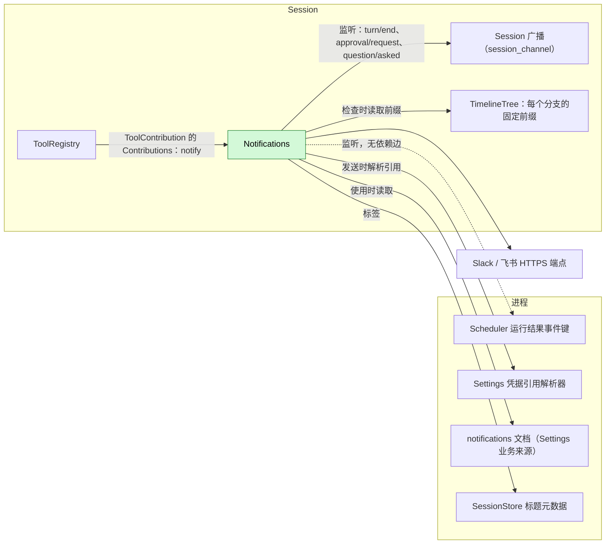
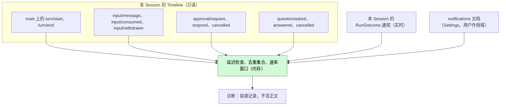
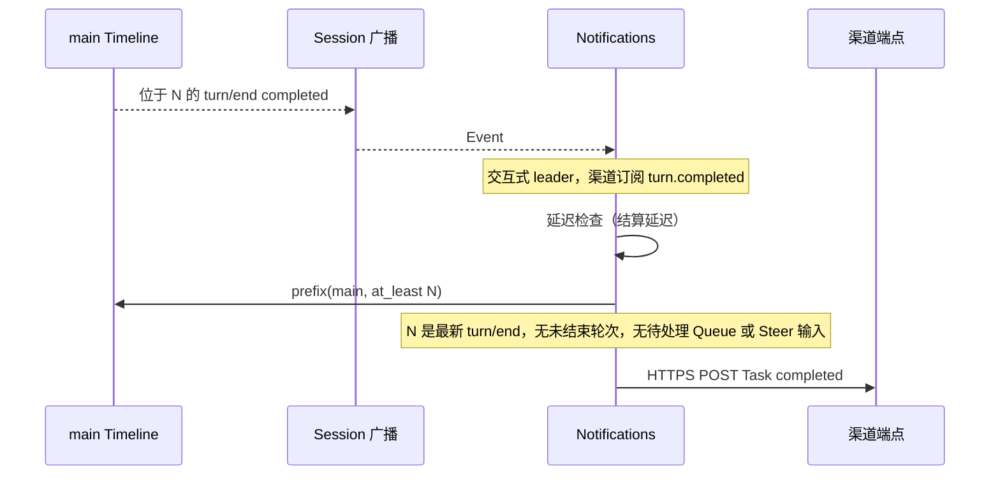
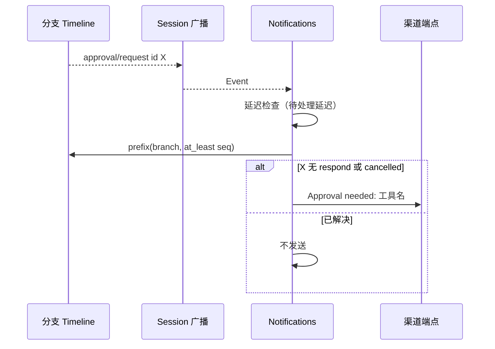
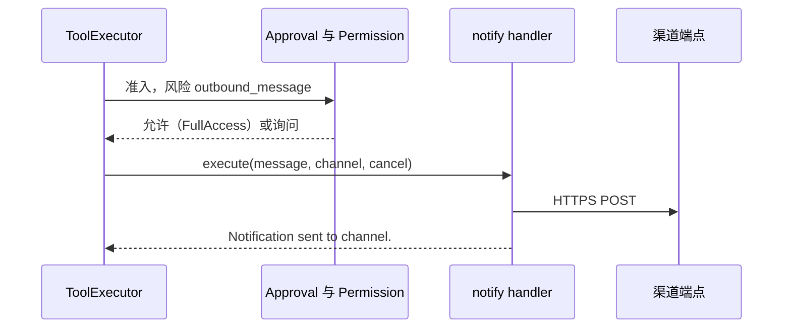
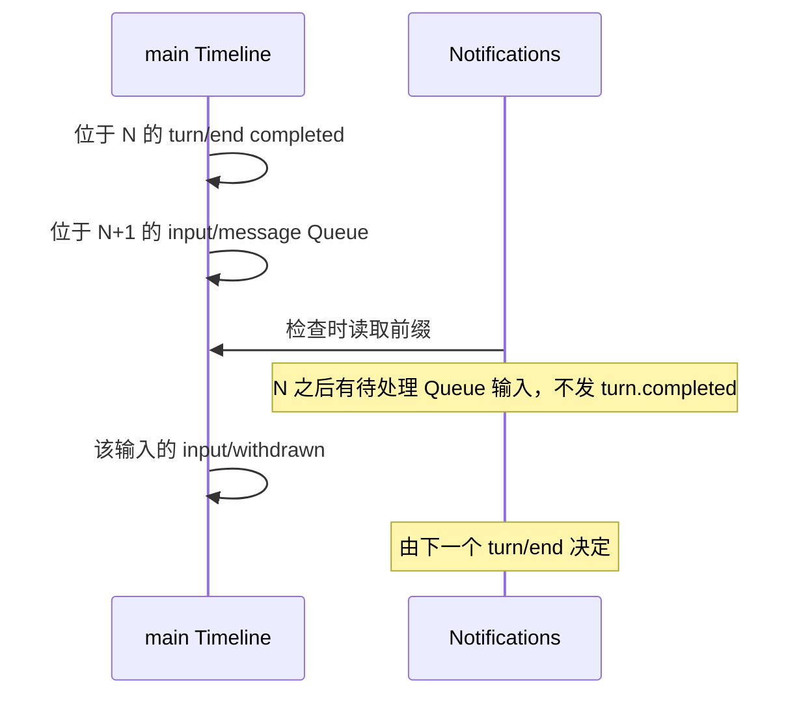

# Notifications

状态：草案。总体设计：[overview](../overview.md)（Notifications）。阶段：P2。语言：TypeScript 优先。作用域：[ADR 002](../../adr/002-plugin-scope.md)（Session）。

Notifications 是一个 Session 插件。当其交互式 leader Session 上的任务完成或失败、有审批待处理或有问题等待回答时，它向已配置的外部渠道（Slack、飞书）投递消息；它依据 Scheduler 的运行结果事件通知，报告在其 Session 中结束的定时运行；它还以 Session 级 `ToolContribution` 向模型提供 `notify` 工具。它只通过既有的 Session 广播观察其 Session，依据分支的固定前缀确认每个触发，并且不向任何 Timeline 写入。终端内提醒（响铃、聚焦）属于 CLI。

## 1. 结构



| 部件 | 作用域 | 依赖 | 提供 |
| --- | --- | --- | --- |
| `Notifications` | Session（仅启用时安装） | 所在 Session 的 Session 广播、TimelineTree、`SessionConfig`；进程服务 Settings 业务来源与凭据解析器、SessionStore 标题元数据；监听（不依赖）Scheduler 的 `scheduled_run_outcomes()` 事件键 | `ToolContribution` `notify`（风险 `outbound_message`）；触发名 `turn.completed`、`turn.failed`、`approval.pending`、`question.pending`、`schedule.ended`；业务文档 `notifications` |

运行结果以事件通知到达，而非依赖（[ADR 002 D2](../../adr/002-plugin-scope.md)）：没有 Scheduler 时，`schedule.ended` 触发处于惰性状态。Settings 或 SessionStore 的重载会重载 Notifications，并经 `notify` 重载 ToolRegistry 及其依赖方；这是可接受的（[D3](../../adr/002-plugin-scope.md)）。`notifications` 文档是业务配置（[D4](../../adr/002-plugin-scope.md)）：使用时读取，从不重载。

## 2. 数据与状态



Notifications 不拥有持久状态：每个触发都依据新读取的前缀检查。内存状态（延迟检查、在途投递、去重集合 `(branch, trigger, id)`、速率窗口）与 Session 插件同寿；新一代实例从空状态开始，事件从不重放，因此不会产生跨代重复。速率窗口按 Session 计（A10）。

## 3. 流程

### 3.1 任务完成



挂钟时间只用于推迟读取；决定依据事实与序号。已撤回的输入不算待处理。

### 3.2 审批待处理



`question.pending` 以 `question/asked` 与 `call_id` 同样工作；在没有 Questions 的 Session 中处于惰性状态。

### 3.3 定时运行结束

Scheduler 为每次结束的运行发出一个 `RunOutcome`。由该运行所属 Session（通知中的 `session_id`）的 Notifications 实例格式化并投递；其他 Session 的实例忽略它。无需读取前缀，且非交互排除不适用（A17）。

### 3.4 模型发送消息



模型只能在用户配置的渠道中选择，从不能指定 URL。

## 4. 时序与冲突



待处理的驱动性输入会抑制 `turn.completed`。在检查前撤回，则不再计入；在检查后撤回，则直到下一个 `turn/end` 之前不发生任何事（A15）。

| 场景 | 顺序 | 结果 | 负责方 |
| --- | --- | --- | --- |
| member、workflow 阶段、定时或 ACP Session | 非交互式 leader | 无事件触发的通知；`schedule.ended` 与 `notify` 仍可用 | Notifications |
| 审批在延迟结束前被回应或取消 | request < respond < check | 不发送 | Notifications |
| 发送后 `notify` 期间中断 | send < cancel | `Cancelled; delivery may have occurred.` | Notifications |
| `notify` 中途 Notifications 或某依赖重载 | — | 调用以 reloaded 结算；从不重发（D3） | ToolExecutor |

完整表格：[附录 B](#附录-b-完整冲突表)。

## 5. 上下文映射

事件触发的通知没有模型可见效果。

| 模型所见 | 形式与位置 |
| --- | --- |
| `notify` 声明 | 名称、描述 `Send a short message to one of the user's configured notification channels.`、`channel` 为字符串的 schema；列入 `SessionConfig.tools` 时位于已采纳的 `context/configured` 中 |
| `notify` 结果 | 位于其批次工具结果位置的 `ToolResult.content`；压缩后只通过摘要保留；子分支继承切出点之前的结果 |
| 非交互 Session | 相同的声明与结果 |
| 永不可见 | 渠道目标、凭据引用、投递记录、重试状态、诊断 |

## 6. 接口（摘要）

| 接口 | 类型 | 用途 |
| --- | --- | --- |
| `notify {message, channel?}` | `ToolContribution`，风险 `outbound_message` | 模型发起、发往已配置渠道的消息 |
| `scheduled_run_outcomes()` | 被监听的事件键（Scheduler 的契约；无依赖） | `schedule.ended` 触发 |
| `notifications` 文档 | 业务配置，Settings 用户作用域，使用时读取 | 渠道、触发、延迟 |

无方法。渠道通过经 `notify` 发送或真实触发来测试（A9）。

## 7. 安全

`notify` 按每次调用在 `outbound_message` 下准入：FullAccess 允许；其他预设询问。渠道只来自 Settings 的用户作用域，从不来自项目文件或插件（A8），因此仓库无法定义外泄目标。凭据是在发送时解析的引用，从不记录日志或返回。除非某渠道启用 `includeContent`，事件触发的消息不携带 Session 内容。每个实例只看到自身 Session 的事件。

## 附录 A. 接口细节

### A.1 配置（`notifications` 文档，仅用户作用域，A8）

```text
notifications.channels: [{
  name: string,                       // [a-z0-9-]{1,32}, unique
  kind: "slack" | "feishu",
  target: { slack: { webhookRef } | { botTokenRef, channelId } }
        | { feishu: { webhookRef, signingSecretRef? } },
  triggers: ("turn.completed" | "turn.failed" | "approval.pending" | "question.pending" | "schedule.ended")[],
  includeContent: bool,               // default false (A5)
  allowTool: bool,                    // default true; channel usable by `notify`
  enabled: bool                       // default true
}]
notifications.settleDelaySeconds: u32   // default 3, 0..=60 (A2)
notifications.pendingDelaySeconds: u32  // default 10, 0..=3600 (A2)
notifications.defaultChannel: string?   // used by `notify` without `channel`
```

`*Ref` 字段是凭据引用；webhook URL 视为凭据。只能经类型化的 Settings 操作变更；在那里校验；每次检查与发送时读取。

### A.2 工具 `notify`

| 项目 | 值 |
| --- | --- |
| 参数 | `{message: string (1..=4000), channel?: string}`；`channel` 指定一个满足 `allowTool && enabled` 的渠道（A6） |
| 结果 | `Notification sent to <channel>.`；错误：`Unknown channel <name>.`、`No notification channel is configured.`、`Delivery failed: <fixed reason>.`、`Rate limit reached for <channel>.`、`Cancelled; delivery may have occurred.` |
| 风险类别 | `outbound_message` |
| 要求 | `interactive: false`、`roles: None` |

工具发送的消息带前缀 `[dim <session label>] `（A7）。

### A.3 触发规则

| 事件 | 触发 | 规则（事件触发要求 `interactive && collaboration_role = leader`） |
| --- | --- | --- |
| `main` 上的 `turn/end` | `turn.completed` / `turn.failed` | `completed` / `failed`；`cancelled` 不触发（A3）。仅当 `N` 是最新的 `turn/end`、其后没有 `turn/start`，且不存在既无 `input/consumed` 也无 `input/withdrawn` 的 Queue/Steer `input/message` 时触发 |
| `approval/request`（任意分支） | `approval.pending` | 延迟结束后没有相同 `approval_id` 的 `approval/respond` 或 `approval/cancelled` |
| `question/asked`（任意分支） | `question.pending` | 延迟结束后没有相同 `call_id` 的 `question/answered` 或 `question/cancelled` |
| `session_id` = 本 Session 的 `RunOutcome` | `schedule.ended` | 每个此类通知（A17） |
| `step/text` | 内容 | 该轮次最后一次请求的可选摘录（`includeContent`） |

模板（仅发往渠道）：`[dim <label>] Task completed.`、`[dim <label>] Task failed.`、`[dim <label>] Approval needed: <tool name>.`、`[dim <label>] The agent is waiting for your answer.`、`[dim schedule <job name>] Run <state>.`。启用 `includeContent` 时：轮次触发追加最后一次请求的 `step/text`，至多 500 个字符；`approval.pending` 追加请求的 `reason`；`question.pending` 追加问题文本，至多 500 个字符（A5）。

### A.4 机制

| 步骤 | 路径 |
| --- | --- |
| 监听 | 在 `apply` 中：在 `session_channel(session_id)` 上监听 `turn/end`、`approval/request`、`question/asked`；在 `scheduled_run_outcomes()` 上监听并过滤为本 Session；两者都由 `ctx.effect` 移除 |
| 触发 | 对匹配、已启用且不在去重集合中的渠道触发：在 `ctx.effect` 下启动延迟检查 |
| 检查 | 延迟结束后读取该分支的固定前缀（`at_least` 事件序号）；分支已不存在 → 不做任何事 |
| 格式化 | 标签 = 可用时取元数据标题，否则取 Session id（A7） |
| 投递 | 发送时解析引用；HTTPS POST；网络错误、429、5xx 时以 1 s、4 s、16 s 重试；其他 4xx 不重试；每个 Session 每个渠道每分钟 20 条消息，超出部分丢弃并记录诊断（A10） |
| Timeline | 不写入，不注册 Dispatcher，无 `StateCell` |
| 重载 / Session 卸载 | 延迟检查与投递由 `ctx.effect` 取消；已发出的请求从不重发（[time bus](../../../architecture/rust-agent/time-bus.md)）；停机期间错过的事件不重放 |

## 附录 B. 完整冲突表

| 场景 | 序号顺序 | 结果 | 负责方 |
| --- | --- | --- | --- |
| 检查前出现延续或排队输入 | `turn/end` N < input | 不发 `turn.completed` | Notifications |
| 该输入在检查前被撤回 | input < `input/withdrawn` < check | 不算待处理；发送 | Notifications |
| 该输入在检查后被撤回 | check < `input/withdrawn` | N 不再发送；由下一个 `turn/end` 决定（A15） | Notifications |
| 检查之后的输入 | check < input | 已发送（接受） | Notifications |
| 轮次因中断结束 | `turn/end {cancelled}` | 不发送（A3） | Notifications |
| 轮次失败 | `turn/end {failed}` | 若仍是最新轮次则发 `turn.failed` | Notifications |
| 审批在延迟结束前被回应或取消 | request < respond/cancelled < check | 不发送 | Notifications |
| 发送后审批被回应 | check < respond | 保持已发送；无后续消息（A11） | — |
| 问题在延迟结束前被回答或取消 | asked < answered/cancelled | 不发送 | Notifications |
| 并发 Steer/Queue/Append | Timeline 顺序 | 未消费、未撤回的 Queue/Steer 抑制 `turn.completed`；Append 不抑制 | Notifications |
| 工具批次未结算 | 批次内的审批 | 通知待处理审批；`turn/end` 不可能先于批次结果 | Loop |
| 压缩 | — | 无影响：检查读取事实 | — |
| 子分支 | 子分支中的审批 | 通知；忽略子分支的 `turn/end`（A1） | Notifications |
| 定时运行在本 Session 中结束 | 终态记录 < 通知 | 一个 `schedule.ended` | Scheduler；Notifications |
| 无 Session 的运行（无 `session_id`）或运行 Session 未加载 | — | 不报告；`schedule.history` 仍是记录（A12） | — |
| Scheduler 重载或不存在 | 无依赖 | 通知停止；Notifications 不受影响 | — |
| 延迟期间分支关闭 | — | 不发送 | Notifications |
| 延迟期间 Session 卸载或关闭 | — | 检查随插件一起取消（A4） | Lifecycle |
| 发送前 `notify` 期间中断 | cancel < send | 不发请求；`Cancelled` | Notifications |
| 发送后 `notify` 期间中断 | send < cancel | `Cancelled; delivery may have occurred.` | Notifications |
| 投递中途 Notifications 或依赖重载 | — | 取消，从不重发；`notify` 以 reloaded 结算（D3） | ToolExecutor |
| 进程重启 | — | 已提交的 `notify` 调用结算且不重新执行 | ToolExecutor |
| 延迟期间配置变更 | — | 在检查时读取 | Notifications |
| 凭据引用无法解析 | — | 投递失败；诊断 | Notifications |
| 资源节点离线 | — | 无影响 | — |
| 客户端分离 | — | 无影响（A13） | — |

## 附录 C. 错误与恢复

| 情形 | 结果 |
| --- | --- |
| 配置无效 | 在写入边界被 Settings 拒绝；保留最后一份有效文档 |
| 重试后投递仍失败 | 诊断；`notify` 返回错误结果 |
| 取消（中断、重载、卸载） | 未完成的请求在工具返回前中止 |
| 进程退出 | 内存中的检查丢失；无持久队列（A12） |

## 附录 D. 验收

使用伪造 HTTP 端点与伪造模型进行流程测试：

1. 交互式 leader Session 完成的 `main` 轮次发送一个 `turn.completed`；检查前的 Queue 输入会抑制它；同一输入在检查前撤回则不抑制；cancelled 不发送；failed 发送 `turn.failed`。
2. member Session 与 `interactive: false` 的 Session 不发送事件触发的消息。
3. 延迟结束前已回应的审批不发送；未回应的发送一次；已取消的不发送。
4. 有回答与无回答的 `question/asked`；没有 Questions 时处于惰性状态。
5. 完成、失败或超时的定时运行只从其运行 Session 发送一个 `schedule.ended`；没有 Scheduler 时该触发处于惰性状态。
6. `notify`：未知渠道或无渠道时报错；发送并返回；FullAccess 允许 `outbound_message`，其他预设询问；投递前与投递中中断。
7. 5xx 时重试，400 时不重试，速率限制丢弃，凭据失败。
8. `includeContent: false` 的消息不含 Session 文本；诊断不含正文或 URL。

## 附录 E. 假设

| # | 假设 | 依据 | 若被否决的影响 |
| --- | --- | --- | --- |
| A1 | 轮次触发只在 `main` 上；审批与问题触发在任意分支上 | 判断 | 子分支工作会在每个子任务上发通知 |
| A2 | 结算延迟 3 s，待处理延迟 10 s | 判断 | 消息更早或更晚 |
| A3 | 被中断的轮次不发通知 | 判断 | 中断也发通知 |
| A4 | 待处理检查随 Session 插件结束（卸载或关闭） | ADR 002 D1 | 需要一个进程部件 |
| A5 | 除非 `includeContent`，否则不含 Session 内容；摘录 500 个字符 | 判断 | 始终或从不包含内容 |
| A6 | `notify` 参数 | 判断 | 不同的 schema |
| A7 | 标签 = 可用时取元数据标题，否则取 Session id | 判断 | 其他标签 |
| A8 | 渠道只能在用户作用域配置 | 判断 | 项目渠道需要宿主本地批准 |
| A9 | 无测试方法 | ADR 002（无进程部件） | 管理方法需要进程部件 |
| A10 | 重试 3 次（1/4/16 s）；每个 Session 每个渠道每分钟 20 条消息 | 判断 | 其他策略 |
| A11 | 通知后待处理项被解决时不发后续消息 | 判断 | 额外消息 |
| A12 | 尽力而为：无持久发件箱，重启后不恢复 | 判断 | 需要进程存储的发件箱 |
| A13 | 无论是否有客户端附着都发送 | 判断 | 需要附着契约 |
| A14 | Slack 经 webhook 或 bot token + channel id；飞书经自定义机器人 webhook，可选签名 | 功能清单；具体方式属判断 | 其他适配器 |
| A15 | 被抑制的 `turn.completed` 在之后撤回时不重新评估 | 判断 | 撤回需要自己的触发 |
| A17 | `schedule.ended` 由运行 Session 的实例依据 `RunOutcome.session_id` 投递，只含作业名与状态 | Scheduler 通知携带 `session_id`；判断 | 由一个进程部件为所有运行统一监听 |

## 附录 F. 待对齐问题

| 问题 | 说明 |
| --- | --- |
| 入站操作 | 从 Slack/飞书回应审批或回答问题不在范围内 |
| 无 Session 的运行 | 在启动 Session 之前失败的运行不会被报告（A12） |
